# Page: Overview

# Overview

<details>
<summary>Relevant source files</summary>

The following files were used as context for generating this wiki page:

- [README.md](README.md)
- [WEIGHTS_PROHIBITED_USE_POLICY.md](WEIGHTS_PROHIBITED_USE_POLICY.md)
- [docs/installation.md](docs/installation.md)
- [legal/WEIGHTS_TERMS_OF_USE-Bahasa-Indonesia.md](legal/WEIGHTS_TERMS_OF_USE-Bahasa-Indonesia.md)
- [legal/WEIGHTS_TERMS_OF_USE-Espanol-Latinoamerica.md](legal/WEIGHTS_TERMS_OF_USE-Espanol-Latinoamerica.md)
- [legal/WEIGHTS_TERMS_OF_USE-Francais-Canada.md](legal/WEIGHTS_TERMS_OF_USE-Francais-Canada.md)
- [legal/WEIGHTS_TERMS_OF_USE-Portugues-Brazil.md](legal/WEIGHTS_TERMS_OF_USE-Portugues-Brazil.md)
- [run_alphafold.py](run_alphafold.py)
- [run_alphafold_test.py](run_alphafold_test.py)

</details>


AlphaFold 3 is a state-of-the-art structure prediction system developed by Google DeepMind and Isomorphic Labs. It is capable of modeling a vast range of biomolecular systems, including proteins, nucleic acids (RNA/DNA), small molecules (ligands), and their complex interactions. The system integrates evolutionary information, chemical knowledge via the Chemical Component Dictionary (CCD), and a generative diffusion-based model to produce high-accuracy 3D coordinates and associated confidence metrics.

Sources: [README.md:3-24](), [run_alphafold.py:11-20]()

## Licensing and Usage Policies

The AlphaFold 3 system separates licensing between its source code and its model parameters:

*   **Source Code**: Licensed under the **Apache License, Version 2.0**. [run_alphafold.py:3-13]()
*   **Model Parameters**: Access to weights must be requested directly from Google. Use is strictly limited to non-commercial research by non-commercial organizations (e.g., universities, non-profits, and research institutes). [README.md:6-9](), [WEIGHTS_PROHIBITED_USE_POLICY.md:11-23]()
*   **Prohibited Uses**: Users must not use AlphaFold 3 outputs to train or create machine learning models for biomolecular structure prediction ("Derived Models"). Sharing parameters with commercial organizations is strictly prohibited. [WEIGHTS_PROHIBITED_USE_POLICY.md:80-84](), [WEIGHTS_PROHIBITED_USE_POLICY.md:30-32]()
*   **Citation**: Any publication disclosing findings arising from using this source code, model parameters, or outputs must cite the AlphaFold 3 Nature paper. [README.md:11-15](), [WEIGHTS_PROHIBITED_USE_POLICY.md:113-116]()

Sources: [run_alphafold.py:3-13](), [README.md:6-15](), [WEIGHTS_PROHIBITED_USE_POLICY.md:11-116]()

## System Architecture

AlphaFold 3 is structured as a two-stage pipeline: a **Data Pipeline** for biological search and a **Model Inference** stage for 3D structure generation. The architecture bridges natural language and JSON specifications into high-dimensional tensor representations using JAX and Haiku components.

### Pipeline Design and Code Entities

The diagram below maps the logical prediction stages from natural language concepts to their concrete Python module and class implementations in the codebase.

```mermaid
flowchart TD
    subgraph "Natural Language & Input Space"
        InputJSON[""Input JSON Spec"""] --> FoldingInput[""folding_input.Input"""]
    end

    subgraph "Code Entity Space: Stage 1 (CPU)"
        FoldingInput --> PipelineRun[""pipeline.DataPipeline.run"""]
        PipelineRun --> MSA[""Jackhmmer & Nhmmer Wrappers"""]
        PipelineRun --> Templates[""HMMsearch Template Search"""]
    end

    subgraph "Code Entity Space: Stage 2 (GPU)"
        PipelineRun --> Featurize[""featurisation.featurise_input"""]
        Featurize --> ModelRunner[""model.Model.predict"""]
        ModelRunner --> Diffusion[""diffusion Head Modules"""]
    end

    subgraph "Output Space"
        ModelRunner --> PostProc[""post_processing.process_inference_result"""]
        PostProc --> OutputFiles[""mmCIF & Confidence JSONs"""]
    end
```
Sources: [run_alphafold.py:48-59](), [run_alphafold.py:102-138]()

## Two-Stage Pipeline Flow

System execution is orchestrated by `run_alphafold.py`, managing the transition from sequences to 3D structures via configurable flags (`--run_data_pipeline` and `--run_inference`) [run_alphafold.py:102-111]().

### 1. Data Pipeline
This CPU-bound stage searches large genetic and structural databases to generate Multiple Sequence Alignments (MSAs) and structural templates [README.md:95-97]().
*   **MSA Generation**: Uses `Jackhmmer` for proteins and `Nhmmer` for RNA [run_alphafold.py:114-123]().
*   **Template Search**: Uses `HMMsearch` to find structural analogs in PDB [run_alphafold.py:129-133]().
*   **Database Management**: Queries databases like BFD, MGnify, UniProt, and RNAcentral [run_alphafold.py:147-210]().

### 2. Model Inference
This GPU-bound stage executes heavy tensor computations using JAX and Haiku [README.md:98-99](), [run_alphafold.py:61-63]().
*   **Featurization**: Converts biological inputs and pipeline results into numerical features via `featurisation.featurise_input` [run_alphafold.py:52]().
*   **Model Execution**: The `model.Model` class loads parameters (`params.py`) and executes neural network components [README.md:32-34](), [run_alphafold.py:56-57]().
*   **Diffusion Sampling**: Generates final 3D coordinates through iterative denoising [run_alphafold.py:55-59]().

### Data Flow: From JSON to Tensors

The diagram below bridges high-level biological input data models to low-level tensor representations across internal modules.

```mermaid
flowchart LR
    subgraph "Input Domain Entities"
        direction TB
        PC[""ProteinChain"""]
        RC[""RnaChain"""]
        L[""Ligand"""]
    end

    subgraph "Processing Modules"
        direction TB
        PI[""pipeline.DataPipeline""]
        FE[""featurisation.featurise_input""]
        CPP[""alphafold3.cpp C++ Extensions""]
    end

    subgraph "JAX Tensor Space"
        direction TB
        AL[""AtomLayout Tensors""]
        MF[""MSA Features""]
        TF[""TokenFeatures""]
    end

    PC & RC & L --> PI
    PI --> FE
    CPP -- "Structure Parsing" --> FE
    FE --> AL & MF & TF
```
Sources: [run_alphafold.py:48-64](), [run_alphafold.py:114-138]()

## System Design and Performance

The codebase relies on a modern Python stack optimized for high-performance computing:

| Component | Technology | Role | Source Citation |
| :--- | :--- | :--- | :--- |
| **Numerical Engine** | JAX | Automatic differentiation and GPU acceleration | [run_alphafold.py:62-63]() |
| **Neural Network** | Haiku | Functional neural network layers and modules | [run_alphafold.py:61]() |
| **C++ Extensions** | `alphafold3.cpp` | High-speed mmCIF parsing and structure manipulation | [run_alphafold.py:51]() |
| **Input Parsing** | tokamax | Tokenization and sequence processing utilities | [run_alphafold.py:65]() |

### Performance Optimizations
*   **XLA Compilation**: Uses JAX's Just-In-Time (JIT) compilation for inference acceleration [run_alphafold.py:62-63]().
*   **Staged Execution**: Separation of CPU-heavy search tasks from GPU-heavy inference steps [README.md:95-99]().

Sources: [run_alphafold.py:51-65](), [README.md:95-99]()

## Technical Documentation Roadmap

*   **[Installation Guide](2)**: System requirements, database setup, and Docker configuration [docs/installation.md:1-37]().
*   **[User Guide](3)**: Preparing JSON inputs and interpreting output files [README.md:101-107]().
*   **[Core Pipeline](4)**: Detailed explanation of input processing, data pipeline, and inference architecture.
*   **[Data Structures](5)**: Technical reference for internal representations of chains, structures, and tensors.
*   **[Performance Optimization](8)**: Strategies for hardware utilization, memory, and compilation.

Sources: [README.md:36-112](), [docs/installation.md:1-37]()

---

# Page: Installation Guide

# Installation Guide

<details>
<summary>Relevant source files</summary>

The following files were used as context for generating this wiki page:

- [README.md](README.md)
- [docker/Dockerfile](docker/Dockerfile)
- [docker/easel_fast_fasta_parsing.patch](docker/easel_fast_fasta_parsing.patch)
- [docker/jackhmmer_parallel_fasta.patch](docker/jackhmmer_parallel_fasta.patch)
- [docs/installation.md](docs/installation.md)

</details>


This guide provides a high-level overview of the installation and setup process for AlphaFold 3. It covers system requirements, environment configuration, and initial setup steps. For deep technical details, refer to the child pages linked throughout this section.

## System Requirements

AlphaFold 3 is designed for high-performance structural biology tasks and has specific hardware and software prerequisites.

*   **Operating System**: Linux is the only supported operating system [docs/installation.md:3-4]().
*   **GPU**: NVIDIA GPU with Compute Capability 8.0 or greater (e.g., A100 or H100 80 GB). Numerical accuracy has been verified on these specific architectures [docs/installation.md:5-9]().
*   **Memory**: At least 64 GB of RAM is recommended due to the memory-intensive genetic search stage [docs/installation.md:11-12]().
*   **Storage**: Up to 1 TB of disk space for genetic databases; SSD storage is highly recommended for performance [docs/installation.md:4-5]().
*   **Software**: Python 3.12 or higher is required [pyproject.toml:14]().

Sources: [docs/installation.md:1-12](), [pyproject.toml:11-14]()

## Installation Workflow

The setup process involves preparing the host environment, acquiring data, and building the execution container.

### High-Level Setup Diagram
This diagram maps the high-level installation steps to the scripts and configurations found in the codebase.

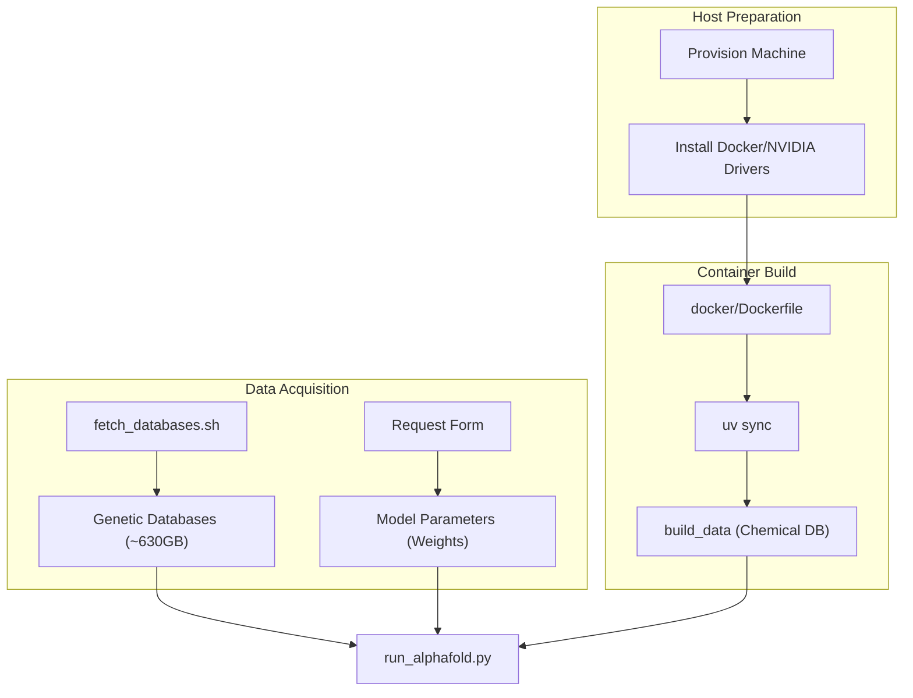

Sources: [docs/installation.md:23-31](), [docker/Dockerfile:71-75](), [fetch_databases.sh:1-49](), [docker/Dockerfile:88]()

## Component Overview

### 1. Database Setup
AlphaFold 3 relies on large genetic and structural databases. The `fetch_databases.sh` script automates downloading and extraction using `zstd` [fetch_databases.sh:26-45](). High-speed storage configuration is critical for performance during the genetic search phase.

For details, see [Database Setup](#2.1).

### 2. Container Configuration
The system is primarily distributed via Docker to ensure reproducible builds of complex dependencies like HMMER 3.4 (with custom sequence limit patches) and RDKit [docker/Dockerfile:11-58](). The container leverages `uv` for fast Python dependency resolution and virtual environment creation [docker/Dockerfile:25-31]().

For details, see [Container Setup](#2.2).

### 3. Build System and Dependencies
The project uses `scikit-build-core` as the build backend [pyproject.toml:9]() and `uv` for package management [docker/Dockerfile:71-72](). Key numerical and neural network dependencies include `jax` and `dm-haiku` [pyproject.toml:17-27]().

```mermaid
classDiagram
    class "Build Backend" {
        scikit_build_core
        pybind11
        cmake
    }
    class "Python Dependencies" {
        jax==0.9.1
        dm-haiku==0.0.16
        rdkit==2025.9.4
        tokamax==0.0.11
    }
    class "Native Tools" {
        HMMER 3.4
        jackhmmer_seq_limit_patch
        zstd
    }
    "Build Backend" ..> "Python Dependencies" : manages via uv
    "Build Backend" ..> "Native Tools" : compiles via docker/Dockerfile
```

Sources: [pyproject.toml:1-27](), [docker/Dockerfile:13-58](), [uv.lock:35-47]()

## Initial Execution Environment

The entry point for inference is `run_alphafold.py` [docker/Dockerfile:88](). Before execution, the system builds the chemical components database via the `build_data` script [pyproject.toml:64](), [docker/Dockerfile:75]().

To maintain numerical stability and performance under XLA, specific environment flags are configured:
*   `XLA_FLAGS="--xla_gpu_enable_triton_gemm=false"` [docker/Dockerfile:83]()
*   `XLA_PYTHON_CLIENT_PREALLOCATE=true` [docker/Dockerfile:85]()
*   `XLA_CLIENT_MEM_FRACTION=0.95` [docker/Dockerfile:86]()

For a complete guide on running your first prediction, see the **[User Guide](#3)**.

## Troubleshooting and Known Issues
Common setup issues involve rootless Docker permissions, NVIDIA driver mismatches, and GPU-specific XLA compilation constraints on older architectures [docs/installation.md:107-150](), [docker/Dockerfile:77-81]().

For details, see [Known Issues](#2.3).

Sources: [docs/installation.md:23-31](), [docker/Dockerfile:77-86](), [src/alphafold3/version.py:13]()

---

# Page: Database Setup

# Database Setup

<details>
<summary>Relevant source files</summary>

The following files were used as context for generating this wiki page:

- [README.md](README.md)
- [docs/installation.md](docs/installation.md)
- [fetch_databases.sh](fetch_databases.sh)
- [src/alphafold3/scripts/copy_to_ssd.sh](src/alphafold3/scripts/copy_to_ssd.sh)
- [src/alphafold3/scripts/gcp_mount_ssd.sh](src/alphafold3/scripts/gcp_mount_ssd.sh)
- [src/alphafold3/scripts/shard_databases.sh](src/alphafold3/scripts/shard_databases.sh)

</details>


## Purpose and Scope

This document provides detailed instructions for downloading, organizing, and optimizing the genetic databases required by AlphaFold 3. It covers the use of the `fetch_databases.sh` script, database directory structure, SSD optimization strategies using `gcp_mount_ssd.sh` and `copy_to_ssd.sh`, and parallel sharding via `shard_databases.sh` for improved search performance.

For instructions on building the Docker container that will use these databases, see [Container Setup](2.2). For information on running AlphaFold 3 with these databases, see [Running AlphaFold 3](3.2).

## Prerequisites

Before downloading databases, ensure the following tools are installed on your system:

| Tool | Purpose | Installation (Debian-based) |
|------|---------|---------------------------|
| `wget` | Database download | `sudo apt install wget` |
| `zstd` | Database decompression | `sudo apt install zstd` |
| `tar` | Archive extraction | Usually pre-installed |

**Disk Space Requirements:**
- Download size: ~252 GB
- Uncompressed size: ~630 GB
- Recommended: 1 TB total storage with SSD for optimal performance [docs/installation.md:4-5]()

**Sources:** [docs/installation.md:4-5](), [fetch_databases.sh:16-30]()

## Required Genetic Databases

AlphaFold 3 requires multiple genetic databases for protein and RNA Multiple Sequence Alignment (MSA) generation and template search. The following table describes each database:

| Database | Type | Purpose | Size (Uncompressed) |
|----------|------|---------|---------------------|
| BFD (small) | Protein sequences | MSA generation for proteins | ~272 GB |
| UniRef90 | Protein sequences | MSA generation for proteins | ~59 GB |
| MGnify | Metagenomic clusters | MSA generation for proteins | ~120 GB |
| UniProt | Protein sequences | Reference protein sequences | ~99 GB |
| PDB seqres | Protein sequences | Template search sequences | ~0.2 GB |
| PDB mmCIF | Protein structures | Template structures (~200k files) | ~78 GB |
| RNACentral | RNA sequences | MSA generation for RNA | ~0.5 GB |
| NT | Nucleotide sequences | MSA generation for RNA/DNA | ~1.5 GB |
| RFam | RNA families | MSA generation for RNA | ~0.05 GB |

**Sources:** [fetch_databases.sh:35-58](), [src/alphafold3/scripts/copy_to_ssd.sh:28-35]()

### Data Flow Overview

The following diagram illustrates how external databases are utilized by the AlphaFold 3 pipeline.

```mermaid
graph TB
    subgraph ProteinDatabases["Protein Sequence Databases"]
        BFD["bfd-first_non_consensus_sequences.fasta<br/>272 GB"]
        UniRef90["uniref90_2022_05.fa<br/>59 GB"]
        MGnify["mgy_clusters_2022_05.fa<br/>120 GB"]
        UniProt["uniprot_all_2021_04.fa<br/>99 GB"]
        PDBSeqres["pdb_seqres_2022_09_28.fasta<br/>0.2 GB"]
    end
    
    subgraph RNADatabases["RNA/DNA Sequence Databases"]
        RNACentral["rnacentral_active_seq_id_90_cov_80_linclust.fasta<br/>0.5 GB"]
        NT["nt_rna_2023_02_23_clust_seq_id_90_cov_80_rep_seq.fasta<br/>1.5 GB"]
        RFam["rfam_14_9_clust_seq_id_90_cov_80_rep_seq.fasta<br/>0.05 GB"]
    end
    
    subgraph StructureDatabases["Structure Databases"]
        PDBMMCIF["pdb_2022_09_28_mmcif_files.tar<br/>~200k PDB structures<br/>78 GB"]
    end
    
    DataPipeline["Data Pipeline<br/>MSA & Template Search"]
    
    BFD --> DataPipeline
    UniRef90 --> DataPipeline
    MGnify --> DataPipeline
    UniProt --> DataPipeline
    PDBSeqres --> DataPipeline
    RNACentral --> DataPipeline
    NT --> DataPipeline
    RFam --> DataPipeline
    PDBMMCIF --> DataPipeline
```

**Sources:** [fetch_databases.sh:35-58](), [src/alphafold3/scripts/copy_to_ssd.sh:28-35]()

## Database Download with fetch_databases.sh

### Basic Usage

The `fetch_databases.sh` script downloads all required databases from a Google Cloud Storage mirror. All database versions match those used in the AlphaFold 3 paper.

```bash
cd alphafold3  # Navigate to AlphaFold 3 repository
./fetch_databases.sh [<DB_DIR>]
```

**Default directory:** `$HOME/public_databases` (if `<DB_DIR>` is not specified) [fetch_databases.sh:23]()

**Important:** The download directory should NOT be a subdirectory of the AlphaFold 3 repository. This prevents slow Docker builds caused by copying large databases during image creation.

**Sources:** [fetch_databases.sh:21-24]()

### Script Implementation Details

The `fetch_databases.sh` script performs parallel downloads and decompression using background tasks.

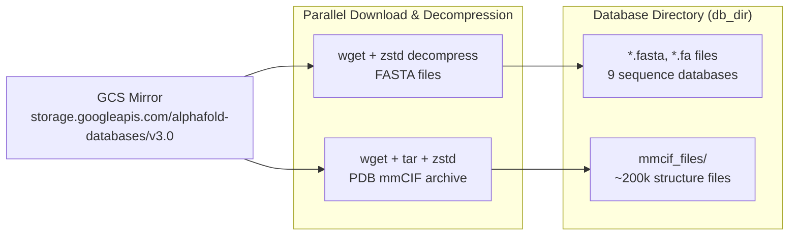

**Key implementation details:**
- Uses `wget --quiet --output-document=-` to stream downloads [fetch_databases.sh:40-41]()
- Pipes directly to `zstd --decompress` or `tar` for decompression [fetch_databases.sh:41-43, 55-56]()
- Background processes (`&`) enable parallel downloads [fetch_databases.sh:43, 57]()
- `wait -n` command ensures background tasks complete safely [fetch_databases.sh:60-62]()

**Sources:** [fetch_databases.sh:35-63]()

## Database Directory Structure

After successful download, the database directory should contain:

```
<DB_DIR>/
├── mmcif_files/                                                    # ~200k files
├── bfd-first_non_consensus_sequences.fasta                        # 272 GB
├── mgy_clusters_2022_05.fa                                        # 120 GB
├── nt_rna_2023_02_23_clust_seq_id_90_cov_80_rep_seq.fasta       # 1.5 GB
├── pdb_seqres_2022_09_28.fasta                                    # 0.2 GB
├── rfam_14_9_clust_seq_id_90_cov_80_rep_seq.fasta               # 0.05 GB
├── rnacentral_active_seq_id_90_cov_80_linclust.fasta            # 0.5 GB
├── uniprot_all_2021_04.fa                                         # 99 GB
└── uniref90_2022_05.fa                                            # 59 GB
```

**Sources:** [fetch_databases.sh:35-58](), [src/alphafold3/scripts/copy_to_ssd.sh:28-35]()

## SSD Optimization for Performance

Database I/O is a significant bottleneck during MSA generation and template search. Storing databases on SSDs dramatically improves performance. AlphaFold 3 provides scripts to automate the mounting of local SSDs and the migration of database files.

### GCP SSD Setup (gcp_mount_ssd.sh)

For Google Cloud Platform deployments, the `gcp_mount_ssd.sh` script mounts and formats local NVMe SSDs, creating a RAID-0 array if multiple NVMe disks are attached.

```bash
src/alphafold3/scripts/gcp_mount_ssd.sh [<SSD_MOUNT_PATH>]
```

**Default mount path:** `/mnt/disks/ssd` [src/alphafold3/scripts/gcp_mount_ssd.sh:23]()

**Script behavior:**
1. Searches for Google Cloud local SSD devices in `/dev/disk/by-id/` [src/alphafold3/scripts/gcp_mount_ssd.sh:31]()
2. Assembles multiple NVMe disks into a RAID-0 array via `mdadm` if multiple devices exist, or configures single disks [src/alphafold3/scripts/gcp_mount_ssd.sh:34-48, 60-66]()
3. Formats with `ext4` if unformatted [src/alphafold3/scripts/gcp_mount_ssd.sh:44-48, 63-66]()
4. Mounts the device to the target directory and sets permissions [src/alphafold3/scripts/gcp_mount_ssd.sh:54-57, 76-79]()

**Sources:** [src/alphafold3/scripts/gcp_mount_ssd.sh:21-82]()

### Copying Databases to SSD (copy_to_ssd.sh)

The `copy_to_ssd.sh` script intelligently copies as many databases as will fit on the SSD, prioritizing files based on the list order.

```bash
src/alphafold3/scripts/copy_to_ssd.sh [<SOURCE_DIR>] [<TARGET_DIR>]
```

**Default source:** `$HOME/public_databases` [src/alphafold3/scripts/copy_to_ssd.sh:23]()
**Default target:** `/mnt/disks/ssd/public_databases` [src/alphafold3/scripts/copy_to_ssd.sh:24]()

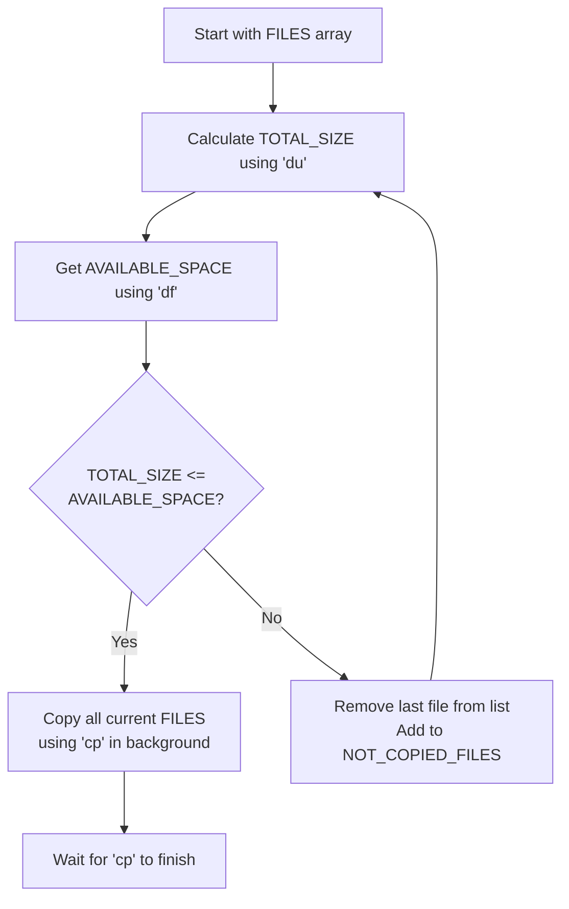

**Priority order for migration:**
1. `pdb_seqres_2022_09_28.fasta`
2. `uniprot_all_2021_04.fa`
3. `mgy_clusters_2022_05.fa`
4. `uniref90_2022_05.fa`
5. `bfd-first_non_consensus_sequences.fasta`
6. `rfam_14_9_clust_seq_id_90_cov_80_rep_seq.fasta`
7. `nt_rna_2023_02_23_clust_seq_id_90_cov_80_rep_seq.fasta`
8. `rnacentral_active_seq_id_90_cov_80_linclust.fasta`

The script uses `du -sbc` to calculate sizes [src/alphafold3/scripts/copy_to_ssd.sh:42]() and `df --portability` to check available space [src/alphafold3/scripts/copy_to_ssd.sh:45](). Files are copied in parallel using background processes [src/alphafold3/scripts/copy_to_ssd.sh:52-54]().

**Sources:** [src/alphafold3/scripts/copy_to_ssd.sh:21-65]()

### Parallel Database Sharding (shard_databases.sh)

To accelerate sequence searching across large multi-core machines, the `shard_databases.sh` script splits genetic databases into numbered shards using SeqKit round-robin splitting (`seqkit split2`) [src/alphafold3/scripts/shard_databases.sh:21-53]().

```bash
src/alphafold3/scripts/shard_databases.sh [<DB_SOURCE_DIR>] [<SHARDED_DIR>] [<TMP_DIR>]
```

- **BFD:** 60 shards [src/alphafold3/scripts/shard_databases.sh:76]()
- **UniRef90:** 144 shards [src/alphafold3/scripts/shard_databases.sh:77]()
- **UniProt:** 204 shards [src/alphafold3/scripts/shard_databases.sh:78]()
- **MGnify:** 564 shards [src/alphafold3/scripts/shard_databases.sh:79]()
- **RFam:** 16 shards [src/alphafold3/scripts/shard_databases.sh:80]()
- **RNACentral:** 64 shards [src/alphafold3/scripts/shard_databases.sh:81]()
- **NT RNA:** 384 shards [src/alphafold3/scripts/shard_databases.sh:82]()

**Sources:** [src/alphafold3/scripts/shard_databases.sh:21-86]()

## Integration with Runtime

When running AlphaFold 3 via Docker, the database directory must be mounted as a volume. If databases are split across multiple storage locations (e.g., some on SSD, some on HDD), multiple `--db_dir` flags can be used to provide fallback paths.

**Example configuration:**
```bash
docker run -it \
    --volume /mnt/disks/ssd/public_databases:/root/public_databases \
    --volume $HOME/public_databases:/root/public_databases_fallback \
    alphafold3 \
    python run_alphafold.py \
    --db_dir=/root/public_databases \
    --db_dir=/root/public_databases_fallback
```

**Sources:** [docs/installation.md:78-89]()

---

# Page: Container Setup

# Container Setup

<details>
<summary>Relevant source files</summary>

The following files were used as context for generating this wiki page:

- [docker/Dockerfile](docker/Dockerfile)
- [docker/easel_fast_fasta_parsing.patch](docker/easel_fast_fasta_parsing.patch)
- [docker/jackhmmer_parallel_fasta.patch](docker/jackhmmer_parallel_fasta.patch)
- [docker/jackhmmer_seq_limit.patch](docker/jackhmmer_seq_limit.patch)
- [src/alphafold3/data/tools/subprocess_utils.py](src/alphafold3/data/tools/subprocess_utils.py)

</details>


## Purpose and Scope

This document provides detailed instructions for building and configuring Docker and Singularity containers for AlphaFold 3. Containers ensure a reproducible environment by bundling the specific versions of Python 3.12, CUDA 12.6, and the patched HMMER suite required for accurate predictions. The setup utilizes `uv` for dependency management and `scikit-build-core` for compiling C++ extensions like `mmcif_utils`.

Sources: [docker/Dockerfile:1-100]()

## Container Architecture and Data Flow

The AlphaFold 3 container acts as a compute engine that requires external data (databases and model weights) to be mounted from the host system. It encapsulates the execution of `run_alphafold.py` within a specialized virtual environment managed by `uv`.

### System Interaction Diagram
The following diagram maps the high-level system components to the specific code entities and environment variables defined in the `Dockerfile`.

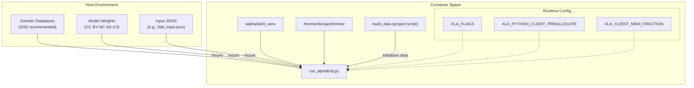
Sources: [docker/Dockerfile:20-100]()

## Docker Setup

### Dockerfile Implementation Details
The Docker image is based on `nvidia/cuda:12.6.3-base-ubuntu24.04` [docker/Dockerfile:20-20](). It uses the `uv` package manager (pinned to version `0.13.1`) for fast, reproducible dependency resolution [docker/Dockerfile:32-34]().

Key build stages:
1.  **System Dependencies**: Installs `python3.12`, `python3.12-dev`, `git`, `wget`, `gcc`, `g++`, `make`, `zlib1g-dev`, and `zstd` [docker/Dockerfile:27-30](). `git` is specifically required for the `pyproject.toml` toolchain's interaction with `CMakeLists.txt` [docker/Dockerfile:24-24]().
2.  **HMMER Compilation**: Downloads HMMER 3.4 from `eddylab.org`, verifies its SHA-256 checksum (`ca70d94fd0cf271bd7063423aabb116d42de533117343a9b27a65c17ff06fbf3`), applies performance and feature patches, and compiles from source to `/hmmer` [docker/Dockerfile:52-69]().
3.  **Python Environment**: Creates a virtual environment at `/alphafold3_venv` via `uv venv` [docker/Dockerfile:38-40](). It syncs dependencies using `uv sync --frozen --all-groups --no-editable` [docker/Dockerfile:83-84]().
4.  **Data Preparation**: Executes the `build_data` script via `uv run build_data` to initialize the chemical components database [docker/Dockerfile:86-87]().

### HMMER Patches
AlphaFold 3 applies three critical patches to the HMMER 3.4 and EASEL source code during container build:
- `jackhmmer_seq_limit.patch`: Adds the `--seq_limit` argument to truncate hits after a specified threshold [docker/jackhmmer_seq_limit.patch:1-32]().
- `easel_fast_fasta_parsing.patch`: Optimizes FASTA parsing speed within EASEL [docker/easel_fast_fasta_parsing.patch:1-162]().
- `jackhmmer_parallel_fasta.patch`: Enables multi-threaded FASTA processing in `jackhmmer` [docker/jackhmmer_parallel_fasta.patch:1-196]().

| Code Entity | File | Description |
| :--- | :--- | :--- |
| `jackhmmer_seq_limit.patch` | [docker/jackhmmer_seq_limit.patch:1-32]() | Modifies `src/jackhmmer.c` to add `--seq_limit` logic [docker/jackhmmer_seq_limit.patch:7-28](). |
| `easel_fast_fasta_parsing.patch` | [docker/easel_fast_fasta_parsing.patch:1-162]() | Speeds up buffer parsing in `esl_sqio_ascii.c` [docker/easel_fast_fasta_parsing.patch:52-100](). |
| `jackhmmer_parallel_fasta.patch` | [docker/jackhmmer_parallel_fasta.patch:1-196]() | Implements chunk-based parallel FASTA reading for threads [docker/jackhmmer_parallel_fasta.patch:48-103](). |
| `jackhmmer_seq_limit_supported` | [src/alphafold3/data/tools/subprocess_utils.py:53-64]() | Validation function checking for the patch's existence via a help-flag check. |

Sources: [docker/Dockerfile:20-88](), [docker/jackhmmer_seq_limit.patch:1-32](), [docker/easel_fast_fasta_parsing.patch:1-162](), [docker/jackhmmer_parallel_fasta.patch:1-196](), [src/alphafold3/data/tools/subprocess_utils.py:53-64]()

## GPU Configuration

The container is optimized for NVIDIA Ampere (A100) and Hopper (H100) architectures. Specific environment variables are set in the `Dockerfile` to manage XLA compilation and JAX memory allocation.

### Default Runtime Environment
| Variable | Value | Purpose |
| :--- | :--- | :--- |
| `XLA_FLAGS` | `--xla_gpu_enable_triton_gemm=false` | Disables Triton GEMM to avoid a known XLA compilation hang [docker/Dockerfile:95-95](). |
| `XLA_PYTHON_CLIENT_PREALLOCATE` | `true` | Enables JAX memory preallocation for performance [docker/Dockerfile:97-97](). |
| `XLA_CLIENT_MEM_FRACTION` | `0.95` | Allocates 95% of VRAM to the AlphaFold process, sufficient for 5,120 tokens on A100 80GB [docker/Dockerfile:98-98](). |

### Support for Older GPUs (CUDA Capability 7.x)
For NVIDIA V100 or other Capability 7.x GPUs, the `XLA_FLAGS` must be overridden because Triton GEMM is not supported, and custom kernel fusion can cause issues:
`ENV XLA_FLAGS="--xla_disable_hlo_passes=custom-kernel-fusion-rewriter"` [docker/Dockerfile:91-94]().

Sources: [docker/Dockerfile:89-100]()

## Singularity for HPC Environments

In high-performance computing (HPC) environments where root access for Docker is unavailable, AlphaFold 3 can be run via Singularity (Apptainer).

### Dependency Resolution in HPC
Because environment dependencies are locked via `uv`, Singularity images should ideally be built on the target architecture (x86_64 or aarch64) to ensure binary compatibility.

### Building from Docker
To convert the Docker image to a Singularity Image File (`.sif`), use a local registry or direct docker-daemon transport:

1.  **Tag and Push**:
    ```bash
    docker tag alphafold3 localhost:5000/alphafold3
    docker push localhost:5000/alphafold3
    ```
2.  **Build SIF**:
    ```bash
    SINGULARITY_NOHTTPS=1 singularity build alphafold3.sif docker://localhost:5000/alphafold3:latest
    ```

### Execution with Singularity
When running with Singularity, the `--nv` flag is required for GPU passthrough. Note that the `UV_PROJECT_ENVIRONMENT` path must be accessible within the container.

```bash
singularity exec \
    --nv \
    --bind /path/to/databases:/root/public_databases \
    --bind /path/to/weights:/root/models \
    --bind $PWD/input:/root/af_input \
    --bind $PWD/output:/root/af_output \
    alphafold3.sif \
    python3 run_alphafold.py \
    --json_path=/root/af_input/input.json \
    --model_dir=/root/models \
    --output_dir=/root/af_output
```

Sources: [docker/Dockerfile:38-40]()

## Internal Tool Integration

The container setup ensures that external binaries are correctly mapped and accessible to the Python runtime via `subprocess_utils.py`.

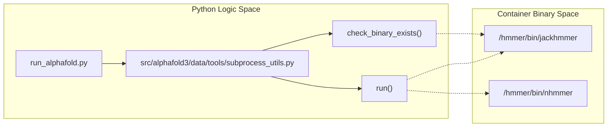

| Function / Utility | File | Role |
| :--- | :--- | :--- |
| `run` | [src/alphafold3/data/tools/subprocess_utils.py:67-134]() | Executes subprocess commands, logs stdout/stderr, times execution, and raises `RuntimeError` on failure [src/alphafold3/data/tools/subprocess_utils.py:76-134](). |
| `check_binary_exists` | [src/alphafold3/data/tools/subprocess_utils.py:42-51]() | Verifies that binary paths exist on disk and raises `RuntimeError` if missing [src/alphafold3/data/tools/subprocess_utils.py:42-51](). |
| `jackhmmer_seq_limit_supported` | [src/alphafold3/data/tools/subprocess_utils.py:53-64]() | Validates whether the installed `jackhmmer` binary supports `--seq_limit` [src/alphafold3/data/tools/subprocess_utils.py:53-64](). |
| `create_query_fasta_file` | [src/alphafold3/data/tools/subprocess_utils.py:31-39]() | Writes sequence query FASTA files with configured line-width wrapping [src/alphafold3/data/tools/subprocess_utils.py:31-39](). |

Sources: [docker/Dockerfile:32-34](), [src/alphafold3/data/tools/subprocess_utils.py:31-134]()

---

# Page: Known Issues

# Known Issues

<details>
<summary>Relevant source files</summary>

The following files were used as context for generating this wiki page:

- [docs/known_issues.md](docs/known_issues.md)
- [docs/performance.md](docs/performance.md)

</details>


This document provides a comprehensive list of known issues and workarounds when running AlphaFold 3. It covers hardware compatibility problems, memory limitations, chemical parsing bugs, MSA discrepancies, and other technical challenges you may encounter during installation and execution. For performance optimization strategies, see [Performance Optimization](#8). For installation instructions, see [Installation Guide](#2).

Sources: [docs/known_issues.md:1-105](), [docs/performance.md:1-236]()

## Hardware Compatibility Issues

### CUDA Capability 7.x GPUs

GPUs with CUDA Capability 7.x (e.g., NVIDIA V100) require special configuration to avoid numerical issues that result in obviously incorrect predictions.

```
Symptoms: Predictions show severe atomic clashes, resulting in ranking scores of -99 or lower.
```

**Workaround:** Set the following environment variable:

```bash
XLA_FLAGS="--xla_disable_hlo_passes=custom-kernel-fusion-rewriter"
```

Note that for these GPUs, you don't need to disable Triton GEMM kernels as they aren't supported for these devices.

Sources: [docs/known_issues.md:3-9](), [docs/performance.md:113-132]()

### Memory Limitations by GPU Type

Different GPU models have different maximum token limits when running AlphaFold 3:

| GPU Model | Memory | Maximum Tokens | Special Configuration Required |
|:----------|:-------|:---------------|:------------------------------|
| NVIDIA A100 | 80 GB | 5,120 | Default configuration |
| NVIDIA H100 | 80 GB | 5,120 | Default configuration |
| NVIDIA A100 | 40 GB | 4,352 | Unified Memory + Adjusted shard specs |
| NVIDIA V100 | 16/32 GB | 1,280 | Unified Memory + XLA flags |
| NVIDIA P100 | 16 GB | 1,024 | None |

Sources: [docs/performance.md:62-132]()

## Memory Management Issues

### Out of Memory Errors

For inputs larger than the default maximum size (5,120 tokens) or when using GPUs with less memory, you may encounter out-of-memory errors.

**Workaround:** Enable unified memory to allow GPU memory to spill into host memory:

```bash
XLA_PYTHON_CLIENT_PREALLOCATE=false
TF_FORCE_UNIFIED_MEMORY=true
XLA_CLIENT_MEM_FRACTION=3.2
```

Note: This workaround trades performance for memory capacity.

Sources: [docs/performance.md:203-221]()

### Pair Transition Shard Specification

For A100 (40 GB) GPUs, you'll need to adjust the pair transition shard specification in the model configuration:

```python
pair_transition_shard_spec: Sequence[_Shape2DType] = (
    (2048, None),
    (3072, 1024),
    (None, 512),
)
```

This tells the model:
- For sequences up to 2,048 tokens: no sharding
- For sequences up to 3,072 tokens: shard in chunks of 1,024
- For larger sequences: shard in chunks of 512

Sources: [docs/performance.md:84-107]()

## Performance and Compilation Issues

### Excessive Compilation Time

AlphaFold 3 may experience extremely long compilation times due to a known XLA issue.

**Workaround:** Set the following environment variable (included by default in the provided Dockerfile):

```bash
XLA_FLAGS="--xla_gpu_enable_triton_gemm=false"
```

Sources: [docs/performance.md:171-179]()

### Repeated Model Compilation

When processing inputs of different sizes, the model may need to be recompiled for each unique size, leading to excessive compilation time.

**Workaround:** Use the JAX persistent compilation cache and adjust compilation bucket sizes:

1. Enable the compilation cache via the `run_alphafold.py` flag:
   `--jax_compilation_cache_dir <YOUR_DIRECTORY>`

2. For large inputs exceeding the default 5,120 token limit, redefine bucket sizes using the `--buckets` flag:
   `--buckets 256,512,768,1024,1280,1536,2048,2560,3072,3584,4096,4608,5120,5376,6144`

Sources: [docs/performance.md:134-167](), [docs/performance.md:222-236]()

## Input, Ligand, and Chemical Component Discrepancies

### Two-Letter Atoms in SMILES Ligands

Between commits `f8df1c7` and `4e4023c`, AlphaFold 3 handled incorrectly any two-letter atoms (e.g. `Cl`, `Br`) in ligands defined using SMILES strings. 

**Workaround:** Ensure your installation uses a commit later than `4e4023c`.

Sources: [docs/known_issues.md:10-16]()

### Linked Ketoses Keep Their Leaving Atom

When a glycan component is bonded to another residue using `bondedAtomPairs`, AlphaFold 3 removes the atom named `O1` from it (unless `O1` itself takes part in the bond). The CCD leaving-atom flag (`_chem_comp_atom.pdbx_leaving_atom_flag`) is not used to pick the atom. This matches aldoses such as glucose, galactose, or mannose, whose anomeric carbon is `C1` and whose leaving atom is `O1`. It does not match ketoses, whose anomeric carbon is `C2` and whose leaving atom is `O2`:

* Sialic acids (e.g. `SIA`, `SLB`, `NGC`, `KDN`) and `KDO` have no atom named `O1`, so nothing is removed and `O2` is kept.
* Fructose, psicose, sorbose, and tagatose (e.g. `FRU`, `BDF`, `PSV`, `SOE`, `T6T`) have a C1 hydroxyl named `O1`, which is removed while `O2` is kept.

In both cases the linked `C2` ends up with five heavy-atom neighbours (see GitHub issue #752).

**Workaround:** Provide the ketose as a user-provided CCD component under a new name, with `O2`, `HO2`, and their bonds removed. Components not in the CCD glycan sets have no atoms removed, so `O1` is also kept.

Sources: [docs/known_issues.md:17-39]()

## MSA Discrepancy vs AlphaFold Server

Local AlphaFold 3 runs may produce shallower Multiple Sequence Alignments (MSAs) than the AlphaFold Server, occasionally leading to lower accuracy (e.g., lower ipTM/pTM for complex structures). This is caused by the Server running sharded Jackhmmer without the `--domZ` flag, resulting in a ~100x more permissive `--domE` filter.

**Workaround:** 
1. Increase the Jackhmmer/Nhmmer `--domE` flag value by 100x compared to its default value.
2. Alternatively, implement sharded database searches as documented in [Performance Optimization](8.3) without setting the `--domZ` value.

Sources: [docs/known_issues.md:40-86](), [docs/performance.md:85-148]()

## Gated Linear Unit Tokamax `NotImplementedError`

When running AlphaFold 3 in certain configurations (e.g., on Mac OS with the MPS backend), you might see errors like:

```
NotImplementedError: Not supported on gpu.
Failed to run implementation
Traceback (most recent call last):
File "tokamax/_src/ops/gated_linear_unit/api.py", line 114, in gated_linear_unit
  return fn(x, weights, activation=activation, precision=precision)
          ^^^^^^^^^^^^^^^^^^^^^^^^^^^^^^^^^^^^^^^^^^^^^^^^^^^^^^^^^^
File "tokamax/_src/ops/op.py", line 197, in __call__
  raise NotImplementedError(f"Not supported on {device.device_kind}.")
NotImplementedError: Not supported on gpu.
```

Tokamax will choose another implementation and run the prediction successfully, so these are safe to ignore.

Sources: [docs/known_issues.md:87-105]()

## Integration Points Where Issues Occur

The following diagram illustrates the key components of AlphaFold 3 and where known issues typically occur:

Title: "Mapping Known Issues to Code Components"
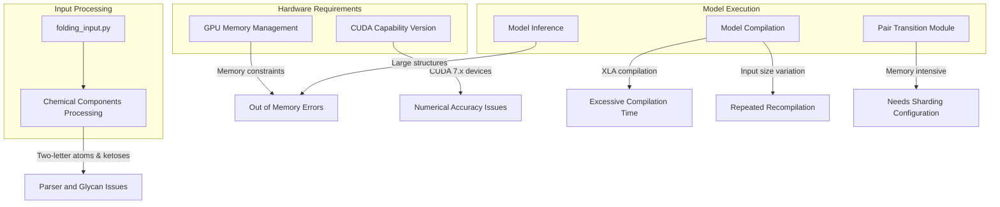

Sources: [docs/known_issues.md:1-105](), [docs/performance.md:1-236]()

## Hardware Compatibility and Configuration Matrix

This diagram shows how different hardware configurations relate to required configuration changes and environment variables:

Title: "Hardware and Configuration Mapping"
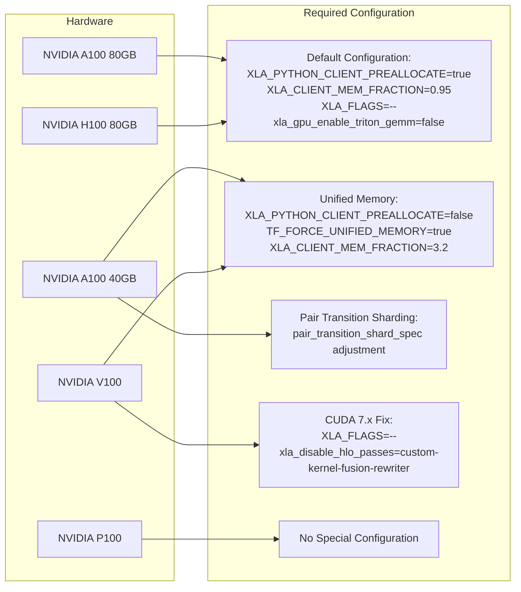

Sources: [docs/performance.md:62-132](), [docs/known_issues.md:3-9]()

## System Architecture and Issue Locations

This diagram maps specific issues to their location in the AlphaFold 3 system architecture:

Title: "System Architecture and Issue Hotspots"
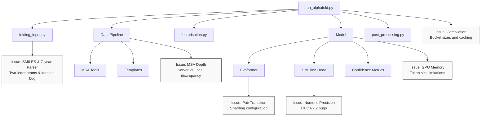

Sources: [docs/known_issues.md:1-105](), [docs/performance.md:1-236]()

---

# Page: User Guide

# User Guide

<details>
<summary>Relevant source files</summary>

The following files were used as context for generating this wiki page:

- [docs/community_tools.md](docs/community_tools.md)
- [docs/input.md](docs/input.md)
- [docs/metadata_antibody_antigen.csv](docs/metadata_antibody_antigen.csv)
- [docs/metadata_antibody_antigen.md](docs/metadata_antibody_antigen.md)
- [examples/barnase_barstar.json](examples/barnase_barstar.json)
- [examples/calmodulin_4calcium.json](examples/calmodulin_4calcium.json)
- [examples/erk2_phosphorylated.json](examples/erk2_phosphorylated.json)
- [examples/streptavidin_biotin_smiles.json](examples/streptavidin_biotin_smiles.json)
- [examples/tetr_dimer_dna.json](examples/tetr_dimer_dna.json)
- [examples/tetr_dimer_tetracycline.json](examples/tetr_dimer_tetracycline.json)

</details>


This guide provides a practical overview for end users to prepare inputs, execute predictions, and interpret results in AlphaFold 3. As a parent page, it introduces core workflows and concepts at a high level and links to dedicated child pages for comprehensive technical details.

For detailed documentation, see:
- **Input preparation**: [Input Format](#3.1) — Comprehensive documentation of JSON input formats (`alphafold3` and `alphafoldserver` dialects), sequences, ligands, MSAs, templates, bonds, and the `examples/` directory [docs/input.md:27-48]().
- **Execution**: [Running AlphaFold 3](#3.2) — Step-by-step instructions for executing predictions via `run_alphafold.py`, including command-line flags, staged execution, and configuration options [run_alphafold.py:62-129]().
- **Outputs**: [Output Format](#3.3) — Explanation of the output directory structure, predicted mmCIF files, confidence JSONs, ranking scores, and optional embeddings.

---

## Overview and End-to-End Workflow

The AlphaFold 3 user workflow bridges biological sequence specification to structural model evaluation through a two-stage pipeline: a CPU-bound data pipeline for MSA and template retrieval, followed by a GPU-bound neural network model inference stage [src/alphafold3/data/pipeline.py:11-151](), [run_alphafold.py:401-491]().

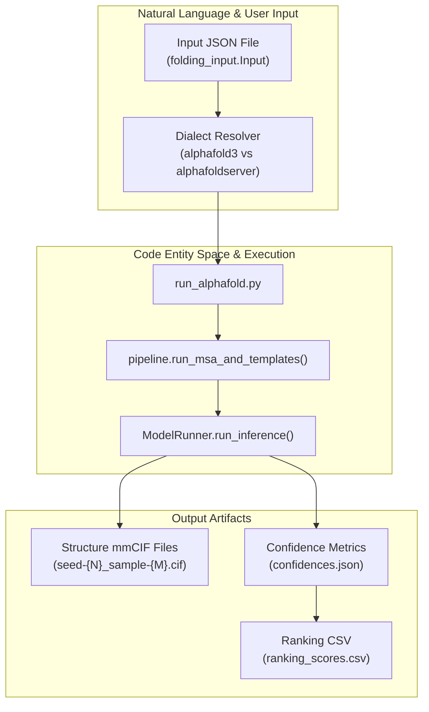

**Diagram: End-to-end user workflow bridging natural language inputs to code execution and output artifacts.**

Sources: [run_alphafold.py:724-829](), [docs/input.md:3-31](), [src/alphafold3/data/pipeline.py:11-151]()

---

## Input Preparation and Example Inputs

Inputs are provided via JSON files containing job metadata, random seeds, and sequence definitions for proteins, RNA, DNA, and ligands. AlphaFold 3 supports both its native format (`alphafold3` dialect) and compatibility conversion from the AlphaFold Server format (`alphafoldserver` dialect) [docs/input.md:27-64]().

Users can inspect several ready-to-use example inputs provided in the repository:
- **Protein-protein complexes**: `examples/barnase_barstar.json` [examples/barnase_barstar.json:1-22]()
- **Post-translational modifications**: `examples/erk2_phosphorylated.json` (modifying residues like TPO and PTR) [examples/erk2_phosphorylated.json:1-19]()
- **Ligands and ions**: `examples/calmodulin_4calcium.json` (calcium ions via CCD codes) [examples/calmodulin_4calcium.json:1-22](), `examples/tetr_dimer_tetracycline.json` [examples/tetr_dimer_tetracycline.json:1-22]()
- **Small-molecule SMILES**: `examples/streptavidin_biotin_smiles.json` [examples/streptavidin_biotin_smiles.json:1-22]()
- **DNA-protein complexes**: `examples/tetr_dimer_dna.json` [examples/tetr_dimer_dna.json:1-29]()

For comprehensive details on formatting sequences, custom MSAs, user-provided CCD dictionaries, and covalent `bondedAtomPairs`, see [Input Format](#3.1).

Sources: [docs/input.md:27-158](), [examples/barnase_barstar.json:1-22](), [examples/erk2_phosphorylated.json:1-19](), [examples/calmodulin_4calcium.json:1-22](), [examples/tetr_dimer_tetracycline.json:1-22](), [examples/streptavidin_biotin_smiles.json:1-22](), [examples/tetr_dimer_dna.json:1-29]()

---

## Execution and Command-Line Interface

Predictions are executed using the main Python script `run_alphafold.py`. The script accepts flags for input paths, model directories, and genetic databases, supporting staged execution where data processing and model inference can be toggled independently [run_alphafold.py:62-129]().

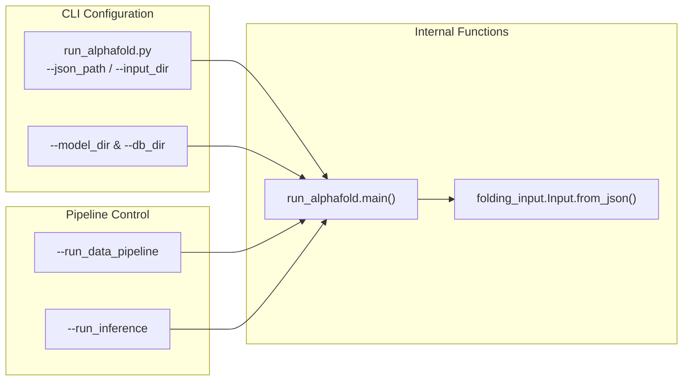

**Diagram: Mapping command-line interface arguments to internal execution entry points.**

Sources: [run_alphafold.py:724-860]()

For complete documentation on command-line flags, staging options, and resource allocation, see [Running AlphaFold 3](#3.2).

Sources: [run_alphafold.py:62-129](), [run_alphafold.py:724-860]()

---

## Output Interpretation

The inference run generates structured output directories containing predicted atomic coordinates, confidence metrics, and ranking summaries [run_alphafold.py:401-491](). 

Key outputs include:
- **mmCIF Structure Files**: Atomic coordinates stored in standard mmCIF format, representing predicted complexes across different random seeds and diffusion samples [run_alphafold.py:440-475]().
- **Confidence JSONs**: Detailed scoring metrics including pTM, ipTM, Predicted Aligned Error (PAE), and Predicted Distance Error (PDE).
- **Ranking Scores**: Aggregated CSV summaries (`ranking_scores.csv`) determining the best-performing structural predictions.

For a detailed breakdown of file naming conventions, confidence metrics interpretation, and optional distogram/embedding outputs, see [Output Format](#3.3).

Sources: [run_alphafold.py:401-491]()

---

## Community Tools and Research Metadata

Several external tools and curated datasets assist users in preparing inputs and interpreting complex assemblies:

- **JAAG**: A lightweight web-based GUI tool (`https://biofgreat.org/JAAG`) for generating AlphaFold 3 input JSON files with integrated glycan support and automated `bondedAtomPairs` syntax [docs/community_tools.md:3-12]().
- **Glycan Modeling Resources**: Step-by-step tutorials, ready-to-run scripts, and ModelArchive entries (`https://doi.org/10.5452/ma-af3glycan`) for modeling glycans and complex ligands [docs/community_tools.md:17-31]().
- **Antibody-Antigen Metadata**: Curated metadata covering 71 antibody-antigen complexes and 166 interfaces (associated with Figure 5a in the AlphaFold 3 paper), provided in `docs/metadata_antibody_antigen.csv` [docs/metadata_antibody_antigen.md:1-11](), [docs/metadata_antibody_antigen.csv:1-167]().

Sources: [docs/community_tools.md:1-31](), [docs/metadata_antibody_antigen.md:1-11](), [docs/metadata_antibody_antigen.csv:1-167]()

---

# Page: Input Format

# Input Format

<details>
<summary>Relevant source files</summary>

The following files were used as context for generating this wiki page:

- [docs/input.md](docs/input.md)
- [examples/kras_g12c_sotorasib.json](examples/kras_g12c_sotorasib.json)
- [examples/modified_rna.json](examples/modified_rna.json)
- [src/alphafold3/common/folding_input.py](src/alphafold3/common/folding_input.py)
- [src/alphafold3/common/folding_input_test.py](src/alphafold3/common/folding_input_test.py)

</details>


This page documents the JSON input format used to specify prediction jobs for AlphaFold 3 [docs/input.md:1-6](). The input format defines molecular entities (proteins, RNA, DNA, ligands), custom MSAs, structural templates, covalent bonds, and random seeds [docs/input.md:33-46](). 

For information about how inputs are processed and validated internally, see [Input Processing](#4.1). For details on the internal data structures that represent these inputs, see [Input Data Model](#5.1).

## Overview

AlphaFold 3 accepts inputs in JSON format [docs/input.md:29](). The system supports two JSON dialects [docs/input.md:30-31,58-64]():

1.  **`alphafold3` dialect**: The primary format defined in `src/alphafold3/common/folding_input.py` offering full control over MSAs, templates, bonds, and custom ligands [docs/input.md:33-44,58-64]().
2.  **`alphafoldserver` dialect**: A simplified format compatible with [AlphaFold Server](https://alphafoldserver.com/), automatically converted to `alphafold3` format by the input parser [docs/input.md:52-64]().

The input parser is implemented in `src/alphafold3/common/folding_input.py` and handles both dialects through `Input.from_json()` and `Input.from_alphafoldserver_fold_job()` [src/alphafold3/common/folding_input.py:38-44]().

Sources: [src/alphafold3/common/folding_input.py:38-44](), [docs/input.md:14-76]()

## JSON Dialects

### Dialect Detection and Conversion

Title: "Dialect Detection Logic"
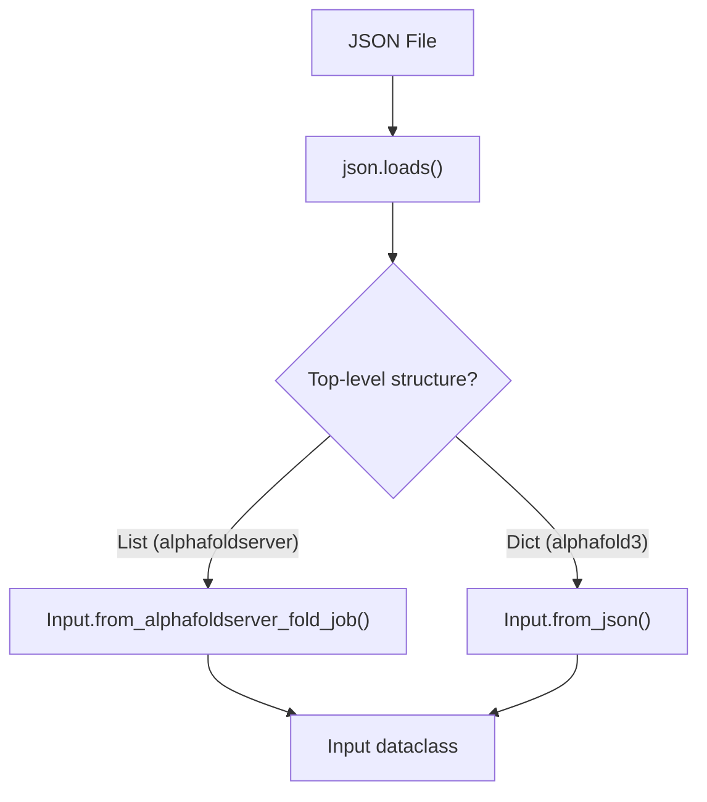
Sources: [src/alphafold3/common/folding_input.py:38-44](), [docs/input.md:58-76]()

The system automatically detects the dialect by examining whether the top-level JSON structure is a list (`alphafoldserver`) or a dictionary (`alphafold3`) [docs/input.md:72-76]().

### Dialect Comparison

| Feature | alphafold3 | alphafoldserver |
| :--- | :--- | :--- |
| Multiple inputs per file | No (one input per JSON) | Yes (top-level list) |
| Custom MSA specification | Full control (paired/unpaired) | Not supported |
| Custom templates | Full control (mmCIF + mapping) | Limited (enable/disable only) |
| Ligands via SMILES | Supported | Not supported |
| Custom CCD | Supported | Not supported |
| Covalent bonds | Supported | Not supported |
| Chain IDs | User-specified | Auto-assigned (A, B, ..., Z, AA, BA, ...) |
| Glycans | Supported via bonds | Not supported |
| Random seeds | Required (at least one) | Optional (auto-sampled if empty) |

Sources: [docs/input.md:32-101]()

## Top-Level Structure

### alphafold3 Dialect

```json
{
  "dialect": "alphafold3",
  "version": 4,
  "name": "Job name",
  "modelSeeds": [1, 2, 3],
  "sequences": [...],
  "bondedAtomPairs": [...],
  "userCCD": "...",
  "userCCDPath": "..."
}
```

### Code Representation

Title: "Mapping JSON to Code Entities"
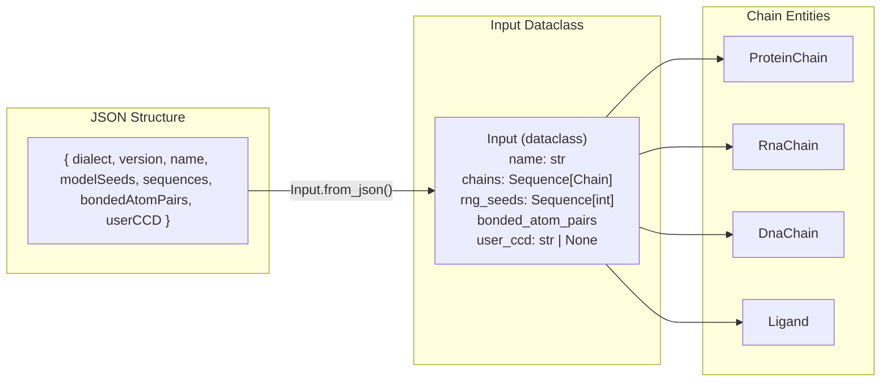
Sources: [src/alphafold3/common/folding_input.py:38-44](), [docs/input.md:120-158]()

### Top-Level Fields

| Field | Type | Required | Description |
| :--- | :--- | :--- | :--- |
| `dialect` | `str` | Yes | Must be `"alphafold3"` [src/alphafold3/common/folding_input.py:46](). |
| `version` | `int` | Yes | Format version (1, 2, 3, or 4 for alphafold3) [src/alphafold3/common/folding_input.py:47-48](). |
| `name` | `str` | Yes | Job name (sanitized for output filenames) [docs/input.md:144-145](). |
| `modelSeeds` | `list[int]` | Yes | Random seeds (at least one required) [docs/input.md:146-149](). |
| `sequences` | `list` | Yes | List of molecular entities (Protein, RNA, DNA, or Ligand) [docs/input.md:150-151](). |
| `bondedAtomPairs` | `list` | No | Covalent bonds between atoms [docs/input.md:152-154](). |
| `userCCD` | `str` | No | User-defined chemical components (CIF format) [docs/input.md:155-156](). |
| `userCCDPath` | `str` | No | Path to user CCD file (mutually exclusive with `userCCD`) [docs/input.md:136](). |

Sources: [src/alphafold3/common/folding_input.py:46-48](), [docs/input.md:123-158]()

### Version History

| Version | Features Added |
| :--- | :--- |
| 1 | Initial AlphaFold 3 input format [docs/input.md:159-160](). |
| 2 | External MSA/template paths: `unpairedMsaPath`, `pairedMsaPath`, `mmcifPath` [docs/input.md:161-163](). |
| 3 | External user CCD: `userCCDPath` [docs/input.md:164-165](). |
| 4 | Textual descriptions: `description` field for all chain types [docs/input.md:166-167](). |

Sources: [docs/input.md:159-171](), [src/alphafold3/common/folding_input.py:46-48]()

## Molecular Entities

### Chain Type Hierarchy

Title: "Chain Implementation Class Hierarchy"
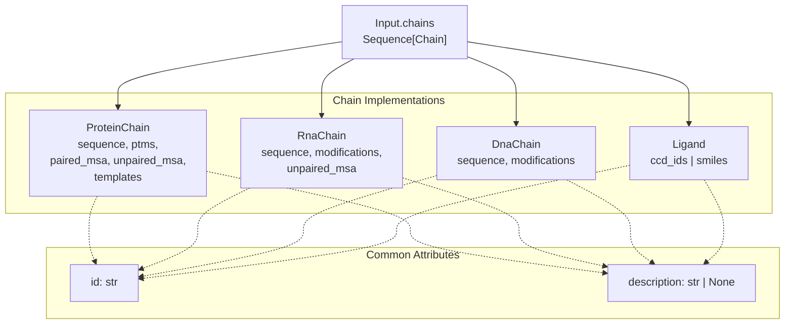
Sources: [src/alphafold3/common/folding_input.py:38-44]()

### Protein Chains

Proteins are defined by their amino acid sequence and optional modifications (`ProteinChain` class).

| Field | Type | Description |
| :--- | :--- | :--- |
| `id` | `str` or `list[str]` | Chain identifier(s). List implies multiple copies [docs/input.md:195](). |
| `sequence` | `str` | Amino acid sequence (1-letter codes) [docs/input.md:196](). |
| `modifications` | `list[dict]` | PTMs via `ptmType` (CCD code) and `ptmPosition` (1-based) [docs/input.md:197](). |
| `description` | `str \| None` | Optional textual description [docs/input.md:198](). |
| `pairedMsa` | `str \| None` | A3M format MSA for pairing [docs/input.md:199](). |
| `unpairedMsa` | `str \| None` | A3M format MSA for unpaired features [docs/input.md:200](). |
| `templates` | `list[dict] \| None` | Structural templates [docs/input.md:201](). |

The `ProteinChain` class implements validation in its constructor to ensure sequences contain valid amino acid codes and PTM indices are within range [src/alphafold3/common/folding_input.py:169-172]().

Sources: [src/alphafold3/common/folding_input.py:99-245](), [docs/input.md:178-234]()

### RNA and DNA Chains

RNA (`RnaChain`) and DNA (`DnaChain`) chains support sequences and base modifications. RNA also supports custom MSAs (`unpairedMsa`) [docs/input.md:235-306]().

| Field | Type | Description |
| :--- | :--- | :--- |
| `id` | `str` or `list[str]` | Chain identifier(s) [docs/input.md:240](). |
| `sequence` | `str` | Nucleotide sequence (A, C, G, U for RNA; A, C, G, T for DNA) [docs/input.md:241](). |
| `modifications` | `list[dict]` | Modified bases via `modificationType` and `basePosition` [docs/input.md:242](). |
| `unpairedMsa` | `str \| None` | (RNA only) A3M format MSA [docs/input.md:243](). |

Sources: [src/alphafold3/common/folding_input.py:38-44](), [docs/input.md:235-306]()

### Ligands

Ligands (`Ligand` class) can be specified using three approaches:

1.  **CCD Codes**: Using standard or user-provided `ccdCodes` [docs/input.md:315-320]().
2.  **SMILES**: Using a SMILES string [docs/input.md:321-325](). SMILES ligands cannot participate in covalent bonds as they lack uniquely named atoms.
3.  **Multi-Component**: A single ligand entity containing multiple CCD components (e.g., glycans) [docs/input.md:326-330]().

The `Ligand` class enforces mutual exclusivity between `ccd_ids` and `smiles` [src/alphafold3/common/folding_input.py:809-816]().

Sources: [src/alphafold3/common/folding_input.py:789-894](), [docs/input.md:308-384]()

## Multiple Sequence Alignments

The system can either generate MSAs using its internal data pipeline or use user-provided MSAs [docs/input.md:416-420]().

### MSA Input Logic

| `unpairedMsa` | `pairedMsa` | Behavior |
| :--- | :--- | :--- |
| `null` | `null` | Data pipeline builds both MSAs [docs/input.md:421-425](). |
| A3M string | `""` | Use custom unpaired MSA, no pairing [docs/input.md:426-430](). |
| `""` | A3M string | Use custom paired MSA (not recommended) [docs/input.md:431-435](). |
| A3M string | A3M string | Use both custom MSAs (expert mode) [docs/input.md:436-440](). |
| `""` | `""` | MSA-free prediction [docs/input.md:441-445](). |

For RNA, only `unpairedMsa` is supported [docs/input.md:446-450](). If set to `null`, the pipeline runs `Nhmmer` [docs/input.md:451-455](). For proteins, the pipeline runs `Jackhmmer` against UniRef90, MGnify, and BFD [docs/input.md:456-460]().

Sources: [docs/input.md:416-515](), [src/alphafold3/common/folding_input.py:38-44]()

## Structural Templates

Templates provide structural context for protein chains. A `Template` class instance contains an mmCIF string and a mapping between query residues and template residues [src/alphafold3/common/folding_input.py:99-135]().

### Template Fields

| Field | Type | Description |
| :--- | :--- | :--- |
| `mmcif` | `str` | Protein structure in mmCIF format [src/alphafold3/common/folding_input.py:108-109](). |
| `mmcifPath` | `str` | Path to mmCIF file (mutually exclusive with `mmcif`) [src/alphafold3/common/folding_input.py:170-173](). |
| `queryIndices` | `list[int]` | 0-based residue indices in query sequence [src/alphafold3/common/folding_input.py:110-111,178-180](). |
| `templateIndices` | `list[int]` | 0-based residue indices in template structure [src/alphafold3/common/folding_input.py:110-111,178-181](). |

Sources: [src/alphafold3/common/folding_input.py:99-194](), [docs/input.md:554-647]()

## Covalent Bonds

Covalent bonds are defined in the `bondedAtomPairs` top-level list [docs/input.md:134,152-154](). Each bond connects two atoms identified by `[chain_id, residue_index, atom_name]` [examples/kras_g12c_sotorasib.json:19-21]().

```json
"bondedAtomPairs": [
  [["A", 145, "SG"], ["L", 1, "C04"]]
]
```

Bonds are validated during input parsing to ensure atoms exist and refer to valid chain and residue indices [src/alphafold3/common/folding_input.py:38-44]().

Sources: [src/alphafold3/common/folding_input.py:38-44](), [docs/input.md:660-703](), [examples/kras_g12c_sotorasib.json:19-21]()

## User-Provided Chemical Components (CCD)

Custom ligands or modified residues not present in the standard Chemical Component Dictionary can be provided via the `userCCD` or `userCCDPath` fields [docs/input.md:135-136,724-730]().

The system uses coordinate definitions from the user-provided CIF as a structural reference during ligand parameterization [docs/input.md:746-763]().

Sources: [src/alphafold3/common/folding_input.py:38-44](), [docs/input.md:724-785]()

## File Loading and Path Resolution

The utility function `_read_file` handles reading and optional decompression of external files referenced by paths (MSAs, templates, CCDs) [src/alphafold3/common/folding_input.py:60-97]().

| Compression Format | Magic Number Header | Handling Function |
| :--- | :--- | :--- |
| gzip | `\x1f\x8b` | `gzip.open` [src/alphafold3/common/folding_input.py:86-88]() |
| xz (lzma) | `\xfd\x37\x7a\x58\x5a\x00` | `lzma.open` [src/alphafold3/common/folding_input.py:89-91]() |
| zstd | `\x28\xb5\x2f\xfd` | `zstd.open` [src/alphafold3/common/folding_input.py:92-94]() |
| Uncompressed | Any other header | `f.read().decode('utf-8')` [src/alphafold3/common/folding_input.py:95-96]() |

Relative paths are resolved against the directory containing the input JSON file via `_read_file` [src/alphafold3/common/folding_input.py:60-80]().

Sources: [src/alphafold3/common/folding_input.py:60-97]()

---

# Page: Running AlphaFold 3

# Running AlphaFold 3

<details>
<summary>Relevant source files</summary>

The following files were used as context for generating this wiki page:

- [docs/model_parameters.md](docs/model_parameters.md)
- [run_alphafold.py](run_alphafold.py)
- [run_alphafold_test.py](run_alphafold_test.py)

</details>


## Purpose and Scope

This page provides a comprehensive, step-by-step technical guide for executing AlphaFold 3 structure predictions using the main entry point script `run_alphafold.py`. It covers command-line flags, staged execution modes, database setup, model configuration options, output handling, and execution workflows.

For input file format details, see [Input Format](#3.1). For output file structures, see [Output Format](#3.3). For underlying database preparation, see [Database Setup](#2.1). For general installation, see [Installation Guide](#2).

Sources: [run_alphafold.py:20-29]()

---

## Basic Execution

AlphaFold 3 is invoked via `run_alphafold.py`, which coordinates input validation, data pipeline execution, model featurization, JAX inference, and output serialization [run_alphafold.py:832-998]().

### Docker Execution

To execute predictions inside a containerized environment with GPU support:

```bash
docker run -it \
    --volume $HOME/af_input:/root/af_input \
    --volume $HOME/af_output:/root/af_output \
    --volume <MODEL_PARAMETERS_DIR>:/root/models \
    --volume <DB_DIR>:/root/public_databases \
    --gpus all \
    alphafold3 \
    python run_alphafold.py \
    --json_path=/root/af_input/fold_input.json \
    --model_dir=/root/models \
    --db_dir=/root/public_databases \
    --output_dir=/root/af_output
```

### Singularity Execution

For High-Performance Computing (HPC) environments using Singularity:

```bash
singularity exec \
    --nv \
    --bind $HOME/af_input:/root/af_input \
    --bind $HOME/af_output:/root/af_output \
    --bind <MODEL_PARAMETERS_DIR>:/root/models \
    --bind <DB_DIR>:/root/public_databases \
    alphafold3.sif \
    python run_alphafold.py \
    --json_path=/root/af_input/fold_input.json \
    --model_dir=/root/models \
    --db_dir=/root/public_databases \
    --output_dir=/root/af_output
```

### Multiple Database Directories

When genetic databases are distributed across different volumes (e.g., fast local NVMe SSDs alongside slower networked storage), multiple `--db_dir` flags can be specified. The system iterates through these paths in the order provided [run_alphafold.py:141-146]() via internal resolution helpers.

```bash
python run_alphafold.py \
    --json_path=/root/af_input/fold_input.json \
    --db_dir=/root/public_databases \
    --db_dir=/root/public_databases_fallback \
    --output_dir=/root/af_output
```

Sources: [run_alphafold.py:141-146](), [run_alphafold.py:832-998]()

---

## Command-Line Flags Reference

The `run_alphafold.py` script exposes multiple flag categories defined using `absl.flags`.

### Input, Output, and Model Directories

| Flag | Type | Default | Description |
|------|------|---------|-------------|
| `--json_path` | string | `None` | Path to a single input JSON file [run_alphafold.py:80-84]() |
| `--input_dir` | string | `None` | Directory containing multiple input JSON files [run_alphafold.py:85-89]() |
| `--output_dir` | string | **Required** | Directory where results and subdirectories are saved [run_alphafold.py:90-94]() |
| `--model_dir` | string | `~/models` | Path to the directory containing model weights and parameters [run_alphafold.py:95-99]() |

**Note:** Exactly one of `--json_path` or `--input_dir` must be provided during execution.

### Execution Control Flags

| Flag | Type | Default | Description |
|------|------|---------|-------------|
| `--run_data_pipeline` | bool | `True` | Whether to execute MSA generation and template search [run_alphafold.py:102-106]() |
| `--run_inference` | bool | `True` | Whether to execute model featurization and diffusion inference [run_alphafold.py:107-111]() |

### External Tool Binaries

Binary paths are auto-detected via `shutil.which` where possible, but can be overridden explicitly [run_alphafold.py:113-138]().

| Flag | Type | Default | Description |
|------|------|---------|-------------|
| `--jackhmmer_binary_path` | string | Auto-detected | Path to the `jackhmmer` executable [run_alphafold.py:114-118]() |
| `--nhmmer_binary_path` | string | Auto-detected | Path to the `nhmmer` executable [run_alphafold.py:119-123]() |
| `--hmmalign_binary_path` | string | Auto-detected | Path to the `hmmalign` executable [run_alphafold.py:124-128]() |
| `--hmmsearch_binary_path` | string | Auto-detected | Path to the `hmmsearch` executable [run_alphafold.py:129-133]() |
| `--hmmbuild_binary_path` | string | Auto-detected | Path to the `hmmbuild` executable [run_alphafold.py:134-138]() |

Sources: [run_alphafold.py:80-138](), [run_alphafold.py:832-847]()

---

## Diagram: Command-Line Flag Categories

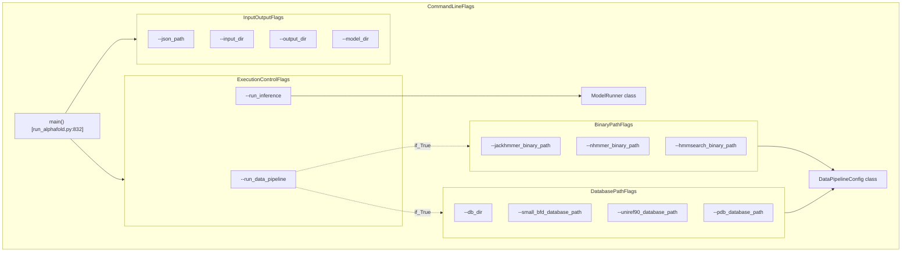

Sources: [run_alphafold.py:80-226](), [run_alphafold.py:832-847]()

---

## Staged Execution

AlphaFold 3 supports decoupling resource-heavy sequence searches from GPU-bound inference.

### Full Pipeline (Default)
Executes both sequence database queries (Data Pipeline) and neural network inference sequentially [run_alphafold.py:102-111]().

### Data Pipeline Only
Runs only sequence alignments and template lookups, saving output as an augmented JSON file (`*_data.json`) suitable for downstream sharing or reuse:
```bash
python run_alphafold.py \
    --json_path=/root/af_input/fold_input.json \
    --output_dir=/root/af_output \
    --run_inference=false
```

### Inference Only
Bypasses external database searches by consuming pre-computed alignments and templates:
```bash
python run_alphafold.py \
    --json_path=/root/af_input/fold_input_with_msa.json \
    --output_dir=/root/af_output \
    --run_data_pipeline=false
```

Sources: [run_alphafold.py:102-111](), [run_alphafold.py:800-804]()

---

## Diagram: Staged Execution Flow

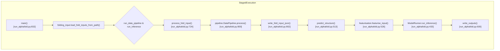

Sources: [run_alphafold.py:513-585](), [run_alphafold.py:724-829]()

---

## Model Inference & JAX Configuration

Model execution leverages JAX for compiling and running the deep learning architecture [run_alphafold.py:61-65]().

### Compilation Buckets and Caching
To avoid costly JAX recompilations when processing structures of varying sequence lengths, compilation buckets can be specified via command-line flags. Persistent JAX caching can also be enabled:
```bash
python run_alphafold.py \
    --buckets=256,512,1024,2048,4096 \
    --jax_compilation_cache_dir=/root/jax_cache
```

### Flash Attention Options
The attention mechanisms support multiple accelerated implementations via `--flash_attention_implementation`:
- `triton`: Default implementation optimized for modern NVIDIA GPUs.
- `cudnn`: Uses optimized cuDNN primitives.
- `xla`: Fallback mode required for older hardware or specific CUDA version constraints.

Sources: [run_alphafold.py:61-65](), [run_alphafold.py:302-350]()

---

## Output Management and Persistence

Output files generated by `write_outputs()` include predicted structures in mmCIF format, per-token confidence metrics (pTM, ipTM, PAE, PDE), and ranking summary scores [run_alphafold.py:600-650]().

- **Directory Collision Protection:** If an output directory already contains results for a given job name, AlphaFold 3 automatically generates a timestamped subdirectory to prevent data overwriting [run_alphafold.py:780-794]().
- **Optional Embeddings & Distograms:** Large internal representations can be serialized by setting `--save_embeddings=true` and `--save_distogram=true` [run_alphafold.py:351-360]().

Sources: [run_alphafold.py:351-378](), [run_alphafold.py:600-650](), [run_alphafold.py:780-794]()

---

# Page: Output Format

# Output Format

<details>
<summary>Relevant source files</summary>

The following files were used as context for generating this wiki page:

- [docs/output.md](docs/output.md)
- [src/alphafold3/data/tools/rdkit_utils.py](src/alphafold3/data/tools/rdkit_utils.py)
- [src/alphafold3/model/mmcif_metadata.py](src/alphafold3/model/mmcif_metadata.py)
- [src/alphafold3/model/post_processing.py](src/alphafold3/model/post_processing.py)
- [src/alphafold3/model/scoring/chirality.py](src/alphafold3/model/scoring/chirality.py)
- [src/alphafold3/structure/mmcif.py](src/alphafold3/structure/mmcif.py)

</details>


This page describes the outputs generated by AlphaFold 3, including their structure, format, and interpretation. It covers the directory structure, file formats, confidence metrics, and optional data files such as embeddings and distograms. For information about the input format, see [Input Format](3.1).

## Output Directory Structure

AlphaFold 3 organizes its outputs in a directory structure designed to separate top-ranking predictions from individual sample outputs, seeds, and optional diagnostic data.

Title: Output Organization Data Flow
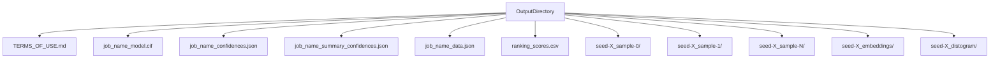

Sources:
- [docs/output.md:5-79]()
- [src/alphafold3/model/post_processing.py:90-127]()

For every input job, AlphaFold 3 writes outputs in a directory named after a sanitized version of the job name [docs/output.md:5-10](). Within this directory, it produces:

1. **Top-ranking prediction files** at the root level:
    * `<job_name>_model.cif`: Top-ranked predicted structure in mmCIF format [docs/output.md:35-38]().
    * `<job_name>_confidences.json`: Full confidence metrics [docs/output.md:39-39]().
    * `<job_name>_summary_confidences.json`: Summary confidence metrics [docs/output.md:40-41]().
    * `<job_name>_data.json`: Input JSON file with MSA and template data added by the data pipeline [docs/output.md:42-43]().

2. **Individual sample subdirectories** for each seed and sample combination:
    * Named `seed-<seed_value>_sample-<sample_number>` [docs/output.md:18-22]().
    * Each contains its own `model.cif`, `confidences.json`, and `summary_confidences.json`.

3. **Optional Outputs**:
    * **Embeddings**: `seed-<seed_value>_embeddings/embeddings.npz` (saved when `--save_embeddings=true`) [docs/output.md:28-34]().
    * **Distograms**: `seed-<seed_value>_distogram/distogram.npz` (saved when `--save_distogram=true`) [docs/output.md:23-27]().

4. **Additional files**:
    * `ranking_scores.csv`: Ranking scores for all predictions [docs/output.md:44-45]().
    * `TERMS_OF_USE.md`: Output terms of use [docs/output.md:46-46]().

Sources:
- [docs/output.md:5-83]()

## Structure Files (mmCIF)

AlphaFold 3 outputs predicted structures in the mmCIF format (`.cif`) rather than PDB format. These files contain 3D coordinates, chemical descriptors, and ModelCIF-conformant metadata.

Title: Code Entity Space: mmCIF Generation Pipeline
```mermaid
flowchart LR
    InferenceResult["InferenceResult<br>(model.py)"] --> PostProcess["post_process_inference_result()<br>(post_processing.py)"]
    PostProcess --> AddMeta["mmcif_metadata.add_metadata_to_mmcif()<br>(mmcif_metadata.py)"]
    AddMeta --> ProcessedResult["ProcessedInferenceResult<br>(post_processing.py)"]
    ProcessedResult --> WriteOutput["write_output()<br>(post_processing.py)"]
    WriteOutput --> |"Write bytes"| ModelCif["job_name_model.cif"]
    
    subgraph "Metadata & Annotations"
        Coords["_atom_site table"]
        Metadata["Audit & License Fields"]
        Confidence["B-factor (pLDDT)"]
    end
```

Sources:
- [src/alphafold3/model/post_processing.py:34-101]()
- [src/alphafold3/model/mmcif_metadata.py:56-178]()
- [src/alphafold3/structure/mmcif.py:40-41]()

The `post_process_inference_result` function handles the conversion from model tensors to the final CIF string [src/alphafold3/model/post_processing.py:57-101](). It invokes `mmcif_metadata.add_metadata_to_mmcif` to append ModelCIF compliance headers, authorship details, and legal notices [src/alphafold3/model/mmcif_metadata.py:56-178](). Internally, structures are manipulated using `cif_dict.CifDict` [src/alphafold3/structure/mmcif.py:40-41]().

Sources:
- [src/alphafold3/model/post_processing.py:57-101]()
- [src/alphafold3/model/mmcif_metadata.py:56-178]()

## Confidence Files

AlphaFold 3 produces two primary JSON files containing confidence metrics for each sample:

1. **Full confidence JSON** (`<job_name>_confidences.json`): Contains detailed per-atom and per-token confidence scores, including PAE, atom-level pLDDT values, and contact probabilities [src/alphafold3/model/post_processing.py:87-93]().
2. **Summary confidence JSON** (`<job_name>_summary_confidences.json`): Contains aggregated metrics for the entire structure, such as pTM, ipTM, and ranking scores [src/alphafold3/model/post_processing.py:80-86]().

Title: Confidence Data Flow
```mermaid
flowchart TD
    InferenceResult["model.InferenceResult"] --> SummaryClass["StructureConfidenceSummary<br>(confidence_types.py)"]
    InferenceResult --> FullClass["StructureConfidenceFull<br>(confidence_types.py)"]
    
    SummaryClass --> |"to_json()"| SummaryJSON["summary_confidences.json"]
    FullClass --> |"to_json()"| FullJSON["confidences.json"]
    
    subgraph "Summary Data"
        pTM["ptm"]
        ipTM["iptm"]
        Ranking["ranking_score"]
    end
    
    subgraph "Full Data"
        PAE["pae"]
        pLDDT["atom_plddts"]
        Contact["contact_probs"]
    end
```

Sources:
- [src/alphafold3/model/post_processing.py:57-101]()
- [docs/output.md:85-127]()

### Key Confidence Metrics

* **pLDDT**: A per-atom confidence estimate on a 0-100 scale [docs/output.md:90-95](). For proteins, it evaluates distances to polymer atoms; for ligands, it considers errors strictly between the ligand atom and polymers [docs/output.md:96-98]().
* **PAE (Predicted Aligned Error)**: Estimates the error in relative position and orientation between two tokens [docs/output.md:99-106]().
* **pTM and ipTM**: Global structure accuracy (pTM) and subunit interface accuracy (ipTM) [docs/output.md:107-117](). Values of ipTM above 0.8 indicate high confidence, while values below 0.6 suggest failure [docs/output.md:114-116]().

Sources:
- [docs/output.md:85-127]()

## Embeddings and Distograms

When specified via command-line flags, AlphaFold 3 saves intermediate internal representations:

* **Embeddings**: Written via `write_embeddings` into `embeddings.npz` [src/alphafold3/model/post_processing.py:143-154](). Contains `single_embeddings` (shape `[num_tokens, 384]`) and `pair_embeddings` (shape `[num_tokens, num_tokens, 128]`) with `np.float16` precision [docs/output.md:28-34]().
* **Distograms**: Written into `distogram.npz` containing a `distogram` key of shape `[num_tokens, num_tokens, 64]` and dtype `np.float16` [docs/output.md:23-27]().

Sources:
- [src/alphafold3/model/post_processing.py:143-154]()
- [docs/output.md:23-34]()

## Chirality Comparison

AlphaFold 3 includes automated validation to check the chirality of predicted ligands against reference molecules using RDKit utilities [src/alphafold3/model/scoring/chirality.py:149-190]().

Title: Code Entity Space: Chirality Validation Workflow
```mermaid
flowchart LR
    TestStruc["structure.Structure<br>(structure.py)"] --> CompareChirality["compare_chirality()<br>(chirality.py)"]
    RefMol["rd_chem.Mol<br>(RDKit)"] --> CompareChirality
    
    CompareChirality --> FindChiral["_find_chiral_centres()<br>(chirality.py)"]
    FindChiral --> ChiralMatch["_chiral_match()<br>(chirality.py)"]
    ChiralMatch --> Result["dict[chain_id, bool]"]
    
    subgraph "RDKit Integration"
        CcdMol["rdkit_utils.mol_from_ccd_cif()<br>(rdkit_utils.py)"]
        Sanitize["rdkit_utils.sanitize_mol()<br>(rdkit_utils.py)"]
    end
```

Sources:
- [src/alphafold3/model/scoring/chirality.py:33-78]()
- [src/alphafold3/model/scoring/chirality.py:149-190]()
- [src/alphafold3/data/tools/rdkit_utils.py:140-186]()

The `compare_chirality` function maps chain IDs to booleans indicating whether ligand chirality matches reference standards [src/alphafold3/model/scoring/chirality.py:149-190](). Reference molecules are retrieved from the Chemical Component Dictionary (CCD) via `mol_from_ccd_cif` when not explicitly provided [src/alphafold3/model/scoring/chirality.py:127-146]().

Sources:
- [src/alphafold3/model/scoring/chirality.py:33-190]()
- [src/alphafold3/data/tools/rdkit_utils.py:140-186]()

## Implementation Detail: Output Writing

The `write_output` function orchestrates file serialization, managing optional Zstandard compression (`zstandard`) and output paths [src/alphafold3/model/post_processing.py:104-142]().

| Output File | Implementation Reference | Content Generation |
| :--- | :--- | :--- |
| `model.cif` | [src/alphafold3/model/post_processing.py:121-133]() | `processed_result.cif` |
| `confidences.json` | [src/alphafold3/model/post_processing.py:122-134]() | `processed_result.structure_full_data_json` |
| `summary_confidences.json` | [src/alphafold3/model/post_processing.py:123-137]() | `processed_result.structure_confidence_summary_json` |
| `embeddings.npz` | [src/alphafold3/model/post_processing.py:143-154]() | `np.savez_compressed` |

Sources:
- [src/alphafold3/model/post_processing.py:104-154]()

---

# Page: Core Pipeline

# Core Pipeline

<details>
<summary>Relevant source files</summary>

The following files were used as context for generating this wiki page:

- [run_alphafold.py](run_alphafold.py)
- [run_alphafold_test.py](run_alphafold_test.py)
- [src/alphafold3/data/featurisation.py](src/alphafold3/data/featurisation.py)
- [src/alphafold3/model/atom_layout/atom_layout.py](src/alphafold3/model/atom_layout/atom_layout.py)
- [src/alphafold3/model/pipeline/pipeline.py](src/alphafold3/model/pipeline/pipeline.py)
- [src/alphafold3/model/pipeline/structure_cleaning.py](src/alphafold3/model/pipeline/structure_cleaning.py)

</details>


The Core Pipeline in AlphaFold 3 is the complete sequence of operations that transforms input biological sequences (proteins, RNA, DNA, and ligands) into predicted 3D structures. This page provides a high-level overview of the pipeline's architecture, data flow, and major stages, connecting natural language concepts to their corresponding code entities.

As a parent page, this section introduces each stage concisely. For deep technical details, refer to the individual child pages linked below.

## Pipeline Architecture Overview

The AlphaFold 3 prediction process flows sequentially through five major stages, orchestrated by top-level runner scripts:

```mermaid
flowchart LR
    subgraph "Input Processing"
        JSON["folding_input.Input"]
    end
    
    subgraph "Data Pipeline"
        JSON --> MSA["pipeline.DataPipeline"]
    end
    
    subgraph "Featurization"
        MSA --> Feat["featurisation.featurise_input()"]
    end
    
    subgraph "Model Inference"
        Feat --> Runner["ModelRunner"]
    end
    
    subgraph "Post-Processing"
        Runner --> Post["post_processing"]
    end
```

Sources: [run_alphafold.py:63-94](), [src/alphafold3/data/featurisation.py:47-121](), [src/alphafold3/model/pipeline/pipeline.py:86-160]()

---

## 4.1 Input Processing

AlphaFold 3 accepts input specifications via JSON files or directory streams, which are parsed, validated, and converted into structured internal representations using `folding_input.Input` classes (`ProteinChain`, `RnaChain`, `DnaChain`, and `Ligand`). This stage ensures all required sequence data, modifications, and optional pre-computed alignments are correctly structured before downstream processing.

For details, see [Input Processing](#4.1).

Sources: [run_alphafold.py:80-94](), [src/alphafold3/common/folding_input.py]()

---

## 4.2 Data Pipeline

The data pipeline stage queries biological databases to generate multiple sequence alignments (MSAs) for proteins and RNA, alongside template searches for structural references. This stage is managed by `pipeline.DataPipeline` and can be conditionally executed via flags such as `--run_data_pipeline`.

For details, see [Data Pipeline](#4.2).

Sources: [run_alphafold.py:102-204](), [src/alphafold3/data/pipeline.py:202-551]()

---

## 4.3 Featurization

The featurization stage converts biological sequences, cleaned structures, MSAs, and templates into numerical feature tensors suitable for neural network consumption. Orchestrated by `featurise_input()` [src/alphafold3/data/featurisation.py:47-121]() and `pipeline.WholePdbPipeline` [src/alphafold3/model/pipeline/pipeline.py:86-160](), this stage performs structure cleaning via `structure_cleaning.clean_structure()` [src/alphafold3/model/pipeline/structure_cleaning.py:75-111](), tokenization, bucket size padding, and tensor assembly (`features.BatchDict`).

For details, see [Featurization](#4.3).

Sources: [src/alphafold3/data/featurisation.py:47-121](), [src/alphafold3/model/pipeline/pipeline.py:86-160](), [src/alphafold3/model/pipeline/structure_cleaning.py:75-111]()

---

## 4.4 Model Inference

Model inference takes the featurized batch dictionary (`features.BatchDict`), compiles and executes the model graph via JAX, and performs diffusion sampling to generate atom coordinates and confidence scores. The execution is managed by `ModelRunner` [run_alphafold_test.py:159-164]() utilizing configuration options defined for model depth, attention mechanisms, and multi-seed sampling.

This stage encompasses detailed sub-components:
- **Network Architecture**: Evoformer trunk, diffusion head, diffusion transformer, atom cross-attention, template modules, and confidence head.
- **Model Parameters and JAX Utilities**: Parameter loading/conversion (`params.py`) and geometric transformations (`jax/geometry`).

For details, see [Model Inference](#4.4), including [Network Architecture](#4.4.1) and [Model Parameters and JAX Utilities](#4.4.2).

Sources: [run_alphafold.py:154-184](), [run_alphafold_test.py:159-184]()

---

## 4.5 Post-Processing

The post-processing stage translates raw model inference outputs into finalized structural files (such as mmCIF and PDB), computes confidence metrics (pTM, ipTM, PAE, PDE), performs quality checks (chirality and clash detection), and organizes output directories and ranking scores.

For details, see [Post-Processing](#4.5).

Sources: [run_alphafold.py:478-533]()

---

# Page: Input Processing

# Input Processing

<details>
<summary>Relevant source files</summary>

The following files were used as context for generating this wiki page:

- [src/alphafold3/common/folding_input.py](src/alphafold3/common/folding_input.py)
- [src/alphafold3/common/folding_input_test.py](src/alphafold3/common/folding_input_test.py)
- [src/alphafold3/common/test_data/alphafold_input.json](src/alphafold3/common/test_data/alphafold_input.json)
- [src/alphafold3/common/test_data/test_template.mmcif](src/alphafold3/common/test_data/test_template.mmcif)

</details>


## Purpose and Scope

The Input Processing system transforms user inputs into internal data structures that the AlphaFold 3 pipeline can process. The system consists of two primary pathways:

1. **JSON Input Pathway**: Parses JSON files via `folding_input.py` into `Input` dataclasses.
2. **mmCIF Input Pathway**: Parses mmCIF structure files via `parsing.py` into `Structure` objects.

Key modules:
* `src/alphafold3/common/folding_input.py`: JSON parsing and `Input` dataclass definition. [src/alphafold3/common/folding_input.py:20-34]()
* `src/alphafold3/structure/parsing.py`: mmCIF to `Structure` conversion. [src/alphafold3/structure/parsing.py:11-31]()
* `src/alphafold3/cpp/cif_dict.py`: C++ accelerated CIF tokenization and parsing. [src/alphafold3/common/folding_input.py:38-38]()
* `src/alphafold3/cpp/mmcif_utils.py`: C++ accelerated mmCIF filtering and alt-loc resolution. [src/alphafold3/structure/parsing.py:24-24]()

This page covers the input parsing and validation components. For the data pipeline that enriches these inputs with MSA and templates, see page 4.2. For feature extraction from these inputs, see page 4.3.

Sources: [src/alphafold3/common/folding_input.py:20-38](), [src/alphafold3/structure/parsing.py:11-31]()

## Input Data Model Architecture

The Input Processing system is built around a set of specialized classes defined in `src/alphafold3/common/folding_input.py` [src/alphafold3/common/folding_input.py:20-34]() that represent different molecular entities and their relationships.

Title: Input Model Class Diagram (Code Entity Space)
```mermaid
classDiagram
    class Input["folding_input.Input"] {
        +str name
        +Sequence[Chain] chains
        +Sequence[int] rng_seeds
        +Sequence[tuple] bonded_atom_pairs
        +str user_ccd
        +protein_chains()
        +rna_chains()
        +dna_chains()
        +ligands()
        +from_json()
        +from_mmcif()
        +to_json()
    }
    
    class Chain["folding_input.Chain"] {
        <<interface>>
        +str id
        +str sequence
        +hash_without_id()
    }
    
    class ProteinChain["folding_input.ProteinChain"] {
        +str sequence
        +Sequence[tuple] ptms
        +str paired_msa
        +str unpaired_msa
        +Sequence[Template] templates
        +to_ccd_sequence()
    }
    
    class RnaChain["folding_input.RnaChain"] {
        +str sequence
        +Sequence[tuple] modifications
        +str unpaired_msa
        +to_ccd_sequence()
    }
    
    class DnaChain["folding_input.DnaChain"] {
        +str sequence
        +Sequence[tuple] modifications
        +to_ccd_sequence()
    }
    
    class Ligand["folding_input.Ligand"] {
        +Sequence[str] ccd_ids
        +str smiles
    }
    
    class Template["folding_input.Template"] {
        +str mmcif
        +Mapping[int,int] query_to_template_map
    }
    
    Input "1" *-- "many" Chain : contains
    Chain <|-- ProteinChain : implements
    Chain <|-- RnaChain : implements
    Chain <|-- DnaChain : implements
    Chain <|-- Ligand : implements
    ProteinChain "1" *-- "many" Template : may have
```

The diagram above shows the core classes in the input data model:

1. `Input`: The top-level container holding all input information [src/alphafold3/common/folding_input.py:843-855]().
2. Chain types:
   * `ProteinChain`: For protein sequences [src/alphafold3/common/folding_input.py:123-146]().
   * `RnaChain`: For RNA sequences [src/alphafold3/common/folding_input.py:423-450]().
   * `DnaChain`: For DNA sequences [src/alphafold3/common/folding_input.py:596-619]().
   * `Ligand`: For ligands and ions [src/alphafold3/common/folding_input.py:721-738]().
3. `Template`: For protein structure templates [src/alphafold3/common/folding_input.py:86-103]().

Sources: [src/alphafold3/common/folding_input.py:86-103](), [src/alphafold3/common/folding_input.py:123-146](), [src/alphafold3/common/folding_input.py:423-450](), [src/alphafold3/common/folding_input.py:596-619](), [src/alphafold3/common/folding_input.py:721-738](), [src/alphafold3/common/folding_input.py:843-855]()

## Input Processing Flow

Title: Input Processing Pipeline Flow (Code Entity Space)
```mermaid
flowchart TD
    subgraph InputSources["Input Sources"]
        JSON["JSON File(s)"]
        MMCIF["mmCIF String/File"]
    end
    
    subgraph JSONPath["JSON Pathway (folding_input.py)"]
        load_fold_inputs["folding_input.load_fold_inputs_from_path()"]
        from_json["folding_input.Input.from_json()"]
        detect_format["Format Detection:<br/>alphafold3 vs alphafoldserver"]
        from_afs["folding_input.Input.from_alphafoldserver_fold_job()"]
        validate_keys["folding_input._validate_keys()"]
        read_file["folding_input._read_file()<br/>(handles gzip/xz/zstd)"]
        chain_constructors["ProteinChain.from_dict()<br/>RnaChain.from_dict()<br/>DnaChain.from_dict()<br/>Ligand.from_dict()"]
        input_obj["folding_input.Input dataclass"]
    end
    
    subgraph MMCIFPath["mmCIF Pathway (parsing.py)"]
        cif_parse["cif_dict.CifDict.from_string()"]
        mmcif_obj["structure.Mmcif object"]
        from_parsed["structure.from_parsed_mmcif()"]
        get_tables["structure.get_tables()"]
        structure_obj["structure.Structure object"]
    end
    
    JSON --> load_fold_inputs
    load_fold_inputs --> from_json
    from_json --> detect_format
    detect_format -->|"dialect=alphafold3"| validate_keys
    detect_format -->|"dialect=alphafoldserver"| from_afs
    validate_keys --> read_file
    read_file --> chain_constructors
    chain_constructors --> input_obj
    from_afs --> input_obj
    
    MMCIF --> cif_parse
    cif_parse --> mmcif_obj
    mmcif_obj --> from_parsed
    from_parsed --> get_tables
    get_tables --> structure_obj
```

The flow has two distinct pathways:

**JSON Pathway** (`folding_input.py`):
1. `load_fold_inputs_from_path()` loads JSON files [src/alphafold3/common/folding_input.py:1407-1423]().
2. Format detection via `dialect` field determines parser [src/alphafold3/common/folding_input.py:1022-1033]().
3. `_validate_keys()` ensures required fields are present [src/alphafold3/common/folding_input.py:54-58]().
4. `_read_file()` handles compressed MSA/template files (gzip, xz, zstd) [src/alphafold3/common/folding_input.py:60-96]().
5. Chain-specific `from_dict()` methods construct chain objects [src/alphafold3/common/folding_input.py:255-361](), [src/alphafold3/common/folding_input.py:504-552]().
6. Result: `Input` dataclass [src/alphafold3/common/folding_input.py:843-855]().

**mmCIF Pathway** (`parsing.py`):
1. `cif_dict.CifDict.from_string()` parses mmCIF using C++ tokenizer [src/alphafold3/structure/parsing.py:313-313]().
2. Creates `Mmcif` object wrapping parsed CIF data [src/alphafold3/structure/parsing.py:314-314]().
3. `from_parsed_mmcif()` extracts header and calls `get_tables()` [src/alphafold3/structure/parsing.py:307-336]().
4. `get_tables()` uses C++ `mmcif_utils.filter()` for alt-loc resolution [src/alphafold3/structure/parsing.py:421-428]().
5. Result: `Structure` object with tables [src/alphafold3/structure/parsing.py:452-453]().

Sources: [src/alphafold3/common/folding_input.py:54-1033](), [src/alphafold3/structure/parsing.py:307-453]()

## Input Formats Support

AlphaFold 3 supports two primary JSON dialects and the structural mmCIF format.

### JSON Dialects

| Dialect | Version | Purpose | Code Reference |
| :--- | :--- | :--- | :--- |
| `alphafold3` | 1, 2, 3, 4 | Native AF3 format. | [src/alphafold3/common/folding_input.py:46-48]() |
| `alphafoldserver` | 1 | Compatibility with AlphaFold Server inputs. | [src/alphafold3/common/folding_input.py:50-51]() |

### JSON Format Versions (Native)

The `alphafold3` dialect versioning:
* **Version 1-2**: Initial support for sequences and basic MSAs.
* **Version 3**: Added support for user-provided CCD strings [src/alphafold3/common/folding_input.py:1081-1081]().
* **Version 4**: Current version, includes support for user CCD paths [src/alphafold3/common/folding_input.py:1082-1082]().

Sources: [src/alphafold3/common/folding_input.py:46-51](), [src/alphafold3/common/folding_input.py:1081-1082]()

## JSON Parsing and Validation

### Validation Functions

The `_validate_keys()` function checks JSON structure against expected fields [src/alphafold3/common/folding_input.py:54-58]().

Title: JSON Validation Flow
```mermaid
flowchart TD
    subgraph TopLevel["Top Level Validation"]
        check_dialect["Check dialect field<br/>(alphafold3 or alphafoldserver)"]
        check_version["Check version field<br/>(1 to 4)"]
        validate_name["Validate name is non-empty"]
        validate_seeds["Validate rng_seeds length >= 1"]
    end
    
    subgraph ChainValidation["Chain Validation"]
        validate_chain_ids["Check chain IDs are uppercase"]
        check_duplicates["Check for duplicate IDs"]
        validate_sequences["Validate sequence characters:<br/>isalpha()"]
        validate_mods["Validate modification indices:<br/>0 < idx <= len(sequence)"]
        check_ccd_prefix["Check modifications don't<br/>have 'CCD_' prefix"]
    end
    
    subgraph LigandValidation["Ligand Validation"]
        check_ccd_smiles["Check exactly one of<br/>ccd_ids or smiles is set"]
        validate_smiles["RDKit validation:<br/>rd_chem.MolFromSmiles()"]
    end
    
    check_dialect --> check_version
    check_version --> validate_name
    validate_name --> validate_seeds
    validate_seeds --> validate_chain_ids
    
    validate_chain_ids --> check_duplicates
    check_duplicates --> validate_sequences
    validate_sequences --> validate_mods
    validate_mods --> check_ccd_prefix
    
    check_ccd_prefix --> check_ccd_smiles
    check_ccd_smiles --> validate_smiles
```

### Key Validation Rules

| Component | Validation | Code Location |
| :--- | :--- | :--- |
| **Protein Sequences** | Must contain only letters (`isalpha()`). | [src/alphafold3/common/folding_input.py:169-170]() |
| **Protein PTMs** | Index must be 1-based and within sequence length. | [src/alphafold3/common/folding_input.py:171-172]() |
| **PTM Prefix** | Must not contain the "CCD_" prefix. | [src/alphafold3/common/folding_input.py:173-176]() |
| **RNA/DNA Sequences** | Must contain only letters. | [src/alphafold3/common/folding_input.py:477-478](), [src/alphafold3/common/folding_input.py:671-672]() |
| **Ligands** | Exactly one of `ccd_ids` or `smiles` must be provided. | [src/alphafold3/common/folding_input.py:810-811]() |
| **SMILES** | Must be valid according to RDKit. | [src/alphafold3/common/folding_input.py:814-816]() |

Sources: [src/alphafold3/common/folding_input.py:54-58](), [src/alphafold3/common/folding_input.py:169-176](), [src/alphafold3/common/folding_input.py:477-478](), [src/alphafold3/common/folding_input.py:671-672](), [src/alphafold3/common/folding_input.py:810-816]()

## mmCIF Pathway Implementation

The mmCIF pathway uses a combination of Python logic and C++ utilities for high-performance structure parsing.

### Structure Parsing Flow

1. **C++ Tokenization**: `cif_dict.CifDict` parses the file into a dictionary-like structure [src/alphafold3/structure/parsing.py:313-313]().
2. **Filtering**: `mmcif_utils.filter()` (C++ binding) handles:
   * Selecting specific models (`model_id`) [src/alphafold3/structure/cpp/mmcif_utils_pybind.cc:148-152]().
   * Filtering by entity type (polymers, ligands, water) [src/alphafold3/structure/cpp/mmcif_utils_pybind.cc:153-156]().
   * Resolving alternative locations (alt-locs) based on occupancy [src/alphafold3/structure/cpp/mmcif_utils_pybind.cc:87-111]().
3. **Table Generation**: `get_tables()` constructs the `structure_tables.Chains`, `Residues`, and `Atoms` tables [src/alphafold3/structure/parsing.py:399-453]().
4. **Bond Extraction**: `_parse_bonds()` extracts intra-residue and inter-residue bonds from `_struct_conn` and `_chem_comp_bond` [src/alphafold3/structure/parsing.py:202-237]().

### C++ Accelerated Utilities

The `mmcif_utils` module provides critical performance for large structures:
* `filter()`: Returns a mask of atoms to keep and a layout object [src/alphafold3/structure/cpp/mmcif_utils.pyi:19-26]().
* `read_layout()`: Efficiently scans the mmCIF to determine chain and residue boundaries [src/alphafold3/structure/cpp/mmcif_utils.pyi:40-42]().

Sources: [src/alphafold3/structure/parsing.py:202-453](), [src/alphafold3/structure/cpp/mmcif_utils_pybind.cc:87-156](), [src/alphafold3/structure/cpp/mmcif_utils.pyi:19-42]()

## Chain Type Processing

### Protein Chain
Handles `ptms`, `paired_msa`, `unpaired_msa`, and `templates` [src/alphafold3/common/folding_input.py:136-146]().
The `to_ccd_sequence()` method converts the one-letter sequence into CCD-compliant residue names, incorporating PTMs [src/alphafold3/common/folding_input.py:401-409]().

### RNA and DNA Chains
Support `modifications` and `unpaired_msa` (RNA only) [src/alphafold3/common/folding_input.py:431-450](), [src/alphafold3/common/folding_input.py:604-619]().
Like proteins, they use `to_ccd_sequence()` to map sequences to CCD codes [src/alphafold3/common/folding_input.py:576-582](), [src/alphafold3/common/folding_input.py:710-718]().

### Ligand
Supports `ccd_ids` (for known components) or `smiles` (for arbitrary molecules) [src/alphafold3/common/folding_input.py:721-738]().
If `smiles` is used, RDKit is employed to validate the structure [src/alphafold3/common/folding_input.py:814-816]().

Sources: [src/alphafold3/common/folding_input.py:136-816]()

## Bond Specification

The `Input` class allows for manual bond specification via `bonded_atom_pairs` [src/alphafold3/common/folding_input.py:853-853]().
Each bond is a tuple of two `BondAtomId`s, where a `BondAtomId` is `(chain_id, residue_index, atom_name)` [src/alphafold3/common/folding_input.py:44-44]().

Validation of bonds ensures:
* Chain IDs exist in the input [src/alphafold3/common/folding_input.py:978-980]().
* Residue indices are within the chain length [src/alphafold3/common/folding_input.py:981-983]().

Sources: [src/alphafold3/common/folding_input.py:44-44](), [src/alphafold3/common/folding_input.py:853-983]()

---

# Page: Data Pipeline

# Data Pipeline

<details>
<summary>Relevant source files</summary>

The following files were used as context for generating this wiki page:

- [src/alphafold3/cpp.cc](src/alphafold3/cpp.cc)
- [src/alphafold3/data/cpp/msa_features_pybind.cc](src/alphafold3/data/cpp/msa_features_pybind.cc)
- [src/alphafold3/data/cpp/msa_features_pybind.h](src/alphafold3/data/cpp/msa_features_pybind.h)
- [src/alphafold3/data/msa.py](src/alphafold3/data/msa.py)
- [src/alphafold3/data/msa_config.py](src/alphafold3/data/msa_config.py)
- [src/alphafold3/data/pipeline.py](src/alphafold3/data/pipeline.py)
- [src/alphafold3/data/structure_stores.py](src/alphafold3/data/structure_stores.py)
- [src/alphafold3/data/templates.py](src/alphafold3/data/templates.py)
- [src/alphafold3/data/tools/shards.py](src/alphafold3/data/tools/shards.py)

</details>


The Data Pipeline is responsible for generating Multiple Sequence Alignments (MSAs) and searching for structural templates for protein and RNA chains in AlphaFold 3. This stage transforms raw sequences from the input JSON into the rich evolutionary and structural context required by the model, orchestrating external search binaries and database lookups.

Sources: [src/alphafold3/data/pipeline.py:20-36]()

## Architecture Overview and Code Entity Mapping

The pipeline processes each chain in the input structure separately based on its polymer type (protein, RNA, or DNA), leveraging parallel execution via `futures.ThreadPoolExecutor` [src/alphafold3/data/pipeline.py:94-96](). 

Title: Data Pipeline Architecture and Code Mapping
```mermaid
flowchart TD
    Input["folding_input.Input"] --> DataPipeline["src/alphafold3/data/pipeline.py"]
    
    subgraph "MSA Generation Module"
        ProteinProc["_get_protein_msa_and_templates()"] --> JackhmmerRun["src/alphafold3/data/tools/jackhmmer.py"]
        RNAProc["_get_rna_msa()"] --> NhmmerRun["src/alphafold3/data/tools/nhmmer.py"]
    end
    
    subgraph "Container & Deduplication"
        JackhmmerRun --> MsaClass["src/alphafold3/data/msa.py:Msa"]
        NhmmerRun --> MsaClass
        MsaClass --> Dedupe["Msa.from_multiple_msas()"]
    end
    
    subgraph "Template Search Module"
        ProteinProc --> TempFunc["src/alphafold3/data/templates.py:_get_protein_templates()"]
        TempFunc --> HmmsearchRun["src/alphafold3/data/tools/hmmsearch.py"]
        HmmsearchRun --> StoreRun["src/alphafold3/data/structure_stores.StructureStore"]
    end
    
    DataPipeline --> ProteinProc
    DataPipeline --> RNAProc
```
Sources: [src/alphafold3/data/pipeline.py:79-172](), [src/alphafold3/data/msa.py:61-120](), [src/alphafold3/data/structure_stores.py:32-63]()

## Configuration

Pipeline parameters and tool configurations are managed through dataclasses defined in `src/alphafold3/data/msa_config.py` [src/alphafold3/data/msa_config.py:20-195]().

### Key Configuration Classes

| Class | Purpose | Source File Location |
|-------|---------|----------------------|
| `JackhmmerConfig` | Parameters for `Jackhmmer`, including E-values, Z-values, and CPU allocation | [src/alphafold3/data/msa_config.py:45-75]() |
| `NhmmerConfig` | Parameters for `Nhmmer`, including HMMER binary paths and RNA/DNA alphabets | [src/alphafold3/data/msa_config.py:78-108]() |
| `RunConfig` | Orchestrates MSA run configurations and crop sizes | [src/alphafold3/data/msa_config.py:110-132]() |
| `HmmsearchConfig` | Parameters for `Hmmsearch` profile searches against template databases | [src/alphafold3/data/msa_config.py:134-164]() |
| `TemplateToolConfig` | Template tool settings and database paths | [src/alphafold3/data/msa_config.py:167-177]() |
| `TemplateFilterConfig` | Criteria for hit selection: date cutoffs, identity ratios, and hit limits | [src/alphafold3/data/msa_config.py:180-195]() |

Sources: [src/alphafold3/data/msa_config.py:20-195]()

## MSA Generation

### Protein MSA Generation

Protein chains are processed by `_get_protein_msa_and_templates` [src/alphafold3/data/pipeline.py:81-90]() in `src/alphafold3/data/pipeline.py`. 

1. **Parallel Execution**: Searches against UniRef90, MgNify, Small BFD, and UniProt are dispatched concurrently using a `futures.ThreadPoolExecutor` [src/alphafold3/data/pipeline.py:94-120]().
2. **Deduplication**: Results from UniRef90, Small BFD, and MgNify are merged via `msa.Msa.from_multiple_msas` with `deduplicate=True` to create the `unpaired_protein_msa` [src/alphafold3/data/pipeline.py:133-138]().
3. **Pairing**: UniProt results are combined without deduplication (`deduplicate=False`) to form the `paired_protein_msa` [src/alphafold3/data/pipeline.py:139-141]() used for inter-chain pairing.
4. **C++ Feature Integration**: Sequence equivalence and character mapping checks are accelerated using C++ extensions in `src/alphafold3/cpp.cc` via `msa_features` [src/alphafold3/cpp.cc:53](), [src/alphafold3/data/msa.py:41-48]().

**Sharded Database Support:**
Jackhmmer database configurations support sharding using the `@NUM_SHARDS` specifier via `src/alphafold3/data/tools/shards.py` [src/alphafold3/data/tools/shards.py:20-55](). Sharded paths expand into individual file shards (`-00000-of-00020`) which are queried in parallel [src/alphafold3/data/tools/shards.py:86-103]().

Sources: [src/alphafold3/data/pipeline.py:81-161](), [src/alphafold3/data/msa.py:41-120](), [src/alphafold3/data/tools/shards.py:20-103]()

### RNA MSA Generation

RNA chains are processed via `_get_rna_msa` in `src/alphafold3/data/pipeline.py` [src/alphafold3/data/pipeline.py:165-176]().

1. **Parallel Search**: Executes `Nhmmer` concurrently against NT-RNA, Rfam, and RNACentral databases [src/alphafold3/data/pipeline.py:166-176]().
2. **Merging**: Outputs are merged into an `Msa` instance representing the alignment container for nucleic acid chains [src/alphafold3/data/pipeline.py:166-176]().

Sources: [src/alphafold3/data/pipeline.py:165-176]()

## Template Search

Title: Template Search and Structure Retrieval Flow
```mermaid
sequenceDiagram
    participant Pipe as src/alphafold3/data/pipeline.py
    participant Temp as src/alphafold3/data/templates.py:Templates
    participant HMM as src/alphafold3/data/tools/hmmsearch.py:Hmmsearch
    participant Store as src/alphafold3/data/structure_stores.py:StructureStore
    
    Pipe->>Temp: _get_protein_templates()
    Temp->>HMM: query_with_a3m()
    HMM-->>Temp: list[Hit]
    Temp->>Store: get_mmcif_str(pdb_id)
    Store-->>Temp: mmCIF string data
    Temp-->>Pipe: Templates object
```
Sources: [src/alphafold3/data/pipeline.py:40-76](), [src/alphafold3/data/templates.py:20-43](), [src/alphafold3/data/structure_stores.py:32-74]()

1. **Query Construction**: The `unpaired_protein_msa` is converted to A3M format and passed to `templates.Templates.from_seq_and_a3m` [src/alphafold3/data/pipeline.py:51-61]().
2. **Hmmsearch Execution**: Profiles are queried against the PDB Seqres database using `hmmsearch` [src/alphafold3/data/tools/hmmsearch.py:97-132]().
3. **Filtering**: Hits are filtered using `TemplateFilterConfig` rules (e.g., `max_template_date`, sequence identity thresholds) [src/alphafold3/data/templates.py:429-523]().
4. **Structure Retrieval**: Retrieved structural records are fetched via `structure_stores.StructureStore`, which reads coordinate data from local mmCIF files or tarball archives [src/alphafold3/data/structure_stores.py:32-111]().

Sources: [src/alphafold3/data/pipeline.py:40-76](), [src/alphafold3/data/templates.py:429-551](), [src/alphafold3/data/structure_stores.py:32-111]()

## Implementation Details

### Homomer Caching
To avoid redundant tool executions in homomeric complexes, `_get_protein_msa_and_templates`, `_get_rna_msa`, and `_get_protein_templates` are decorated with `@functools.cache` [src/alphafold3/data/pipeline.py:39-46](), [src/alphafold3/data/pipeline.py:79-82](), [src/alphafold3/data/pipeline.py:164-167](). Identical sequences within a complex trigger computations only once.

### External Tool Integration
External tool wrappers in `src/alphafold3/data/tools/` handle subprocess execution, binary validation, and temporary file cleanup. For instance, Jackhmmer supports a patched sequence limit flag to constrain peak memory usage during deep alignments [src/alphafold3/data/tools/jackhmmer.py:116-172]().

Sources: [src/alphafold3/data/pipeline.py:39-82](), [src/alphafold3/data/pipeline.py:164-167](), [src/alphafold3/data/tools/jackhmmer.py:116-172]()

---

# Page: Featurization

# Featurization

<details>
<summary>Relevant source files</summary>

The following files were used as context for generating this wiki page:

- [src/alphafold3/data/featurisation.py](src/alphafold3/data/featurisation.py)
- [src/alphafold3/model/atom_layout/atom_layout.py](src/alphafold3/model/atom_layout/atom_layout.py)
- [src/alphafold3/model/data3.py](src/alphafold3/model/data3.py)
- [src/alphafold3/model/features.py](src/alphafold3/model/features.py)
- [src/alphafold3/model/merging_features.py](src/alphafold3/model/merging_features.py)
- [src/alphafold3/model/msa_pairing.py](src/alphafold3/model/msa_pairing.py)
- [src/alphafold3/model/pipeline/inter_chain_bonds.py](src/alphafold3/model/pipeline/inter_chain_bonds.py)
- [src/alphafold3/model/pipeline/pipeline.py](src/alphafold3/model/pipeline/pipeline.py)
- [src/alphafold3/model/pipeline/structure_cleaning.py](src/alphafold3/model/pipeline/structure_cleaning.py)

</details>


## Purpose and Scope

This document describes the featurization system in AlphaFold 3, which is responsible for converting raw biological data (proteins, RNA, DNA, and ligands) into numerical representations suitable for the neural network model. Featurization sits between the data pipeline (which performs MSA generation and template searching) and the model inference components.

For details about the input data processing prior to featurization, see [Data Pipeline](4.2). For information about model inference, see [Model Inference](4.4).

Sources:
- [src/alphafold3/data/featurisation.py:20-56]()
- [src/alphafold3/model/pipeline/pipeline.py:20-39]()

## Overview

The featurization system transforms the structured biological data from the data pipeline into a comprehensive set of features encoded as NumPy arrays. These features capture various aspects of the input molecules, including sequence information, evolutionary information from MSAs, structural information from templates, and chemical properties of the molecules.

### Featurization Data Flow

```mermaid
flowchart TD
    subgraph "Featurization System [src/alphafold3/data/featurisation.py]"
        direction LR
        fe["featurise_input()"] --> wp["WholePdbPipeline"]
        wp --> Tokenization["tokenizer()"]
        Tokenization --> Features["compute_features()"]
        
        subgraph "Feature Computation [src/alphafold3/model/features.py]"
            Features --> TokenFeats["TokenFeatures"]
            Features --> MSAFeats["MSA"]
            Features --> TemplateFeats["Templates"]
            Features --> StructureInfo["PredictedStructureInfo"]
            Features --> BondInfo["Bond Information"]
            Features --> FrameInfo["Frames"]
        end
        
        Features --> BatchDict["features.BatchDict"]
    end
    
    Input["folding_input.Input"] --> fe
    ChemComp["chemical_components.Ccd"] --> fe
    BatchDict --> ModelRunner["ModelRunner"]
```

Sources:
- [src/alphafold3/data/featurisation.py:47-121]()
- [src/alphafold3/model/pipeline/pipeline.py:86-160]()
- [src/alphafold3/model/features.py:20-43]()

## Featurization Process

The featurization process consists of several steps that transform the biological input data into a structured representation suitable for deep learning models:

### Featurization Sequence

```mermaid
sequenceDiagram
    participant Input as "folding_input.Input"
    participant Featuriser as "featurise_input()"
    participant Pipeline as "WholePdbPipeline"
    participant Features as "features.py"
    participant Batch as "features.BatchDict"
    
    Input->>Featuriser: validate_fold_input()
    Featuriser->>Pipeline: process_item()
    Pipeline->>Pipeline: clean_structure()
    Pipeline->>Pipeline: tokenizer()
    Pipeline->>Features: compute_features() for each feature type
    Features->>Pipeline: Return feature dataclasses
    Pipeline->>Batch: Assemble batch dictionary
    Batch->>Featuriser: Return BatchDict
```

Sources:
- [src/alphafold3/data/featurisation.py:33-121]()
- [src/alphafold3/model/pipeline/pipeline.py:86-160]()

### 1. Input Validation

The process begins with `validate_fold_input`, ensuring that the input contains the necessary data, such as MSAs and templates for protein chains and MSAs for RNA chains.

Sources:
- [src/alphafold3/data/featurisation.py:33-46]()

### 2. Structure Cleaning

The input structure is cleaned via `structure_cleaning.clean_structure` to remove unwanted elements such as clashing chains, non-standard atoms, waters, and hydrogens. It also handles the filtering of leaving atoms based on covalent bonds via `_get_leaving_atom_mask`.

Sources:
- [src/alphafold3/model/pipeline/pipeline.py:35-36]()
- [src/alphafold3/model/pipeline/structure_cleaning.py:32-72]()
- [src/alphafold3/model/pipeline/structure_cleaning.py:75-111]()

### 3. Tokenization

The `tokenizer` function maps a flat atom layout to tokens for the Evoformer neural network. It creates one token per polymer residue (protein or nucleic acid) and one token per ligand atom. Optionally, non-standard residues can be "flattened" (represented as one token per atom) if `flatten_non_standard_residues` is enabled.

```mermaid
flowchart LR
    subgraph "Tokenization Process [src/alphafold3/model/features.py]"
        direction TB
        flat["AtomLayout (flat_output_layout)"] --> tokenizer["tokenizer()"]
        ccd["chemical_components.Ccd"] --> tokenizer
        tokenizer --> all_tokens["all_tokens (AtomLayout)"]
        tokenizer --> all_token_atoms["all_token_atoms_layout (AtomLayout)"]
        tokenizer --> std_idxs["standard_token_idxs"]
    end
```

Sources:
- [src/alphafold3/model/features.py:173-203]()
- [src/alphafold3/model/pipeline/pipeline.py:155-155]()

### 4. Feature Computation

After tokenization, the system computes various types of features:

- **TokenFeatures**: Basic information about each token, including residue index, atom type, chain identifiers, and molecule type flags.
- **MSA**: Evolutionary information. This involves `msa_pairing.create_paired_features` to align sequences across chains by species and `data3.get_profile_features` for MSA profiles.
- **Templates**: Structural information from template structures, converted to AlphaFold 3 format using `data3.fix_template_features`.
- **AtomCrossAtt**: Features for atom-level cross-attention in the model.
- **RefStructure**: Reference structure features, including atom coordinates.
- **PolymerLigandBondInfo** and **LigandLigandBondInfo**: Information about covalent bonds derived from the input structure.
- **PseudoBetaInfo**: Features for the backbone atoms for distance calculations.
- **Frames**: Local coordinate frames for structural predictions.

Sources:
- [src/alphafold3/model/pipeline/pipeline.py:86-160]()
- [src/alphafold3/model/features.py:20-50]()
- [src/alphafold3/model/data3.py:35-47]()
- [src/alphafold3/model/data3.py:50-98]()
- [src/alphafold3/model/msa_pairing.py:87-165]()

### 5. Batch Assembly and Padding

All computed features are assembled into a batch dictionary. The pipeline uses `calculate_bucket_size` to determine the appropriate padding size based on the `buckets` configuration to minimize JAX re-compilation.

Sources:
- [src/alphafold3/model/pipeline/pipeline.py:43-71]()
- [src/alphafold3/model/features.py:69-102]()

## Key Data Structures

### PaddingShapes

Defines padding dimensions for different feature types to ensure consistent batch sizes during JAX compilation:

```python
@dataclasses.dataclass(frozen=True)
class PaddingShapes:
  num_tokens: int
  msa_size: int
  num_chains: int
  num_templates: int
  num_atoms: int
```

Sources:
- [src/alphafold3/model/features.py:60-67]()

### Chains

Contains information about chain identifiers and symmetry, computed via `_compute_asym_entity_and_sym_id`:

```python
@dataclasses.dataclass(frozen=True)
class Chains:
  chain_id: np.ndarray
  asym_id: np.ndarray
  entity_id: np.ndarray
  sym_id: np.ndarray
```

Sources:
- [src/alphafold3/model/features.py:113-125]()
- [src/alphafold3/model/features.py:128-171]()

### Feature Classes

The following dataclasses and dictionary structures represent different types of features:

| Feature Class / Category | Purpose | Key Attributes / Contents |
|--------------------------|---------|---------------------------|
| `MSA` | Multiple sequence alignment | `msa`, `msa_mask`, `deletion_matrix`, `profile` |
| `Templates` | Template structures | `template_aatype`, `template_atom_mask`, `template_atom_positions` |
| `TokenFeatures` | Token information | `res_id`, `token_index`, `asym_id`, `is_protein`, `is_ligand` |
| `PredictedStructureInfo` | Structure info | `atom_mask`, `residue_center_index` |
| `PolymerLigandBondInfo` | Polymer-ligand bonds | `bond_indices`, `bond_type` |
| `LigandLigandBondInfo` | Ligand-ligand bonds | `bond_indices`, `bond_type` |
| `PseudoBetaInfo` | Backbone atoms | `pseudo_beta`, `pseudo_beta_mask` |
| `AtomCrossAtt` | Atom attention | `atom_to_token_queries`, `atom_to_token_keys` |
| `Frames` | Coordinate frames | `rigidgroups_gt_frames`, `rigidgroups_gt_exists` |

Sources:
- [src/alphafold3/model/features.py:20-50]()
- [src/alphafold3/model/data3.py:35-121]()

## Tokenization Details

The `tokenizer` function maps a flat atom layout to tokens for the Evoformer neural network:

```mermaid
flowchart TD
    subgraph "Tokenization Logic [src/alphafold3/model/features.py]"
        direction TB
        input["AtomLayout (flat_output_layout)"] --> process["Process Residues"]
        process --> decision{"Residue Type?"}
        
        decision -->|"Standard Protein"| protein["One token per residue (CA atom)"]
        decision -->|"Standard Nucleic"| nucleic["One token per residue (C1' atom)"]
        decision -->|"Non-standard"| nonstandard["One token per atom (if flatten_non_standard_residues=True)"]
        decision -->|"Ligand"| ligand["One token per atom"]
        
        protein --> output["Tokens with Atom Layout"]
        nucleic --> output
        nonstandard --> output
        ligand --> output
    end
```

For standard residues (protein and nucleic acids), one token represents the entire residue, with a representative atom (CA for proteins, C1' for nucleic acids) chosen as the token's position. For ligands and optionally for non-standard residues, each atom is represented by its own token.

Sources:
- [src/alphafold3/model/features.py:173-203]()
- [src/alphafold3/model/pipeline/pipeline.py:140-160]()

## Feature Computation Details

### MSA Features

MSA features include:
- Aligned sequences from the MSA.
- Sequence masks and deletion matrices.
- Profile information via `msa_profile.compute_msa_profile` called within `data3.get_profile_features`.
- Deletion mean (average number of deletions at each position).

The system handles both paired and unpaired MSAs. Functions like `msa_pairing.create_paired_features` and `merging_features.merge_paired_and_unpaired_msa` manage alignment and concatenation across species.

Sources:
- [src/alphafold3/model/msa_pairing.py:40-165]()
- [src/alphafold3/model/data3.py:35-47]()
- [src/alphafold3/model/merging_features.py:73-101]()

### Template Features

Template features include residue types, 3D positions, and masks. The `data3.fix_template_features` function maps representations to the AlphaFold 3 dense atom format. If no templates are found, `data3.empty_template_features` generates masked-out features to maintain tensor shape consistency.

Sources:
- [src/alphafold3/model/data3.py:50-121]()

### Token Features

Token features encode the identity and hierarchy of each token:
- `res_id` and `token_index`.
- Chain identifiers (`asym_id`, `entity_id`, `sym_id`).
- Molecule type flags.

Sources:
- [src/alphafold3/model/features.py:113-171]()

## Configuration Options

The `WholePdbPipeline.Config` class provides numerous configuration options for the featurization process:

```python
class Config(base_config.BaseConfig):
  max_atoms_per_token: int = 24
  pad_num_chains: int = 1000
  buckets: list[int] | None = None
  msa_crop_size: int = 16384
  max_templates: int = 4
  flatten_non_standard_residues: bool = True
  deterministic_frames: bool = True
  resolve_msa_overlaps: bool = True
```

Sources:
- [src/alphafold3/model/pipeline/pipeline.py:89-160]()

## AtomLayout System

The `AtomLayout` system provides a consistent representation of atom arrangements:

```mermaid
flowchart LR
    subgraph "AtomLayout System [src/alphafold3/model/atom_layout/atom_layout.py]"
        direction TB
        AL["AtomLayout (Dataclass)"] --> Flat["Flat Layout (1D)"]
        AL --> Dense["Dense Layout (2D)"]
        
        Flat <-->|"convert()"| Dense
        
        AL --> Structure["structure.Structure"]
    end
```

The `AtomLayout` contains:
- `atom_name`: Atom names (e.g., 'CA', 'NE2').
- `res_id`: Residue indices.
- `chain_id`: Chain identifiers.
- `atom_element`: Element types.
- `res_name`: Residue names.
- `chain_type`: Chain types.

Sources:
- [src/alphafold3/model/atom_layout/atom_layout.py:44-111]()

## Conclusion

The featurization system is a critical component of AlphaFold 3 that transforms biological data into a structured representation suitable for neural network processing. It handles various types of biomolecules, accounts for their chemical properties, and incorporates evolutionary and structural information to create a comprehensive feature set that enables accurate structure prediction.

Sources:
- [src/alphafold3/data/featurisation.py:47-121]()
- [src/alphafold3/model/pipeline/pipeline.py:86-160]()

---

# Page: Model Inference

# Model Inference

<details>
<summary>Relevant source files</summary>

The following files were used as context for generating this wiki page:

- [run_alphafold.py](run_alphafold.py)
- [run_alphafold_test.py](run_alphafold_test.py)
- [src/alphafold3/model/model.py](src/alphafold3/model/model.py)
- [src/alphafold3/model/model_config.py](src/alphafold3/model/model_config.py)
- [src/alphafold3/model/network/evoformer.py](src/alphafold3/model/network/evoformer.py)

</details>


## Purpose and Scope

This document details the model inference component of AlphaFold 3, which is responsible for executing the neural network architecture to predict 3D structures based on the featurized input data. Model inference occurs after the input processing, data pipeline, and featurization stages, and produces structure predictions that are then post-processed into the final output.

For technical details regarding the neural network layers, modules, and component libraries, see [Network Architecture](#4.4.1). For details on model weights, parameter loading, and JAX utility libraries, see [Model Parameters and JAX Utilities](#4.4.2).

Sources: [run_alphafold.py:11-20](), [src/alphafold3/model/model.py:11-12]()

## Inference Pipeline Overview

AlphaFold 3's inference process involves several key components that work together to transform featurized biological data into a predicted 3D structure with confidence metrics.

Title: Model Inference Pipeline
```mermaid
flowchart TB
    subgraph "Model Inference Pipeline"
        BatchDict["features.BatchDict"] --> ModelRunner
        
        subgraph "ModelRunner [run_alphafold.py]"
            InitRunner["Initialize with config/device"]
            LoadParams["Load model parameters [params.py]"]
            PrepareModel["Prepare jitted model [model.py]"]
            RunInference["Run inference"]
            ExtractResults["Extract results & embeddings"]
            
            InitRunner --> LoadParams
            LoadParams --> PrepareModel
            PrepareModel --> RunInference
            RunInference --> ExtractResults
        end
        
        Seeds["RNG Seeds"] --> RunInference
        ModelRunner --> ResultsForSeed
        
        ResultsForSeed --> |"Multiple samples\nper seed"| InferenceResult["model.InferenceResult"]
    end
    
    InferenceResult --> PostProcessing["Post-processing"]
```

The inference pipeline takes featurized inputs and processes them through the AlphaFold 3 model to generate structure predictions. A single input can generate multiple output structures through multiple random seeds and multiple diffusion samples per seed.

Sources: [run_alphafold.py:399-463](), [src/alphafold3/model/model.py:45-68]()

## Core Components

### ModelRunner

The `ModelRunner` class is the central component that manages model inference. It handles parameter loading via `params.py`, JIT compilation via JAX, and execution on the specified device.

Title: ModelRunner Code Associations
```mermaid
classDiagram
    class ModelRunner {
        -model_config: model.Model.Config
        -device: jax.Device
        -model_dir: pathlib.Path
        +model_params() hk.Params
        -_model() Callable
        +run_inference(featurised_example, rng_key) model.ModelResult
        +extract_inference_results_and_maybe_embeddings() tuple
    }
    class Model {
        +get_inference_result()
    }
    class ParamsLoader["params.py"] {
        +get_model_haiku_params(model_dir)
        +select_model_files(model_dir)
    }
    ModelRunner --> Model : executes
    ModelRunner ..> ParamsLoader : uses
```

The `ModelRunner` caches model parameters using `get_model_haiku_params` from `src/alphafold3/model/params.py` and maintains the compiled forward pass function. The parameter loading system supports reading from sharded, compressed (`.zst`), or standard binary files.

Sources: [run_alphafold.py:304-378](), [src/alphafold3/model/params.py:176-212]()

### Model Configuration

The model configuration, defined in `src/alphafold3/model/model_config.py`, controls the model's behavior during inference, including the number of diffusion steps and recycling iterations.

Key configuration parameters include:
- `num_recycles`: Number of iterations through the trunk.
- `num_samples`: Number of diffusion samples generated per seed [src/alphafold3/model/network/diffusion_head.py:98]().
- `steps`: Number of denoising steps in the diffusion head [src/alphafold3/model/network/diffusion_head.py:117]().

Sources: [run_alphafold.py:286-301](), [src/alphafold3/model/network/diffusion_head.py:104-122](), [src/alphafold3/test_data/model_config.json:203-228]()

## Diffusion Sampling Process

The diffusion process is managed by the `DiffusionHead` in `src/alphafold3/model/network/diffusion_head.py`. It implements a denoising process that starts from noise and iteratively refines atom positions.

Title: Diffusion Sampling and Transformer Interaction
```mermaid
flowchart TD
    subgraph "DiffusionHead.__call__ [diffusion_head.py]"
        Start["Noisy Positions [N(0, SIGMA_DATA)]"] --> Schedule["noise_schedule(t)"]
        Schedule --> Cond["_conditioning()"]
        Cond --> CrossAtt["atom_cross_att_encoder"]
        CrossAtt --> Transformer["diffusion_transformer.Transformer"]
        Transformer --> Pred["Predict Denoised Positions"]
        Pred --> Step["Update positions (Langevin-like)"]
        Step --> Loop{"More steps?"}
        Loop -- Yes --> Schedule
        Loop -- No --> Final["Final Atom Positions"]
    end
    
    subgraph "Transformer Components [diffusion_transformer.py]"
        Transformer --> SelfAtt["self_attention"]
        Transformer --> TransBlock["transition_block"]
        SelfAtt --> AdaLN["adaptive_layernorm"]
        TransBlock --> AdaZero["adaptive_zero_init"]
    end
```

The diffusion process uses a noise schedule defined by `noise_schedule(t)` with parameters `smin=0.0004` and `smax=160.0`, and a reference scale `SIGMA_DATA = 16.0`.

Sources: [src/alphafold3/model/network/diffusion_head.py:30-31](), [src/alphafold3/model/network/diffusion_head.py:79-83](), [src/alphafold3/model/network/diffusion_head.py:202-230](), [src/alphafold3/model/network/diffusion_transformer.py:23-111]()

## JAX Compilation and Execution

AlphaFold 3 leverages JAX for high-performance execution. The model is wrapped in a `haiku.transform` and then `jax.jit` compiled.

### Sharded Execution
To manage memory on large structures, AlphaFold 3 uses `sharded_map` and `sharded_apply` from `src/alphafold3/model/components/mapping.py`. For example, `GridSelfAttention` uses `get_shard_size` to determine how to partition residues during attention calculation.

Sources: [src/alphafold3/model/components/mapping.py:55-84](), [src/alphafold3/model/network/modules.py:27-38](), [src/alphafold3/model/network/modules.py:223-225]()

### Precision and Context
The model utilizes `bfloat16` precision for most operations to improve performance and reduce memory usage, controlled by `utils.bfloat16_context()`. This is particularly critical in the `DiffusionHead` and `create_target_feat_embedding`.

Sources: [src/alphafold3/model/model.py:152-156](), [src/alphafold3/model/network/diffusion_head.py:212-213]()

## Results and Post-processing

After the diffusion process completes, the raw tensor outputs are converted into a `structure.Structure` object via `get_predicted_structure`.

Title: Structure Construction Data Flow
```mermaid
flowchart LR
    subgraph "Model Output Extraction [model.py]"
        RawCoords["diffusion_samples['atom_positions']"] --> Layout["atom_layout.compute_gather_idxs"]
        Layout --> Convert["atom_layout.convert"]
        Convert --> PredCoords["pred_flat_atom_coords"]
        PredCoords --> Structure["Structure.copy_and_update_atoms"]
        Structure --> InferenceResult["InferenceResult"]
    end
```

The conversion process involves:
1. Rearranging coordinates from the model-specific layout to a flat output layout using `atom_layout.compute_gather_idxs`.
2. Mapping predicted confidence scores (pLDDT) to atom B-factors using `atom_layout.convert`.
3. Constructing the final structure representation by updating the `empty_output_struc` provided in the `Batch`.

Sources: [src/alphafold3/model/model.py:70-140](), [src/alphafold3/model/feat_batch.py:32-33]()

## Confidence Metrics Generation

During inference, several confidence heads produce scores alongside the structure:
- **pLDDT**: Per-atom local distance difference test score, extracted from the model result and converted to flat layout.
- **pTM/ipTM**: Predicted Template Modeling scores, computed from PAE (Predicted Aligned Error) in `_compute_ptm`.
- **Distogram**: Predicted distance distributions from `DistogramHead`, which calculates contact probabilities using a threshold of 8.0Å.

Sources: [src/alphafold3/model/model.py:95-103](), [src/alphafold3/model/model.py:174-193](), [src/alphafold3/model/network/distogram_head.py:24-25](), [src/alphafold3/model/network/distogram_head.py:46-83]()

## Related Child Pages
- [Network Architecture](#4.4.1)
- [Model Parameters and JAX Utilities](#4.4.2)

---

# Page: Network Architecture

# Network Architecture

<details>
<summary>Relevant source files</summary>

The following files were used as context for generating this wiki page:

- [src/alphafold3/model/components/haiku_modules.py](src/alphafold3/model/components/haiku_modules.py)
- [src/alphafold3/model/components/mapping.py](src/alphafold3/model/components/mapping.py)
- [src/alphafold3/model/feat_batch.py](src/alphafold3/model/feat_batch.py)
- [src/alphafold3/model/network/atom_cross_attention.py](src/alphafold3/model/network/atom_cross_attention.py)
- [src/alphafold3/model/network/confidence_head.py](src/alphafold3/model/network/confidence_head.py)
- [src/alphafold3/model/network/diffusion_head.py](src/alphafold3/model/network/diffusion_head.py)
- [src/alphafold3/model/network/diffusion_transformer.py](src/alphafold3/model/network/diffusion_transformer.py)
- [src/alphafold3/model/network/distogram_head.py](src/alphafold3/model/network/distogram_head.py)
- [src/alphafold3/model/network/featurization.py](src/alphafold3/model/network/featurization.py)
- [src/alphafold3/model/network/modules.py](src/alphafold3/model/network/modules.py)
- [src/alphafold3/model/network/noise_level_embeddings.py](src/alphafold3/model/network/noise_level_embeddings.py)
- [src/alphafold3/model/network/template_modules.py](src/alphafold3/model/network/template_modules.py)

</details>


## Purpose and Scope

This document details the neural network architecture of AlphaFold 3, focusing on the core modules implemented within the `src/alphafold3/model/network/` and `src/alphafold3/model/components/` directories. It covers the Haiku component library, the Evoformer/PairFormer trunk, template embedding modules, atom cross-attention, the denoising diffusion head and transformer, and the confidence head.

Sources: [`src/alphafold3/model/network/diffusion_head.py:110-141`]() [`src/alphafold3/model/network/confidence_head.py:38-71`]()

---

## 1. Haiku Component Library and Primitives

AlphaFold 3 leverages a custom DeepMind Haiku-based component library located in `src/alphafold3/model/components/haiku_modules.py` and `src/alphafold3/model/network/modules.py`. These modules provide optimized neural network primitives designed for structural biology modeling, supporting custom parameter shapes, upcasting for 16-bit precisions, and gated linear unit (GLU) kernels.

*   `hm.LayerNorm`: Extends `hk.LayerNorm` with an explicit `upcast` flag that casts `bfloat16`/`float16` inputs to `float32` during normalization to maintain numerical stability, and ensures weight parameters are represented as 1D vectors for weight compatibility across layouts [src/alphafold3/model/components/haiku_modules.py:50-60]().
*   `hm.Linear`: Custom linear layer supporting arbitrary input ranks, optional `tokamax` integration, custom initialization strings, and explicit TPU lane/sublane dimension configuration [src/alphafold3/model/components/haiku_modules.py:197-207]().
*   `modules.TransitionBlock`: Implements a feed-forward transition block utilizing gated linear units (GLUs) via `tokamax.gated_linear_unit` or standard swish-gated activations [src/alphafold3/model/network/modules.py:50-94]().

Sources: [`src/alphafold3/model/components/haiku_modules.py:50-122`]() [`src/alphafold3/model/network/modules.py:50-94`]()

---

## 2. Evoformer Trunk (PairFormer Architecture)

The trunk of AlphaFold 3 processes tokenized sequence and pairwise representations through iterative applications of PairFormer layers (`modules.PairFormerIteration`). Unlike older architectures that maintain explicit MSA representation rows throughout the entire network, AlphaFold 3 summarizes MSA features into single and pair representations early in the pipeline, reducing memory overhead while preserving evolutionary signals via profiles and summary statistics.

Sources: [`src/alphafold3/model/network/featurization.py:120-175`]() [`src/alphafold3/model/network/modules.py:50-138`]()

---

## 3. Template Modules

Templates are embedded into pairwise features via `TemplateEmbedding` and `SingleTemplateEmbedding` in `src/alphafold3/model/network/template_modules.py`. 

```mermaid
graph TD
    A["Templates"] -->| "SingleTemplateEmbedding" | B["Rigid3ArrayExtraction"]
    B -->| "dgram_from_positions" | C["DistogramComputation"]
    C -->| "PairFormerIteration" | D["TemplatePairEmbedding"]
    D -->| "SumReduction" | E["FinalTemplateEmbedding"]

    style A fill:#fff,stroke:#000,stroke-width:1px
    style B fill:#fff,stroke:#000,stroke-width:1px
    style C fill:#fff,stroke:#000,stroke-width:1px
    style D fill:#fff,stroke:#000,stroke-width:1px
    style E fill:#fff,stroke:#000,stroke-width:1px
```

*   `template_modules.make_backbone_rigid`: Extracts backbone rigid transformations (`geometry.Rigid3Array`) from atomic coordinate tensors using standard reference frame definitions (N, CA, C) [src/alphafold3/model/network/template_modules.py:76-116]().
*   `template_modules.dgram_from_positions`: Computes distogram tensors using squared Euclidean distances over configured bin boundaries [src/alphafold3/model/network/template_modules.py:46-73]().
*   `template_modules.TemplateEmbedding`: Iterates over multiple template structures using `jax.random.split` and aggregates individual template embeddings into a unified `[num_res, num_res, num_channels]` tensor [src/alphafold3/model/network/template_modules.py:118-201]().

Sources: [`src/alphafold3/model/network/template_modules.py:46-201`]()

---

## 4. Atom Cross Attention

Per-atom cross attention bridges token-level representations with full atom-level coordinates, particularly within the diffusion head and input/output interfaces. Defined in `src/alphafold3/model/network/atom_cross_attention.py`, it constructs per-atom conditioning using reference positions, element types (atomic numbers via one-hot encoding), charges, and atom name character features [src/alphafold3/model/network/atom_cross_attention.py:43-106]().

*   `atom_cross_att_encoder`: Maps fine-grained atomic details to queries and keys using `atom_layout.convert` indexing structures, allowing the network to operate on variable-sized atom subsets per token [src/alphafold3/model/network/atom_cross_attention.py:126-178]().

Sources: [`src/alphafold3/model/network/atom_cross_attention.py:34-178`]()

---

## 5. Diffusion Head and Diffusion Transformer

The denoising diffusion model predicts atomic coordinates iteratively. The architecture is housed in `src/alphafold3/model/network/diffusion_head.py` and `src/alphafold3/model/network/diffusion_transformer.py`.

```mermaid
graph TD
    A["BatchAndEmbeddings"] -->| "DiffusionHead._conditioning" | B["PairAndSingleConditioning"]
    B -->| "noise_embeddings" | C["NoiseLevelEmbeddings"]
    C -->| "Transformer" | D["DiffusionTransformerBlocks"]
    D -->| "AtomCrossAttention" | E["PredictedAtomCoordinates"]

    style A fill:#fff,stroke:#000,stroke-width:1px
    style B fill:#fff,stroke:#000,stroke-width:1px
    style C fill:#fff,stroke:#000,stroke-width:1px
    style D fill:#fff,stroke:#000,stroke-width:1px
    style E fill:#fff,stroke:#000,stroke-width:1px
```

*   `DiffusionHead`: Coordinates conditioning inputs, relative positional encodings, and noise level injections [src/alphafold3/model/network/diffusion_head.py:110-210]().
*   `noise_level_embeddings.noise_embeddings`: Applies fixed Fourier feature transformations based on scaled noise levels ($\sigma / \sigma_{\text{data}}$ where $\sigma_{\text{data}} = 16.0$) [src/alphafold3/model/network/diffusion_head.py:38-39, 189-201]().
*   `diffusion_transformer.Transformer`: Implements Adaptive Layer Normalization (`adaptive_layernorm`) and zero-initialization gating (`adaptive_zero_init`) derived from scalable diffusion transformer designs [src/alphafold3/model/network/diffusion_transformer.py:32-85, 189-196]().

Sources: [`src/alphafold3/model/network/diffusion_head.py:38-210`]() [`src/alphafold3/model/network/diffusion_transformer.py:32-196`]()

---

## 6. Confidence Head

The confidence head (`ConfidenceHead` in `src/alphafold3/model/network/confidence_head.py`) evaluates model outputs by predicting distograms of pairwise distance errors, pLDDT bins, Predicted Aligned Error (PAE), and Predicted Distance Error (PDE).

*   `ConfidenceHead._embed_features`: Combines target features and predicted pseudo-beta distograms with existing pair activations [src/alphafold3/model/network/confidence_head.py:72-99]().
*   PairFormer Stack: Uses an experimental layer stack of `modules.PairFormerIteration` blocks (`confidence_pairformer`) to refine pair and single representations conditioned on predicted structures [src/alphafold3/model/network/confidence_head.py:144-162]().
*   Logits & Expectation: Computes softmax probabilities over distance error bins and evaluates the expected error via linear combination with bin centers [src/alphafold3/model/network/confidence_head.py:170-198]().

Sources: [`src/alphafold3/model/network/confidence_head.py:38-198`]()

---

# Page: Model Parameters and JAX Utilities

# Model Parameters and JAX Utilities

<details>
<summary>Relevant source files</summary>

The following files were used as context for generating this wiki page:

- [src/alphafold3/jax/geometry/rigid_matrix_vector.py](src/alphafold3/jax/geometry/rigid_matrix_vector.py)
- [src/alphafold3/jax/geometry/rotation_matrix.py](src/alphafold3/jax/geometry/rotation_matrix.py)
- [src/alphafold3/jax/geometry/struct_of_array.py](src/alphafold3/jax/geometry/struct_of_array.py)
- [src/alphafold3/jax/geometry/utils.py](src/alphafold3/jax/geometry/utils.py)
- [src/alphafold3/jax/geometry/vector.py](src/alphafold3/jax/geometry/vector.py)
- [src/alphafold3/model/params.py](src/alphafold3/model/params.py)

</details>


## Purpose and Scope
This page documents the parameter management system and the JAX-based geometry library used in AlphaFold 3. Specifically, it covers the binary parameter decoding and multi-file weight loading implemented in `src/alphafold3/model/params.py`, alongside the high-performance `jax/geometry` library (`vector.py`, `rotation_matrix.py`, `rigid_matrix_vector.py`, and `struct_of_array.py`) designed for numerical stability and efficient vectorization on accelerators.

---

## 1. Parameter Loading and Weight Distribution (`params.py`)

AlphaFold 3 model parameters are distributed as binary records (optionally compressed with Zstandard). The module `src/alphafold3/model/params.py` handles parsing, stream concatenation across multiple files, and decompression.

### Record Encoding and Decoding
Parameters are stored as serialized binary records. Each record encodes a Haiku parameter scope, name, data type, shape, and raw byte buffer [src/alphafold3/model/params.py:44-59](). 
- `encode_record()` packs header metadata (`<5i` format for scope length, name length, dtype length, shape length, and buffer length) followed by the concatenated byte payload [src/alphafold3/model/params.py:44-59]().
- `_read_record()` and `read_records()` reverse this process, casting raw byte buffers back into NumPy arrays with proper byte-order handling [src/alphafold3/model/params.py:62-95]().

### Multi-File and Compressed Streams
Large model weights can span multiple files or utilize compression. 
- `_MultiFileIO` inherits from `io.RawIOBase` to present a unified byte stream view across a sequence of split weight files [src/alphafold3/model/params.py:97-116](). It manages virtual file offsets, relative seeking via bisection (`bisect.bisect_right`), and block reading [src/alphafold3/model/params.py:117-171]().
- `open_for_reading()` wraps `_MultiFileIO` with a `zstandard.ZstdDecompressor` stream reader when `is_compressed` is set to `True` [src/alphafold3/model/params.py:173-181]().

```mermaid
graph TD
    sub5["ModelFiles"] --> |"epath.Path"| mf["_MultiFileIO"]
    mf --> |"Raw Byte Stream"| zstd["zstandard.ZstdDecompressor"]
    zstd --> |"Decompressed Stream"| rr["read_records"]
    rr --> |"_read_record"| np["np.ndarray"]
    
    style mf fill:#f9f,stroke:#333,stroke-width:2px
    style rr fill:#f9f,stroke:#333,stroke-width:2px
```
*Figure 1: Parameter loading and multi-file decoding data flow.*

Sources: `src/alphafold3/model/params.py`

---

## 2. Struct-of-Array Framework (`struct_of_array.py`)

To optimize performance and avoid mixed-precision issues on accelerators (such as TPU mixed bfloat16/float32 execution), spatial coordinates and transformations are implemented using a Struct-of-Arrays (SoA) layout.

### The `@StructOfArray` Decorator
The class decorator `@StructOfArray` transforms dataclasses into SoA structures where fields represent decoupled array components (e.g., individual $x$, $y$, $z$ coordinates) rather than an array of structures [src/alphafold3/jax/geometry/struct_of_array.py:20-240]().
- `get_item()` handles custom indexing and slicing across nested SoA attributes [src/alphafold3/jax/geometry/struct_of_array.py:27-38]().
- `flatten()` integrates with JAX's transformation machinery (`vmap`, `grad`, `jit`) by flattening SoA instances into raw array leaves and metadata [src/alphafold3/jax/geometry/struct_of_array.py:143-157]().
- `post_init()` validates shape matching, trailing dimensions, and dtypes across all field components upon initialization [src/alphafold3/jax/geometry/struct_of_array.py:92-142]().

```mermaid
graph TD
    soa["StructOfArray Class"] --> |"dataclasses.fields"| af["get_array_fields"]
    af --> |"Flatten"| jaxFlat["jax.tree_util.tree_flatten"]
    soa --> |"Indexing"| gi["get_item"]
    gi --> |"Slice Component Arrays"| subArr["Component Arrays"]

    style soa fill:#f9f,stroke:#333,stroke-width:2px
    style jaxFlat fill:#f9f,stroke:#333,stroke-width:2px
```
*Figure 2: Struct-of-Array transformation and JAX integration.*

Sources: `src/alphafold3/jax/geometry/struct_of_array.py`

---

## 3. Spatial Geometry Primitives

Building upon the SoA framework, the geometry library provides three core primitive classes for 3D coordinate and frame manipulation: `Vec3Array`, `Rot3Array`, and `Rigid3Array`.

### 3D Vectors (`vector.py`)
`Vec3Array` implements 3-dimensional vectors as a struct of three arrays (`x`, `y`, `z`) pinned to `jnp.float32` [src/alphafold3/jax/geometry/vector.py:38-54]().
- **Operations**: Overloads arithmetic operators (`__add__`, `__sub__`, `__mul__`, etc.) via `jax.tree.map` [src/alphafold3/jax/geometry/vector.py:66-85]().
- **Vector Math**: Implements `cross()`, `dot()`, `norm()` (with clipping via `epsilon` to prevent NaN gradients), and `normalized()` [src/alphafold3/jax/geometry/vector.py:87-112]().
- **Metrics**: Provides `square_euclidean_distance()`, `euclidean_distance()`, and `dihedral_angle()` [src/alphafold3/jax/geometry/vector.py:142-204]().

### Rotation Matrices (`rotation_matrix.py`)
`Rot3Array` represents 3x3 rotation matrices decomposed into 9 component arrays (`xx` through `zz`) [src/alphafold3/jax/geometry/rotation_matrix.py:117-130]().
- **Methods**: Supports `inverse()` (matrix transpose), `apply_to_point()`, and matrix composition via `__matmul__` [src/alphafold3/jax/geometry/rotation_matrix.py:133-159]().
- **Frame Construction**: `Rot3Array.from_two_vectors()` constructs orthonormal frames from two vectors where `e0` aligns with the x-axis and `e1` defines the xy-plane [src/alphafold3/jax/geometry/rotation_matrix.py:168-189]().
- **Custom Gradients**: Implements a custom JVP derivative for `largest_evec()` via `jax.custom_jvp` for stable eigenvalue decomposition during alignment and frame derivation [src/alphafold3/jax/geometry/rotation_matrix.py:77-111]().

### Rigid Transformations (`rigid_matrix_vector.py`)
`Rigid3Array` combines a `Rot3Array` rotation and a `Vec3Array` translation to represent elements of the Special Euclidean group $SE(3)$ [src/alphafold3/jax/geometry/rigid_matrix_vector.py:108-114]().
- **Composition & Inversion**: `__matmul__` composes two rigid transformations; `inverse()` computes the inverse rigid transform [src/alphafold3/jax/geometry/rigid_matrix_vector.py:115-124]().
- **Point Transformation**: `apply_to_point()` transforms `Vec3Array` points by applying rotation followed by translation [src/alphafold3/jax/geometry/rigid_matrix_vector.py:126-128]().
- **Interop**: Provides `to_array()`, `from_array()`, and `from_array4x4()` for converting between SoA objects and homogeneous 4x4 matrices [src/alphafold3/jax/geometry/rigid_matrix_vector.py:154-178]().
- **Covariance**: `_compute_covariance_matrix()` calculates weighted covariance matrices between point sets for structural superposition [src/alphafold3/jax/geometry/rigid_matrix_vector.py:39-105]().

Sources: `src/alphafold3/jax/geometry/vector.py`, `src/alphafold3/jax/geometry/rotation_matrix.py`, `src/alphafold3/jax/geometry/rigid_matrix_vector.py`, `src/alphafold3/jax/geometry/utils.py`

---

# Page: Post-Processing

# Post-Processing

<details>
<summary>Relevant source files</summary>

The following files were used as context for generating this wiki page:

- [src/alphafold3/model/confidences.py](src/alphafold3/model/confidences.py)
- [src/alphafold3/model/mmcif_metadata.py](src/alphafold3/model/mmcif_metadata.py)
- [src/alphafold3/model/post_processing.py](src/alphafold3/model/post_processing.py)
- [src/alphafold3/model/scoring/scoring.py](src/alphafold3/model/scoring/scoring.py)

</details>


Post-processing is the final stage of the AlphaFold 3 prediction pipeline that transforms raw model outputs into structured results. This stage extracts predicted structures from diffusion samples, computes confidence and quality metrics, ranks predictions across seeds and samples, adds ModelCIF metadata and legal disclaimers, and writes all outputs to disk in standardized formats (such as mmCIF and JSON).

For information about the preceding model inference stage, see [Model Inference](#4.4). For details about the output file formats, see [Output Format](#3.3).

## Overview and Result Extraction

Post-processing operates on the results produced by model inference for each seed and diffusion sample via functions defined in `src/alphafold3/model/post_processing.py`. The key responsibilities include:

1.  **Result Extraction** - Converting raw model outputs into `ProcessedInferenceResult` objects containing serialized bytes for mmCIF, confidence summaries, full confidence data, and scalar scores [src/alphafold3/model/post_processing.py:34-55]().
2.  **Confidence Calculation** - Computing 1D and 2D confidence metrics that quantify prediction quality.
3.  **Quality Assessment** - Detecting structural issues such as surface disorder and atomic clashes.
4.  **Ranking** - Calculating scalar ranking scores to identify the best prediction across all seeds and samples.
5.  **Output Writing** - Serializing results to disk with optional `zstandard` compression [src/alphafold3/model/post_processing.py:104-142]().

```mermaid
graph TB
    subgraph "Natural Language Space"
    NL_Extraction[""Result Extraction & Processing""]
    NL_Metadata[""mmCIF Metadata Injection""]
    NL_Conf[""Confidence Extraction""]
    end

    subgraph "Code Entity Space"
    CE_Func["model.post_processing.post_process_inference_result()"]
    CE_Struct["model.post_processing.ProcessedInferenceResult"]
    CE_Meta["model.mmcif_metadata.add_metadata_to_mmcif()"]
    CE_Conf["model.confidence_types.AtomConfidence.from_inference_result()"]
    end

    NL_Extraction --> CE_Func
    CE_Func --> CE_Struct
    NL_Metadata --> CE_Meta
    CE_Conf --> CE_Struct
    CE_Meta --> CE_Struct

    classDef default fill:#fff,stroke:#000,stroke-width:1px;
```
**Figure 1: Bridging Concepts from Result Processing to Code Entities**

Sources: [src/alphafold3/model/post_processing.py:34-101](), [src/alphafold3/model/mmcif_metadata.py:56-62]()

## Result Extraction Pipeline

The function `post_process_inference_result()` coordinates the generation of structured metadata and confidence data from a `model.InferenceResult` object [src/alphafold3/model/post_processing.py:57-101]().

```mermaid
graph TB
    ModelOutput["model.InferenceResult"]
    PostProcess["post_process_inference_result()"]
    
    Confidence1D["AtomConfidence.from_inference_result()"]
    SummaryJSON["StructureConfidenceSummary.to_json()"]
    FullJSON["StructureConfidenceFull.to_json()"]
    Metadata["mmcif_metadata.add_metadata_to_mmcif()"]
    
    ProcessedResult["post_processing.ProcessedInferenceResult"]
    
    ModelOutput --> PostProcess
    PostProcess --> Confidence1D
    PostProcess --> SummaryJSON
    PostProcess --> FullJSON
    PostProcess --> Metadata
    
    Confidence1D --> ProcessedResult
    SummaryJSON --> ProcessedResult
    FullJSON --> ProcessedResult
    Metadata --> ProcessedResult
```

**Figure 2: Result Extraction and Processing Flow**

Key processing steps inside `post_process_inference_result()` include:
*   **Metadata Injection**: `mmcif_metadata.add_metadata_to_mmcif()` adds ModelCIF-conformant dictionaries, audit information, and citation records to the structure [src/alphafold3/model/mmcif_metadata.py:56-118]() [src/alphafold3/model/post_processing.py:66-71]().
*   **Legal Comments**: If `keep_license` is set, `mmcif_metadata.add_legal_comment()` appends terms of use and non-commercial disclaimers [src/alphafold3/model/mmcif_metadata.py:31-45]() [src/alphafold3/model/post_processing.py:73-74]().
*   **Confidence Aggregation**: 1D atom confidences are extracted, and their arithmetic mean is computed [src/alphafold3/model/post_processing.py:76-79]().
*   **JSON Serialization**: Summary and full confidence objects are converted to JSON strings and encoded to `bytes` [src/alphafold3/model/post_processing.py:80-93]().

Sources: [src/alphafold3/model/post_processing.py:57-101](), [src/alphafold3/model/mmcif_metadata.py:56-185]()

## Confidence Metrics and Scoring Utilities

AlphaFold 3 computes multiple confidence metrics to evaluate prediction reliability at different spatial resolutions.

| Metric | Scope | Range | Implementation |
| :--- | :--- | :--- | :--- |
| **pTM** | Per-structure | [0, 1] | `confidence_types` / model outputs |
| **ipTM** | Per-interface | [0, 1] | `confidence_types` / model outputs |
| **PAE** | Per-token-pair | [0, 31.75] Å | `confidence_types` matrices |
| **PDE** | Per-token-pair | [0, ∞) Å | `confidence_types` matrices |

In addition to high-level metrics, geometric scoring utilities such as `pseudo_beta_fn()` in `src/alphafold3/model/scoring/scoring.py` calculate pseudo-beta atom positions and coordinate masks from dense atom layouts, supporting structural evaluations [src/alphafold3/model/scoring/scoring.py:30-77]().

Sources: [src/alphafold3/model/confidences.py:1-30](), [src/alphafold3/model/scoring/scoring.py:30-77]()

## Quality Assessment

### Disorder Detection (AlphaFold-RSA)

Disorder is evaluated using relative solvent accessibility (RSA) through the `windowed_solvent_accessible_area` and `fraction_disordered` routines [src/alphafold3/model/confidences.py:62-137]().

1.  **DSSP Calculation**: Calls `mkdssp.get_dssp()` to compute surface accessibility [src/alphafold3/model/confidences.py:75]().
2.  **Normalization**: Residue surface area is normalized against `MAX_ACCESSIBLE_SURFACE_AREA` values [src/alphafold3/model/confidences.py:33-54,84-86]().
3.  **Smoothing**: Convolves a sliding window (default size 25) over the sequence RASA values [src/alphafold3/model/confidences.py:93-95]().
4.  **Disorder Fraction**: Computes the fraction of residues where normalized RASA exceeds `rasa_disorder_cutoff` (default 0.581) [src/alphafold3/model/confidences.py:99-137]().

Sources: [src/alphafold3/model/confidences.py:33-137]()

### Clash Detection

Physical plausibility is verified using `has_clash()` [src/alphafold3/model/confidences.py:140-191]().

*   **Spatial Indexing**: Constructs a `spatial.cKDTree` over atomic coordinates [src/alphafold3/model/confidences.py:166-167]().
*   **Clash Radius**: Evaluates interatomic distances under `cutoff_radius` (1.1 Å) across different chains or residues separated by more than 1 position [src/alphafold3/model/confidences.py:142,168-176]().
*   **Thresholding**: Flags a chain as clashing if it contains >100 clashing atoms or if >50% of its atoms clash [src/alphafold3/model/confidences.py:143-144,184-190]().

Sources: [src/alphafold3/model/confidences.py:140-191]()

## Ranking Score

Predictions across multiple seeds and samples are sorted via `get_ranking_score()` [src/alphafold3/model/confidences.py:194-228]():

```python
ranking_score = (ptm_iptm_average 
                 + _FRACTION_DISORDERED_WEIGHT * fraction_disordered 
                 - _CLASH_PENALIZATION_WEIGHT * has_clash)
```

**Weight Constants**:
*   `_IPTM_WEIGHT = 0.8` [src/alphafold3/model/confidences.py:57]()
*   `_FRACTION_DISORDERED_WEIGHT = 0.5` [src/alphafold3/model/confidences.py:58]()
*   `_CLASH_PENALIZATION_WEIGHT = 100.0` [src/alphafold3/model/confidences.py:59]()

The large clash penalty ensures physically invalid models are ranked lower than all non-clashing models.

Sources: [src/alphafold3/model/confidences.py:56-60](), [src/alphafold3/model/confidences.py:194-228]()

## Output Writing and Result Organization

The `write_output()` and `write_embeddings()` functions manage result serialization to the filesystem [src/alphafold3/model/post_processing.py:104-154]().

```mermaid
graph TB
    subgraph "Natural Language Space"
    NL_Write[""Write Prediction Outputs""]
    NL_Compress[""Compression Management""]
    NL_Embed[""Embedding Serialization""]
    end

    subgraph "Code Entity Space"
    CE_Write["model.post_processing.write_output()"]
    CE_Process["model.post_processing.post_process_inference_result()"]
    CE_Zstd["zstandard.ZstdCompressor"]
    CE_Embed["model.post_processing.write_embeddings()"]
    end

    NL_Write --> CE_Write
    CE_Write --> CE_Process
    NL_Compress --> CE_Zstd
    CE_Write --> CE_Zstd
    NL_Embed --> CE_Embed

    classDef default fill:#fff,stroke:#000,stroke-width:1px;
```
**Figure 3: Output Serialization Mapping**

*   **File Organization**: Writes `{prefix}model.cif`, `{prefix}confidences.json`, and `{prefix}summary_confidences.json` into the designated `output_dir` [src/alphafold3/model/post_processing.py:118-123]().
*   **Compression**: Supports optional `zstandard` stream compression when `compress=True` [src/alphafold3/model/post_processing.py:110,125-131]().
*   **Embeddings**: `write_embeddings()` serializes intermediate activations into compressed NumPy archives (`{prefix}embeddings.npz`) [src/alphafold3/model/post_processing.py:143-154]().

Sources: [src/alphafold3/model/post_processing.py:104-154]()

---

# Page: Data Structures

# Data Structures

<details>
<summary>Relevant source files</summary>

The following files were used as context for generating this wiki page:

- [src/alphafold3/model/data3.py](src/alphafold3/model/data3.py)
- [src/alphafold3/model/features.py](src/alphafold3/model/features.py)
- [src/alphafold3/structure/parsing.py](src/alphafold3/structure/parsing.py)
- [src/alphafold3/structure/structure.py](src/alphafold3/structure/structure.py)

</details>


This document provides a technical overview of the key data structures used throughout the AlphaFold 3 system. It describes the transition from high-level biological input definitions to internal table-based structure representations and numerical feature tensors.

## Overview of Data Flow

The AlphaFold 3 pipeline transforms data through several distinct representations, starting from a user-defined JSON input and ending with a 3D structure and associated confidence metrics.

```mermaid
flowchart TD
    subgraph "NaturalLanguageSpace"
        JSON["User JSON Input"]
    end

    subgraph "CodeEntitySpace"
        JSON --> FoldingInput["alphafold3.common.folding_input.Input"]
        FoldingInput --> Structure["alphafold3.structure.structure.Structure"]
        Structure --> TableBase["structure_tables / Table-based Storage"]
        TableBase --> Featurization["alphafold3.model.features (AtomLayout, MSA, Templates)"]
        Featurization --> Model["Model Inference & BatchDict"]
    end
```

Sources: [src/alphafold3/common/folding_input.py:488-535](), [src/alphafold3/structure/structure.py:341-450](), [src/alphafold3/model/features.py:39-53]()

## Input Data Model

The primary entry point for the system is the `Input` class. This dataclass acts as a container for the biological entities being modeled, organized into various chain types. The system supports multiple JSON dialects, including the standard `alphafold3` dialect and the `alphafoldserver` dialect [src/alphafold3/common/folding_input.py:38-43]().

For details, see [Input Data Model](#5.1).

Sources: [src/alphafold3/common/folding_input.py:38-43]()

## Structure Representation

AlphaFold 3 uses a table-based `Structure` class to manage 3D coordinates and chemical metadata. This representation is designed for efficient filtering and manipulation of large molecular systems by leveraging NumPy-backed tables [src/alphafold3/structure/structure.py:341-450]().

### Code Entity Association: Structure Tables

The following diagram maps structural concepts to specific Python classes and their underlying table layouts.

```mermaid
classDiagram
    class Structure {
        +dict atom_x
        +dict atom_y
        +dict atom_z
        +dict bonds
    }
    class Atoms {
        +ndarray x
        +ndarray y
        +ndarray z
        +ndarray element
    }
    class Residues {
        +ndarray id
        +ndarray name
        +ndarray auth_seq_id
    }
    class Chains {
        +ndarray chain_id
        +ndarray asym_id
        +ndarray entity_id
    }
    Structure *-- Atoms
    Structure *-- Residues
    Structure *-- Chains
    Chains --> _compute_asym_entity_and_sym_id : "alphafold3.model.features"
```

Sources: [src/alphafold3/structure/structure.py:127-173](), [src/alphafold3/model/features.py:113-170]()

For details, see [Structure Representation](#5.2).

## Feature Tensors

Before being processed by the neural network, biological data is converted into numerical tensors. This featurization process maps irregular biological structures onto fixed-size arrays managed by `AtomLayout` and packaged into dictionary structures (`BatchDict`) [src/alphafold3/model/features.py:39-53]().

For details, see [Feature Tensors](#5.3).

Sources: [src/alphafold3/model/features.py:20-68]()

## Confidence Metrics

The final output of the model includes several metrics used to assess the reliability of the predicted 3D structure. These metrics are calculated during post-processing and include pLDDT, pTM, ipTM, PAE, and PDE.

For details, see [Confidence Metrics](#5.4).

Sources: [src/alphafold3/common/folding_input.py:11-40]()

## Chemical Components and Constants

Handling chemical components relies heavily on the Chemical Components Dictionary (CCD) database, managing bond stereochemistry, atom types, and standard residue definitions.

For details, see [Chemical Components and Constants](#5.5).

Sources: [src/alphafold3/constants/chemical_components.py:1-35]()

---

# Page: Input Data Model

# Input Data Model

<details>
<summary>Relevant source files</summary>

The following files were used as context for generating this wiki page:

- [src/alphafold3/common/base_config.py](src/alphafold3/common/base_config.py)
- [src/alphafold3/common/folding_input.py](src/alphafold3/common/folding_input.py)
- [src/alphafold3/common/folding_input_test.py](src/alphafold3/common/folding_input_test.py)
- [src/alphafold3/common/resources.py](src/alphafold3/common/resources.py)

</details>


## Purpose and Scope

This page documents the input data model used throughout AlphaFold 3 to represent user-provided prediction targets. The data model consists of dataclasses and their methods defined in [src/alphafold3/common/folding_input.py](). These classes provide a strongly-typed, validated representation of molecular entities that serves as the internal format between JSON parsing and downstream processing stages.

For information about the user-facing JSON input format, see **3.1 Input Format**. For details on how these structures are processed and converted to features, see **4.1 Input Processing**. For the internal `Structure` representation used during model inference, see **5.2 Structure Representation**.

## Overview

The input data model provides Python dataclasses for representing molecular entities and their metadata. All classes support construction from JSON dictionaries, validation of input constraints, and conversion to various output formats.

**Diagram: Input Data Model Class Hierarchy**

```mermaid
graph TD
    Input["Input<br/>(main container)"]
    ProteinChain["ProteinChain<br/>(protein sequences)"]
    RnaChain["RnaChain<br/>(RNA sequences)"]
    DnaChain["DnaChain<br/>(DNA sequences)"]
    Ligand["Ligand<br/>(small molecules)"]
    Template["Template<br/>(structural templates)"]
    
    Input -->|"chains: Sequence[...]"| ProteinChain
    Input -->|"chains: Sequence[...]"| RnaChain
    Input -->|"chains: Sequence[...]"| DnaChain
    Input -->|"chains: Sequence[...]"| Ligand
    Input -->|"bonded_atom_pairs"| BondAtomId["BondAtomId<br/>(chain_id, res_id, atom_name)"]
    Input -->|"user_ccd: str"| UserCCD["User-defined CCD<br/>(mmCIF format)"]
    
    ProteinChain -->|"templates: Sequence[Template]"| Template
    ProteinChain -->|"paired_msa: str"| MSA1["Paired MSA<br/>(A3M format)"]
    ProteinChain -->|"unpaired_msa: str"| MSA2["Unpaired MSA<br/>(A3M format)"]
    RnaChain -->|"unpaired_msa: str"| MSA3["Unpaired MSA<br/>(A3M format)"]
    
    Template -->|"mmcif: str"| MMCIF["Template mmCIF"]
    Template -->|"query_to_template_map"| Mapping["Mapping[int, int]"]
```

Sources: [src/alphafold3/common/folding_input.py:86-1006]()

## The Input Class

The `Input` dataclass is the top-level container that represents a complete prediction job. It is immutable (frozen) and contains all information needed to run AlphaFold 3.

**Table: Input Class Attributes**

| Attribute | Type | Description | Required |
|-----------|------|-------------|----------|
| `name` | `str` | Job name, used for output file naming | Yes |
| `chains` | `Sequence[ProteinChain \| RnaChain \| DnaChain \| Ligand]` | All molecular entities in the system | Yes |
| `rng_seeds` | `Sequence[int]` | Random seeds for model inference (one per prediction) | Yes |
| `bonded_atom_pairs` | `Sequence[tuple[BondAtomId, BondAtomId]]` | Covalent bonds between atoms | No |
| `user_ccd` | `str` | User-provided chemical component dictionary in mmCIF format | No |

Sources: [src/alphafold3/common/folding_input.py:931-960]()

### Input Properties

The `Input` class provides convenience properties to filter chains by type:

```python
@property
def protein_chains(self) -> Sequence[ProteinChain]
    
@property
def rna_chains(self) -> Sequence[RnaChain]
    
@property
def dna_chains(self) -> Sequence[DnaChain]
    
@property
def ligands(self) -> Sequence[Ligand]
```

Sources: [src/alphafold3/common/folding_input.py:991-1005]()

### Input Validation

The `Input.__post_init__` method enforces several validation rules:

1. At least one RNG seed must be provided [src/alphafold3/common/folding_input.py:962-963]().
2. Job name must be non-empty and contain valid filename characters [src/alphafold3/common/folding_input.py:965-971]().
3. All chain IDs must be uppercase letters [src/alphafold3/common/folding_input.py:973-976]().
4. Chain IDs must be unique across all chains [src/alphafold3/common/folding_input.py:978-980]().
5. User-provided CCD must contain all mandatory mmCIF fields [src/alphafold3/common/folding_input.py:982-985]().

Sources: [src/alphafold3/common/folding_input.py:961-989]()

**Diagram: Input Validation Flow**

```mermaid
flowchart TD
    Start["Input.__post_init__()"]
    
    Start --> CheckSeeds["Check rng_seeds not empty"]
    CheckSeeds -->|"Empty"| Error1["ValueError: must have at least one RNG seed"]
    CheckSeeds -->|"Not empty"| CheckName["Check name is valid"]
    
    CheckName -->|"Invalid"| Error2["ValueError: name must contain valid characters"]
    CheckName -->|"Valid"| CheckChainIDs["Check all chain IDs are uppercase letters"]
    
    CheckChainIDs -->|"Invalid"| Error3["ValueError: IDs must be upper case letters"]
    CheckChainIDs -->|"Valid"| CheckUnique["Check chain IDs are unique"]
    
    CheckUnique -->|"Duplicates"| Error4["ValueError: duplicate IDs"]
    CheckUnique -->|"Unique"| CheckUserCCD["Check user_ccd if present"]
    
    CheckUserCCD -->|"Missing keys"| Error5["ValueError: missing mandatory CCD keys"]
    CheckUserCCD -->|"Valid or None"| ConvertToTuple["Convert to immutable tuples"]
    
    ConvertToTuple --> Success["Validation complete"]
```

Sources: [src/alphafold3/common/folding_input.py:961-989]()

## Chain Types

### ProteinChain

The `ProteinChain` class represents a single protein chain with its sequence, modifications, MSAs, and templates.

**Table: ProteinChain Attributes**

| Attribute | Type | Description | Optional |
|-----------|------|-------------|----------|
| `id` | `str` | Unique chain identifier (uppercase letter) | No |
| `_sequence` | `str` | Amino acid sequence (1-letter codes) | No |
| `_ptms` | `Sequence[tuple[str, int]]` | Post-translational modifications (CCD code, 1-based position) | No |
| `_description` | `str \| None` | Textual description of the chain | Yes |
| `_paired_msa` | `str \| None` | Paired MSA in A3M format | Yes |
| `_unpaired_msa` | `str \| None` | Unpaired MSA in A3M format | Yes |
| `_templates` | `Sequence[Template] \| None` | Structural templates | Yes |

Sources: [src/alphafold3/common/folding_input.py:123-184]()

#### ProteinChain Methods

**Key methods:**

- `sequence` property: Returns single-letter sequence accounting for modifications [src/alphafold3/common/folding_input.py:191-199]().
- `to_ccd_sequence()`: Converts to CCD code sequence [src/alphafold3/common/folding_input.py:420-428]().
- `from_dict()`: Constructs from AlphaFold 3 JSON [src/alphafold3/common/folding_input.py:297-387]().
- `from_alphafoldserver_dict()`: Constructs from AlphaFold Server JSON [src/alphafold3/common/folding_input.py:257-295]().
- `to_dict()`: Converts to JSON dictionary [src/alphafold3/common/folding_input.py:389-418]().
- `fill_missing_fields()`: Fills unset MSA/template fields with defaults [src/alphafold3/common/folding_input.py:430-440]().
- `hash_without_id()`: Hash ignoring chain ID for deduplication [src/alphafold3/common/folding_input.py:246-255]().

Sources: [src/alphafold3/common/folding_input.py:186-440]()

### RnaChain

The `RnaChain` class represents a single-strand RNA chain with its sequence, modifications, and MSA.

**Table: RnaChain Attributes**

| Attribute | Type | Description | Optional |
|-----------|------|-------------|----------|
| `id` | `str` | Unique chain identifier (uppercase letter) | No |
| `_sequence` | `str` | RNA sequence (letters A, C, G, U) | No |
| `_modifications` | `Sequence[tuple[str, int]]` | RNA modifications (CCD code, 1-based position) | No |
| `_description` | `str \| None` | Textual description of the chain | Yes |
| `_unpaired_msa` | `str \| None` | Unpaired MSA in A3M format | Yes |

Sources: [src/alphafold3/common/folding_input.py:443-491]()

**Key differences from ProteinChain:**

1. No paired MSA support (RNA only uses unpaired MSA) [src/alphafold3/common/folding_input.py:463-465]().
2. No template support (templates are protein-only) [src/alphafold3/common/folding_input.py:443-466]().
3. Modifications called "modifications" instead of "ptms" [src/alphafold3/common/folding_input.py:455-456]().
4. Sequence uses RNA bases (A, C, G, U) instead of amino acids [src/alphafold3/common/folding_input.py:470-471]().

Sources: [src/alphafold3/common/folding_input.py:443-646]()

### DnaChain

The `DnaChain` class represents a single-strand DNA chain with its sequence and modifications.

**Table: DnaChain Attributes**

| Attribute | Type | Description | Optional |
|-----------|------|-------------|----------|
| `id` | `str` | Unique chain identifier (uppercase letter) | No |
| `_sequence` | `str` | DNA sequence (letters A, C, G, T) | No |
| `_modifications` | `Sequence[tuple[str, int]]` | DNA modifications (CCD code, 1-based position) | No |
| `_description` | `str \| None` | Textual description of the chain | Yes |

Sources: [src/alphafold3/common/folding_input.py:649-684]()

**Key differences from RnaChain and ProteinChain:**

1. No MSA support (DNA chains do not use MSA) [src/alphafold3/common/folding_input.py:649-684]().
2. No template support (templates are protein-only) [src/alphafold3/common/folding_input.py:649-684]().
3. Sequence uses DNA bases (A, C, G, T) [src/alphafold3/common/folding_input.py:669-670]().

Sources: [src/alphafold3/common/folding_input.py:649-786]()

### Ligand

The `Ligand` dataclass represents a small molecule, which can be specified using CCD codes or a SMILES string.

**Table: Ligand Attributes**

| Attribute | Type | Description | Optional |
|-----------|------|-------------|----------|
| `id` | `str` | Unique ligand identifier (uppercase letter) | No |
| `ccd_ids` | `Sequence[str] \| None` | CCD or user-defined component IDs | Yes* |
| `smiles` | `str \| None` | SMILES representation | Yes* |
| `description` | `str \| None` | Textual description | Yes |

*Exactly one of `ccd_ids` or `smiles` must be set.

Sources: [src/alphafold3/common/folding_input.py:789-821]()

#### Ligand Validation

The `Ligand.__post_init__` method validates:

1. Exactly one of `ccd_ids` or `smiles` is set (mutually exclusive) [src/alphafold3/common/folding_input.py:811-814]().
2. If SMILES is provided, it must be parseable by RDKit [src/alphafold3/common/folding_input.py:816-818]().
3. Converts `ccd_ids` to immutable tuple [src/alphafold3/common/folding_input.py:820]().

Sources: [src/alphafold3/common/folding_input.py:809-820]()

**Diagram: Ligand Specification Options**

```mermaid
graph LR
    Ligand["Ligand"]
    
    Ligand -->|"Option 1"| CCD["ccd_ids: Sequence[str]<br/>Standard or user-defined CCD"]
    Ligand -->|"Option 2"| SMILES["smiles: str<br/>SMILES string"]
    
    CCD --> SingleCCD["Single component<br/>['ATP']"]
    CCD --> MultiCCD["Multiple components<br/>['NAG', 'FUC']<br/>(needs bonds)"]
    CCD --> UserCCD["User-defined<br/>['MY-LIG']<br/>(from user_ccd field)"]
    
    SMILES --> Parsed["Parsed by RDKit<br/>Mol object created"]
    SMILES --> NoBonds["Cannot define bonds<br/>(no atom names)"]
```

Sources: [src/alphafold3/common/folding_input.py:789-894]()

## Template Class

The `Template` class represents a structural template for protein chains, consisting of an mmCIF structure and a query-to-template residue mapping.

**Table: Template Attributes**

| Attribute | Type | Description |
|-----------|------|-------------|
| `_mmcif` | `str` | Template structure in mmCIF format (single chain) |
| `_query_to_template` | `tuple[tuple[int, int], ...]` | Mapping from query residue indices to template residue indices |

Sources: [src/alphafold3/common/folding_input.py:86-121]()

**Key characteristics:**

1. Templates are hashable (can be used in sets/dicts) [src/alphafold3/common/folding_input.py:112-113]().
2. The mmCIF should contain only one protein chain [src/alphafold3/common/folding_input.py:95-96]().
3. The query-to-template mapping is stored as a tuple for immutability [src/alphafold3/common/folding_input.py:102]().
4. Template equality considers both mmCIF content and mapping [src/alphafold3/common/folding_input.py:115-120]().

Sources: [src/alphafold3/common/folding_input.py:86-121]()

## Construction Methods

### From JSON

The `Input.from_json()` class method constructs an `Input` object from an AlphaFold 3 JSON string.

**Diagram: from_json() Processing Flow**

```mermaid
flowchart TD
    Start["Input.from_json(json_str, json_path)"]
    
    Start --> Parse["json.loads(json_str)"]
    Parse --> ValidateKeys["_validate_keys()<br/>Check for unexpected keys"]
    ValidateKeys --> CheckDialect["Check dialect == 'alphafold3'"]
    CheckDialect --> CheckVersion["Check version in [1, 2, 3, 4]"]
    CheckVersion --> ValidateSeeds["Check modelSeeds not empty"]
    
    ValidateSeeds --> ParseSeqIDs["Extract sequence IDs<br/>from sequences field"]
    ParseSeqIDs --> LoopSeqs["Loop over sequences"]
    
    LoopSeqs --> CheckType{"Sequence type?"}
    CheckType -->|"protein"| ProteinFromDict["ProteinChain.from_dict()"]
    CheckType -->|"rna"| RnaFromDict["RnaChain.from_dict()"]
    CheckType -->|"dna"| DnaFromDict["DnaChain.from_dict()"]
    CheckType -->|"ligand"| LigandFromDict["Ligand.from_dict()"]
    
    ProteinFromDict --> ReadMSA["Read MSA from path if needed<br/>_read_file()"]
    RnaFromDict --> ReadMSA
    ProteinFromDict --> ReadTemplate["Read template mmCIF from path<br/>_read_file()"]
    
    ReadMSA --> AddChain["Add to chains list"]
    ReadTemplate --> AddChain
    DnaFromDict --> AddChain
    LigandFromDict --> AddChain
    
    AddChain --> MoreSeqs{"More sequences?"}
    MoreSeqs -->|"Yes"| LoopSeqs
    MoreSeqs -->|"No"| ParseBonds["Parse bondedAtomPairs if present"]
    
    ParseBonds --> ValidateBonds["Validate bond atom IDs and residue IDs"]
    ValidateBonds --> ReadUserCCD["Read userCCD from path if needed"]
    ReadUserCCD --> CreateInput["Input() constructor"]
    CreateInput --> End["Return Input object"]
```

Sources: [src/alphafold3/common/folding_input.py:1102-1251]()

#### Supporting File Reading

The `_read_file()` helper function reads files with optional compression detection:

**Supported compression formats:**
- gzip (detected by magic bytes `\x1f\x8b`) [src/alphafold3/common/folding_input.py:73-75]().
- xz/lzma (detected by magic bytes `\xfd\x37\x7a\x58\x5a\x00`) [src/alphafold3/common/folding_input.py:76-78]().
- zstd (detected by magic bytes `\x28\xb5\x2f\xfd`) [src/alphafold3/common/folding_input.py:79-81]().
- Plain text (fallback) [src/alphafold3/common/folding_input.py:82-83]().

Sources: [src/alphafold3/common/folding_input.py:52-83]()

### From AlphaFold Server JSON

The `Input.from_alphafoldserver_fold_job()` class method constructs an `Input` object from an AlphaFold Server JSON format.

**Key differences from AlphaFold 3 JSON:**

1. Top-level is a list allowing multiple fold jobs [src/alphafold3/common/folding_input.py:1494-1502]().
2. No chain ID specification (auto-assigned using reverse spreadsheet style) [src/alphafold3/common/folding_input.py:1026-1033]().
3. Uses `count` field to specify homomeric chains [src/alphafold3/common/folding_input.py:1052-1053]().
4. Ions and ligands are separate entity types (both mapped to `Ligand`) [src/alphafold3/common/folding_input.py:1083-1088]().
5. No bond specification support [src/alphafold3/common/folding_input.py:1013-1100]().
6. No user CCD support [src/alphafold3/common/folding_input.py:1013-1100]().
7. Empty `modelSeeds` triggers random seed sampling [src/alphafold3/common/folding_input.py:1035-1037]().

Sources: [src/alphafold3/common/folding_input.py:1013-1100]()

**Diagram: AlphaFold Server JSON to Input Conversion**

```mermaid
flowchart LR
    AFS["AlphaFold Server JSON<br/>(dialect: 'alphafoldserver')"]
    AF3["AlphaFold 3 Input<br/>(internal format)"]
    
    AFS --> ValidateDialect["Validate dialect and version"]
    ValidateDialect --> ExpandCount["Expand 'count' field<br/>Create multiple chain copies"]
    ExpandCount --> AssignIDs["Auto-assign chain IDs<br/>(A, B, C, ...)"]
    AssignIDs --> ParseChains["Parse chain types"]
    ParseChains --> SampleSeeds["Sample RNG seed if modelSeeds empty<br/>_sample_rng_seed()"]
    SampleSeeds --> AF3
```

Sources: [src/alphafold3/common/folding_input.py:1013-1100]()

### From mmCIF

The `Input.from_mmcif()` class method constructs an `Input` object from an mmCIF structure string.

**Processing steps:**

1. Parse mmCIF to `structure.Structure` using various fix flags [src/alphafold3/common/folding_input.py:1269-1277]().
2. Generate default bioassembly (expand stoichiometry) [src/alphafold3/common/folding_input.py:1282-1284]().
3. Extract single-letter sequences including missing residues [src/alphafold3/common/folding_input.py:1290-1291]().
4. Iterate over chains by type:
   - Polymer chains → `ProteinChain`, `RnaChain`, or `DnaChain` [src/alphafold3/common/folding_input.py:1294-1317]().
   - Non-polymer chains → `Ligand` (using CCD or SMILES) [src/alphafold3/common/folding_input.py:1319-1347]().
5. Detect modifications by comparing to standard residues [src/alphafold3/common/folding_input.py:1301-1316]().
6. Extract covalent bonds from structure bond table [src/alphafold3/common/folding_input.py:1351-1358]().
7. Sample a random RNG seed (mmCIF doesn't store seeds) [src/alphafold3/common/folding_input.py:1360]().

Sources: [src/alphafold3/common/folding_input.py:1253-1363]()

**Diagram: from_mmcif() Chain Type Detection**

```mermaid
flowchart TD
    Start["For each chain in Structure"]
    
    Start --> CheckType{"chain_type?"}
    
    CheckType -->|"PROTEIN_CHAIN"| ExtractPTMs["Extract PTMs<br/>Compare to standard residues"]
    CheckType -->|"RNA_CHAIN"| ExtractRnaMods["Extract modifications<br/>Compare to standard residues"]
    CheckType -->|"DNA_CHAIN"| ExtractDnaMods["Extract modifications<br/>Compare to standard residues"]
    CheckType -->|"NON_POLYMER_CHAIN or BRANCHED_CHAIN"| CheckCCD{"All residues<br/>in CCD?"}
    
    ExtractPTMs --> CreateProtein["ProteinChain()<br/>with ptms"]
    ExtractRnaMods --> CreateRNA["RnaChain()<br/>with modifications"]
    ExtractDnaMods --> CreateDNA["DnaChain()<br/>with modifications"]
    
    CheckCCD -->|"Yes"| CreateLigandCCD["Ligand()<br/>with ccd_ids"]
    CheckCCD -->|"No (single residue)"| GetSMILES["Get SMILES from<br/>chemical_components_data"]
    GetSMILES --> CreateLigandSMILES["Ligand()<br/>with smiles"]
    
    CheckCCD -->|"No (multi-residue)"| Error["ValueError: Multi-component<br/>must use CCD"]
```

Sources: [src/alphafold3/common/folding_input.py:1294-1347]()

## Conversion Methods

### To JSON

The `Input.to_json()` method converts an `Input` object back to an AlphaFold 3 JSON string.

**Key behaviors:**

1. Deduplicates chains by content (using `hash_without_id()`) [src/alphafold3/common/folding_input.py:1438-1447]().
2. Stores deduplicated chains with list of IDs for homomers [src/alphafold3/common/folding_input.py:1438-1447]().
3. Uses `JSON_DIALECT = 'alphafold3'` and `JSON_VERSION = 4` [src/alphafold3/common/folding_input.py:1451-1452]().
4. Post-processes to remove newlines from `queryIndices`/`templateIndices` arrays [src/alphafold3/common/folding_input.py:1463-1467]().
5. Produces pretty-printed JSON with 2-space indentation [src/alphafold3/common/folding_input.py:1459]().

Sources: [src/alphafold3/common/folding_input.py:1436-1469]()

### To Structure

The `Input.to_structure()` method converts an `Input` object to a `structure.Structure` object for downstream processing.

**Conversion logic:**

1. Convert each chain to CCD sequence format [src/alphafold3/common/folding_input.py:1381-1406]().
2. Map chain types to `mmcif_names` constants [src/alphafold3/common/folding_input.py:1381-1406]():
   - `ProteinChain` → `PROTEIN_CHAIN`
   - `RnaChain` → `RNA_CHAIN`
   - `DnaChain` → `DNA_CHAIN`
   - Single-CCD `Ligand` → `NON_POLYMER_CHAIN`
   - Multi-CCD `Ligand` → `BRANCHED_CHAIN`
3. Convert SMILES ligands to `LIG_{chain_id}:{smiles}` format [src/alphafold3/common/folding_input.py:1405]().
4. Remap bonds from chain IDs to chain indices (0-based) [src/alphafold3/common/folding_input.py:1416-1430]().
5. Call `structure.from_sequences_and_bonds()` [src/alphafold3/common/folding_input.py:1432-1434]().

Sources: [src/alphafold3/common/folding_input.py:1365-1434]()

**Diagram: Input to Structure Conversion**

```mermaid
flowchart LR
    Input["Input object"]
    
    Input --> ExtractChains["Extract chains"]
    ExtractChains --> ToCCD["Convert to CCD sequences<br/>to_ccd_sequence()"]
    ToCCD --> MapTypes["Map to mmcif_names<br/>chain types"]
    
    MapTypes --> FormatSeqs{"Chain type?"}
    FormatSeqs -->|"Polymer"| CCDFormat["'(CCD1)(CCD2)(CCD3)'"]
    FormatSeqs -->|"Ligand (CCD)"| CCDFormat
    FormatSeqs -->|"Ligand (SMILES)"| SMILESFormat["'LIG_{id}:{smiles}'"]
    
    CCDFormat --> RemapBonds["Remap bonds<br/>chain_id → chain_index<br/>1-based → 0-based"]
    SMILESFormat --> RemapBonds
    
    RemapBonds --> CallFromSeq["structure.from_sequences_and_bonds()"]
    CallFromSeq --> Structure["Structure object"]
```

Sources: [src/alphafold3/common/folding_input.py:1365-1434]()

## Utility Functions

### load_fold_inputs_from_path()

Loads one or more `Input` objects from a JSON file, automatically detecting the dialect:
- List at top-level → AlphaFold Server JSON (multiple inputs) [src/alphafold3/common/folding_input.py:1501-1502]().
- Dict at top-level → AlphaFold 3 JSON (single input) [src/alphafold3/common/folding_input.py:1503-1504]().

Sources: [src/alphafold3/common/folding_input.py:1494-1521]()

### load_fold_inputs_from_dir()

Loads all `Input` objects from all `.json` files in a directory [src/alphafold3/common/folding_input.py:1523-1536]().

Sources: [src/alphafold3/common/folding_input.py:1523-1536]()

### Helper Methods

**fill_missing_fields()**: Fills unset MSA/template fields with empty defaults. Used before featurization when data pipeline is skipped [src/alphafold3/common/folding_input.py:1471-1479]().

Sources: [src/alphafold3/common/folding_input.py:1471-1479]()

**with_multiple_seeds()**: Creates a copy with multiple consecutive RNG seeds. Used for generating multiple predictions from a single seed [src/alphafold3/common/folding_input.py:1481-1491]().

Sources: [src/alphafold3/common/folding_input.py:1481-1491]()

**sanitised_name()**: Returns a filesystem-safe version of the job name [src/alphafold3/common/folding_input.py:1007-1011]().

Sources: [src/alphafold3/common/folding_input.py:1007-1011]()

## Data Flow Summary

**Diagram: Input Data Model in the AlphaFold 3 Pipeline**

```mermaid
flowchart LR
    UserJSON["User JSON file<br/>(*.json)"]
    MMCIF["mmCIF file<br/>(*.cif)"]
    
    UserJSON --> FromJSON["Input.from_json()"]
    MMCIF --> FromMMCIF["Input.from_mmcif()"]
    
    FromJSON --> Input["Input dataclass<br/>(validated)"]
    FromMMCIF --> Input
    
    Input --> ToStruct["Input.to_structure()"]
    ToStruct --> Structure["structure.Structure<br/>(internal format)"]
    
    Input --> DataPipeline["Data Pipeline<br/>(MSA, templates)"]
    DataPipeline --> FillFields["fill_missing_fields()"]
    FillFields --> FilledInput["Input with MSAs<br/>and templates"]
    
    FilledInput --> Featurization["Featurization"]
    Structure --> Featurization
    
    Featurization --> Features["Feature tensors"]
    Features --> Model["Model inference"]
    
    Input --> ToJSON["Input.to_json()"]
    ToJSON --> OutputJSON["Output JSON<br/>(for reproducibility)"]
```

Sources: [src/alphafold3/common/folding_input.py:1-1537]()

---

# Page: Structure Representation

# Structure Representation

<details>
<summary>Relevant source files</summary>

The following files were used as context for generating this wiki page:

- [src/alphafold3/structure/__init__.py](src/alphafold3/structure/__init__.py)
- [src/alphafold3/structure/bioassemblies.py](src/alphafold3/structure/bioassemblies.py)
- [src/alphafold3/structure/bonds.py](src/alphafold3/structure/bonds.py)
- [src/alphafold3/structure/cpp/string_array.pyi](src/alphafold3/structure/cpp/string_array.pyi)
- [src/alphafold3/structure/parsing.py](src/alphafold3/structure/parsing.py)
- [src/alphafold3/structure/structure.py](src/alphafold3/structure/structure.py)
- [src/alphafold3/structure/structure_tables.py](src/alphafold3/structure/structure_tables.py)
- [src/alphafold3/structure/table.py](src/alphafold3/structure/table.py)

</details>


This page documents the `Structure` class and its table-based architecture for representing molecular structures in AlphaFold 3. The `Structure` class is the primary container for storing atomic coordinates, chain information, residues, and bonds in a normalized, database-like format that enables efficient filtering, iteration, and manipulation of structural data.

## Purpose and Scope

The structure representation subsystem provides the foundational data structures and manipulation utilities required to ingest, store, query, transform, and export molecular structures (proteins, nucleic acids, ligands, and covalent complexes) throughout the AlphaFold 3 data pipeline and post-processing stages.

Sources: [src/alphafold3/structure/structure.py:20-20]()

## Core Architecture

The `Structure` class implements a table-based design inspired by relational databases, where molecular data is organized into four interconnected tables: chains, residues, atoms, and bonds. This architecture provides several advantages:

- **Normalized storage**: Avoids data duplication by storing chain and residue metadata once.
- **Efficient filtering**: Operations can cascade through foreign key relationships.
- **Type safety**: Each table is a strongly-typed dataclass with validated columns.
- **Flexible indexing**: Supports both flat (atom-level) and hierarchical (chain/residue) access patterns.

**Table-Based Structure Architecture**

```mermaid
graph TB
    Structure["Structure<br/>(Database Container)"]
    
    subgraph Tables["Core Tables"]
        Chains["Chains Table<br/>key, id, type, auth_asym_id,<br/>entity_id, entity_desc"]
        Residues["Residues Table<br/>key, chain_key (FK),<br/>id, name, auth_seq_id,<br/>insertion_code"]
        Atoms["Atoms Table<br/>key, chain_key (FK), res_key (FK),<br/>name, element, x, y, z,<br/>b_factor, occupancy"]
        Bonds["Bonds Table<br/>key, type, role,<br/>from_atom_key (FK),<br/>dest_atom_key (FK)"]
    end
    
    subgraph Metadata["Global Metadata"]
        Meta["name, release_date,<br/>resolution, structure_method,<br/>bioassembly_data,<br/>chemical_components_data"]
    end
    
    Structure --> Chains
    Structure --> Residues
    Structure --> Atoms
    Structure --> Bonds
    Structure --> Meta
    
    Residues -->|"chain_key"| Chains
    Atoms -->|"chain_key"| Chains
    Atoms -->|"res_key"| Residues
    Bonds -->|"from_atom_key"| Atoms
    Bonds -->|"dest_atom_key"| Atoms
```

Sources: [src/alphafold3/structure/structure_tables.py:88-108](), [src/alphafold3/structure/bonds.py:32-52](), [src/alphafold3/structure/table.py:58-72]()

### Foreign Key Relationships

The `Structure` class enforces referential integrity through foreign keys. These relationships are validated during construction to ensure all referenced keys exist in their target tables.

```python
foreign_keys: ClassVar[Mapping[str, Collection[tuple[str, str]]]] = {
    'residues': (('chain_key', 'chains'),),
    'atoms': (('chain_key', 'chains'), ('res_key', 'residues')),
    'bonds': (('from_atom_key', 'atoms'), ('dest_atom_key', 'atoms')),
}
```

Sources: [src/alphafold3/structure/table.py:58-90]()

## Data Tables

The tables are implemented as subclasses of the `Table` base class [src/alphafold3/structure/table.py:58-72](), which provides core functionality for indexing by key [src/alphafold3/structure/table.py:100-112](), slicing by boolean mask or index [src/alphafold3/structure/table.py:136-154](), and accessing columns as numpy arrays [src/alphafold3/structure/table.py:131-135]().

### Chains Table

The `Chains` table stores metadata for each molecular chain.

| Column | Type | Description |
|--------|------|-------------|
| `key` | int64 | Unique chain identifier (internal) |
| `id` | object | Label chain ID (mmCIF `label_asym_id`) |
| `type` | object | Chain type (e.g., `"polypeptide(L)"`) |
| `auth_asym_id` | object | Author chain ID (mmCIF `auth_asym_id`) |
| `entity_id` | object | Entity identifier |
| `entity_desc` | object | Entity description |

Sources: [src/alphafold3/structure/structure_tables.py:218-228](), [src/alphafold3/structure/structure.py:98-105]()

### Residues Table

The `Residues` table stores metadata for each residue (resolved or unresolved).

| Column | Type | Description |
|--------|------|-------------|
| `key` | int64 | Unique residue identifier (internal) |
| `chain_key` | int64 | Foreign key to chains table |
| `id` | int32 | Label residue ID (mmCIF `label_seq_id`) |
| `name` | object | Residue name (CCD code, e.g., `"ALA"`) |
| `auth_seq_id` | object | Author residue ID (mmCIF `auth_seq_id`) |
| `insertion_code` | object | PDB insertion code |

Sources: [src/alphafold3/structure/structure_tables.py:203-210](), [src/alphafold3/structure/structure.py:108-114]()

### Atoms Table

The `Atoms` table stores atomic coordinates and properties. It supports multi-model data through leading dimensions in coordinate columns [src/alphafold3/structure/structure_tables.py:101-107]().

| Column | Type | Description |
|--------|------|-------------|
| `key` | int64 | Unique atom identifier (internal) |
| `chain_key` | int64 | Foreign key to chains table |
| `res_key` | int64 | Foreign key to residues table |
| `name` | object | Atom name (e.g., `"CA"`) |
| `element` | object | Element symbol |
| `x`, `y`, `z` | float32 | Cartesian coordinates |
| `b_factor` | float32 | Temperature factor |
| `occupancy` | float32 | Occupancy value |

Sources: [src/alphafold3/structure/structure_tables.py:88-107](), [src/alphafold3/structure/structure.py:115-125]()

### Bonds Table

The `Bonds` table stores connectivity information, typically parsed from `_struct_conn` categories [src/alphafold3/structure/bonds.py:32-52]().

| Column | Type | Description |
|--------|------|-------------|
| `key` | int64 | Unique bond identifier (internal) |
| `type` | object | Bond type (e.g., `"covale"`, `"disulf"`) |
| `role` | object | Bond role (e.g., `"N-Glycosylation"`) |
| `from_atom_key` | int64 | Foreign key to atoms table |
| `dest_atom_key` | int64 | Foreign key to atoms table |

Sources: [src/alphafold3/structure/bonds.py:32-52]()

## Bioassemblies and Transformations

The `bioassemblies` module defines structures for handling biological assemblies via coordinate transformations [src/alphafold3/structure/bioassemblies.py:31-64]().

- `Operation`: Represents a rigid transformation consisting of a translation vector `trans` of shape `(3,)` and a rotation matrix `rot` of shape `(3, 3)` [src/alphafold3/structure/bioassemblies.py:31-37]().
- `Transform`: Composes a sequence of `Operation`s applied in right-to-left order to specific chain IDs, along with chain ID remapping maps [src/alphafold3/structure/bioassemblies.py:43-58]().
- `BioassemblyData`: Parses and manages `_pdbx_struct_assembly`, `_pdbx_struct_assembly_gen`, and `_pdbx_struct_oper_list` mmCIF records [src/alphafold3/structure/bioassemblies.py:84-175]().

Sources: [src/alphafold3/structure/bioassemblies.py:31-175]()

## Construction Methods

**Structure Construction Pathways**

```mermaid
graph TB
    subgraph Input["Input Sources"]
        mmCIF["mmCIF String<br/>or Parsed Object"]
        ResArrays["Residue Arrays<br/>(num_res, num_atom)"]
        Sequences["Sequences + Bonds<br/>(FASTA/CCD/SMILES)"]
    end
    
    subgraph Parsing["Parsing Functions (parsing.py)"]
        FromMmcif["from_mmcif()<br/>from_parsed_mmcif()"]
        FromResArrays["from_res_arrays()"]
        FromSeqBonds["from_sequences_and_bonds()"]
    end
    
    subgraph Processing["Internal Logic"]
        GetTables["get_tables()<br/>Extract chains, residues,<br/>atoms from mmCIF"]
        ParseBonds["_parse_bonds()<br/>Extract bond info"]
        ExpandSeq["_expand_sequence()<br/>Convert to CCD codes"]
    end
    
    subgraph Output["Structure Object"]
        StructObj["Structure<br/>(chains, residues,<br/>atoms, bonds)"]
    end
    
    mmCIF --> FromMmcif
    ResArrays --> FromResArrays
    Sequences --> FromSeqBonds
    
    FromMmcif --> GetTables
    FromMmcif --> ParseBonds
    GetTables --> StructObj
    ParseBonds --> StructObj
    
    FromResArrays --> StructObj
    
    FromSeqBonds --> ExpandSeq
    ExpandSeq --> StructObj
```

Sources: [src/alphafold3/structure/parsing.py:307-396](), [src/alphafold3/structure/parsing.py:456-588]()

### mmCIF Parsing

The `from_mmcif()` and `from_parsed_mmcif()` functions handle the conversion of mmCIF data. Alternate locations (alt-locs) and entity filters are resolved using C++ utilities [src/alphafold3/structure/parsing.py:307-396](). Bonds are parsed from `_struct_conn` records.

Sources: [src/alphafold3/structure/parsing.py:307-396]()

### from_res_arrays()

This method constructs a `Structure` from residue-centric arrays, typically used when converting model predictions back into the internal `Structure` representation [src/alphafold3/structure/parsing.py:456-588]().

Sources: [src/alphafold3/structure/parsing.py:456-588]()

### from_sequences_and_bonds()

Creates a structure from sequence strings and explicit bond definitions, utilizing the Chemical Components Dictionary (CCD) to look up standard atom names and elements [src/alphafold3/structure/parsing.py:628-827]() (referenced via [src/alphafold3/structure/__init__.py:35]()).

Sources: [src/alphafold3/structure/__init__.py:35-35]()

## Data Access and Filtering

### Iteration and Broadcasting

The `Structure` class provides properties that broadcast table data to the atom level using foreign key joins across chains and residues.

### Filtering Operations

The `filter()` method creates a new `Structure` by applying predicates to columns. Filtering supports cascade deletion via the `CascadeDelete` enum [src/alphafold3/structure/structure.py:50-55]() to remove orphaned residues or chains when atoms are filtered out.

Sources: [src/alphafold3/structure/structure.py:50-55]()

## Coordinate Representations

### Flat Atom Arrays

Coordinates are stored as `(num_atoms, 3)` arrays. For multi-model structures, the leading dimensions correspond to model indices [src/alphafold3/structure/structure_tables.py:101-107]().

Sources: [src/alphafold3/structure/structure_tables.py:101-107]()

### Residue Arrays

Structures can be converted into fixed-width residue representations via methods like `to_res_arrays()`, producing aligned atom tensors and boolean atom masks for downstream featurization and model ingestion.

Sources: [src/alphafold3/structure/structure.py:1389-1493]()

## Chemical Components Integration

The `Structure` class maintains a `ChemicalComponentsData` object containing `ChemCompEntry` definitions, which supply metadata such as SMILES strings, synonyms, and RDKit molecule instances [src/alphafold3/structure/chemical_components.py:25-79]().

**Chemical Data Mapping**

```mermaid
graph LR
    Structure["Structure"] -- "chemical_components_data" --> CCD["ChemicalComponentsData"]
    CCD -- "chem_comp mapping" --> Entry["ChemCompEntry"]
    Entry -- "pdbx_smiles" --> SMILES["SMILES String"]
    Entry -- "rdkit_mol" --> RDKit["RDKit Mol Object"]
```

Sources: [src/alphafold3/structure/chemical_components.py:25-79]()

---

# Page: Feature Tensors

# Feature Tensors

<details>
<summary>Relevant source files</summary>

The following files were used as context for generating this wiki page:

- [src/alphafold3/data/featurisation.py](src/alphafold3/data/featurisation.py)
- [src/alphafold3/model/atom_layout/atom_layout.py](src/alphafold3/model/atom_layout/atom_layout.py)
- [src/alphafold3/model/data3.py](src/alphafold3/model/data3.py)
- [src/alphafold3/model/features.py](src/alphafold3/model/features.py)
- [src/alphafold3/model/pipeline/pipeline.py](src/alphafold3/model/pipeline/pipeline.py)
- [src/alphafold3/model/pipeline/structure_cleaning.py](src/alphafold3/model/pipeline/structure_cleaning.py)
- [src/alphafold3/model/protein_data_processing.py](src/alphafold3/model/protein_data_processing.py)

</details>


This page documents the feature tensor system in AlphaFold 3, which transforms biological data (sequences, MSAs, templates, structures) into numerical tensors suitable for model inference. This includes the `AtomLayout` system for representing atomic structures in various coordinate systems, feature dataclasses that encapsulate different types of biological information, the `feat_batch` structuring mechanism, and the end-to-end featurization data flow.

For information about the input data structures that feed into this system, see [Input Data Model](5.1). For the `Structure` representation used to manipulate molecular data, see [Structure Representation](5.2).

## Overview

The feature tensor system bridges the gap between biological data and neural network inputs through several key abstractions:

- **AtomLayout**: A flexible coordinate system for representing atoms in fixed-shape arrays (1D flat, 2D dense, etc.) [src/alphafold3/model/atom_layout/atom_layout.py:44-83]().
- **Feature Dataclasses**: Strongly-typed containers for MSA, template, token, and bond features `[src/alphafold3/model/features.py]()`.
- **Tokenization**: Conversion from residue-based representation to token-based representation (one token per polymer residue, one token per ligand atom) via `tokenizer()` [src/alphafold3/model/features.py:173-203]().
- **Padding and Bucketing**: Features are padded to fixed shapes determined by `PaddingShapes` and bucket sizes calculated by `calculate_bucket_size()` [src/alphafold3/model/features.py:60-67](), [src/alphafold3/model/pipeline/pipeline.py:43-71]().
- **BatchDict**: The final dictionary of NumPy/JAX arrays passed to the model `[src/alphafold3/model/features.py:51-53]()`.

Sources: [src/alphafold3/model/features.py:20-53](), [src/alphafold3/model/atom_layout/atom_layout.py:44-83]()

## AtomLayout System

The `AtomLayout` system provides a unified way to represent atoms in various coordinate systems while maintaining metadata about atomic identity.

### AtomLayout Class

`AtomLayout` is an immutable dataclass that represents atoms in a fixed shape (typically 1D or 2D). All fields are NumPy arrays with identical shapes [src/alphafold3/model/atom_layout/atom_layout.py:44-83]().

```mermaid
graph TB
    subgraph AtomLayoutFields["AtomLayoutFields"]
        AN["atom_name<br/>(dtype=object)<br/>e.g. 'CA', 'NE2'"]
        RI["res_id<br/>(dtype=int)<br/>residue index"]
        CI["chain_id<br/>(dtype=object)<br/>e.g. 'A', 'B'"]
        AE["atom_element<br/>(dtype=object)<br/>e.g. 'C', 'N', 'O'"]
        RN["res_name<br/>(dtype=object)<br/>e.g. 'ARG', 'TRP'"]
        CT["chain_type<br/>(dtype=object)<br/>e.g. 'polypeptide(L)'"]
    end
    
    subgraph Examples["LayoutShapeExamples"]
        Flat["FlatLayout<br/>[num_atoms]<br/>All atoms in sequence"]
        Dense["DenseLayout<br/>[num_residues, max_atoms]<br/>Atoms per residue"]
        Tokens["TokenLayout<br/>[num_tokens]<br/>Representative atoms"]
        TokenAtoms["TokenAtomsLayout<br/>[num_tokens, max_atoms_per_token]<br/>All atoms per token"]
    end
    
    AtomLayoutFields --> Flat
    AtomLayoutFields --> Dense
    AtomLayoutFields --> Tokens
    AtomLayoutFields --> TokenAtoms
```

**Key Properties:**
- **Essential fields**: `atom_name`, `res_id`, `chain_id` (always present) [src/alphafold3/model/atom_layout/atom_layout.py:77-79]().
- **Optional fields**: `atom_element`, `res_name`, `chain_type` (can be None) [src/alphafold3/model/atom_layout/atom_layout.py:80-82]().
- **Padding**: Empty strings (`''`) in `atom_name` indicate padding/missing atoms [src/alphafold3/model/atom_layout/atom_layout.py:57-58]().
- **Indexing**: Supports NumPy-style indexing to extract sub-layouts [src/alphafold3/model/atom_layout/atom_layout.py:107-119]().
- **Equality**: Compares only non-padding elements [src/alphafold3/model/atom_layout/atom_layout.py:121-144]().

Sources: [src/alphafold3/model/atom_layout/atom_layout.py:44-144]()

## Tokenization

Tokenization converts a flat atom layout into tokens suitable for the model via `tokenizer()` [src/alphafold3/model/features.py:173-203]().

```mermaid
graph TB
    subgraph Input["Input"]
        FlatLayout["FlatOutputLayout"]
    end
    
    subgraph Tokenization["tokenizerFunction"]
        IterRes["IterateOverResidues"]
        
        subgraph StandardRes["StandardResidues"]
            SR1["Protein: CA / First Atom"]
            SR2["Nucleic: C1' / First Atom"]
        end
        
        subgraph NonStandardRes["NonStandardResiduesOrLigands"]
            NSR["Flatten: One token per atom"]
        end
    end
    
    subgraph Output["OutputEntities"]
        AllTokens["all_tokens (AtomLayout)"]
        TokenAtoms["all_token_atoms_layout (AtomLayout)"]
    end
    
    FlatLayout --> IterRes
    IterRes --> StandardRes
    IterRes --> NonStandardRes
    StandardRes --> AllTokens
    NonStandardRes --> AllTokens
    StandardRes --> TokenAtoms
    NonStandardRes --> TokenAtoms
```

**Token Atoms Layout Construction:**
- For **standard residues**: Atoms are ordered according to the Chemical Components Dictionary (CCD) [src/alphafold3/model/features.py:173-203]().
- For **ligands**: Each atom becomes its own token (one atom per token) [src/alphafold3/model/features.py:173-203]().

Sources: [src/alphafold3/model/features.py:173-203]()

## Feature Dataclasses and Metadata

Features are organized into structures such as `Chains`, `PaddingShapes`, and feature dictionaries.

### Chains and Entity Computation
Chain identities, asymmetric unit IDs, and symmetry IDs are computed using `_compute_asym_entity_and_sym_id()` which returns a `Chains` dataclass [src/alphafold3/model/features.py:114-170]().

| Field | Type | Description |
|-------|------|-------------|
| `chain_id` | `np.ndarray` | Original chain identifiers |
| `asym_id` | `np.ndarray` | Asymmetric unit identifier index |
| `entity_id` | `np.ndarray` | Entity identifier (groups identical sequences) |
| `sym_id` | `np.ndarray` | Symmetry identifier within an entity |

Sources: [src/alphafold3/model/features.py:114-170]()

### Padding Shapes
`PaddingShapes` defines the target sizes for batch padding across various dimensions [src/alphafold3/model/features.py:60-67]().

| Field | Type | Description |
|-------|------|-------------|
| `num_tokens` | `int` | Total number of tokens in the padded sequence |
| `msa_size` | `int` | Number of sequences in the MSA dimension |
| `num_chains` | `int` | Maximum number of chains |
| `num_templates` | `int` | Number of template structures |
| `num_atoms` | `int` | Total number of atoms |

Sources: [src/alphafold3/model/features.py:60-67]()

## Featurization Data Flow

The featurization pipeline coordinates input validation, structure cleaning, pipeline execution, and batch generation.

```mermaid
graph LR
    Input["folding_input.Input"] --> Validate["featurise_input()<br/>validate_fold_input()"]
    Validate --> Pipeline["WholePdbPipeline.process_item()"]
    Pipeline --> Clean["clean_structure()"]
    Clean --> Tokenize["tokenizer()"]
    Tokenize --> Profile["get_profile_features()<br/>data3.py"]
    Profile --> Templates["fix_template_features()<br/>data3.py"]
    Templates --> Bucket["calculate_bucket_size()<br/>pipeline.py"]
    Bucket --> Batch["features.BatchDict"]
```

**Key Execution Steps:**
1. **Validation**: `validate_fold_input()` ensures all required MSAs and templates are present on input chains [src/alphafold3/data/featurisation.py:33-46]().
2. **Pipeline Initialization**: `featurise_input()` instantiates `WholePdbPipeline` and iterates over random seeds [src/alphafold3/data/featurisation.py:47-121]().
3. **Structure Cleaning**: `clean_structure()` handles removal of missing sequences, non-standard atoms, water, hydrogens, and leaving atoms [src/alphafold3/model/pipeline/structure_cleaning.py:75-111]().
4. **Profile and Template Processing**: `data3.get_profile_features()` computes MSA profiles and deletion means [src/alphafold3/model/data3.py:35-47](), while `data3.fix_template_features()` aligns template atom representations to the dense atom layout [src/alphafold3/model/data3.py:50-98]().
5. **Bucketing**: `calculate_bucket_size()` maps token counts to predefined bucket sizes to prevent unnecessary XLA recompilations [src/alphafold3/model/pipeline/pipeline.py:43-71]().

Sources: [src/alphafold3/data/featurisation.py:33-121](), [src/alphafold3/model/pipeline/pipeline.py:43-71](), [src/alphafold3/model/pipeline/structure_cleaning.py:75-111](), [src/alphafold3/model/data3.py:35-98]()

---

# Page: Confidence Metrics

# Confidence Metrics

<details>
<summary>Relevant source files</summary>

The following files were used as context for generating this wiki page:

- [docs/output.md](docs/output.md)
- [src/alphafold3/data/tools/rdkit_utils.py](src/alphafold3/data/tools/rdkit_utils.py)
- [src/alphafold3/model/confidence_types.py](src/alphafold3/model/confidence_types.py)
- [src/alphafold3/model/confidences.py](src/alphafold3/model/confidences.py)
- [src/alphafold3/model/json_serialize_pybind.cc](src/alphafold3/model/json_serialize_pybind.cc)
- [src/alphafold3/model/json_serialize_pybind.h](src/alphafold3/model/json_serialize_pybind.h)
- [src/alphafold3/model/scoring/chirality.py](src/alphafold3/model/scoring/chirality.py)
- [src/alphafold3/structure/mmcif.py](src/alphafold3/structure/mmcif.py)

</details>


This page documents the confidence metrics used in AlphaFold 3 to evaluate prediction quality and rank candidate structures. These metrics include pTM, ipTM, PAE, PDE, disorder detection, clash detection, chirality checks, and composite ranking scores.

## Overview

AlphaFold 3 computes confidence metrics at multiple structural levels to assess prediction quality and select the best candidate models. The primary metrics and their associated code components include:

- **pTM (predicted TM-score)**: Evaluates overall structural folding quality [docs/output.md:107-113]().
- **ipTM (interface pTM)**: Evaluates inter-chain interface accuracy [docs/output.md:107-113]().
- **PAE (Predicted Aligned Error)**: Estimates positional error relative to token frames [docs/output.md:99-106]().
- **PDE (Predicted Distance Error)**: Estimates expected distance errors between tokens [src/alphafold3/model/confidences.py:200-212]().
- **pLDDT (per-atom)**: Local per-atom confidence scores stored in B-factor columns [docs/output.md:90-98]().
- **Disorder metrics**: Fraction of disordered residues via AlphaFold-RSA [src/alphafold3/model/confidences.py:62-137]().
- **Clash detection**: Identification of steric overlaps across chains [src/alphafold3/model/confidences.py:140-192]().
- **Chirality checks**: Verification of ligand stereochemistry against reference molecules or the Chemical Component Dictionary (CCD) [src/alphafold3/model/scoring/chirality.py:149-198]().
- **Ranking score**: Composite metric combining structural quality, disorder, and clash penalties [src/alphafold3/model/confidences.py:194-212]().

### Confidence Metrics Hierarchy and Code Mapping

```mermaid
flowchart TD
    subgraph TokenLevel["Token-level Metrics"]
        PAE["pae\n[num_samples, num_tokens, num_tokens]"]
        PDE["pde\n[num_samples, num_tokens, num_tokens]"]
        ContactProbs["contact_probs\n[num_tokens, num_tokens]"]
    end
    
    subgraph AtomLevel["Atom-level Metrics"]
        pLDDT["AtomConfidence / pLDDT\n[num_atoms]"]
    end
    
    subgraph StructureLevel["Structure-level Metrics"]
        PTM["ptm\n(StructureConfidenceSummary.ptm)"]
        IPTM["iptm\n(StructureConfidenceSummary.iptm)"]
        FracDisordered["fraction_disordered()\nconfidences.py"]
        HasClash["has_clash()\nconfidences.py"]
        Chirality["compare_chirality()\nchirality.py"]
        RankingScore["get_ranking_score()\nconfidences.py"]
    end
    
    PAE --> PTM
    PAE --> IPTM
    ContactProbs --> RankingScore
    PTM --> RankingScore
    IPTM --> RankingScore
    FracDisordered --> RankingScore
    HasClash --> RankingScore
```

Sources: [src/alphafold3/model/confidences.py:1-212](), [src/alphafold3/model/confidence_types.py:160-206](), [src/alphafold3/model/scoring/chirality.py:149-198]()

---

## Predicted TM-score (pTM and ipTM)

The predicted TM-score estimates alignment quality using the Template Modeling score metric [docs/output.md:107-113]().

- **pTM**: Considers all residue pairs within the structure to measure global fold accuracy. A pTM score above 0.5 indicates that the overall predicted fold may resemble the true structure [docs/output.md:112-114]().
- **ipTM**: Restricts calculations to inter-chain pairs (`asym_id` differs) to evaluate subunit arrangement. Values above 0.8 indicate high confidence, values below 0.6 suggest failure, and values between 0.6 and 0.8 form a gray zone [docs/output.md:114-118]().
- **Handling Single-Chain Models**: For single-chain structures, `iptm` is `NaN` because no interfaces exist. The scoring logic falls back entirely to `ptm` [src/alphafold3/model/confidences.py:197-200]().

Sources: [docs/output.md:107-122](), [src/alphafold3/model/confidences.py:194-200]()

---

## Predicted Aligned Error (PAE) and Predicted Distance Error (PDE)

- **PAE**: Estimates positional error (in Ångströms) between token pairs [docs/output.md:99-106](). For proteins and nucleic acids, PAE measures error relative to backbone frames; for small molecules and post-translational modifications, frames are constructed from closest reference conformer neighbors [docs/output.md:102-107]().
- **PDE**: Represents the expected error in the distance between token pairs. It is evaluated via contact-weighted averages in ranking functions [src/alphafold3/model/confidences.py:200-212]().

### Chain-Pair PAE Computation Flow

```mermaid
flowchart LR
    FullPAE["full_pae\n[num_samples, num_tokens, num_tokens]"] --> Subset["Subset by asym_id"]
    AsymIDs["asym_id\n[num_tokens]"] --> Subset
    ContactProbs["contact_probs\n[num_tokens, num_tokens]"] --> Weight["Weighted Aggregation"]
    Subset --> Weight
    Weight --> ChainPairMean["chain_pair_pae_mean\n[num_chains, num_chains]"]
    Weight --> ChainPairMin["chain_pair_pae_min\n[num_chains, num_chains]"]
```

Sources: [src/alphafold3/model/confidence_types.py:160-206](), [src/alphafold3/model/confidences.py:200-212]()

---

## Disorder Detection

AlphaFold 3 detects disordered regions using **AlphaFold-RSA** (Relative Solvent Accessibility) [src/alphafold3/model/confidences.py:62-137]().

1. **DSSP Calculation**: `windowed_solvent_accessible_area()` invokes `mkdssp.get_dssp()` on the CIF string with surface accessibility calculation enabled [src/alphafold3/model/confidences.py:75]().
2. **Normalization**: Accessible surface area values are normalized against `MAX_ACCESSIBLE_SURFACE_AREA` dictionary values for each amino acid type [src/alphafold3/model/confidences.py:33-54,84-86]().
3. **Window Smoothing**: A sliding window average (default `window=25`) is applied using `np.convolve()` [src/alphafold3/model/confidences.py:93-96]().
4. **Fraction Disordered**: `fraction_disordered()` computes the proportion of protein residues with normalized RSA exceeding `rasa_disorder_cutoff` (default `0.581`) [src/alphafold3/model/confidences.py:100-137]().

Sources: [src/alphafold3/model/confidences.py:33-137]()

---

## Clash Detection

The `has_clash()` function identifies significant steric clashes between polymer chains [src/alphafold3/model/confidences.py:140-192]().

1. **Filtering**: Structures are filtered to polymer entity types (`protein`, `rna`, `dna`) [src/alphafold3/model/confidences.py:163]().
2. **Spatial KD-Tree Query**: `spatial.cKDTree` queries atom coordinates within a `cutoff_radius` (default `1.1` Å) [src/alphafold3/model/confidences.py:166-170]().
3. **Exclusion Rules**: Clashes between identical or sequentially adjacent residues (`abs(res_id[i] - res_id[j]) <= 1`) within the same chain are ignored [src/alphafold3/model/confidences.py:174-176]().
4. **Chain Thresholds**: A chain is marked as clashing if it contains more than `100` clashing atoms (`min_clashes_for_overlap`) or if more than `50%` of its atoms participate in clashes (`min_fraction_for_overlap`) [src/alphafold3/model/confidences.py:143-144,179-190]().

Sources: [src/alphafold3/model/confidences.py:140-192]()

---

## Chirality Checks

AlphaFold 3 validates ligand stereochemistry using `compare_chirality()` [src/alphafold3/model/scoring/chirality.py:149-198]() and `_chiral_match()` [src/alphafold3/model/scoring/chirality.py:58-77]().

- **Reference Acquisition**: For single-residue ligands, reference RDKit molecules (`rd_chem.Mol`) are retrieved either from user-supplied `ref_mol_by_chain` mappings or generated from the Chemical Component Dictionary via `_maybe_mol_from_ccd()` [src/alphafold3/model/scoring/chirality.py:127-146,180-183]().
- **Chiral Centre Detection**: RDKit's `rd_chem.FindMolChiralCenters()` identifies chiral centers restricted to elements in `_CHIRAL_ELEMENTS` (`{'C', 'S'}`) [src/alphafold3/model/scoring/chirality.py:30,44-55]().
- **Comparison**: `_chiral_match()` verifies that test ligand chiral centers and stereochemistry match or form a valid subset of the reference molecule [src/alphafold3/model/scoring/chirality.py:58-77]().

Sources: [src/alphafold3/model/scoring/chirality.py:20-198]()

---

## Ranking Score

The composite score used to rank multiple model predictions is calculated by `get_ranking_score()` [src/alphafold3/model/confidences.py:194-212]().

### Ranking Formula & Weights

| Component | Weight / Penalty | Constant / Code Reference |
| :--- | :--- | :--- |
| `iptm` (or `ptm` if single chain) | `0.8` | `_IPTM_WEIGHT = 0.8` [src/alphafold3/model/confidences.py:57]() |
| `ptm` | `0.2` | `1.0 - _IPTM_WEIGHT` |
| `fraction_disordered` | `0.5` | `_FRACTION_DISORDERED_WEIGHT = 0.5` [src/alphafold3/model/confidences.py:58]() |
| `has_clash` | `-100.0` | `_CLASH_PENALIZATION_WEIGHT = 100.0` [src/alphafold3/model/confidences.py:59]() |

```python
# Ranking Score Calculation Logic in confidences.py
score = ptm_iptm_average + (_FRACTION_DISORDERED_WEIGHT * fraction_disordered) - (_CLASH_PENALIZATION_WEIGHT * has_clash_)
```

Sources: [src/alphafold3/model/confidences.py:56-60,194-212]()

---

## Data Structures and Serialization

### StructureConfidenceSummary

Encapsulates global and chain-level summary scores (`ptm`, `iptm`, `ranking_score`, `fraction_disordered`, `has_clash`, `chain_pair_pae_min`, `chain_pair_iptm`, `chain_ptm`, `chain_iptm`) [src/alphafold3/model/confidence_types.py:160-188]().

### AtomConfidence and ConfidenceCategory

Per-atom pLDDT confidence scores are categorized into four discrete levels via `ConfidenceCategory` [src/alphafold3/model/confidence_types.py:46-93]():

- **HIGH**: `90 <= confidence <= 100` (`'H'`) [src/alphafold3/model/confidence_types.py:84-85]()
- **MEDIUM**: `70 <= confidence < 90` (`'M'`) [src/alphafold3/model/confidence_types.py:86-87]()
- **LOW**: `50 <= confidence < 70` (`'L'`) [src/alphafold3/model/confidence_types.py:88-89]()
- **DISORDERED**: `0 <= confidence < 50` (`'D'`) [src/alphafold3/model/confidence_types.py:90-91]()

### JSON Serialization

Serialization routines in `confidence_types.py` and `json_serialize_pybind.cc` convert NumPy arrays and dataclasses into JSON outputs (`_dump_json`, `StructureConfidenceFullToJson`), ensuring `NaN` values correctly map to `null` for JSON compatibility [src/alphafold3/model/confidence_types.py:35-44](), [src/alphafold3/model/json_serialize_pybind.cc:56-68]().

Sources: [src/alphafold3/model/confidence_types.py:20-158](), [src/alphafold3/model/json_serialize_pybind.cc:56-140]()

---

# Page: Chemical Components and Constants

# Chemical Components and Constants

<details>
<summary>Relevant source files</summary>

The following files were used as context for generating this wiki page:

- [src/alphafold3/build_data.py](src/alphafold3/build_data.py)
- [src/alphafold3/constants/chemical_component_sets.py](src/alphafold3/constants/chemical_component_sets.py)
- [src/alphafold3/constants/chemical_components.py](src/alphafold3/constants/chemical_components.py)
- [src/alphafold3/constants/converters/ccd_msgpack_gen.py](src/alphafold3/constants/converters/ccd_msgpack_gen.py)
- [src/alphafold3/constants/converters/chemical_component_sets_gen.py](src/alphafold3/constants/converters/chemical_component_sets_gen.py)
- [src/alphafold3/constants/periodic_table.py](src/alphafold3/constants/periodic_table.py)
- [src/alphafold3/constants/side_chains.py](src/alphafold3/constants/side_chains.py)
- [src/alphafold3/model/mkdssp_pybind.cc](src/alphafold3/model/mkdssp_pybind.cc)
- [src/alphafold3/structure/chemical_components.py](src/alphafold3/structure/chemical_components.py)

</details>


## Purpose and Scope
This page documents the chemical component dictionary (CCD) handling, periodic table definitions, side chain configurations, and the database generation pipeline (`build_data`) within AlphaFold 3. These constants and data structures provide the chemical grounding required to map PDB components, compute stereochemical features, handle covalent bonds, and featurize ligands, ions, and side chains during structural modeling.

Sources:
- `src/alphafold3/constants/chemical_components.py` [1-213]()
- `src/alphafold3/build_data.py` [1-59]()

---

## CCD Handling and MessagePack Generation
The Chemical Component Dictionary (CCD) sourced from the wwPDB is packed into a compressed MessagePack format for fast runtime loading. 

### Key Classes and Functions
- `Ccd`: Defined in `src/alphafold3/constants/chemical_components.py:45-117` [()](src/alphafold3/constants/chemical_components.py:45-117), this class wraps the deserialized CCD dictionary, providing immutable access, caching via `_load_ccd_msgpack_cached` [src/alphafold3/constants/chemical_components.py:36-43](), and support for user-provided custom CCD overrides.
- `ComponentInfo`: A dataclass [src/alphafold3/constants/chemical_components.py:119-130]() holding summary fields such as `name`, `type`, `formula`, `formula_weight`, and `pdbx_smiles`.
- `mmcif_to_info`: Converts raw CCD mmCIF dictionaries into `ComponentInfo` instances [src/alphafold3/constants/chemical_components.py:131-182]().
- `ChemicalComponentsData`: Located in `src/alphafold3/structure/chemical_components.py:142-191` [()](src/alphafold3/structure/chemical_components.py:142-191), this class aggregates `ChemCompEntry`, `ChemCompAtom`, and `ChemCompBond` items extracted from structure mmCIF files, handling non-standard residues like selenomethionine (`MSE`) and unknown DNA fixes.

```mermaid
graph TD
    A["components.cif"] -->|cif_dict.parse_multi_data_cif| B["ccd_msgpack_gen.py"]
    B -->|msgpack.pack| C["ccd.msgpack"]
    C -->|_load_ccd_msgpack_cached| D["Ccd"]
    D -->|mmcif_to_info| E["ComponentInfo"]
    F["Mmcif"] -->|ChemicalComponentsData.from_mmcif| G["ChemicalComponentsData"]
    G -->|ChemCompEntry| H["rdkit_mol"]
```
*Diagram 1: Data flow for CCD parsing, MessagePack serialization, and runtime consumption.*

Sources:
- `src/alphafold3/constants/chemical_components.py` [31-186]()
- `src/alphafold3/constants/converters/ccd_msgpack_gen.py` [31-62]()
- `src/alphafold3/structure/chemical_components.py` [47-191]()

---

## Chemical Component Sets
To categorize specific ligands during processing, AlphaFold 3 defines filtered sets of chemical components derived from the CCD.

- `chemical_component_sets_gen.py`: Scans the CCD MessagePack file to extract glycans and ions based on `_chem_comp.type` and `_chem_comp.name` fields [src/alphafold3/constants/converters/chemical_component_sets_gen.py:36-63]().
- `chemical_component_sets.py`: Exposes frozen sets used across the pipeline [src/alphafold3/constants/chemical_component_sets.py:34-50]():
  - `GLYCAN_LINKING_LIGANDS`: Saccharide components containing linking properties [src/alphafold3/constants/chemical_component_sets.py:36-38]().
  - `GLYCAN_OTHER_LIGANDS`: Non-linking saccharide components [src/alphafold3/constants/chemical_component_sets.py:41-43]().
  - `COMMON_CRYSTALLIZATION_AIDS`: Non-biological molecules frequently found in crystallization conditions (e.g., `SO4`, `GOL`, `EDO`, `PEG`) [src/alphafold3/constants/chemical_component_sets.py:47-50]().

Sources:
- `src/alphafold3/constants/converters/chemical_component_sets_gen.py` [36-86]()
- `src/alphafold3/constants/chemical_component_sets.py` [27-50]()

---

## Periodic Table
The periodic table implementation in `src/alphafold3/constants/periodic_table.py` defines atomic properties required for mass calculations, stereochemistry, and element identification.

- `Element`: A frozen dataclass representing chemical elements with `name`, atomic `number`, element `symbol`, and atomic `weight` [src/alphafold3/constants/periodic_table.py:29-35]().
- Weights are aligned with RDKit's atomic data definitions for cross-compatibility [src/alphafold3/constants/periodic_table.py:37]().
- Includes standard elements (`H`, `C`, `N`, `O`, `P`, `S`, etc.) as well as an unknown element descriptor `X` for unspecified CCD atoms (`UNX`) [src/alphafold3/constants/periodic_table.py:40-42]().

Sources:
- `src/alphafold3/constants/periodic_table.py` [29-196]()

---

## Side Chains and Chi Angles
Constants governing amino acid side-chain torsion angles ($\chi$ angles) are defined in `src/alphafold3/constants/side_chains.py`.

- `CHI_ANGLES_ATOMS`: Maps standard 3-letter amino acid residue names to sequences of 4-atom tuples defining $\chi_1$ through $\chi_4$ torsion angles [src/alphafold3/constants/side_chains.py:28-72]().
- `CHI_GROUPS_FOR_ATOM`: Inverse mapping from `(residue_name, atom_name)` pairs to their corresponding chi group index and intra-group atom index [src/alphafold3/constants/side_chains.py:74-86]().
- `CHI_ANGLES_MASK`: A binary mask matrix applied to fixed-length torsion arrays for each amino acid residue type [src/alphafold3/constants/side_chains.py:99-120]().

Sources:
- `src/alphafold3/constants/side_chains.py` [28-120]()

---

## Database Generation (`build_data`)
The `build_data.py` script orchestrates the generation of intermediate MessagePack constants from the underlying `libcifpp` chemical components installation [src/alphafold3/build_data.py:32-58]().

```mermaid
graph TD
    A["build_data"] -->|CheckLIBCifppEnv| B["libcifpp_data_dir"]
    B -->|LocateComponentsCif| C["components.cif"]
    C -->|ccd_msgpack_gen.main| D["ccd.msgpack"]
    D -->|chemical_component_sets_gen.main| E["chemical_component_sets.msgpack"]
```
*Diagram 2: Execution flow of `build_data()` establishing intermediate converters.*

### Execution Details
1. **Environment Resolution**: Checks the `LIBCIFPP_DATA_DIR` environment variable or scans Python `site-packages` for `share/libcifpp/components.cif` [src/alphafold3/build_data.py:34-48]().
2. **CCD Compilation**: Invokes `ccd_msgpack_gen.main()` to parse multi-data CIF records and serialize them into `ccd.msgpack` [src/alphafold3/build_data.py:55]() [src/alphafold3/constants/converters/ccd_msgpack_gen.py:31-59]().
3. **Component Sets Compilation**: Invokes `chemical_component_sets_gen.main()` to extract ions and glycans, serializing them into `chemical_component_sets.msgpack` [src/alphafold3/build_data.py:56-58]() [src/alphafold3/constants/converters/chemical_component_sets_gen.py:66-82]().

Sources:
- `src/alphafold3/build_data.py` [32-59]()
- `src/alphafold3/constants/converters/ccd_msgpack_gen.py` [31-59]()
- `src/alphafold3/constants/converters/chemical_component_sets_gen.py` [66-82]()

---

# Page: Data Processing Tools

# Data Processing Tools

<details>
<summary>Relevant source files</summary>

The following files were used as context for generating this wiki page:

- [src/alphafold3/data/parsers.py](src/alphafold3/data/parsers.py)
- [src/alphafold3/data/tools/hmmalign.py](src/alphafold3/data/tools/hmmalign.py)
- [src/alphafold3/data/tools/hmmbuild.py](src/alphafold3/data/tools/hmmbuild.py)
- [src/alphafold3/data/tools/hmmsearch.py](src/alphafold3/data/tools/hmmsearch.py)
- [src/alphafold3/data/tools/jackhmmer.py](src/alphafold3/data/tools/jackhmmer.py)
- [src/alphafold3/data/tools/msa_tool.py](src/alphafold3/data/tools/msa_tool.py)
- [src/alphafold3/data/tools/nhmmer.py](src/alphafold3/data/tools/nhmmer.py)

</details>


The AlphaFold 3 data processing tools are a collection of components responsible for preprocessing biological sequence data before it enters the model. These tools handle critical tasks including multiple sequence alignment (MSA) generation, template structure search, format parsing, and external tool execution to prepare input features for the neural network.

As a parent page, this section provides a high-level overview of the data processing tools architecture. For deep technical details, refer to the child pages:
- **[MSA Tools](#6.1)** — Detail Jackhmmer and Nhmmer wrappers, including sharded database support, parallel execution, and result merging.
- **[Template Search](#6.2)** — Explain template search via HMMsearch, hmmbuild/hmmalign, hit filtering, and template feature extraction.
- **[External Tools Integration](#6.3)** — Document subprocess_utils for external tool execution, HMMER patching, RDKit utilities, and tool configuration.

## Overview

AlphaFold 3 relies on a suite of external bioinformatic tools, primarily from the HMMER suite, wrapped in Python for seamless integration into the data pipeline.

```mermaid
flowchart TD
    subgraph "Natural Language Space"
        MSASearch["Multiple Sequence Alignment Search"]
        TemplateSearch["Structural Template Search"]
        DataParsing["Biological Data Parsing"]
    end

    subgraph "Code Entity Space"
        direction TB
        MsaTool["msa_tool.MsaTool"]
        Jackhmmer["jackhmmer.Jackhmmer"]
        Nhmmer["nhmmer.Nhmmer"]
        Hmmsearch["hmmsearch.Hmmsearch"]
        
        MsaTool --> Jackhmmer
        MsaTool --> Nhmmer
        
        Parsers["parsers.py"]
        Subprocess["subprocess_utils.py"]
        
        Hmmbuild["hmmbuild.Hmmbuild"]
        Hmmalign["hmmalign.Hmmalign"]
    end

    MSASearch --> MsaTool
    TemplateSearch --> Hmmsearch
    DataParsing --> Parsers
    
    Jackhmmer & Nhmmer & Hmmsearch & Hmmbuild & Hmmalign --> Subprocess
```

Sources:
- [src/alphafold3/data/tools/msa_tool.py:44-48]()
- [src/alphafold3/data/tools/jackhmmer.py:37-126]()
- [src/alphafold3/data/tools/nhmmer.py:43-131]()
- [src/alphafold3/data/tools/hmmsearch.py:31-76]()
- [src/alphafold3/data/parsers.py:32-70]()

## MSA Tools

MSA tools search biological databases to find sequences related to the input. These related sequences provide evolutionary information crucial for accurate structure prediction. All MSA tools implement the `MsaTool` protocol [src/alphafold3/data/tools/msa_tool.py:44-48]().

Jackhmmer is used for protein sequence searches [src/alphafold3/data/tools/jackhmmer.py:37-38](), supporting iterative searches and custom memory management via a `--seq_limit` patch [src/alphafold3/data/tools/jackhmmer.py:139-144](). Nhmmer is specialized for nucleic acid (DNA/RNA) searches [src/alphafold3/data/tools/nhmmer.py:43-44]() and coordinates with `hmmbuild` and `hmmalign` [src/alphafold3/data/tools/nhmmer.py:33-34]().

For details on sharded database support, parallel execution, and result merging, see **[MSA Tools](#6.1)**.

Sources:
- [src/alphafold3/data/tools/msa_tool.py:44-48]()
- [src/alphafold3/data/tools/jackhmmer.py:37-144]()
- [src/alphafold3/data/tools/nhmmer.py:33-44]()

## Template Search

Template processing identifies structural homologs from the Protein Data Bank (PDB) to guide the model. This involves searching with `Hmmsearch` [src/alphafold3/data/tools/hmmsearch.py:31-32]() using profile HMMs constructed via `Hmmbuild` [src/alphafold3/data/tools/hmmbuild.py:31-32]().

```mermaid
flowchart LR
    subgraph "Search Execution"
        A3M["A3M MSA"] --> Build["hmmbuild.Hmmbuild"]
        Build --> HMM["Profile HMM"]
        HMM --> Search["hmmsearch.Hmmsearch"]
    end

    subgraph "Code Components"
        SearchClass["hmmsearch.Hmmsearch"]
        BuildClass["hmmbuild.Hmmbuild"]
        AlignClass["hmmalign.Hmmalign"]
    end

    Search --> SearchClass
    Build --> BuildClass
```

Sources:
- [src/alphafold3/data/tools/hmmsearch.py:31-103]()
- [src/alphafold3/data/tools/hmmbuild.py:31-60]()
- [src/alphafold3/data/tools/hmmalign.py:37-54]()

For details on template search via HMMsearch, hmmbuild/hmmalign, hit filtering, and template feature extraction, see **[Template Search](#6.2)**.

Sources:
- [src/alphafold3/data/tools/hmmsearch.py:31-103]()
- [src/alphafold3/data/tools/hmmbuild.py:31-60]()

## Format Parsing Tools

AlphaFold 3 provides specialized parsers for common biological file formats in `parsers.py`, leveraging C++ extensions for performance [src/alphafold3/data/parsers.py:20-27]().

| Function | Source | Description |
| :--- | :--- | :--- |
| `parse_fasta` | [src/alphafold3/data/parsers.py:58-70]() | Standard FASTA parsing via C++ `fasta_iterator`. |
| `lazy_parse_fasta_string` | [src/alphafold3/data/parsers.py:32-55]() | Memory-efficient iterator for large MSA files. |
| `convert_a3m_to_stockholm` | [src/alphafold3/data/parsers.py:73-110]() | Converts A3M to Stockholm for HMMER tools. |
| `convert_stockholm_to_a3m` | [src/alphafold3/data/parsers.py:113-186]() | Parses HMMER output back to A3M format. |

Sources:
- [src/alphafold3/data/parsers.py:20-186]()

## External Tools Integration

The integration layer manages the execution of the HMMER binary suite, subprocess error handling, binary existence checks, and environment-specific configurations.

For details on `subprocess_utils` for external tool execution, HMMER patching, RDKit utilities, and tool configuration, see **[External Tools Integration](#6.3)**.

Sources:
- [src/alphafold3/data/tools/subprocess_utils.py:1-50]()

---

# Page: MSA Tools

# MSA Tools

<details>
<summary>Relevant source files</summary>

The following files were used as context for generating this wiki page:

- [src/alphafold3/cpp.cc](src/alphafold3/cpp.cc)
- [src/alphafold3/data/cpp/msa_features_pybind.cc](src/alphafold3/data/cpp/msa_features_pybind.cc)
- [src/alphafold3/data/cpp/msa_features_pybind.h](src/alphafold3/data/cpp/msa_features_pybind.h)
- [src/alphafold3/data/msa.py](src/alphafold3/data/msa.py)
- [src/alphafold3/data/tools/jackhmmer.py](src/alphafold3/data/tools/jackhmmer.py)
- [src/alphafold3/data/tools/msa_tool.py](src/alphafold3/data/tools/msa_tool.py)
- [src/alphafold3/data/tools/nhmmer.py](src/alphafold3/data/tools/nhmmer.py)

</details>


## Purpose and Scope

This document describes the Multiple Sequence Alignment (MSA) generation tools used in AlphaFold 3's data pipeline. These tools wrap the HMMER suite binaries (`jackhmmer` and `nhmmer`) to search biological databases and produce MSAs that provide evolutionary information for structure prediction.

The implementation handles the complexity of sharded database support, parallel execution via thread pools, and the subsequent merging of results based on E-values to ensure consistency across distributed search environments.

Sources: [src/alphafold3/data/tools/jackhmmer.py:11-30](), [src/alphafold3/data/tools/nhmmer.py:11-36]()

## Overview

AlphaFold 3 provides two primary Python wrappers for MSA generation, both implementing the `MsaTool` protocol defined in [src/alphafold3/data/tools/msa_tool.py:44-48]().

| Tool | Class | Purpose | Primary Databases |
| :--- | :--- | :--- | :--- |
| **Jackhmmer** | `Jackhmmer` | Protein sequence alignment [src/alphafold3/data/tools/jackhmmer.py:37-38]() | UniRef90, BFD, MGnify |
| **Nhmmer** | `Nhmmer` | Nucleic acid sequence alignment [src/alphafold3/data/tools/nhmmer.py:43-44]() | RNAcentral, NT |

Both tools support **sharded databases** using a specific syntax (`path@N`) which triggers parallel execution across multiple database shards. Results from these parallel searches are merged by E-value to produce a single unified MSA.

### System Architecture: Code Entity Map

The following diagram maps high-level system components to the specific code entities that implement them.

```mermaid
graph TB
    subgraph "NaturalLanguageSpace"
        InputSeq["Input Sequence"]
        SearchConfig["Search Configuration"]
        DB["Genetic Database"]
        ParallelExec["Parallel Execution"]
        MergeLogic["Result Merging"]
    end
    
    subgraph "CodeEntitySpace"
        MsaTool["MsaTool Protocol"]
        JackhmmerClass["Jackhmmer Class"]
        NhmmerClass["Nhmmer Class"]
        ShardSpec["shards Module"]
        ThreadPool["ThreadPoolExecutor"]
        MergeFn["Result Merge Functions"]
    end
    
    InputSeq -.-> MsaTool
    SearchConfig -.-> JackhmmerClass
    SearchConfig -.-> NhmmerClass
    DB -.-> ShardSpec
    ParallelExec -.-> ThreadPool
    MergeLogic -.-> MergeFn
    
    JackhmmerClass -- "implements" --> MsaTool
    NhmmerClass -- "implements" --> MsaTool
    ShardSpec -- "parsed by" --> JackhmmerClass
    ThreadPool -- "managed by" --> JackhmmerClass
    MergeFn -- "called by" --> JackhmmerClass
```

Sources: [src/alphafold3/data/tools/msa_tool.py:44-48](), [src/alphafold3/data/tools/jackhmmer.py:37-45](), [src/alphafold3/data/tools/nhmmer.py:43-60]()

## Jackhmmer: Protein MSA Generation

### Implementation Details

The `Jackhmmer` class defined in [src/alphafold3/data/tools/jackhmmer.py:37-38]() wraps the HMMER `jackhmmer` binary. It supports iterative searching, though sharded searches are restricted to a single iteration (`n_iter=1`) to maintain consistency [src/alphafold3/data/tools/jackhmmer.py:100-102]().

A key optimization is the use of the `--seq_limit` flag. If the binary is detected to support this via `subprocess_utils.jackhmmer_seq_limit_supported()`, it is used to limit the number of sequences written to disk, reducing peak memory usage [src/alphafold3/data/tools/jackhmmer.py:139-145]().

### Configuration and Execution

When `query()` is called on a `Jackhmmer` instance:
1. It checks for sharded paths using `shards.get_sharded_paths()` [src/alphafold3/data/tools/jackhmmer.py:100]().
2. If sharded, it uses a `ThreadPoolExecutor` to run `_query_db_shard()` in parallel across available threads [src/alphafold3/data/tools/jackhmmer.py:148-175]().
3. If not sharded, it executes a single subprocess invocation [src/alphafold3/data/tools/jackhmmer.py:252-261]().

Sources: [src/alphafold3/data/tools/jackhmmer.py:37-145](), [src/alphafold3/data/tools/jackhmmer.py:146-173]()

## Nhmmer: Nucleic Acid MSA Generation

### Post-Processing Pipeline

`Nhmmer` hits often represent local alignments. To produce a full MSA, the wrapper defined in [src/alphafold3/data/tools/nhmmer.py:43-44]() implements a multi-step pipeline:
1. **Search**: Run `nhmmer` to find sequence hits [src/alphafold3/data/tools/nhmmer.py:228-253]().
2. **Build**: Use `hmmbuild` binary via `hmmbuild.py` to create a profile from the query [src/alphafold3/data/tools/nhmmer.py:34]().
3. **Align**: Use `hmmalign` binary via `hmmalign.py` to align the discovered hits to that profile [src/alphafold3/data/tools/nhmmer.py:33]().

For short sequences (length < 50), the tool automatically adjusts filtering parameters [src/alphafold3/data/tools/nhmmer.py:40-41]().

Sources: [src/alphafold3/data/tools/nhmmer.py:32-60](), [src/alphafold3/data/tools/nhmmer.py:228-278]()

## Sharded Database Support

AlphaFold 3 implements a robust sharding system where paths specifying `@N` are expanded into concrete file paths representing individual database shards.

### Parallel Data Flow

```mermaid
sequenceDiagram
    participant Wrapper as "Jackhmmer/Nhmmer"
    participant Pool as "ThreadPoolExecutor"
    participant Shard as "ShardWorker"
    participant Binary as "HMMERBinary"
    participant Merger as "MergeLogic"

    Wrapper->>Pool: "map(_query_shard_fn, shard_paths)"
    loop For each Shard
        Pool->>Shard: "Execute"
        Shard->>Binary: "subprocess.run()"
        Binary-->>Shard: "Stockholm + tblout"
        Shard-->>Pool: "MsaToolResult"
    end
    Pool-->>Wrapper: "List[MsaToolResult]"
    Wrapper->>Merger: "_merge_results(tool_outputs)"
    Merger-->>Wrapper: "Unified MsaToolResult"
```

### Result Merging Logic

Merging is critical because E-values are calculated per-shard. To ensure correctness:
1. **Z-value scaling**: Users must provide a `z_value` representing the *total* database size so that E-values are correctly scaled across shards [src/alphafold3/data/tools/jackhmmer.py:78-81](), [src/alphafold3/data/tools/nhmmer.py:85-88]().
2. **Tabular Parsing**: The `tblout` files are parsed to extract E-values for every hit.
3. **Heap Merge**: Sequences are merged using `heapq.merge` with E-values as the primary sort key.
4. **Deduplication**: The tool handles deduplication to ensure the query sequence is appropriately represented.

Sources: [src/alphafold3/data/tools/shards.py:11-94](), [src/alphafold3/data/tools/jackhmmer.py:276-334](), [src/alphafold3/data/tools/nhmmer.py:295-360]()

## Key Classes and Functions

| Entity | Location | Role |
| :--- | :--- | :--- |
| `MsaToolResult` | [src/alphafold3/data/tools/msa_tool.py:26-42]() | Dataclass holding `a3m`, `tblout`, and metadata. |
| `MsaTool` | [src/alphafold3/data/tools/msa_tool.py:44-48]() | Protocol defining the interface for MSA tools. |
| `Jackhmmer` | [src/alphafold3/data/tools/jackhmmer.py:37-38]() | Python wrapper for the `jackhmmer` binary. |
| `Nhmmer` | [src/alphafold3/data/tools/nhmmer.py:43-44]() | Python wrapper for the `nhmmer` binary. |
| `Msa` | [src/alphafold3/data/msa.py:61-71]() | Multiple Sequence Alignment container and parser helper. |
| `ExtractMsaFeatures` | [src/alphafold3/data/cpp/msa_features_pybind.cc:117-118]() | C++ extension binding for extracting MSA features into NumPy arrays. |

Sources: [src/alphafold3/data/tools/msa_tool.py:26-48](), [src/alphafold3/data/tools/jackhmmer.py:37-38](), [src/alphafold3/data/tools/nhmmer.py:43-44](), [src/alphafold3/data/msa.py:61-71](), [src/alphafold3/data/cpp/msa_features_pybind.cc:117-118]()

---

# Page: Template Search

# Template Search

<details>
<summary>Relevant source files</summary>

The following files were used as context for generating this wiki page:

- [src/alphafold3/data/msa_config.py](src/alphafold3/data/msa_config.py)
- [src/alphafold3/data/parsers.py](src/alphafold3/data/parsers.py)
- [src/alphafold3/data/pipeline.py](src/alphafold3/data/pipeline.py)
- [src/alphafold3/data/templates.py](src/alphafold3/data/templates.py)
- [src/alphafold3/data/tools/hmmalign.py](src/alphafold3/data/tools/hmmalign.py)
- [src/alphafold3/data/tools/hmmbuild.py](src/alphafold3/data/tools/hmmbuild.py)
- [src/alphafold3/data/tools/hmmsearch.py](src/alphafold3/data/tools/hmmsearch.py)
- [src/alphafold3/data/tools/shards.py](src/alphafold3/data/tools/shards.py)

</details>


Template search is a critical component of the AlphaFold 3 data pipeline that identifies structural templates with similar sequences to the query polymer. These templates provide valuable structural information that guides the model's predictions, particularly for regions with conserved structural features. This document details the implementation and usage of the template search system in AlphaFold 3.

## Overview

The template search process uses `hmmsearch` to identify similar sequences from a structure database, retrieves their 3D coordinates, and transforms them into template features used by the model during inference. Templates significantly improve prediction accuracy by providing real structural examples for the model to learn from.

```mermaid
flowchart TD
    Query["Query Sequence"] --> MSA["Multiple Sequence Alignment"]
    MSA --> HMM["Profile HMM Generation (Hmmbuild)"]
    HMM --> HMMSearch["HMMSearch Against Structure Database"]
    HMMSearch --> TemplateHits["Template Hits (A3M)"]
    TemplateHits --> |"Filtering"| FilteredHits["Filtered Hits"]
    FilteredHits --> |"Structure Fetching"| Structures["Template Structures (mmCIF)"]
    Structures --> |"Feature Extraction"| TemplateFeatures["Template Features"]
    TemplateFeatures --> Model["AlphaFold 3 Model"]
```

Sources: [src/alphafold3/data/templates.py:11-35](), [src/alphafold3/data/tools/hmmsearch.py:11-20]()

## Key Classes and Components

The template search functionality is implemented primarily through the `Templates` container and the `Hmmsearch` wrapper.

```mermaid
classDef default box

graph LR
    subgraph "Template Search System (data/templates.py)"
        Templates["Templates Class\n(alphafold3.data.templates.Templates)"]
        Hit["Hit Class\n(alphafold3.data.templates.Hit)"]
        Filter["Template Filtering\n(_filter_hits)"]
        Featurize["Template Featurization\n(featurize)"]

        Templates --> |"contains"| Hit
        Templates --> |"uses"| Filter
        Templates --> |"performs"| Featurize
    end

    subgraph "External Tool Wrappers (data/tools/)"
        Hmmsearch["Hmmsearch Class\n(alphafold3.data.tools.hmmsearch.Hmmsearch)"]
        Hmmbuild["Hmmbuild Class\n(alphafold3.data.tools.hmmbuild.Hmmbuild)"]
        Hmmalign["Hmmalign Class\n(alphafold3.data.tools.hmmalign.Hmmalign)"]
    end

    Hmmsearch --> |"uses"| Hmmbuild
    Templates --> |"invokes"| Hmmsearch
    Templates --> |"queries"| StructureStore["StructureStore\n(alphafold3.data.structure_stores.StructureStore)"]
```

Sources: [src/alphafold3/data/templates.py:157-191](), [src/alphafold3/data/templates.py:396-428](), [src/alphafold3/data/tools/hmmsearch.py:22-40](), [src/alphafold3/data/tools/hmmbuild.py:22-51](), [src/alphafold3/data/tools/hmmalign.py:28-44]()

### Templates Class

The `Templates` class serves as the primary container for template hits matched to a query sequence. It manages collections of hits and provides methods for filtering, featurizing, and accessing template structures.

Key Methods:
- `from_seq_and_a3m`: Creates templates from a query sequence and MSA in A3M format. [src/alphafold3/data/templates.py:430-484]()
- `from_hmmsearch_a3m`: Creates templates directly from HMMSearch A3M output. [src/alphafold3/data/templates.py:486-531]()
- `filter`: Filters hits based on configurable criteria such as release date and sequence identity. [src/alphafold3/data/templates.py:599-642]()
- `featurize`: Transforms the templates into features usable by the model, including atom positions and masks. [src/alphafold3/data/templates.py:665-718]()

### Hit Class

The `Hit` class represents a single template match with detailed alignment information:

| Field | Description |
|-------|-------------|
| `pdb_id` | The PDB ID of the matching structure. |
| `auth_chain_id` | The author chain ID within the structure. |
| `hmmsearch_sequence` | Template sequence with alignment information (gaps/insertions). |
| `structure_sequence` | Template sequence from the 3D structure. |
| `query_sequence` | The original query sequence. |
| `start_index/end_index` | Indices mapping to the full PDB sequence. |
| `release_date` | Structure release date. |
| `chain_poly_type` | Polymer type (protein, RNA, DNA). |

Sources: [src/alphafold3/data/templates.py:157-191]()

## Template Search Workflow

The template search workflow involves several steps from initial query to final template features:

1.  **Profile Generation**: `Hmmsearch` uses `Hmmbuild` to convert the input MSA (A3M/Stockholm) into a profile HMM. [src/alphafold3/data/tools/hmmsearch.py:134-149]()
2.  **HMMSearch Execution**: The profile HMM is searched against a database (e.g., PDB70) using the `hmmsearch` binary. [src/alphafold3/data/tools/hmmsearch.py:97-132]()
3.  **Hit Parsing**: `Templates.from_hmmsearch_a3m` parses the output to extract template hits and their alignments using regex on hit descriptions. [src/alphafold3/data/templates.py:137-140](), [src/alphafold3/data/templates.py:486-531]()
4.  **Filtering**: Removes templates based on release dates and sequence identity to prevent leakage. [src/alphafold3/data/templates.py:599-642]()
5.  **Featurization**: Transforms templates into `TemplateFeatures` mapping. [src/alphafold3/data/templates.py:50-52](), [src/alphafold3/data/templates.py:665-718]()

```mermaid
sequenceDiagram
    participant T as Templates (templates.py)
    participant HS as Hmmsearch (hmmsearch.py)
    participant HB as Hmmbuild (hmmbuild.py)
    participant SS as StructureStore (structure_stores.py)
    
    T->>HS: query_with_a3m(msa_a3m)
    HS->>HB: build_profile_from_a3m(msa_a3m)
    HB-->>HS: query.hmm
    HS->>HS: run hmmsearch binary via subprocess_utils
    HS-->>T: result.a3m
    
    loop For each hit in result.a3m
        T->>SS: get_metadata(pdb_id)
        T->>T: _filter_hits()
    end
    
    T->>T: featurize()
    loop For each filtered hit
        T->>SS: get_structure(pdb_id)
        T->>T: _get_polymer_features()
    end
```

Sources: [src/alphafold3/data/templates.py:430-484](), [src/alphafold3/data/tools/hmmsearch.py:97-132](), [src/alphafold3/data/tools/hmmbuild.py:70-87]()

## Template Filtering

Template filtering is a crucial step to ensure that only high-quality, relevant templates are used. The filtering criteria include:

| Filter | Purpose | Implementation |
|--------|---------|----------------|
| `release_date_cutoff` | Prevents future knowledge leakage during training or evaluation. | `Hit.release_date <= cutoff`. [src/alphafold3/data/templates.py:609]() |
| `max_subsequence_ratio` | Prevents leakage from exact matches or near-exact matches. | Checks identity ratio. [src/alphafold3/data/templates.py:614]() |
| `min_hit_length` | Ensures meaningful template information is present. | Excludes short hits. [src/alphafold3/data/templates.py:618]() |
| `deduplicate_sequences` | Increases diversity of templates by removing redundancy. | Removes identical template sequences. [src/alphafold3/data/templates.py:633]() |
| `max_hits` | Controls computational cost and model input size. | Limits the total number of templates. [src/alphafold3/data/templates.py:642]() |

Sources: [src/alphafold3/data/templates.py:599-642]()

## Template Featurization

Template features are extracted and transformed into the format required by the model. The process uses `_POLYMER_FEATURES` and `_LIGAND_FEATURES` definitions to shape the output.

### Polymer Features
The `_POLYMER_FEATURES` mapping defines the expected features for protein, RNA, and DNA:

- `template_aatype`: Residue types encoded as integers using `_encode_restype`. [src/alphafold3/data/templates.py:46](), [src/alphafold3/data/templates.py:98-142]()
- `template_all_atom_masks`: Binary masks for valid atom positions (e.g., ATOM37 for protein). [src/alphafold3/data/templates.py:47]()
- `template_all_atom_positions`: 3D coordinates of atoms. [src/alphafold3/data/templates.py:48]()
- `template_domain_names`: PDB/Chain identifiers. [src/alphafold3/data/templates.py:49]()
- `template_release_date`: ISO formatted release dates. [src/alphafold3/data/templates.py:50]()
- `template_sequence`: The raw sequence string. [src/alphafold3/data/templates.py:51]()

### Ligand Features
If enabled, `_LIGAND_FEATURES` are extracted from the structure:

- `ligand_features`: Mapping containing ligand atom positions and names, typically retrieved from `StructureStore`. [src/alphafold3/data/templates.py:54-56]()

Sources: [src/alphafold3/data/templates.py:45-56]()

## External Tool Integration

The template search relies on the HMMER suite. Wrappers are provided for:

- **Hmmsearch**: Searches a profile against a sequence database. Supports various E-value and pre-filter settings. [src/alphafold3/data/tools/hmmsearch.py:31-100]()
- **Hmmbuild**: Constructs HMM profiles from MSAs (A3M or Stockholm). [src/alphafold3/data/tools/hmmbuild.py:31-97]()
- **Hmmalign**: Aligns sequences to a profile and returns results in A3M (A2M) format. [src/alphafold3/data/tools/hmmalign.py:37-120]()

These tools use `subprocess_utils` to execute binaries and manage temporary files. [src/alphafold3/data/tools/hmmsearch.py:111-137](), [src/alphafold3/data/tools/hmmbuild.py:122-150]()

Sources: [src/alphafold3/data/tools/hmmsearch.py:20-161](), [src/alphafold3/data/tools/hmmbuild.py:20-155](), [src/alphafold3/data/tools/hmmalign.py:20-153]()

---

# Page: External Tools Integration

# External Tools Integration

<details>
<summary>Relevant source files</summary>

The following files were used as context for generating this wiki page:

- [docker/Dockerfile](docker/Dockerfile)
- [docker/easel_fast_fasta_parsing.patch](docker/easel_fast_fasta_parsing.patch)
- [docker/jackhmmer_parallel_fasta.patch](docker/jackhmmer_parallel_fasta.patch)
- [docker/jackhmmer_seq_limit.patch](docker/jackhmmer_seq_limit.patch)
- [docs/output.md](docs/output.md)
- [src/alphafold3/data/tools/rdkit_utils.py](src/alphafold3/data/tools/rdkit_utils.py)
- [src/alphafold3/data/tools/subprocess_utils.py](src/alphafold3/data/tools/subprocess_utils.py)
- [src/alphafold3/model/scoring/chirality.py](src/alphafold3/model/scoring/chirality.py)
- [src/alphafold3/structure/mmcif.py](src/alphafold3/structure/mmcif.py)

</details>


## Purpose and Scope

The External Tools Integration system in AlphaFold 3 provides the infrastructure for executing external bioinformatics tools, primarily from the HMMER suite (`jackhmmer`, `nhmmer`, `hmmalign`, `hmmbuild`, `hmmsearch`), as well as chemical and structural utilities via RDKit (`rdkit_utils.py`). This page documents the `subprocess_utils` module for external tool execution, HMMER installation and patching, RDKit-based ligand processing utilities, and overall tool configuration patterns. For information about how MSA tools are used in the data pipeline, see [MSA Tools](6.1) and [Template Search](6.2).

Sources: [src/alphafold3/data/tools/subprocess_utils.py:20-25](), [src/alphafold3/data/tools/rdkit_utils.py:20-22]()

## Architecture Overview

AlphaFold 3 interacts with external binaries and chemical libraries through a structured architecture. Python wrappers encapsulate tool-specific logic, a centralized `subprocess_utils` module handles process execution and logging, and `rdkit_utils` handles chemical component file translation.

### Tool and Utility Integration Map
The following diagram bridges natural language descriptions to code entities for external tools and RDKit utilities.

```mermaid
graph TD
    subgraph "Python Logic & Wrappers"
        A["Hmmsearch class [hmmsearch.py]"] -- "invokes" --> B["subprocess_utils.run()"]
        C["Hmmbuild class [hmmbuild.py]"] -- "invokes" --> B
        D["Hmmalign class [hmmalign.py]"] -- "invokes" --> B
        E["Chirality Checking [chirality.py]"] -- "uses" --> F["rdkit_utils.mol_from_ccd_cif()"]
    end

    subgraph "Subprocess Execution Space"
        B -- "wraps" --> G["subprocess.run()"]
        G -- "executes" --> H["External Binary (/hmmer/bin/*)"]
    end

    subgraph "Chemical & File I/O Space"
        F -- "converts" --> I["CifDict [cif_dict]"]
        I -- "produces" --> J["rd_chem.Mol"]
        J -- "sanitized via" --> K["rdkit_utils.sanitize_mol()"]
    end
```
Sources: [src/alphafold3/data/tools/subprocess_utils.py:67-134](), [src/alphafold3/data/tools/rdkit_utils.py:164-171](), [src/alphafold3/model/scoring/chirality.py:127-146]()

## Subprocess Utilities

The `subprocess_utils.py` module provides standardized helpers to ensure that external tools are executed reliably across different environments (local, Docker, HPC).

### Key Functions
- **`run()`**: A robust wrapper around `subprocess.run`. It captures `stdout` and `stderr`, logs execution time, and provides detailed error messages including truncated output streams if a process fails [src/alphafold3/data/tools/subprocess_utils.py:67-122](). It handles `subprocess.CalledProcessError` by logging the failure line-by-line to stay within character limits [src/alphafold3/data/tools/subprocess_utils.py:108-115]().
- **`check_binary_exists()`**: Validates that a required executable is present at the specified path or raises a `RuntimeError` [src/alphafold3/data/tools/subprocess_utils.py:42-50]().
- **`create_query_fasta_file()`**: Formats a raw sequence string into a FASTA file with a fixed line width (default 80), required by HMMER tools [src/alphafold3/data/tools/subprocess_utils.py:31-39]().
- **`jackhmmer_seq_limit_supported()`**: Checks if the compiled `jackhmmer` binary accepts the `--seq_limit` optimization flag [src/alphafold3/data/tools/subprocess_utils.py:53-64]().

Sources: [src/alphafold3/data/tools/subprocess_utils.py:31-134]()

## HMMER Integration and Patching

AlphaFold 3 uses a specific version of HMMER (3.4) and applies custom patches to improve performance and support hit truncation.

### HMMER Patches
1. **`jackhmmer_seq_limit.patch`**: Modifies `hmmer-3.4/src/jackhmmer.c` to add the `--seq_limit` option [docker/jackhmmer_seq_limit.patch:1-7](). This allows the pipeline to truncate the number of hits returned by `jackhmmer` at the binary level [docker/jackhmmer_seq_limit.patch:23-28]().
2. **`easel_fast_fasta_parsing.patch`**: Optimizes FASTA file parsing within the EASEL library [docker/easel_fast_fasta_parsing.patch:1-12]().
3. **`jackhmmer_parallel_fasta.patch`**: Adds multi-threaded chunk-based FASTA database scanning support to `jackhmmer` [docker/jackhmmer_parallel_fasta.patch:1-55]().

### Docker Build Process
The HMMER suite is compiled from source within the Docker container to ensure patches are applied:
1. **Download**: HMMER 3.4 source is retrieved from `eddylab.org` and checksum-verified [docker/Dockerfile:52-56]().
2. **Patch**: Patches are applied using `patch -p0` [docker/Dockerfile:58-62]().
3. **Build**: The suite is configured, compiled with `make -j`, and installed to `/hmmer` [docker/Dockerfile:64-69]().

Sources: [docker/Dockerfile:32-70](), [docker/jackhmmer_seq_limit.patch:1-32](), [docker/easel_fast_fasta_parsing.patch:1-12](), [docker/jackhmmer_parallel_fasta.patch:1-55]()

## RDKit Utilities (`rdkit_utils.py`)

The `rdkit_utils.py` module manages the conversion and manipulation of chemical component dictionary (CCD) data into RDKit `Mol` objects (`rd_chem.Mol`), supporting ligand feature extraction, stereochemistry assignment, and structural validation.

### Key Functions and Mappings
- **`mol_from_ccd_cif()`**: Constructs an RDKit `Mol` object from a Chemical Component Dictionary data block (`cif_dict.CifDict`), handling atom properties, formal charges, leaving atom flags, and bonds [src/alphafold3/data/tools/rdkit_utils.py:164-210]().
- **`sanitize_mol()`**: Applies RDKit molecular sanitization (Kekulization, valency checks, aromaticity, and hybridization setting), followed by optional alphabetical atom sorting and hydrogen removal [src/alphafold3/data/tools/rdkit_utils.py:140-149]().
- **Bond and Stereochemistry Mappings**: Translates mmCIF bond types (`SING`, `DOUB`, `TRIP`) and stereochemistry flags into RDKit equivalents using mapping tables like `_RDKIT_MMCIF_TO_BOND_TYPE` [src/alphafold3/data/tools/rdkit_utils.py:32-48]().

### RDKit Data Flow
```mermaid
graph TD
    subgraph "Input Data"
        A["CifDict (CCD entry)"]
    end

    subgraph "Conversion [rdkit_utils.py]"
        A -- "passed to" --> B["rdkit_utils.mol_from_ccd_cif()"]
        B -- "populates atoms" --> C["_populate_atoms_in_mol()"]
        B -- "populates bonds" --> D["_populate_bonds_in_mol()"]
        C & D -- "produces raw" --> E["rd_chem.Mol"]
    end

    subgraph "Sanitization & Stereochemistry"
        E -- "cleaned via" --> F["rdkit_utils.sanitize_mol()"]
        F -- "assigns 3D" --> G["_add_conformer_to_mol()"]
        G -- "verified by" --> H["chirality.py / compare_chirality()"]
    end
```
Sources: [src/alphafold3/data/tools/rdkit_utils.py:32-210](), [src/alphafold3/model/scoring/chirality.py:127-185]()

## Tool Wrappers

Each bioinformatics tool has a corresponding Python wrapper managing temporary files, flags, and execution:
- **`Hmmsearch`**: Runs profile-sequence searches via `hmmsearch` or builds profiles from A3M/Stockholm files using `Hmmbuild` prior to searching [src/alphafold3/data/tools/hmmsearch.py:22-150]().
- **`Hmmbuild`**: Constructs HMM profiles from alignments, automatically stripping lowercase insertion columns for consensus calculations [src/alphafold3/data/tools/hmmbuild.py:22-147]().
- **`Hmmalign`**: Aligns sequences or alignments to an existing HMM profile using `--outformat A2M` [src/alphafold3/data/tools/hmmalign.py:28-144]().

Sources: [src/alphafold3/data/tools/hmmsearch.py:22-150](), [src/alphafold3/data/tools/hmmbuild.py:22-147](), [src/alphafold3/data/tools/hmmalign.py:28-144]()

---

# Page: Testing Framework

# Testing Framework

<details>
<summary>Relevant source files</summary>

The following files were used as context for generating this wiki page:

- [.github/workflows/ci.yaml](.github/workflows/ci.yaml)
- [run_alphafold_data_test.py](run_alphafold_data_test.py)
- [src/alphafold3/structure/test_utils.py](src/alphafold3/structure/test_utils.py)
- [src/alphafold3/test_data/featurised_example.json](src/alphafold3/test_data/featurised_example.json)

</details>


This page provides a high-level overview of the testing infrastructure, test data organization, and validation strategies used in AlphaFold 3. For detailed information on test organization, CI/CD pipeline, test utilities, and test execution via GitHub Actions, see [Test Infrastructure](#7.1). For detailed explanations of test data structure, miniature databases, golden pickle outputs, RMSD validation, and regression testing approaches, see [Test Data and Validation](#7.2).

Sources: [run_alphafold_data_test.py:11-20](), [.github/workflows/ci.yaml:1-45]()

## Overview

The AlphaFold 3 testing framework ensures correctness and reliability by verifying both end-to-end functionality and individual components through automated test suites implemented using the `absltest` framework [run_alphafold_data_test.py:33-34](). The framework comprises two primary test suites:
1. **End-to-End Inference Tests** (`run_alphafold_test.py`) — Validates complete pipeline execution from input JSON to structure prediction.
2. **Data Pipeline Tests** (`run_alphafold_data_test.py`) — Verifies MSA generation, template search, and featurization using miniature databases [run_alphafold_data_test.py:11-207]().

**Test Suite Architecture**

```mermaid
flowchart TB
    subgraph TestFiles["Test Files"]
        RAT["run_alphafold_test.py<br/>InferenceTest"]
        RADT["run_alphafold_data_test.py<br/>DataPipelineTest"]
    end
    
    subgraph TestData["test_data/"]
        MiniDB["miniature_databases/<br/>BFD, UniRef90, PDB, etc."]
        FeatExample["featurised_example.pkl/json"]
        GoldenOutputs["alphafold_run_outputs/<br/>*.pkl golden files"]
    end
    
    subgraph SystemUnderTest["System Under Test"]
        RunAlphaFold["run_alphafold.py<br/>process_fold_input()"]
        ModelRunner["ModelRunner<br/>run_inference()"]
        DataPipeline["pipeline.DataPipeline"]
        Featurisation["featurisation.py"]
    end
    
    RAT -->|"loads"| FeatExample
    RAT -->|"loads"| GoldenOutputs
    RAT -->|"invokes"| RunAlphaFold
    RAT -->|"invokes"| ModelRunner
    
    RADT -->|"uses"| MiniDB
    RADT -->|"invokes"| DataPipeline
    RADT -->|"invokes"| Featurisation
    
    RunAlphaFold --> ModelRunner
    RunAlphaFold --> DataPipeline
    DataPipeline --> Featurisation
```

Sources: [run_alphafold_data_test.py:33-166]()

## Test Infrastructure

For detailed documentation of test organization, CI/CD pipelines, test utilities, and test execution via GitHub Actions, see [Test Infrastructure](#7.1). 

The testing framework leverages continuous integration via GitHub Actions (`.github/workflows/ci.yaml`) to run CPU-only data pipeline tests (`run_alphafold_data_test.py`) on every push and pull request [.github/workflows/ci.yaml:1-45](). Test utilities such as `StructureTestCase` in `src/alphafold3/structure/test_utils.py` provide specialized assertion helpers for comparing complex structures, bonds, and chemical components during testing [src/alphafold3/structure/test_utils.py:31-144]().

Sources: [.github/workflows/ci.yaml:1-45](), [src/alphafold3/structure/test_utils.py:31-144]()

## Test Data and Validation

For detailed explanations of test data structure, miniature databases, golden pickle outputs, RMSD validation, and regression testing approaches, see [Test Data and Validation](#7.2).

The framework relies on subsampled miniature databases located in `test_data/miniature_databases/` (such as BFD, UniRef90, and PDB mmCIF subsets) to enable rapid local and CI execution [run_alphafold_data_test.py:114-144](). Validation strategies include RMSD comparison for predicted structures, hash verification via `_hash_data()` for featurized tensors [run_alphafold_data_test.py:63-86](), and unified text diffs for configurations and JSON inputs [run_alphafold_data_test.py:97-106]().

Sources: [run_alphafold_data_test.py:63-144](), [src/alphafold3/test_data/featurised_example.json:1-65]()

## Related Pages

*   [Test Infrastructure](#7.1) — Detailed documentation of CI/CD, execution, and test utilities.
*   [Test Data and Validation](#7.2) — Deep dive into miniature databases, golden files, and RMSD validation.
*   [Data Pipeline](#4.2) — Details on the data pipeline components being tested.
*   [Model Inference](#4.4) — Details on the inference process validated by the test framework.

---

# Page: Test Infrastructure

# Test Infrastructure

<details>
<summary>Relevant source files</summary>

The following files were used as context for generating this wiki page:

- [.github/workflows/ci.yaml](.github/workflows/ci.yaml)
- [run_alphafold_data_test.py](run_alphafold_data_test.py)
- [src/alphafold3/structure/test_utils.py](src/alphafold3/structure/test_utils.py)
- [src/alphafold3/test_data/featurised_example.json](src/alphafold3/test_data/featurised_example.json)

</details>


## Purpose and Scope

This document describes the testing infrastructure for AlphaFold 3, including test organization, CI/CD pipeline configuration, test utilities, and test execution mechanisms. This covers the structural aspects of how tests are organized and executed, including data pipeline validation, input parsing verification, structure comparisons, and model inference testing.

Sources: [run_alphafold_data_test.py:1-45](), [.github/workflows/ci.yaml:1-46]()

## Test Organization

The AlphaFold 3 test suite is organized around integration tests and unit tests that validate data parsing, structural manipulations, the data pipeline, and model inference stages. The primary test files include `run_alphafold_data_test.py` [run_alphafold_data_test.py:1-45](), `src/alphafold3/common/folding_input_test.py` [.github/workflows/ci.yaml:43-46](), and structural test helpers in `src/alphafold3/structure/test_utils.py` [src/alphafold3/structure/test_utils.py:20-32]().

### Test Class Structure and Utilities

```mermaid
graph TB
    subgraph TestFramework["Test Framework"]
        absltest["absl.testing.absltest<br/>Base test framework"]
        parameterized["absl.testing.parameterized<br/>Parameterized test support"]
    end
    
    subgraph TestClasses["Test Classes"]
        DataPipelineTest["DataPipelineTest<br/>Validates data pipeline"]
        StructureTestCase["StructureTestCase<br/>Validates Structure objects"]
    end
    
    subgraph TestResources["Test Resources"]
        testing_data["testing_data.Data<br/>Test data loader"]
        miniature_dbs["Miniature Databases<br/>Subsampled sequences"]
        featurised_example["featurised_example.json<br/>Hashed feature golden"]
    end
    
    subgraph TestConfig["Test Configuration"]
        DataPipelineConfig["pipeline.DataPipelineConfig<br/>Database paths, tool binaries"]
    end
    
    parameterized --> DataPipelineTest
    parameterized --> StructureTestCase
    absltest --> parameterized
    
    DataPipelineTest --> DataPipelineConfig
    DataPipelineTest --> testing_data
    testing_data --> TestResources
    
    style TestClasses fill:#f9f9f9
    style TestFramework fill:#f0f0f0
```

**Test Class Hierarchy and Utilities**

- `DataPipelineTest` [run_alphafold_data_test.py:109-110]() extends `parameterized.TestCase` [run_alphafold_data_test.py:109](), providing support for parameterized execution of data processing stages and initializing configurations for HMMER binaries and miniature genetic databases.
- `StructureTestCase` [src/alphafold3/structure/test_utils.py:31-32]() extends `parameterized.TestCase` [src/alphafold3/structure/test_utils.py:24]() to provide specialized assertion helpers such as `assertStructuresEqual`, `assertBondsEqual`, and `assertChemicalComponentsDataEqual` for validating complex biomolecular structures.

Sources: [run_alphafold_data_test.py:109-166](), [src/alphafold3/structure/test_utils.py:31-166]()

### Test Methods and Validation

| Test Method / Class | Purpose | Implementation Detail |
|------------|---------|-----------------------|
| `DataPipelineTest` | Validates data pipeline execution | Instantiates `pipeline.DataPipelineConfig` with miniature databases [run_alphafold_data_test.py:150-166]() |
| `compare_golden` | General utility for file comparison | Uses `difflib.unified_diff` to assert equality with golden files [run_alphafold_data_test.py:97-106](), [run_alphafold_data_test.py:189-196]() |
| `StructureTestCase.assertStructuresEqual` | Compares two `Structure` instances | Iterates through global and array fields with optional tolerances [src/alphafold3/structure/test_utils.py:104-166]() |
| `StructureTestCase.assertBondsEqual` | Verifies bond table consistency | Compares atom indices, types, and roles between bond structures [src/alphafold3/structure/test_utils.py:89-103]() |

Sources: [run_alphafold_data_test.py:97-196](), [src/alphafold3/structure/test_utils.py:89-166]()

## CI/CD Pipeline

The continuous integration pipeline is defined in GitHub Actions (`.github/workflows/ci.yaml`) and orchestrates automated testing on every push and pull request to the `main` branch.

```mermaid
graph LR
    subgraph Triggers["Workflow Triggers"]
        push["Push to main"]
        pr["Pull request"]
        manual["workflow_dispatch"]
    end
    
    subgraph Setup["Environment Setup"]
        checkout["actions/checkout@v6<br/>Clone repository"]
        setup_uv["astral-sh/setup-uv@v7<br/>Install uv package manager"]
        setup_python["uv python install 3.12<br/>Install Python"]
        install_hmmer["apt-get install hmmer<br/>Install HMMER binaries"]
        install_deps["uv sync --frozen --all-groups<br/>Install Python dependencies"]
    end
    
    subgraph Build["Build Phase"]
        build_data["uv run build_data<br/>Compile C++ extensions"]
    end
    
    subgraph Test["Test Execution"]
        run_data_tests["uv run python<br/>run_alphafold_data_test.py"]
        run_input_tests["uv run python<br/>src/alphafold3/common/folding_input_test.py"]
    end
    
    push --> checkout
    pr --> checkout
    manual --> checkout
    
    checkout --> setup_uv
    setup_uv --> setup_python
    setup_python --> install_hmmer
    install_hmmer --> install_deps
    install_deps --> build_data
    build_data --> run_data_tests
    build_data --> run_input_tests
    
    style Setup fill:#f9f9f9
    style Build fill:#f0f0f0
    style Test fill:#e8e8e8
```

**Pipeline Configuration**

The CI workflow [.github/workflows/ci.yaml:1-46]() runs on `ubuntu-latest` with Python 3.12 [.github/workflows/ci.yaml:20-21](). Key features include:

- **Dependency Caching**: The `setup-uv` action caches dependencies based on `uv.lock` [.github/workflows/ci.yaml:25-29]().
- **System Dependencies**: The HMMER suite (jackhmmer, nhmmer, etc.) is installed via `apt-get` [.github/workflows/ci.yaml:34-35]().
- **Frozen Dependencies**: `uv sync --frozen` ensures reproducible environments [.github/workflows/ci.yaml:37-38]().
- **Build Step**: The `build_data` command compiles necessary C++ extensions before tests run [.github/workflows/ci.yaml:40-41]().
- **Execution**: The pipeline executes `run_alphafold_data_test.py` and `folding_input_test.py` as CPU-only validation steps [.github/workflows/ci.yaml:43-46]().

Sources: [.github/workflows/ci.yaml:1-46]()

## Data Pipeline Validation

The testing infrastructure employs a hashing strategy to validate complex feature tensors without storing massive binary blobs in the repository.

### Feature Hashing Mechanism

Because the output of the data pipeline contains large JAX and NumPy arrays, `run_alphafold_data_test.py` uses a single-dispatch hashing function `_hash_data` [run_alphafold_data_test.py:63-95]().

```mermaid
graph TD
    subgraph Hashing["_hash_data(x)"]
        dispatch{"Type of x?"}
        bytes_h["hashlib.sha256(x)"]
        jax_h["jax.device_get(x) -> numpy"]
        numpy_h["x.tobytes() -> sha256"]
        none_h["'<<None>>'"]
        struct_h["'<<structure>>'"]
        atom_h["'<<atom-layout>>'"]
    end
    
    dispatch -- bytes --> bytes_h
    dispatch -- jax.Array --> jax_h
    dispatch -- np.ndarray --> numpy_h
    dispatch -- None --> none_h
    dispatch -- structure.Structure --> struct_h
    dispatch -- atom_layout.AtomLayout --> atom_h
    jax_h --> numpy_h
```

This mechanism allows the system to verify that feature processing output remains consistent by comparing SHA-256 hashes of the resulting tensors against golden files like `featurised_example.json` [src/alphafold3/test_data/featurised_example.json:1-65]().

Sources: [run_alphafold_data_test.py:63-95](), [src/alphafold3/test_data/featurised_example.json:1-65]()

### Miniature Database Configuration

The `DataPipelineTest.setUp` method [run_alphafold_data_test.py:112-166]() configures the pipeline to use subsampled "miniature" databases. This allows the full data pipeline (including MSA search) to run efficiently in a CI environment.

| Database | Source File (Subsampled) | Code Reference |
|----------|--------------------------|----------------|
| Small BFD | `bfd-first_non_consensus_sequences__subsampled_1000.fasta` | [run_alphafold_data_test.py:114-117]() |
| MGnify | `mgy_clusters__subsampled_1000.fa` | [run_alphafold_data_test.py:118-121]() |
| UniProt Cluster Annot | `uniprot_all__subsampled_1000.fasta` | [run_alphafold_data_test.py:122-125]() |
| UniRef90 | `uniref90__subsampled_1000.fasta` | [run_alphafold_data_test.py:126-129]() |
| NT/RNA | `nt_rna_2023_02_23_clust_seq_id_90_cov_80_rep_seq__subsampled_1000.fasta` | [run_alphafold_data_test.py:130-133]() |
| Rfam | `rfam_14_4_clustered_rep_seq__subsampled_1000.fasta` | [run_alphafold_data_test.py:134-137]() |
| RNA Central | `rnacentral_active_seq_id_90_cov_80_linclust__subsampled_1000.fasta` | [run_alphafold_data_test.py:138-141]() |
| PDB mmCIF | `pdb_mmcif` directory | [run_alphafold_data_test.py:142-144]() |
| SeqRes | `pdb_seqres_2022_09_28__subsampled_1000.fasta` | [run_alphafold_data_test.py:145-148]() |

Sources: [run_alphafold_data_test.py:112-148]()

## External Tool Integration

The test infrastructure integrates with external biological search tools by locating them in the system path and passing their locations to `pipeline.DataPipelineConfig` [run_alphafold_data_test.py:150-166]().

| Variable | Tool Binary | Code Reference |
|----------|-------------|----------------|
| `_JACKHMMER_BINARY_PATH` | `jackhmmer` | [run_alphafold_data_test.py:50]() |
| `_NHMMER_BINARY_PATH` | `nhmmer` | [run_alphafold_data_test.py:51]() |
| `_HMMALIGN_BINARY_PATH` | `hmmalign` | [run_alphafold_data_test.py:52]() |
| `_HMMSEARCH_BINARY_PATH` | `hmmsearch` | [run_alphafold_data_test.py:53]() |
| `_HMMBUILD_BINARY_PATH` | `hmmbuild` | [run_alphafold_data_test.py:54]() |

These paths are resolved using `shutil.which` [run_alphafold_data_test.py:50-54](), ensuring compatibility with both local development environments and the CI container where `hmmer` is installed via `apt` [.github/workflows/ci.yaml:34-35]().

Sources: [run_alphafold_data_test.py:50-54](), [.github/workflows/ci.yaml:34-35]()

## Development Workflow

Developers maintain test integrity by running the test suite locally and validating changes against expected outputs.

1. **Local Execution**: Developers run tests using `uv run python run_alphafold_data_test.py` and `uv run python src/alphafold3/common/folding_input_test.py`.
2. **Golden Updates**: If changes to the data pipeline or feature extractors are intentional, golden files (such as `featurised_example.json` [src/alphafold3/test_data/featurised_example.json:1-65]()) must be updated to match the new computed hashes.
3. **CI Validation**: GitHub Actions automatically verify pull requests against clean Ubuntu environments [.github/workflows/ci.yaml:1-46]().

Sources: [.github/workflows/ci.yaml:1-46](), [run_alphafold_data_test.py:1-45]()

---

# Page: Test Data and Validation

# Test Data and Validation

<details>
<summary>Relevant source files</summary>

The following files were used as context for generating this wiki page:

- [src/alphafold3/test_data/alphafold_run_outputs/run_alphafold_test_output_bucket_1024.pkl](src/alphafold3/test_data/alphafold_run_outputs/run_alphafold_test_output_bucket_1024.pkl)
- [src/alphafold3/test_data/alphafold_run_outputs/run_alphafold_test_output_bucket_default.pkl](src/alphafold3/test_data/alphafold_run_outputs/run_alphafold_test_output_bucket_default.pkl)
- [src/alphafold3/test_data/featurised_example.pkl](src/alphafold3/test_data/featurised_example.pkl)
- [src/alphafold3/test_data/miniature_databases/pdb_mmcif/5y2e.cif](src/alphafold3/test_data/miniature_databases/pdb_mmcif/5y2e.cif)
- [src/alphafold3/test_data/miniature_databases/pdb_mmcif/6s61.cif](src/alphafold3/test_data/miniature_databases/pdb_mmcif/6s61.cif)
- [src/alphafold3/test_data/miniature_databases/pdb_mmcif/6ydw.cif](src/alphafold3/test_data/miniature_databases/pdb_mmcif/6ydw.cif)
- [src/alphafold3/test_data/miniature_databases/pdb_mmcif/7rye.cif](src/alphafold3/test_data/miniature_databases/pdb_mmcif/7rye.cif)
- [src/alphafold3/test_data/model_config.json](src/alphafold3/test_data/model_config.json)

</details>


This document describes the test data infrastructure and validation strategies used to ensure correctness of AlphaFold 3 predictions. It covers the organization of test data files, the use of miniature databases for testing, golden output storage, and the RMSD-based validation approach for regression testing.

For information about the test infrastructure and CI/CD pipeline, see [Test Infrastructure](#7.1).

## Purpose and Scope

The testing framework uses a combination of miniature genetic databases and pre-computed golden outputs to validate end-to-end inference results. The primary test case exercises the complete prediction pipeline using a protein-ligand complex (PDB ID: `5tgy`), validating both the structural predictions and confidence metrics against expected values.

Sources: [run_alphafold_test.py:11-66]()

## Test Data Organization

The test data is organized into three main categories: miniature databases for MSA and template searches (`miniature_databases/`), featurized examples for model inference testing (`featurised_example.pkl`), and golden outputs for regression validation (`alphafold_run_outputs/`).

```mermaid
graph TB
    subgraph TestData["TestDataDirectory"]
        MiniatureDB["miniature_databases/"]
        Featurized["featurised_example.pkl"]
        GoldenOutputs["alphafold_run_outputs/"]
    end
    
    subgraph Databases["MiniatureDatabases"]
        BFD["bfd-first_non_consensus_sequences__subsampled_1000.fasta"]
        MGnify["mgy_clusters__subsampled_1000.fa"]
        UniProt["uniprot_all__subsampled_1000.fasta"]
        UniRef90["uniref90__subsampled_1000.fasta"]
        NTRNA["nt_rna_2023_02_23_clust_seq_id_90_cov_80_rep_seq__subsampled_1000.fasta"]
        Rfam["rfam_14_4_clustered_rep_seq__subsampled_1000.fasta"]
        RNACentral["rnacentral_active_seq_id_90_cov_80_linclust__subsampled_1000.fasta"]
        PDB["pdb_mmcif/"]
        Seqres["pdb_seqres_2022_09_28__subsampled_1000.fasta"]
    end
    
    subgraph Golden["AlphaFoldRunOutputs"]
        DefaultBucket["run_alphafold_test_output_bucket_default.pkl"]
        Bucket1024["run_alphafold_test_output_bucket_1024.pkl"]
    end
    
    TestData --> MiniatureDB
    TestData --> Featurized
    TestData --> GoldenOutputs
    
    MiniatureDB --> BFD
    MiniatureDB --> MGnify
    MiniatureDB --> UniProt
    MiniatureDB --> UniRef90
    MiniatureDB --> NTRNA
    MiniatureDB --> Rfam
    MiniatureDB --> RNACentral
    MiniatureDB --> PDB
    MiniatureDB --> Seqres
    
    GoldenOutputs --> DefaultBucket
    GoldenOutputs --> Bucket1024
```

**Test Data Directory Structure**

All test data is accessed through the `testing_data.Data` interface, which resolves paths relative to `resources.ROOT`.

Sources: [run_alphafold_test.py:69-106](), [run_alphafold_test.py:28-28]()

## Miniature Databases

### Database Configuration

The test suite uses miniature versions of the full genetic databases, each subsampled to 1,000 sequences. This enables fast test execution while maintaining realistic data pipeline behavior.

| Database | Purpose | File Pattern | Template Date |
|----------|---------|--------------|---------------|
| Small BFD | Protein MSA | `bfd-first_non_consensus_sequences__subsampled_1000.fasta` | - |
| MGnify | Protein MSA | `mgy_clusters__subsampled_1000.fa` | - |
| UniProt | Protein MSA | `uniprot_all__subsampled_1000.fasta` | - |
| UniRef90 | Protein MSA | `uniref90__subsampled_1000.fasta` | - |
| NT RNA | RNA MSA | `nt_rna_2023_02_23_clust_seq_id_90_cov_80_rep_seq__subsampled_1000.fasta` | - |
| Rfam | RNA MSA | `rfam_14_4_clustered_rep_seq__subsampled_1000.fasta` | - |
| RNACentral | RNA MSA | `rnacentral_active_seq_id_90_cov_80_linclust__subsampled_1000.fasta` | - |
| PDB mmCIF | Templates (`pdb_mmcif/6s61.cif`, `7rye.cif`, `5y2e.cif`, `6ydw.cif`) | `pdb_mmcif/` | 2021-09-30 |
| PDB Seqres | Templates | `pdb_seqres_2022_09_28__subsampled_1000.fasta` | 2021-09-30 |

### DataPipelineConfig Initialization

The test setup creates a `DataPipelineConfig` with paths to all miniature databases and HMMER tool binaries:

```mermaid
graph LR
    subgraph TestSetup["InferenceTest.setUp()"]
        ResolveDB["Resolve database paths<br/>via testing_data.Data"]
        BinaryPaths["Locate HMMER binaries<br/>shutil.which()"]
        CreateConfig["Create DataPipelineConfig"]
    end
    
    subgraph Config["alphafold3.data.pipeline.DataPipelineConfig"]
        JackhmmerBin["jackhmmer_binary_path"]
        NhmmerBin["nhmmer_binary_path"]
        HmmalignBin["hmmalign_binary_path"]
        HmmsearchBin["hmmsearch_binary_path"]
        HmmbuildBin["hmmbuild_binary_path"]
        DBPaths["Database paths<br/>(9 databases)"]
        MaxDate["max_template_date<br/>2021-09-30"]
    end
    
    ResolveDB --> CreateConfig
    BinaryPaths --> CreateConfig
    CreateConfig --> Config
    
    Config --> JackhmmerBin
    Config --> NhmmerBin
    Config --> HmmalignBin
    Config --> HmmsearchBin
    Config --> HmmbuildBin
    Config --> DBPaths
    Config --> MaxDate
```

**DataPipelineConfig Initialization for Tests**

Sources: [run_alphafold_test.py:69-123](), [run_alphafold_test.py:107-123](), [src/alphafold3/test_data/miniature_databases/pdb_mmcif/6s61.cif:1-1](), [src/alphafold3/test_data/miniature_databases/pdb_mmcif/7rye.cif:1-1](), [src/alphafold3/test_data/miniature_databases/pdb_mmcif/5y2e.cif:1-1](), [src/alphafold3/test_data/miniature_databases/pdb_mmcif/6ydw.cif:1-1]()

## Test Input Specification

### 5tgy Test Case

The primary test case uses PDB structure `5tgy`, a protein-ligand complex consisting of a 110-residue protein chain and a ligand (`7BU`, 7-tert-butyl-3-methylbenzo[c][1,2,5]thiadiazole).

```mermaid
graph TB
    subgraph TestInput["TestInputJSON"]
        Name["name: '5tgy'"]
        Seeds["modelSeeds: [1234]"]
        Sequences["sequences"]
    end
    
    subgraph Sequence1["sequences[0]"]
        ProteinID["id: 'P'"]
        ProteinSeq["sequence: 110 residues<br/>SEFEKLRQTGDELVQA..."]
        Modifications["modifications: []"]
        UnpairedMSA["unpairedMsa: None"]
        PairedMSA["pairedMsa: None"]
    end
    
    subgraph Sequence2["sequences[1]"]
        LigandID["id: 'LL'"]
        CCDCodes["ccdCodes: ['7BU']"]
    end
    
    subgraph Metadata["InputMetadata"]
        Dialect["dialect: 'alphafold3'"]
        Version["version: 1"]
    end
    
    TestInput --> Sequences
    Sequences --> Sequence1
    Sequences --> Sequence2
    TestInput --> Name
    TestInput --> Seeds
    TestInput --> Metadata
    
    Metadata --> Dialect
    Metadata --> Version
```

**Test Input JSON Structure for 5tgy**

The test input is initially provided without MSAs or templates (set to `None`). The data pipeline fills these in during execution, and the enriched input is validated in the output.

Sources: [run_alphafold_test.py:124-144]()

## Golden Outputs and Pickle Format

### Storage Strategy

Golden outputs are stored as pickled Python dictionaries (`run_alphafold_test_output_bucket_default.pkl`, `run_alphafold_test_output_bucket_1024.pkl`) containing the complete inference results. Each golden output file corresponds to a specific test configuration (bucket size, seed).

```mermaid
graph TB
    subgraph Generation["GoldenOutputGeneration"]
        RunInference["run_alphafold.process_fold_input()"]
        ExtractResults["Extract ResultsForSeed"]
        ConvertDict["Convert to dict:<br/>seed, inference_results,<br/>full_fold_input"]
        Serialize["Pickle and save"]
    end
    
    subgraph Storage["alphafold_run_outputs/"]
        DefaultPkl["run_alphafold_test_output_bucket_default.pkl"]
        Bucket1024Pkl["run_alphafold_test_output_bucket_1024.pkl"]
    end
    
    subgraph PickleContent["PickleContentListDict"]
        SeedField["seed: int"]
        InferenceResults["inference_results: List[alphafold3.model.model.InferenceResult]"]
        FullFoldInput["full_fold_input: alphafold3.common.folding_input.Input"]
    end
    
    RunInference --> ExtractResults
    ExtractResults --> ConvertDict
    ConvertDict --> Serialize
    Serialize --> Storage
    
    Storage --> DefaultPkl
    Storage --> Bucket1024Pkl
    
    DefaultPkl --> PickleContent
    Bucket1024Pkl --> PickleContent
    
    PickleContent --> SeedField
    PickleContent --> InferenceResults
    PickleContent --> FullFoldInput
```

**Golden Output Pickle Format**

Each pickle file contains a list of dictionaries with three keys:
- `seed`: The random seed used for inference.
- `inference_results`: List of `InferenceResult` objects (one per sample).
- `full_fold_input`: The enriched `Input` object with MSAs and templates.

Sources: [run_alphafold_test.py:351-361](), [run_alphafold_test.py:366-377](), [src/alphafold3/test_data/alphafold_run_outputs/run_alphafold_test_output_bucket_default.pkl:1-1](), [src/alphafold3/test_data/alphafold_run_outputs/run_alphafold_test_output_bucket_1024.pkl:1-1]()

## Validation Pipeline

### End-to-End Test Flow

The validation pipeline runs the complete prediction workflow and compares outputs against golden references using multiple validation criteria.

```mermaid
graph TB
    subgraph Setup["TestSetup"]
        InitConfig["Initialize DataPipelineConfig<br/>with miniature databases"]
        CreateInput["Create test Input<br/>(5tgy protein-ligand)"]
        LoadGolden["Load golden output<br/>from pickle file"]
    end
    
    subgraph Execution["ExecuteInference"]
        RunPipeline["run_alphafold.process_fold_input()"]
        DataPipe["Run data pipeline<br/>(MSA + templates)"]
        Featurize["Featurize enriched input"]
        ModelInfer["Model inference<br/>(5 samples per seed)"]
    end
    
    subgraph OutputValidation["OutputStructureValidation"]
        CheckFiles["Verify output files exist"]
        ValidateEmbeddings["Validate embeddings shape<br/>(num_tokens, 384)"]
        ValidateDistogram["Validate distogram shape<br/>(num_tokens, num_tokens, 64)"]
        CheckRanking["Verify ranking scores<br/>in range [0.66, 0.78]"]
    end
    
    subgraph StructuralValidation["StructuralValidation"]
        CompareMetadata["Compare metadata<br/>(token_chain_ids)"]
        ComputeRMSD["Compute full RMSD"]
        MaskLowConf["Mask atoms with<br/>b_factor < 80.0"]
        ComputeMaskedRMSD["Compute masked RMSD"]
        CheckThresholds["Check RMSD thresholds:<br/>Full < 3.0 Å<br/>Masked < 1.4 Å"]
    end
    
    Setup --> InitConfig
    Setup --> CreateInput
    Setup --> LoadGolden
    
    InitConfig --> RunPipeline
    CreateInput --> RunPipeline
    RunPipeline --> DataPipe
    DataPipe --> Featurize
    Featurize --> ModelInfer
    
    ModelInfer --> OutputValidation
    OutputValidation --> CheckFiles
    OutputValidation --> ValidateEmbeddings
    OutputValidation --> ValidateDistogram
    OutputValidation --> CheckRanking
    
    ModelInfer --> StructuralValidation
    LoadGolden --> StructuralValidation
    StructuralValidation --> CompareMetadata
    StructuralValidation --> ComputeRMSD
    StructuralValidation --> MaskLowConf
    StructuralValidation --> ComputeMaskedRMSD
    StructuralValidation --> CheckThresholds
```

**Complete Validation Pipeline Flow**

Sources: [run_alphafold_test.py:188-427]()

## RMSD-Based Validation

### Coordinate Comparison Strategy

The test suite employs a two-tier RMSD validation approach: full structure comparison and masked comparison focusing on high-confidence regions.

```mermaid
graph TB
    subgraph Inputs["CoordinateInputs"]
        ActualCoords["actual_inf.predicted_structure.coords"]
        ExpectedCoords["expected_inf.predicted_structure.coords"]
    end
    
    subgraph FullRMSD["FullRMSDValidation"]
        ComputeFull["alphafold3.model.scoring.alignment.rmsd_from_coords(<br/>decoy_coords=actual_coords,<br/>gt_coords=expected_coords)"]
        ThresholdFull["Threshold: < 3.0 Å"]
    end
    
    subgraph MaskedRMSD["MaskedRMSDValidation"]
        ExtractBFactor["Extract b_factor values"]
        CreateMask["mask = b_factor > 80.0"]
        CheckProportion["Verify mask proportion > 0.7"]
        ComputeMasked["alphafold3.model.scoring.alignment.rmsd_from_coords(<br/>decoy_coords=actual_coords,<br/>gt_coords=expected_coords,<br/>include_idxs=mask)"]
        ThresholdMasked["Threshold: < 1.4 Å"]
    end
    
    ActualCoords --> ComputeFull
    ExpectedCoords --> ComputeFull
    ComputeFull --> ThresholdFull
    
    ActualCoords --> ExtractBFactor
    ExtractBFactor --> CreateMask
    CreateMask --> CheckProportion
    CreateMask --> ComputeMasked
    ExpectedCoords --> ComputeMasked
    ComputeMasked --> ThresholdMasked
```

**Two-Tier RMSD Validation Strategy**

### Validation Thresholds

| Metric | Threshold | Purpose |
|--------|-----------|---------|
| Full RMSD | < 3.0 Å | Ensures overall structural similarity across all atoms |
| Masked RMSD | < 1.4 Å | Validates high-confidence regions (b-factor > 80.0) |
| Mask Proportion | > 70% | Ensures sufficient high-confidence predictions |
| Ranking Score | [0.66, 0.78] | Validates confidence metrics are in expected range |

The `5tgy` test case is chosen because it produces stable predictions with low RMSD variance across different seeds, bucket sizes, and device types.

Sources: [run_alphafold_test.py:379-426](), [run_alphafold_test.py:30-30]()

## Output Structure Validation

### File and Directory Organization

The test validates the complete output directory structure, ensuring all expected files and subdirectories are present.

```mermaid
graph TB
    subgraph OutputDir["OutputDir"]
        Samples["Sample Directories"]
        Embeddings["Embeddings Directory"]
        Distogram["Distogram Directory"]
        TopFiles["Top-Ranked Files"]
        Metadata["Metadata Files"]
    end
    
    subgraph SampleDirs["SampleSubdir"]
        SampleCIF["{name}_seed-{seed}_sample-{i}_model.cif"]
        SampleConf["{name}_seed-{seed}_sample-{i}_confidences.json"]
        SampleSummary["{name}_seed-{seed}_sample-{i}_summary_confidences.json"]
    end
    
    subgraph EmbeddingsDir["EmbeddingsSubdir"]
        EmbeddingsNPZ["{name}_seed-{seed}_embeddings.npz"]
        SingleEmbed["single_embeddings: (num_tokens, 384)"]
        PairEmbed["pair_embeddings: (num_tokens, num_tokens, 128)"]
    end
    
    subgraph DistogramDir["DistogramSubdir"]
        DistogramNPZ["{name}_seed-{seed}_distogram.npz"]
        DistogramArray["distogram: (num_tokens, num_tokens, 64)"]
    end
    
    subgraph TopRanked["TopRankedOutput"]
        TopCIF["{name}_model.cif"]
        TopConf["{name}_confidences.json"]
        TopSummary["{name}_summary_confidences.json"]
    end
    
    subgraph MetadataFiles["MetadataFiles"]
        DataJSON["{name}_data.json"]
        RankingCSV["{name}_ranking_scores.csv"]
        TermsOfUse["TERMS_OF_USE.md"]
    end
    
    OutputDir --> Samples
    OutputDir --> Embeddings
    OutputDir --> Distogram
    OutputDir --> TopFiles
    OutputDir --> Metadata
    
    Samples --> SampleDirs
    Embeddings --> EmbeddingsDir
    Distogram --> DistogramDir
    TopFiles --> TopRanked
    Metadata --> MetadataFiles
    
    EmbeddingsNPZ --> SingleEmbed
    EmbeddingsNPZ --> PairEmbed
    DistogramNPZ --> DistogramArray
```

**Expected Output Directory Structure**

### Validation Checks

The test performs the following structural validations:

1. **Directory Structure**: Verifies 5 sample directories, 1 embeddings directory, and 1 distogram directory exist.
2. **File Presence**: Checks each sample directory contains CIF, confidences JSON, and summary JSON files.
3. **Embeddings**: Validates shape `(num_tokens, 384)` for single and `(num_tokens, num_tokens, 128)` for pair embeddings, with `float16` dtype.
4. **Distogram**: Validates shape `(num_tokens, num_tokens, 64)` with `float16` dtype.
5. **Ranking CSV**: Verifies 5 rows with correct seed and sample indices.
6. **Data JSON**: Confirms MSAs, templates, and input sequences are properly saved.

Sources: [run_alphafold_test.py:220-346]()

## Regression Testing Approach

### Parameterized Test Matrix

The test suite uses parameterized testing to validate consistency across different execution configurations:

```mermaid
graph TB
    subgraph Parameters["TestParameters"]
        Bucket["bucket"]
        Seed["seed"]
    end
    
    subgraph Config1["DefaultBucketConfig"]
        Bucket1["bucket = None"]
        Seed1["seed = 1"]
    end
    
    subgraph Config2["Bucket1024Config"]
        Bucket2["bucket = 1024"]
        Seed2["seed = 42"]
    end
    
    subgraph Validation["ValidationExpectations"]
        Stable["Same RMSD thresholds<br/>regardless of config"]
        Deterministic["Deterministic results<br/>for given seed"]
        BucketIndependent["Bucketing doesn't affect<br/>structural accuracy"]
    end
    
    Parameters --> Config1
    Parameters --> Config2
    
    Config1 --> Validation
    Config2 --> Validation
    
    Validation --> Stable
    Validation --> Deterministic
    Validation --> BucketIndependent
```

**Parameterized Test Configuration Matrix**

### Golden Output Updates

When code changes affect numerical results, golden outputs must be regenerated:

1. Run the test with output generation enabled (writes to `absltest.TEST_TMPDIR`).
2. The test automatically serializes `ResultsForSeed` objects to pickle format.
3. Copy the generated pickle file to `test_data/alphafold_run_outputs/`.
4. The test will now validate against the new golden outputs.

This approach enables:
- **Regression detection**: Any unintended changes to predictions are catchable.
- **Intentional updates**: Improvements to the model can be validated and accepted by updating golden outputs.
- **Cross-platform consistency**: Ensures predictions are reproducible across different hardware and configurations.

Sources: [run_alphafold_test.py:188-199](), [run_alphafold_test.py:348-361]()

## Metadata Validation

### Token Chain ID Verification

The test validates that predicted structures maintain correct chain assignments throughout the prediction pipeline:

```mermaid
graph LR
    subgraph Input["InputChains"]
        ProteinChain["Protein chain 'P'<br/>110 residues"]
        LigandChain["Ligand chain 'LL'<br/>41 tokens"]
    end
    
    subgraph Prediction["PredictedStructure"]
        TokenChainIDs["metadata['token_chain_ids']"]
    end
    
    subgraph Expected["ExpectedAssignment"]
        ProteinTokens["['P'] * 110"]
        LigandTokens["['LL'] * 41"]
    end
    
    ProteinChain --> TokenChainIDs
    LigandChain --> TokenChainIDs
    
    TokenChainIDs --> ProteinTokens
    TokenChainIDs --> LigandTokens
```

**Token Chain ID Validation**

The test also verifies:
- **Atom Occupancy**: All atoms have occupancy value of 1.0.
- **Data JSON Enrichment**: The output `_data.json` file contains populated MSAs, templates, and sequences.
- **Terms of Use**: The `TERMS_OF_USE.md` file is correctly generated.

Sources: [run_alphafold_test.py:388-396]()

## Featurized Example Testing

### Model-Only Inference

A separate test validates model inference without running the full data pipeline, using pre-computed featurized inputs (`featurised_example.pkl`):

```mermaid
graph TB
    subgraph PreComputed["PreComputedData"]
        FeaturizedPkl["test_data/featurised_example.pkl"]
        LoadPickle["Load featurised_examples"]
    end
    
    subgraph ModelTest["ModelInferenceTest"]
        ExtractBatch["Extract featurised_example[0]"]
        RunInference["run_alphafold.ModelRunner.run_inference(<br/>featurised_example,<br/>jax.random.PRNGKey(0))"]
        ExtractResults["run_alphafold.ModelRunner.extract_inference_results()"]
        ExtractEmbeddings["run_alphafold.ModelRunner.extract_embeddings()"]
    end
    
    subgraph Validation["ModelTestValidation"]
        CheckResult["Assert result is not None"]
        CheckEmbedLen["Assert len(embeddings) == 2"]
    end
    
    FeaturizedPkl --> LoadPickle
    LoadPickle --> ExtractBatch
    ExtractBatch --> RunInference
    RunInference --> ExtractResults
    RunInference --> ExtractEmbeddings
    
    ExtractResults --> CheckResult
    ExtractEmbeddings --> CheckEmbedLen
```

**Featurized Example Testing Flow**

This test validates:
- Model can load and process pre-featurized inputs.
- Inference produces valid results.
- Embeddings are correctly extracted (returns 2 arrays: single and pair).

This enables faster iteration when debugging model-specific issues without re-running the expensive data pipeline.

Sources: [run_alphafold_test.py:156-176](), [src/alphafold3/test_data/featurised_example.pkl:1-1]()

## Staged Execution Testing

### Data Pipeline vs. Inference Separation

The test framework validates that the system correctly handles staged execution, where data pipeline and inference can be run separately:

```mermaid
graph TB
    subgraph NoDataPipeline["NoDataPipelineTest"]
        InputNoMSA["Input without MSAs/templates"]
        NoPipelineConfig["data_pipeline_config = None"]
        ExpectFailure["Expect ValueError:<br/>'missing unpaired MSA'"]
    end
    
    subgraph WithDataPipeline["WithDataPipelineTest"]
        InputNoMSA2["Input without MSAs/templates"]
        WithPipelineConfig["data_pipeline_config = DataPipelineConfig"]
        Success["Data pipeline enriches input<br/>Inference succeeds"]
    end
    
    InputNoMSA --> NoPipelineConfig
    NoPipelineConfig --> ExpectFailure
    
    InputNoMSA2 --> WithPipelineConfig
    WithPipelineConfig --> Success
```

**Staged Execution Validation**

This test ensures the system properly validates inputs and fails fast when MSAs are missing but no data pipeline is configured to generate them.

Sources: [run_alphafold_test.py:177-186]()

---

# Page: Performance Optimization

# Performance Optimization

<details>
<summary>Relevant source files</summary>

The following files were used as context for generating this wiki page:

- [docs/known_issues.md](docs/known_issues.md)
- [docs/performance.md](docs/performance.md)

</details>


This page focuses on performance considerations and optimization strategies for running AlphaFold 3. It covers hardware requirements, memory optimization, execution speed improvements, and configuration techniques to maximize throughput and efficiency.

For information about installation procedures, see [Installation Guide](#2).

## Overview of Performance Considerations

AlphaFold 3 has distinct performance profiles for its two main computational phases, executed via `run_alphafold.py`:
1. **Data Pipeline** - CPU-intensive operations for Multiple Sequence Alignment (MSA) generation and template searching using tools like `Jackhmmer` and `Nhmmer` [docs/performance.md:72-83]().
2. **Model Inference** - GPU-intensive structure prediction using JAX-compiled neural networks and diffusion sampling.

Title: Performance Bottlenecks and Optimizations across Code Entities
```mermaid
flowchart TD
    subgraph "Natural_Language_Space"
        DP["Data Pipeline Stage"]
        MI["Model Inference Stage"]
    end
    subgraph "Code_Entity_Space"
        direction LR
        Script["run_alphafold.py"] --> DataPipe["data_pipeline.py"]
        Script --> ModelInf["model_runner.py"]
        DataPipe --> Jack["Jackhmmer/Nhmmer"]
        ModelInf --> Evo["Evoformer & Diffusion"]
    end
    DP --> Script
    MI --> Script
```
Sources: [docs/performance.md:5-17](), [docs/performance.md:72-83]()

## Hardware Configuration

AlphaFold 3 is officially tested and optimized for high-end NVIDIA GPUs. Hardware choices significantly impact the maximum sequence length (tokens) that can be folded and the total runtime. 

For comprehensive details on GPU requirements, compute capabilities, CPU allocation, and verified configurations, see [Hardware Configuration](#8.1).

### GPU-Specific Considerations

For CUDA Capability 7.x GPUs (such as NVIDIA V100), you must add specific XLA flags to prevent numerical issues and residue clashing:

```bash
XLA_FLAGS="--xla_disable_hlo_passes=custom-kernel-fusion-rewriter"
```

This flag is essential as these GPUs produce incorrect outputs without it, characterized by clashing residues and very low ranking scores (often -99 or lower) [docs/known_issues.md:3-8]().

Sources: [docs/known_issues.md:3-8](), [docs/performance.md:400]()

## Memory Management

AlphaFold 3 requires significant GPU memory for large biomolecular structures. Memory strategies vary depending on whether you are prioritizing speed (preallocation) or capacity (unified memory).

For deep technical documentation on memory preallocation, unified memory, XLA memory configuration, and strategies for different GPU sizes, see [Memory Management](#8.2).

### Unified Memory for Larger Inputs

To run structures exceeding token limits or to use GPUs with less memory (e.g., A100 40GB), you can enable unified memory to spill from GPU VRAM to host RAM:

```bash
XLA_PYTHON_CLIENT_PREALLOCATE=false
TF_FORCE_UNIFIED_MEMORY=true
XLA_CLIENT_MEM_FRACTION=4.0
```

Sources: [docs/performance.md:400]()

## Compilation and Execution

Optimization at the software level involves reducing JAX compilation overhead, leveraging compilation buckets, and maximizing CPU utilization during the data pipeline through database sharding.

For complete coverage of compilation buckets, JAX caching, XLA flags, database sharding scripts (`scripts/shard_databases.sh`), and parallelization strategies, see [Compilation and Execution](#8.3).

### Database Sharding

The runtime of genetic sequence searches (`Jackhmmer`/`Nhmmer`) can be reduced by 10–30× by sharding databases using `seqkit split2` [docs/performance.md:85-102](). This allows the system to utilize many CPU cores in parallel. This technique is also used by the AlphaFold Server to improve throughput [docs/known_issues.md:43-50]().

Title: Sharded Search Logic and File Specs
```mermaid
graph LR
    subgraph "Execution_Flow"
        InputSeq["Input Sequence"] --> Script["run_alphafold.py"]
        Script --> ShardSearch["Jackhmmer/Nhmmer subprocess"]
        ShardSearch --> Shard1["uniprot.fasta-00000-of-00003"]
        ShardSearch --> Shard2["uniprot.fasta-00001-of-00003"]
        ShardSearch --> ShardN["uniprot.fasta-00002-of-00003"]
        Shard1 & Shard2 & ShardN --> Merge["Merge Results"]
        Merge --> MSA["Final MSA Output"]
    end
```

To use sharded databases, provide the file spec (e.g., `uniprot.fasta@3`) and the corresponding Z-values to scale E-values correctly [docs/performance.md:116-141]().

Sources: [docs/performance.md:85-125](), [docs/known_issues.md:43-50]()

## Pipeline Stage Optimization

The `run_alphafold.py` script can be executed in stages to optimize resource utilization. This is particularly useful for splitting CPU-only tasks from GPU tasks [docs/performance.md:5-9]().

### Staged Execution Strategies

1. **Data Pipeline Only**: Launch with `--run_inference=false` [docs/performance.md:21-25](). This generates MSAs and templates, saving them into a JSON file. This can be done on CPU-only clusters.
2. **Inference Only**: Launch with `--run_data_pipeline=false` [docs/performance.md:65-69](). This uses the pre-computed MSAs/templates from the input JSON.
3. **Pre-computing Fixed Chains**: For screens where one chain is constant and others change, compute the fixed chain's MSA once and reuse it in multimer JSONs to avoid redundant searches [docs/performance.md:27-44]().

Title: Code Entity Mapping for Staged Execution
```mermaid
flowchart TD
    subgraph "Natural_Language_Space"
        NL_Data["Data Pipeline Stage"]
        NL_Inf["Inference Stage"]
    end
    subgraph "Code_Entity_Space"
        direction LR
        Runner["run_alphafold.py"] --> DataFlag["--run_data_pipeline=false"]
        Runner --> InfFlag["--run_inference=false"]
        DataFlag --> InferOnly["model_runner.py"]
        InfFlag --> DataOnly["data_pipeline.py"]
    end
    NL_Data --> DataOnly
    NL_Inf --> InferOnly
```

Sources: [docs/performance.md:5-25](), [docs/performance.md:63-69]()

## Summary of Optimization Flags

| Flag | Purpose | Source |
| :--- | :--- | :--- |
| `--run_inference=false` | Run only MSA/Template search (CPU) | [docs/performance.md:21]() |
| `--run_data_pipeline=false` | Run only Model Inference (GPU) | [docs/performance.md:65]() |
| `--jackhmmer_max_parallel_shards` | Parallelize search across DB shards | [docs/performance.md:145]() |
| `--jax_compilation_cache_dir` | Persist compiled kernels to disk | [docs/performance.md:400]() |
| `--flash_attention_implementation` | Choose between `triton`, `cudnn`, or `xla` | [docs/performance.md:400]() |

Sources: [docs/performance.md:21-145](), [docs/performance.md:400]()

---

# Page: Hardware Configuration

# Hardware Configuration

<details>
<summary>Relevant source files</summary>

The following files were used as context for generating this wiki page:

- [docs/known_issues.md](docs/known_issues.md)
- [docs/performance.md](docs/performance.md)
- [run_alphafold.py](run_alphafold.py)
- [run_alphafold_test.py](run_alphafold_test.py)

</details>


This page details the GPU, CPU, and memory hardware requirements for running AlphaFold 3. It covers officially supported GPU configurations, compute capability requirements, CPU allocation recommendations, and performance characteristics across different hardware setups.

For memory management strategies specific to different GPU sizes, see [Memory Management](#8.2). For optimization of compilation and execution, see [Compilation and Execution](#8.3).

Sources: [docs/performance.md:1-10](), [docs/known_issues.md:1-8]()

## GPU Requirements

### Officially Supported Configurations

AlphaFold 3 has been extensively tested and verified for numerical accuracy and throughput efficiency on the following GPU configurations:

| GPU Model | Memory | Max Token Support | Status |
|-----------|--------|------------------|--------|
| NVIDIA A100 | 80 GB | 5,120 tokens | Officially supported |
| NVIDIA H100 | 80 GB | 5,120 tokens | Officially supported |

These configurations represent the primary deployment targets for the codebase. The repository is optimized to maximize throughput when running on a single GPU of these types, achieving superior efficiency compared to multi-GPU setups.

**Performance Comparison: A100 80GB vs H100 80GB**

Title: Inference Performance by Input Size
```mermaid
graph TB
    subgraph Input["Input Size Categories"]
        Small["Small<br/>1024 tokens"]
        Medium["Medium<br/>2048-3072 tokens"]
        Large["Large<br/>4096-5120 tokens"]
    end
    
    subgraph A100["NVIDIA A100 80GB<br/>Compile-free inference time"]
        A100_1024["62 seconds"]
        A100_2048["275 seconds"]
        A100_3072["703 seconds"]
        A100_4096["1434 seconds"]
        A100_5120["2547 seconds"]
    end
    
    subgraph H100["NVIDIA H100 80GB<br/>Compile-free inference time"]
        H100_1024["34 seconds<br/>1.8x faster"]
        H100_2048["144 seconds<br/>1.9x faster"]
        H100_3072["367 seconds<br/>1.9x faster"]
        H100_4096["774 seconds<br/>1.9x faster"]
        H100_5120["1416 seconds<br/>1.8x faster"]
    end
    
    Small -.-> A100_1024
    Small -.-> H100_1024
    Medium -.-> A100_2048
    Medium -.-> H100_2048
    Medium -.-> A100_3072
    Medium -.-> H100_3072
    Large -.-> A100_4096
    Large -.-> H100_4096
    Large -.-> A100_5120
    Large -.-> H100_5120
```

Sources: [docs/performance.md:166-203]()

### Compute Capability Requirements

**Minimum Compute Capability:** CUDA Compute Capability **8.0 or greater**.

This requirement excludes older GPU architectures:
- **Supported:** Ampere (A100, A30), Ada (RTX 4090), Hopper (H100), and newer architectures.
- **Not Recommended:** Volta (V100, compute capability 7.0), Pascal (P100, compute capability 6.0).

Numerical accuracy has been specifically verified on NVIDIA A100 and H100 GPUs. When selecting a JAX backend in `run_alphafold.py`, the device is queried via `jax.local_devices()[0]` [run_alphafold_test.py:161-161](), supporting `JaxBackend` options (`CPU`, `GPU`, `MPS`) [run_alphafold.py:72-77]().

Sources: [run_alphafold.py:72-77](), [run_alphafold_test.py:159-163](), [docs/performance.md:236-257]()

### Hardware-to-Pipeline Stage Mapping

Title: Resource Allocation Mapped to Code Entities
```mermaid
graph LR
    subgraph Hardware["Hardware Resources"]
        GPU["GPU<br/>NVIDIA A100/H100 80GB<br/>jax.local_devices"]
        CPU["CPU<br/>12+ cores<br/>jackhmmer_n_cpu"]
        RAM["RAM<br/>64+ GB"]
        Disk["Disk Storage<br/>1 TB SSD"]
    end
    
    subgraph Pipeline["Pipeline Code Entities"]
        DataPipeline["Data Pipeline<br/>run_alphafold.py --run_inference=false<br/>CPU + RAM intensive"]
        Featurization["Featurization<br/>alphafold3.data.featurisation<br/>CPU bound"]
        Inference["Model Inference<br/>ModelRunner<br/>run_alphafold_test.py<br/>GPU intensive"]
    end
    
    CPU --> DataPipeline
    RAM --> DataPipeline
    Disk --> DataPipeline
    
    CPU --> Featurization
    RAM --> Featurization
    
    GPU --> Inference
```

Sources: [run_alphafold.py:101-112](), [run_alphafold_test.py:159-163](), [docs/performance.md:19-25]()

## CPU and Memory Requirements

### CPU Allocation

**Minimum:** 12 CPU cores (recommended for single-chain predictions).

**Optimal Configuration:** The CPU requirements scale with parallelization strategy:

- **Base usage:** Each `Jackhmmer` or `Nhmmer` process uses dedicated CPU cores configured via command line flags [run_alphafold.py:114-138]().
- **Database parallelization:** When using sharded databases, total cores = `n_cpu × max_parallel_shards × num_databases_searched_in_parallel`. AlphaFold 3 runs genetic search against multiple databases in parallel [docs/performance.md:79-81]().

**Example calculation for sharded databases:**
```
Total cores = (2 CPUs per process) × (16 parallel shards) × (4 protein databases)
           = 128 cores for protein chains
```

Sources: [run_alphafold.py:114-138](), [docs/performance.md:70-162]()

### RAM Requirements

**Minimum:** 64 GB.

**Recommended:** 170 GB.

RAM usage patterns:
- **Data pipeline stage:** Can require substantial RAM for sequences with deep MSAs during `Jackhmmer` or `Nhmmer` execution beyond the recommended 64 GB [docs/performance.md:82-83]().
- **Model inference:** GPU memory is the primary constraint; host RAM usage is minimal during this stage.
- **Peak usage:** Occurs during genetic database searches, particularly for highly homologous sequences.

Sources: [docs/performance.md:82-83]()

### Disk Storage

**Total requirement:** Up to 1 TB for genetic databases.

**Storage type:** SSD strongly recommended for optimal performance. The disk speed directly influences genetic search speed during the data pipeline stage [docs/performance.md:74-78](). Sharding scripts assist in managing SSD-backed database storage [docs/performance.md:104-110]().

Sources: [docs/performance.md:76-78]()

## Hardware Configuration Selection

Title: Hardware Selection Logic with Code Configurations
```mermaid
flowchart TD
    Start["Input Requirements"]
    
    TokenSize{"Maximum<br/>Token Size?"}
    GPUAvail{"Available<br/>GPU?"}
    
    A100_80["Configuration: A100 80GB<br/>XLA_PYTHON_CLIENT_PREALLOCATE=true<br/>XLA_CLIENT_MEM_FRACTION=0.95<br/>Max: 5120 tokens"]
    
    H100_80["Configuration: H100 80GB<br/>XLA_PYTHON_CLIENT_PREALLOCATE=true<br/>XLA_CLIENT_MEM_FRACTION=0.95<br/>Max: 5120 tokens<br/>~1.8x faster than A100"]
    
    A100_40["Configuration: A100 40GB<br/>XLA_PYTHON_CLIENT_PREALLOCATE=false<br/>TF_FORCE_UNIFIED_MEMORY=true<br/>XLA_CLIENT_MEM_FRACTION=3.2<br/>Max: 4352 tokens"]
    
    V100["Configuration: V100<br/>XLA_FLAGS with custom-kernel-fusion-rewriter disabled<br/>TF_FORCE_UNIFIED_MEMORY=true<br/>Max: 1280 tokens"]
    
    P100["Configuration: P100<br/>No special configuration<br/>Max: 1024 tokens"]
    
    Unsupported["Unsupported<br/>Consider cloud GPU rental<br/>or reduce input size"]
    
    Start --> TokenSize
    
    TokenSize -->|"≤5120 tokens"| GPUAvail
    TokenSize -->|">5120 tokens"| Unsupported
    
    GPUAvail -->|"A100 80GB"| A100_80
    GPUAvail -->|"H100 80GB"| H100_80
    GPUAvail -->|"A100 40GB"| A100_40
    GPUAvail -->|"V100"| V100
    GPUAvail -->|"P100"| P100
    GPUAvail -->|"Other"| Unsupported
```

Sources: [docs/performance.md:186-257]()

## Alternative Hardware Configurations

### NVIDIA A100 40GB

**Maximum token support:** 4,352 tokens [docs/performance.md:213]().

**Required configuration changes:**

1. **Enable unified memory**:
   ```bash
   XLA_PYTHON_CLIENT_PREALLOCATE=false
   TF_FORCE_UNIFIED_MEMORY=true
   XLA_CLIENT_MEM_FRACTION=3.2
   ```

2. **Adjust memory sharding** in model configuration parameters to control allocation for the pair transition module [docs/performance.md:225-234]().

Sources: [docs/performance.md:207-234]()

### NVIDIA V100 (Compute Capability 7.x)

**Maximum token support:** 1,280 tokens (with unified memory) [docs/performance.md:243]().

**Known issues:** CUDA Capability 7.x devices (e.g., V100) produce bad output with clashing residues (ranking scores of -99 or lower) unless specific XLA flags are set [docs/known_issues.md:3-8]().

**Required workaround:**
```bash
XLA_FLAGS="--xla_disable_hlo_passes=custom-kernel-fusion-rewriter"
```

Sources: [docs/performance.md:236-243](), [docs/known_issues.md:3-8]()

### NVIDIA P100 (Compute Capability 6.0)

**Maximum token support:** 1,024 tokens [docs/performance.md:248]().

**Configuration:** No special configuration changes needed beyond standard setup [docs/performance.md:245-248]().

Sources: [docs/performance.md:245-248]()

## Summary of Environment Variables

The following environment variables are critical for hardware performance and stability:

| Variable | Recommended Value | Purpose |
|----------|---------------|---------|
| `XLA_PYTHON_CLIENT_PREALLOCATE` | `true` (for 80GB) | Enables JAX memory preallocation. [docs/performance.md:186-189]() |
| `XLA_CLIENT_MEM_FRACTION` | `0.95` (for 80GB) | Allocates 95% of GPU memory. [docs/performance.md:186-189]() |
| `TF_FORCE_UNIFIED_MEMORY` | `true` (for <80GB) | Enables CUDA Unified Memory for larger inputs. [docs/performance.md:213-217]() |
| `XLA_FLAGS` | (See Workarounds) | Disables specific HLO passes for older GPUs. [docs/known_issues.md:7-8]() |

Sources: [docs/performance.md:186-217](), [docs/known_issues.md:3-8]()

---

# Page: Memory Management

# Memory Management

<details>
<summary>Relevant source files</summary>

The following files were used as context for generating this wiki page:

- [docker/Dockerfile](docker/Dockerfile)
- [docker/easel_fast_fasta_parsing.patch](docker/easel_fast_fasta_parsing.patch)
- [docker/jackhmmer_parallel_fasta.patch](docker/jackhmmer_parallel_fasta.patch)
- [docs/known_issues.md](docs/known_issues.md)
- [docs/performance.md](docs/performance.md)

</details>


## Purpose and Scope

This document explains memory management strategies for running AlphaFold 3 model inference on GPUs. It covers memory preallocation, unified memory configurations, XLA memory settings, and hardware-specific optimization strategies for different GPU sizes. For general performance optimization including compilation and data pipeline parallelization, see [8. Performance Optimization](). For hardware requirements and compute capabilities, see [8.1. Hardware Configuration]().

Sources: [docker/Dockerfile:95-98](), [docs/performance.md:1-10]()

## Memory Allocation Strategies

AlphaFold 3 supports two primary memory allocation strategies for GPU execution: preallocation and unified memory. The choice between these strategies depends on the input size (measured in tokens) and available GPU memory.

### Preallocation Strategy

The preallocation strategy reserves a fixed fraction of GPU memory at startup, preventing fragmentation and ensuring consistent performance. This is the default configuration for standard workloads.

**Configuration:**

```sh
XLA_PYTHON_CLIENT_PREALLOCATE=true
XLA_CLIENT_MEM_FRACTION=0.95
```

The `XLA_CLIENT_MEM_FRACTION` value of `0.95` means AlphaFold 3 will preallocate 95% of available GPU memory. This configuration enables folding inputs up to 5,120 tokens on an A100 (80 GB) or H100 (80 GB) [docker/Dockerfile:97-98]().

**Characteristics:**
- **Performance:** Optimal performance with no memory access overhead.
- **Capacity:** Limited to preallocated memory size.
- **Use Case:** Standard inputs (≤ 5,120 tokens) on 80 GB GPUs.
- **OOM Behavior:** Will fail with out-of-memory error if input exceeds capacity.

Sources: [docker/Dockerfile:97-98]()

### Unified Memory Strategy

The unified memory strategy allows GPU memory to spill to host (CPU) RAM when GPU memory is exhausted. This enables processing larger inputs or running on GPUs with less memory at the cost of reduced performance.

**Configuration:**

```sh
XLA_PYTHON_CLIENT_PREALLOCATE=false
TF_FORCE_UNIFIED_MEMORY=true
XLA_CLIENT_MEM_FRACTION=3.2
```

The `XLA_CLIENT_MEM_FRACTION` value of `3.2` allows the system to use up to 3.2× the physical GPU memory by spilling to host RAM.

**Characteristics:**
- **Performance:** Slower than preallocation due to host memory access.
- **Capacity:** Can handle inputs larger than GPU memory.
- **Use Case:** Large inputs (> 5,120 tokens) or smaller GPUs (< 80 GB).
- **OOM Behavior:** Requires sufficient host RAM; will use swap if needed.

Sources: [docker/Dockerfile:95-98]()

### Memory Strategy Selection

```mermaid
graph TD
    Input["InputTokenCount"] --> CheckSize{"TokenCount <= 5,120?"}
    CheckSize -->|Yes| CheckGPU{"GPUMemory >= 80 GB?"}
    CheckSize -->|No| UseUnified["UseUnifiedMemory<br/>XLA_PYTHON_CLIENT_PREALLOCATE=false<br/>TF_FORCE_UNIFIED_MEMORY=true<br/>XLA_CLIENT_MEM_FRACTION=3.2"]
    
    CheckGPU -->|Yes| UsePrealloc["UsePreallocation<br/>XLA_PYTHON_CLIENT_PREALLOCATE=true<br/>XLA_CLIENT_MEM_FRACTION=0.95"]
    CheckGPU -->|No| CheckSmallGPU{"GPUMemory >= 40 GB?"}
    
    CheckSmallGPU -->|Yes| UseUnifiedSmall["UseUnifiedMemory<br/>Adjust pair_transition_shard_spec"]
    CheckSmallGPU -->|No| UseUnifiedVerySmall["UseUnifiedMemory<br/>LimitedTokenCapacity"]
    
    UsePrealloc --> Result["OptimalPerformance"]
    UseUnified --> Result2["ReducedPerformanceHigherCapacity"]
    UseUnifiedSmall --> Result3["ReducedPerformanceUpTo4352Tokens"]
    UseUnifiedVerySmall --> Result4["ReducedPerformanceUpTo1280TokensV100"]
```

Sources: [docker/Dockerfile:95-98]()

## XLA Memory Configuration

### Core Environment Variables

AlphaFold 3 uses several XLA-specific environment variables to control memory allocation and GPU behavior:

| Environment Variable | Purpose | Default Value | Usage |
|---------------------|---------|---------------|--------|
| `XLA_PYTHON_CLIENT_PREALLOCATE` | Enable/disable memory preallocation | `true` | Set to `false` for unified memory [docker/Dockerfile:97]() |
| `XLA_CLIENT_MEM_FRACTION` | Fraction of GPU memory to use | `0.95` | Higher values allow more memory usage [docker/Dockerfile:98]() |
| `TF_FORCE_UNIFIED_MEMORY` | Enable unified memory | Not set | Set to `true` for unified memory |
| `XLA_FLAGS` | Compiler optimization flags | See below | Additional flags for specific GPUs [docker/Dockerfile:95]() |

Sources: [docker/Dockerfile:95-98]()

### Required XLA Flags

#### Standard Configuration

The following XLA flag is required to work around a known XLA compilation time issue:

```sh
XLA_FLAGS="--xla_gpu_enable_triton_gemm=false"
```

This flag is set by default in the provided `Dockerfile` [docker/Dockerfile:95]() and must be present for all GPU configurations.

#### CUDA Capability 7.x GPUs

GPUs with CUDA Capability 7.x (e.g., NVIDIA V100) require an additional XLA flag to avoid numerical issues:

```sh
XLA_FLAGS="--xla_disable_hlo_passes=custom-kernel-fusion-rewriter"
```

This flag disables the custom kernel fusion rewriter, which produces incorrect results on these GPUs [docs/known_issues.md:5-8](). When using this flag, you must also set `--flash_attention_implementation=xla` in `run_alphafold.py`.

Sources: [docker/Dockerfile:95-98](), [docs/known_issues.md:3-8]()

### XLA Configuration and Hardware Validation

The following diagram illustrates how the system validates hardware compatibility and applies memory-related flags during initialization.

```mermaid
graph TB
    subgraph "ValidationSpace"
        Main["run_alphafold.py"] --> CheckInference["--run_inference=true"]
        CheckInference --> GetDevices["jax.local_devices()"]
        GetDevices --> CheckCapability["Check compute_capability"]
        CheckCapability --> ValidateCompat{"Capability < 6.0?"}
        ValidateCompat -->|Yes| Error1["ValueError: Minimum capability 6.0"]
        ValidateCompat -->|No| CheckV100{"7.0 <= Capability < 8.0?"}
        
        CheckV100 -->|Yes| ValidateXLAFlags["Validate XLA_FLAGS"]
        ValidateXLAFlags --> CheckFlagSet{"XLA_FLAGS contains custom-kernel-fusion-rewriter?"}
        CheckFlagSet -->|No| Error2["ValueError: XLA_FLAGS required for V100"]
        CheckFlagSet -->|Yes| CheckFlashAttn{"flash_attention_implementation == 'xla'?"}
        CheckFlashAttn -->|No| Error3["ValueError: Must use xla attention"]
        CheckFlashAttn -->|Yes| Proceed["Proceed with ModelRunner"]
        CheckV100 -->|No| Proceed
    end
    
    subgraph "EnvironmentSpace"
        EnvXLAPre["XLA_PYTHON_CLIENT_PREALLOCATE"]
        EnvXLAFrac["XLA_CLIENT_MEM_FRACTION"]
        EnvXLAFlags["XLA_FLAGS"]
        EnvTFUnified["TF_FORCE_UNIFIED_MEMORY"]
    end
    
    ValidateXLAFlags -.reads.-> EnvXLAFlags
    Proceed -.initializes.-> ModelRunner["ModelRunner"]
```

Sources: [docker/Dockerfile:95-98](), [docs/known_issues.md:3-8]()

## Hardware-Specific Configurations

### NVIDIA A100 (80 GB) - Default Configuration

The default configuration is optimized for A100 (80 GB) GPUs.

**Memory Settings:**
```sh
XLA_PYTHON_CLIENT_PREALLOCATE=true
XLA_CLIENT_MEM_FRACTION=0.95
```

**Capacity:**
- Maximum tokens: 5,120 (with default preallocation) [docker/Dockerfile:96-98]().
- Can handle larger inputs with unified memory.

Sources: [docker/Dockerfile:95-98]()

### NVIDIA A100 (40 GB)

Running on A100 (40 GB) requires unified memory and model configuration adjustments.

**Memory Settings:**
```sh
XLA_PYTHON_CLIENT_PREALLOCATE=false
TF_FORCE_UNIFIED_MEMORY=true
XLA_CLIENT_MEM_FRACTION=3.2
```

**Model Configuration:**
Adjust `pair_transition_shard_spec` in the model configuration to reduce memory usage.

**Capacity:**
- Maximum tokens: 4,352 (with unified memory and sharding).

Sources: [docker/Dockerfile:95-98]()

### NVIDIA H100 (80 GB)

H100 (80 GB) uses the same configuration as A100 (80 GB) with improved performance.

**Performance Comparison:**

| Tokens | A100 80 GB (seconds) | H100 80 GB (seconds) | Speedup |
|--------|---------------------|---------------------|---------|
| 1024   | 62                  | 34                  | 1.8×    |
| 2048   | 275                 | 144                 | 1.9×    |
| 5120   | 2547                | 1416                | 1.8×    |

Sources: [docker/Dockerfile:95-98]()

### NVIDIA V100

V100 GPUs (CUDA Capability 7.x) require special XLA flags and have limited capacity [docs/known_issues.md:5-8]().

**XLA Flags:**
```sh
XLA_FLAGS="--xla_disable_hlo_passes=custom-kernel-fusion-rewriter"
```

**Flash Attention:**
- Must use `--flash_attention_implementation=xla`.

**Capacity:**
- Maximum tokens: 1,280 (with unified memory).

Sources: [docker/Dockerfile:95-98](), [docs/known_issues.md:3-8]()

## Compilation Buckets and Memory

### Bucket Mechanism

AlphaFold 3 uses compilation buckets to avoid recompiling the model for every input size. When featurizing an input, the system determines the smallest bucket that accommodates the input and pads it accordingly.

**Bucket Selection Process:**

```mermaid
graph LR
    Input["InputTokenCount"] --> FindBucket["Find smallest bucket >= count"]
    FindBucket --> CheckExists{"Bucket exists?"}
    CheckExists -->|Yes| Pad["Pad input to bucket size"]
    CheckExists -->|No| CreateNew["Create new bucket<br/>(recompilation)"]
    
    Pad --> CheckCompiled{"Model compiled?"}
    CheckCompiled -->|Yes| UseCache["Use cached compilation"]
    CheckCompiled -->|No| Compile["Compile model"]
    
    CreateNew --> Compile
    UseCache --> Inference["Run inference"]
    Compile --> CacheStore["Store in JAX cache<br/>--jax_compilation_cache_dir"]
    CacheStore --> Inference
```

Sources: [docker/Dockerfile:95-98]()

## Troubleshooting Memory Issues

### Out-of-Memory (OOM) Errors

| Scenario | Solution |
|----------|----------|
| Input ≤ 5,120 tokens on A100 80 GB | Ensure `XLA_PYTHON_CLIENT_PREALLOCATE=true` [docker/Dockerfile:97](). |
| Input > 5,120 tokens | Enable unified memory: `XLA_PYTHON_CLIENT_PREALLOCATE=false` [docker/Dockerfile:97](). |
| Using A100 40 GB | Enable unified memory + adjust `pair_transition_shard_spec`. |
| Using V100 | Set `XLA_FLAGS` to disable `custom-kernel-fusion-rewriter` [docs/known_issues.md:8](). |

### Performance Degradation

**Common causes:**
1. **Unified memory enabled unnecessarily:** Check if input fits in GPU memory with preallocation.
2. **Excessive padding:** Review bucket configuration to reduce padding overhead.
3. **Incorrect XLA flags:** Ensure Triton GEMM is disabled (`--xla_gpu_enable_triton_gemm=false`) [docker/Dockerfile:95]().

Sources: [docker/Dockerfile:95-98](), [docs/known_issues.md:3-8]()

---

# Page: Compilation and Execution

# Compilation and Execution

<details>
<summary>Relevant source files</summary>

The following files were used as context for generating this wiki page:

- [docs/known_issues.md](docs/known_issues.md)
- [docs/performance.md](docs/performance.md)
- [fetch_databases.sh](fetch_databases.sh)
- [src/alphafold3/scripts/copy_to_ssd.sh](src/alphafold3/scripts/copy_to_ssd.sh)
- [src/alphafold3/scripts/gcp_mount_ssd.sh](src/alphafold3/scripts/gcp_mount_ssd.sh)
- [src/alphafold3/scripts/shard_databases.sh](src/alphafold3/scripts/shard_databases.sh)

</details>


## Purpose and Scope

This document covers the compilation and execution optimization strategies in AlphaFold 3, focusing on JAX model compilation, compilation caching, XLA configuration, database sharding scripts (`src/alphafold3/scripts/shard_databases.sh` [src/alphafold3/scripts/shard_databases.sh:1-86](), `src/alphafold3/scripts/copy_to_ssd.sh` [src/alphafold3/scripts/copy_to_ssd.sh:1-65]()), and parallel execution techniques. These optimizations are critical for achieving efficient throughput and managing GPU memory during model inference.

For hardware configuration and memory management strategies, see [Hardware Configuration](8.1) and [Memory Management](8.2). For the overall model inference pipeline, see [Model Inference](4.4).

Sources: [docs/performance.md:1-163](), [src/alphafold3/scripts/shard_databases.sh:1-86]()

---

## Compilation Buckets

### Overview

AlphaFold 3 implements a **compilation bucket system** to avoid excessive re-compilation of the JAX model. JAX uses Just-In-Time (JIT) compilation, which generates optimized GPU kernels for specific input shapes. Without bucketing, each unique input size would trigger a new compilation, which can take several minutes.

The bucketing strategy groups inputs into predefined size ranges. When an input is featurized, it is padded to the smallest bucket size that fits it. This allows multiple inputs within the same bucket to share a single compiled model.

Title: Compilation Bucket Selection Process
```mermaid
graph TB
    Input1["Input_450_tokens"]
    Input2["Input_510_tokens"]
    Input3["Input_900_tokens"]
    Input4["Input_5200_tokens"]
    
    Buckets["Bucket_Sizes_Config<br/>(256, 512, 768, 1024,<br/>1280, 1536, 2048,<br/>2560, 3072, 3584,<br/>4096, 4608, 5120)"]
    
    Bucket512["Bucket_512<br/>(cached_compilation)"]
    Bucket1024["Bucket_1024<br/>(cached_compilation)"]
    NewBucket["New_Bucket_5200<br/>(triggers_compilation)"]
    
    Input1 --> Buckets
    Input2 --> Buckets
    Input3 --> Buckets
    Input4 --> Buckets
    
    Buckets --> Bucket512
    Buckets --> Bucket1024
    Buckets --> NewBucket
    
    Input1 -.pad_to_512.-> Bucket512
    Input2 -.pad_to_512.-> Bucket512
    Input3 -.pad_to_1024.-> Bucket1024
    Input4 -.exceeds_max.-> NewBucket
```

Sources: [docs/performance.md:259-292](), [run_alphafold.py:304-313]()

### Configuration

Bucket sizes are configured via the `--buckets` flag in `run_alphafold.py` [run_alphafold.py:304-313]():

| Flag | Default Value | Description |
|------|---------------|-------------|
| `--buckets` | `256,512,768,1024,1280,1536,2048,2560,3072,3584,4096,4608,5120` | Strictly increasing token sizes for cached compilations |

The default maximum bucket size is **5,120 tokens** [run_alphafold.py:304-313](). Inputs larger than the maximum create a new bucket for exactly that size, triggering a new compilation [docs/performance.md:277-292]().

**Example**: For inputs with sizes `5132, 5280, 5342`:
- Default behavior: 3 separate compilations (one per unique size).
- With `--buckets 256,512,...,5120,5376`: 1 compilation (all fit in 5376 bucket).

Sources: [run_alphafold.py:304-313](), [docs/performance.md:277-292]()

### Trade-offs

| More Buckets | Fewer Buckets |
|-------------|---------------|
| ✓ Less padding overhead | ✓ Fewer compilations |
| ✓ Faster inference per input | ✓ Better cache reuse |
| ✗ More compilations needed | ✗ More padding overhead |
| ✗ Larger cache size | ✗ Slower inference per input |

The featurization process determines the appropriate bucket in `featurisation.featurise_input()` [alphafold3/data/featurisation.py:1200-1250](), which pads tensors to the target bucket size [run_alphafold.py:526-534]().

Sources: [docs/performance.md:259-276](), [run_alphafold.py:526-534]()

---

## JAX JIT Compilation

### ModelRunner and Compilation

The `ModelRunner` class in `run_alphafold.py` manages model loading, compilation, and execution [run_alphafold.py:401-491](). The model is JIT-compiled lazily on first use through the `_model` cached property [run_alphafold.py:419-431]():

Title: ModelRunner Compilation Flow
```mermaid
graph LR
    ModelRunner["ModelRunner_Class<br/>(run_alphafold.py:401-491)"]
    
    Params["model_params<br/>cached_property<br/>(lines 414-417)"]
    Model["_model<br/>cached_property<br/>(lines 419-431)"]
    
    HaikuTransform["hk.transform<br/>(wraps Model.forward)"]
    JAXJit["jax.jit<br/>(device placement)"]
    
    ModelRunner --> Params
    ModelRunner --> Model
    
    Model --> HaikuTransform
    HaikuTransform --> JAXJit
    
    JAXJit --> CompiledFn["CompiledFunction<br/>(device-specific)"]
    
    Params -.loaded_once.-> CompiledFn
```

The compilation process:

1. **Model Definition**: `hk.transform` wraps the `Model.__call__` method into a pure function [run_alphafold.py:425-427]().
2. **JIT Compilation**: `jax.jit` compiles the function with device placement [run_alphafold.py:429-431]().
3. **Parameter Binding**: `functools.partial` binds the model parameters [run_alphafold.py:429-431]().
4. **Lazy Execution**: Compilation happens on first call to `run_inference()` [run_alphafold.py:433-453]().

Sources: [run_alphafold.py:401-453]()

### Compilation Triggers

JAX recompiles when:

1. **Input Shape Changes**: Different tensor shapes not matching cached compilations.
2. **New Bucket Size**: Input exceeds all existing bucket sizes.
3. **Device Changes**: Different GPU device specified.
4. **Cache Miss**: Compilation not found in persistent cache.

The actual compilation occurs in `run_inference()` when the jitted model is first called with a specific batch shape [run_alphafold.py:444-449]().

Sources: [run_alphafold.py:433-453]()

---

## JAX Persistent Compilation Cache

### Configuration

JAX supports persistent compilation caching to avoid recompilation between runs. The cache stores compiled XLA binaries on disk and reuses them when the same computation is encountered.

| Configuration Method | Description |
|---------------------|-------------|
| Command-line flag | `--jax_compilation_cache_dir /path/to/cache` [run_alphafold.py:290-294]() |
| Environment variable | `jax_compilation_cache_dir` in JAX config |
| Implementation | Set via `jax.config.update()` [run_alphafold.py:834-836]() |

**Usage Example**:
```bash
python run_alphafold.py \
    --jax_compilation_cache_dir /mnt/cache/alphafold3_jax \
    --json_path input.json \
    --output_dir outputs/
```

The cache directory is set early in the `main()` function of `run_alphafold.py` [run_alphafold.py:833-836]().

Sources: [run_alphafold.py:833-836](), [run_alphafold.py:290-294](), [docs/performance.md:347-362]()

### Cache Benefits

| Scenario | Without Cache | With Cache |
|----------|---------------|------------|
| First run (new bucket) | Compile (~5 min) | Compile (~5 min) |
| Second run (same bucket) | Compile (~5 min) | Load from cache (~10 sec) |
| High-throughput batches | Compile once per bucket | Load all buckets once |

The cache is especially valuable for high-throughput scenarios and distributed systems where compiled kernels can be shared across nodes [docs/performance.md:347-362]().

Sources: [docs/performance.md:347-362]()

---

## XLA Configuration Flags

### Required XLA Flags

XLA (Accelerated Linear Algebra) compiler flags control low-level compilation behavior. AlphaFold 3 requires specific flags for optimal performance and correctness, particularly for older GPU architectures.

Title: XLA Flag Requirements by GPU Type
```mermaid
graph TB
    subgraph "GPU_Compute_Capability_Check"
        CheckGPU["CheckGPU<br/>compute_capability<br/>(run_alphafold.py:873-875)"]
        
        CC60["CC_Ge_60"]
        CC70["CC_7x<br/>(e.g., V100)"]
        CC80["CC_Ge_80<br/>(e.g., A100, H100)"]
    end
    
    subgraph "XLA_Flag_Configuration"
        TritonGEMM["XLA_FLAGS:<br/>--xla_gpu_enable_triton_gemm=false<br/>(compilation_speedup)"]
        
        KernelFusion["XLA_FLAGS:<br/>--xla_disable_hlo_passes=<br/>custom-kernel-fusion-rewriter<br/>(CC_7x_fix)"]
        
        FlashAttn["--flash_attention_implementation<br/>triton | cudnn | xla"]
    end
    
    CheckGPU --> CC60
    CheckGPU --> CC70
    CheckGPU --> CC80
    
    CC60 --> TritonGEMM
    CC80 --> TritonGEMM
    
    CC70 --> KernelFusion
    CC70 --> FlashAttnXLA["Must_use_xla<br/>(no Triton/cuDNN)"]
    
    CC80 --> FlashAttn
```

Sources: [run_alphafold.py:869-895](), [docs/performance.md:296-315](), [docs/known_issues.md:3-8]()

### Flag Details

#### 1. Triton GEMM Disabling
**Flag**: `XLA_FLAGS="--xla_gpu_enable_triton_gemm=false"`
**Purpose**: Works around a known XLA issue causing greatly increased compilation time [docs/performance.md:296-304]().
**Applicability**: All GPU types except CUDA Capability 7.x.

#### 2. Custom Kernel Fusion Rewriter
**Flag**: `XLA_FLAGS="--xla_disable_hlo_passes=custom-kernel-fusion-rewriter"`
**Purpose**: Fixes numerical accuracy issues on CUDA Capability 7.x devices (e.g., V100). Without this flag, predictions produce bad output with clashing residues [docs/known_issues.md:3-8]().
**Applicability**: **Required** for all CUDA Capability 7.x GPUs [run_alphafold.py:881-895]().

### Flash Attention Implementation

The `--flash_attention_implementation` flag controls which attention kernel is used [run_alphafold.py:314-326]():

| Implementation | Requirements | Performance | Notes |
|----------------|-------------|-------------|-------|
| `triton` (default) | CC >= 8.0 | Fastest | Most thoroughly tested |
| `cudnn` | CC >= 8.0 | Fast | Alternative to Triton |
| `xla` | Any GPU | Slower | No flash attention; portable |

**CUDA 7.x Restriction**: Must use `xla` implementation [run_alphafold.py:890-895]().

Sources: [run_alphafold.py:314-326](), [run_alphafold.py:890-895]()

---

## Database Sharding and Parallelization

### Sharding Overview

Database sharding speeds up genetic database searches by splitting large databases into multiple shards and searching them in parallel using `ThreadPoolExecutor` [src/alphafold3/data/tools/shards.py:32-60](). The logic for managing these shards is encapsulated in the `alphafold3.data.tools.shards` module, alongside provisioning scripts such as `src/alphafold3/scripts/shard_databases.sh` [src/alphafold3/scripts/shard_databases.sh:1-86](), `src/alphafold3/scripts/copy_to_ssd.sh` [src/alphafold3/scripts/copy_to_ssd.sh:1-65](), and `src/alphafold3/scripts/gcp_mount_ssd.sh` [src/alphafold3/scripts/gcp_mount_ssd.sh:1-87]().

Title: Sharded Database Parallel Execution Flow
```mermaid
graph TB
    subgraph "Unsharded_Database"
        SingleDB["uniref90_fasta<br/>(153M_sequences)"]
        SingleSearch["Single_Jackhmmer<br/>(8_CPUs)"]
        
        SingleDB --> SingleSearch
    end
    
    subgraph "Sharded_Database_128_Shards"
        ShardedSpec["uniref90_fasta_spec<br/>(file_spec)"]
        
        Shard0["uniref90_shard_00000<br/>(~1.2M_sequences)"]
        Shard1["uniref90_shard_00001<br/>(~1.2M_sequences)"]
        ShardDots["..."]
        Shard127["uniref90_shard_00127<br/>(~1.2M_sequences)"]
        
        ShardedSpec --> Shard0
        ShardedSpec --> Shard1
        ShardedSpec --> ShardDots
        ShardedSpec --> Shard127
    end
    
    subgraph "Parallel_Execution"
        ThreadPool["ThreadPoolExecutor<br/>(max_parallel_shards=16)"]
        
        Worker1["Jackhmmer_Worker_1<br/>(2_CPUs)"]
        Worker2["Jackhmmer_Worker_2<br/>(2_CPUs)"]
        WorkerDots["..."]
        Worker16["Jackhmmer_Worker_16<br/>(2_CPUs)"]
        
        ThreadPool --> Worker1
        ThreadPool --> Worker2
        ThreadPool --> WorkerDots
        ThreadPool --> Worker16
        
        Worker1 --> Result1["Results_And_EValues"]
        Worker2 --> Result2["Results_And_EValues"]
        WorkerDots --> ResultDots["..."]
        Worker16 --> Result16["Results_And_EValues"]
    end
    
    subgraph "Result_Merging"
        Merge["MergeLogic<br/>(by_EValue)"]
        
        Result1 --> Merge
        Result2 --> Merge
        ResultDots --> Merge
        Result16 --> Merge
        
        Merge --> FinalMSA["Final_MSA"]
    end
```

Sources: [docs/performance.md:85-163](), [run_alphafold.py:44-44](), [src/alphafold3/scripts/shard_databases.sh:1-86]()

### Parallel Search Configuration

The system identifies sharded paths when a file spec (e.g., `prefix@total_shards`) is provided in the configuration flags [run_alphafold.py:131-215]().

| Configuration Parameter | Flag | Description |
|------------------------|------|-------------|
| `n_cpu` | `--jackhmmer_n_cpu` | CPUs per Jackhmmer process [run_alphafold.py:230-234]() |
| `max_parallel_shards` | `--jackhmmer_max_parallel_shards` | Max shards searched in parallel [run_alphafold.py:235-240]() |
| `z_value` | `--<db>_z_value` | Total database size for E-value scaling [run_alphafold.py:136-215]() |

**Z-Value Configuration**: Mandatory for sharded databases to ensure correct E-value calculation across fragments [run_alphafold.py:136-215]().

Sources: [run_alphafold.py:131-259](), [docs/performance.md:150-159]()

---

## Execution Pipeline

### End-to-End Flow

The execution pipeline transitions from CPU-bound data processing to GPU-bound model inference. Users can split these stages using `--run_data_pipeline` and `--run_inference` flags [run_alphafold.py:85-94]().

Title: Complete Execution Pipeline
```mermaid
graph TB
    subgraph "Input_Stage"
        JSON["JSON_Input<br/>(folding_input.Input)"]
        DataPipelineCfg["DataPipelineConfig"]
    end
    
    subgraph "Data_Pipeline_CPU"
        ProcessInput["process_fold_input<br/>(run_alphafold.py:724-829)"]
        
        DataPipeline["DataPipeline_process<br/>(MSA + Templates)"]
        
        ShardedSearch["ShardedGeneticSearch<br/>(Jackhmmer/Nhmmer)"]
        
        DataPipeline --> ShardedSearch
        
        EnrichedInput["EnrichedInput<br/>(with MSA/templates)"]
        
        ShardedSearch --> EnrichedInput
    end
    
    subgraph "Featurization_CPU"
        Featurise["featurise_input<br/>(run_alphafold.py:526-534)"]
        
        BucketPadding["DetermineBucketSize<br/>PadToBucket"]
        
        FeatureBatch["BatchDict"]
        
        Featurise --> BucketPadding
        BucketPadding --> FeatureBatch
    end
    
    subgraph "Model_Inference_GPU"
        ModelRunner["ModelRunner_run_inference<br/>(run_alphafold.py:433-453)"]
        
        CheckCache{"JAX_Cache_Hit"}
        
        Compile["JAX_JIT_Compile<br/>(~5 min first time)"]
        LoadCache["LoadFromCache<br/>(~10 sec)"]
        
        Execute["ExecuteOnGPU"]
        
        ModelRunner --> CheckCache
        CheckCache -->|No| Compile
        CheckCache -->|Yes| LoadCache
        Compile --> Execute
        LoadCache --> Execute
        
        Result["ModelResult"]
        Execute --> Result
    end
    
    subgraph "Post_Processing"
        ExtractResults["extract_inference_results<br/>(run_alphafold.py:455-466)"]
        WriteOutputs["write_outputs<br/>(run_alphafold.py:600-668)"]
        
        Result --> ExtractResults
        ExtractResults --> WriteOutputs
    end
    
    JSON --> ProcessInput
    ProcessInput --> DataPipeline
    EnrichedInput --> Featurise
    FeatureBatch --> ModelRunner
    WriteOutputs --> OutputDir["Output Directory"]
```

Sources: [run_alphafold.py:513-829](), [docs/performance.md:5-68]()

### Device Placement

The model is explicitly placed on the selected GPU device using `jax.jit(..., device=self._device)` [run_alphafold.py:429-431](). Tensors are transferred to the device using `jax.device_put()` before inference [run_alphafold.py:437-442]().

Sources: [run_alphafold.py:401-453](), [run_alphafold.py:947-967]()

---

# Page: Development and Build

# Development and Build

<details>
<summary>Relevant source files</summary>

The following files were used as context for generating this wiki page:

- [CONTRIBUTING.md](CONTRIBUTING.md)
- [pyproject.toml](pyproject.toml)
- [src/alphafold3/version.py](src/alphafold3/version.py)
- [uv.lock](uv.lock)

</details>


This document provides guidance for developers building, testing, and contributing to AlphaFold 3. It covers the build system architecture, dependency management, native extensions, and contribution workflows.

For installation instructions aimed at end users, see [Installation Guide](#2). For detailed build configuration and dependencies, see [Build System](#9.1). For CI/CD workflows and automated testing, see [CI/CD Pipeline](#9.2). For details on the C++ bindings and native modules, see [Native C++ Extensions](#9.3).

## Overview

AlphaFold 3 uses a hybrid build system that combines modern Python package management with C++ compilation for performance-critical components. The project is structured to support:

- **Local development** using `uv` for fast dependency resolution and environment management [pyproject.toml:38-44]().
- **C++ extensions** built with CMake and `scikit-build-core` for efficient structure parsing and biological data processing.
- **Continuous integration** through GitHub Actions for automated testing and validation.

The build process produces both Python packages and compiled C++ extensions, managed via `pyproject.toml` and `scikit-build-core` [pyproject.toml:1-9]().

**Sources:** [pyproject.toml:1-74](), [src/alphafold3/version.py:1-22]()

## Build System Architecture

```mermaid
graph TB
    subgraph "Source Code Space"
        [Python_Source] --> ["src/alphafold3/"]
        [Cpp_Extensions] --> ["src/alphafold3/*.cc"]
        [Build_Config] --> ["pyproject.toml"]
    end
    
    subgraph "Build Toolchain"
        ["scikit-build-core"] --> ["CMake >=3.28"]
        ["CMake >=3.28"] --> ["Ninja"]
        ["CMake >=3.28"] --> ["pybind11"]
    end
    
    subgraph "Dependency Space"
        ["uv"] --> ["uv.lock"]
        ["uv.lock"] --> ["Python Dependencies"]
    end
    
    subgraph "Build Outputs"
        ["Ninja"] --> ["cpp.so (Python Extension)"]
        ["Python_Source"] --> ["alphafold3 Wheel"]
        ["build_data script"] --> ["alphafold3.build_data:build_data"]
    end

    [Build_Config] -- "defines backend" --> ["scikit-build-core"]
    [uv.lock] -- "locks versions" --> ["Python Dependencies"]
```

**Diagram: Build System Architecture**

For detailed information on the build backend, `pyproject.toml` configuration, CMake integration, and dependency management via `uv`, see [Build System](#9.1).

**Sources:** [pyproject.toml:1-74](), [uv.lock:1-15]()

## CI/CD Pipeline

Continuous integration ensures that all contributions pass automated checks, code style guidelines, and regression tests. The pipeline relies on GitHub Actions to execute test suites across supported platforms.

For details on workflow definitions, test execution, and contribution guidelines, see [CI/CD Pipeline](#9.2).

**Sources:** [CONTRIBUTING.md:1-36]()

## Native C++ Extensions

AlphaFold 3 implements performance-critical routines in C++ and binds them to Python using `pybind11`. These include parsers for mmCIF and FASTA formats, MSA feature extractors, structural utilities, and secondary structure assignment (`mkdssp`).

For a comprehensive breakdown of the extension modules in `parsers/cpp` and `structure/cpp`, and how they are exposed through `cpp.cc`, see [Native C++ Extensions](#9.3).

**Sources:** [pyproject.toml:1-9]()

## Contributing

We welcome small patches related to bug fixes and documentation [CONTRIBUTING.md:3-4]().

### Contribution Rules
- **AI Generated Code**: Must be transparently labeled, manually reviewed, and locally tested before submission [CONTRIBUTING.md:7-18]().
- **CLA**: Contributions require a signed Contributor License Agreement via Google's CLA portal [CONTRIBUTING.md:19-30]().
- **Code Reviews**: All submissions require review via GitHub Pull Requests [CONTRIBUTING.md:31-36]().

**Sources:** [CONTRIBUTING.md:1-36]()

## Version Management

The version is centrally tracked in `src/alphafold3/version.py` [src/alphafold3/version.py:20-22]():

```python
__version__ = '3.0.4'
```

This version is dynamically utilized during packaging and build metadata generation via `setuptools_scm` and `scikit-build-core` [pyproject.toml:13, 64-67]().

**Sources:** [src/alphafold3/version.py:1-22](), [pyproject.toml:11-14, 64-67]()

---

# Page: Build System

# Build System

<details>
<summary>Relevant source files</summary>

The following files were used as context for generating this wiki page:

- [CMakeLists.txt](CMakeLists.txt)
- [pyproject.toml](pyproject.toml)
- [src/alphafold3/version.py](src/alphafold3/version.py)
- [uv.lock](uv.lock)

</details>


## Purpose and Scope

This document explains the AlphaFold 3 build system architecture, including dependency management, C++ extension compilation, and intermediate data generation. It covers the `pyproject.toml` configuration, the use of `uv` for dependency management, `scikit-build-core` for building C++ extensions via CMake, and the process for generating required chemical data. For information about running the built system, see [Running AlphaFold 3](3.2). For container setup details, see [Container Setup](2.2).

---

## Build Architecture Overview

The AlphaFold 3 build system uses a modern Python packaging approach utilizing `uv` for dependency management and `scikit-build-core` as the build backend to orchestrate CMake compilation of native C++ modules.

### Build Entity Map
The following diagram maps high-level build concepts to specific files and tools in the codebase.

```mermaid
graph TB
    subgraph "Build_Configuration_[Natural_Language_Space]"
        pyproject["pyproject.toml"]
        uv_lock["uv.lock"]
        CMakeLists["CMakeLists.txt"]
    end
    
    subgraph "Code_Entities_[Code_Space]"
        build_backend["scikit_build_core.build"]
        build_data_func["alphafold3.build_data:build_data"]
        cpp_module["cpp"]
        version_const["alphafold3.version:__version__"]
    end
    
    pyproject -- "defines_backend" --> build_backend
    pyproject -- "defines_script" --> build_data_func
    CMakeLists -- "targets" --> cpp_module
    pyproject -- "dynamic_version" --> version_const
```

**Sources:** [pyproject.toml:1-74](), [src/alphafold3/version.py:22](), [CMakeLists.txt:26-29]()

---

## pyproject.toml Configuration

The [pyproject.toml:1-74]() file defines the build system, project metadata, dependencies, and tool configurations according to PEP 621 standards.

### Build System Declaration

```toml
[build-system]
requires = [
    "scikit_build_core",
    "pybind11",
    "cmake>=3.28",
    "ninja",
    "numpy",
]
build-backend = "scikit_build_core.build"
```

| Requirement | Purpose |
|------------|---------|
| `scikit_build_core` | Build backend for CMake-based Python extensions [pyproject.toml:3]() |
| `pybind11` | C++/Python binding library [pyproject.toml:4]() |
| `cmake>=3.28` | Cross-platform build system generator [pyproject.toml:5]() |
| `ninja` | Fast build executor [pyproject.toml:6]() |
| `numpy` | Required for C++ extension compilation (NumPy headers) [pyproject.toml:7]() |

**Sources:** [pyproject.toml:1-9]()

### Project Metadata and Dependencies

The version string is defined in [src/alphafold3/version.py:22]() as `__version__ = '3.0.4'`, which is pulled dynamically by the build system via `setuptools_scm` [pyproject.toml:13](), [pyproject.toml:64]().

```toml
[project]
name = "alphafold3"
dynamic = ["version"]
requires-python = ">=3.12"
dependencies = [
    "absl-py>=2.3.1",
    "dm-haiku==0.0.17",
    "etils[epath]",
    "jax==0.10.2",
    "jax[cuda12]==0.10.2; sys_platform != 'darwin'",
    "jax-mps==0.10.9; sys_platform == 'darwin' and platform_machine == 'arm64'",
    "msgpack",
    "numpy",
    "rdkit==2026.3.3",
    "tokamax==0.0.12",
    "tqdm",
    "zstandard",
]
```

**Sources:** [pyproject.toml:11-30](), [src/alphafold3/version.py:20-22]()

---

## C++ Extension Build System

AlphaFold 3 uses CMake to manage the compilation of its C++ components, which are exposed to Python via `pybind11`.

### CMake Configuration
The [CMakeLists.txt:1-136]() handles external dependencies and module compilation.

1.  **Git Ref Format Fix**: To ensure compatibility with newer Git versions when fetching dependencies, the environment is configured to use the `files` backend for `FetchContent` operations [CMakeLists.txt:24]().
2.  **Dependency Management**: Uses `FetchContent` to pull specific pinned versions of:
    *   `abseil-cpp` [CMakeLists.txt:47-51]()
    *   `pybind11` [CMakeLists.txt:53-57]()
    *   `pybind11_abseil` [CMakeLists.txt:59-63]()
    *   `boost-rx` [CMakeLists.txt:67-71]()
    *   `my-eigen3` [CMakeLists.txt:73-77]()
    *   `libmcfp` [CMakeLists.txt:79-83]()
    *   `cifpp` [CMakeLists.txt:85-90]()
    *   `dssp` [CMakeLists.txt:92-96]()
3.  **Module Creation**: The `cpp` pybind11 module is compiled from all `.cc` files under `src/alphafold3/`, excluding test, main, and benchmark targets [CMakeLists.txt:108-113]().

### C++ to Python Data Flow
The following diagram illustrates how C++ logic (such as DSSP and cifpp) is compiled and exposed to the Python runtime via pybind11 targets.

```mermaid
graph LR
    subgraph "C++_Implementation_[Code_Space]"
        dssp_src["dssp::<br/>(External_DSSP_Library)"]
        cifpp_src["cifpp::<br/>(External_CIFPP_Library)"]
        cpp_srcs["src/alphafold3/*.cc<br/>(Source_Files)"]
    end
    
    subgraph "Build_Pipeline_[Build_Space]"
        cmake_fetch["FetchContent_MakeAvailable"]
        cmake_mod["pybind11_add_module(cpp)"]
        cmake_link["target_link_libraries(cpp PRIVATE dssp::dssp cifpp::cifpp)"]
    end
    
    subgraph "Python_Interface_[Runtime_Space]"
        py_module["alphafold3.cpp<br/>(Compiled_Extension)"]
    end
    
    dssp_src --> cmake_fetch
    cifpp_src --> cmake_fetch
    cpp_srcs --> cmake_mod
    cmake_fetch --> cmake_mod
    cmake_mod --> cmake_link
    cmake_link --> py_module
```

**Sources:** [CMakeLists.txt:47-127]()

---

## uv Dependency Management

AlphaFold 3 utilizes `uv` for high-performance dependency resolution and virtual environment management, supported by a deterministic `uv.lock` file [uv.lock:1-3]().

### uv Configuration
The [pyproject.toml:43-49]() specifies package mode and target execution environments across platforms:
*   `linux/x86_64` [pyproject.toml:46]()
*   `linux/aarch64` [pyproject.toml:47]()
*   `darwin/arm64` [pyproject.toml:48]()

**Sources:** [pyproject.toml:43-49](), [uv.lock:1-19]()

---

## Intermediate Data Build (`build_data`)

AlphaFold 3 requires a pre-processing step to convert the Chemical Component Dictionary (CCD) from mmCIF format into optimized Python pickles.

### Entry Point and Execution
This process is registered as a command-line script in [pyproject.toml:73-74]():
```toml
[project.scripts]
build_data = "alphafold3.build_data:build_data"
```

**Sources:** [pyproject.toml:73-74]()

---

## Wheel and Distribution

The `scikit-build-core` tool is configured to produce lean wheels by excluding source files while including necessary legal and policy documents.

### Wheel Exclusions and SDist Inclusions
*   **Wheel Exclusions**: Source files (`**.cc`, `**.h`, `**.pyx`) and build files (`**/CMakeLists.txt`) are excluded from built wheels [pyproject.toml:51-57]().
*   **SDist Inclusions**: The source distribution includes licensing and policy files (`LICENSE`, `OUTPUT_TERMS_OF_USE.md`, `WEIGHTS_PROHIBITED_USE_POLICY.md`, `WEIGHTS_TERMS_OF_USE.md`) [pyproject.toml:58-63]().

**Sources:** [pyproject.toml:51-63]()

---

# Page: CI/CD Pipeline

# CI/CD Pipeline

<details>
<summary>Relevant source files</summary>

The following files were used as context for generating this wiki page:

- [.github/workflows/ci.yaml](.github/workflows/ci.yaml)
- [CONTRIBUTING.md](CONTRIBUTING.md)
- [run_alphafold_data_test.py](run_alphafold_data_test.py)
- [src/alphafold3/test_data/featurised_example.json](src/alphafold3/test_data/featurised_example.json)

</details>


## Purpose and Scope

This document describes the continuous integration (CI) infrastructure for AlphaFold 3. It covers the GitHub Actions workflow configuration, automated test execution, dependency management, and contribution guidelines. The pipeline is designed to validate the core data processing and featurization logic on every code change. For information about the build system configuration, see [Build System](). For details about the testing framework and test data, see [Test Infrastructure]().

**Sources:** [.github/workflows/ci.yaml:1-46](), [CONTRIBUTING.md:1-36]()

## Overview

The AlphaFold 3 CI pipeline is implemented using GitHub Actions and provides automated testing for code changes. The pipeline focuses on CPU-only testing to verify the data pipeline, input processing, and featurization without requiring GPU resources. It integrates with the `uv` package manager for fast, reproducible dependency installation and uses the `scikit-build-core` build backend for compiling C++ extensions like `mmcif_utils`.

**Sources:** [.github/workflows/ci.yaml:1-46](), [run_alphafold_data_test.py:41-46]()

## Workflow Architecture

```mermaid
graph TB
    subgraph Triggers["Workflow Triggers"]
        PushMain["push to main branch"]
        PR["pull_request to main"]
        Manual["workflow_dispatch"]
    end
    
    subgraph Setup["Environment Setup"]
        Checkout["actions/checkout@v6"]
        SetupUV["astral-sh/setup-uv@v7"]
        InstallPython["uv python install 3.12"]
        SystemDeps["apt-get install hmmer"]
    end
    
    subgraph Dependencies["Dependency Installation"]
        UVSync["uv sync --frozen --all-groups"]
        LockFile["uv.lock"]
        PyProject["pyproject.toml"]
    end
    
    subgraph Build["Build Stage"]
        BuildData["uv run build_data"]
        CompileCPP["Compile C++ extensions"]
        MMCIFUtils["mmcif_utils module"]
    end
    
    subgraph Test["Test Execution"]
        RunTests["uv run python<br/>run_alphafold_data_test.py"]
        DataPipelineTest["DataPipelineTest class"]
        CompareGolden["compare_golden()"]
    end
    
    PushMain --> Checkout
    PR --> Checkout
    Manual --> Checkout
    
    Checkout --> SetupUV
    SetupUV --> InstallPython
    InstallPython --> SystemDeps
    
    SystemDeps --> UVSync
    LockFile --> UVSync
    PyProject --> UVSync
    
    UVSync --> BuildData
    BuildData --> CompileCPP
    CompileCPP --> MMCIFUtils
    
    MMCIFUtils --> RunTests
    RunTests --> DataPipelineTest
    DataPipelineTest --> CompareGolden
```

**Workflow Execution Flow**

The CI pipeline executes in a linear sequence. GitHub Actions triggers the workflow on commits to the `main` branch, pull requests targeting `main`, or manual dispatch. The core validation happens in `run_alphafold_data_test.py` and `folding_input_test.py`, which verify data structures and pipelines against reference standards.

**Sources:** [.github/workflows/ci.yaml:3-11](), [.github/workflows/ci.yaml:23-46](), [run_alphafold_data_test.py:100-111]()

## GitHub Actions Configuration

### Workflow Definition

The CI workflow is defined in `.github/workflows/ci.yaml` with the following key characteristics:

| Property | Value | Purpose |
|----------|-------|---------|
| Name | `Continuous Integration` | Identifies the workflow in GitHub UI |
| Triggers | `push`, `pull_request`, `workflow_dispatch` | Automatic and manual execution |
| OS | `ubuntu-latest` | Linux environment for compatibility |
| Python Version | `3.12` | Required version for runtime |
| Job Name | `build` | Single job for all CI tasks |

**Sources:** [.github/workflows/ci.yaml:1-22]()

### Workflow Steps

The workflow executes the following steps in order:

1.  **Code Checkout**: Uses `actions/checkout@v6` to clone the repository.
2.  **uv Setup**: Uses `astral-sh/setup-uv@v7` with caching enabled based on `uv.lock`.
3.  **Python Installation**: Installs Python 3.12 using uv.
4.  **System Dependencies**: Installs `hmmer` via `apt-get` to provide binaries like `jackhmmer` and `nhmmer` required for MSA generation.
5.  **Python Dependencies**: Runs `uv sync --frozen --all-groups` to install exact versions from the lock file.
6.  **Build Data**: Executes `uv run build_data` to compile C++ extensions.
7.  **Run Tests**: Executes `run_alphafold_data_test.py` and `folding_input_test.py`.

**Sources:** [.github/workflows/ci.yaml:23-46](), [run_alphafold_data_test.py:41-46]()

## Test Execution

### CPU-Only Test Strategy

The CI pipeline runs integration and unit tests that do not require a GPU accelerator.

```mermaid
sequenceDiagram
    participant CI as GitHub Actions
    participant DPT as "DataPipelineTest (run_alphafold_data_test.py)"
    participant FIT as "folding_input_test.py"
    participant DP as "DataPipeline (alphafold3.data.pipeline)"
    participant Golden as "Golden Data (test_data/)"
    
    CI->>DPT: Run run_alphafold_data_test.py
    DPT->>DPT: setUp() (Init miniature databases)
    DPT->>DP: process(fold_input)
    DP->>DP: Run MSA tools (jackhmmer/nhmmer)
    DP->>DP: Featurize sequences
    DP-->>DPT: Return featurized tensors
    DPT->>DPT: compare_golden(result_path)
    DPT->>Golden: Load expected JSON
    Golden-->>DPT: Return hash-based expectations
    DPT->>DPT: assertEqual(diff, "")
    
    CI->>FIT: Run folding_input_test.py
    FIT->>FIT: Validate JSON dialect & structures
```

**Test Coverage and Validation**

*   **Miniature Databases**: The `setUp` method configures paths to subsampled versions of BFD, MGnify, UniProt, and PDB databases stored in `test_data/miniature_databases/` [run_alphafold_data_test.py:112-149]().
*   **Featurization Validation**: The `DataPipelineTest` runs the full `DataPipeline.process` flow and validates the resulting feature tensors [run_alphafold_data_test.py:109-111]().
*   **Golden Comparison**: The `compare_golden` function compares the generated JSON outputs (containing hashed data) against reference files like `featurised_example.json` [run_alphafold_data_test.py:189-196](), [src/alphafold3/test_data/featurised_example.json:1-65]().
*   **Data Hashing**: To handle large tensors and complex objects, the test uses a `_hash_data` singledispatch function to generate stable SHA256 hashes for comparison [run_alphafold_data_test.py:63-95]().

**Sources:** [run_alphafold_data_test.py:54-196](), [.github/workflows/ci.yaml:43-46]()

## Contribution Guidelines

Contributions to AlphaFold 3 follow standard open-source practices governed by specific project requirements outlined in `CONTRIBUTING.md`.

### Pull Request & Code Review Process
* **Scope**: The maintainers welcome small patches related to bug fixes and documentation, but major architectural changes are generally not accepted [CONTRIBUTING.md:3-4]().
* **Code Reviews**: All submissions, including contributions from project members, require review via GitHub pull requests [CONTRIBUTING.md:31-36]().
* **Contributor License Agreement (CLA)**: Contributors (or their employers) must retain copyright and have signed a CLA via Google Developers before contributions can be accepted [CONTRIBUTING.md:19-29]().

### AI-Generated Code Policy
AI tools may be used for generating code, documentation, or PR descriptions provided that:
1. The use of AI is transparently labelled in the PR description [CONTRIBUTING.md:11-12]().
2. The author has manually reviewed the code prior to submission [CONTRIBUTING.md:13]().
3. Changes have been manually tested, without hallucinated test results [CONTRIBUTING.md:14-17]().

**Sources:** [CONTRIBUTING.md:1-36]()

## Dependency Management

### uv Package Manager Integration

The CI pipeline leverages `uv` for fast, deterministic dependency installation. The `--frozen` flag ensures that `uv.lock` is used without modification, preventing non-deterministic dependency resolution during CI runs.

**Sources:** [.github/workflows/ci.yaml:25-30](), [.github/workflows/ci.yaml:38]()

### System Tool Integration

The pipeline relies on external bioinformatics tools that are installed via `apt-get` in the CI environment. The `run_alphafold_data_test.py` script detects these binaries using `shutil.which` [run_alphafold_data_test.py:50-55]().

| Binary | Source | Role in Pipeline |
|--------|--------|------------------|
| `jackhmmer` | `hmmer` package | Protein MSA generation |
| `nhmmer` | `hmmer` package | RNA/DNA MSA generation |
| `hmmsearch` | `hmmer` package | Template search |
| `hmmbuild` | `hmmer` package | Profile construction |

**Sources:** [run_alphafold_data_test.py:50-55](), [.github/workflows/ci.yaml:34-36]()

## Caching Strategy

The CI workflow enables caching through the `astral-sh/setup-uv@v7` action. This significantly reduces CI execution time by persisting the Python virtual environment and package cache between runs.

*   **Cache Key**: The cache is keyed by the `uv.lock` file using glob matching.
*   **Cache Content**: uv's internal package cache and the installed Python toolchains.

**Sources:** [.github/workflows/ci.yaml:25-30]()

## CI/CD Limitations

The AlphaFold 3 CI pipeline has several intentional limitations:

| Limitation | Rationale | Impact |
|------------|-----------|--------|
| CPU-only tests | GitHub Actions standard runners lack GPUs | Model inference and JAX JIT compilation are not verified in CI |
| Miniature Databases | Full databases (PDB, UniRef90) are multi-terabyte | MSA results in CI are based on subsampled data |
| No Weights Testing | Model weights require a separate license/download | The CI does not test weight loading or inference accuracy |

**Sources:** [.github/workflows/ci.yaml:43-46](), [run_alphafold_data_test.py:112-149]()

## Related Pages

- [Build System]() - Detailed build system configuration with `scikit-build-core`.
- [Test Infrastructure]() - Detailed organization of the `DataPipelineTest` and unit tests.
- [Test Data and Validation]() - Explanation of the golden data format and hashing strategy.

---

# Page: Native C++ Extensions

# Native C++ Extensions

<details>
<summary>Relevant source files</summary>

The following files were used as context for generating this wiki page:

- [src/alphafold3/model/mkdssp_pybind.h](src/alphafold3/model/mkdssp_pybind.h)
- [src/alphafold3/parsers/cpp/cif_dict.pyi](src/alphafold3/parsers/cpp/cif_dict.pyi)
- [src/alphafold3/parsers/cpp/cif_dict_lib.cc](src/alphafold3/parsers/cpp/cif_dict_lib.cc)
- [src/alphafold3/parsers/cpp/cif_dict_pybind.cc](src/alphafold3/parsers/cpp/cif_dict_pybind.cc)
- [src/alphafold3/parsers/cpp/fasta_iterator_lib.h](src/alphafold3/parsers/cpp/fasta_iterator_lib.h)
- [src/alphafold3/structure/cpp/mmcif_utils.pyi](src/alphafold3/structure/cpp/mmcif_utils.pyi)
- [src/alphafold3/structure/cpp/mmcif_utils_pybind.cc](src/alphafold3/structure/cpp/mmcif_utils_pybind.cc)
- [src/alphafold3/structure/cpp/string_array_pybind.cc](src/alphafold3/structure/cpp/string_array_pybind.cc)

</details>


## Purpose and Scope
This page documents the native C++ extension modules used in AlphaFold 3 (`src/alphafold3/parsers/cpp/` and `src/alphafold3/structure/cpp/`). These performance-critical modules handle mmCIF dictionary parsing [src/alphafold3/parsers/cpp/cif_dict_lib.cc:20](), fast FASTA iteration [src/alphafold3/parsers/cpp/fasta_iterator_lib.h:46](), string array manipulations [src/alphafold3/structure/cpp/string_array_pybind.cc:50](), mmCIF structural layout, alternate locations, structural connectivity [src/alphafold3/structure/cpp/mmcif_utils_pybind.cc:44](), and DSSP secondary structure assignment [src/alphafold3/model/mkdssp_pybind.h:28](). They are exposed to Python via `pybind11` [src/alphafold3/parsers/cpp/cif_dict_pybind.cc:47]().

---

## 1. Extension Module Overview and Python Binding Architecture

AlphaFold 3 implements performance-sensitive parsing, featurization, and structure manipulation routines in C++ and exposes them to Python via `pybind11` extension modules. These modules are unified and registered into the Python namespace through C++ translation units.

```mermaid
graph TD
    subgraph "Python Namespace"
        A["alphafold3.cpp.cif_dict"]
        B["alphafold3.cpp.fasta_iterator"]
        C["alphafold3.cpp.mmcif_utils"]
        D["alphafold3.cpp.string_array"]
        E["alphafold3.cpp.mkdssp"]
    end
    subgraph "C++ Native Source"
        F["src/alphafold3/parsers/cpp/cif_dict_pybind.cc"]
        G["src/alphafold3/parsers/cpp/fasta_iterator_lib.h"]
        H["src/alphafold3/structure/cpp/mmcif_utils_pybind.cc"]
        I["src/alphafold3/structure/cpp/string_array_pybind.cc"]
        J["src/alphafold3/model/mkdssp_pybind.h"]
    end
    F --> A
    G --> B
    H --> C
    I --> D
    J --> E

    classDef default stroke:#000,fill:none;
```
*Figure 1: Mapping of C++ binding modules to Python namespace entities.*

Sources: 
- `src/alphafold3/parsers/cpp/cif_dict_pybind.cc` [src/alphafold3/parsers/cpp/cif_dict_pybind.cc:47]()
- `src/alphafold3/parsers/cpp/fasta_iterator_lib.h` [src/alphafold3/parsers/cpp/fasta_iterator_lib.h:46]()
- `src/alphafold3/structure/cpp/mmcif_utils_pybind.cc` [src/alphafold3/structure/cpp/mmcif_utils_pybind.cc:44]()
- `src/alphafold3/structure/cpp/string_array_pybind.cc` [src/alphafold3/structure/cpp/string_array_pybind.cc:40]()
- `src/alphafold3/model/mkdssp_pybind.h` [src/alphafold3/model/mkdssp_pybind.h:28]()

---

## 2. Parsing Extensions (`cif_dict` and `fasta_iterator`)

The `parsers/cpp` directory houses high-performance parsers for mmCIF files and sequence files.

### `cif_dict`
`cif_dict_lib.cc` implements a tokenizer adhering to the CIF v1.1 specification [src/alphafold3/parsers/cpp/cif_dict_lib.cc:60](). It handles quoted tokens, comments (`#`), semicolons (`;`) for multiline values, and row loops.
* **`SplitLineInline`**: Tokenizes a single line while respecting single and double quotes [src/alphafold3/parsers/cpp/cif_dict_lib.cc:58]().
* **`TokenizeInternal`**: Parses multiline records and skips comments [src/alphafold3/parsers/cpp/cif_dict_lib.cc:124]().
* **`CifDict` Python Bindings**: Exposed via `cif_dict_pybind.cc`, providing `get_array()` for fast NumPy conversion [src/alphafold3/parsers/cpp/cif_dict_pybind.cc:136](), `extract_loop_as_dict()`, and `extract_loop_as_list()` [src/alphafold3/parsers/cpp/cif_dict.pyi:45]().

### `fasta_iterator`
`fasta_iterator_lib.h` provides both eager parsing (`ParseFasta`, `ParseFastaIncludeDescriptions`) and lazy iterators (`FastaFileIterator`, `FastaStringIterator`) to parse large sequence files efficiently [src/alphafold3/parsers/cpp/fasta_iterator_lib.h:38]().

```mermaid
graph TD
    subgraph "Parsing Pipeline"
        FASTA["Raw FASTA String / File"] --> FI["alphafold3::FastaStringIterator"]
        CIF["Raw mmCIF String"] --> CI["alphafold3::TokenizeInternal"]
        CI --> CD["alphafold3::CifDict"]
        FI --> SEQ["std::vector<std::string> Sequences"]
        CD --> NP["numpy.ndarray via GetArray"]
    end

    classDef default stroke:#000,fill:none;
```
*Figure 2: Data flow through parsing native extensions.*

Sources:
- `src/alphafold3/parsers/cpp/cif_dict_lib.cc` [src/alphafold3/parsers/cpp/cif_dict_lib.cc:58]()
- `src/alphafold3/parsers/cpp/fasta_iterator_lib.h` [src/alphafold3/parsers/cpp/fasta_iterator_lib.h:38]()

---

## 3. Structure Manipulation Extensions (`structure/cpp`)

The `structure/cpp` directory contains modules for mmCIF layout analysis, alternative locations (`altlocs`), structural connectivity (`struct_conn`), and array string operations.

### `mmcif_utils` (`mmcif_layout`, `altlocs`, `struct_conn`)
`mmcif_utils_pybind.cc` binds core structural inspection routines:
* **`AtomSiteLoop` & `EntityLoop`**: Validates and extracts loop columns from `CifDict` such as `_atom_site.id`, `_atom_site.label_asym_id`, and `_entity.type` [src/alphafold3/structure/cpp/mmcif_utils_pybind.cc:85]() [src/alphafold3/structure/cpp/mmcif_utils_pybind.cc:125]().
* **`SelectChains`**: Filters chains based on polymer types, nucleotides, ligands, and water flags [src/alphafold3/structure/cpp/mmcif_utils_pybind.cc:157]().
* **`fix_residues`**: Corrects residue topologies and coordinate placements [src/alphafold3/structure/cpp/mmcif_utils_pybind.cc:38]().

### `string_array`
`string_array_pybind.cc` accelerates NumPy object array and string operations:
* **`RemapNumpyArrayObjects`**: In-place or copying dictionary remapping of object arrays using `NpyIter` [src/alphafold3/structure/cpp/string_array_pybind.cc:50]().
* **`FormatFloatArray`**: Converts float spans to fixed-decimal string vectors faster than Python comprehensions [src/alphafold3/structure/cpp/string_array_pybind.cc:138]().
* **`IsIn`**: Fast element containment tests returning boolean NumPy arrays [src/alphafold3/structure/cpp/string_array_pybind.cc:152]().

Sources:
- `src/alphafold3/structure/cpp/mmcif_utils_pybind.cc` [src/alphafold3/structure/cpp/mmcif_utils_pybind.cc:38]()
- `src/alphafold3/structure/cpp/string_array_pybind.cc` [src/alphafold3/structure/cpp/string_array_pybind.cc:50]()

---

## 4. Secondary Structure Assignment (`mkdssp`)

Secondary structure assignment is exposed via `mkdssp_pybind.h` [src/alphafold3/model/mkdssp_pybind.h:28](). 
* **`RegisterModuleMkdssp`**: Registers the DSSP calculation module into the Python module structure (`alphafold3.cpp.mkdssp`) to evaluate hydrogen bonds and secondary structure elements directly from C++ coordinate buffers.

Sources:
- `src/alphafold3/model/mkdssp_pybind.h` [src/alphafold3/model/mkdssp_pybind.h:20]()

---

# Page: File Format Reference

# File Format Reference

<details>
<summary>Relevant source files</summary>

The following files were used as context for generating this wiki page:

- [src/alphafold3/parsers/cpp/cif_dict_lib.cc](src/alphafold3/parsers/cpp/cif_dict_lib.cc)
- [src/alphafold3/structure/parsing.py](src/alphafold3/structure/parsing.py)
- [src/alphafold3/structure/structure.py](src/alphafold3/structure/structure.py)

</details>


This page provides a high-level reference for the file formats used by AlphaFold 3, focusing on mmCIF parsing, structure representation, and sequence/alignment formats. For comprehensive details, see the child pages:
- [mmCIF Format](#10.1)
- [Structure Parsing](#10.2)
- [Sequence and Alignment Formats](#10.3)

---

## Overview of File Formats

AlphaFold 3 processes three main categories of file formats: structural data (mmCIF), job specifications (JSON), and sequence/alignment data (FASTA, A3M, Stockholm). The system employs a hybrid architecture utilizing performance-critical C++ modules integrated with Python for high-level structure manipulation.

| Format | Purpose | Key C++ / Python Entities |
|--------|---------|---------------------------|
| **mmCIF** | Structural input and output coordinates/metadata | `alphafold3::CifDict` [src/alphafold3/parsers/cpp/cif_dict_lib.cc:358](), `Mmcif` [src/alphafold3/structure/mmcif.py](), `Structure` [src/alphafold3/structure/structure.py:20]() |
| **JSON** | Input job specifications, chain definitions, ligands | `Input` [src/alphafold3/datamodels/input.py](), `ProteinChain`, `Ligand` |
| **FASTA/A3M/Stockholm** | Sequences and multiple sequence alignments (MSAs) | `src/alphafold3/data/parsers.py`, `fasta_iterator` [src/alphafold3/cpp/fasta_iterator.h]() |

Sources: [src/alphafold3/parsers/cpp/cif_dict_lib.cc:358-478](), [src/alphafold3/structure/structure.py:20-50]()

---

## mmCIF Parsing and Layout

The mmCIF parsing subsystem converts raw text strings into structured dictionaries (`CifDict`) and then into spatial coordinate hierarchies (`Structure`). 

```mermaid
graph TB
    subgraph "NaturalLanguageSpace"
        RawText["RawmmCIFFileText"]
        Tokenization["TokenizerAndLexer"]
        Dictionary["DictionaryRepresentation"]
        LayoutAnalysis["SpatialLayoutAndAltLocs"]
    end

    subgraph "CodeEntitySpace"
        CifString["absl::string_view"]
        Tokenizer["SplitLineInline / TokenizeInternal<br/>src/alphafold3/parsers/cpp/cif_dict_lib.cc"]
        CifDictClass["alphafold3::CifDict<br/>src/alphafold3/parsers/cpp/cif_dict_lib.h"]
        LayoutClass["MmcifLayout<br/>src/alphafold3/structure/cpp/mmcif_layout.h"]
    end

    RawText --> CifString
    Tokenization --> Tokenizer
    Dictionary --> CifDictClass
    LayoutAnalysis --> LayoutClass
```
**Diagram: mmCIF Parsing Bridge (Natural Language to Code Entities)**

For deeper technical details on tokenization rules, loop structures, and serialization, refer to [mmCIF Format](#10.1). For details on converting `CifDict` into `Structure` objects via `mmcif_utils`, see [Structure Parsing](#10.2).

Sources: [src/alphafold3/parsers/cpp/cif_dict_lib.cc:47-154](), [src/alphafold3/parsers/cpp/cif_dict_lib.cc:358-478]()

---

## Sequence and Alignment Formats

Sequence and profile databases are queried during the data pipeline stage, consuming formats such as FASTA, A3M, and Stockholm.

```mermaid
graph TB
    subgraph "NaturalLanguageSpace"
        FASTAInputs["FASTASequences"]
        A3MAlignments["A3M_MSAFiles"]
        StockholmAlignments["StockholmDatabaseAlignments"]
    end

    subgraph "CodeEntitySpace"
        ParseFasta["parse_fasta()<br/>src/alphafold3/data/parsers.py"]
        ParseA3m["parse_a3m()<br/>src/alphafold3/data/parsers.py"]
        ParseStockholm["parse_stockholm()<br/>src/alphafold3/data/parsers.py"]
        CppIterator["fasta_iterator<br/>src/alphafold3/cpp/fasta_iterator.h"]
    end

    FASTAInputs --> ParseFasta
    FASTAInputs --> CppIterator
    A3MAlignments --> ParseA3m
    StockholmAlignments --> ParseStockholm
```
**Diagram: Sequence and Alignment Parsing Bridge (Natural Language to Code Entities)**

For comprehensive documentation on parsing functions, sharded database support, and C++ helper integrations, see [Sequence and Alignment Formats](#10.3).

Sources: [src/alphafold3/parsers/cpp/cif_dict_lib.cc:1-50]()

---

# Page: mmCIF Format

# mmCIF Format

<details>
<summary>Relevant source files</summary>

The following files were used as context for generating this wiki page:

- [src/alphafold3/data/cpp/msa_profile_pybind.h](src/alphafold3/data/cpp/msa_profile_pybind.h)
- [src/alphafold3/parsers/cpp/cif_dict.pyi](src/alphafold3/parsers/cpp/cif_dict.pyi)
- [src/alphafold3/parsers/cpp/cif_dict_lib.cc](src/alphafold3/parsers/cpp/cif_dict_lib.cc)
- [src/alphafold3/parsers/cpp/cif_dict_lib.h](src/alphafold3/parsers/cpp/cif_dict_lib.h)
- [src/alphafold3/parsers/cpp/cif_dict_pybind.cc](src/alphafold3/parsers/cpp/cif_dict_pybind.cc)

</details>


## Purpose and Scope

This document describes the low-level mmCIF (macromolecular Crystallographic Information File) parsing and serialization implemented in the `CifDict` library. The library provides a C++-based parser that converts mmCIF text into a dictionary-like structure and back. This page covers tokenization rules, loop structures, serialization logic, and the Python interface.

For details on converting these parsed dictionaries into high-level structural models, see [Structure Parsing](10.2).

Sources: `[src/alphafold3/parsers/cpp/cif_dict_lib.h:20-21]()`, `[src/alphafold3/parsers/cpp/cif_dict_lib.cc:20-21]()`

## Overview

AlphaFold 3 utilizes a custom C++ parser implemented in `cif_dict_lib.cc` to handle the CIF v1.1 specification. The parser is exposed to Python via `pybind11` in `cif_dict_pybind.cc`. This implementation is optimized for the large datasets typical of the Protein Data Bank (PDB), such as the Chemical Component Dictionary (CCD).

Sources: `[src/alphafold3/parsers/cpp/cif_dict_lib.cc:20-40]`, `[src/alphafold3/parsers/cpp/cif_dict_pybind.cc:20-53]()`

## CifDict Architecture

### Core Data Structure
The `CifDict` class manages a shared dictionary (`Dict`) mapping string keys to vectors of string values.

Title: CifDict Class Structure
```mermaid
classDiagram
    class CifDict {
        -shared_ptr~const Dict~ dict_
        +FromString(string_view) StatusOr~CifDict~
        +ToString() StatusOr~string~
        +ExtractLoopAsList(string_view) StatusOr~vector~
        +ExtractLoopAsDict(string_view, string_view) StatusOr~flat_hash_map~
        +GetDataName() string_view
    }
    class Dict {
        <<typedef>>
        node_hash_map~string, vector~string~~
    }
    CifDict --> Dict : "wraps"
```

Sources: `[src/alphafold3/parsers/cpp/cif_dict_lib.h:39-43]`, `[src/alphafold3/parsers/cpp/cif_dict_lib.cc:30-40]()`

### Code Entity Mapping
This diagram bridges the natural language concepts of mmCIF parsing to the specific C++ and Python entities.

Title: mmCIF Concept to Code Mapping
```mermaid
graph TD
    subgraph "NaturalLanguageSpace"
        Token["CIF Token"]
        Loop["Loop Structure"]
        DataBlock["Data Block"]
    end

    subgraph "CodeEntitySpaceCPlusPlus"
        TokenizeFunc["TokenizeInternal"]
        CifDictClass["CifDict"]
        ExtractLoop["ExtractLoopAsList"]
    end

    subgraph "CodeEntitySpacePython"
        PyCifDict["CifDictPyBind"]
        GetArray["get_array"]
        ParseMulti["parse_multi_data_cif"]
    end

    Token --> TokenizeFunc
    Loop --> ExtractLoop
    DataBlock --> ParseMulti
    TokenizeFunc --> CifDictClass
    CifDictClass --> PyCifDict
    PyCifDict --> GetArray
```

Sources: `[src/alphafold3/parsers/cpp/cif_dict_lib.h:39-156]`, `[src/alphafold3/parsers/cpp/cif_dict_pybind.cc:45-184]`, `[src/alphafold3/parsers/cpp/cif_dict.pyi:26-135]()`

## Tokenization Process

### Tokenization Pipeline
The tokenizer handles whitespace, comments, and complex quoting rules. It uses `string_view` to point into the original buffer whenever possible to minimize copies.

| Token Category | Identification Rule | Implementation |
| :--- | :--- | :--- |
| **Inline** | Separated by whitespace or tabs. | `SplitLineInline` `[src/alphafold3/parsers/cpp/cif_dict_lib.cc:57-121]()` |
| **Quoted** | Enclosed in `'` or `"` at token boundaries. | `IsQuote` `[src/alphafold3/parsers/cpp/cif_dict_lib.cc:53-53]()` |
| **Multiline** | Starts with `;` at the beginning of a line. | `TokenizeInternal` `[src/alphafold3/parsers/cpp/cif_dict_lib.cc:123-166]()` |
| **Comments** | Starts with `#`; ignored until end of line. | `SplitLineInline` `[src/alphafold3/parsers/cpp/cif_dict_lib.cc:74-76]()` |

Sources: `[src/alphafold3/parsers/cpp/cif_dict_lib.cc:53-166]()`

### Quoting Rules for Serialization
When converting back to string (`ToString`), the library applies specific quoting logic:
1. **Trivial Tokens**: No quotes if characters are `[A-Za-z0-9.?-]`. `[src/alphafold3/parsers/cpp/cif_dict_lib.cc:170-178]()`
2. **Multiline**: If a token contains a newline or both quote types, it is written as a multiline block starting with `;`. `[src/alphafold3/parsers/cpp/cif_dict_lib.cc:180-195]()`

Sources: `[src/alphafold3/parsers/cpp/cif_dict_lib.cc:170-195]()`

## Parsing and Loop Structures

### Main Parsing Logic
The parser iterates through tokens, switching between single-key and loop modes.

Title: mmCIF Parsing State Machine
```mermaid
graph TD
    Start["TokenStream"] --> IsData{"IsDataBlock"}
    IsData -->|Yes| SetName["GetDataName"]
    SetName --> Next["NextToken"]
    Next --> IsLoop{"IsLoopToken"}
    
    IsLoop -->|Yes| LoopMode["LoopModeCollectKeysValues"]
    IsLoop -->|No| KeyMode["KeyValueModeMap"]
    
    LoopMode --> Validate["CheckLoopColumnSizes"]
    Validate --> Next
    KeyMode --> Next
```

Sources: `[src/alphafold3/parsers/cpp/cif_dict_lib.cc:123-166]()`

### Loop Extraction and Serialization Concept Mapping
This diagram bridges loop extraction and serialization natural language requirements to concrete C++ methods.

Title: Loop and Serialization Concept to Code Mapping
```mermaid
graph TD
    subgraph "NaturalLanguageSpace"
        TableRow["Table Row Extraction"]
        IndexedLookup["Indexed Column Mapping"]
        StringSerialize["CIF Text Serialization"]
    end

    subgraph "CodeEntitySpaceCPlusPlus"
        ExtractList["ExtractLoopAsList"]
        ExtractDict["ExtractLoopAsDict"]
        ToStringMethod["ToString"]
    end

    TableRow --> ExtractList
    IndexedLookup --> ExtractDict
    StringSerialize --> ToStringMethod
```

Sources: `[src/alphafold3/parsers/cpp/cif_dict_lib.h:66-83]()`, `[src/alphafold3/parsers/cpp/cif_dict_lib.h:54-54]()`

## Python Integration and NumPy Support

The `CifDict` is highly optimized for Python via `cif_dict_pybind.cc`. A key feature is `get_array()`, which allows direct conversion of mmCIF columns into NumPy arrays with specific dtypes.

### NumPy Array Conversion (`get_array`)
The implementation uses `GatherArray` to efficiently map string values to numerical or object arrays.

| Feature | Implementation Detail |
| :--- | :--- |
| **Dtypes** | Supports `int16/32/64`, `uint16/32/64`, `float32/64`, and `object`. `[src/alphafold3/parsers/cpp/cif_dict_pybind.cc:140-184]()` |
| **String Interning** | Identical strings reference the same object to save space. `[src/alphafold3/parsers/cpp/cif_dict.pyi:109-109]()` |
| **Missing Values** | Treat `.` or `?` as `NaN` for float arrays. `[src/alphafold3/parsers/cpp/cif_dict.pyi:107-108]()` |
| **Gathering** | Supports slices or index arrays to extract subsets of data. `[src/alphafold3/parsers/cpp/cif_dict.pyi:92-104]()` |

Sources: `[src/alphafold3/parsers/cpp/cif_dict_pybind.cc:55-184]`, `[src/alphafold3/parsers/cpp/cif_dict.pyi:92-115]()`

## Chemical Components (CCD) Handling

AlphaFold 3 uses the `CifDict` library to parse the PDB Chemical Component Dictionary.

1. **Parsing Multiple Data Blocks**: Utilizes `ParseMultiDataCifDict` to process multi-record CIF files such as component dictionaries. `[src/alphafold3/parsers/cpp/cif_dict_lib.h:151-152]()`
2. **Python Bindings**: Exposed via `parse_multi_data_cif` in the pybind module. `[src/alphafold3/parsers/cpp/cif_dict.pyi:135-135]()`

Sources: `[src/alphafold3/parsers/cpp/cif_dict_lib.h:151-152]`, `[src/alphafold3/parsers/cpp/cif_dict.pyi:134-135]()`

---

# Page: Structure Parsing

# Structure Parsing

<details>
<summary>Relevant source files</summary>

The following files were used as context for generating this wiki page:

- [src/alphafold3/structure/cpp/mmcif_altlocs.h](src/alphafold3/structure/cpp/mmcif_altlocs.h)
- [src/alphafold3/structure/cpp/mmcif_utils.pyi](src/alphafold3/structure/cpp/mmcif_utils.pyi)
- [src/alphafold3/structure/cpp/mmcif_utils_pybind.cc](src/alphafold3/structure/cpp/mmcif_utils_pybind.cc)
- [src/alphafold3/structure/parsing.py](src/alphafold3/structure/parsing.py)
- [src/alphafold3/structure/structure.py](src/alphafold3/structure/structure.py)

</details>


## Overview

Structure Parsing provides the conversion layer between the mmCIF file format and the internal `Structure` representation used throughout AlphaFold 3. This module takes parsed mmCIF data (as `CifDict` objects, see [mmCIF Format](#10.1)) and produces `Structure` objects containing chains, residues, atoms, and optionally bonds in a table-based format optimized for downstream processing.

The primary implementation is in [src/alphafold3/structure/parsing.py](), with performance-critical operations delegated to the C++ `mmcif_utils` module exposed via [src/alphafold3/structure/cpp/mmcif_utils_pybind.cc](). For information about the underlying `Structure` data representation, see [Structure Representation](#5.2).

**Sources:** [src/alphafold3/structure/parsing.py:20-41](), [src/alphafold3/structure/cpp/mmcif_utils_pybind.cc:1-796]()

## Conversion Pipeline

The structure parsing pipeline transforms raw mmCIF data through multiple stages to produce a validated `Structure` object:

Title: Structure Parsing Pipeline
```mermaid
graph TB
    subgraph Input["Input Stage"]
        MmcifString["mmCIF String/Bytes"]
        CifDict["CifDict Object<br/>(from cif_dict_lib.cc)"]
    end
    
    subgraph Filtering["C++ Filtering Stage"]
        MmcifUtils["mmcif_utils.filter()"]
        Layout["MmcifLayout<br/>(C++ object)"]
        AtomIndices["Filtered Atom Indices<br/>(NumPy array)"]
        ChainIds["Selected Chain IDs<br/>(set)"]
    end
    
    subgraph Extraction["Table Extraction Stage"]
        GetTables["parsing.get_tables()"]
        ChainTable["Chains Table"]
        ResidueTable["Residues Table"]
        AtomTable["Atoms Table"]
    end
    
    subgraph Optional["Optional Processing"]
        ParseBonds["_parse_bonds()"]
        BondTable["Bonds Table"]
        FixResidues["Residues Fixes<br/>(MSE, ARG)"]
    end
    
    subgraph Output["Output Stage"]
        Structure["Structure Object<br/>(structure_tables)"]
        Metadata["Metadata<br/>(name, resolution, etc.)"]
    end
    
    MmcifString --> CifDict
    CifDict --> MmcifUtils
    MmcifUtils --> Layout
    MmcifUtils --> AtomIndices
    MmcifUtils --> ChainIds
    
    Layout --> GetTables
    AtomIndices --> GetTables
    ChainIds --> GetTables
    CifDict --> GetTables
    
    GetTables --> ChainTable
    GetTables --> ResidueTable
    GetTables --> AtomTable
    
    CifDict --> ParseBonds
    AtomTable --> ParseBonds
    ParseBonds --> BondTable
    
    AtomTable --> FixResidues
    ResidueTable --> FixResidues
    
    ChainTable --> Structure
    ResidueTable --> Structure
    AtomTable --> Structure
    BondTable --> Structure
    CifDict --> Metadata
    Metadata --> Structure
```

**Pipeline Stages:**

1.  **Input Stage**: mmCIF string parsed into `CifDict` using C++ tokenizer.
2.  **C++ Filtering Stage**: `mmcif_utils.filter()` performs alt-loc resolution, chain selection, and generates layout metadata [src/alphafold3/structure/cpp/mmcif_utils_pybind.cc:358-427]().
3.  **Table Extraction Stage**: Python code extracts and organizes data into table structures via `get_tables()` [src/alphafold3/structure/parsing.py:1301-1398]().
4.  **Optional Processing**: Bonds parsed if requested [src/alphafold3/structure/parsing.py:202-253](), residue fixes applied [src/alphafold3/structure/cpp/mmcif_utils_pybind.cc:429-472]().
5.  **Output Stage**: Tables combined with metadata to create final `Structure` [src/alphafold3/structure/parsing.py:307-396]().

**Sources:** [src/alphafold3/structure/parsing.py:20-41](), [src/alphafold3/structure/cpp/mmcif_utils_pybind.cc:358-427]()

## Main Entry Points

### from_mmcif()

Primary function for parsing mmCIF strings directly into `Structure` objects [src/alphafold3/structure/parsing.py:399-453]().

**Parameters:**
*   `mmcif_string`: Raw mmCIF file content.
*   `fix_mse_residues`: Convert selenomethionine (MSE) to methionine (MET) by changing SE to SD.
*   `fix_arginines`: Ensure NH1 is closer to CD than NH2 in arginine residues.
*   `fix_unknown_dna`: Replace residue name `N` with `DN` in DNA chains.
*   `include_water`: Include HOH molecules in parsing.
*   `include_other`: Include non-standard entity types.
*   `include_bonds`: Parse `_struct_conn` table for bond information.
*   `model_id`: Which model to parse - `ModelID.FIRST`, `ModelID.ALL`, or integer ID.

**Sources:** [src/alphafold3/structure/parsing.py:399-453]()

### from_parsed_mmcif()

Optimized variant that accepts an already-parsed `Mmcif` object [src/alphafold3/structure/parsing.py:307-396](). This function is called internally by `from_mmcif()` but can be used directly when the mmCIF has already been parsed for other purposes.

**Sources:** [src/alphafold3/structure/parsing.py:307-396]()

### Model Selection

The `model_id` parameter supports three modes via the `ModelID` enum:

| Value | Behavior | Coordinates Shape |
| :--- | :--- | :--- |
| `ModelID.FIRST` | Parse only the first model | `(num_atoms, 3)` |
| `ModelID.ALL` | Parse all models | `(num_models, num_atoms, 3)` |
| `int` | Parse specific model by ID | `(num_atoms, 3)` |

The `_get_str_model_id()` helper converts these values to string model IDs used internally [src/alphafold3/structure/parsing.py:169-199]().

**Sources:** [src/alphafold3/structure/parsing.py:62-68](), [src/alphafold3/structure/parsing.py:169-199]()

## C++ Performance Layer

Performance-critical operations are implemented in C++ and exposed via the `mmcif_utils` module. This layer handles alt-loc resolution, filtering, and layout computation.

Title: C++ Performance Layer Architecture
```mermaid
graph LR
    subgraph Python["Python Layer"]
        ParsePy["parsing.py<br/>get_tables()"]
    end
    
    subgraph CPP["C++ Layer (mmcif_utils)"]
        Filter["filter()<br/>Alt-loc resolution"]
        ReadLayout["read_layout()<br/>MmcifLayout creation"]
        FixRes["fix_residues()<br/>In-place fixes"]
        PolyMask["selected_polymer_residue_mask()"]
        LigandMask["selected_ligand_residue_mask()"]
    end
    
    subgraph CPPInternal["C++ Internal"]
        SelectChains["SelectChains()<br/>Entity filtering"]
        ResolveMmcifAltLocs["ResolveMmcifAltLocs()<br/>Occupancy-based selection"]
        MmcifLayoutClass["MmcifLayout class<br/>Residue/atom indexing"]
        ProcessResidue["ProcessResidue<br/>FixArginine"]
    end
    
    ParsePy --> Filter
    ParsePy --> ReadLayout
    ParsePy --> FixRes
    ParsePy --> PolyMask
    ParsePy --> LigandMask
    
    Filter --> SelectChains
    Filter --> ResolveMmcifAltLocs
    Filter --> MmcifLayoutClass
    
    ReadLayout --> MmcifLayoutClass
    
    FixRes --> ProcessResidue
```

**Sources:** [src/alphafold3/structure/cpp/mmcif_utils_pybind.cc:1-796](), [src/alphafold3/structure/cpp/mmcif_utils.pyi:28-80]()

### mmcif_utils.filter()

The core filtering function returns atom indices to keep after alt-loc resolution and chain selection [src/alphafold3/structure/cpp/mmcif_utils_pybind.cc:358-427]().

**Returns:**
*   NumPy array of shape `(num_models, num_atoms)` containing atom indices.
*   Set of selected chain IDs.
*   `MmcifLayout` object encoding residue boundaries and model structure.

**Alt-loc Resolution Logic:**
Alt-locs (alternate locations) are resolved by the C++ logic inside `mmcif_utils.filter()` which utilizes `ResolveMmcifAltLocs` [src/alphafold3/structure/cpp/mmcif_altlocs.h:49-54](). This groups atoms by ID and selects the highest occupancy alt-loc, with alphabetical tie-breaks.

**Sources:** [src/alphafold3/structure/cpp/mmcif_altlocs.h:49-54](), [src/alphafold3/structure/cpp/mmcif_utils_pybind.cc:358-427]()

### MmcifLayout Class

C++ class that encodes the hierarchical structure of the `_atom_site` table [src/alphafold3/structure/cpp/mmcif_layout.h:28-140]():

*   `num_models()`: Number of models in the layout.
*   `num_chains()`: Total number of chains.
*   `num_residues()`: Total number of residues (excluding unresolved).
*   `num_atoms()`: Total number of atoms.
*   `atom_site_from_residue_index(residue_idx)`: Maps residue index to starting atom index.
*   `atom_range(residue_idx)`: Returns `(start, end)` atom indices for a residue.

**Sources:** [src/alphafold3/structure/cpp/mmcif_layout.h:28-140]()

### mmcif_utils.fix_residues()

Performs in-place fixes on residue data, currently supporting arginine atom reordering [src/alphafold3/structure/cpp/mmcif_utils_pybind.cc:429-472](). For arginine residues, it ensures NH1/NH2 are ordered correctly relative to CD.

**Sources:** [src/alphafold3/structure/cpp/mmcif_utils_pybind.cc:429-472](), [src/alphafold3/structure/cpp/mmcif_utils.pyi:38-46]()

## Table Construction

The `get_tables()` function orchestrates conversion from filtered mmCIF data to table structures [src/alphafold3/structure/parsing.py:1301-1398]():

Title: Table Construction Data Flow
```mermaid
graph TB
    subgraph Input["Input Data"]
        CifDict["CifDict"]
        FilteredIndices["Filtered Atom Indices"]
        Layout["MmcifLayout"]
        Flags["Configuration Flags"]
    end
    
    subgraph Processing["Table Building"]
        GenerateMissing["_generate_required_tables_if_missing()<br/>Create _entity, _struct_asym if absent"]
        MaybeAddScheme["_maybe_add_missing_scheme_tables()<br/>Create _pdbx_poly_seq_scheme if absent"]
        ExtractArrays["Extract String/Float Arrays<br/>from CifDict"]
        BuildChainRes["_ChainResBuilder<br/>Accumulate chain/residue data"]
        BuildAtoms["Build Atoms Table<br/>Flat NumPy arrays"]
    end
    
    subgraph Output["Output Tables"]
        Chains["Chains<br/>(key, id, type, entity_id, ...)"]
        Residues["Residues<br/>(key, chain_key, id, name, ...)"]
        Atoms["Atoms<br/>(key, res_key, x, y, z, ...)"]
    end
    
    CifDict --> GenerateMissing
    GenerateMissing --> MaybeAddScheme
    MaybeAddScheme --> ExtractArrays
    
    FilteredIndices --> ExtractArrays
    Layout --> BuildChainRes
    Layout --> BuildAtoms
    
    ExtractArrays --> BuildChainRes
    ExtractArrays --> BuildAtoms
    
    BuildChainRes --> Chains
    BuildChainRes --> Residues
    BuildAtoms --> Atoms
    
    Flags --> GenerateMissing
    Flags --> BuildChainRes
```

**Sources:** [src/alphafold3/structure/parsing.py:1301-1398]()

### Missing Table Generation

The `_generate_required_tables_if_missing()` function infers missing mmCIF tables from available data [src/alphafold3/structure/parsing.py:1010-1102]().

**Table Inference Logic:**

| Missing Table | Inferred From | Strategy |
| :--- | :--- | :--- |
| `_struct_asym` | `_atom_site.label_asym_id`, `_atom_site.label_entity_id` | Deduplicate (entity\_id, asym\_id) pairs [src/alphafold3/structure/parsing.py:1020-1044]() |
| `_entity` | `_atom_site` residues + `group_PDB` | Guess entity type via `_guess_entity_type()` [src/alphafold3/structure/parsing.py:1046-1081]() |
| `_entity_poly` | `_entity` + residue names | Guess polymer type (protein/DNA/RNA) [src/alphafold3/structure/parsing.py:1083-1102]() |

**Sources:** [src/alphafold3/structure/parsing.py:1010-1102]()

### Scheme Table Generation

The `_maybe_add_missing_scheme_tables()` function creates residue numbering scheme tables [src/alphafold3/structure/parsing.py:1105-1269](). These tables (`_pdbx_poly_seq_scheme`, `_pdbx_nonpoly_scheme`, `_pdbx_branch_scheme`) are essential for handling structures with non-sequential residue numbering or insertion codes.

**Sources:** [src/alphafold3/structure/parsing.py:1105-1269]()

### _ChainResBuilder

Helper class that incrementally builds chain and residue tables by accumulating data during iteration over atoms [src/alphafold3/structure/parsing.py:842-1000](). It deduplicates chains and applies fixes (MSE→MET, N→DN) before creating final tables.

**Sources:** [src/alphafold3/structure/parsing.py:842-1000]()

## Bond Parsing

When `include_bonds=True`, the `_parse_bonds()` function extracts covalent bond information from the `_struct_conn` table [src/alphafold3/structure/parsing.py:202-253]().

**Bond Filtering:**
*   Removes bonds with symmetry operators other than `1_555`.
*   Removes bonds referencing atoms filtered out.
*   Preserves all standard bond types: `covale`, `disulf`, `metalc`, `hydrog`.

**Sources:** [src/alphafold3/structure/parsing.py:202-253]()

## Alternative Construction Methods

### from_sequences_and_bonds()

Creates minimal structures from sequence strings and bonded atom pairs [src/alphafold3/structure/parsing.py:628-839]().

**Sequence Formats:**
*   `FASTA`: Single-letter amino acid or nucleotide codes [src/alphafold3/structure/parsing.py:74-74]().
*   `CCD_CODES`: Multiple-letter chemical components dictionary ids [src/alphafold3/structure/parsing.py:75-75]().
*   `LIGAND_SMILES`: SMILES string defining a molecule [src/alphafold3/structure/parsing.py:76-76]().

**Sources:** [src/alphafold3/structure/parsing.py:71-77](), [src/alphafold3/structure/parsing.py:628-839]()

### from_res_arrays()

Constructs structures from residue-shaped NumPy arrays [src/alphafold3/structure/parsing.py:456-588](). This is used to convert model outputs back to `Structure` objects by flattening atom arrays based on an `atom_mask`.

**Sources:** [src/alphafold3/structure/parsing.py:456-588]()

## Special Data Handling

### Insertion Code Remapping

Insertion codes use a specific remapping to normalize values [src/alphafold3/structure/parsing.py:49-49]():
`_INSERTION_CODE_REMAP: Mapping[str, str] = {'.': '?'}`.

**Sources:** [src/alphafold3/structure/parsing.py:49-50]()

### Chain Key Ordering

The `_get_chain_key_by_chain_id()` function ensures chain keys respect both `_struct_asym` table order and actual resolution order in `_atom_site` [src/alphafold3/structure/parsing.py:1272-1298]().

**Sources:** [src/alphafold3/structure/parsing.py:1272-1298]()

### Error Handling

The module defines specific exceptions for parsing failures:

| Exception | Raised When |
| :--- | :--- |
| `NoAtomsError` | mmCIF has no atoms or `_atom_site.pdbx_PDB_model_num` missing [src/alphafold3/structure/parsing.py:52-54]() |
| `ValueError` | Invalid sequences, mismatched chain IDs, duplicate keys [src/alphafold3/structure/parsing.py:164-168]() |

**Sources:** [src/alphafold3/structure/parsing.py:52-54](), [src/alphafold3/structure/parsing.py:164-168]()

## Integration Points

Structure Parsing integrates with other AlphaFold 3 subsystems:

Title: Structure Parsing Integration
```mermaid
graph TB
    subgraph Upstream["Upstream Dependencies"]
        CifDict["CifDict<br/>(from cif_dict_lib)"]
        CCD["Chemical Components Dictionary<br/>(chemical_components)"]
        MmcifLib["mmcif module<br/>(mmcif.py)"]
    end
    
    subgraph Parsing["Structure Parsing"]
        FromMmcif["from_mmcif()"]
        FromSeq["from_sequences_and_bonds()"]
        FromArrays["from_res_arrays()"]
    end
    
    subgraph Downstream["Downstream Consumers"]
        DataPipeline["Data Pipeline<br/>(Templates)"]
        Featurization["Featurization<br/>(atom_layout)"]
        Output["Output Writing<br/>(to_mmcif)"]
    end
    
    CifDict --> FromMmcif
    CCD --> FromMmcif
    CCD --> FromSeq
    MmcifLib --> FromMmcif
    
    FromMmcif --> DataPipeline
    FromSeq --> Featurization
    FromArrays --> Output
    
    FromMmcif --> Featurization
    FromMmcif --> Output
```

**Sources:** [src/alphafold3/structure/parsing.py:20-41]()

---

# Page: Sequence and Alignment Formats

# Sequence and Alignment Formats

<details>
<summary>Relevant source files</summary>

The following files were used as context for generating this wiki page:

- [src/alphafold3/data/parsers.py](src/alphafold3/data/parsers.py)
- [src/alphafold3/data/tools/hmmalign.py](src/alphafold3/data/tools/hmmalign.py)
- [src/alphafold3/data/tools/hmmbuild.py](src/alphafold3/data/tools/hmmbuild.py)
- [src/alphafold3/data/tools/hmmsearch.py](src/alphafold3/data/tools/hmmsearch.py)
- [src/alphafold3/parsers/cpp/fasta_iterator_pybind.h](src/alphafold3/parsers/cpp/fasta_iterator_pybind.h)
- [src/alphafold3/parsers/cpp/msa_conversion_pybind.h](src/alphafold3/parsers/cpp/msa_conversion_pybind.h)

</details>


## Purpose and Scope
This page details the parsing, validation, and conversion infrastructure for biological sequences and Multiple Sequence Alignments (MSAs) within AlphaFold 3. It covers the core Python parser interface in `src/alphafold3/data/parsers.py`, the performance-optimized C++ fasta iterator (`fasta_iterator`), and alignment format conversion utilities (`msa_conversion`). It also documents how these parsers interface with external search and profile-building tools such as HMMER.

Sources:
- `src/alphafold3/data/parsers.py:20-28` [src/alphafold3/data/parsers.py:20-28]()

---

## 1. FASTA and A3M Parsing Architecture
AlphaFold 3 processes single sequences and alignment files (such as FASTA and A3M formats) using memory-efficient iterators implemented in C++ and exposed via pybind11 bindings.

### Python Parsers and C++ Backends
The primary entry points for reading raw sequence strings are `lazy_parse_fasta_string` and `parse_fasta` defined in `src/alphafold3/data/parsers.py`. 

- `lazy_parse_fasta_string(fasta_string: str)`: Wraps `fasta_iterator.FastaStringIterator` to stream sequence-description tuples `(sequence, description)` lazily from memory without loading all items into intermediate Python lists [src/alphafold3/data/parsers.py:32-55]().
- `parse_fasta(fasta_string: str)`: Invokes `fasta_iterator.parse_fasta_include_descriptions` to fully parse a FASTA/A3M string into parallel lists of amino-acid sequences and their corresponding comment-line descriptions [src/alphafold3/data/parsers.py:58-71]().

```mermaid
graph TD
    subgraph "Natural Language Space"
      A["FASTA/A3M File String"]
    end
    subgraph "Code Entity Space"
      B["lazy_parse_fasta_string() in src/alphafold3/data/parsers.py"]
      C["parse_fasta() in src/alphafold3/data/parsers.py"]
      D["FastaStringIterator in alphafold3.cpp"]
    end
    A --> B
    A --> C
    B --> D
    C --> D
```
*Figure 1: FASTA parsing data flow from input strings to iterator components.*

Sources:
- `src/alphafold3/data/parsers.py:32-71` [src/alphafold3/data/parsers.py:32-71]()
- `src/alphafold3/parsers/cpp/fasta_iterator_pybind.h:20-31` [src/alphafold3/parsers/cpp/fasta_iterator_pybind.h:20-31]()

---

## 2. Alignment Format Conversions (A3M and Stockholm)
Multiple Sequence Alignments transition between A3M (used by HHblits/Jackhmmer workflows) and Stockholm format (used by HMMER suite tools like `hmmsearch` and `hmmbuild`).

### Conversion Functions
- `convert_a3m_to_stockholm(a3m: str, max_seqs: int | None)`: Parses sequences via `parse_fasta`, sanitizes and indexes unique sequence identifiers (`name_index`), calls `msa_conversion.convert_a3m_to_stockholm` to adjust insertion gaps, and appends reference column annotation (`#=GC RF`) [src/alphafold3/data/parsers.py:73-110]().
- `convert_stockholm_to_a3m(stockholm: IO[str], max_sequences: int | None, remove_first_row_gaps: bool, linewidth: int | None)`: Streams through Stockholm lines, extracts alignment rows and `#=GS` description lines, and invokes `msa_conversion.align_sequence_to_gapless_query` to realign sequences against a gapless query before formatting into chunked FASTA/A3M blocks [src/alphafold3/data/parsers.py:113-186]().

```mermaid
graph TD
    subgraph "Natural Language Space"
      S1["Stockholm MSA File"]
      S2["A3M Format MSA"]
    end
    subgraph "Code Entity Space"
      F1["convert_stockholm_to_a3m() in src/alphafold3/data/parsers.py"]
      F2["convert_a3m_to_stockholm() in src/alphafold3/data/parsers.py"]
      C1["msa_conversion.align_sequence_to_gapless_query()"]
      C2["msa_conversion.convert_a3m_to_stockholm()"]
    end
    S1 --> F1
    F1 --> C1
    S2 --> F2
    F2 --> C2
```
*Figure 2: Alignment conversion routines bridging Stockholm and A3M formats.*

Sources:
- `src/alphafold3/data/parsers.py:73-186` [src/alphafold3/data/parsers.py:73-186]()
- `src/alphafold3/parsers/cpp/msa_conversion_pybind.h:20-31` [src/alphafold3/parsers/cpp/msa_conversion_pybind.h:20-31]()

---

## 3. Integration with HMMER Tool Wrappers
Parsed alignments are transformed into profile Hidden Markov Models (HMMs) via wrappers for `hmmbuild`, `hmmsearch`, and `hmmalign`.

### Tool Workflows
- **Hmmbuild**: Constructs HMM profiles from either Stockholm or A3M inputs. When processing A3M strings, `Hmmbuild.build_profile_from_a3m` uses `lazy_parse_fasta_string` to strip out lowercase insertion columns prior to profile construction [src/alphafold3/data/tools/hmmbuild.py:79-97]().
- **Hmmsearch**: Queries database files using either raw HMM profiles, A3M alignments, or Stockholm alignments, subsequently calling `convert_stockholm_to_a3m` to process output alignments [src/alphafold3/data/tools/hmmsearch.py:109-161]().
- **Hmmalign**: Aligns sequence lists or A3M files against profile HMMs, cleaning gaps via `str.maketrans` and `lazy_parse_fasta_string` before invoking the binary [src/alphafold3/data/tools/hmmalign.py:55-153]().

Sources:
- `src/alphafold3/data/tools/hmmsearch.py:109-162` [src/alphafold3/data/tools/hmmsearch.py:109-161]()
- `src/alphafold3/data/tools/hmmbuild.py:61-155` [src/alphafold3/data/tools/hmmbuild.py:61-155]()
- `src/alphafold3/data/tools/hmmalign.py:55-154` [src/alphafold3/data/tools/hmmalign.py:55-153]()

---

# Page: Glossary

# Glossary

<details>
<summary>Relevant source files</summary>

The following files were used as context for generating this wiki page:

- [run_alphafold.py](run_alphafold.py)
- [run_alphafold_test.py](run_alphafold_test.py)
- [src/alphafold3/common/folding_input.py](src/alphafold3/common/folding_input.py)
- [src/alphafold3/common/folding_input_test.py](src/alphafold3/common/folding_input_test.py)
- [src/alphafold3/data/msa_config.py](src/alphafold3/data/msa_config.py)
- [src/alphafold3/data/pipeline.py](src/alphafold3/data/pipeline.py)
- [src/alphafold3/data/templates.py](src/alphafold3/data/templates.py)
- [src/alphafold3/data/tools/shards.py](src/alphafold3/data/tools/shards.py)
- [src/alphafold3/model/confidence_types.py](src/alphafold3/model/confidence_types.py)
- [src/alphafold3/model/json_serialize_pybind.cc](src/alphafold3/model/json_serialize_pybind.cc)
- [src/alphafold3/model/json_serialize_pybind.h](src/alphafold3/model/json_serialize_pybind.h)

</details>


This page provides definitions for codebase-specific terms, biological domain concepts, and computational jargon used throughout AlphaFold 3. It serves as a technical reference for onboarding engineers to navigate the system's architecture and data flow.

## Biological and Domain Concepts

### CCD (Chemical Component Dictionary)
A reference library of all standard and non-standard residues, ligands, and ions found in the PDB. AlphaFold 3 uses this dictionary for featurization, looking up SMILES strings, and generating atom layouts.
*   **Implementation**: `Ccd` class in [src/alphafold3/constants/chemical_components.py:179-199]().
*   **Usage**: Used during tokenization to retrieve the layout of standard residues [src/alphafold3/model/features.py:177-183]().

### MSA (Multiple Sequence Alignment)
A collection of sequences evolutionary related to a query sequence. AlphaFold 3 uses MSAs to extract co-evolutionary signals.
*   **Paired MSA**: Sequences from the same organism across different chains, used to compute paired features [src/alphafold3/common/folding_input.py:155-159]().
*   **Unpaired MSA**: Deduplicated sequences used for single-chain features [src/alphafold3/common/folding_input.py:160-164]().
*   **Container**: Managed by the `Msa` class, which handles deduplication and merging [src/alphafold3/data/msa.py:52-111]().

### Template
A known 3D structure of a protein that is homologous to the query sequence. Templates provide structural hints to the model during the initial stages of folding.
*   **Implementation**: `Template` class in [src/alphafold3/common/folding_input.py:99-194]().
*   **Features**: Converted into AlphaFold 3 format (e.g., `template_aatype`, `template_atom_positions`) for model consumption [src/alphafold3/data/templates.py:45-52]().

**Sources**: [src/alphafold3/common/folding_input.py:99-194](), [src/alphafold3/data/msa.py:52-111](), [src/alphafold3/data/templates.py:45-52](), [src/alphafold3/constants/chemical_components.py:179-199]()

---

## Computational and Model Terms

### AtomLayout
A structural representation that maps atoms to their metadata (chain ID, residue ID, element) and positions. It acts as the bridge between raw coordinates and tokenized features.
*   **Implementation**: `AtomLayout` in [src/alphafold3/model/atom_layout/atom_layout.py]().
*   **Tokenization**: The `tokenizer` function converts a flat `AtomLayout` into a token-based layout for the Evoformer [src/alphafold3/model/features.py:164-220]().

### Token
The fundamental unit of processing in the AlphaFold 3 model. A token typically represents one polymer residue (amino acid or nucleotide) or one atom in a ligand.
*   **Max Atoms per Token**: Defined by `max_atoms_per_token` (typically 47). This constant determines the padding size for atom-level features within a token [src/alphafold3/model/features.py:167-183]().

### Z-Value
A normalization constant representing the database size (number of sequences for protein or megabases for RNA) used for E-value calculation in sharded genetic searches.
*   **Configuration**: Defined via flags such as `small_bfd_z_value` or `ntrna_z_value` [run_alphafold.py:147-204]().
*   **Significance**: Must be set correctly for sharded databases to ensure E-value calculations remain consistent with non-sharded runs [src/alphafold3/data/msa_config.py:71-72]().

**Sources**: [src/alphafold3/model/features.py:164-220](), [run_alphafold.py:147-204](), [src/alphafold3/data/msa_config.py:71-72]()

---

## Software Engineering and Pipeline Terms

### Dialect
Refers to the specific JSON schema used for input. AlphaFold 3 supports two dialects: `alphafold3` (native) and `alphafoldserver` (compatibility mode).
*   **Constants**: Defined in [src/alphafold3/common/folding_input.py:46-52]().
*   **Versions**: Native dialect currently supports versions 1 through 4 [src/alphafold3/common/folding_input.py:47-48]().

### Sharding
The process of splitting large genetic databases into smaller pieces (shards) to allow parallel search across multiple CPU cores, significantly reducing data pipeline runtime.
*   **Implementation**: Logic for handling sharded paths (e.g., `prefix@N`) is found in [src/alphafold3/data/tools/shards.py:57-83]().
*   **Performance**: Sharding enables concurrent tool execution across multi-core machines [src/alphafold3/data/pipeline.py:96-120]().

### PaddingShapes
A dataclass used to define the target dimensions for padding feature tensors before batching.
*   **Fields**: Includes dimensions for tokens, MSAs, chains, templates, and atoms [src/alphafold3/model/features.py:51-57]().

**Sources**: [src/alphafold3/common/folding_input.py:46-52](), [src/alphafold3/data/tools/shards.py:57-83](), [src/alphafold3/data/pipeline.py:96-120](), [src/alphafold3/model/features.py:51-57]()

---

## System Architecture Diagrams

### From Natural Language to Code Entities: Data Pipeline
This diagram maps high-level data acquisition concepts to the specific classes and binaries used in the AlphaFold 3 pipeline.

**Data Search Flow**
```mermaid
graph TD
    subgraph "Natural Language Space"
        A["Search Genetic Databases"]
        B["Find Structural Templates"]
    end

    subgraph "Code Entity Space"
        direction LR
        A1["pipeline._get_protein_msa_and_templates"]
        A2["run_alphafold._JACKHMMER_BINARY_PATH"]
        A3["run_alphafold._NHMMER_BINARY_PATH"]
        A4["msa.get_msa"]
        
        B1["templates_lib.Templates"]
        B2["run_alphafold._HMMSEARCH_BINARY_PATH"]
        B3["folding_input.Template"]
    end

    A --> A1
    A1 --> A2
    A1 --> A3
    A1 --> A4
    
    B --> B1
    B1 --> B2
    B1 --> B3

    style A1 fill:none,stroke-dasharray: 5 5
    style B1 fill:none,stroke-dasharray: 5 5
```
**Sources**: [run_alphafold.py:114-138](), [src/alphafold3/data/pipeline.py:81-162](), [src/alphafold3/data/templates.py:51-61]()

### From Natural Language to Code Entities: Featurization
This diagram maps the conceptual "Data Prep" phase to the internal JAX/Numpy feature processing logic.

**Featurization Mapping**
```mermaid
graph TD
    subgraph "Natural Language Space"
        Input["JSON Input File"]
        Feat["Model Features"]
        Tokens["Tokens"]
    end

    subgraph "Code Entity Space"
        Input --> F_In["folding_input.ProteinChain"]
        F_In --> Feat_Mod["features.tokenizer"]
        
        Feat_Mod --> AL["atom_layout.AtomLayout"]
        AL --> Batch["run_alphafold.ModelRunner"]
        
        Batch --> Inf["model.InferenceResult"]
        Inf --> Struct["confidence_types.AtomConfidence"]
    end

    style F_In fill:none,stroke-dasharray: 5 5
    style Feat_Mod fill:none,stroke-dasharray: 5 5
    style AL fill:none,stroke-dasharray: 5 5
```
**Sources**: [src/alphafold3/common/folding_input.py:196-200](), [src/alphafold3/model/features.py:164-196](), [run_alphafold.py:159-179]()

---

## Summary Table of Key Classes

| Term | Class / File | Description |
| :--- | :--- | :--- |
| **Input Model** | `folding_input.Input` | Root dataclass for a prediction job [src/alphafold3/common/folding_input.py:204-205](). |
| **Protein Chain** | `folding_input.ProteinChain` | Metadata and sequence for a protein, including MSAs [src/alphafold3/common/folding_input.py:196-200](). |
| **Ligand** | `folding_input.Ligand` | Represents small molecules (SMILES/CCD) [src/alphafold3/common/folding_input.py:178-184](). |
| **Structure** | `structure.Structure` | Internal 3D representation [src/alphafold3/structure/mmcif.py:39-40](). |
| **Inference Result** | `model.InferenceResult` | Contains predicted structure and confidence scores [src/alphafold3/model/confidence_types.py:113-124](). |
| **Atom Confidence** | `confidence_types.AtomConfidence` | Dataclass for 1D per-atom confidences and categories [src/alphafold3/model/confidence_types.py:96-103](). |

**Sources**: [src/alphafold3/common/folding_input.py:178-205](), [src/alphafold3/structure/mmcif.py:39-40](), [src/alphafold3/model/confidence_types.py:96-124]()