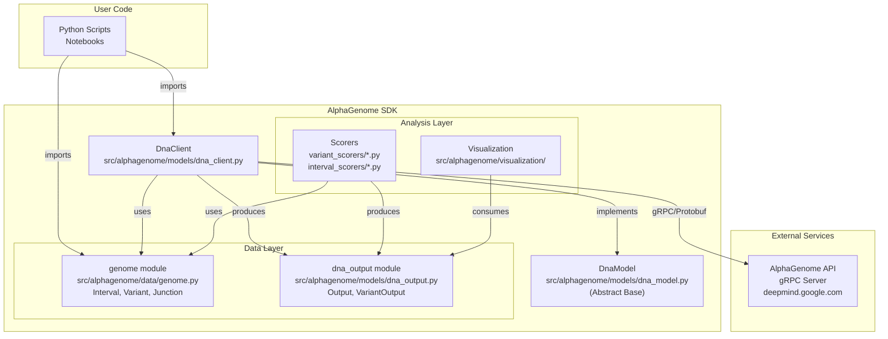
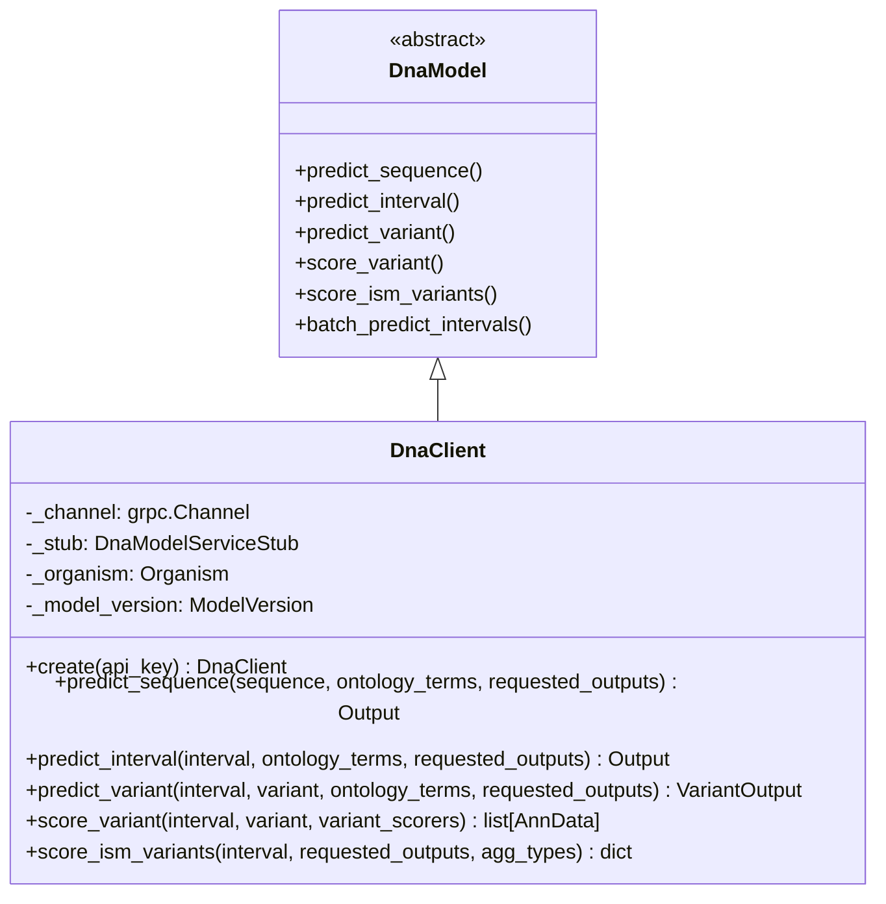
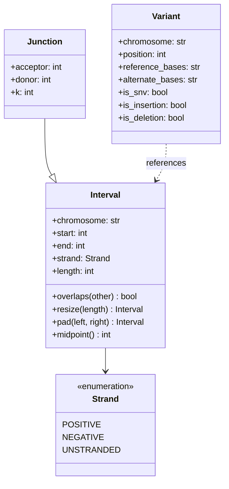
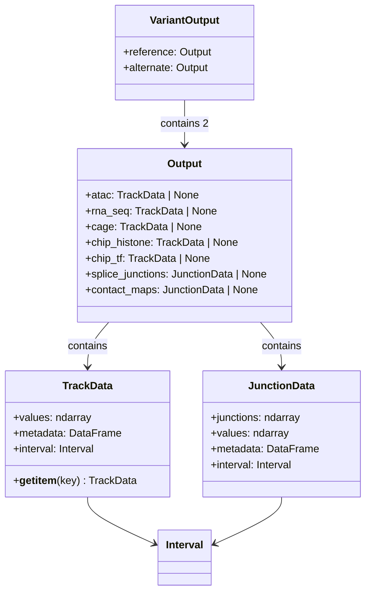
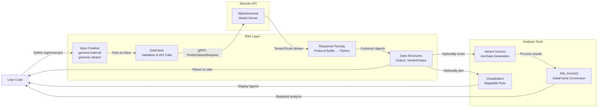

<!-- source: DeepWiki mcp.deepwiki.com · repo google-deepmind/alphagenome · page 1 Overview · fetched 2026-10-26 -->

# Overview

Relevant source files

The following files were used as context for generating this wiki page:

- [CHANGELOG.md](CHANGELOG.md)
- [README.md](README.md)
- [docs/source/index.md](docs/source/index.md)
- [src/alphagenome/__init__.py](src/alphagenome/__init__.py)

This document provides a high-level introduction to the AlphaGenome SDK, its purpose, architecture, and key components. It explains what the SDK does and how its major subsystems work together to provide genomic prediction and variant scoring capabilities.

For detailed installation instructions, see [Installation](#2.1). For hands-on tutorials, see [Quick Start Tutorial](#2.2). For complete API documentation, see [API Reference](#4).

**Sources:** [README.md:1-261](), [docs/source/index.md:1-82](), [src/alphagenome/__init__.py:15-17]()

## Purpose and Scope

The AlphaGenome SDK is a Python client library that provides programmatic access to AlphaGenome, Google DeepMind's genomic foundation model. The SDK abstracts the complexity of network communication, data serialization, and result processing, allowing researchers to focus on scientific questions rather than infrastructure.

The SDK enables three primary workflows:
1. **Genomic predictions** - Generate multimodal predictions (RNA-seq, ATAC-seq, ChIP-seq, etc.) for DNA sequences up to 1 million base pairs
2. **Variant scoring** - Quantify the functional impact of genetic variants using configurable scoring metrics
3. **In-silico mutagenesis (ISM)** - Systematically mutate sequences to identify functional elements

**Sources:** [README.md:15-27](), [docs/source/index.md:3-12]()

## What is AlphaGenome?

AlphaGenome is a deep learning model trained to predict diverse functional genomic outputs from DNA sequences. The model accepts sequences of 4,096 to 1,048,576 base pairs and generates predictions across multiple modalities:

| Modality | Description | Resolution |
|----------|-------------|------------|
| RNA-seq | Gene expression levels | Base-pair |
| ATAC-seq | Chromatin accessibility | Base-pair |
| CAGE | Transcription start sites | Base-pair |
| ChIP-seq (Histone) | Histone modifications | Base-pair |
| ChIP-seq (TF) | Transcription factor binding | Base-pair |
| Splice Junctions | Exon-exon boundaries | Discrete events |
| Contact Maps | 3D chromatin interactions | Junction pairs |

The model is hosted as a remote API service, accessible via gRPC. The SDK in this repository provides the client-side implementation for communicating with this service.

**Sources:** [README.md:15-27](), [docs/source/index.md:6-12]()

## SDK Architecture Overview

**Architecture Overview**

The SDK is organized into four major layers:

1. **Client Layer** - `DnaClient` handles API authentication, network communication, and retry logic
2. **Data Layer** - Core data structures (`Interval`, `Variant`, `Output`) represent genomic entities and predictions
3. **Analysis Layer** - Scorers and visualization tools process predictions into interpretable results
4. **External Services** - The remote AlphaGenome API service that performs model inference

**Sources:** [src/alphagenome/__init__.py:15-17](), Diagram 1 from provided context

## Core Components

### DnaClient - API Communication

The `DnaClient` class is the primary entry point for interacting with AlphaGenome. It implements the `DnaModel` abstract interface and manages all communication with the remote API server.

**Key responsibilities:**
- API authentication using API keys
- Protocol buffer serialization/deserialization
- gRPC channel management with retry logic (`@retry_rpc` decorator)
- Input validation (sequence lengths, valid nucleotides)
- Streaming large predictions (chunked tensor transfer)

**Sources:** [README.md:84-124](), Diagram 4 and Diagram 6 from provided context

### Data Structures

#### Genomic Coordinates

The `genome` module defines fundamental data structures for representing genomic entities:

- **`Interval`** - Represents a genomic region with chromosome, start, end, and strand
- **`Variant`** - Represents a genetic variant with reference and alternate alleles
- **`Junction`** - Extends `Interval` for splice junctions with donor/acceptor coordinates

**Sources:** [README.md:94-100](), Diagram 2 from provided context

#### Prediction Outputs

- **`Output`** - Container for all prediction modalities from a single sequence
- **`VariantOutput`** - Contains paired `Output` objects for reference and alternate alleles
- **`TrackData`** - Continuous signal predictions (e.g., RNA-seq) with NumPy arrays and pandas metadata
- **`JunctionData`** - Discrete event predictions (e.g., splice junctions) with coordinates and scores

**Sources:** Diagram 2 from provided context, [README.md:102-124]()

### Scoring System

The scoring subsystem quantifies functional impacts by comparing predictions or applying aggregation functions:

| Scorer Type | Module | Purpose |
|-------------|--------|---------|
| `CenterMaskScorer` | `variant_scorers/center_mask_scorer.py` | Compare REF vs ALT over central window |
| `GeneMaskLFCScorer` | `variant_scorers/gene_mask_lfc_scorer.py` | Gene-level log-fold-change scoring |
| `GeneMaskSplicingScorer` | `variant_scorers/gene_mask_splicing_scorer.py` | Splice junction impact per gene |
| `PolyadenylationScorer` | `variant_scorers/polyadenylation_scorer.py` | Polyadenylation signal changes |
| `SpliceJunctionScorer` | `variant_scorers/splice_junction_scorer.py` | Individual junction strength changes |
| `GeneMaskIntervalScorer` | `interval_scorers/gene_mask_interval_scorer.py` | Gene activity from single prediction |

Each scorer produces `AnnData` objects with gene-by-track matrices, which can be converted to tidy DataFrames using `tidy_scores()`.

**Sources:** Diagram 4 from provided context, [CHANGELOG.md:78-80]()

## Data Flow Architecture

**Typical workflow sequence:**

1. **Input Definition** - User creates `Interval` and `Variant` objects using the `genome` module
2. **Prediction Request** - `DnaClient` validates inputs and sends gRPC request to API server
3. **Model Inference** - Remote server runs AlphaGenome model and streams back predictions
4. **Response Assembly** - SDK reassembles chunked tensors and creates `Output`/`VariantOutput` objects
5. **Analysis** - User can score variants, convert to DataFrames, or visualize results

**Sources:** Diagram 1 and Diagram 6 from provided context, [README.md:84-124]()

## Key Technologies

The SDK leverages the following core technologies:

| Technology | Purpose | Key Files |
|------------|---------|-----------|
| **gRPC** | Client-server communication | `src/alphagenome/models/dna_client.py` |
| **Protocol Buffers** | Data serialization format | `src/alphagenome/protos/*.proto` |
| **NumPy** | Array storage for predictions | Throughout `dna_output.py` |
| **pandas** | Metadata tables and results | `TrackData.metadata`, `tidy_scores()` |
| **AnnData** | Gene-by-track scoring matrices | Scorer outputs |
| **Matplotlib** | Visualization rendering | `src/alphagenome/visualization/` |

**Sources:** [README.md:187-209]()

## Supported Features

### Organisms

| Organism | Enum Value | Reference Assembly |
|----------|------------|-------------------|
| Human | `Organism.HUMAN` | hg38 |
| Mouse | `Organism.MOUSE` | mm10 |

### Sequence Lengths

Supported sequence lengths (in base pairs): 4,096, 8,192, 16,384, 32,768, 65,536, 131,072, 262,144, 524,288, 1,048,576

Note: 2,048 bp sequences were removed in v0.5.0 due to poor model performance at very short lengths.

**Sources:** [CHANGELOG.md:30-35](), [README.md:20-27]()

## Version and Release Information

Current SDK version: `0.5.1` ([src/alphagenome/__init__.py:17]())

Recent major changes include:
- **v0.5.1** - Move `ModelVersion` enum to `dna_model` base class
- **v0.5.0** - Add ISM support for alternate alleles, remove 2kb sequence support
- **v0.4.0** - Add MANE Select transcript filtering, improve GTF processing
- **v0.3.0** - Add `get_gene_intervals()`, implement `TrackData.__getitem__()`
- **v0.2.0** - Add `DnaModel` abstract base class, improve scoring flexibility

**Sources:** [CHANGELOG.md:1-106](), [src/alphagenome/__init__.py:17]()

## Getting Started

To begin using the AlphaGenome SDK:

1. **Obtain an API key** from [deepmind.google.com/science/alphagenome](https://deepmind.google.com/science/alphagenome)
2. **Install the SDK** following [Installation](#2.1) instructions
3. **Run the Quick Start** tutorial at [Quick Start Tutorial](#2.2)
4. **Explore examples** in the [Examples and Tutorials](#6) section

For common questions, see [Frequently Asked Questions](#9.1). For detailed API documentation, see [API Reference](#4).

**Sources:** [README.md:8-37](), [docs/source/index.md:29-36]()

---

