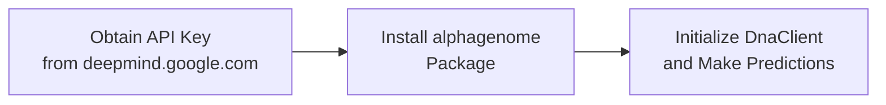
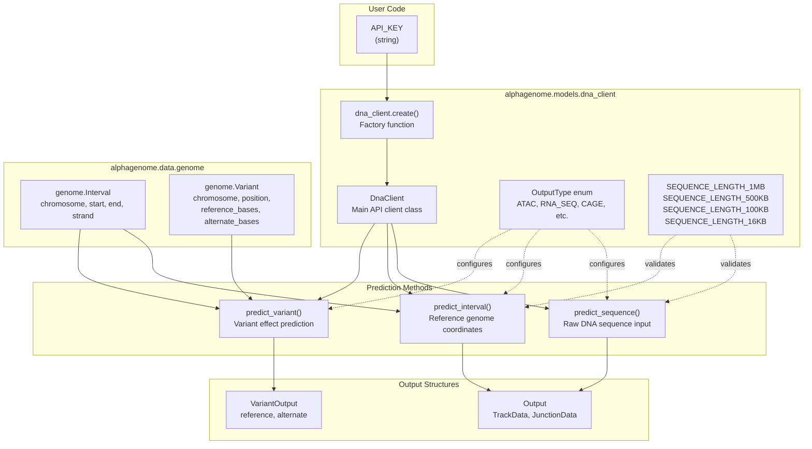
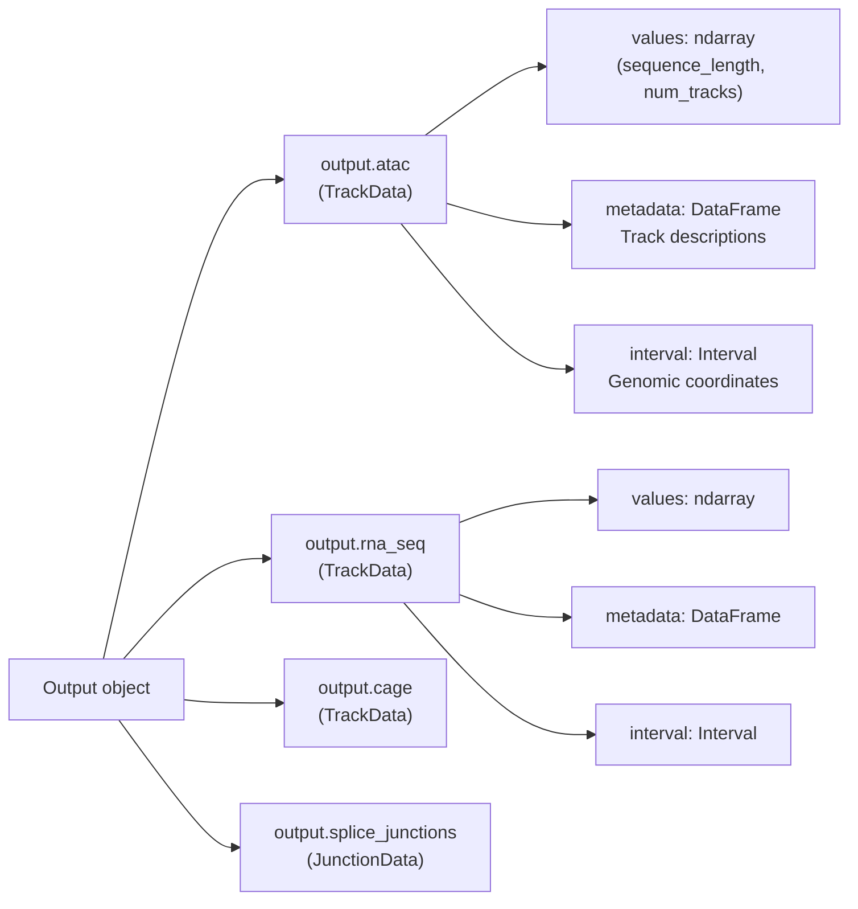
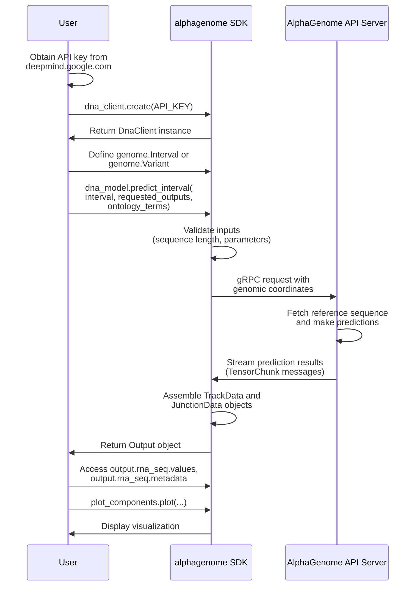

<!-- source: DeepWiki mcp.deepwiki.com · repo google-deepmind/alphagenome · page 2 Getting Started · fetched 2026-10-26 -->

# Getting Started

<details>
<summary>Relevant source files</summary>

The following files were used as context for generating this wiki page:

- [README.md](README.md)
- [colabs/quick_start.ipynb](colabs/quick_start.ipynb)
- [docs/source/index.md](docs/source/index.md)

</details>


This page guides you through the initial setup required to use the AlphaGenome SDK: obtaining an API key, installing the package, and running your first prediction. For detailed installation instructions, see [Installation](#2.1). For a comprehensive walkthrough with examples, see [Quick Start Tutorial](#2.2).

## Overview

Getting started with AlphaGenome involves three main steps:



**Sources:** [README.md:8-36](), [colabs/quick_start.ipynb:54-152]()

## Prerequisites: Obtaining an API Key

Before using the AlphaGenome SDK, you must obtain an API key from [deepmind.google.com/science/alphagenome](https://deepmind.google.com/science/alphagenome). The API is offered free of charge for non-commercial use, subject to the Terms of Use.

**Key points:**
- The API is designed for small to medium-scale analyses (thousands of predictions)
- Query rates vary based on demand
- Not suitable for large-scale analyses requiring more than 1 million predictions

**Sources:** [README.md:8-36](), [docs/source/index.md:14-19]()

## Installation

The AlphaGenome SDK can be installed using pip:

```bash
git clone https://github.com/google-deepmind/alphagenome.git
pip install ./alphagenome
```

For Google Colab environments, you can install directly:

```python
!pip install alphagenome
```

For detailed installation instructions, environment setup, and alternative installation methods, see [Installation](#2.1).

**Sources:** [README.md:138-143](), [colabs/quick_start.ipynb:54-60]()

## Core Workflow Components

The following diagram shows the primary code entities involved in making predictions:



**Sources:** [colabs/quick_start.ipynb:90-152](), [README.md:84-124]()

## Your First Prediction

### Step 1: Initialize the Model Client

Create a `DnaClient` instance using your API key:

```python
from alphagenome.models import dna_client

API_KEY = 'your_api_key_here'
dna_model = dna_client.create(API_KEY)
```

In Google Colab, you can store your API key in Secrets and retrieve it using:

```python
from alphagenome import colab_utils
dna_model = dna_client.create(colab_utils.get_api_key())
```

**Sources:** [colabs/quick_start.ipynb:150-152](), [README.md:91-92]()

### Step 2: Make a Prediction

The SDK supports three main prediction methods:

| Method | Input | Use Case |
|--------|-------|----------|
| `predict_sequence()` | Raw DNA sequence string | Arbitrary sequences, including synthetic DNA |
| `predict_interval()` | Reference genome coordinates | Predictions on human/mouse reference genomes |
| `predict_variant()` | Genomic interval + variant | Compare reference vs. alternate allele effects |

**Example: Predicting from a DNA sequence**

```python
from alphagenome.models import dna_client

output = dna_model.predict_sequence(
    sequence='GATTACA'.center(dna_client.SEQUENCE_LENGTH_1MB, 'N'),
    requested_outputs=[dna_client.OutputType.DNASE],
    ontology_terms=['UBERON:0002048'],  # Lung tissue
)
```

**Example: Predicting from a genomic interval**

```python
from alphagenome.data import genome

interval = genome.Interval(
    chromosome='chr19',
    start=40504839,
    end=41553415,
    strand='+'
)

output = dna_model.predict_interval(
    interval=interval,
    requested_outputs=[dna_client.OutputType.RNA_SEQ],
    ontology_terms=['UBERON:0001114'],  # Right liver lobe
)
```

**Sources:** [colabs/quick_start.ipynb:244-250](), [colabs/quick_start.ipynb:1243-1250](), [README.md:102-108]()

### Step 3: Access Prediction Results

Predictions are returned as `Output` objects containing `TrackData` for continuous signals (e.g., chromatin accessibility, gene expression) and `JunctionData` for discrete events (e.g., splice junctions, contact maps).



Access the predictions and metadata:

```python
# Prediction values (numpy array)
predictions = output.dnase.values  # Shape: (1048576, num_tracks)

# Track metadata (pandas DataFrame)
track_info = output.dnase.metadata
# Contains: name, strand, ontology_curie, biosample_name, etc.

# Genomic coordinates
coords = output.dnase.interval
```

**Sources:** [colabs/quick_start.ipynb:260-373](), [colabs/quick_start.ipynb:1243-1259]()

## Supported Output Types and Sequence Lengths

The model supports multiple output modalities:

| Output Type | Description | Stranded |
|-------------|-------------|----------|
| `ATAC` | ATAC-seq chromatin accessibility | No |
| `DNASE` | DNase-seq chromatin accessibility | No |
| `RNA_SEQ` | RNA-seq gene expression | Yes |
| `CAGE` | CAGE transcription start sites | Yes |
| `CHIP_HISTONE` | Histone ChIP-seq marks | No |
| `CHIP_TF` | Transcription factor binding | No |
| `SPLICE_JUNCTIONS` | Splice junction usage | No |
| `CONTACT_MAPS` | 3D chromatin contacts | No |

**Supported sequence lengths:**
- `SEQUENCE_LENGTH_16KB` (16,384 bp)
- `SEQUENCE_LENGTH_100KB` (102,400 bp)
- `SEQUENCE_LENGTH_500KB` (524,288 bp)
- `SEQUENCE_LENGTH_1MB` (1,048,576 bp)

**Sources:** [colabs/quick_start.ipynb:186-206](), [colabs/quick_start.ipynb:1192-1203]()

## API Key Management

### In Python Scripts

Store your API key as an environment variable or in a secure configuration file:

```python
import os
from alphagenome.models import dna_client

API_KEY = os.environ.get('ALPHAGENOME_API_KEY')
dna_model = dna_client.create(API_KEY)
```

### In Google Colab

Store your API key in Colab Secrets (accessible via the key icon in the left sidebar) with the name `API_KEY`. Then retrieve it using:

```python
from alphagenome import colab_utils
dna_model = dna_client.create(colab_utils.get_api_key())
```

**Sources:** [colabs/quick_start.ipynb:127-152]()

## Next Steps

After completing your first prediction, explore:

1. **[Quick Start Tutorial](#2.2)** - Comprehensive walkthrough with visualization examples
2. **[Core Concepts](#3)** - Understand genomic data structures and prediction workflows
3. **[Making Predictions](#5.1)** - Detailed guide on prediction methods and parameters
4. **[Variant Scoring](#5.2)** - Learn about variant effect scoring strategies
5. **[Creating Visualizations](#5.5)** - Generate publication-ready figures

For interactive tutorials, see the Colab notebooks:
- [Quick Start](https://colab.research.google.com/github/google-deepmind/alphagenome/blob/main/colabs/quick_start.ipynb)
- [Visualization Tour](https://colab.research.google.com/github/google-deepmind/alphagenome/blob/main/colabs/visualization_modality_tour.ipynb)

**Sources:** [README.md:67-79](), [docs/source/index.md:29-82]()

## Workflow Summary

The complete workflow from API key to visualization:



**Sources:** [colabs/quick_start.ipynb:1-1294](), [README.md:67-124]()

---

