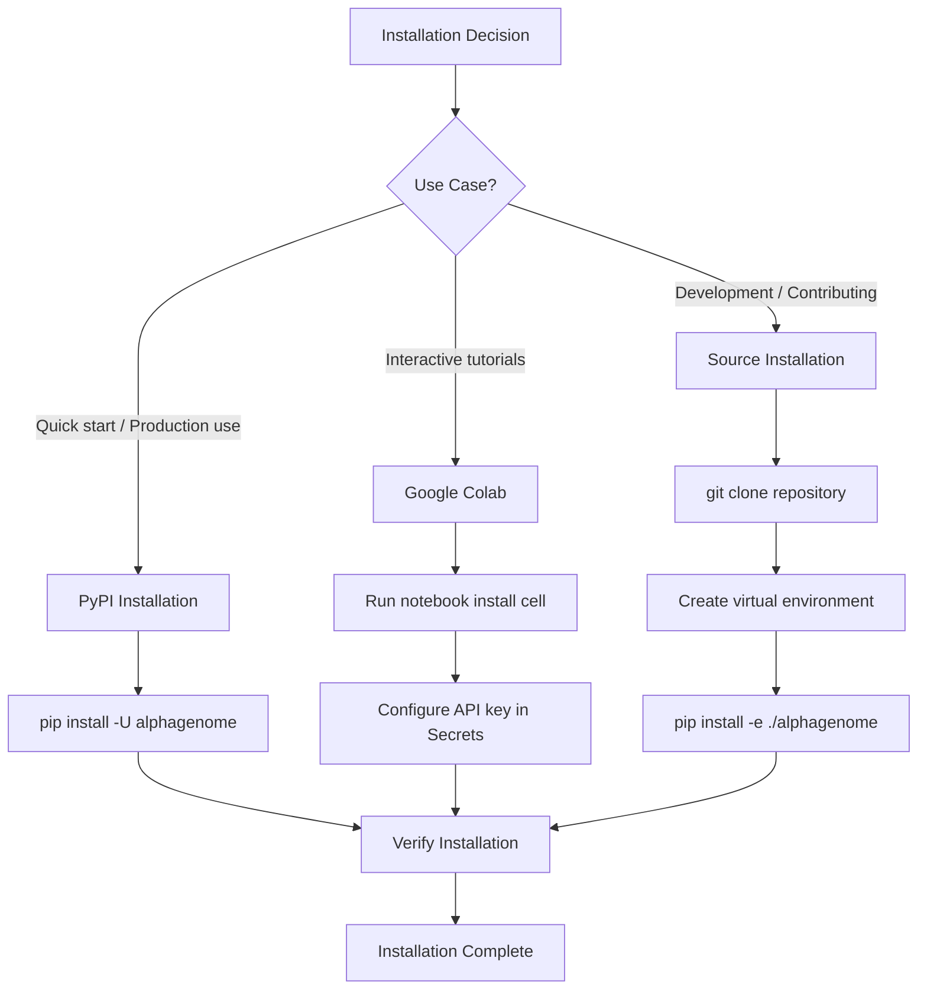
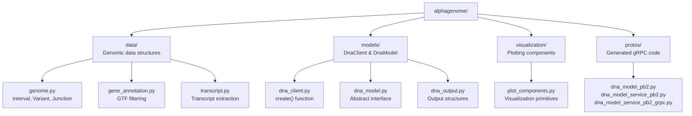

<!-- source: DeepWiki mcp.deepwiki.com · repo google-deepmind/alphagenome · page 2.1 Installation · fetched 2026-10-26 -->

# Installation

<details>
<summary>Relevant source files</summary>

The following files were used as context for generating this wiki page:

- [README.md](README.md)
- [docs/source/index.md](docs/source/index.md)
- [docs/source/installation.md](docs/source/installation.md)
- [pyproject.toml](pyproject.toml)
- [scripts/__init__.py](scripts/__init__.py)
- [scripts/process_gtf.py](scripts/process_gtf.py)
- [scripts/process_gtf_test.py](scripts/process_gtf_test.py)

</details>


This page provides detailed instructions for installing the AlphaGenome Python SDK, including system requirements, dependency management, and environment setup. Installation enables local usage of the SDK for making predictions, scoring variants, and visualizing genomic data through the AlphaGenome API.

For information about running your first prediction after installation, see [Quick Start Tutorial](#2.2). For guidance on obtaining and configuring your API key, see [Quick Start Tutorial](#2.2).

## Prerequisites

### Python Version Requirements

The AlphaGenome SDK requires Python 3.10 or later. Supported versions include Python 3.10, 3.11, 3.12, and 3.13, as specified in [pyproject.toml:12]() and [pyproject.toml:28-31]().

```bash
# Check your Python version
$ python --version
# or
$ python3 --version
```

### API Key

Before using the SDK, you must obtain an API key from [https://deepmind.google.com/science/alphagenome](https://deepmind.google.com/science/alphagenome). The API is offered free of charge for non-commercial use.

**Sources:** [README.md:8](), [README.md:29-30](), [pyproject.toml:12]()

## Installation Methods

The SDK supports three primary installation approaches depending on your use case: PyPI installation for general use, source installation for development, and Colab for interactive notebooks.



**Diagram: Installation Decision Flow**

**Sources:** [README.md:126-146](), [docs/source/installation.md:1-74]()

### PyPI Installation (Recommended)

The simplest method is installing from the Python Package Index (PyPI):

```bash
$ pip install -U alphagenome
```

This installs the latest stable release with all required dependencies listed in [pyproject.toml:34-55](). The `-U` flag ensures you receive the latest version.

**Sources:** [docs/source/installation.md:3-10](), [README.md:137-143]()

### Source Installation

For local development or accessing unreleased features, install from source:

```bash
$ git clone https://github.com/google-deepmind/alphagenome.git
$ pip install ./alphagenome
```

For editable installation (changes to source code immediately reflected):

```bash
$ pip install -e ./alphagenome
```

The editable mode is useful when modifying the SDK or running tests defined in [pyproject.toml:98-109]().

**Sources:** [README.md:140-143](), [docs/source/installation.md:44-51]()

### Google Colab Installation

Tutorial notebooks in the `colabs/` directory include installation cells. The notebooks automatically install the SDK into the Colab runtime environment.

#### Configuring API Key in Colab

1. Open the 🔑 **Secrets** tab in the left panel
2. Create a secret named `ALPHA_GENOME_API_KEY`
3. Paste your API key into the value field
4. Toggle access to allow the notebook to read the secret

**Sources:** [docs/source/installation.md:16-40]()

## Dependency Structure

The SDK has three categories of dependencies: required runtime dependencies, build-time requirements, and optional feature groups.

```mermaid
graph TB
    subgraph "Build System"
        BuildBackend["hatchling<br/>[build-system]"]
        GrpcTools["grpcio-tools≤1.67.1<br/>Protocol buffer compiler"]
        ImportRes["importlib-resources<br/>Resource loading"]
    end
    
    subgraph "Core Runtime Dependencies"
        Grpc["grpcio≥1.67.1<br/>gRPC communication"]
        Protobuf["protobuf≥5.28.3<br/>Serialization"]
        Numpy["numpy<br/>Array operations"]
        Pandas["pandas<br/>DataFrames"]
        Anndata["anndata<br/>Scoring results"]
        Scipy["scipy<br/>Statistical functions"]
        Matplotlib["matplotlib<br/>Visualization"]
    end
    
    subgraph "Supporting Libraries"
        Absl["absl-py<br/>Flags & logging"]
        Jaxtyping["jaxtyping<br/>Type hints"]
        Typeguard["typeguard<br/>Runtime validation"]
        Tqdm["tqdm<br/>Progress bars"]
        Seaborn["seaborn<br/>Plotting"]
        Pyarrow["pyarrow<br/>Feather files"]
        Others["intervaltree<br/>ml_dtypes<br/>immutabledict<br/>typing_extensions<br/>zstandard"]
    end
    
    subgraph "Optional Dependencies"
        Dev["[dev]<br/>hatch"]
        Docs["[docs]<br/>sphinx<br/>myst-nb<br/>sphinx-book-theme"]
        Scripts["[scripts]<br/>pyranges"]
    end
    
    BuildBackend -.->|"builds"| Package["alphagenome package"]
    GrpcTools -.->|"compiles"| Protobuf
    
    Package -->|"requires"| Grpc
    Package -->|"requires"| Protobuf
    Package -->|"requires"| Numpy
    Package -->|"requires"| Pandas
    Package -->|"requires"| Anndata
    Package -->|"requires"| Scipy
    Package -->|"requires"| Matplotlib
    
    Package -->|"requires"| Absl
    Package -->|"requires"| Jaxtyping
    Package -->|"requires"| Typeguard
    Package -->|"requires"| Tqdm
    Package -->|"requires"| Seaborn
    Package -->|"requires"| Pyarrow
    Package -->|"requires"| Others
    
    Package -.->|"optional"| Dev
    Package -.->|"optional"| Docs
    Package -.->|"optional"| Scripts
```



**Diagram: Dependency Hierarchy and Categories**

### Required Dependencies

All runtime dependencies are automatically installed with the SDK. Key dependencies include:

| Category | Package | Version Constraint | Purpose |
|----------|---------|-------------------|---------|
| **Communication** | `grpcio` | ≥1.67.1 | gRPC client for API communication |
| **Communication** | `protobuf` | ≥5.28.3 | Protocol buffer serialization |
| **Data Processing** | `numpy` | (any) | Array operations and numerical computing |
| **Data Processing** | `pandas` | (any) | DataFrame operations and tabular data |
| **Data Processing** | `anndata` | (any) | Storing scoring results |
| **Visualization** | `matplotlib` | (any) | Core plotting functionality |
| **Visualization** | `seaborn` | (any) | Enhanced visualization styles |
| **File I/O** | `pyarrow` | (any) | Feather file format support for GTF data |
| **Scientific** | `scipy` | (any) | Statistical functions and distributions |

The complete dependency list is defined in [pyproject.toml:34-55]().

### Optional Dependencies

Additional feature groups can be installed as needed:

```bash
# Development tools (hatch)
$ pip install alphagenome[dev]

# Documentation building (Sphinx)
$ pip install alphagenome[docs]

# GTF processing scripts (pyranges)
$ pip install alphagenome[scripts]
```

These optional groups are specified in [pyproject.toml:61-83]().

**Sources:** [pyproject.toml:1-55](), [pyproject.toml:61-83](), [README.md:187-208]()

## Virtual Environment Setup

Using a virtual environment is strongly recommended to isolate the SDK dependencies from system Python packages and avoid version conflicts.

### Using venv (Built-in)

Python's built-in `venv` module provides basic virtual environment support:

```bash
# Create environment
$ python3 -m venv alphagenome-env

# Activate environment
$ source alphagenome-env/bin/activate  # Linux/Mac
$ alphagenome-env\Scripts\activate.bat  # Windows

# Install SDK
$ pip install alphagenome
```

### Using conda/miniconda

For users with conda installed, as recommended in [docs/source/installation.md:54-55]():

```bash
# Create environment with Python 3.11
$ conda create -n alphagenome-env python=3.11

# Activate environment
$ conda activate alphagenome-env

# Install SDK
$ pip install -e ./alphagenome
```

### Using uv

The `uv` package manager offers fast, deterministic installation:

```bash
# Install uv
$ pip install uv

# Create environment and install
$ uv venv alphagenome-env
$ source alphagenome-env/bin/activate  # Linux/Mac
$ uv pip install alphagenome
```

**Sources:** [README.md:130-134](), [docs/source/installation.md:53-63]()

## Build System Configuration

The SDK uses `hatch` as its build backend, configured in [pyproject.toml:1-3](). The build process includes special steps for compiling protocol buffer definitions.

```mermaid
graph LR
    Start["pip install invoked"]
    
    Start --> ReadConfig["Read pyproject.toml<br/>[build-system]"]
    ReadConfig --> InstallBuild["Install build dependencies:<br/>hatchling<br/>grpcio-tools≤1.67.1<br/>importlib-resources"]
    
    InstallBuild --> CustomHook["Execute hatch_build.py<br/>[tool.hatch.build.hooks.custom]"]
    CustomHook --> CompileProto["Compile .proto files<br/>Generate Python bindings<br/>src/alphagenome/protos/"]
    
    CompileProto --> BuildWheel["Build wheel package<br/>hatchling backend"]
    BuildWheel --> InstallWheel["Install wheel with dependencies"]
    
    InstallWheel --> Complete["Installation complete"]
```



**Diagram: Build and Installation Process**

### Protocol Buffer Compilation

During build, the custom build hook defined in [pyproject.toml:85-86]() invokes `hatch_build.py` to compile `.proto` files into Python modules. This generates gRPC service stubs used by the `DnaClient` for API communication.

The compiled protocol buffers are excluded from code formatting via [pyproject.toml:136]().

**Sources:** [pyproject.toml:1-3](), [pyproject.toml:85-86](), [pyproject.toml:136]()

## Package Structure

After installation, the SDK provides the following module structure:



**Diagram: Installed Package Module Structure**

### Import Paths

Common import patterns after installation:

```python
# Core client and model
from alphagenome.models import dna_client
from alphagenome.models.dna_client import OutputType

# Genomic data structures  
from alphagenome.data import genome
from alphagenome.data.genome import Interval, Variant, Junction

# Gene annotations
from alphagenome.data import gene_annotation

# Visualization
from alphagenome.visualization import plot_components

# Scoring
from alphagenome.models.variant_scorers import tidy_scores
```

**Sources:** [README.md:85-87]()

## Updating the SDK

### PyPI Installation

Update to the latest release:

```bash
$ pip install --upgrade alphagenome
```

### Source Installation

Pull latest changes and reinstall:

```bash
$ cd ./alphagenome
$ git pull
$ pip install --upgrade .
```

For editable installations, reinstallation is typically not required as changes are immediately reflected, but may be needed if [pyproject.toml]() dependencies change.

**Sources:** [docs/source/installation.md:65-73]()

## Verification

After installation, verify the SDK is properly installed:

```python
# Check package is importable
import alphagenome
print(alphagenome.__version__)

# Verify key modules
from alphagenome.models import dna_client
from alphagenome.data import genome
from alphagenome.visualization import plot_components

print("AlphaGenome SDK installed successfully")
```

The version string is read from [pyproject.toml:89]() which points to `src/alphagenome/__init__.py`.

**Sources:** [pyproject.toml:88-89]()

## Troubleshooting

### Common Installation Issues

| Issue | Cause | Solution |
|-------|-------|----------|
| `ModuleNotFoundError: grpcio` | Build dependencies not installed | Ensure `pip` is up to date: `pip install --upgrade pip` |
| Protocol buffer compilation fails | Old `grpcio-tools` version | Build system constraint in [pyproject.toml:3]() should handle this |
| `ImportError: cannot import name` | Cached build artifacts | Remove `build/` and `*.egg-info/` directories, reinstall |
| Python version error | Python <3.10 | Upgrade Python to ≥3.10 as required by [pyproject.toml:12]() |

### Testing Installation

Run the test suite to verify installation integrity:

```bash
# Install test dependencies
$ pip install alphagenome[dev]

# Run all tests
$ python3 -m hatch test

# Run tests on all supported Python versions
$ python3 -m hatch test --all
```

Test configuration is defined in [pyproject.toml:98-109]() and uses parallel execution across Python 3.10-3.13.

**Sources:** [README.md:154-161](), [pyproject.toml:98-109]()

## Development Environment Setup

For contributors or developers modifying the SDK source code:

```bash
# Clone repository
$ git clone https://github.com/google-deepmind/alphagenome.git
$ cd alphagenome

# Create virtual environment
$ python3 -m venv venv
$ source venv/bin/activate

# Install in editable mode with dev dependencies
$ pip install -e .[dev]

# Install pre-commit hooks and testing tools
$ pip install hatch

# Run linters and formatters
$ python3 -m hatch run check:all

# Run tests
$ python3 -m hatch test
```

The development environment includes:
- Code formatting via `pyink` (Google style guide) - [pyproject.toml:114]()
- Linting via `pylint` - [pyproject.toml:115]()
- Notebook validation via `nbconvert` - [pyproject.toml:123]()

Environment configuration is in [pyproject.toml:91-92]() which specifies `uv` as the installer for faster dependency resolution.

**Sources:** [README.md:148-161](), [pyproject.toml:91-137]()

---

