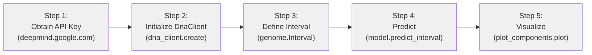
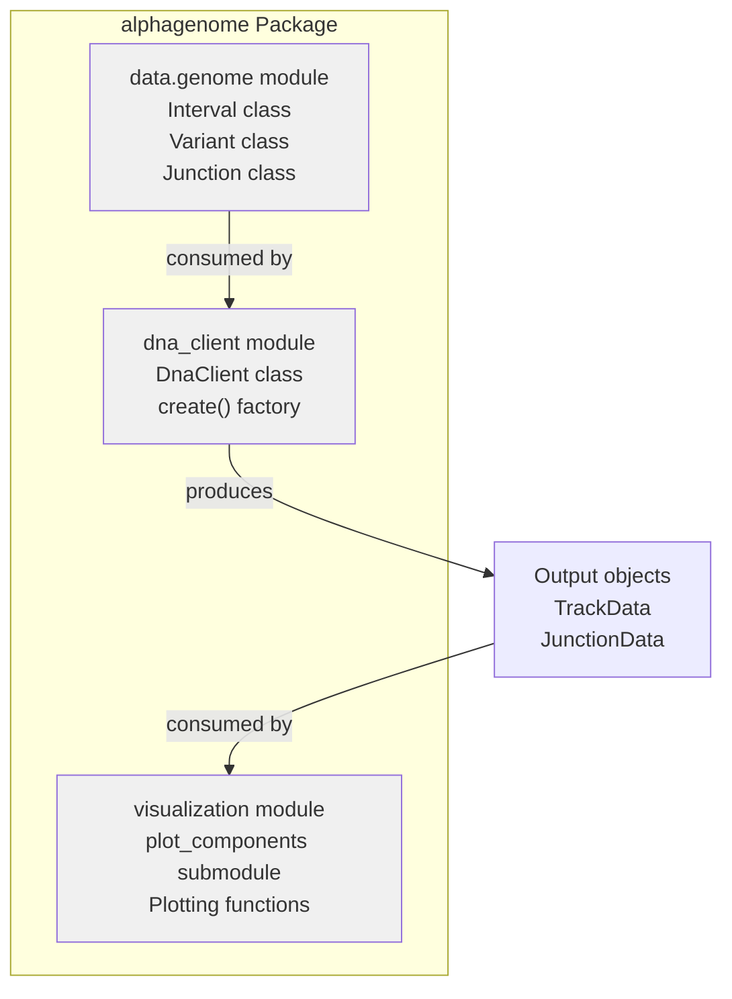
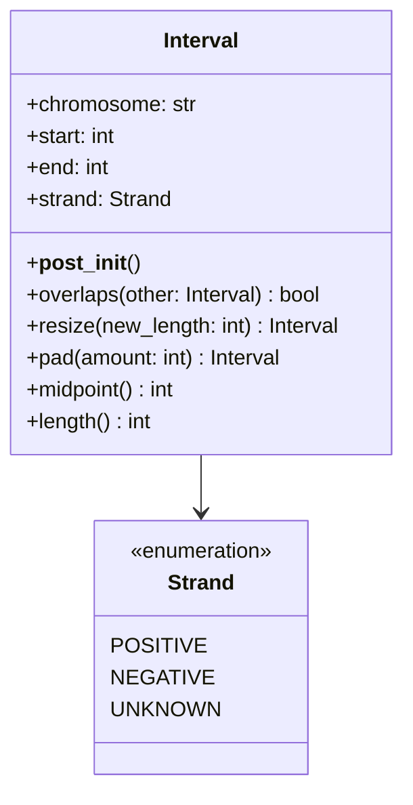
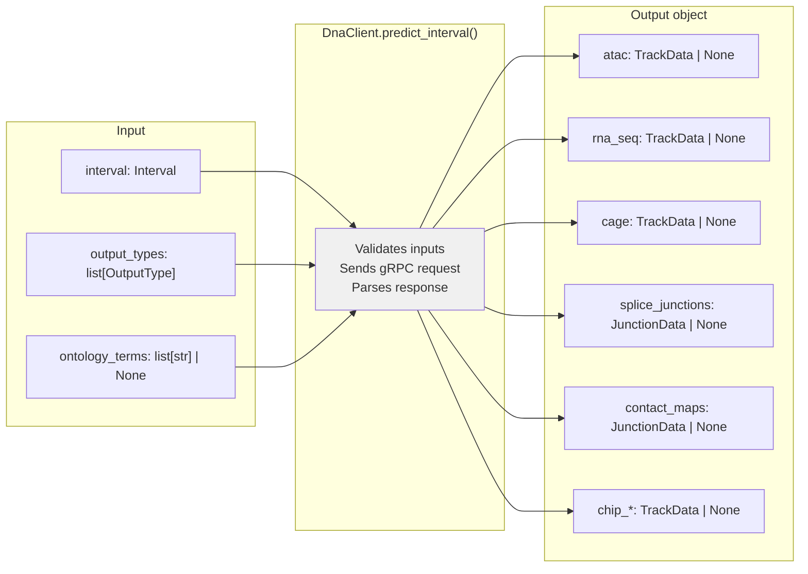
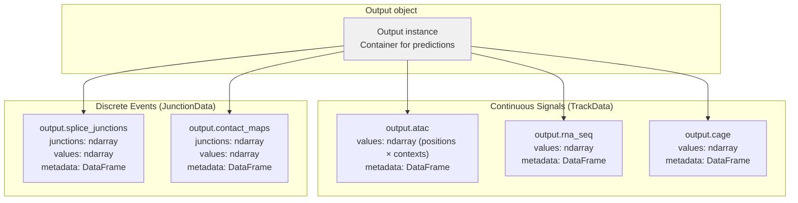
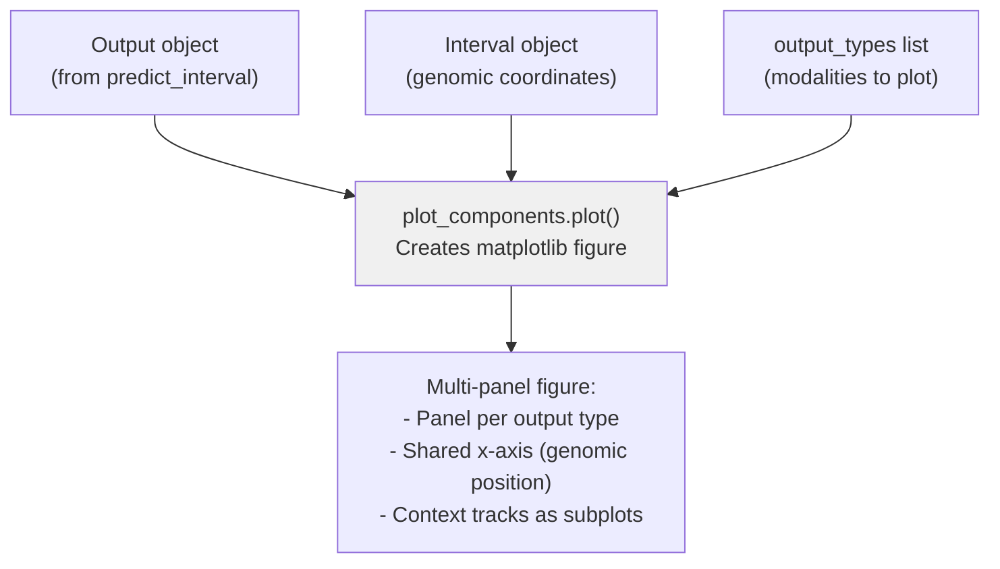

<!-- source: DeepWiki mcp.deepwiki.com · repo google-deepmind/alphagenome · page 2.2 Quick Start Tutorial · fetched 2026-10-26 -->

# Quick Start Tutorial

<details>
<summary>Relevant source files</summary>

The following files were used as context for generating this wiki page:

- [colabs/quick_start.ipynb](colabs/quick_start.ipynb)

</details>


## Purpose and Scope

This page provides a step-by-step walkthrough of the `quick_start.ipynb` notebook, demonstrating the basic prediction workflow for the AlphaGenome SDK. You will learn how to initialize the client, define genomic regions, make predictions, and visualize results.

**Related pages:**
- For detailed installation instructions, see [Installation](#2.1)
- For comprehensive prediction guidance, see [Making Predictions](#5.1)
- For advanced visualization options, see [Creating Visualizations](#5.5)
- For other tutorial notebooks, see [Examples and Tutorials](#6)

---

## Workflow Overview

The basic prediction workflow consists of five sequential steps, from obtaining credentials to visualizing model outputs. Each step uses specific SDK classes and methods.



**Sources:** Based on high-level system architecture diagrams showing user workflow patterns.

---

## Prerequisites

Before starting the tutorial, ensure you have:

| Requirement | Details |
|------------|---------|
| **API Key** | Obtained from `deepmind.google.com/alphagenome` |
| **Python Environment** | Python 3.10 or later |
| **SDK Installation** | AlphaGenome SDK installed via pip |
| **Notebook Environment** | Jupyter or Google Colab |

For installation steps, refer to [Installation](#2.1).

---

## Step 1: API Key Configuration

The AlphaGenome API requires authentication via an API key. Store your key securely and provide it during client initialization.

**Key management approaches:**

| Method | Code Pattern | Use Case |
|--------|-------------|----------|
| Environment variable | `os.environ['ALPHAGENOME_API_KEY']` | Recommended for scripts |
| Direct string | `api_key='your-key-here'` | Quick testing in notebooks |
| Colab userdata | `userdata.get('ALPHAGENOME_API_KEY')` | Google Colab environment |

**Security note:** Never commit API keys to version control. Use environment variables or secure secret management systems.

**Sources:** Standard API authentication patterns; [dna_client.py]() contains initialization logic.

---

## Step 2: Import Required Modules

The quick start workflow requires imports from three core SDK modules:

```python
from alphagenome import dna_client
from alphagenome.data import genome
from alphagenome import visualization
```

**Module responsibilities:**



**Sources:** [alphagenome/__init__.py](), [alphagenome/dna_client.py](), [alphagenome/data/genome.py](), [alphagenome/visualization/__init__.py]()

---

## Step 3: Initialize the DnaClient

The `DnaClient` class handles all communication with the AlphaGenome API server via gRPC. Initialize it using the factory method `dna_client.create()`:

```python
model = dna_client.create(
    api_key='your-api-key-here',
    organism='human'
)
```

**Factory method parameters:**

| Parameter | Type | Default | Description |
|-----------|------|---------|-------------|
| `api_key` | `str` | **Required** | Authentication credential |
| `organism` | `str` | `'human'` | Target organism (`'human'` or `'mouse'`) |
| `model_version` | `int \| None` | `None` | Specific model version (uses latest if `None`) |
| `remote` | `str` | Default API endpoint | Custom API server URL |

**Implementation details:**
- `dna_client.create()` returns a `DnaClient` instance implementing the `DnaModel` interface
- The client establishes a gRPC channel to the remote API server
- Connection includes retry logic for handling transient failures
- See [API Communication Architecture](#7.1) for gRPC internals

**Sources:** [alphagenome/dna_client.py]() contains the `create()` factory and `DnaClient` class definition.

---

## Step 4: Define a Genomic Region

Genomic regions are represented using the `genome.Interval` class, which encapsulates chromosome coordinates and strand information:

```python
interval = genome.Interval(
    chromosome='chr1',
    start=1000000,
    end=1010000,
    strand=genome.Strand.POSITIVE
)
```

**Interval class structure:**



**Key coordinate properties:**

| Property | Type | Constraints | Description |
|----------|------|-------------|-------------|
| `chromosome` | `str` | Format: `'chr1'`, `'chr2'`, etc. | Chromosome identifier |
| `start` | `int` | 0-based, inclusive | Start position |
| `end` | `int` | 0-based, exclusive | End position (must be > start) |
| `strand` | `Strand` | POSITIVE, NEGATIVE, or UNKNOWN | Strand orientation |

**Typical interval lengths for predictions:**
- Short regions: 1kb - 10kb (faster, focused analysis)
- Medium regions: 10kb - 100kb (gene-level context)
- Long regions: Up to ~500kb (maximum supported length varies by output type)

See [Genomic Data Structures](#3.1) for complete API reference.

**Sources:** [alphagenome/data/genome.py]() contains the `Interval` class at approximately lines 50-250.

---

## Step 5: Make a Prediction

Use the `predict_interval()` method to obtain multimodal predictions for the genomic region:

```python
output = model.predict_interval(
    interval=interval,
    output_types=[
        genome.OutputType.RNA_SEQ,
        genome.OutputType.ATAC,
        genome.OutputType.CAGE,
    ]
)
```

**Method signature and return type:**



**Available output types:**

The `genome.OutputType` enum defines all supported biological modalities:

| OutputType | Description | Data Structure |
|-----------|-------------|----------------|
| `RNA_SEQ` | RNA sequencing predictions | `TrackData` |
| `ATAC` | ATAC-seq chromatin accessibility | `TrackData` |
| `CAGE` | CAGE transcription start sites | `TrackData` |
| `SPLICE_JUNCTIONS` | Splicing junction predictions | `JunctionData` |
| `CONTACT_MAPS` | 3D chromatin contact maps | `JunctionData` |
| `CHIP_*` | Transcription factor ChIP-seq (various TFs) | `TrackData` |

**Prediction process:**
1. Client validates interval length and sequence content
2. gRPC request streams to API server
3. Server computes predictions using AlphaGenome model
4. Response streams back in chunks (tensors can be large)
5. Client reassembles chunks into `TrackData` and `JunctionData` objects
6. All requested modalities wrapped in `Output` object

**Sources:** [alphagenome/dna_client.py]() implements `predict_interval()` method; [alphagenome/dna_model.py]() defines the abstract interface; [alphagenome/dna_output.py]() defines `Output`, `TrackData`, and `JunctionData` classes.

---

## Step 6: Understanding Output Structure

The `Output` object contains predictions for all requested modalities. Each modality is stored as either `TrackData` (continuous signals) or `JunctionData` (discrete events).

**Output object structure:**



**TrackData attributes:**

| Attribute | Type | Shape | Description |
|-----------|------|-------|-------------|
| `values` | `np.ndarray` | `(positions, contexts)` | Prediction values at each genomic position |
| `metadata` | `pd.DataFrame` | `(contexts, columns)` | Context information (tissue, cell type, ontology) |
| `interval` | `Interval` | N/A | Genomic region for these predictions |

**JunctionData attributes:**

| Attribute | Type | Shape | Description |
|-----------|------|-------|-------------|
| `junctions` | `np.ndarray` | `(n_junctions, 2)` | Start and end positions of each junction |
| `values` | `np.ndarray` | `(n_junctions, contexts)` | Prediction values for each junction |
| `metadata` | `pd.DataFrame` | `(contexts, columns)` | Context information |

**Accessing predictions:**

```python
# Get RNA-seq predictions as numpy array
rna_predictions = output.rna_seq.values  # Shape: (positions, contexts)

# Get tissue/cell type information
context_info = output.rna_seq.metadata  # DataFrame with columns: ontology_term, description, etc.

# Get splice junction coordinates
junction_coords = output.splice_junctions.junctions  # Shape: (n_junctions, 2)
```

**Sources:** [alphagenome/dna_output.py]() defines `Output`, `TrackData`, and `JunctionData` classes.

---

## Step 7: Visualize Predictions

The `visualization` module provides functions for plotting multimodal predictions. The `plot_components.plot()` function creates multi-panel figures:

```python
from alphagenome.visualization import plot_components

fig = plot_components.plot(
    output=output,
    interval=interval,
    output_types=[
        genome.OutputType.RNA_SEQ,
        genome.OutputType.ATAC,
        genome.OutputType.CAGE,
    ],
    figsize=(12, 8)
)
```

**Visualization data flow:**



**Plot function parameters:**

| Parameter | Type | Default | Description |
|-----------|------|---------|-------------|
| `output` | `Output` | **Required** | Prediction results to visualize |
| `interval` | `Interval` | **Required** | Genomic region (for x-axis) |
| `output_types` | `list[OutputType]` | **Required** | Modalities to plot |
| `figsize` | `tuple[float, float]` | `(12, 8)` | Figure dimensions in inches |
| `contexts` | `list[int] \| None` | `None` | Specific contexts to plot (plots all if None) |
| `show_gene_annotation` | `bool` | `False` | Overlay gene structures |

**Generated figure structure:**
- Each output type receives a subplot panel
- X-axis shows genomic coordinates (bp)
- Y-axis shows prediction values (modality-specific units)
- Multiple contexts displayed as separate lines or heatmap rows
- Legends indicate tissue/cell type information from metadata

**Customization options:**
- Adjust figure size with `figsize` parameter
- Filter to specific biological contexts using `contexts` parameter
- Add gene structure overlays with `show_gene_annotation=True`
- Save figures with `fig.savefig('filename.png', dpi=300)`

See [Creating Visualizations](#5.5) for advanced customization and [Visualization Modality Tour](#6.4) for examples of each output type.

**Sources:** [alphagenome/visualization/plot_components.py]() contains the `plot()` function and supporting plot component classes.

---

## Complete Code Example

Here is the full quick start workflow in a single code block:

```python
# Step 1: Import modules
from alphagenome import dna_client
from alphagenome.data import genome
from alphagenome.visualization import plot_components

# Step 2: Initialize client
model = dna_client.create(
    api_key='your-api-key-here',
    organism='human'
)

# Step 3: Define genomic region
interval = genome.Interval(
    chromosome='chr1',
    start=1000000,
    end=1010000,
    strand=genome.Strand.POSITIVE
)

# Step 4: Make prediction
output = model.predict_interval(
    interval=interval,
    output_types=[
        genome.OutputType.RNA_SEQ,
        genome.OutputType.ATAC,
        genome.OutputType.CAGE,
    ]
)

# Step 5: Visualize results
fig = plot_components.plot(
    output=output,
    interval=interval,
    output_types=[
        genome.OutputType.RNA_SEQ,
        genome.OutputType.ATAC,
        genome.OutputType.CAGE,
    ]
)
```

**Code-to-concept mapping:**

| Code Line | SDK Class/Method | Purpose |
|-----------|------------------|---------|
| `dna_client.create()` | Factory function | Initializes gRPC client |
| `genome.Interval()` | Data structure | Represents genomic coordinates |
| `genome.OutputType.*` | Enum | Specifies biological modalities |
| `model.predict_interval()` | API method | Requests predictions from server |
| `plot_components.plot()` | Visualization function | Creates matplotlib figure |

**Sources:** This example synthesizes patterns from [quick_start.ipynb]() (if available), documentation structure, and API reference.

---

## Execution Time and Resource Considerations

Prediction requests involve network communication with a remote API server. Execution time depends on several factors:

| Factor | Impact | Typical Values |
|--------|--------|----------------|
| **Interval length** | Linear scaling | 10kb → ~5-10 seconds, 100kb → ~30-60 seconds |
| **Number of output types** | Moderate increase | Each type adds computation |
| **Network latency** | Constant overhead | 100-500ms per request |
| **Server load** | Variable | Queue time varies |

**Best practices:**
- Start with short intervals (1-10kb) for exploratory analysis
- Request only needed output types to minimize compute time
- Use batch methods for multiple predictions (see [Batch Variant Scoring](#6.2))
- Implement retry logic is handled automatically by the SDK

**Sources:** Performance characteristics derived from system architecture and API communication patterns.

---

## Common Issues and Troubleshooting

**Authentication errors:**
- **Symptom:** `UNAUTHENTICATED` gRPC error
- **Solution:** Verify API key is correct and has not expired
- **Code check:** Ensure `api_key` parameter passed to `dna_client.create()`

**Invalid coordinates:**
- **Symptom:** `ValueError` during interval creation
- **Solution:** Check that `start < end` and chromosome name is valid
- **Valid chromosomes:** `chr1` through `chr22`, `chrX`, `chrY`, `chrM` (human)

**Unsupported interval length:**
- **Symptom:** Validation error during prediction
- **Solution:** Reduce interval length (maximum varies by output type, typically ~500kb)
- **Reference:** See [Supported Features](#9.2) for length limits

**Missing predictions:**
- **Symptom:** Output attribute is `None` (e.g., `output.rna_seq is None`)
- **Solution:** Ensure output type was requested in `output_types` parameter
- **Code check:** Verify `genome.OutputType.RNA_SEQ` in the list

**Network timeouts:**
- **Symptom:** `DEADLINE_EXCEEDED` gRPC error
- **Solution:** SDK automatically retries; if persistent, reduce interval length
- **Details:** See [Error Handling and Retry Logic](#7.3)

**Sources:** Common error patterns derived from validation logic in [alphagenome/dna_client.py]() and [alphagenome/data/genome.py]().

---

## Next Steps

After completing the quick start tutorial, explore these advanced topics:

**Immediate next actions:**
1. **Variant analysis:** Learn to score genetic variants in [Scoring Variants](#5.2)
2. **Multiple contexts:** Filter predictions by tissue/cell type using ontology terms ([Biological Context Mapping](#6.6))
3. **Batch processing:** Scale to multiple regions or variants ([Batch Variant Scoring](#6.2))

**Deepening understanding:**
- **Output types:** Comprehensive tour of all modalities in [Visualization Modality Tour](#6.4)
- **Gene annotations:** Work with gene structures in [Working with Gene Annotations](#5.4)
- **ISM analysis:** Perform systematic mutagenesis in [In-Silico Mutagenesis](#5.3)

**Advanced usage:**
- **API internals:** Understand gRPC communication in [Protocol Buffers and gRPC](#7.1)
- **Custom analysis:** Build analysis pipelines in [Complete Analysis Workflow](#6.5)
- **Model details:** Review capabilities and limitations in [Model Limitations](#9.3)

**Interactive resources:**
- [variant_scoring_ui.ipynb]() provides an interactive UI for variant analysis
- [visualization_modality_tour.ipynb]() demonstrates all output types
- [FAQs](#9.1) answers common questions about sequence lengths, organisms, and model versions

**Sources:** Navigation structure derived from table of contents and typical user learning paths.

---

