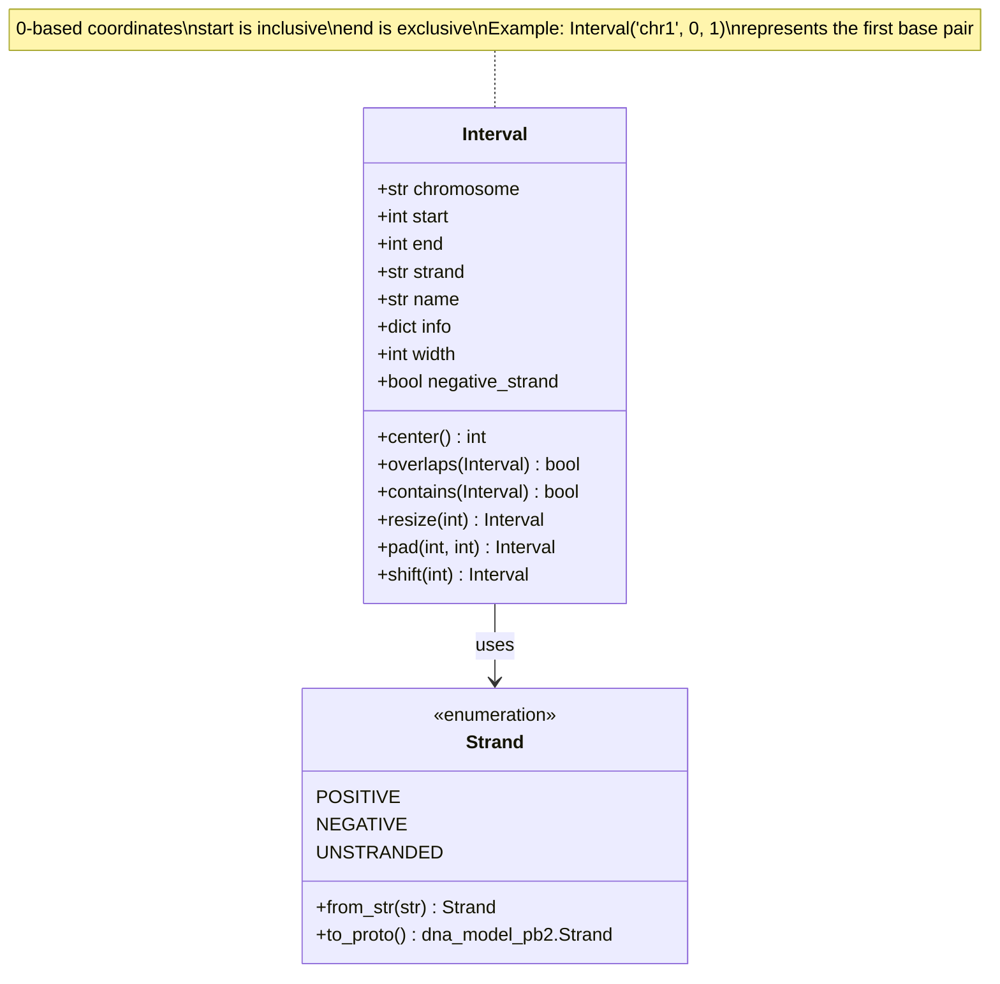
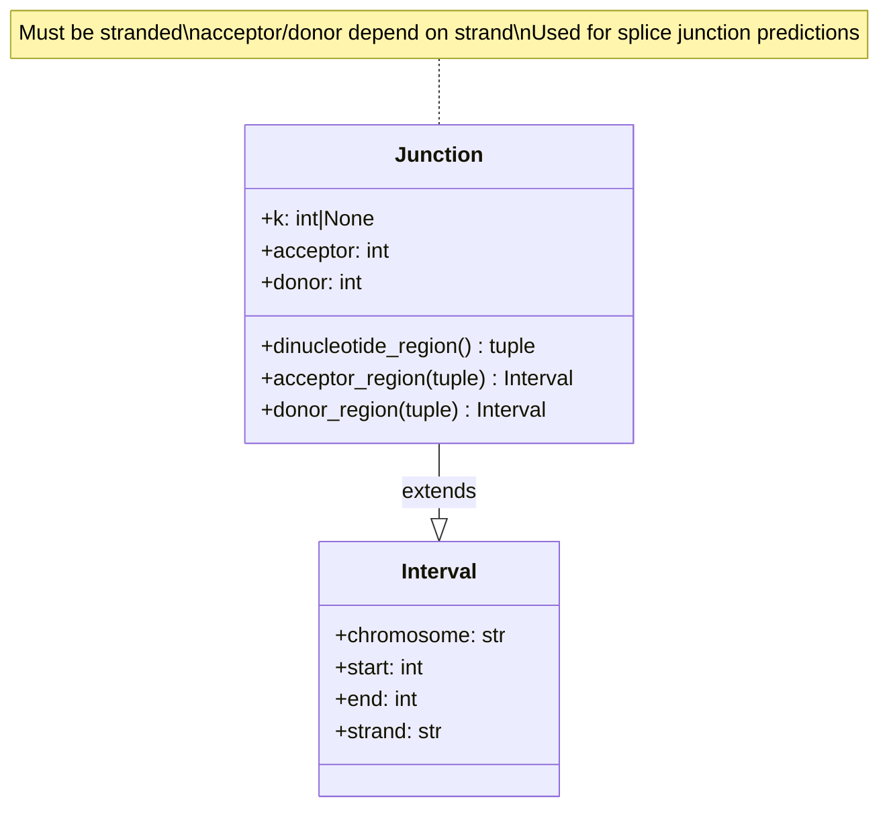
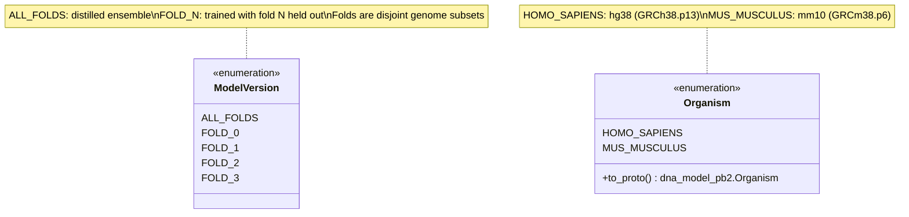
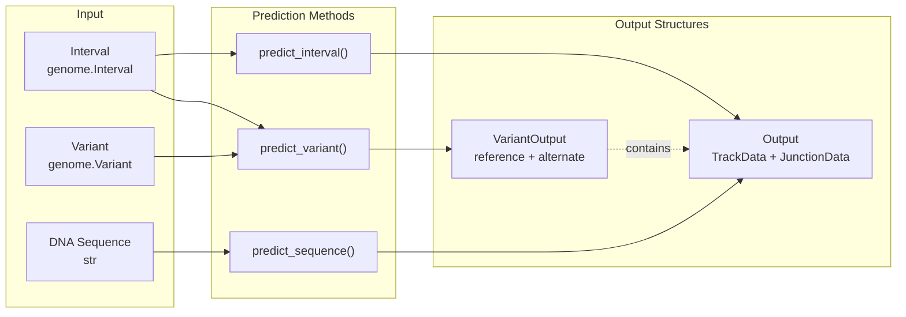
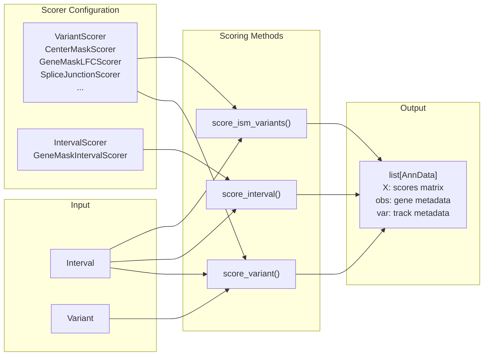
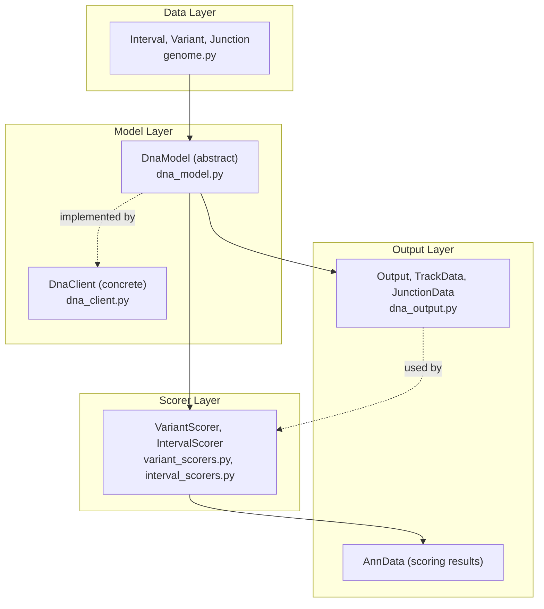

<!-- source: DeepWiki mcp.deepwiki.com · repo google-deepmind/alphagenome · page 3 Core Concepts · fetched 2026-10-26 -->

# Core Concepts

<details>
<summary>Relevant source files</summary>

The following files were used as context for generating this wiki page:

- [docs/source/_templates/autosummary/class.rst](docs/source/_templates/autosummary/class.rst)
- [docs/source/faqs.md](docs/source/faqs.md)
- [docs/source/refs.bib](docs/source/refs.bib)
- [src/alphagenome/data/genome.py](src/alphagenome/data/genome.py)
- [src/alphagenome/data/genome_test.py](src/alphagenome/data/genome_test.py)
- [src/alphagenome/models/dna_model.py](src/alphagenome/models/dna_model.py)
- [src/alphagenome/models/dna_model_test.py](src/alphagenome/models/dna_model_test.py)

</details>


This page introduces the fundamental concepts underlying the AlphaGenome SDK architecture. It covers the core data structures for representing genomic entities, the distinction between prediction and scoring operations, and the model abstraction layer. For detailed API documentation of specific classes and methods, see the [API Reference](#4). For practical usage examples, see [User Guides](#5).

## Genomic Coordinate System

The SDK uses a zero-based, half-open coordinate system for all genomic intervals, consistent with Python's indexing conventions. The `Interval` class [src/alphagenome/data/genome.py:98-595]() represents a contiguous genomic region.

### Interval Representation



**Sources:** [src/alphagenome/data/genome.py:98-595](), [docs/source/faqs.md:14-39]()

### Indexing Convention

| Concept | Indexing | Example | Notes |
|---------|----------|---------|-------|
| `Interval.start` | 0-based | `Interval('chr1', 0, 1)` | First base pair of chr1 |
| `Interval.end` | 0-based exclusive | Range is [start, end) | Does not include base at `end` |
| `Variant.position` | 1-based | `Variant('chr1', 1, 'A', 'T')` | Compatible with dbSNP, VCF |
| `Variant.start` | 0-based | `position - 1` | Derived property for consistency |

The distinction exists because public databases (dbSNP, VCF) use 1-based positions, while internal calculations use 0-based indices. The `Variant` class [src/alphagenome/data/genome.py:644-868]() accepts 1-based `position` but provides 0-based `start` and `end` properties.

**Sources:** [docs/source/faqs.md:20-36](), [docs/source/faqs.md:245-265](), [src/alphagenome/data/genome.py:710-718]()

### Strandedness

DNA is double-stranded. The SDK represents strand using three values:

- `+` (POSITIVE): Forward strand, 5'→3' direction
- `-` (NEGATIVE): Reverse strand, 3'→5' direction  
- `.` (UNSTRANDED): Strand not specified

Strand-aware operations (e.g., `pad()`, `resize()`, `center()`) adjust behavior based on orientation to maintain biological consistency when intervals are reverse-complemented.

**Sources:** [docs/source/faqs.md:110-163](), [src/alphagenome/data/genome.py:38-93]()

## Genetic Variation Representation

### Variant Class

The `Variant` class [src/alphagenome/data/genome.py:644-868]() represents genetic mutations including SNVs, insertions, and deletions:

```python
# Example variant definitions
snv = Variant('chr1', 1024, 'A', 'C')           # Single nucleotide variant
deletion = Variant('chr1', 1024, 'ATG', 'A')    # Deletion of TG
insertion = Variant('chr1', 1024, 'A', 'ATGC')  # Insertion of TGC
```

**Key Properties:**

| Property | Type | Description |
|----------|------|-------------|
| `is_snv` | bool | Single nucleotide variant |
| `is_insertion` | bool | Alternate longer than reference |
| `is_deletion` | bool | Reference longer than alternate |
| `is_indel` | bool | Any insertion or deletion |
| `is_frameshift` | bool | Indel size not divisible by 3 |
| `is_structural` | bool | Indel size ≥ 50 bp |
| `reference_interval` | Interval | Genomic span of reference allele |

Variants use left-alignment following the normalization algorithm from Tan et al. (2015) [src/alphagenome/data/genome.py:950-1005](). The `normalize_variant()` function ensures consistent representation across different input formats.

**Sources:** [src/alphagenome/data/genome.py:644-868](), [docs/source/faqs.md:239-293]()

### Junction Class

The `Junction` class [src/alphagenome/data/genome.py:870-930]() extends `Interval` to represent splice junctions:



The `acceptor` and `donor` properties return positions that respect strand orientation:
- Positive strand: donor=start, acceptor=end
- Negative strand: donor=end, acceptor=start

**Sources:** [src/alphagenome/data/genome.py:870-930]()

## Model Abstraction Layer

### DnaModel Interface

The `DnaModel` abstract base class [src/alphagenome/models/dna_model.py:73-508]() defines the contract for all AlphaGenome models:

```mermaid
graph TB
    subgraph "Abstract Interface"
        DnaModel["DnaModel (ABC)"]
    end
    
    subgraph "Core Methods"
        predict_sequence["predict_sequence(sequence, organism, outputs)"]
        predict_interval["predict_interval(interval, organism, outputs)"]
        predict_variant["predict_variant(interval, variant, organism, outputs)"]
        score_interval["score_interval(interval, scorers, organism)"]
        score_variant["score_variant(interval, variant, scorers, organism)"]
        score_ism_variants["score_ism_variants(interval, ism_interval, scorers)"]
        output_metadata["output_metadata(organism)"]
    end
    
    subgraph "Batch Methods"
        predict_sequences["predict_sequences(sequences, ...)"]
        predict_intervals["predict_intervals(intervals, ...)"]
        predict_variants["predict_variants(intervals, variants, ...)"]
        score_intervals["score_intervals(intervals, ...)"]
        score_variants["score_variants(intervals, variants, ...)"]
    end
    
    subgraph "Concrete Implementation"
        DnaClient["DnaClient"]
    end
    
    DnaModel --> predict_sequence
    DnaModel --> predict_interval
    DnaModel --> predict_variant
    DnaModel --> score_interval
    DnaModel --> score_variant
    DnaModel --> score_ism_variants
    DnaModel --> output_metadata
    
    DnaModel -.provides default.-> predict_sequences
    DnaModel -.provides default.-> predict_intervals
    DnaModel -.provides default.-> predict_variants
    DnaModel -.provides default.-> score_intervals
    DnaModel -.provides default.-> score_variants
    
    DnaClient -.implements.-> DnaModel
```



The abstract methods must be implemented by concrete classes (e.g., `DnaClient`). Batch methods have default implementations that parallelize calls using `ThreadPoolExecutor` [src/alphagenome/models/dna_model.py:102-158]().

**Sources:** [src/alphagenome/models/dna_model.py:73-508]()

### Model Version and Organism



The `ModelVersion` enum [src/alphagenome/models/dna_model.py:35-56]() allows selecting between the distilled ensemble model (`ALL_FOLDS`) and fold-specific models trained on different genome partitions. The `Organism` enum [src/alphagenome/models/dna_model.py:58-71]() specifies the reference genome assembly.

**Sources:** [src/alphagenome/models/dna_model.py:35-71](), [docs/source/faqs.md:40-46]()

## Prediction vs Scoring Paradigm

The SDK distinguishes between two operational modes:

### Prediction Operations

**Purpose:** Generate raw multimodal predictions for genomic sequences.

**Input:** Genomic coordinates or DNA sequence  
**Output:** `Output` or `VariantOutput` objects containing continuous track data and discrete event data



**Key Classes:**
- `Output` [src/alphagenome/models/dna_output.py](): Contains `TrackData` (continuous signals like RNA-seq, ATAC) and `JunctionData` (discrete events like splice junctions, chromatin contacts)
- `VariantOutput` [src/alphagenome/models/dna_output.py](): Pairs reference and alternate `Output` objects for comparison

**Sources:** [src/alphagenome/models/dna_model.py:76-256]()

### Scoring Operations

**Purpose:** Aggregate predictions into interpretable scalar metrics for downstream analysis.

**Input:** Genomic coordinates plus configuration (scorer type, aggregation method)  
**Output:** `list[AnnData]` containing gene-by-track score matrices



**Key Concepts:**
- **Scorers** [src/alphagenome/models/variant_scorers.py](), [src/alphagenome/models/interval_scorers.py](): Define how to aggregate raw predictions (e.g., mean difference, log2 fold change, maximum value)
- **AnnData**: Standard single-cell analysis format storing scores in `.X`, gene metadata in `.obs`, track metadata in `.var`, and genomic context in `.uns`
- **Quantile Scores**: Empirically-derived percentiles based on common variant distribution (MAF>0.01), enabling cross-track comparison

The `tidy_scores()` utility [src/alphagenome/models/variant_scorers.py]() converts `AnnData` objects to pandas DataFrames for tabular analysis.

**Sources:** [src/alphagenome/models/dna_model.py:317-494](), [docs/source/faqs.md:294-341]()

## Output Types and Modalities

The `OutputType` enum specifies which biological assays to predict:

| OutputType | Data Structure | Tracks | Description |
|------------|----------------|--------|-------------|
| `RNA_SEQ` | TrackData | 600+ | RNA expression levels (stranded) |
| `ATAC` | TrackData | 100+ | Chromatin accessibility (unstranded) |
| `CAGE` | TrackData | 250+ | Transcription start sites (stranded) |
| `CHIP_TF` | TrackData | 350+ | Transcription factor binding |
| `CHIP_HISTONE` | TrackData | 100+ | Histone modifications |
| `SPLICE_JUNCTIONS` | JunctionData | - | Splice site usage predictions |
| `CONTACT_MAPS` | JunctionData | - | Chromatin loop predictions |
| `POLYADENYLATION` | TrackData | - | PolyA site usage (stranded) |

Each output type contains multiple tracks corresponding to different cell types, tissues, or experimental conditions. The exact tracks available for each organism can be queried via `DnaModel.output_metadata()` [src/alphagenome/models/dna_model.py:496-507]().

**Sources:** [docs/source/faqs.md:82-109]()

### Ontology Terms

Tracks are annotated with standardized ontology CURIEs (Compact URIs) from:
- **UBERON**: Anatomical structures (e.g., `UBERON:0001114` for liver)
- **CL**: Cell types (e.g., `CL:0000182` for hepatocyte)
- **CLO**: Cell lines
- **EFO**: Experimental factors

Predictions can be filtered to specific tissues/cell types by passing ontology terms to prediction methods [src/alphagenome/models/dna_model.py:83-84]().

**Sources:** [docs/source/faqs.md:96-109]()

## Key Design Principles

### Separation of Concerns



- **Data structures** are organism-agnostic and operate only on coordinates
- **Model interface** is abstract, enabling future implementations
- **Output structures** are rich objects with metadata, not raw arrays
- **Scorers** are composable configurations, not hard-coded logic

**Sources:** [src/alphagenome/data/genome.py](), [src/alphagenome/models/dna_model.py]()

### Strand-Aware Operations

Many methods accept a `use_strand` parameter [src/alphagenome/data/genome.py:341-357]() that controls whether operations respect strand orientation. When `use_strand=True`:
- Padding/resizing operations are reversed for negative strand
- Center calculations account for asymmetric widths
- Coverage tracks separate forward/reverse contributions

This ensures biological correctness when working with directional features (transcription, splicing).

**Sources:** [src/alphagenome/data/genome.py:300-446](), [src/alphagenome/data/genome.py:551-594]()

### Reference Genome Awareness

While the SDK accepts arbitrary DNA sequences [docs/source/faqs.md:47-56](), predictions are most reliable for sequences similar to the reference:
- **Supported:** SNPs, indels, small variants
- **Caution:** Large structural variants, synthetic sequences, padding
- **Reference assemblies:** hg38 (human), mm10 (mouse)

The model has not been trained on or evaluated for highly divergent sequences.

**Sources:** [docs/source/faqs.md:47-62](), [docs/source/faqs.md:178-203]()

---

