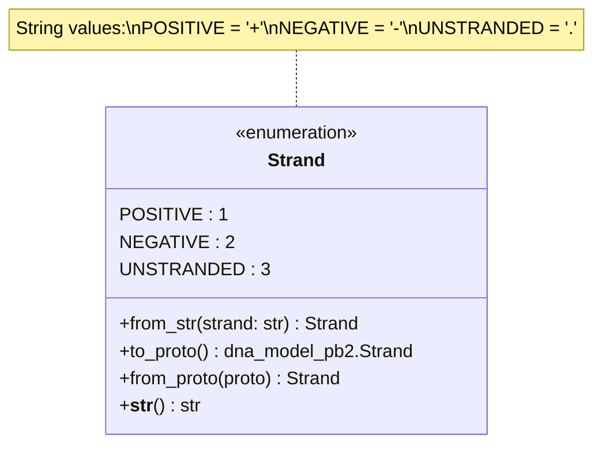
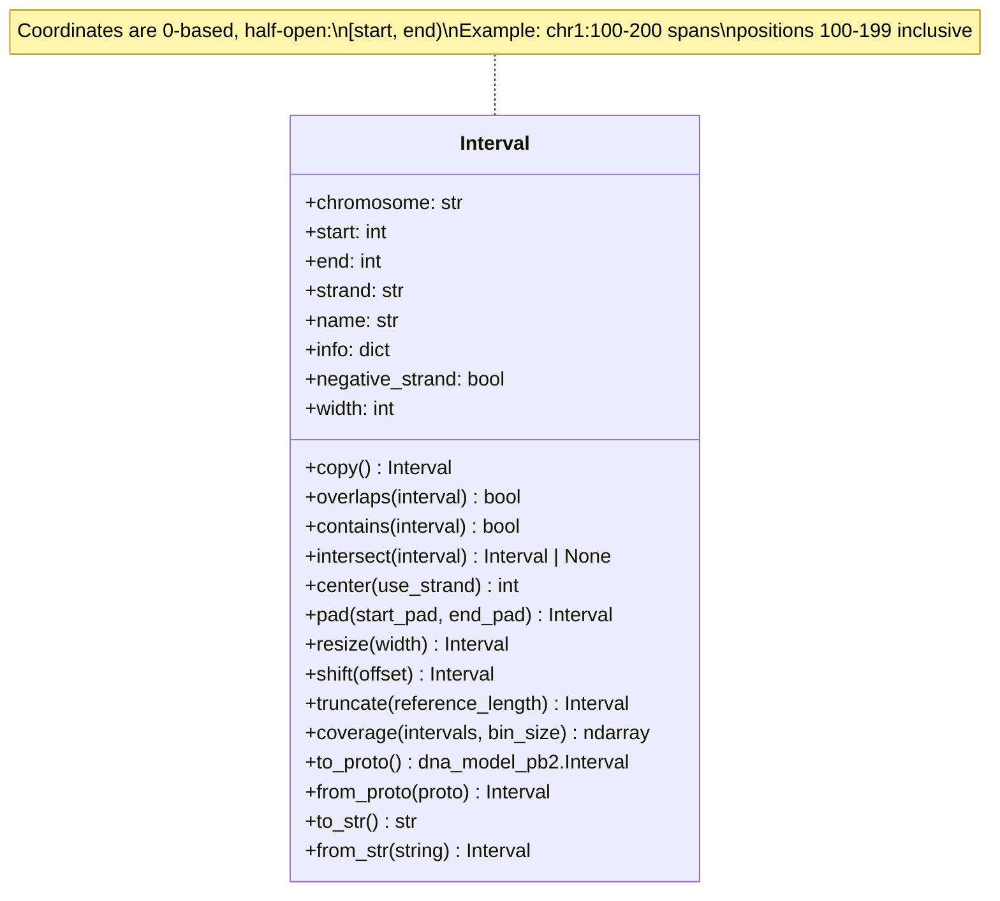
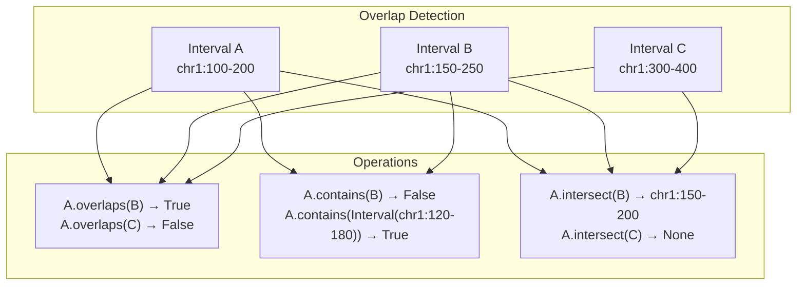
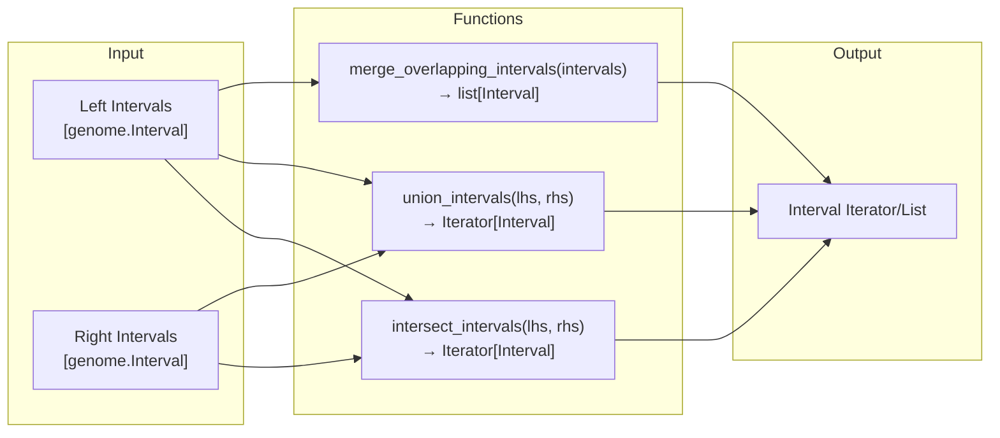
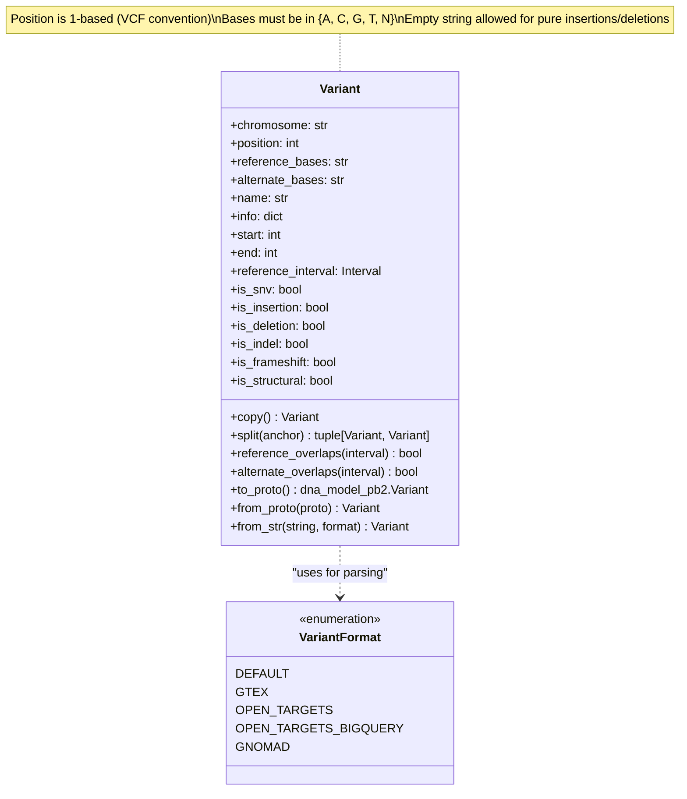
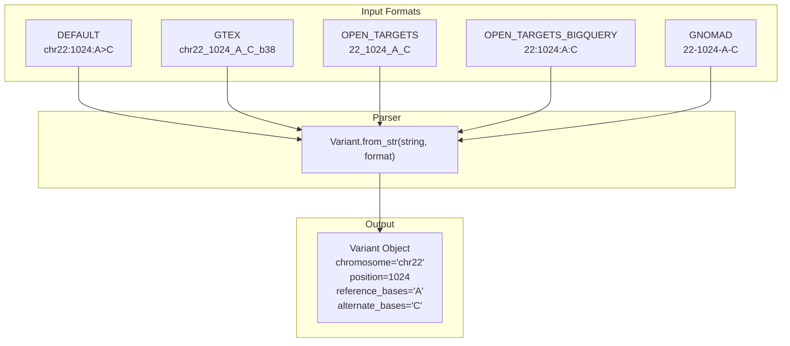
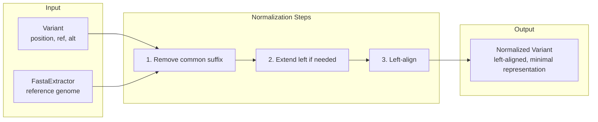
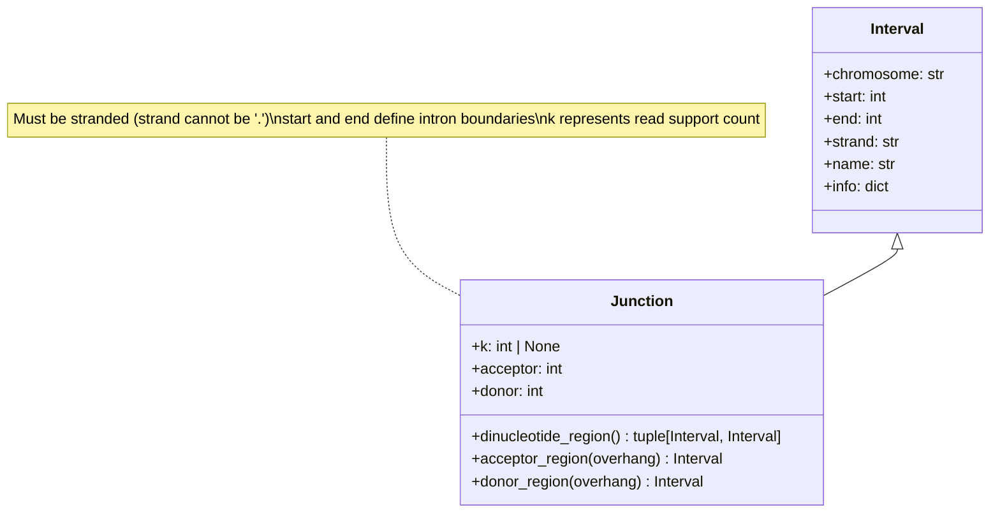
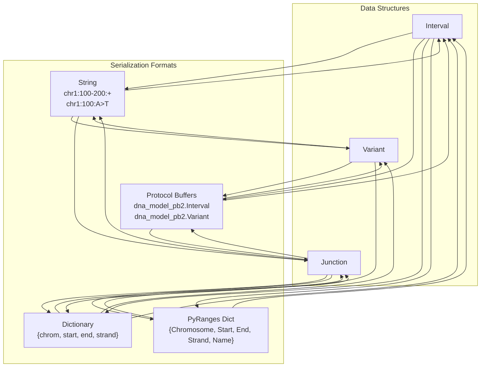
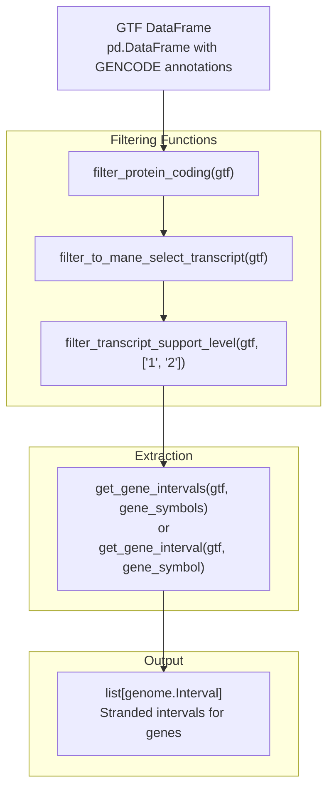

<!-- source: DeepWiki mcp.deepwiki.com · repo google-deepmind/alphagenome · page 3.1 Genomic Data Structures · fetched 2026-10-26 -->

# Genomic Data Structures

<details>
<summary>Relevant source files</summary>

The following files were used as context for generating this wiki page:

- [docs/source/api/data.md](docs/source/api/data.md)
- [src/alphagenome/data/gene_annotation.py](src/alphagenome/data/gene_annotation.py)
- [src/alphagenome/data/gene_annotation_test.py](src/alphagenome/data/gene_annotation_test.py)
- [src/alphagenome/data/genome.py](src/alphagenome/data/genome.py)
- [src/alphagenome/data/genome_test.py](src/alphagenome/data/genome_test.py)

</details>


This page documents the core genomic data structures used throughout the AlphaGenome SDK. These classes provide a consistent interface for representing genomic coordinates, genetic variants, and splice junctions. All prediction and scoring operations in the SDK operate on these fundamental data types.

For information about how these structures are used in predictions, see [Prediction Workflows](#3.2). For details on scoring variants with these structures, see [Variant Scoring](#3.3). For complete API documentation, see [Data Structures API Reference](#4.3).

---

## Overview

The SDK provides three primary data structures, all located in [src/alphagenome/data/genome.py]():

| Class | Purpose | Key Properties |
|-------|---------|----------------|
| `Interval` | Represents a genomic region with chromosome coordinates | `chromosome`, `start`, `end`, `strand` |
| `Variant` | Represents a genetic variant (SNV, indel, etc.) | `position`, `reference_bases`, `alternate_bases` |
| `Junction` | Represents a splice junction (subclass of `Interval`) | `acceptor`, `donor`, `k` |

All three classes use consistent coordinate conventions:
- **0-based, half-open intervals** for `Interval` and derived classes (`start` is inclusive, `end` is exclusive)
- **1-based positions** for `Variant` (following VCF convention)
- **Strand-aware operations** with explicit handling of forward (+), reverse (-), and unstranded (.) orientations

---

## Strand Representation

The `Strand` enum defines genomic strand orientations and provides conversion methods for string and Protocol Buffer representations.

### Strand Enum



**Usage Example:**
```python
from alphagenome.data.genome import Strand

# Create from string
strand = Strand.from_str('+')  # Strand.POSITIVE
print(strand)  # '+'

# Convert to protocol buffer for API calls
proto_strand = strand.to_proto()
```

**Sources:** [src/alphagenome/data/genome.py:38-93]()

---

## Interval: Genomic Coordinate Representation

The `Interval` class is the foundational data structure for representing genomic regions. It uses 0-based, half-open coordinates (same convention as BED files).

### Interval Class Structure



### Key Coordinate Operations

**Coordinate System Convention:**
```
Position:     0   1   2   3   4   5   6   7   8   9
              |   |   |   |   |   |   |   |   |   |
Bases:        A   T   C   G   A   T   C   G   A   T
              
Interval(start=2, end=5):
                  [--------)
              A   T   C   G   A   T   C   G   A   T
                      ↑   ↑   ↑
                   Bases at positions 2, 3, 4 (width=3)
```

**String Serialization:**
```python
# Format: chromosome:start-end:strand
interval = Interval('chr1', 100, 200, '+')
print(interval)  # 'chr1:100-200:+'

# Parse from string
interval = Interval.from_str('chr1:100-200:+')
```

### Strand-Aware Operations

Many `Interval` methods have a `use_strand` parameter that changes behavior based on strand orientation:

| Method | Without `use_strand=True` | With `use_strand=True` |
|--------|---------------------------|------------------------|
| `center()` | Returns geometric center | Adjusts for odd-width negative strand intervals |
| `pad(start_pad, end_pad)` | Pads in coordinate space | Reverses padding for negative strand |
| `shift(offset)` | Shifts in positive direction | Reverses direction for negative strand |
| `resize(width)` | Centers around geometric center | Strand-aware centering |

**Example:**
```python
# Positive strand interval
pos = Interval('chr1', 100, 110, '+')
pos.center()  # 105
pos.pad(5, 10)  # chr1:95-120:+

# Negative strand interval - padding is reversed
neg = Interval('chr1', 100, 110, '-')
neg.center()  # 105
neg.pad(5, 10, use_strand=True)  # chr1:90-115:- (end_pad applied to start)
```

**Sources:** [src/alphagenome/data/genome.py:98-594](), [src/alphagenome/data/genome_test.py:61-480]()

---

## Interval Operations and Utilities

### Overlap and Intersection



**Coverage Calculation:**
The `coverage()` method computes how many intervals overlap each position:

```python
# Calculate base-level coverage
region = Interval('chr1', 0, 10)
reads = [
    Interval('chr1', 2, 5),
    Interval('chr1', 4, 8),
    Interval('chr1', 6, 10)
]
coverage = region.coverage(reads, bin_size=1)
# Returns: [0, 0, 1, 1, 2, 1, 2, 2, 1, 1]

# Bin coverage into windows
binned = region.coverage(reads, bin_size=2)
# Returns: [0, 2, 3, 3, 2] (sum of each 2-base window)
```

**Sources:** [src/alphagenome/data/genome.py:447-594](), [src/alphagenome/data/genome_test.py:139-480]()

### Set Operations on Intervals

The SDK provides utility functions for interval set operations:



**Function Signatures:**
- `intersect_intervals(lhs, rhs)`: Returns overlapping regions between two interval sets
- `union_intervals(lhs, rhs)`: Returns union of two interval sets
- `merge_overlapping_intervals(intervals)`: Merges overlapping intervals within a single set

**Sources:** [src/alphagenome/data/genome.py:1030-1223](), [src/alphagenome/data/genome_test.py:919-1113]()

---

## Variant: Genetic Variation Representation

The `Variant` class represents genetic variants including SNVs (Single Nucleotide Variants), insertions, deletions, and more complex variants.

### Variant Class Structure



### Coordinate Convention Difference

**Important:** `Variant` uses 1-based position (VCF convention), while `Interval` uses 0-based coordinates:

```
Position (1-based): 1   2   3   4   5   6   7   8
Position (0-based): 0   1   2   3   4   5   6   7
                    |   |   |   |   |   |   |   |
Bases:              A   T   C   G   A   T   C   G

Variant(position=3, reference_bases='C', alternate_bases='T'):
  - 1-based position: 3
  - 0-based start: 2 (variant.start)
  - 0-based end: 3 (variant.end)
  - Affects base at 0-based index 2
```

**Conversion Properties:**
```python
variant = Variant('chr1', 3, 'C', 'T')
variant.position        # 3 (1-based, as specified)
variant.start          # 2 (0-based, derived)
variant.end            # 3 (0-based, derived)
variant.reference_interval  # Interval('chr1', 2, 3)
```

**Sources:** [src/alphagenome/data/genome.py:644-868](), [src/alphagenome/data/genome_test.py:482-845]()

### Variant Types and Properties

The `Variant` class provides boolean properties to classify variant types:

| Property | Definition | Example |
|----------|------------|---------|
| `is_snv` | Single nucleotide: len(ref)==1 and len(alt)==1 | position=100, ref='A', alt='T' |
| `is_insertion` | len(ref) < len(alt) | position=100, ref='A', alt='ATT' |
| `is_deletion` | len(ref) > len(alt) | position=100, ref='ATT', alt='A' |
| `is_indel` | is_insertion or is_deletion | Any of above |
| `is_frameshift` | Indel size not divisible by 3 | ref='AT', alt='A' (size=1) |
| `is_structural` | abs(len(ref) - len(alt)) >= 50 | Large insertions/deletions |

**Example:**
```python
# SNV
snv = Variant('chr1', 100, 'A', 'T')
assert snv.is_snv

# Insertion
ins = Variant('chr1', 100, 'A', 'ATT')
assert ins.is_insertion and ins.is_indel

# Deletion
del_ = Variant('chr1', 100, 'ATT', 'A')
assert del_.is_deletion and del_.is_indel

# Frameshift
fs = Variant('chr1', 100, 'AT', 'A')
assert fs.is_frameshift  # Size difference = 1 (not divisible by 3)
```

**Sources:** [src/alphagenome/data/genome.py:738-768](), [src/alphagenome/data/genome_test.py:750-814]()

### Variant String Formats

The SDK supports parsing variants from multiple common formats via the `VariantFormat` enum:



**Format Details:**

| Format | Example | Notes |
|--------|---------|-------|
| `DEFAULT` | `chr22:1024:A>C` | Default SDK format, requires 'chr' prefix |
| `GTEX` | `chr22_1024_A_C_b38` | GTEx format, optional build suffix |
| `OPEN_TARGETS` | `22_1024_A_C` | No 'chr' prefix (auto-added) |
| `OPEN_TARGETS_BIGQUERY` | `22:1024:A:C` | BigQuery format, no 'chr' prefix |
| `GNOMAD` | `22-1024-A-C` | gnomAD format, no 'chr' prefix |

**Usage:**
```python
from alphagenome.data.genome import Variant, VariantFormat

# Parse from different formats
v1 = Variant.from_str('chr22:1024:A>C', VariantFormat.DEFAULT)
v2 = Variant.from_str('chr22_1024_A_C', VariantFormat.GTEX)
v3 = Variant.from_str('22_1024_A_C', VariantFormat.OPEN_TARGETS)

# All parse to the same variant
assert v1 == v2 == v3

# Default format doesn't require explicit specification
v4 = Variant.from_str('chr22:1024:A>C')  # Uses DEFAULT
```

**Sources:** [src/alphagenome/data/genome.py:607-642](), [src/alphagenome/data/genome.py:773-801](), [src/alphagenome/data/genome_test.py:535-681]()

### Variant Normalization

The `normalize_variant()` function left-aligns variants according to the algorithm described in [Tan et al. 2015](https://doi.org/10.1093/bioinformatics/btv112).



**Example:**
```python
from alphagenome.data.genome import Variant, normalize_variant

# Original variant
variant = Variant('chr1', 6, 'CAC', 'C')  # Deletion in repeat region
# Reference: ...GGGCACACACAGGG...
#                   ^^^

# After normalization (left-aligned)
normalized = normalize_variant(variant, fasta_extractor)
# Result: chr1:3:GCA>G
# Now aligned to leftmost position of repeat
```

**Sources:** [src/alphagenome/data/genome.py:950-1008](), [src/alphagenome/data/genome_test.py:816-844]()

---

## Junction: Splice Junction Representation

The `Junction` class extends `Interval` to represent splice junctions, which are critical for RNA splicing analysis.

### Junction Class Structure



### Strand-Specific Acceptor/Donor Sites

The `acceptor` and `donor` properties return different positions depending on strand orientation:

```
Positive Strand (+):
    Exon1    Intron     Exon2
    |-----[=========]-----|
          ↑         ↑
        donor    acceptor
        (start)    (end)

Negative Strand (-):
    Exon2    Intron     Exon1
    |-----[=========]-----|
          ↑         ↑
      acceptor    donor
        (start)    (end)
```

**Code Behavior:**
```python
# Positive strand junction
pos_junction = Junction('chr1', 100, 200, '+')
pos_junction.donor      # 100 (start)
pos_junction.acceptor   # 200 (end)

# Negative strand junction
neg_junction = Junction('chr1', 100, 200, '-')
neg_junction.donor      # 200 (end)
neg_junction.acceptor   # 100 (start)
```

### Junction Methods

**Dinucleotide Regions:**
Splice junctions typically have canonical dinucleotide sequences (GT-AG for most junctions). The `dinucleotide_region()` method returns the 2bp regions flanking the intron:

```python
junction = Junction('chr1', 100, 200, '+')
donor_di, acceptor_di = junction.dinucleotide_region()

# Returns:
# donor_di: Interval('chr1', 100, 102, '+')    # GT at donor site
# acceptor_di: Interval('chr1', 198, 200, '+') # AG at acceptor site
```

**Splice Site Regions:**
Extract extended regions around splice sites for motif analysis:

```python
junction = Junction('chr1', 1000, 2000, '+')

# Default: 250bp upstream and downstream of each site
acceptor_region = junction.acceptor_region()  # chr1:1750-2250:+

# Custom overhang
donor_region = junction.donor_region(overhang=(100, 100))  # chr1:900-1100:+
```

**Sources:** [src/alphagenome/data/genome.py:870-930](), [src/alphagenome/data/genome_test.py:847-917]()

---

## Serialization and Interoperability

All data structures support multiple serialization formats for interoperability with other tools and the AlphaGenome API.

### Serialization Format Support



### Interval Serialization

| Format | To Method | From Method | Use Case |
|--------|-----------|-------------|----------|
| String | `str(interval)` or `interval.to_str()` | `Interval.from_str(string)` | Human-readable representation |
| Protocol Buffer | `interval.to_proto()` | `Interval.from_proto(proto)` | API communication with server |
| Dictionary | `interval.to_interval_dict()` | `Interval.from_interval_dict(dict)` | JSON serialization |
| PyRanges | `interval.to_pyranges_dict()` | `Interval.from_pyranges_dict(dict)` | Interop with PyRanges library |

**Example:**
```python
interval = Interval('chr1', 100, 200, '+', name='gene1', info={'score': 0.95})

# String format
s = str(interval)  # 'chr1:100-200:+'
parsed = Interval.from_str(s)

# Protocol buffer (for API calls)
proto = interval.to_proto()
roundtrip = Interval.from_proto(proto)

# PyRanges dictionary (includes name and info)
pr_dict = interval.to_pyranges_dict()
# {'Chromosome': 'chr1', 'Start': 100, 'End': 200, 
#  'Strand': '+', 'Name': 'gene1', 'score': 0.95}
```

**Sources:** [src/alphagenome/data/genome.py:150-277]()

### Variant Serialization

**String Format (Multiple Variants):**
```python
# Default format
v = Variant('chr1', 100, 'A', 'T')
print(v)  # 'chr1:100:A>T'

# Parse from various formats
v1 = Variant.from_str('chr1:100:A>T')  # DEFAULT
v2 = Variant.from_str('chr1_100_A_T_b38', VariantFormat.GTEX)
v3 = Variant.from_str('1_100_A_T', VariantFormat.OPEN_TARGETS)
```

**Protocol Buffer (for API):**
```python
variant = Variant('chr1', 100, 'A', 'T')

# Convert to proto for API request
proto = variant.to_proto()

# Parse from API response
response_variant = Variant.from_proto(proto)
```

**Dictionary:**
```python
variant = Variant('chr1', 100, 'A', 'T', name='rs123')

# Convert to dict (e.g., for JSON)
d = variant.to_dict()
# {'chromosome': 'chr1', 'position': 100, 
#  'reference_bases': 'A', 'alternate_bases': 'T',
#  'name': 'rs123', 'info': {}}

# Parse from dict
parsed = Variant.from_dict(d)
```

**Sources:** [src/alphagenome/data/genome.py:691-829]()

---

## Integration with Gene Annotations

The `gene_annotation` module provides functions that work with these data structures to extract gene-level intervals from GTF files.

### Gene Interval Extraction Flow



**Example Usage:**
```python
from alphagenome.data import gene_annotation, genome
import pandas as pd

# Load GTF file
gtf = pd.read_feather('gencode.v46.annotation.feather')

# Filter to high-confidence protein-coding transcripts
filtered = gene_annotation.filter_protein_coding(gtf)
filtered = gene_annotation.filter_to_mane_select_transcript(filtered)

# Extract intervals for specific genes
intervals = gene_annotation.get_gene_intervals(
    filtered,
    gene_symbols=['TP53', 'EGFR', 'BRCA1']
)
# Returns: [genome.Interval('chr17', ...), ...]

# Single gene
tp53_interval = gene_annotation.get_gene_interval(
    filtered,
    gene_symbol='TP53'
)
# Returns: genome.Interval with TP53 coordinates
```

**Key Functions:**

| Function | Purpose | Returns |
|----------|---------|---------|
| `get_gene_interval(gtf, gene_symbol=..., gene_id=...)` | Get interval for single gene | `genome.Interval` |
| `get_gene_intervals(gtf, gene_symbols=..., gene_ids=...)` | Get intervals for multiple genes | `list[genome.Interval]` |
| `extract_tss(gtf)` | Extract transcription start sites | `pd.DataFrame` with width=0 intervals |

**Sources:** [src/alphagenome/data/gene_annotation.py:331-445](), [src/alphagenome/data/gene_annotation_test.py:87-240]()

---

## Summary Table: Data Structure Quick Reference

| Aspect | Interval | Variant | Junction |
|--------|----------|---------|----------|
| **Coordinate System** | 0-based, half-open [start, end) | 1-based position (VCF) | 0-based (inherits Interval) |
| **Primary Use** | Genomic regions, predictions | Genetic variants | Splice junctions |
| **Key Attributes** | chromosome, start, end, strand | position, reference_bases, alternate_bases | Inherits Interval + k |
| **Strand Required** | No (can be '.') | No | Yes (cannot be '.') |
| **Main Operations** | overlaps, pad, resize, coverage | split, classification properties | acceptor/donor regions |
| **String Format** | `chr1:100-200:+` | `chr1:100:A>T` (multiple formats) | Same as Interval |
| **Protocol Buffer** | `dna_model_pb2.Interval` | `dna_model_pb2.Variant` | `dna_model_pb2.Interval` |
| **Source Lines** | [98-594]() | [644-868]() | [870-930]() |

---

**Complete Sources:**
- [src/alphagenome/data/genome.py]()
- [src/alphagenome/data/genome_test.py]()
- [src/alphagenome/data/gene_annotation.py]()
- [src/alphagenome/data/gene_annotation_test.py]()
- [docs/source/api/data.md]()

---

