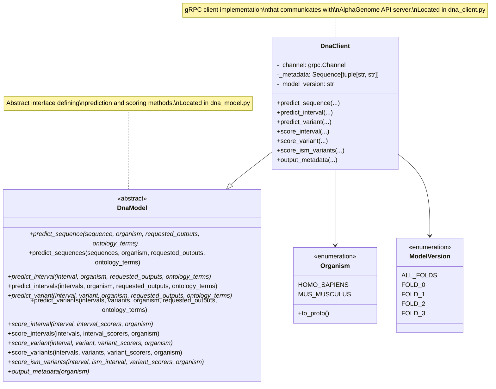
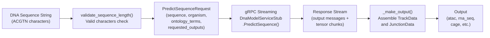
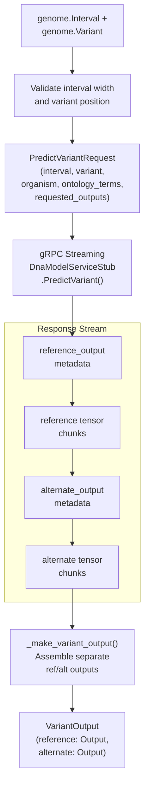
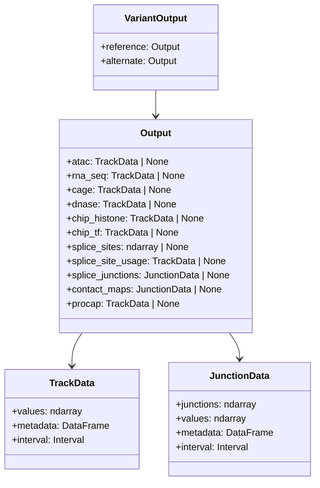
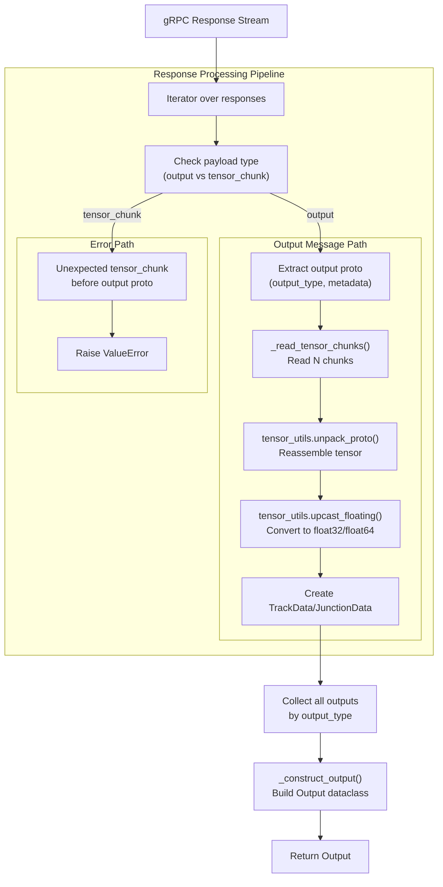
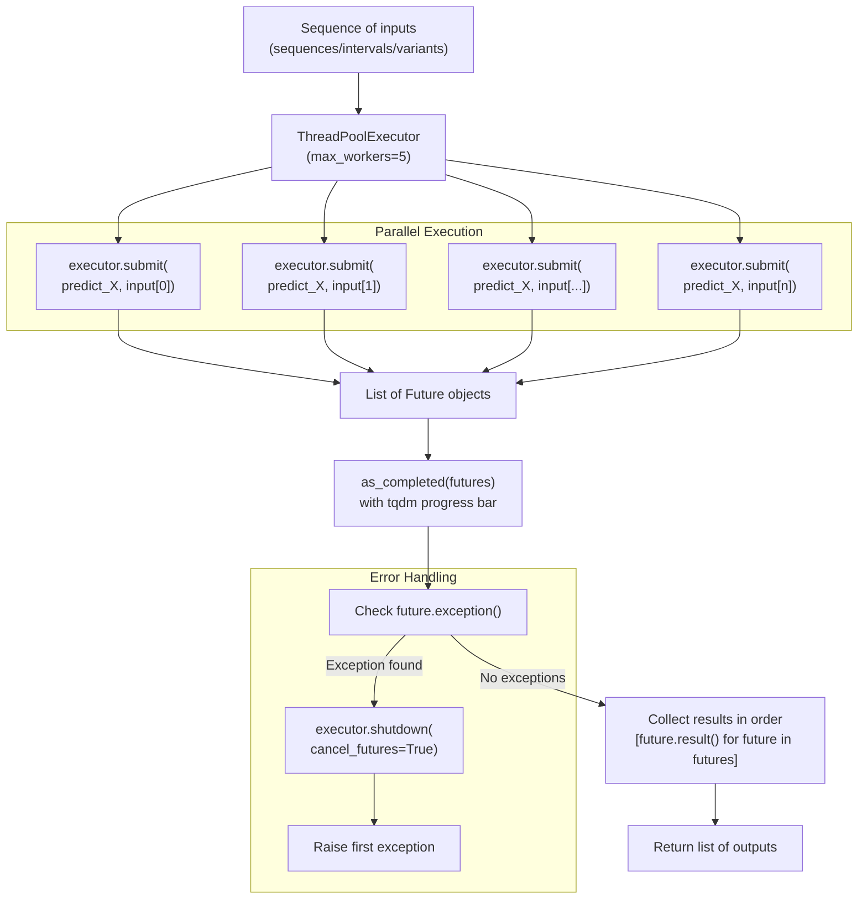

<!-- source: DeepWiki mcp.deepwiki.com · repo google-deepmind/alphagenome · page 3.2 Prediction Workflows · fetched 2026-10-26 -->

# Prediction Workflows

<details>
<summary>Relevant source files</summary>

The following files were used as context for generating this wiki page:

- [docs/source/_templates/autosummary/class.rst](docs/source/_templates/autosummary/class.rst)
- [docs/source/api/models.md](docs/source/api/models.md)
- [src/alphagenome/models/dna_client.py](src/alphagenome/models/dna_client.py)
- [src/alphagenome/models/dna_model.py](src/alphagenome/models/dna_model.py)
- [src/alphagenome/models/dna_model_test.py](src/alphagenome/models/dna_model_test.py)

</details>


## Purpose and Scope

This page explains the prediction workflows in the AlphaGenome SDK, focusing on the `DnaModel` interface and the three core prediction methods. It covers how to generate model predictions for DNA sequences, genomic intervals, and genetic variants, as well as batch processing capabilities.

For information about the data structures used as inputs to predictions (Interval, Variant, Junction), see [Genomic Data Structures](#3.1). For information about scoring workflows that quantify variant effects, see [Variant Scoring](#3.3). For practical guidance on making predictions, see [Making Predictions](#5.1).

## The DnaModel Interface

The prediction system is built around the `DnaModel` abstract base class, which defines a consistent interface for all prediction operations. The `DnaClient` class implements this interface to communicate with the remote AlphaGenome API server via gRPC.



**Sources:** [src/alphagenome/models/dna_model.py:73-508](), [src/alphagenome/models/dna_client.py:494-872]()

### Abstract Methods

The `DnaModel` interface defines six abstract methods that must be implemented:

| Method | Purpose | Input | Output |
|--------|---------|-------|--------|
| `predict_sequence` | Predict from raw DNA string | DNA sequence string | `Output` |
| `predict_interval` | Predict from genomic coordinates | `genome.Interval` | `Output` |
| `predict_variant` | Predict reference and alternate alleles | `genome.Interval`, `genome.Variant` | `VariantOutput` |
| `score_interval` | Score an interval with gene-level aggregation | `genome.Interval` | `list[AnnData]` |
| `score_variant` | Score a variant's effect on genes | `genome.Interval`, `genome.Variant` | `list[AnnData]` |
| `output_metadata` | Retrieve track and ontology metadata | `Organism` | `OutputMetadata` |

**Sources:** [src/alphagenome/models/dna_model.py:76-507]()

### Batch Processing Methods

The interface also provides concrete implementations of batch processing methods that parallelize requests:

- `predict_sequences()` - Process multiple DNA sequences
- `predict_intervals()` - Process multiple genomic intervals
- `predict_variants()` - Process multiple variants
- `score_intervals()` - Score multiple intervals
- `score_variants()` - Score multiple variants

These methods use `concurrent.futures.ThreadPoolExecutor` with configurable `max_workers` and optional progress bars via `tqdm`.

**Sources:** [src/alphagenome/models/dna_model.py:102-467]()

## Three Prediction Types

### 1. Sequence Prediction

The `predict_sequence` method generates predictions from a raw DNA sequence string. This is useful when you have sequence data that is not tied to a specific genomic location, or when working with synthetic sequences.



**Key Implementation Details:**

- **Validation**: Checks that sequence contains only 'ACGTN' characters and has a supported length (16KB, 100KB, 500KB, or 1MB)
- **Request Construction**: Creates `PredictSequenceRequest` protobuf with sequence, organism, ontology terms, and requested outputs
- **Streaming Response**: Server streams back output metadata followed by tensor chunks for each requested output type
- **Output Assembly**: `_make_output()` function reassembles chunks into `TrackData` and `JunctionData` objects
- **Retry Logic**: `@retry_rpc` decorator automatically retries transient failures with exponential backoff

**Sources:** [src/alphagenome/models/dna_client.py:517-562](), [src/alphagenome/models/dna_client.py:485-491](), [src/alphagenome/models/dna_client.py:542-549]()

### 2. Interval Prediction

The `predict_interval` method generates predictions from genomic coordinates. The server automatically retrieves the reference sequence for the specified interval.

```mermaid
flowchart LR
    Input["genome.Interval\n(chromosome, start,\nend, strand)"]
    Validate["validate_sequence_length()\nCheck interval width"]
    Proto["interval.to_proto()\nConvert to protobuf"]
    Request["PredictIntervalRequest\n(interval, organism,\nontology_terms,\nrequested_outputs)"]
    gRPC["gRPC Streaming\nDnaModelServiceStub\n.PredictInterval()"]
    Response["Response Stream"]
    Construct["_make_output(responses)"]
    Output["Output\n(with interval\nmetadata preserved)"]
    
    Input --> Validate
    Validate --> Proto
    Proto --> Request
    Request --> gRPC
    gRPC --> Response
    Response --> Construct
    Construct --> Output
```



**Key Characteristics:**

- **Automatic Sequence Retrieval**: The server fetches reference genome sequence for the specified interval
- **Strand Handling**: Predictions respect the interval's strand orientation
- **Interval Metadata**: The original interval is preserved in the output's `TrackData` objects
- **Width Validation**: Interval width must be one of the supported sequence lengths

**Sources:** [src/alphagenome/models/dna_client.py:564-598]()

### 3. Variant Prediction

The `predict_variant` method generates predictions for both reference and alternate alleles of a genetic variant. This enables direct comparison of model predictions with and without the variant.



**Variant Output Structure:**

The `VariantOutput` dataclass contains two complete `Output` objects:

```
VariantOutput(
    reference: Output(atac=..., rna_seq=..., cage=..., ...),
    alternate: Output(atac=..., rna_seq=..., cage=..., ...)
)
```

**Key Points:**

- **Dual Predictions**: Server generates predictions for both reference and alternate sequences in a single request
- **Sequence Generation**: Server applies the variant to generate the alternate sequence
- **Efficient Comparison**: Both predictions use the same model parameters and biological context
- **Response Ordering**: Reference output always precedes alternate output in the stream

**Sources:** [src/alphagenome/models/dna_client.py:600-637](), [src/alphagenome/models/dna_client.py:285-312]()

## Input Parameters

All prediction methods accept a common set of input parameters that control what predictions are generated and for which biological contexts.

### Required Parameters

| Parameter | Type | Description |
|-----------|------|-------------|
| `requested_outputs` | `Iterable[OutputType]` | Which prediction modalities to generate (ATAC, RNA_SEQ, CAGE, etc.) |

### Optional Parameters

| Parameter | Type | Default | Description |
|-----------|------|---------|-------------|
| `organism` | `Organism` | `HOMO_SAPIENS` | Species for prediction (HOMO_SAPIENS or MUS_MUSCULUS) |
| `ontology_terms` | `Iterable[OntologyTerm \| str] \| None` | `None` | Tissue/cell type contexts; None returns all ontologies |
| `interval` | `genome.Interval \| None` | `None` | (sequence prediction only) Original genomic location |

### Ontology Term Handling

Ontology terms filter predictions to specific biological contexts (tissues, cell types, cell lines). They can be provided as:

- **OntologyTerm objects**: `ontology.OntologyTerm` instances
- **CURIE strings**: Compact URIs like `"UBERON:0002048"` (lung) or `"CL:0000066"` (epithelial cell)

The `_convert_ontologies_to_protos()` function normalizes these inputs and removes duplicates before sending to the server:

```python
# Both formats are valid:
ontology_terms=[ontology.from_curie("UBERON:0002048")]
ontology_terms=["UBERON:0002048", "CL:0000066"]
```

**Sources:** [src/alphagenome/models/dna_client.py:469-482]()

### Output Type Selection

The `requested_outputs` parameter specifies which prediction modalities to generate. Available types include:

- **Chromatin accessibility**: `OutputType.ATAC`, `OutputType.DNASE`
- **Transcription**: `OutputType.RNA_SEQ`, `OutputType.CAGE`, `OutputType.PROCAP`
- **Histone modifications**: `OutputType.CHIP_HISTONE`
- **Transcription factors**: `OutputType.CHIP_TF`
- **RNA processing**: `OutputType.SPLICE_SITES`, `OutputType.SPLICE_JUNCTIONS`, `OutputType.SPLICE_SITE_USAGE`
- **3D genome**: `OutputType.CONTACT_MAPS`

Each output type is converted to its protocol buffer representation before transmission.

**Sources:** [src/alphagenome/models/dna_client.py:551](), [src/alphagenome/models/dna_client.py:587](), [src/alphagenome/models/dna_client.py:625]()

## Output Structures

Predictions return structured output objects that organize results by modality and biological context.

### Output Dataclass

The `Output` dataclass contains predictions for all requested modalities:



**TrackData Structure:**

- `values`: NumPy array of shape `[positions, tracks]` containing predictions
- `metadata`: Pandas DataFrame with track information (ontology terms, biosamples)
- `interval`: Genomic coordinates the predictions correspond to

**JunctionData Structure:**

- `junctions`: NumPy array of junction coordinates
- `values`: NumPy array of prediction values for each junction
- `metadata`: Pandas DataFrame with track metadata
- `interval`: Genomic coordinates

**Sources:** [src/alphagenome/models/dna_client.py:234-258](), [src/alphagenome/models/dna_client.py:309-312]()

### Response Processing Pipeline

The client processes streaming responses through several stages:



**Key Functions:**

- `_read_tensor_chunks()`: Reads a specified number of tensor chunk messages from the response stream
- `tensor_utils.unpack_proto()`: Deserializes chunked tensor data into NumPy arrays
- `tensor_utils.upcast_floating()`: Converts float16 predictions to float32/float64 for numerical stability
- `_make_output_data()`: Constructs `TrackData` or `JunctionData` objects from protos and tensor chunks
- `_construct_output()`: Builds the final `Output` dataclass with all requested modalities

**Sources:** [src/alphagenome/models/dna_client.py:139-159](), [src/alphagenome/models/dna_client.py:162-192](), [src/alphagenome/models/dna_client.py:261-282]()

## Supported Sequence Lengths

The model supports four fixed sequence lengths, defined as powers of 2:

| Constant | Value | Length |
|----------|-------|--------|
| `SEQUENCE_LENGTH_16KB` | 2^14 | 16,384 bp |
| `SEQUENCE_LENGTH_100KB` | 2^17 | 131,072 bp |
| `SEQUENCE_LENGTH_500KB` | 2^19 | 524,288 bp |
| `SEQUENCE_LENGTH_1MB` | 2^20 | 1,048,576 bp |

The `validate_sequence_length()` function enforces this constraint:

```python
def validate_sequence_length(length: int):
    if length not in SUPPORTED_SEQUENCE_LENGTHS.values():
        raise ValueError(
            f'Sequence length {length} not supported by the model.'
            f' Supported lengths: {[*SUPPORTED_SEQUENCE_LENGTHS.values()]}'
        )
```

All prediction methods call this validation before making requests. For intervals, the `width` property is validated.

**Sources:** [src/alphagenome/models/dna_client.py:46-57](), [src/alphagenome/models/dna_client.py:485-491]()

## Error Handling and Retries

All prediction methods are wrapped with the `@retry_rpc` decorator, which implements automatic retry logic for transient gRPC failures.

### Retry Configuration

```python
@retry_rpc(
    max_attempts=5,
    initial_backoff=1.25,
    backoff_multiplier=1.5,
    retry_status_codes=frozenset([
        grpc.StatusCode.RESOURCE_EXHAUSTED,
        grpc.StatusCode.UNAVAILABLE
    ]),
    jitter=0.2
)
```

**Retry Behavior:**

- **Retryable Errors**: `RESOURCE_EXHAUSTED` (server overloaded), `UNAVAILABLE` (temporary service outage)
- **Non-Retryable Errors**: Immediately raised without retry (e.g., `INVALID_ARGUMENT`, `PERMISSION_DENIED`)
- **Backoff Strategy**: Exponential backoff with jitter to avoid thundering herd
- **Max Attempts**: Up to 5 attempts total (1 initial + 4 retries)

**Backoff Calculation:**

```
backoff = initial_backoff * (backoff_multiplier ^ attempt) ± (jitter * backoff)
```

For example:
- Attempt 1: 1.25s ± 0.25s
- Attempt 2: 1.88s ± 0.38s
- Attempt 3: 2.81s ± 0.56s

**Sources:** [src/alphagenome/models/dna_client.py:73-122]()

## Client Creation and Configuration

The `create()` function initializes a `DnaClient` instance with authentication and connection parameters:

```python
def create(
    api_key: str,
    *,
    model_version: ModelVersion | None = None,
    timeout: float | None = None,
    address: str | None = None,
) -> DnaClient
```

**Configuration:**

- **API Key**: Required for authentication; passed as `x-goog-api-key` metadata
- **Model Version**: Optional; defaults to `ALL_FOLDS` (distilled ensemble model)
- **Timeout**: Optional timeout for channel readiness check
- **Address**: Optional server address; defaults to `dns:///gdmscience.googleapis.com:443`
- **Message Size**: Unlimited send/receive message sizes for large tensors

**Example Usage:**

```python
import alphagenome.models.dna_client as dna_client

model = dna_client.create(
    api_key="your-api-key",
    model_version=dna_client.ModelVersion.ALL_FOLDS
)
```

**Sources:** [src/alphagenome/models/dna_client.py:874-907]()

## Batch Processing Implementation

The batch prediction methods (`predict_sequences`, `predict_intervals`, `predict_variants`) share a common implementation pattern using `concurrent.futures.ThreadPoolExecutor`:



**Key Features:**

- **Parallelization**: Multiple requests execute concurrently with configurable `max_workers`
- **Progress Tracking**: Optional `tqdm` progress bar tracks completion
- **Early Termination**: On first exception, cancels remaining futures and raises immediately
- **Order Preservation**: Results list maintains input order, not completion order

**Sources:** [src/alphagenome/models/dna_model.py:131-157](), [src/alphagenome/models/dna_model.py:207-230](), [src/alphagenome/models/dna_model.py:291-315]()

---

