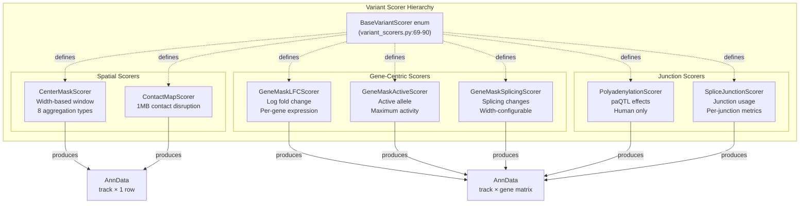
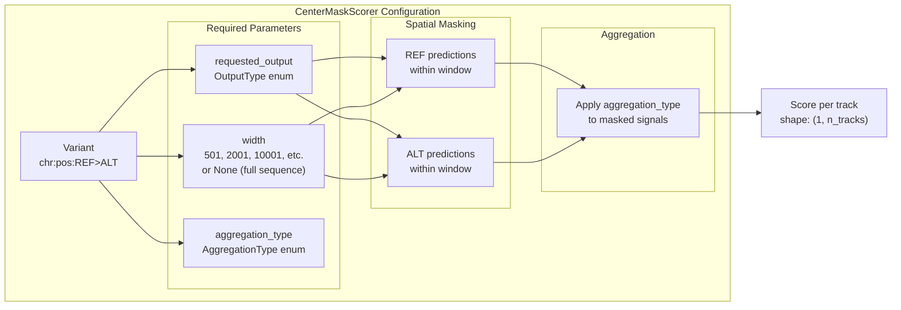
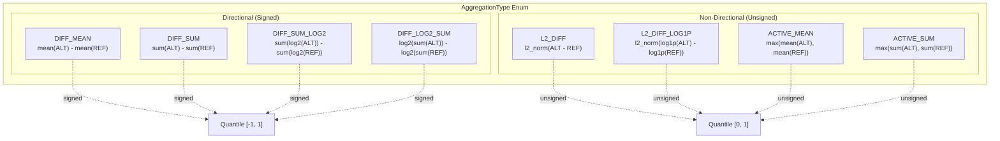
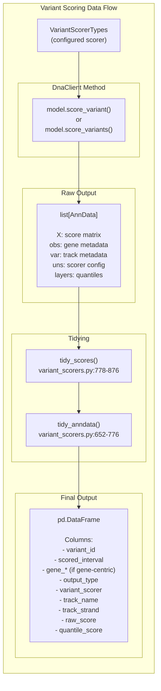
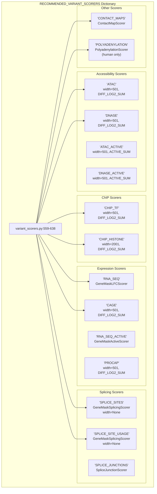

<!-- source: DeepWiki mcp.deepwiki.com · repo google-deepmind/alphagenome · page 3.3 Variant Scoring · fetched 2026-10-26 -->

# Variant Scoring

<details>
<summary>Relevant source files</summary>

The following files were used as context for generating this wiki page:

- [docs/source/faqs.md](docs/source/faqs.md)
- [docs/source/refs.bib](docs/source/refs.bib)
- [src/alphagenome/models/variant_scorers.py](src/alphagenome/models/variant_scorers.py)
- [src/alphagenome/models/variant_scorers_test.py](src/alphagenome/models/variant_scorers_test.py)

</details>


## Purpose and Scope

This page introduces the conceptual framework for variant scoring in AlphaGenome. Variant scoring quantifies the predicted functional impact of genetic variants by aggregating model predictions for reference and alternate alleles. This document covers scorer types, aggregation strategies, output formats, and scoring metrics.

For API details on scorer classes and methods, see [Variant and Interval Scorers](#4.4). For practical usage instructions, see [Scoring Variants](#5.2). For batch processing examples, see [Batch Variant Scoring](#6.2).

**Sources:** [docs/source/faqs.md:237-341]()

---

## What is Variant Scoring?

Variant scoring transforms raw model predictions into interpretable metrics that quantify variant effects. While predictions (see [Prediction Workflows](#3.2)) generate detailed genomic signals for reference and alternate sequences, variant scorers aggregate these signals into summary statistics that answer specific biological questions:

- **How does this variant affect gene expression?**
- **Does this variant disrupt chromatin accessibility?**
- **What is the impact on splicing patterns?**

A variant scorer operates on paired reference/alternate predictions, applying aggregation functions over spatial regions (windows around the variant) or functional units (gene exons, splice sites) to compute effect sizes.

**Key differences from predictions:**

| Predictions | Variant Scoring |
|-------------|-----------------|
| Genome-wide signal tracks | Per-variant summary metrics |
| Output: `TrackData`, `JunctionData` | Output: `AnnData`, `DataFrame` |
| Base-pair resolution | Gene/track-level aggregation |
| Multiple modalities returned | Targeted biological questions |

**Sources:** [src/alphagenome/models/variant_scorers.py:1-67](), [docs/source/faqs.md:294-306]()

---

## Scorer Type Architecture

AlphaGenome provides seven variant scorer types organized into three conceptual categories. Each scorer implements a specific aggregation strategy suited to different biological questions and output modalities.



**Scorer type definitions:**

| Scorer Class | Purpose | Gene-Centric | Supported Outputs |
|--------------|---------|--------------|-------------------|
| `CenterMaskScorer` | Spatial window aggregation around variant | No | ATAC, CAGE, DNASE, RNA_SEQ, CHIP_*, SPLICE_SITES, SPLICE_SITE_USAGE |
| `ContactMapScorer` | Chromatin contact disruption | No | CONTACT_MAPS |
| `GeneMaskLFCScorer` | Gene expression log fold change | Yes | ATAC, CAGE, DNASE, RNA_SEQ, SPLICE_SITES, SPLICE_SITE_USAGE |
| `GeneMaskActiveScorer` | Active allele (max REF/ALT) | Yes | ATAC, CAGE, DNASE, RNA_SEQ, SPLICE_SITES, SPLICE_SITE_USAGE |
| `GeneMaskSplicingScorer` | Splicing probability changes | Yes | SPLICE_SITES, SPLICE_SITE_USAGE |
| `PolyadenylationScorer` | Polyadenylation QTL effects | Yes | RNA_SEQ (human only) |
| `SpliceJunctionScorer` | Splice junction usage | Yes | SPLICE_JUNCTIONS |

**Sources:** [src/alphagenome/models/variant_scorers.py:69-100](), [src/alphagenome/models/variant_scorers.py:102-137](), [src/alphagenome/models/variant_scorers.py:158-284]()

---

## Center Mask Scoring

`CenterMaskScorer` is the most flexible scorer type, aggregating predictions within a spatial window centered on the variant. It supports configurable window widths and eight aggregation types.



**Example instantiation:**

```python
from alphagenome.models import variant_scorers, dna_output

scorer = variant_scorers.CenterMaskScorer(
    requested_output=dna_output.OutputType.ATAC,
    width=501,  # 501bp window
    aggregation_type=variant_scorers.AggregationType.DIFF_LOG2_SUM
)
```

**Supported widths:** `None`, `501`, `2001`, `10_001`, `100_001`, `200_001`

**Sources:** [src/alphagenome/models/variant_scorers.py:158-241](), [src/alphagenome/models/variant_scorers.py:139-143]()

---

## Aggregation Types

The `AggregationType` enum defines eight mathematical operations for combining reference and alternate predictions. These fall into three categories: difference-based (directional), L2-based (non-directional), and active-based (maximum).



**Aggregation type properties:**

| Type | Formula | Signed | Use Case |
|------|---------|--------|----------|
| `DIFF_MEAN` | `mean(ALT) - mean(REF)` | Yes | Simple directional effect |
| `DIFF_SUM` | `sum(ALT) - sum(REF)` | Yes | Total signal change |
| `DIFF_SUM_LOG2` | `sum(log2(ALT)) - sum(log2(REF))` | Yes | Log-space difference |
| `DIFF_LOG2_SUM` | `log2(sum(ALT)) - log2(sum(REF))` | Yes | Recommended for accessibility |
| `L2_DIFF` | `‖ALT - REF‖₂` | No | Magnitude of change |
| `L2_DIFF_LOG1P` | `‖log1p(ALT) - log1p(REF)‖₂` | No | Log-scaled magnitude |
| `ACTIVE_MEAN` | `max(mean(ALT), mean(REF))` | No | Maximum activity level |
| `ACTIVE_SUM` | `max(sum(ALT), sum(REF))` | No | Peak signal strength |

Signed scorers preserve directionality (up-regulation vs down-regulation). Unsigned scorers measure magnitude regardless of direction.

**Sources:** [src/alphagenome/models/variant_scorers.py:30-67](), [src/alphagenome/models/variant_scorers.py:198-207]()

---

## Gene-Centric Scoring

Gene-centric scorers aggregate predictions across gene annotations, producing one score per gene-track pair. These scorers use exon masks or junction annotations to focus aggregation on biologically relevant regions.

```mermaid
graph TB
    subgraph "Gene-Centric Scoring Workflow"
        Variant["Variant Input<br/>genome.Variant"]
        GTF["Gene Annotations<br/>via gene_annotation module"]
        
        subgraph "Gene Identification"
            FindGenes["Identify overlapping genes<br/>within scoring interval"]
            GeneList["List of genes<br/>ENSG00000...]
        end
        
        subgraph "Per-Gene Aggregation"
            Gene1["Gene 1 exons"]
            Gene2["Gene 2 exons"]
            GeneN["Gene N exons"]
            
            Mask1["Apply exon mask to<br/>REF and ALT predictions"]
            Mask2["Apply exon mask to<br/>REF and ALT predictions"]
            MaskN["Apply exon mask to<br/>REF and ALT predictions"]
        end
        
        subgraph "Score Matrix"
            Matrix["AnnData.X<br/>shape: (n_genes, n_tracks)<br/><br/>obs: gene metadata<br/>var: track metadata"]
        end
    end
    
    Variant --> FindGenes
    GTF --> FindGenes
    FindGenes --> GeneList
    
    GeneList --> Gene1
    GeneList --> Gene2
    GeneList --> GeneN
    
    Gene1 --> Mask1
    Gene2 --> Mask2
    GeneN --> MaskN
    
    Mask1 --> Matrix
    Mask2 --> Matrix
    MaskN --> Matrix
```

**Gene-centric scorer characteristics:**

- **Output dimensions:** `(n_genes, n_tracks)` matrix instead of `(1, n_tracks)`
- **Gene filtering:** Scorers automatically identify genes within the scoring interval
- **Strand matching:** `tidy_scores()` can filter mismatched gene/track strands via `match_gene_strand=True`
- **Gene metadata:** Output includes `gene_id`, `gene_name`, `gene_type`, `gene_strand` in `AnnData.obs`

**Sources:** [src/alphagenome/models/variant_scorers.py:286-395](), [src/alphagenome/models/variant_scorers.py:397-458]()

---

## Output Data Structures

Variant scoring produces `AnnData` objects that encapsulate scores and metadata. These are converted to tidy pandas DataFrames for analysis using the `tidy_scores()` function.



**AnnData structure for gene-centric scoring:**

| Component | Shape | Contents |
|-----------|-------|----------|
| `X` | `(n_genes, n_tracks)` | Raw score matrix |
| `obs` | `(n_genes, n_columns)` | Gene metadata: `gene_id`, `gene_name`, `gene_type`, `strand` |
| `var` | `(n_tracks, n_columns)` | Track metadata: `name`, `strand`, `ontology_curie`, `biosample_name`, etc. |
| `uns` | dict | Scorer configuration: `variant`, `interval`, `variant_scorer` |
| `layers['quantiles']` | `(n_genes, n_tracks)` | Quantile scores (if available) |

**AnnData structure for variant-centric scoring:**

| Component | Shape | Contents |
|-----------|-------|----------|
| `X` | `(1, n_tracks)` | Raw score vector |
| `obs` | `(1, n_columns)` | Empty DataFrame (no gene concept) |
| `var` | `(n_tracks, n_columns)` | Track metadata |
| `uns` | dict | Scorer configuration |
| `layers['quantiles']` | `(1, n_tracks)` | Quantile scores (if available) |

**Sources:** [src/alphagenome/models/variant_scorers.py:652-775](), [src/alphagenome/models/variant_scorers.py:778-876]()

---

## Raw vs Quantile Scores

Variant scoring produces two types of metrics: **raw scores** (direct aggregation results) and **quantile scores** (normalized ranks within a background distribution).

### Raw Scores

Raw scores are the direct output of the aggregation function. Their scale depends on the scorer type:

- **`DIFF_LOG2_SUM`:** Can range from negative to positive infinity (unbounded)
- **`SPLICE_SITE_USAGE`:** Ranges from 0 to 1 (probability space)
- **`L2_DIFF`:** Always positive (magnitude only)

Raw scores are **not directly comparable** across different scorers or output modalities.

### Quantile Scores

Quantile scores normalize raw scores to a standardized `[-1, 1]` (signed) or `[0, 1]` (unsigned) range using an empirical background distribution computed from common variants (MAF > 0.01 in GnomAD v3).

**Quantile transformation:**

1. Compute background distribution using ~300K common variants
2. Rank new variant's raw score within this distribution
3. Convert rank to percentile
4. For signed scores: linearly transform `[0, 1]` → `[-1, 1]`

**Example interpretations:**

| Raw Score | Quantile Score | Interpretation |
|-----------|----------------|----------------|
| 2.3 (RNA_SEQ) | 0.95 | 95th percentile: strong up-regulation |
| -1.8 (RNA_SEQ) | -0.92 | 8th percentile: strong down-regulation |
| 0.1 (RNA_SEQ) | 0.02 | 52nd percentile: minimal effect |
| 0.85 (SPLICE_SITE_USAGE) | 0.999 | 99.9th percentile: extreme impact |

**Quantile score bounds:** Values saturate at `±0.999990` due to finite background distribution size (~300K variants).

**Recommendation:** Use quantile scores to identify unusually large effects and compare across scorers. Use raw scores to quantify effect magnitude within a single scorer/track.

**Sources:** [docs/source/faqs.md:307-338](), [src/alphagenome/models/variant_scorers.py:765-766]()

---

## Recommended Scorer Configurations

AlphaGenome provides pre-configured scorers for common use cases via the `RECOMMENDED_VARIANT_SCORERS` dictionary. These configurations are optimized based on empirical evaluation and are the only scorers that include quantile scores.



**Accessing recommended scorers:**

```python
from alphagenome.models import variant_scorers

# Get all recommended scorers for an organism
scorers = variant_scorers.get_recommended_scorers(
    organism=dna_model_pb2.Organism.ORGANISM_HOMO_SAPIENS
)

# Access specific scorer by key
atac_scorer = variant_scorers.RECOMMENDED_VARIANT_SCORERS['ATAC']
rna_scorer = variant_scorers.RECOMMENDED_VARIANT_SCORERS['RNA_SEQ']
```

**Key design choices:**

- **Narrow windows (501bp) for focal signals:** TF binding, accessibility, CAGE/PRO-cap
- **Wider windows (2001bp) for broad signals:** Histone modifications
- **Gene-mask aggregation for expression:** Captures transcriptional changes across all exons
- **DIFF_LOG2_SUM for accessibility:** Handles multiplicative effects in open chromatin
- **Active scorers for maximum activity:** Useful when directionality is less important than magnitude

**Sources:** [src/alphagenome/models/variant_scorers.py:559-638](), [src/alphagenome/models/variant_scorers.py:641-649](), [docs/source/faqs.md:294-299]()

---

## Organism Support

Most scorers support both human and mouse genomes, but some are species-specific:

| Scorer | Human (hg38) | Mouse (mm10) |
|--------|--------------|--------------|
| `CenterMaskScorer` | ✓ | ✓ |
| `ContactMapScorer` | ✓ | ✓ |
| `GeneMaskLFCScorer` | ✓ | ✓ |
| `GeneMaskActiveScorer` | ✓ | ✓ |
| `GeneMaskSplicingScorer` | ✓ | ✓ |
| `PolyadenylationScorer` | ✓ | ✗ |
| `SpliceJunctionScorer` | ✓ | ✓ |

The `get_recommended_scorers()` function automatically filters scorers based on organism support.

**Sources:** [src/alphagenome/models/variant_scorers.py:92-100](), [src/alphagenome/models/variant_scorers.py:641-649]()

---

## Tidy Scores Function

The `tidy_scores()` function converts nested `AnnData` objects into a single long-format DataFrame suitable for statistical analysis and visualization.

**Function signature:**
```python
def tidy_scores(
    scores: Sequence[AnnData] | Sequence[Sequence[AnnData]],
    match_gene_strand: bool = True,
    include_extended_metadata: bool = True,
) -> pd.DataFrame | None
```

**Parameters:**

- **`scores`**: Output from `model.score_variant()` (single variant, list of AnnData) or `model.score_variants()` (multiple variants, nested list)
- **`match_gene_strand`**: If `True`, removes rows where gene strand and track strand are mismatched (e.g., `+` gene with `-` track)
- **`include_extended_metadata`**: If `True`, includes columns like `biosample_name`, `ontology_curie`, `gtex_tissue`

**Output DataFrame columns:**

| Column | Description | Present When |
|--------|-------------|--------------|
| `variant_id` | Variant identifier (e.g., `chr22:36201698:A>C`) | Variant scoring |
| `scored_interval` | Genomic interval used for scoring | Always |
| `gene_id` | Ensembl gene ID (version stripped) | Gene-centric |
| `gene_name` | HGNC gene symbol | Gene-centric |
| `gene_type` | Gene biotype (e.g., `protein_coding`) | Gene-centric |
| `gene_strand` | Gene strand (`+`, `-`, `.`) | Gene-centric |
| `junction_Start` | Junction start position | SpliceJunctionScorer |
| `junction_End` | Junction end position | SpliceJunctionScorer |
| `output_type` | Output modality (e.g., `RNA_SEQ`) | Always |
| `variant_scorer` | Scorer configuration string | Variant scoring |
| `track_name` | Track display name | Always |
| `track_strand` | Track strand (`+`, `-`, `.`) | Always |
| `ontology_curie` | Ontology term (e.g., `UBERON:0002107`) | Extended metadata |
| `biosample_name` | Tissue/cell type name | Extended metadata |
| `gtex_tissue` | GTEx tissue identifier | Extended metadata |
| `raw_score` | Raw aggregated score | Always |
| `quantile_score` | Normalized quantile score | Recommended scorers only |

**Sources:** [src/alphagenome/models/variant_scorers.py:778-876](), [src/alphagenome/models/variant_scorers_test.py:436-498]()

---

## Indel Scoring

Variant scoring supports insertions and deletions (indels) using left-alignment conventions and SpliceAI's indel aggregation strategy:

**Indel aggregation rules:**
- **Insertions:** Take maximum value over inserted segment
- **Deletions:** Treat deleted bases as having zero signal in ALT context

This enables consistent positional comparisons between REF and ALT despite sequence length differences.

**Example:**
```python
from alphagenome.data import genome

# Define deletion
deletion = genome.Variant(
    chromosome='chr1',
    position=100000,
    reference_bases='AGCT',  # 4bp deletion
    alternate_bases='A',     # Keep first base (left-aligned)
)

# Scoring automatically handles alignment
```

**Sources:** [docs/source/faqs.md:285-293]()

---

## Summary

Variant scoring provides a systematic framework for quantifying variant effects across multiple biological modalities:

1. **Seven scorer types** target different biological questions (spatial windows, gene expression, splicing, contacts)
2. **Eight aggregation methods** capture different mathematical relationships between REF and ALT
3. **AnnData output format** encapsulates scores and rich metadata
4. **Tidy DataFrame conversion** enables downstream statistical analysis
5. **Quantile scores** standardize effect sizes across scorers and modalities
6. **Recommended configurations** provide validated starting points for common use cases

For implementation details, see [Variant and Interval Scorers](#4.4). For usage examples, see [Scoring Variants](#5.2).

**Sources:** [src/alphagenome/models/variant_scorers.py:1-876]()

---

