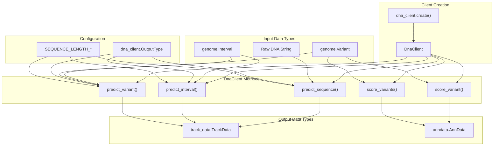
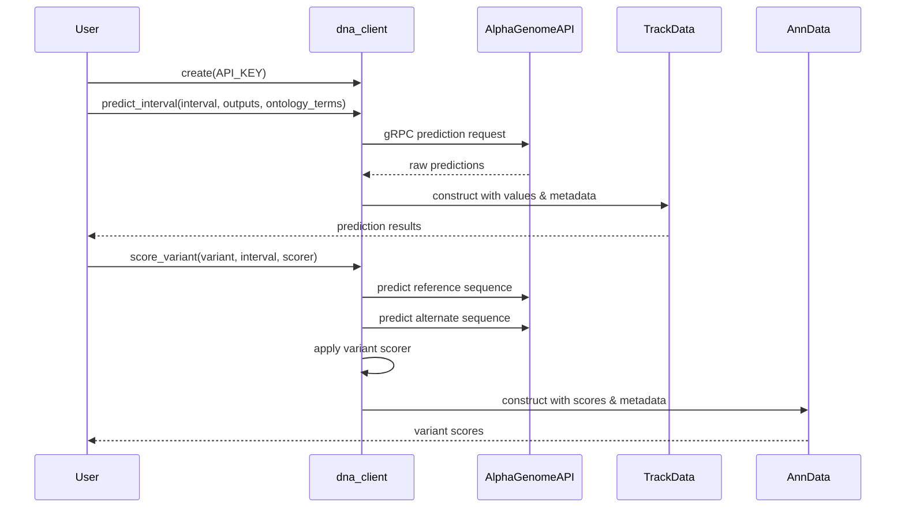
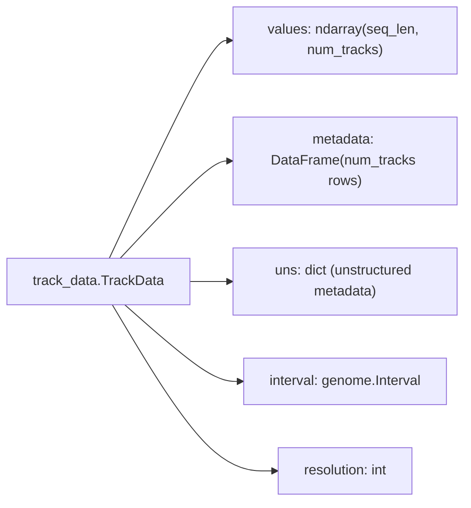
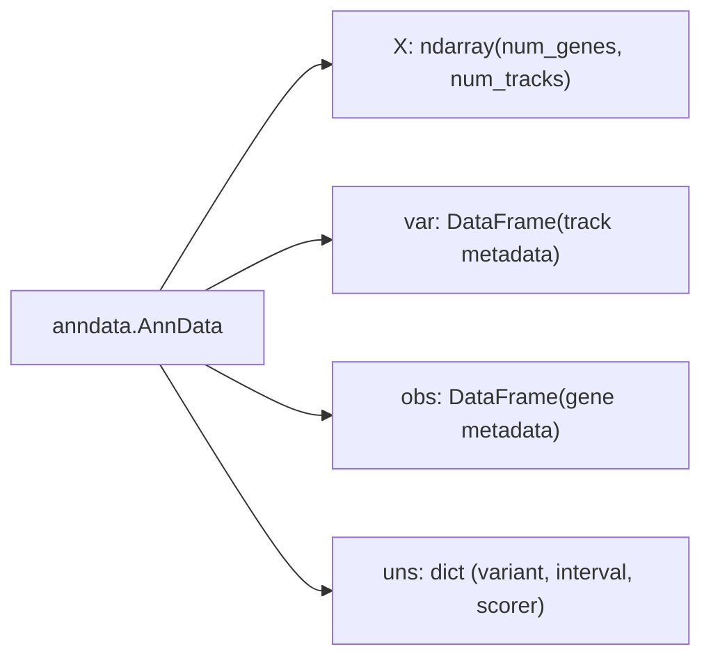

<!-- source: DeepWiki mcp.deepwiki.com · repo google-deepmind/alphagenome · page 4 API Reference · fetched 2026-10-26 -->

# API Reference

<details>
<summary>Relevant source files</summary>

The following files were used as context for generating this wiki page:

- [CHANGELOG.md](CHANGELOG.md)
- [docs/source/api/data.md](docs/source/api/data.md)
- [src/alphagenome/__init__.py](src/alphagenome/__init__.py)
- [src/alphagenome/data/gene_annotation.py](src/alphagenome/data/gene_annotation.py)
- [src/alphagenome/data/gene_annotation_test.py](src/alphagenome/data/gene_annotation_test.py)

</details>


This page provides a comprehensive reference for the AlphaGenome client library API, covering all public classes, methods, and data structures. The API enables interaction with Google DeepMind's AlphaGenome model for genomic sequence analysis and variant scoring.

For getting started tutorials, see [Getting Started](#2). For specific example workflows, see [Examples and Tutorials](#4).

## API Architecture Overview



Sources: [colabs/quick_start.ipynb:84-95](), [colabs/essential_commands.ipynb:76-80]()

## Core Data Flow



Sources: [colabs/quick_start.ipynb:134-206](), [colabs/essential_commands.ipynb:1341-1356]()

## Core Client

### Client Creation

| Function | Description | Returns |
|----------|-------------|---------|
| `dna_client.create(api_key)` | Creates authenticated client instance | `DnaClient` |

Sources: [colabs/quick_start.ipynb:135]()

### DnaClient Methods

| Method | Input Types | Output Type | Description |
|--------|-------------|-------------|-------------|
| `predict_sequence(sequence, requested_outputs, ontology_terms)` | `str`, `List[OutputType]`, `List[str]` | `TrackData` | Predict from raw DNA string |
| `predict_interval(interval, requested_outputs, ontology_terms)` | `genome.Interval`, `List[OutputType]`, `List[str]` | `TrackData` | Predict from genomic interval |
| `predict_variant(interval, variant, requested_outputs, ontology_terms)` | `genome.Interval`, `genome.Variant`, `List[OutputType]`, `List[str]` | `TrackData` | Predict reference and alternate sequences |
| `score_variant(variant, interval, scorer, requested_outputs, ontology_terms)` | `genome.Variant`, `genome.Interval`, `VariantScorer`, `List[OutputType]`, `List[str]` | `AnnData` | Score single variant effect |
| `score_variants(variants, interval, scorer, requested_outputs, ontology_terms)` | `List[genome.Variant]`, `genome.Interval`, `VariantScorer`, `List[OutputType]`, `List[str]` | `AnnData` | Score multiple variant effects |

Sources: [colabs/essential_commands.ipynb:1341-1356]()

### Output Types

```python
dna_client.OutputType
```

| Enum Value | Description |
|------------|-------------|
| `ATAC` | ATAC-seq accessibility predictions |
| `CAGE` | CAGE transcription start site predictions |
| `DNASE` | DNase-seq accessibility predictions |  
| `RNA_SEQ` | RNA-seq expression predictions |
| `CHIP_HISTONE` | Histone ChIP-seq predictions |
| `CHIP_TF` | Transcription factor ChIP-seq predictions |
| `SPLICE_SITES` | Splice site predictions |
| `SPLICE_SITE_USAGE` | Splice site usage predictions |
| `SPLICE_JUNCTIONS` | Splice junction predictions |
| `CONTACT_MAPS` | Chromatin contact map predictions |
| `PROCAP` | PRO-cap predictions |

Sources: [colabs/quick_start.ipynb:154-180]()

### Supported Sequence Lengths

| Constant | Value | Description |
|----------|-------|-------------|
| `dna_client.SEQUENCE_LENGTH_2KB` | 2,048 | 2 kilobase sequences |
| `dna_client.SEQUENCE_LENGTH_16KB` | 16,384 | 16 kilobase sequences |
| `dna_client.SEQUENCE_LENGTH_100KB` | 102,400 | 100 kilobase sequences |
| `dna_client.SEQUENCE_LENGTH_500KB` | 524,288 | 500 kilobase sequences |
| `dna_client.SEQUENCE_LENGTH_1MB` | 1,048,576 | 1 megabase sequences |

Sources: [colabs/quick_start.ipynb:1003-1018]()

## Data Structures

### genome.Interval

Represents a genomic interval with chromosome, start, and end coordinates.

#### Constructor
```python
genome.Interval(chromosome, start, end, strand='.', name='')
```

#### Properties and Methods

| Member | Type | Description |
|--------|------|-------------|
| `chromosome` | `str` | Chromosome identifier (e.g., 'chr1') |
| `start` | `int` | Start position (0-based, inclusive) |
| `end` | `int` | End position (0-based, exclusive) |  
| `strand` | `str` | Strand ('+', '-', or '.') |
| `name` | `str` | Optional name/identifier |
| `width` | `int` | Length of interval (`end - start`) |
| `center()` | `int` | Returns center position |
| `resize(width)` | `genome.Interval` | Returns resized interval around center |
| `overlaps(other)` | `bool` | Check if intervals overlap |
| `contains(other)` | `bool` | Check if this interval contains other |
| `intersect(other)` | `genome.Interval` | Return intersection with other interval |

Sources: [colabs/essential_commands.ipynb:121-389]()

### genome.Variant

Represents a genetic variant with reference and alternate alleles.

#### Constructor
```python
genome.Variant(chromosome, position, reference_bases, alternate_bases)
```

#### Properties and Methods

| Member | Type | Description |
|--------|------|-------------|
| `chromosome` | `str` | Chromosome identifier |
| `position` | `int` | Position (1-based) |
| `reference_bases` | `str` | Reference allele sequence |
| `alternate_bases` | `str` | Alternate allele sequence |
| `reference_interval` | `genome.Interval` | Interval spanning reference bases |
| `reference_overlaps(interval)` | `bool` | Check if reference overlaps interval |
| `alternate_overlaps(interval)` | `bool` | Check if alternate overlaps interval |

Sources: [colabs/essential_commands.ipynb:427-653]()

### track_data.TrackData

Container for model prediction outputs with values and metadata.

#### Structure



#### Properties and Methods

| Member | Type | Description |
|--------|------|-------------|
| `values` | `numpy.ndarray` | Prediction values, shape `(sequence_length, num_tracks)` |
| `metadata` | `pandas.DataFrame` | Track metadata with columns `name`, `strand`, etc. |
| `uns` | `dict` | Unstructured metadata |
| `interval` | `genome.Interval` | Genomic interval for predictions |
| `resolution` | `int` | Base pairs per prediction value |
| `change_resolution(resolution)` | `TrackData` | Convert to different resolution |
| `filter_to_positive_strand()` | `TrackData` | Filter to positive strand tracks |
| `filter_to_negative_strand()` | `TrackData` | Filter to negative strand tracks |
| `filter_to_unstranded()` | `TrackData` | Filter to unstranded tracks |
| `resize(width)` | `TrackData` | Resize by cropping or padding |
| `slice_by_positions(start, end)` | `TrackData` | Slice by position indices |
| `slice_by_interval(interval)` | `TrackData` | Slice by genomic interval |
| `select_tracks_by_name(names)` | `TrackData` | Select specific tracks |
| `reverse_complement()` | `TrackData` | Reverse complement transformation |

Sources: [colabs/essential_commands.ipynb:706-1254]()

### anndata.AnnData

Container for variant scoring results with scores and metadata.

#### Structure



#### Properties

| Member | Type | Description |
|--------|------|-------------|
| `X` | `numpy.ndarray` | Variant scores, shape `(num_genes, num_tracks)` |
| `var` | `pandas.DataFrame` | Track metadata |
| `obs` | `pandas.DataFrame` | Gene metadata (if gene-centric scorer) |
| `uns` | `dict` | Contains `variant`, `interval`, `scorer` metadata |

Sources: [colabs/essential_commands.ipynb:1260-1295]()

## Visualization

### plot_components.plot

Main plotting function for creating visualizations from prediction data.

```python
plot_components.plot(components, interval)
```

#### Parameters
- `components`: List of plot components
- `interval`: `genome.Interval` for the plot region

#### Returns
- `matplotlib.figure.Figure`

### Plot Components

| Component | Description |
|-----------|-------------|
| `plot_components.TranscriptAnnotation` | Gene/transcript annotations |
| `plot_components.Tracks` | Track prediction visualizations |
| `plot_components.VariantAnnotation` | Variant position markers |
| `plot_components.OverlaidTracks` | Multiple overlaid track types |

Sources: [colabs/quick_start.ipynb:1107-1115](), [colabs/essential_commands.ipynb:1374-1382]()

## Constants and Configuration

### API Authentication
- Requires `ALPHA_GENOME_API_KEY` for client creation
- Uses gRPC for communication with AlphaGenome service

### Coordinate Systems
- **Intervals**: 0-based indexing (start inclusive, end exclusive)
- **Variants**: 1-based position indexing for compatibility with VCF format

### Default Parameters
- Default strand: `'.'` (unstranded)
- Default resolution: 1 base pair per prediction value
- Human hg38 reference genome

Sources: [colabs/essential_commands.ipynb:132-135](), [colabs/essential_commands.ipynb:396-400](), [colabs/essential_commands.ipynb:441-446]()

---

