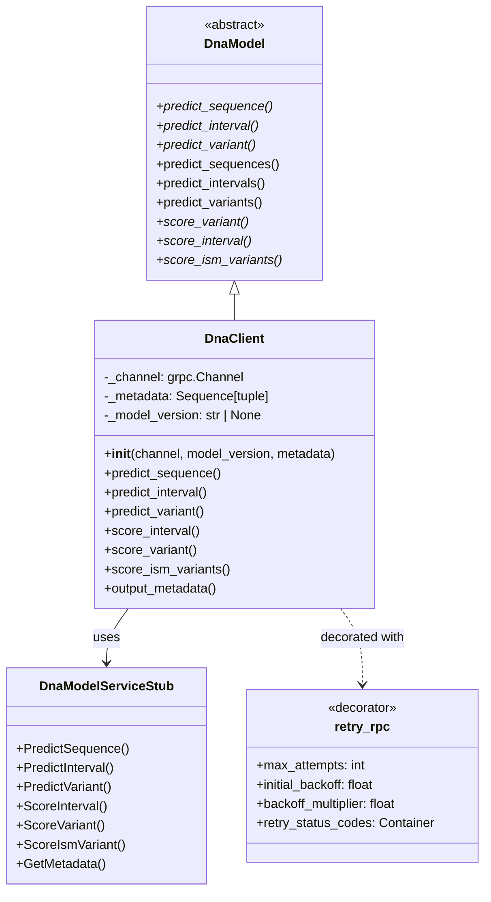
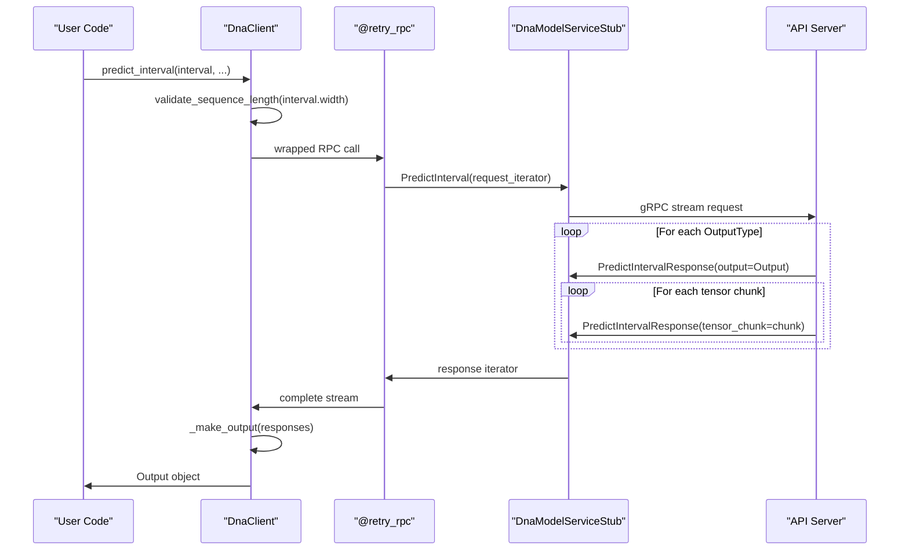
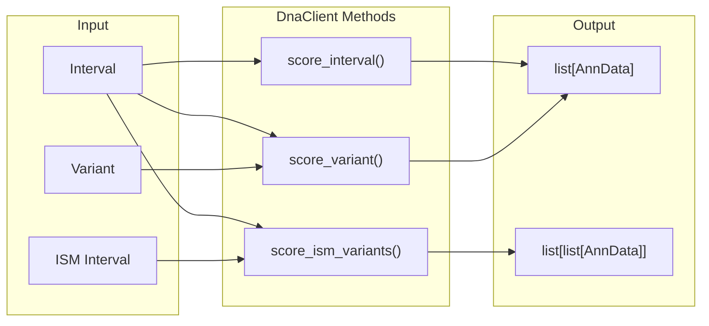
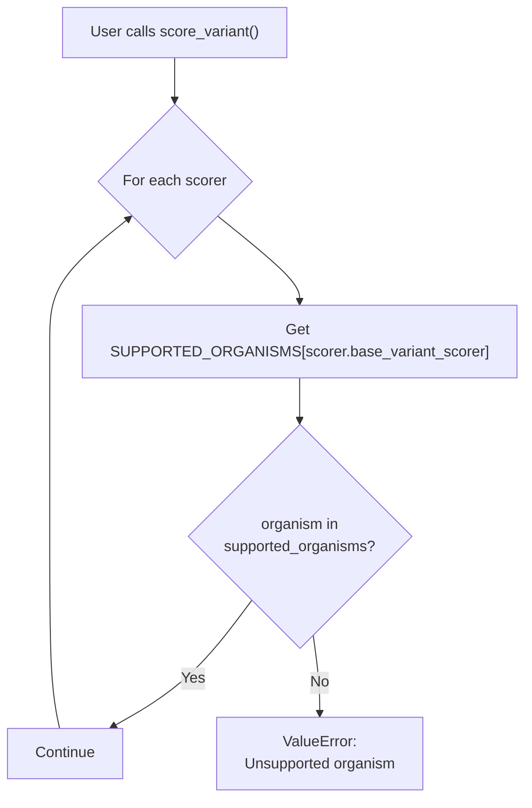
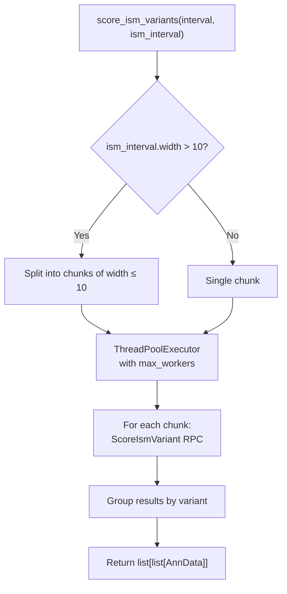
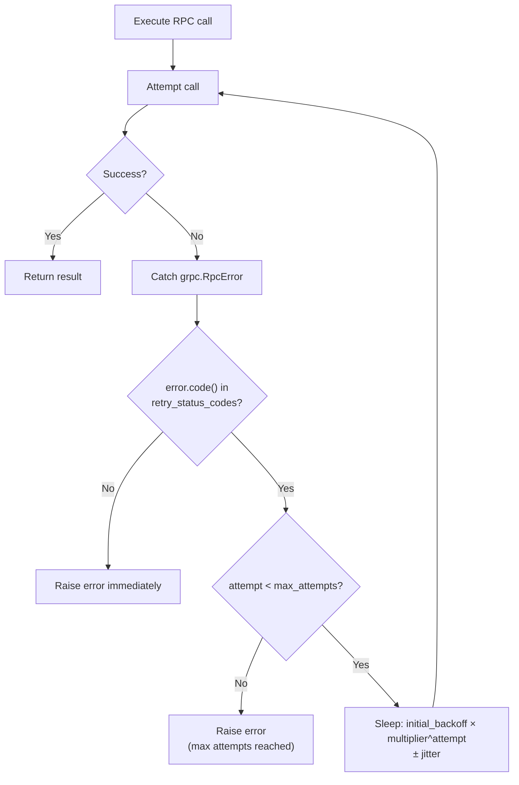

<!-- source: DeepWiki mcp.deepwiki.com · repo google-deepmind/alphagenome · page 4.1 DnaClient · fetched 2026-10-26 -->

# DnaClient

<details>
<summary>Relevant source files</summary>

The following files were used as context for generating this wiki page:

- [docs/source/api/models.md](docs/source/api/models.md)
- [src/alphagenome/models/dna_client.py](src/alphagenome/models/dna_client.py)
- [src/alphagenome/models/dna_client_test.py](src/alphagenome/models/dna_client_test.py)
- [src/alphagenome/protos/dna_model_service.proto](src/alphagenome/protos/dna_model_service.proto)

</details>


**Purpose**: This document provides the complete technical reference for the `DnaClient` class, the primary interface for communicating with the AlphaGenome API server. It documents initialization, prediction methods, scoring methods, error handling, and configuration options.

**Scope**: This page covers the `DnaClient` implementation details. For the abstract interface that `DnaClient` implements, see [DnaModel Abstract Interface](#4.2). For information about the data structures returned by these methods, see [Data Structures](#4.3). For scorer configuration details, see [Variant and Interval Scorers](#4.4).

---

## Overview

The `DnaClient` class is the concrete implementation of the `DnaModel` abstract interface that communicates with the remote AlphaGenome API server via gRPC. It provides methods for making genomic predictions, scoring variants, and retrieving model metadata.

**Key characteristics**:
- Implements streaming gRPC communication using Protocol Buffers
- Automatic retry logic for transient network failures
- Input validation before network calls
- Support for batch processing via inherited methods
- Thread-safe parallel execution

**Class Diagram: DnaClient Architecture**



**Sources**: [src/alphagenome/models/dna_client.py:494-507](), [src/alphagenome/models/dna_model.py]()

---

## Creating a DnaClient

### Factory Function: `create`

The recommended way to create a `DnaClient` is using the `create` factory function, which handles channel configuration and authentication.

**Function Signature**:
```python
def create(
    api_key: str,
    *,
    model_version: ModelVersion | None = None,
    timeout: float | None = None,
    address: str | None = None,
) -> DnaClient
```

**Parameters**:

| Parameter | Type | Default | Description |
|-----------|------|---------|-------------|
| `api_key` | `str` | *required* | API key for authentication (obtain from deepmind.google.com) |
| `model_version` | `ModelVersion \| None` | `None` | Specific model version to use; if `None`, uses default |
| `timeout` | `float \| None` | `None` | Timeout in seconds for channel ready check |
| `address` | `str \| None` | `'dns:///gdmscience.googleapis.com:443'` | Server address |

**Returns**: Configured `DnaClient` instance

**Example Usage**:
```python
import alphagenome.models.dna_client as dna_client

# Basic creation with API key
model = dna_client.create(api_key='your-api-key')

# With specific model version
model = dna_client.create(
    api_key='your-api-key',
    model_version=dna_client.ModelVersion.FOLD_0
)
```

**Implementation Details**:
- Creates a secure gRPC channel with SSL credentials
- Configures unlimited message size for large genomic predictions
- Passes API key as gRPC metadata in `x-goog-api-key` header
- Waits for channel to be ready before returning

**Sources**: [src/alphagenome/models/dna_client.py:874-907]()

### Direct Constructor

Advanced users can construct `DnaClient` directly for custom channel configurations:

```python
DnaClient(
    *,
    channel: grpc.Channel,
    model_version: ModelVersion | None = None,
    metadata: Sequence[tuple[str, str]] = (),
)
```

**Sources**: [src/alphagenome/models/dna_client.py:504-515]()

---

## Prediction Methods

The `DnaClient` provides three core prediction methods for different input types. All methods return structured prediction objects containing multiple biological modalities.

### Communication Flow



**Sources**: [src/alphagenome/models/dna_client.py:564-598](), [src/alphagenome/protos/dna_model_service.proto:28-55]()

### `predict_sequence`

Generate predictions for a raw DNA sequence string.

**Signature**:
```python
@retry_rpc
def predict_sequence(
    self,
    sequence: str,
    *,
    organism: Organism = Organism.HOMO_SAPIENS,
    requested_outputs: Iterable[OutputType],
    ontology_terms: Iterable[OntologyTerm | str] | None,
    interval: Interval | None = None,
) -> Output
```

**Parameters**:

| Parameter | Type | Description |
|-----------|------|-------------|
| `sequence` | `str` | DNA sequence containing only characters `A`, `C`, `G`, `T`, `N` |
| `organism` | `Organism` | Target organism (HOMO_SAPIENS or MUS_MUSCULUS) |
| `requested_outputs` | `Iterable[OutputType]` | Which prediction modalities to generate |
| `ontology_terms` | `Iterable[OntologyTerm \| str] \| None` | Tissue/cell type contexts; `None` returns all |
| `interval` | `Interval \| None` | Optional genomic coordinates for output annotation |

**Returns**: `Output` object containing requested prediction modalities

**Raises**:
- `ValueError` if sequence contains invalid characters
- `ValueError` if sequence length is not supported
- `grpc.RpcError` if API call fails after retries

**Input Validation**:
- Checks sequence contains only valid characters `{A, C, G, T, N}`
- Validates length is one of: 16,384 / 131,072 / 524,288 / 1,048,576
- Deduplicates `requested_outputs` to avoid redundant computation
- Converts ontology term strings to `OntologyTerm` objects

**Sources**: [src/alphagenome/models/dna_client.py:517-562]()

### `predict_interval`

Generate predictions for a genomic interval (chromosome coordinates).

**Signature**:
```python
@retry_rpc
def predict_interval(
    self,
    interval: Interval,
    *,
    organism: Organism = Organism.HOMO_SAPIENS,
    requested_outputs: Iterable[OutputType],
    ontology_terms: Iterable[OntologyTerm | str] | None,
) -> Output
```

**Parameters**:

| Parameter | Type | Description |
|-----------|------|-------------|
| `interval` | `Interval` | Genomic coordinates to predict |
| `organism` | `Organism` | Organism for reference genome lookup |
| `requested_outputs` | `Iterable[OutputType]` | Which prediction modalities to generate |
| `ontology_terms` | `Iterable[OntologyTerm \| str] \| None` | Tissue/cell type contexts |

**Returns**: `Output` object with predictions tied to the input interval

**Key Differences from `predict_sequence`**:
- Server fetches sequence from reference genome automatically
- Returned `TrackData` objects have `interval` attribute populated
- No need to provide sequence string

**Sources**: [src/alphagenome/models/dna_client.py:564-598]()

### `predict_variant`

Generate predictions for both reference and alternate alleles of a variant.

**Signature**:
```python
@retry_rpc
def predict_variant(
    self,
    interval: Interval,
    variant: Variant,
    *,
    organism: Organism = Organism.HOMO_SAPIENS,
    requested_outputs: Iterable[OutputType],
    ontology_terms: Iterable[OntologyTerm | str] | None,
) -> VariantOutput
```

**Parameters**:

| Parameter | Type | Description |
|-----------|------|-------------|
| `interval` | `Interval` | Context interval for prediction |
| `variant` | `Variant` | Genetic variant to evaluate |
| `organism` | `Organism` | Target organism |
| `requested_outputs` | `Iterable[OutputType]` | Which prediction modalities to generate |
| `ontology_terms` | `Iterable[OntologyTerm \| str] \| None` | Tissue/cell type contexts |

**Returns**: `VariantOutput` object containing:
- `reference`: `Output` for reference allele
- `alternate`: `Output` for alternate allele

**Usage Pattern**:
```python
variant_output = model.predict_variant(
    interval=genome.Interval('chr1', 1000000, 1131072),
    variant=genome.Variant('chr1', 1050000, 'A', 'G'),
    organism=dna_client.Organism.HOMO_SAPIENS,
    requested_outputs=[dna_client.OutputType.RNA_SEQ],
    ontology_terms=None
)

# Compare reference vs alternate
ref_rna = variant_output.reference.rna_seq
alt_rna = variant_output.alternate.rna_seq
```

**Sources**: [src/alphagenome/models/dna_client.py:600-637]()

### Supported Output Types

All prediction methods accept an `Iterable[OutputType]` specifying which modalities to generate:

| OutputType | Description | Data Structure |
|------------|-------------|----------------|
| `ATAC` | ATAC-seq (chromatin accessibility) | `TrackData` |
| `CAGE` | CAGE (transcription start sites) | `TrackData` |
| `DNASE` | DNase-seq (chromatin accessibility) | `TrackData` |
| `RNA_SEQ` | RNA-seq (gene expression) | `TrackData` |
| `CHIP_HISTONE` | ChIP-seq histone marks | `TrackData` |
| `CHIP_TF` | ChIP-seq transcription factors | `TrackData` |
| `SPLICE_SITES` | Splice site predictions | `TrackData` |
| `SPLICE_SITE_USAGE` | Splice site usage | `TrackData` |
| `SPLICE_JUNCTIONS` | Splice junction usage | `JunctionData` |
| `CONTACT_MAPS` | 3D genome contact maps | `JunctionData` |
| `PROCAP` | PRO-cap (nascent transcription) | `TrackData` |

**Sources**: [src/alphagenome/models/dna_output.py](), [src/alphagenome/protos/dna_model.proto]()

---

## Scoring Methods

Scoring methods compute interpretable summary statistics from model predictions, producing `AnnData` objects suitable for downstream analysis.

### Method Overview



**Sources**: [src/alphagenome/models/dna_client.py:639-852]()

### `score_interval`

Generate interval scores for a genomic region using interval scorers.

**Signature**:
```python
@retry_rpc
def score_interval(
    self,
    interval: Interval,
    interval_scorers: Sequence[IntervalScorerTypes] = (),
    *,
    organism: Organism = Organism.HOMO_SAPIENS,
) -> list[anndata.AnnData]
```

**Parameters**:

| Parameter | Type | Description |
|-----------|------|-------------|
| `interval` | `Interval` | Genomic region to score |
| `interval_scorers` | `Sequence[IntervalScorerTypes]` | Scorers to apply; empty uses recommended scorers |
| `organism` | `Organism` | Target organism |

**Returns**: List of `AnnData` objects, one per scorer. Each contains:
- `.X`: Score matrix `[genes × tracks]`
- `.obs`: Gene metadata (gene_id, strand, gene_name, gene_type)
- `.var`: Track metadata (name, strand)
- `.uns['interval']`: Input interval
- `.uns['interval_scorer']`: Scorer configuration used

**Constraints**:
- Maximum 20 interval scorers per request (`MAX_VARIANT_SCORERS_PER_REQUEST`)
- Scorer widths must be ≤ interval width
- No duplicate scorers allowed
- Interval width must be a supported sequence length

**Sources**: [src/alphagenome/models/dna_client.py:639-691]()

### `score_variant`

Generate variant effect scores for a genetic variant.

**Signature**:
```python
@retry_rpc
def score_variant(
    self,
    interval: Interval,
    variant: Variant,
    variant_scorers: Sequence[VariantScorerTypes] = (),
    *,
    organism: Organism = Organism.HOMO_SAPIENS,
) -> list[anndata.AnnData]
```

**Parameters**:

| Parameter | Type | Description |
|-----------|------|-------------|
| `interval` | `Interval` | Context interval for scoring |
| `variant` | `Variant` | Variant to score |
| `variant_scorers` | `Sequence[VariantScorerTypes]` | Scorers to apply; empty uses recommended |
| `organism` | `Organism` | Target organism |

**Returns**: List of `AnnData` objects, one per scorer. Each contains:
- `.X`: Raw effect scores `[genes × tracks]`
- `.layers['quantiles']`: Quantile-normalized scores (if available)
- `.obs`: Gene metadata
- `.var`: Track metadata
- `.uns['variant']`: Input variant
- `.uns['interval']`: Input interval
- `.uns['variant_scorer']`: Scorer configuration

**Validation**:
- Checks scorer compatibility with organism
- Validates no duplicate scorers
- Enforces maximum 20 scorers per request
- Validates interval width

**Scorer-Organism Compatibility Check**:



**Sources**: [src/alphagenome/models/dna_client.py:693-757](), [src/alphagenome/models/variant_scorers.py]()

### `score_ism_variants`

Perform in-silico mutagenesis (ISM) by scoring all possible single-nucleotide variants in an interval.

**Signature**:
```python
def score_ism_variants(
    self,
    interval: Interval,
    ism_interval: Interval,
    variant_scorers: Sequence[VariantScorerTypes] = (),
    *,
    organism: Organism = Organism.HOMO_SAPIENS,
    interval_variant: Variant | None = None,
    progress_bar: bool = True,
    max_workers: int = DEFAULT_MAX_WORKERS,
) -> list[list[anndata.AnnData]]
```

**Parameters**:

| Parameter | Type | Description |
|-----------|------|-------------|
| `interval` | `Interval` | Full context interval for predictions |
| `ism_interval` | `Interval` | Subregion to mutagenize (must be within `interval`) |
| `variant_scorers` | `Sequence[VariantScorerTypes]` | Scorers to apply |
| `organism` | `Organism` | Target organism |
| `interval_variant` | `Variant \| None` | Optional variant to apply before ISM |
| `progress_bar` | `bool` | Show progress indicator |
| `max_workers` | `int` | Parallel worker threads |

**Returns**: Nested list structure `list[list[AnnData]]`
- Outer list: One entry per variant (3 × `ism_interval.width`)
- Inner list: One `AnnData` per scorer

**Automatic Chunking**:
- If `ism_interval.width` > 10 (`MAX_ISM_INTERVAL_WIDTH`)
- Client automatically splits into chunks of width ≤ 10
- Processes chunks in parallel
- Groups results by variant

**ISM Workflow**:



**ISM Interval Constraints**:
- Must be on positive strand
- Width typically 10-100 bp for practical execution time
- Each base generates 3 variants (3 alternate nucleotides)

**Sources**: [src/alphagenome/models/dna_client.py:759-852]()

---

## Metadata Retrieval

### `output_metadata`

Retrieve metadata about available tracks and their annotations for an organism.

**Signature**:
```python
def output_metadata(
    self, 
    organism: Organism = Organism.HOMO_SAPIENS
) -> OutputMetadata
```

**Parameters**:

| Parameter | Type | Description |
|-----------|------|-------------|
| `organism` | `Organism` | Organism to retrieve metadata for |

**Returns**: `OutputMetadata` object containing `DataFrame` metadata for each output type:

```python
metadata = model.output_metadata(organism=Organism.HOMO_SAPIENS)

# Access track metadata
if metadata.rna_seq is not None:
    print(metadata.rna_seq)  # DataFrame with columns: name, strand, ...
    
# Access junction metadata  
if metadata.splice_junctions is not None:
    print(metadata.splice_junctions)  # DataFrame with columns: name, ...
```

**Metadata Structure**:
- Track-based outputs (ATAC, RNA_SEQ, etc.): `pandas.DataFrame` with track names and strand info
- Junction-based outputs (SPLICE_JUNCTIONS, CONTACT_MAPS): `pandas.DataFrame` with junction names
- Outputs not available for organism: `None`

**Sources**: [src/alphagenome/models/dna_client.py:854-871](), [src/alphagenome/models/dna_client.py:195-231]()

---

## Error Handling and Retry Logic

### `@retry_rpc` Decorator

All prediction and scoring methods are decorated with `@retry_rpc`, which provides automatic retry for transient failures.

**Retry Configuration**:

| Parameter | Default | Description |
|-----------|---------|-------------|
| `max_attempts` | 5 | Maximum number of call attempts |
| `initial_backoff` | 1.25s | Initial delay before first retry |
| `backoff_multiplier` | 1.5 | Exponential backoff multiplier |
| `retry_status_codes` | `RESOURCE_EXHAUSTED`, `UNAVAILABLE` | Which gRPC errors to retry |
| `jitter` | 0.2 | Random jitter factor (±20%) |

**Retry Decision Flow**:



**Retryable Status Codes**:
- `RESOURCE_EXHAUSTED`: Server temporarily overloaded
- `UNAVAILABLE`: Network or server unavailable

**Non-Retryable Status Codes** (immediate failure):
- `INVALID_ARGUMENT`: Invalid input parameters
- `PERMISSION_DENIED`: Authentication failure
- `INTERNAL`: Server internal error
- `DEADLINE_EXCEEDED`: Total timeout exceeded
- All other status codes

**Backoff Calculation**:
```python
base_backoff = initial_backoff * (backoff_multiplier ** attempt)
jitter_amount = random.uniform(-jitter, jitter) * base_backoff
actual_backoff = base_backoff + jitter_amount
```

**Example Timeline**:
- Attempt 1: Immediate
- Attempt 2: ~1.25s ± 0.25s
- Attempt 3: ~1.88s ± 0.38s
- Attempt 4: ~2.81s ± 0.56s
- Attempt 5: ~4.22s ± 0.84s

**Sources**: [src/alphagenome/models/dna_client.py:73-122]()

### Input Validation

The client performs validation before making network calls to fail fast on invalid inputs.

**Validation Functions**:

```python
# Sequence validation
def validate_sequence_length(length: int):
    """Raises ValueError if length not in SUPPORTED_SEQUENCE_LENGTHS"""
    
# Implemented at line 485-491
```

**Validation Checks**:

| Check | Location | Error Type |
|-------|----------|------------|
| Sequence contains only `ACGTN` | `predict_sequence` | `ValueError` |
| Sequence length is supported | All prediction methods | `ValueError` |
| Interval width is supported | All interval methods | `ValueError` |
| No duplicate scorers | Scoring methods | `ValueError` |
| Scorer count ≤ 20 | Scoring methods | `ValueError` |
| Scorer width ≤ interval width | `score_interval` | `ValueError` |
| Organism supported by scorer | `score_variant` | `ValueError` |
| ISM interval on positive strand | `score_ism_variants` | `ValueError` |

**Sources**: [src/alphagenome/models/dna_client.py:485-491](), [src/alphagenome/models/dna_client.py:542-550](), [src/alphagenome/models/dna_client.py:665-678](), [src/alphagenome/models/dna_client.py:720-743]()

---

## Constants and Configuration

### Supported Sequence Lengths

The model supports four discrete sequence lengths (powers of 2):

```python
SEQUENCE_LENGTH_16KB = 2**14    # 16,384 bp
SEQUENCE_LENGTH_100KB = 2**17   # 131,072 bp
SEQUENCE_LENGTH_500KB = 2**19   # 524,288 bp
SEQUENCE_LENGTH_1MB = 2**20     # 1,048,576 bp

SUPPORTED_SEQUENCE_LENGTHS = {
    'SEQUENCE_LENGTH_16KB': 16_384,
    'SEQUENCE_LENGTH_100KB': 131_072,
    'SEQUENCE_LENGTH_500KB': 524_288,
    'SEQUENCE_LENGTH_1MB': 1_048_576,
}
```

**Sources**: [src/alphagenome/models/dna_client.py:46-57]()

### Request Limits

**Constants**:

| Constant | Value | Description |
|----------|-------|-------------|
| `MAX_ISM_INTERVAL_WIDTH` | 10 | Maximum ISM interval before automatic chunking |
| `MAX_VARIANT_SCORERS_PER_REQUEST` | 20 | Maximum scorers per scoring request |

**gRPC Message Limits**:
```python
options = [
    ('grpc.max_send_message_length', -1),      # Unlimited
    ('grpc.max_receive_message_length', -1),   # Unlimited
]
```

These unlimited message sizes accommodate large genomic prediction tensors (potentially gigabytes for 1MB sequences with many tracks).

**Sources**: [src/alphagenome/models/dna_client.py:59-66](), [src/alphagenome/models/dna_client.py:893-896]()

### Model Versions

The `ModelVersion` enum allows selection of specific model checkpoints:

```python
class ModelVersion(enum.Enum):
    FOLD_0 = 0
    FOLD_1 = 1
    FOLD_2 = 2
    FOLD_3 = 3
    FOLD_4 = 4
```

If `model_version=None` (default), the server uses the ensemble/default model.

**Sources**: [src/alphagenome/models/dna_model.py]()

### Organisms

```python
class Organism(enum.Enum):
    HOMO_SAPIENS = auto()   # Human (hg38)
    MUS_MUSCULUS = auto()   # Mouse (mm10)
```

**Sources**: [src/alphagenome/models/dna_model.py]()

---

## Advanced Usage

### Custom Channel Configuration

For advanced use cases (e.g., custom credentials, proxies, interceptors):

```python
import grpc
from alphagenome.models import dna_client

# Create custom channel
options = [
    ('grpc.max_send_message_length', -1),
    ('grpc.max_receive_message_length', -1),
    # Add custom options...
]

credentials = grpc.ssl_channel_credentials()
channel = grpc.secure_channel(
    'dns:///gdmscience.googleapis.com:443',
    credentials,
    options=options
)

# Create client with custom channel
client = dna_client.DnaClient(
    channel=channel,
    metadata=[('x-goog-api-key', 'your-api-key')],
    model_version=None
)
```

**Sources**: [src/alphagenome/models/dna_client.py:504-515](), [src/alphagenome/models/dna_client.py:893-901]()

### Batch Processing

`DnaClient` inherits batch processing methods from `DnaModel`:

- `predict_sequences()`: Process multiple sequences in parallel
- `predict_intervals()`: Process multiple intervals in parallel
- `predict_variants()`: Process multiple variants in parallel
- `score_intervals()`: Score multiple intervals in parallel
- `score_variants()`: Score multiple variants in parallel

These methods use `ThreadPoolExecutor` for concurrent RPC calls with configurable `max_workers`.

See [DnaModel Abstract Interface](#4.2) for batch method documentation.

**Sources**: [src/alphagenome/models/dna_model.py]()

### Response Streaming

All RPC methods use bidirectional streaming:

**Request Side**: Client sends single request message
**Response Side**: Server streams multiple messages:
1. Output/score metadata messages
2. Tensor chunk messages (large arrays split into chunks)

The client automatically:
- Reads tensor chunks in sequence
- Reassembles complete tensors
- Constructs high-level objects (`Output`, `AnnData`)

**Chunking Strategy**: Server splits large arrays into chunks to avoid gRPC message size limits, even though client sets unlimited sizes (for compatibility with older servers).

**Sources**: [src/alphagenome/models/dna_client.py:139-193](), [src/alphagenome/protos/dna_model_service.proto:76-87]()

---

## Type Aliases and Imports

The module provides convenience type aliases:

```python
from alphagenome.models.dna_client import (
    ModelVersion,          # Re-exported from dna_model
    Output,               # Re-exported from dna_output
    OutputMetadata,       # Re-exported from dna_output
    OutputType,           # Re-exported from dna_output
    VariantOutput,        # Re-exported from dna_output
    Organism,             # Re-exported from dna_model
)
```

**Sources**: [src/alphagenome/models/dna_client.py:125-130]()

---

