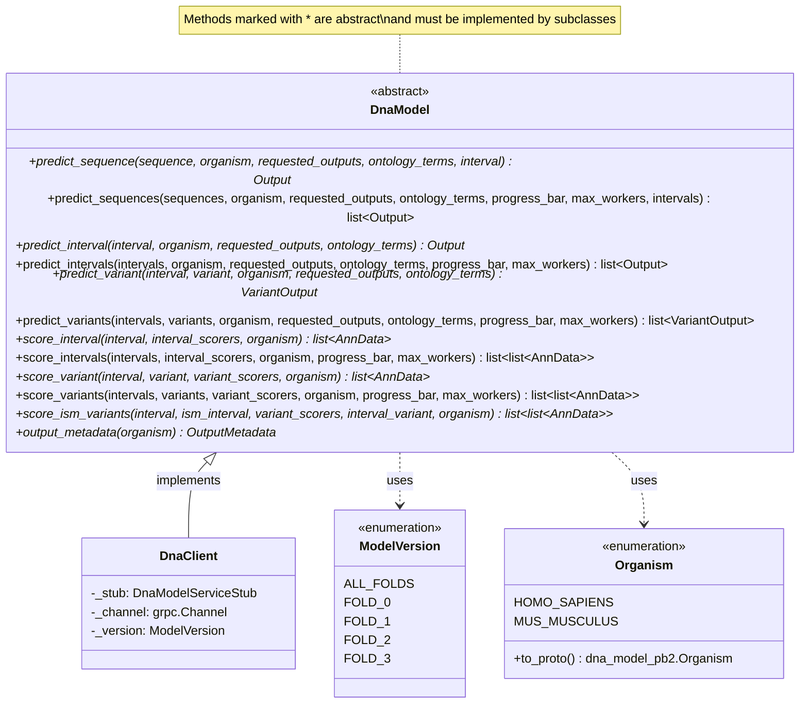
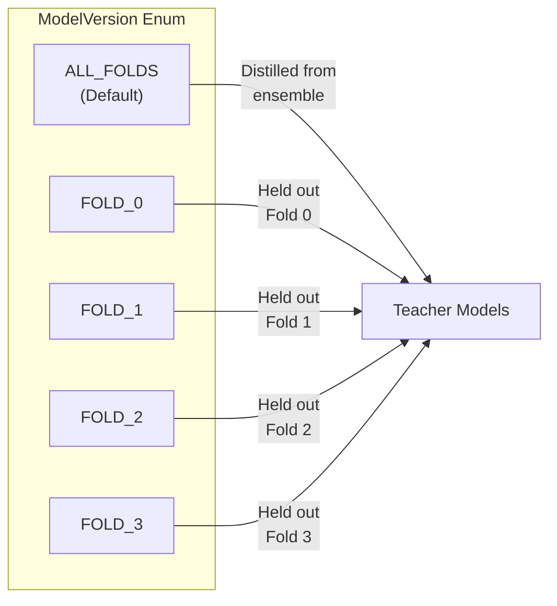
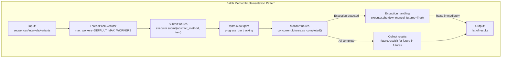
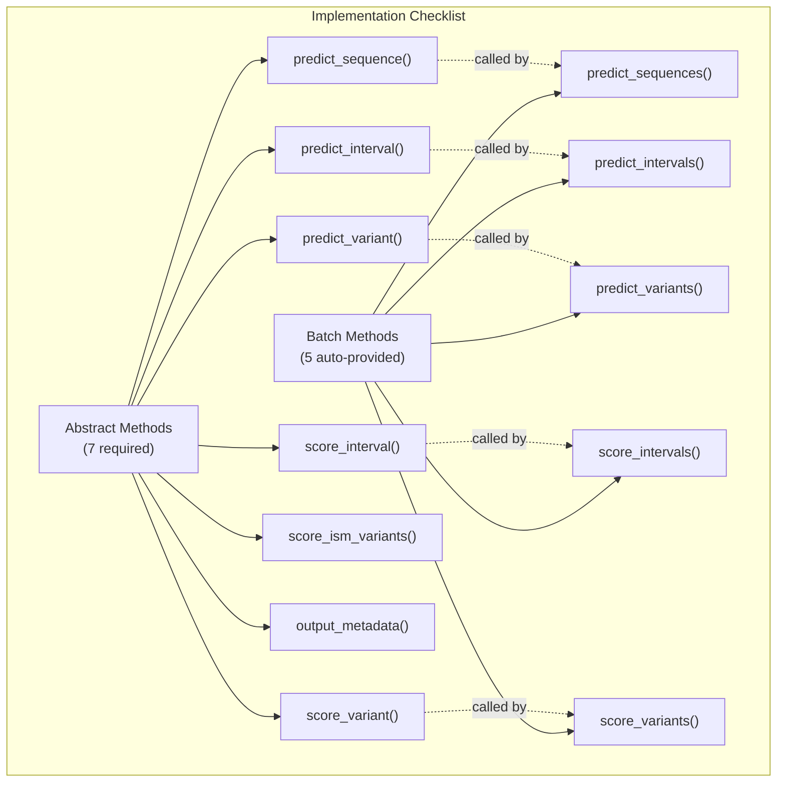
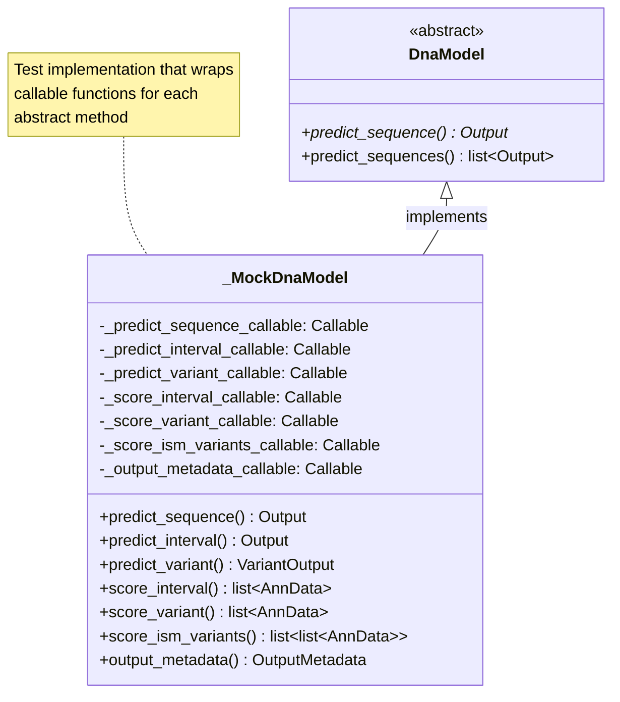

<!-- source: DeepWiki mcp.deepwiki.com · repo google-deepmind/alphagenome · page 4.2 DnaModel Abstract Interface · fetched 2026-10-26 -->

# DnaModel Abstract Interface

<details>
<summary>Relevant source files</summary>

The following files were used as context for generating this wiki page:

- [docs/source/_templates/autosummary/class.rst](docs/source/_templates/autosummary/class.rst)
- [src/alphagenome/models/dna_model.py](src/alphagenome/models/dna_model.py)
- [src/alphagenome/models/dna_model_test.py](src/alphagenome/models/dna_model_test.py)

</details>


## Purpose and Scope

The `DnaModel` abstract base class defines the standard interface that all AlphaGenome model implementations must follow. It specifies seven abstract methods for predictions and scoring operations, and provides pre-implemented batch processing methods that parallelize these operations using thread pools.

This page documents the abstract interface specification. For the concrete implementation using gRPC, see [DnaClient](#4.1). For practical usage patterns and examples, see [Prediction Workflows](#3.2) and [Variant Scoring](#3.3).

**Sources:** [src/alphagenome/models/dna_model.py:15-16](), [src/alphagenome/models/dna_model.py:73-74]()

---

## Class Architecture

The `DnaModel` class provides a two-tiered API design: abstract single-item methods that must be implemented by subclasses, and concrete batch processing methods that automatically parallelize the single-item operations.



**Sources:** [src/alphagenome/models/dna_model.py:35-71](), [src/alphagenome/models/dna_model.py:73-507]()

---

## Method Summary

The `DnaModel` interface consists of 13 public methods organized into three categories:

| Category | Abstract Methods | Batch Methods | Description |
|----------|-----------------|---------------|-------------|
| **Prediction** | `predict_sequence`<br/>`predict_interval`<br/>`predict_variant` | `predict_sequences`<br/>`predict_intervals`<br/>`predict_variants` | Generate raw model predictions for genomic inputs |
| **Scoring** | `score_interval`<br/>`score_variant`<br/>`score_ism_variants` | `score_intervals`<br/>`score_variants` | Compute aggregated scores using scorer configurations |
| **Metadata** | `output_metadata` | - | Retrieve model metadata for ontology terms and output types |

All abstract methods (7 total) must be implemented by concrete subclasses. Batch methods (5 total) are provided by the base class and automatically parallelize their corresponding single-item methods.

**Sources:** [src/alphagenome/models/dna_model.py:76-507]()

---

## Enumerations

### ModelVersion

The `ModelVersion` enum specifies which training fold or ensemble to use for predictions. AlphaGenome uses a 4-fold cross-validation strategy where the genome is partitioned into four disjoint subsets.



| Value | Description |
|-------|-------------|
| `ALL_FOLDS` | Distilled ensemble model trained on all genomic regions (default) |
| `FOLD_0` | Model trained with fold 0 held out for validation |
| `FOLD_1` | Model trained with fold 1 held out for validation |
| `FOLD_2` | Model trained with fold 2 held out for validation |
| `FOLD_3` | Model trained with fold 3 held out for validation |

**Usage:** When evaluating variants in regions that were held out during training (folds 0-3), use the corresponding fold-specific model to avoid train/test leakage. For production predictions, use `ALL_FOLDS`.

**Sources:** [src/alphagenome/models/dna_model.py:35-56]()

### Organism

The `Organism` enum specifies which reference genome and model weights to use.

| Value | Protocol Buffer Value | Reference Genome |
|-------|----------------------|------------------|
| `HOMO_SAPIENS` | `dna_model_pb2.ORGANISM_HOMO_SAPIENS` | hg38 (GRCh38) |
| `MUS_MUSCULUS` | `dna_model_pb2.ORGANISM_MUS_MUSCULUS` | mm10 (GRCm38) |

The `to_proto()` method converts the enum to its Protocol Buffer representation for gRPC communication.

**Sources:** [src/alphagenome/models/dna_model.py:58-71]()

---

## Abstract Methods

These seven methods define the core interface that all `DnaModel` implementations must provide. Each method is decorated with `@abc.abstractmethod`.

### predict_sequence

```python
@abc.abstractmethod
def predict_sequence(
    self,
    sequence: str,
    *,
    organism: Organism = Organism.HOMO_SAPIENS,
    requested_outputs: Iterable[dna_output.OutputType],
    ontology_terms: Iterable[ontology.OntologyTerm | str] | None,
    interval: genome.Interval | None = None,
) -> dna_output.Output
```

Generate predictions for a raw DNA sequence string. This is the most flexible prediction method as it accepts arbitrary sequences that may not correspond to reference genome coordinates.

**Parameters:**
- `sequence`: DNA sequence string (A, C, G, T characters)
- `organism`: Target organism for prediction context
- `requested_outputs`: Which prediction modalities to compute (RNA_SEQ, ATAC, etc.)
- `ontology_terms`: Tissue/cell type contexts to predict, or `None` for all available terms
- `interval`: Optional genomic coordinates if sequence was derived from a known location

**Returns:** `dna_output.Output` object containing predictions for all requested modalities

**Sources:** [src/alphagenome/models/dna_model.py:76-100]()

---

### predict_interval

```python
@abc.abstractmethod
def predict_interval(
    self,
    interval: genome.Interval,
    *,
    organism: Organism = Organism.HOMO_SAPIENS,
    requested_outputs: Iterable[dna_output.OutputType],
    ontology_terms: Iterable[ontology.OntologyTerm | str] | None,
) -> dna_output.Output
```

Generate predictions for a genomic interval by fetching the reference sequence from the specified organism's genome.

**Parameters:**
- `interval`: `genome.Interval` object specifying chromosome, start, end, and strand
- `organism`: Which reference genome to use for sequence extraction
- `requested_outputs`: Which prediction modalities to compute
- `ontology_terms`: Tissue/cell type contexts to predict

**Returns:** `dna_output.Output` object with the `interval` attribute set to the input interval

**Sources:** [src/alphagenome/models/dna_model.py:159-180]()

---

### predict_variant

```python
@abc.abstractmethod
def predict_variant(
    self,
    interval: genome.Interval,
    variant: genome.Variant,
    *,
    organism: Organism = Organism.HOMO_SAPIENS,
    requested_outputs: Iterable[dna_output.OutputType],
    ontology_terms: Iterable[ontology.OntologyTerm | str] | None,
) -> dna_output.VariantOutput
```

Generate predictions for both reference and alternate alleles of a variant. The variant position must fall within the specified interval.

**Parameters:**
- `interval`: Genomic context window around the variant
- `variant`: `genome.Variant` object specifying position and alleles
- `organism`: Reference genome containing the variant
- `requested_outputs`: Which prediction modalities to compute
- `ontology_terms`: Tissue/cell type contexts to predict

**Returns:** `dna_output.VariantOutput` containing separate `reference` and `alternate` `Output` objects

**Sources:** [src/alphagenome/models/dna_model.py:232-255]()

---

### score_interval

```python
@abc.abstractmethod
def score_interval(
    self,
    interval: genome.Interval,
    interval_scorers: Sequence[interval_scorers_lib.IntervalScorerTypes] = (),
    *,
    organism: Organism = Organism.HOMO_SAPIENS,
) -> list[anndata.AnnData]
```

Compute aggregated interval scores for a genomic region using one or more scoring configurations.

**Parameters:**
- `interval`: Genomic region to score
- `interval_scorers`: Sequence of interval scorer configurations (e.g., `GeneMaskIntervalScorer`). If empty, uses recommended defaults.
- `organism`: Reference genome to use

**Returns:** List of `AnnData` objects, one per scorer configuration. Each `AnnData` contains a gene-by-track matrix of scores.

**Sources:** [src/alphagenome/models/dna_model.py:317-336]()

---

### score_variant

```python
@abc.abstractmethod
def score_variant(
    self,
    interval: genome.Interval,
    variant: genome.Variant,
    variant_scorers: Sequence[variant_scorers_lib.VariantScorerTypes] = (),
    *,
    organism: Organism = Organism.HOMO_SAPIENS,
) -> list[anndata.AnnData]
```

Compute variant effect scores by comparing reference and alternate predictions using configured aggregation methods.

**Parameters:**
- `interval`: Genomic context window around the variant
- `variant`: Variant to score
- `variant_scorers`: Sequence of variant scorer configurations (e.g., `CenterMaskScorer`, `GeneMaskLFCScorer`). If empty, uses recommended defaults.
- `organism`: Reference genome to use

**Returns:** List of `AnnData` objects, one per scorer configuration. Each contains a gene-by-track matrix of variant effect scores.

**Sources:** [src/alphagenome/models/dna_model.py:387-408]()

---

### score_ism_variants

```python
@abc.abstractmethod
def score_ism_variants(
    self,
    interval: genome.Interval,
    ism_interval: genome.Interval,
    variant_scorers: Sequence[variant_scorers_lib.VariantScorerTypes] = (),
    *,
    interval_variant: genome.Variant | None = None,
    organism: Organism = Organism.HOMO_SAPIENS,
) -> list[list[anndata.AnnData]]
```

Perform in-silico mutagenesis (ISM) by systematically mutating every position in a target interval and scoring each mutation.

**Parameters:**
- `interval`: Outer genomic context for predictions
- `ism_interval`: Inner region to systematically mutate (must be contained within `interval`)
- `variant_scorers`: Scorer configurations to apply to each mutation
- `interval_variant`: Optional variant to apply before ISM (mutates alternate allele instead of reference)
- `organism`: Reference genome to use

**Returns:** Nested list structure: outer list has one element per position in `ism_interval`, inner list has one `AnnData` per scorer configuration

**Sources:** [src/alphagenome/models/dna_model.py:469-494]()

---

### output_metadata

```python
@abc.abstractmethod
def output_metadata(
    self, organism: Organism = Organism.HOMO_SAPIENS
) -> dna_output.OutputMetadata
```

Retrieve metadata describing available ontology terms and output types for a given organism.

**Parameters:**
- `organism`: Organism to query metadata for

**Returns:** `dna_output.OutputMetadata` object containing lists of available ontology terms and their associated output types

**Sources:** [src/alphagenome/models/dna_model.py:496-507]()

---

## Batch Processing Methods

The `DnaModel` base class provides five concrete batch processing methods that parallelize their corresponding abstract methods. These methods share a common implementation pattern.

### Batch Processing Architecture



**Sources:** [src/alphagenome/models/dna_model.py:102-230](), [src/alphagenome/models/dna_model.py:257-467]()

### Common Parameters

All batch methods accept these parameters in addition to their single-item equivalents:

| Parameter | Type | Default | Description |
|-----------|------|---------|-------------|
| `progress_bar` | `bool` | `True` | Display tqdm progress bar during execution |
| `max_workers` | `int` | `DEFAULT_MAX_WORKERS` (5) | Number of parallel threads for concurrent requests |

**Sources:** [src/alphagenome/models/dna_model.py:31-32]()

### Error Handling Strategy

When any future raises an exception during batch processing:

1. The exception is detected via `future.exception()`
2. The executor immediately calls `executor.shutdown(wait=False, cancel_futures=True)`
3. All pending futures are cancelled
4. The exception is re-raised to the caller

This fail-fast behavior prevents wasting resources on remaining items after a failure.

**Sources:** [src/alphagenome/models/dna_model.py:153-155](), [src/alphagenome/models/dna_model.py:226-228]()

### predict_sequences

```python
def predict_sequences(
    self,
    sequences: Sequence[str],
    *,
    organism: Organism = Organism.HOMO_SAPIENS,
    requested_outputs: Iterable[dna_output.OutputType],
    ontology_terms: Iterable[ontology.OntologyTerm | str] | None,
    progress_bar: bool = True,
    max_workers: int = DEFAULT_MAX_WORKERS,
    intervals: Sequence[genome.Interval] | None = None,
) -> list[dna_output.Output]
```

Parallelizes `predict_sequence()` across multiple sequences. The `intervals` parameter must match the length of `sequences` if provided.

**Sources:** [src/alphagenome/models/dna_model.py:102-157]()

### predict_intervals

```python
def predict_intervals(
    self,
    intervals: Sequence[genome.Interval],
    *,
    organism: Organism = Organism.HOMO_SAPIENS,
    requested_outputs: Iterable[dna_output.OutputType],
    ontology_terms: Iterable[ontology.OntologyTerm | str] | None,
    progress_bar: bool = True,
    max_workers: int = DEFAULT_MAX_WORKERS,
) -> list[dna_output.Output]
```

Parallelizes `predict_interval()` across multiple intervals.

**Sources:** [src/alphagenome/models/dna_model.py:182-230]()

### predict_variants

```python
def predict_variants(
    self,
    intervals: genome.Interval | Sequence[genome.Interval],
    variants: Sequence[genome.Variant],
    *,
    organism: Organism = Organism.HOMO_SAPIENS,
    requested_outputs: Iterable[dna_output.OutputType],
    ontology_terms: Iterable[ontology.OntologyTerm | str] | None,
    progress_bar: bool = True,
    max_workers: int = DEFAULT_MAX_WORKERS,
) -> list[dna_output.VariantOutput]
```

Parallelizes `predict_variant()` across multiple variants. The `intervals` parameter accepts either:
- A single `genome.Interval` (broadcasted to all variants)
- A `Sequence[genome.Interval]` matching the length of `variants`

**Sources:** [src/alphagenome/models/dna_model.py:257-315]()

### score_intervals

```python
def score_intervals(
    self,
    intervals: Sequence[genome.Interval],
    interval_scorers: Sequence[interval_scorers_lib.IntervalScorerTypes] = (),
    *,
    organism: Organism = Organism.HOMO_SAPIENS,
    progress_bar: bool = True,
    max_workers: int = DEFAULT_MAX_WORKERS,
) -> list[list[anndata.AnnData]]
```

Parallelizes `score_interval()` across multiple intervals. Returns nested lists where the outer list corresponds to input intervals and inner lists contain one `AnnData` per scorer.

**Sources:** [src/alphagenome/models/dna_model.py:338-385]()

### score_variants

```python
def score_variants(
    self,
    intervals: genome.Interval | Sequence[genome.Interval],
    variants: Sequence[genome.Variant],
    variant_scorers: Sequence[variant_scorers_lib.VariantScorerTypes] = (),
    *,
    organism: Organism = Organism.HOMO_SAPIENS,
    progress_bar: bool = True,
    max_workers: int = DEFAULT_MAX_WORKERS,
) -> list[list[anndata.AnnData]]
```

Parallelizes `score_variant()` across multiple variants. Like `predict_variants()`, accepts either a single interval or a sequence matching the variants length.

**Sources:** [src/alphagenome/models/dna_model.py:410-467]()

---

## Implementation Guidelines

### Creating a Concrete Implementation

To implement the `DnaModel` interface:

1. **Subclass `DnaModel`**: Create a class that inherits from `dna_model.DnaModel`
2. **Implement all abstract methods**: Provide concrete implementations for all seven `@abc.abstractmethod` decorated methods
3. **Leverage batch methods**: The five batch processing methods are automatically available and require no implementation



**Sources:** [src/alphagenome/models/dna_model.py:73-507]()

### Example: Mock Implementation

The test suite provides a reference implementation pattern:



The mock implementation stores callable functions for each abstract method and delegates to them in the concrete implementations. This pattern enables flexible testing of the batch processing logic.

**Sources:** [src/alphagenome/models/dna_model_test.py:29-165]()

### DnaClient: Production Implementation

The `DnaClient` class in `src/alphagenome/client/dna_client.py` provides the production implementation that communicates with the AlphaGenome API server via gRPC. See [DnaClient](#4.1) for details.

**Sources:** [src/alphagenome/models/dna_model.py:15-16]()

---

## Related Documentation

- **[DnaClient](#4.1)**: Concrete gRPC-based implementation of this interface
- **[Prediction Workflows](#3.2)**: Usage patterns and examples for prediction methods
- **[Variant Scoring](#3.3)**: Details on scoring methods and scorer configurations
- **[Data Structures](#4.3)**: Documentation for `genome.Interval`, `genome.Variant`, and related types
- **[Variant and Interval Scorers](#4.4)**: Complete reference for scorer types and configurations

---

