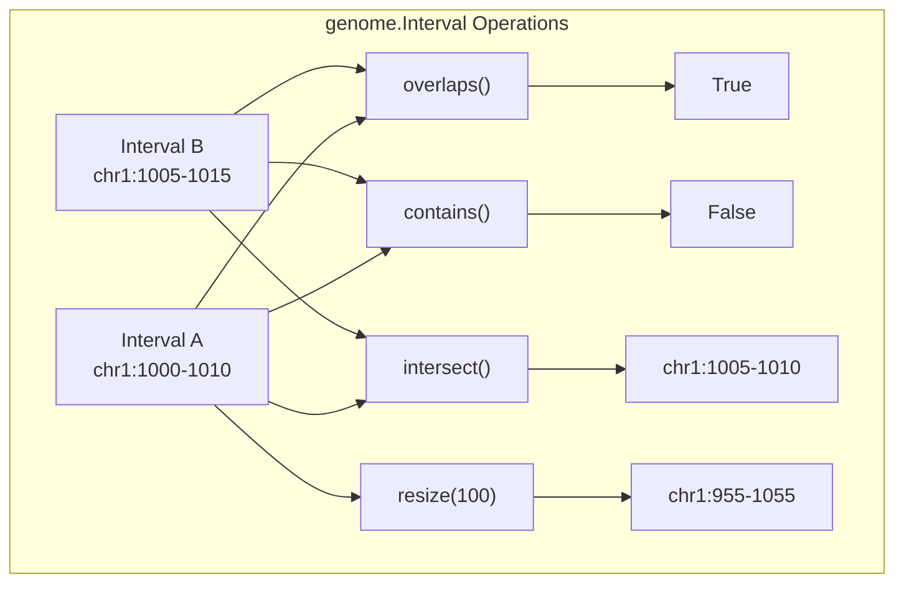
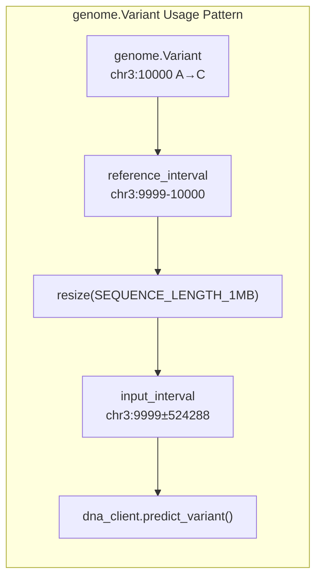
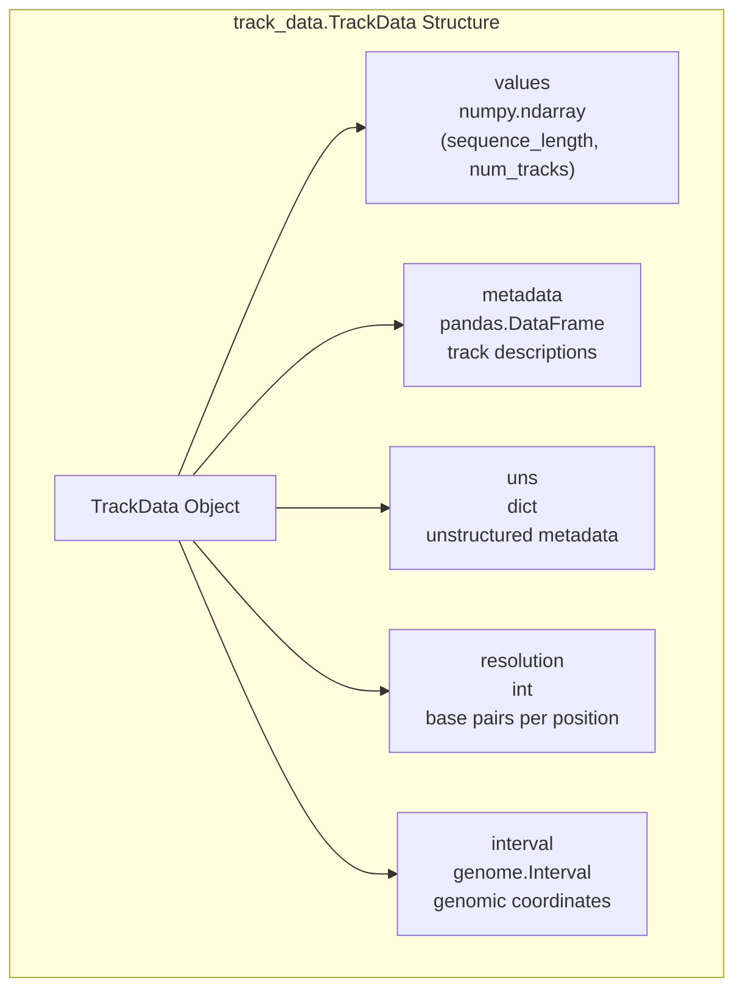
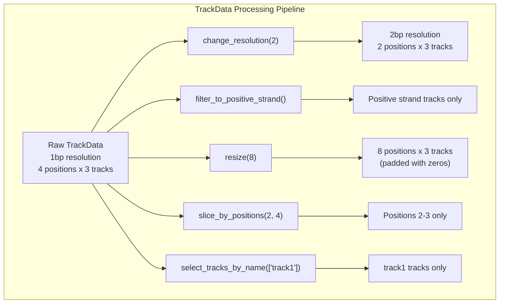
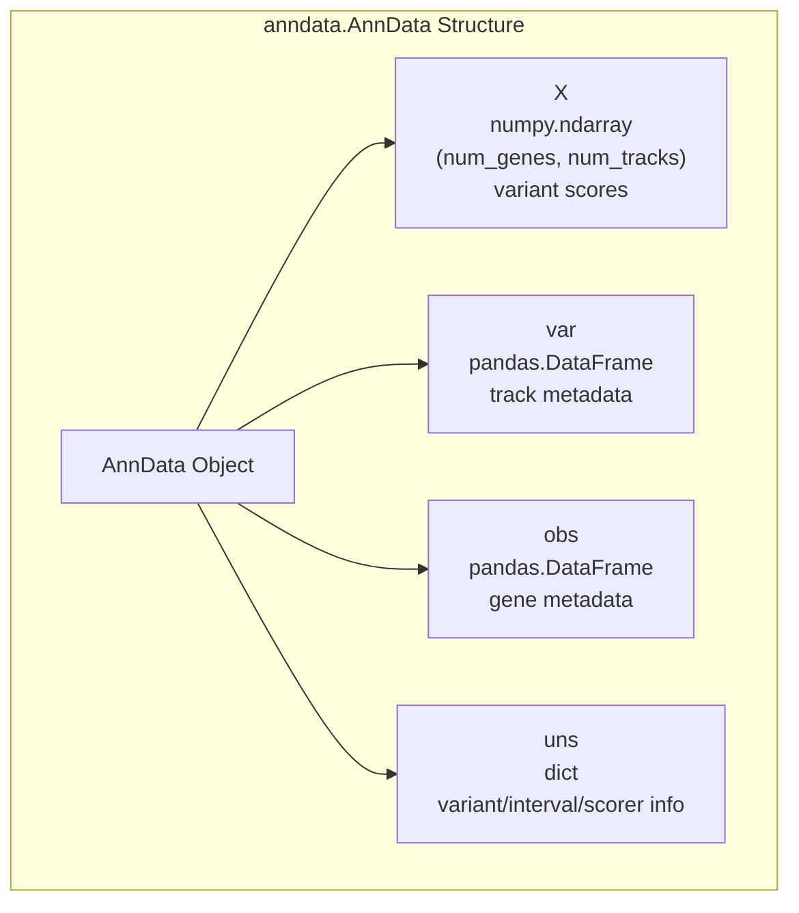
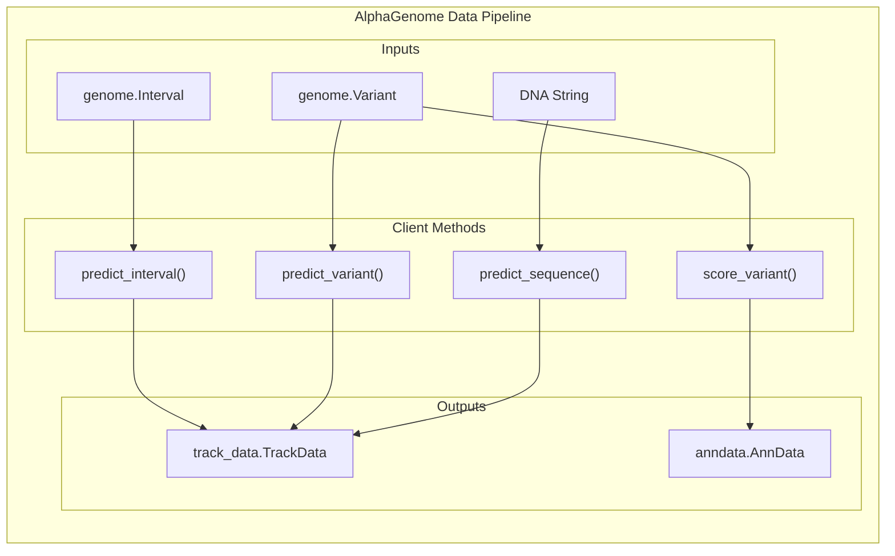
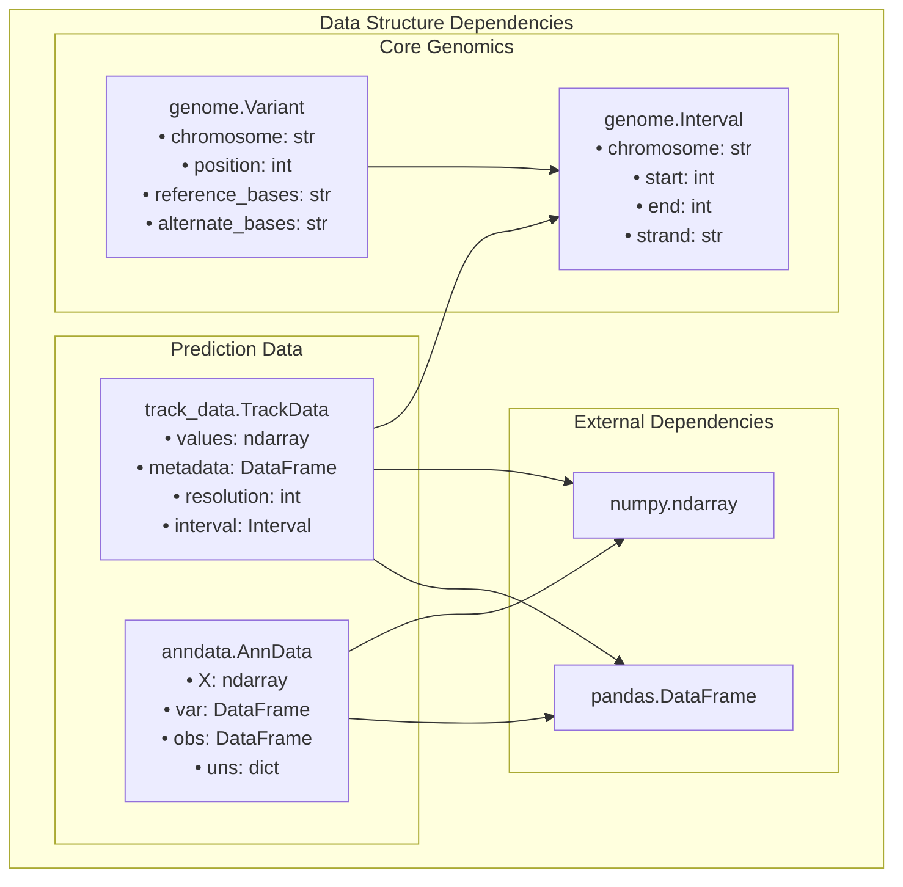

<!-- source: DeepWiki mcp.deepwiki.com · repo google-deepmind/alphagenome · page 4.3 Data Structures · fetched 2026-10-26 -->

# Data Structures

<details>
<summary>Relevant source files</summary>

The following files were used as context for generating this wiki page:

- [docs/source/api/data.md](docs/source/api/data.md)
- [src/alphagenome/data/gene_annotation.py](src/alphagenome/data/gene_annotation.py)
- [src/alphagenome/data/gene_annotation_test.py](src/alphagenome/data/gene_annotation_test.py)
- [src/alphagenome/data/genome.py](src/alphagenome/data/genome.py)
- [src/alphagenome/data/genome_test.py](src/alphagenome/data/genome_test.py)

</details>


This page documents the core data structures used in the AlphaGenome client library for representing genomic inputs and model outputs. These structures serve as the foundation for all prediction operations and data manipulation workflows. For information about the client methods that operate on these structures, see [Core Client](#3.1). For visualization components that work with these data structures, see [Visualization](#3.3).

## Overview

The AlphaGenome client library uses four primary data structures organized into input and output categories:

**Input Structures:**
- `genome.Interval` - Represents genomic regions with chromosome, start, and end coordinates
- `genome.Variant` - Represents genetic variants with reference and alternate sequences

**Output Structures:**
- `track_data.TrackData` - Contains model predictions as numerical arrays with metadata
- `anndata.AnnData` - Contains variant effect scores with gene and track annotations

## Input Data Structures

### genome.Interval

The `genome.Interval` class represents genomic coordinates using 0-based indexing, where the interval includes the base pair at the `start` position up to the base pair at the `end-1` position.

#### Basic Construction

```python
interval = genome.Interval(chromosome='chr1', start=1_000, end=1_010)
```

#### Key Properties and Methods

| Method/Property | Description | Return Type |
|----------------|-------------|-------------|
| `center()` | Returns the center position of the interval | `int` |
| `width` | Width of the interval in base pairs | `int` |
| `resize(new_width)` | Creates a new interval resized around the center | `genome.Interval` |
| `overlaps(other)` | Checks if this interval overlaps another | `bool` |
| `contains(other)` | Checks if this interval contains another | `bool` |
| `intersect(other)` | Returns the intersection of two intervals | `genome.Interval` |

#### Interval Relationships Diagram



Sources: [colabs/essential_commands.ipynb:100-400]()

### genome.Variant

The `genome.Variant` class represents genetic variants using 1-based positioning to maintain compatibility with standard variant formats like VCF.

#### Basic Construction

```python
# Single nucleotide variant
variant = genome.Variant(
    chromosome='chr3', 
    position=10_000, 
    reference_bases='A', 
    alternate_bases='C'
)

# Insertion variant
variant = genome.Variant(
    chromosome='chr3',
    position=10_000,
    reference_bases='T',
    alternate_bases='CGTCAAT'
)

# Deletion variant  
variant = genome.Variant(
    chromosome='chr3',
    position=10_000,
    reference_bases='AGGGATC',
    alternate_bases='C'
)
```

#### Key Properties and Methods

| Method/Property | Description | Return Type |
|----------------|-------------|-------------|
| `reference_interval` | Returns the genomic interval of the reference allele | `genome.Interval` |
| `reference_overlaps(interval)` | Checks if reference allele overlaps an interval | `bool` |
| `alternate_overlaps(interval)` | Checks if alternate allele overlaps an interval | `bool` |

#### Variant Processing Workflow



Sources: [colabs/essential_commands.ipynb:408-600]()

## Output Data Structures

### track_data.TrackData

The `track_data.TrackData` class stores model predictions as numerical arrays with associated metadata. It supports operations for filtering, resizing, and transforming prediction data.

#### Core Components



#### Key Operations

| Operation | Method | Description |
|-----------|--------|-------------|
| Resolution conversion | `change_resolution(resolution)` | Up/downsample track data |
| Filtering | `filter_to_positive_strand()` | Keep only positive strand tracks |
| | `filter_to_negative_strand()` | Keep only negative strand tracks |
| | `filter_to_unstranded()` | Keep only unstranded tracks |
| Resizing | `resize(width)` | Crop or pad tracks to new width |
| Slicing | `slice_by_positions(start, end)` | Extract specific positions |
| | `slice_by_interval(interval)` | Extract positions matching interval |
| Track selection | `select_tracks_by_name(names)` | Keep only specified track names |
| Transformation | `reverse_complement()` | Strand-aware reverse complement |

#### TrackData Operations Flow



Sources: [colabs/essential_commands.ipynb:663-1254]()

### anndata.AnnData

The `anndata.AnnData` class stores variant effect scores with gene and track metadata. Originally developed for single-cell RNA-seq analysis, it provides a structured format for associating numerical data with rich annotations.

#### Core Components



#### Metadata Organization

| Component | Content | Shape |
|-----------|---------|-------|
| `X` | Variant effect scores per gene | `(num_genes, num_tracks)` |
| `var` | Track metadata (cell type, strand, etc.) | `(num_tracks, metadata_cols)` |
| `obs` | Gene metadata (gene IDs, etc.) | `(num_genes, metadata_cols)` |
| `uns['variant']` | Original `genome.Variant` object | - |
| `uns['interval']` | Context `genome.Interval` object | - |
| `uns['scorer']` | Variant scorer configuration | - |

Sources: [colabs/essential_commands.ipynb:1261-1333]()

## Data Structure Relationships

### Input to Output Data Flow



### Class Hierarchy and Dependencies



Sources: [colabs/essential_commands.ipynb:76-1383]()

---

