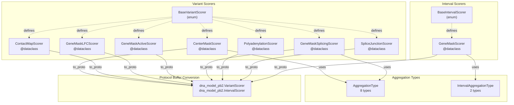
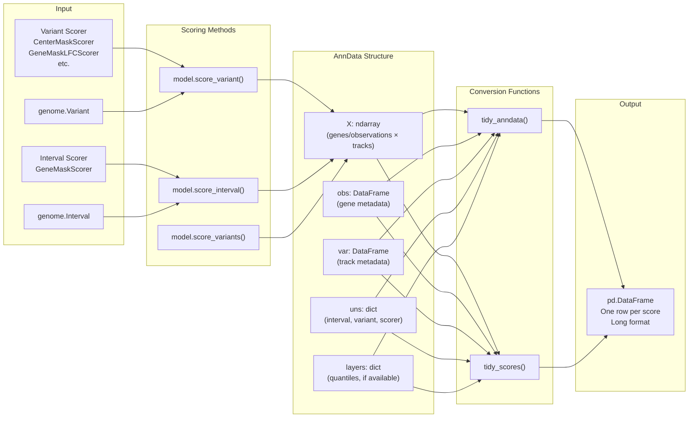

<!-- source: DeepWiki mcp.deepwiki.com · repo google-deepmind/alphagenome · page 4.4 Variant and Interval Scorers · fetched 2026-10-26 -->

# Variant and Interval Scorers

<details>
<summary>Relevant source files</summary>

The following files were used as context for generating this wiki page:

- [src/alphagenome/models/interval_scorers.py](src/alphagenome/models/interval_scorers.py)
- [src/alphagenome/models/variant_scorers.py](src/alphagenome/models/variant_scorers.py)
- [src/alphagenome/models/variant_scorers_test.py](src/alphagenome/models/variant_scorers_test.py)
- [src/alphagenome/visualization/plot_components_test.py](src/alphagenome/visualization/plot_components_test.py)

</details>


This page provides a complete technical reference for all scorer types available in the AlphaGenome SDK. Scorers are configuration objects that specify how to aggregate model predictions into interpretable scores for genomic variants or intervals. This page documents the scorer classes, their parameters, aggregation methods, and utilities for processing scoring results.

For practical guidance on using these scorers, see [Scoring Variants](#5.2) and [Complete Analysis Workflow](#6.5). For the high-level DnaModel interface that accepts these scorers, see [DnaClient](#4.1).

---

## Overview

The AlphaGenome SDK provides two categories of scorers:

1. **Variant Scorers**: Quantify the functional impact of genetic variants by comparing reference (REF) and alternate (ALT) allele predictions
2. **Interval Scorers**: Aggregate model predictions over genomic intervals without comparing alleles

Both scorer types produce results as `anndata.AnnData` objects, which can be converted to tidy pandas DataFrames using the `tidy_scores()` utility.

Sources: [src/alphagenome/models/variant_scorers.py:1-876](), [src/alphagenome/models/interval_scorers.py:1-146]()

---

## Scorer Type Hierarchy



Sources: [src/alphagenome/models/variant_scorers.py:69-90](), [src/alphagenome/models/variant_scorers.py:158-542](), [src/alphagenome/models/interval_scorers.py:47-54](), [src/alphagenome/models/interval_scorers.py:75-129]()

---

## Variant Scorers

Variant scorers quantify differences between REF and ALT predictions. All variant scorers implement a `to_proto()` method for serialization and have properties: `requested_output`, `name`, `is_signed`, and `base_variant_scorer`.

### AggregationType Enum

The `AggregationType` enum defines how to aggregate and compare REF vs ALT predictions.

| Aggregation Type | Formula | Description | Signed |
|-----------------|---------|-------------|--------|
| `DIFF_MEAN` | mean(ALT) - mean(REF) | Difference of means | Yes |
| `DIFF_SUM` | sum(ALT) - sum(REF) | Difference of sums | Yes |
| `DIFF_SUM_LOG2` | sum(log2(ALT)) - sum(log2(REF)) | Log-scale first, then sum | Yes |
| `DIFF_LOG2_SUM` | log2(sum(ALT)) - log2(sum(REF)) | Sum first, then log-scale | Yes |
| `L2_DIFF` | l2_norm(ALT - REF) | L2 norm of differences | No |
| `L2_DIFF_LOG1P` | l2_norm(log1p(ALT) - log1p(REF)) | L2 norm after log1p transform | No |
| `ACTIVE_MEAN` | max(mean(ALT), mean(REF)) | Maximum of means (captures active allele) | No |
| `ACTIVE_SUM` | max(sum(ALT), sum(REF)) | Maximum of sums (captures active allele) | No |

**Signed vs Non-directional**: Signed scorers produce positive or negative values indicating directionality (ALT increases or decreases signal). Non-directional scorers always produce non-negative values.

Sources: [src/alphagenome/models/variant_scorers.py:30-67]()

---

### CenterMaskScorer

Aggregates REF and ALT predictions using a spatial mask centered around the variant position, then computes differences according to the specified aggregation type.

**Class**: `variant_scorers.CenterMaskScorer`

**Attributes**:
- `requested_output` (OutputType): The output modality to score (e.g., `ATAC`, `DNASE`, `RNA_SEQ`)
- `width` (int | None): Width in base pairs of the mask around the variant. If `None`, uses the entire sequence. Supported values: `None`, `501`, `2001`, `10_001`, `100_001`, `200_001`
- `aggregation_type` (AggregationType): How to aggregate predictions (see table above)

**Properties**:
- `base_variant_scorer`: Returns `BaseVariantScorer.CENTER_MASK`
- `name` (str): String representation uniquely identifying the configuration
- `is_signed` (bool): Whether the scorer produces directional scores

**Supported Output Types**: `ATAC`, `CAGE`, `DNASE`, `PROCAP`, `RNA_SEQ`, `CHIP_HISTONE`, `CHIP_TF`, `SPLICE_SITES`, `SPLICE_SITE_USAGE`

**Example**:
```python
from alphagenome.models import variant_scorers, dna_output

scorer = variant_scorers.CenterMaskScorer(
    requested_output=dna_output.OutputType.ATAC,
    width=501,
    aggregation_type=variant_scorers.AggregationType.DIFF_LOG2_SUM
)
```

Sources: [src/alphagenome/models/variant_scorers.py:158-241](), [src/alphagenome/models/variant_scorers.py:102-156]()

---

### ContactMapScorer

Quantifies local contact disruption in chromatin interaction maps. Uses a 1MB window centered around the variant to calculate the mean absolute difference of contact frequencies for all interactions involving the variant-containing bin.

**Class**: `variant_scorers.ContactMapScorer`

**Attributes**: None (configuration is fixed)

**Properties**:
- `requested_output`: Always returns `OutputType.CONTACT_MAPS`
- `base_variant_scorer`: Returns `BaseVariantScorer.CONTACT_MAP`
- `name` (str): String representation
- `is_signed` (bool): Always `False` (non-directional)

**Example**:
```python
scorer = variant_scorers.ContactMapScorer()
```

Sources: [src/alphagenome/models/variant_scorers.py:243-284]()

---

### GeneMaskLFCScorer

Quantifies variant impact on gene expression using log-fold change (LFC). Aggregates predictions across gene exons and computes LFC between ALT and REF alleles.

**Class**: `variant_scorers.GeneMaskLFCScorer`

**Attributes**:
- `requested_output` (OutputType): The output modality to score

**Properties**:
- `base_variant_scorer`: Returns `BaseVariantScorer.GENE_MASK_LFC`
- `name` (str): String representation
- `is_signed` (bool): Always `True` (directional)

**Supported Output Types**: `ATAC`, `CAGE`, `DNASE`, `PROCAP`, `RNA_SEQ`, `SPLICE_SITES`, `SPLICE_SITE_USAGE`

**Output Format**: Returns one score per gene-track combination for all genes overlapping the scored interval.

**Example**:
```python
scorer = variant_scorers.GeneMaskLFCScorer(
    requested_output=dna_output.OutputType.RNA_SEQ
)
```

Sources: [src/alphagenome/models/variant_scorers.py:286-338]()

---

### GeneMaskActiveScorer

Similar to `GeneMaskLFCScorer`, but captures the absolute activity level associated with the more active allele rather than the difference between ALT and REF. Calculates the maximum of aggregated ALT and REF signals across gene exons.

**Class**: `variant_scorers.GeneMaskActiveScorer`

**Attributes**:
- `requested_output` (OutputType): The output modality to score

**Properties**:
- `base_variant_scorer`: Returns `BaseVariantScorer.GENE_MASK_ACTIVE`
- `name` (str): String representation
- `is_signed` (bool): Always `False` (non-directional)

**Supported Output Types**: `ATAC`, `CAGE`, `DNASE`, `PROCAP`, `RNA_SEQ`, `SPLICE_SITES`, `SPLICE_SITE_USAGE`

**Example**:
```python
scorer = variant_scorers.GeneMaskActiveScorer(
    requested_output=dna_output.OutputType.RNA_SEQ
)
```

Sources: [src/alphagenome/models/variant_scorers.py:341-394]()

---

### GeneMaskSplicingScorer

Quantifies variant impact on splicing using a gene exon mask. Works with two output types:
- `SPLICE_SITES`: Changes in splice site class assignment probabilities (donor, acceptor, or other)
- `SPLICE_SITE_USAGE`: Changes in the usage frequency of individual splice sites

**Class**: `variant_scorers.GeneMaskSplicingScorer`

**Attributes**:
- `requested_output` (OutputType): Either `SPLICE_SITES` or `SPLICE_SITE_USAGE`
- `width` (int | None): Width of the mask around the variant. Supported values: `None`, `101`, `1_001`, `10_001`

**Properties**:
- `base_variant_scorer`: Returns `BaseVariantScorer.GENE_MASK_SPLICING`
- `name` (str): String representation
- `is_signed` (bool): Always `False` (non-directional)

**Example**:
```python
scorer = variant_scorers.GeneMaskSplicingScorer(
    requested_output=dna_output.OutputType.SPLICE_SITE_USAGE,
    width=1_001
)
```

Sources: [src/alphagenome/models/variant_scorers.py:397-458]()

---

### PolyadenylationScorer

Scores polyadenylation quantitative trait loci (paQTLs) to capture variant impact on RNA isoform production. Quantifies the maximum log-fold change in expression between proximal and distal polyadenylation sites (PAS), where proximal and distal are defined relative to any given 3' cleavage site.

**Class**: `variant_scorers.PolyadenylationScorer`

**Attributes**: None (configuration is fixed)

**Properties**:
- `requested_output`: Always returns `OutputType.RNA_SEQ`
- `base_variant_scorer`: Returns `BaseVariantScorer.PA_QTL`
- `name` (str): String representation
- `is_signed` (bool): Always `False` (non-directional)

**Organism Support**: Only supports `ORGANISM_HOMO_SAPIENS` (human)

**Example**:
```python
scorer = variant_scorers.PolyadenylationScorer()
```

Sources: [src/alphagenome/models/variant_scorers.py:461-504](), [src/alphagenome/models/variant_scorers.py:92-100]()

---

### SpliceJunctionScorer

Scores variant impact on splice junction formation and usage.

**Class**: `variant_scorers.SpliceJunctionScorer`

**Attributes**: None (configuration is fixed)

**Properties**:
- `requested_output`: Always returns `OutputType.SPLICE_JUNCTIONS`
- `base_variant_scorer`: Returns `BaseVariantScorer.SPLICE_JUNCTION`
- `name` (str): String representation
- `is_signed` (bool): Always `False` (non-directional)

**Example**:
```python
scorer = variant_scorers.SpliceJunctionScorer()
```

Sources: [src/alphagenome/models/variant_scorers.py:507-542]()

---

### Recommended Variant Scorers

The SDK provides a dictionary of recommended scorer configurations optimized for common use cases.

**Dictionary**: `variant_scorers.RECOMMENDED_VARIANT_SCORERS`

**Keys**: String identifiers (e.g., `'ATAC'`, `'RNA_SEQ'`, `'CONTACT_MAPS'`)

**Example Usage**:
```python
# Get recommended scorer for ATAC-seq
atac_scorer = variant_scorers.RECOMMENDED_VARIANT_SCORERS['ATAC']

# Get all recommended scorers for a specific organism
scorers = variant_scorers.get_recommended_scorers(
    organism=dna_model_pb2.Organism.ORGANISM_HOMO_SAPIENS
)
```

**Function**: `get_recommended_scorers(organism)` returns a filtered list of recommended scorers that support the specified organism.

Sources: [src/alphagenome/models/variant_scorers.py:557-649]()

---

## Interval Scorers

Interval scorers aggregate model predictions over genomic intervals without comparing alleles. Currently, only one interval scorer type is available.

### IntervalAggregationType Enum

Defines how to aggregate predictions across positions within an interval.

| Aggregation Type | Description |
|-----------------|-------------|
| `MEAN` | Average signal across positions |
| `SUM` | Sum signal across positions |

Sources: [src/alphagenome/models/interval_scorers.py:26-44]()

---

### GeneMaskScorer

Aggregates model predictions across gene intervals (typically gene exons or gene bodies).

**Class**: `interval_scorers.GeneMaskScorer`

**Attributes**:
- `requested_output` (OutputType): The output modality to score
- `width` (int | None): Width of the interval to include in aggregation. Supported values: `None`, `501`, `2001`, `10_001`, `100_001`, `200_001`
- `aggregation_type` (IntervalAggregationType): How to aggregate predictions across positions

**Properties**:
- `base_interval_scorer`: Returns `BaseIntervalScorer.GENE_MASK`
- `name` (str): String representation uniquely identifying the configuration

**Supported Output Types**: `ATAC`, `CAGE`, `CHIP_HISTONE`, `CHIP_TF`, `DNASE`, `RNA_SEQ`, `SPLICE_SITES`, `SPLICE_SITE_USAGE`

**Example**:
```python
from alphagenome.models import interval_scorers, dna_output

scorer = interval_scorers.GeneMaskScorer(
    requested_output=dna_output.OutputType.RNA_SEQ,
    width=200_001,
    aggregation_type=interval_scorers.IntervalAggregationType.MEAN
)
```

**Recommended Configuration**:
```python
rna_seq_scorer = interval_scorers.RECOMMENDED_INTERVAL_SCORERS['RNA_SEQ']
```

Sources: [src/alphagenome/models/interval_scorers.py:75-129](), [src/alphagenome/models/interval_scorers.py:139-145]()

---

## Score Output Processing

Scoring operations produce `anndata.AnnData` objects that encode scores along with metadata about genes, tracks, and genomic context. The SDK provides utilities to convert these structured objects into tidy DataFrames suitable for analysis.

### Data Flow: Scorers to Tidy DataFrames



Sources: [src/alphagenome/models/variant_scorers.py:652-776](), [src/alphagenome/models/variant_scorers.py:778-875]()

---

### tidy_anndata Function

Converts a single `AnnData` object from scoring into a tidy (long-format) pandas DataFrame.

**Function**: `variant_scorers.tidy_anndata(adata, match_gene_strand=True, include_extended_metadata=True)`

**Parameters**:
- `adata` (anndata.AnnData): An AnnData object containing scores from `score_variant()` or `score_interval()`
- `match_gene_strand` (bool, default=True): If `True` and using gene-centric scoring, removes rows where gene and track strands are mismatched (e.g., gene on '+' strand, track on '-' strand). Retains unstranded tracks (strand = '.')
- `include_extended_metadata` (bool, default=True): If `True`, includes additional metadata columns such as biosample name, tissue, transcription factor, and histone mark (when available)

**Returns**: `pd.DataFrame` with one row per score. The exact columns depend on the scorer type:

**Common Columns**:
- `scored_interval`: Genomic interval that was scored (e.g., "chr22:36100000-36300000")
- `output_type`: Model output type (e.g., "RNA_SEQ", "ATAC")
- `track_name`: Name of the output track
- `track_strand`: Strand of the track ('+', '-', '.')
- `raw_score`: The computed score value
- `quantile_score` (if available): Quantile-normalized score

**Variant Scorer Additional Columns**:
- `variant_id`: The variant being scored (e.g., "chr22:36201698:A>C")
- `variant_scorer`: String representation of the scorer configuration

**Interval Scorer Additional Columns**:
- `interval_scorer`: String representation of the scorer configuration

**Gene-Centric Scorer Additional Columns**:
- `gene_id`: ENSEMBL gene identifier (version stripped)
- `gene_name`: HGNC gene symbol
- `gene_type`: Gene biotype (e.g., "protein_coding", "lncRNA")
- `gene_strand`: Strand of the gene

**Splice Junction Scorer Additional Columns**:
- `junction_Start`: Start position of the junction
- `junction_End`: End position of the junction

**Extended Metadata Columns** (when `include_extended_metadata=True`):
- `Assay title`: Subtype of assay (e.g., "total RNA-seq")
- `ontology_curie`: Ontology term for cell type/tissue (e.g., "UBERON:0036149")
- `biosample_name`: Name of the biosample
- `biosample_type`: Type of biosample (e.g., "tissue", "primary_cell")
- `biosample_life_stage`: Life stage (e.g., "adult", "embryonic")
- `gtex_tissue`: GTEx tissue name (e.g., "Liver")
- `data_source`: Source of the data
- `endedness`: Sequencing endedness ("paired", "single")
- `genetically_modified`: Whether the biosample was genetically modified
- `transcription_factor`: Transcription factor name (for ChIP-seq)
- `histone_mark`: Histone modification (for ChIP-seq)

**Example**:
```python
# Score a variant with a gene-centric scorer
scorer = variant_scorers.GeneMaskLFCScorer(
    requested_output=dna_output.OutputType.RNA_SEQ
)
scores = model.score_variant(interval, variant, [scorer])

# Convert to DataFrame
df = variant_scorers.tidy_anndata(scores[0])
print(df[['gene_name', 'track_name', 'raw_score']])
```

**Strand Matching Behavior**: When `match_gene_strand=True`, the function removes scores where gene and track strands are opposite ('+' vs '-' or vice versa), but retains all scores involving unstranded tracks (strand = '.'). This is useful because some assays (e.g., unstranded RNA-seq) don't preserve strand information.

Sources: [src/alphagenome/models/variant_scorers.py:652-776]()

---

### tidy_scores Function

Converts scoring results into a tidy DataFrame, handling both single and batch scoring outputs.

**Function**: `variant_scorers.tidy_scores(scores, match_gene_strand=True, include_extended_metadata=True)`

**Parameters**:
- `scores`: Either:
  - A sequence of `AnnData` objects (e.g., output of `score_variant()` with multiple scorers)
  - A nested sequence of `AnnData` objects (e.g., output of `score_variants()` with multiple variants)
- `match_gene_strand` (bool, default=True): Passed to `tidy_anndata()`
- `include_extended_metadata` (bool, default=True): Passed to `tidy_anndata()`

**Returns**: `pd.DataFrame | None`. Returns `None` if the input is empty. Otherwise, returns a concatenated DataFrame with all scores, containing the union of columns across all scorers.

**Column Order**: The function ensures that `raw_score` (and `quantile_score` if present) appear as the last columns in the DataFrame.

**Example Usage**:

```python
# Single variant, multiple scorers
scorers = [
    variant_scorers.CenterMaskScorer(
        requested_output=dna_output.OutputType.ATAC,
        width=501,
        aggregation_type=variant_scorers.AggregationType.DIFF_LOG2_SUM
    ),
    variant_scorers.GeneMaskLFCScorer(
        requested_output=dna_output.OutputType.RNA_SEQ
    )
]
scores = model.score_variant(interval, variant, scorers)
df = variant_scorers.tidy_scores(scores)

# Multiple variants, multiple scorers
scores_batch = model.score_variants(interval, variants, scorers)
df_batch = variant_scorers.tidy_scores(scores_batch)

# Both produce the same DataFrame structure
```

**Output Structure**:
- For non-gene-centric scorers: One row per variant-track (or interval-track) pair
- For gene-centric scorers: One row per variant-gene-track (or interval-gene-track) combination

Sources: [src/alphagenome/models/variant_scorers.py:778-875]()

---

## Scorer Configuration Reference

### Supported Output Types by Scorer

| Scorer Class | Supported Output Types |
|-------------|----------------------|
| `CenterMaskScorer` | ATAC, CAGE, DNASE, PROCAP, RNA_SEQ, CHIP_HISTONE, CHIP_TF, SPLICE_SITES, SPLICE_SITE_USAGE |
| `ContactMapScorer` | CONTACT_MAPS |
| `GeneMaskLFCScorer` | ATAC, CAGE, DNASE, PROCAP, RNA_SEQ, SPLICE_SITES, SPLICE_SITE_USAGE |
| `GeneMaskActiveScorer` | ATAC, CAGE, DNASE, PROCAP, RNA_SEQ, SPLICE_SITES, SPLICE_SITE_USAGE |
| `GeneMaskSplicingScorer` | SPLICE_SITES, SPLICE_SITE_USAGE |
| `PolyadenylationScorer` | RNA_SEQ |
| `SpliceJunctionScorer` | SPLICE_JUNCTIONS |
| `GeneMaskScorer` (interval) | ATAC, CAGE, CHIP_HISTONE, CHIP_TF, DNASE, RNA_SEQ, SPLICE_SITES, SPLICE_SITE_USAGE |

Sources: [src/alphagenome/models/variant_scorers.py:102-137](), [src/alphagenome/models/interval_scorers.py:57-68]()

---

### Supported Width Parameters

Width parameters control the size of the aggregation window around variants (for variant scorers) or within intervals (for interval scorers).

| Scorer Class | Supported Widths |
|-------------|-----------------|
| `CenterMaskScorer` | None, 501, 2001, 10_001, 100_001, 200_001 |
| `GeneMaskSplicingScorer` | None, 101, 1_001, 10_001 |
| `GeneMaskScorer` (interval) | None, 501, 2001, 10_001, 100_001, 200_001 |

**Note**: `None` indicates that the entire sequence/interval is used without masking.

Sources: [src/alphagenome/models/variant_scorers.py:139-142](), [src/alphagenome/models/interval_scorers.py:70-72]()

---

### Supported Aggregation Types by Scorer

| Scorer Class | Supported Aggregation Types |
|-------------|----------------------------|
| `CenterMaskScorer` | DIFF_MEAN, DIFF_SUM, DIFF_SUM_LOG2, DIFF_LOG2_SUM, L2_DIFF, L2_DIFF_LOG1P, ACTIVE_MEAN, ACTIVE_SUM |
| `GeneMaskScorer` (interval) | MEAN, SUM |

Other scorers have fixed aggregation strategies built into their implementation.

Sources: [src/alphagenome/models/variant_scorers.py:144-155]()

---

### Organism Support

Most variant scorers support all organisms (`ORGANISM_HOMO_SAPIENS`, `ORGANISM_MUS_MUSCULUS`), with one exception:

- `PolyadenylationScorer`: Only supports `ORGANISM_HOMO_SAPIENS` (human)

Sources: [src/alphagenome/models/variant_scorers.py:92-100]()

---

## Implementation Details

### Protocol Buffer Conversion

All scorer classes implement a `to_proto()` method that converts the scorer configuration into a protocol buffer message for transmission to the AlphaGenome API server.

**Method Signature**: `to_proto() -> dna_model_pb2.VariantScorer | dna_model_pb2.IntervalScorer`

**Example**:
```python
scorer = variant_scorers.CenterMaskScorer(
    requested_output=dna_output.OutputType.ATAC,
    width=501,
    aggregation_type=variant_scorers.AggregationType.DIFF_LOG2_SUM
)
proto_message = scorer.to_proto()
# Returns a dna_model_pb2.VariantScorer message
```

Sources: [src/alphagenome/models/variant_scorers.py:233-240](), [src/alphagenome/models/interval_scorers.py:121-128]()

---

### Validation

Scorer classes perform validation in their `__post_init__()` methods (for dataclasses). This validation checks:

1. **Output Type Support**: Ensures the requested output type is compatible with the scorer
2. **Width Support**: Ensures the width parameter (if applicable) is in the supported set
3. **Aggregation Type Support**: Ensures the aggregation type (if applicable) is compatible with the scorer

**Example Error**:
```python
# This raises ValueError: Unsupported requested output
scorer = variant_scorers.CenterMaskScorer(
    requested_output=dna_output.OutputType.CONTACT_MAPS,  # Not supported!
    width=501,
    aggregation_type=variant_scorers.AggregationType.DIFF_MEAN
)
```

Sources: [src/alphagenome/models/variant_scorers.py:209-231](), [src/alphagenome/models/variant_scorers.py:323-331](), [src/alphagenome/models/interval_scorers.py:106-119]()

---

## Complete Example

```python
from alphagenome.models import variant_scorers, interval_scorers, dna_output
from alphagenome.data import genome

# Define a variant and interval
variant = genome.Variant('chr1', 1000000, 'A', 'G')
interval = genome.Interval('chr1', 900000, 1100000)

# Create multiple variant scorers
variant_scorers_list = [
    # Center mask scorer for ATAC-seq
    variant_scorers.CenterMaskScorer(
        requested_output=dna_output.OutputType.ATAC,
        width=501,
        aggregation_type=variant_scorers.AggregationType.DIFF_LOG2_SUM
    ),
    # Gene-centric RNA-seq scorer
    variant_scorers.GeneMaskLFCScorer(
        requested_output=dna_output.OutputType.RNA_SEQ
    ),
    # Contact map scorer
    variant_scorers.ContactMapScorer(),
]

# Score the variant
scores = model.score_variant(interval, variant, variant_scorers_list)

# Convert to tidy DataFrame
df = variant_scorers.tidy_scores(scores)

# Filter to high-impact scores
high_impact = df[df['raw_score'].abs() > 0.5]

# Group by gene (for gene-centric scorers)
gene_scores = df.groupby('gene_name')['raw_score'].mean()
```

Sources: [src/alphagenome/models/variant_scorers.py:1-876]()

---

