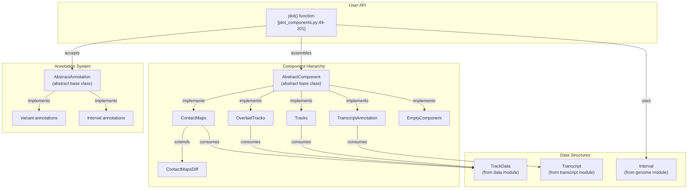
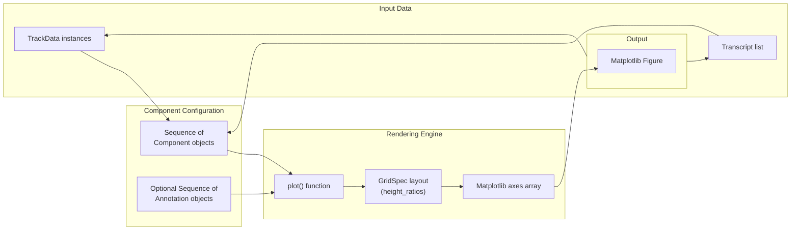
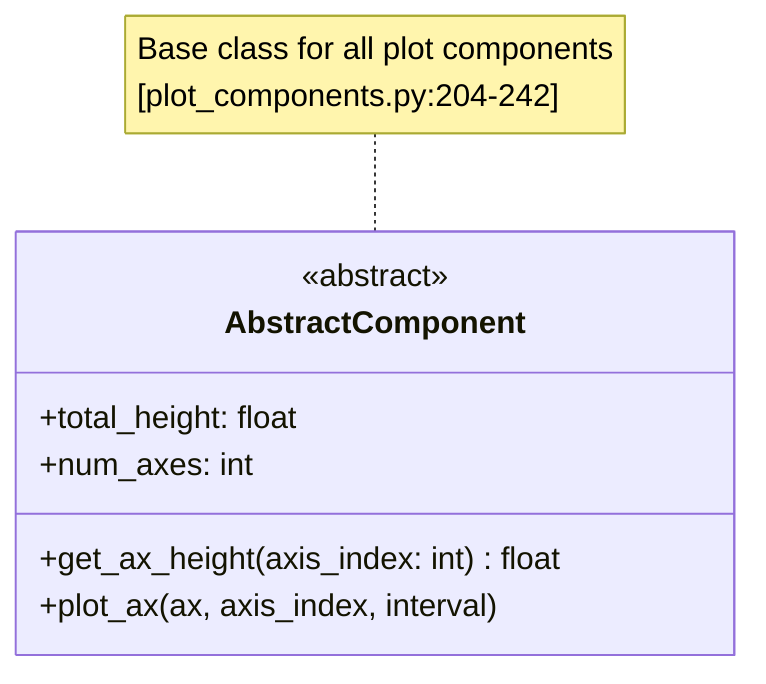
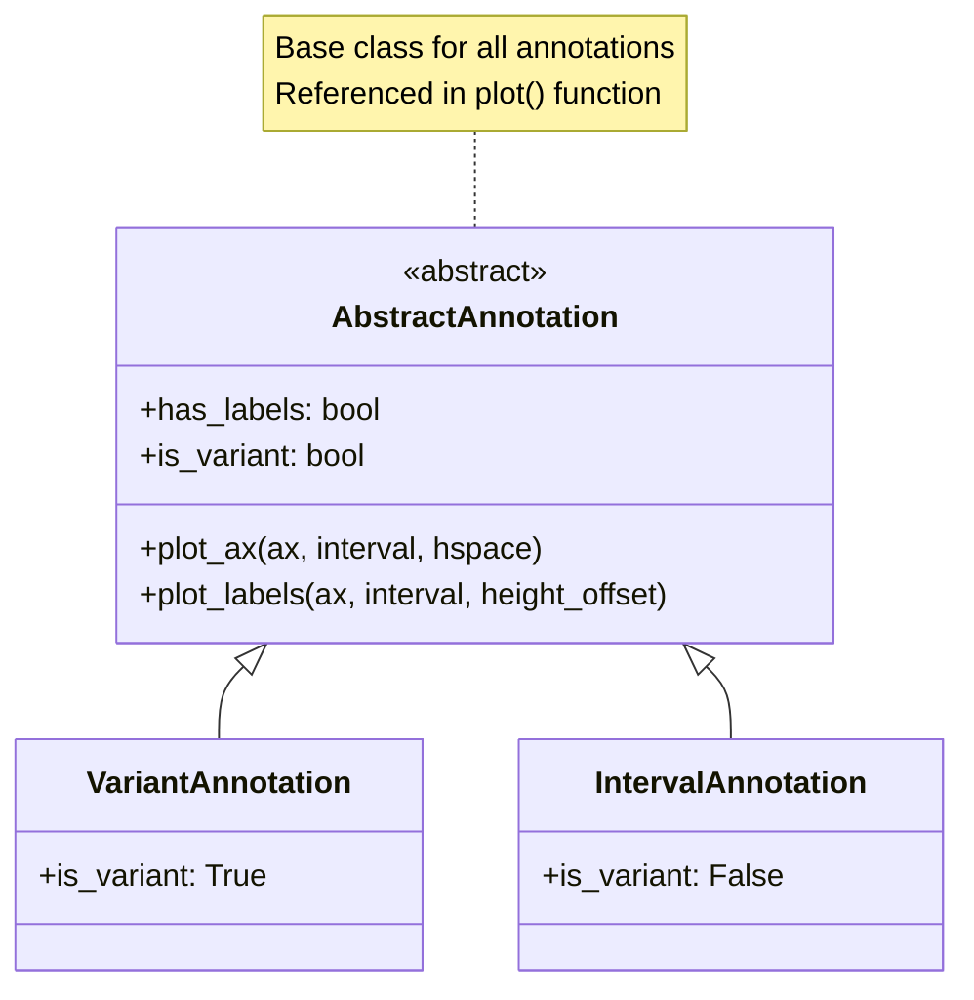

<!-- source: DeepWiki mcp.deepwiki.com · repo google-deepmind/alphagenome · page 4.5 Visualization · fetched 2026-10-26 -->

# Visualization

<details>
<summary>Relevant source files</summary>

The following files were used as context for generating this wiki page:

- [colabs/visualization_modality_tour.ipynb](colabs/visualization_modality_tour.ipynb)
- [docs/source/variant_scoring.md](docs/source/variant_scoring.md)
- [src/alphagenome/visualization/plot_components.py](src/alphagenome/visualization/plot_components.py)

</details>


## Purpose and Scope

This page provides a complete technical reference for the AlphaGenome visualization library, which enables users to create publication-quality plots of model outputs. The library is built on matplotlib and provides a component-based architecture for visualizing genomic predictions across multiple modalities (tracks, contact maps, junctions) along with genomic annotations (transcripts, variants, intervals).

For practical examples and step-by-step guides on creating visualizations, see [Creating Visualizations](#5.5). For an overview of different modalities that can be visualized, refer to the visualization modality tour notebook.

## Architecture Overview

The visualization system follows a component-based architecture where individual plot elements (tracks, contact maps, transcripts) are assembled into multi-panel figures:



**Sources:** [src/alphagenome/visualization/plot_components.py:1-896]()

## Data Flow and Rendering Pipeline



**Sources:** [src/alphagenome/visualization/plot_components.py:49-201]()

## Main API: plot() Function

The `plot()` function is the primary entry point for creating visualizations. It accepts a sequence of components and assembles them into a multi-panel figure.

### Function Signature

```python
def plot(
    components: Sequence[AbstractComponent],
    interval: genome.Interval,
    fig_width: int = 20,
    fig_height_scale: float = 1.0,
    title: str | None = None,
    despine: bool = True,
    despine_keep_bottom: bool = False,
    annotations: Sequence[AbstractAnnotation] | None = None,
    annotation_offset_range: tuple[float, float] = (0.1, 0.6),
    hspace: float = 0.3,
    xlabel: str | None = None,
) -> matplotlib.figure.Figure
```

### Key Parameters

| Parameter | Type | Description |
|-----------|------|-------------|
| `components` | `Sequence[AbstractComponent]` | List of components to visualize (tracks, contact maps, transcripts) |
| `interval` | `genome.Interval` | Genomic interval defining the x-axis range |
| `fig_width` | `int` | Total figure width in inches (default: 20) |
| `fig_height_scale` | `float` | Scaling factor for component heights (default: 1.0) |
| `title` | `str \| None` | Optional title for the overall plot |
| `despine` | `bool` | Remove top/right/bottom spines from axes (default: True) |
| `despine_keep_bottom` | `bool` | Keep bottom spine when despining (default: False) |
| `annotations` | `Sequence[AbstractAnnotation] \| None` | Annotations to overlay across components |
| `annotation_offset_range` | `tuple[float, float]` | Y-axis range for annotation labels (default: (0.1, 0.6)) |
| `hspace` | `float` | Vertical spacing between subplots (default: 0.3) |
| `xlabel` | `str \| None` | X-axis label; None uses default, empty string removes it |

### Layout Algorithm

The `plot()` function implements a sophisticated layout algorithm:

1. **Height Calculation**: Total figure height is computed as the sum of individual component heights scaled by `fig_height_scale`
2. **GridSpec Configuration**: Creates a grid layout with `height_ratios` for each axis based on component specifications
3. **Axis Allocation**: Allocates matplotlib axes according to `num_axes` property of each component
4. **Annotation Handling**: If annotations have labels, prepends an `EmptyComponent` for label placement
5. **Coordinate Mapping**: Sets x-axis limits to the specified genomic interval

**Sources:** [src/alphagenome/visualization/plot_components.py:49-201]()

## Component Classes

All visualization components inherit from `AbstractComponent`, which defines the interface for plot elements.

### AbstractComponent (Base Class)

Abstract base class defining the component interface:



#### Required Methods and Properties

| Member | Type | Description |
|--------|------|-------------|
| `get_ax_height(axis_index)` | Method | Returns height for individual axis (abstract) |
| `total_height` | Property | Sum of all axis heights (computed) |
| `num_axes` | Property | Number of matplotlib axes required (abstract) |
| `plot_ax(ax, axis_index, interval)` | Method | Renders component on given axis (abstract) |

**Sources:** [src/alphagenome/visualization/plot_components.py:204-242]()

### Tracks Component

The `Tracks` component visualizes one-dimensional genomic tracks (e.g., RNA-seq, ATAC-seq, ChIP-seq coverage).

#### Class Signature

```python
class Tracks(AbstractComponent):
    def __init__(
        self,
        tdata: track_data.TrackData,
        cmap: str = 'viridis',
        truncate_cmap: bool = True,
        track_height: float = 1.0,
        filled: bool = False,
        ylabel_template: str = '{name}:{strand}',
        ylabel_horizontal: bool = True,
        shared_y_scale: bool = False,
        global_ylims: tuple[float, float] | None = None,
        max_num_tracks: int = 50,
        track_colors: Sequence[_ColorType] | str | None = None,
        **kwargs,
    )
```

#### Key Parameters

| Parameter | Type | Default | Description |
|-----------|------|---------|-------------|
| `tdata` | `TrackData` | Required | Track data containing values, metadata, and interval |
| `cmap` | `str` | `'viridis'` | Matplotlib colormap name for track colors |
| `truncate_cmap` | `bool` | `True` | Truncate colormap to avoid extreme values (uses 0-1.2 range) |
| `track_height` | `float` | `1.0` | Height of each track in inches |
| `filled` | `bool` | `False` | Fill area under tracks if True |
| `ylabel_template` | `str` | `'{name}:{strand}'` | Template for y-axis labels using metadata columns |
| `ylabel_horizontal` | `bool` | `True` | Rotate y-axis labels to horizontal orientation |
| `shared_y_scale` | `bool` | `False` | Use same y-limits across all tracks |
| `global_ylims` | `tuple[float, float] \| None` | `None` | Manual y-limits (overrides computed limits) |
| `max_num_tracks` | `int` | `50` | Maximum allowed tracks (raises error if exceeded) |
| `track_colors` | `Sequence \| str \| None` | `None` | Override colors; single color or list matching track count |

#### Behavior Details

- **Color Assignment**: Distributes colors from colormap across track sets (groups of interleaved tracks)
- **Interleaved Tracks**: Supports multiple `TrackData` objects interleaved together via `uns['num_interleaved_trackdatas']`
- **Y-Limit Computation**: Per-track or global depending on `shared_y_scale` parameter
- **Resolution Handling**: Automatically adjusts x-coordinates based on `tdata.resolution`
- **Interval Slicing**: If plotting interval differs from data interval, automatically slices data with `match_resolution=True`

#### Constraints

- Must have exactly 1 positional axis in `TrackData` (validates in `__init__`)
- Must have `interval` attribute set in `TrackData`
- Number of tracks must not exceed `max_num_tracks`

**Sources:** [src/alphagenome/visualization/plot_components.py:244-407]()

### OverlaidTracks Component

The `OverlaidTracks` component visualizes multiple track sets on the same axes, useful for comparing REF/ALT predictions or different conditions.

#### Class Signature

```python
class OverlaidTracks(AbstractComponent):
    def __init__(
        self,
        tdata: Mapping[str, track_data.TrackData],
        colors: Mapping[str, str] | None = None,
        cmap: str | None = 'viridis',
        track_height: float = 1.0,
        ylabel_template: str = '{name}:{strand}',
        ylabel_horizontal: bool = True,
        shared_y_scale: bool = False,
        global_ylims: tuple[float, float] | None = None,
        yticks: Sequence[float] | None = None,
        yticklabels: Sequence[str] | None = None,
        alpha: float = 0.8,
        order_tdata_by_mean: bool = True,
        max_num_tracks: int = 50,
        legend_loc: str = 'upper right',
        **kwargs,
    )
```

#### Key Parameters

| Parameter | Type | Default | Description |
|-----------|------|---------|-------------|
| `tdata` | `Mapping[str, TrackData]` | Required | Dictionary mapping names to TrackData objects |
| `colors` | `Mapping[str, str] \| None` | `None` | Optional color for each track name; uses cmap if not provided |
| `cmap` | `str \| None` | `'viridis'` | Colormap for automatic color assignment |
| `alpha` | `float` | `0.8` | Transparency of overlaid tracks |
| `order_tdata_by_mean` | `bool` | `True` | Plot tracks in descending mean order (larger values first) |
| `yticks` | `Sequence[float] \| None` | `None` | Manual y-axis tick values |
| `yticklabels` | `Sequence[str] \| None` | `None` | Manual y-axis tick labels (must match yticks length) |
| `legend_loc` | `str` | `'upper right'` | Legend position; None disables legend |

#### Validation Rules

- All `TrackData` objects must have identical shapes
- All `TrackData` objects must have identical metadata
- If `colors` provided, keys must exactly match `tdata` keys
- `yticks` and `yticklabels` must have matching lengths if both provided
- Must have exactly 1 positional axis in `TrackData`
- Must have `interval` attribute set

#### Rendering Logic

1. **Pre-processing**: Slices all track data to interval and optionally reorders by mean value
2. **Plotting Order**: Higher mean values plotted first to improve visibility of smaller signals
3. **Legend**: Displays once on first axis with track names as labels
4. **Y-Scale**: Can be shared across all tracks or computed independently

**Sources:** [src/alphagenome/visualization/plot_components.py:409-629]()

### ContactMaps Component

The `ContactMaps` component visualizes 3D genome contact frequency matrices as heatmaps.

#### Class Signature

```python
class ContactMaps(AbstractComponent):
    def __init__(
        self,
        tdata: track_data.TrackData,
        track_height: float = 10.0,
        vmin: float | None = -1.0,
        vmax: float | None = 2.0,
        norm: matplotlib.colors.TwoSlopeNorm | None = None,
        ylabel_horizontal: bool = True,
        ylabel_template: str = '{name}',
        cmap: matplotlib.colors.LinearSegmentedColormap | None = None,
        max_num_tracks: int = 10,
        **kwargs,
    )
```

#### Key Parameters

| Parameter | Type | Default | Description |
|-----------|------|---------|-------------|
| `tdata` | `TrackData` | Required | 2D contact map data |
| `track_height` | `float` | `10.0` | Height of each contact map in inches |
| `vmin` | `float \| None` | `-1.0` | Minimum value for color scale (clips below) |
| `vmax` | `float \| None` | `2.0` | Maximum value for color scale (clips above) |
| `norm` | `TwoSlopeNorm \| None` | `None` | Custom normalization (overrides vmin/vmax) |
| `cmap` | `Colormap \| None` | `None` | Colormap; defaults to 'autumn_r' if not provided |

#### Technical Details

- **Data Shape Requirements**: Must be square matrices (shape[0] == shape[1])
- **Positional Axes**: Must have exactly 2 positional axes
- **Coordinate Mapping**: Uses `pcolormesh` for efficient rendering without upsampling
- **Diagonal Orientation**: Y-axis reversed ([::-1]) to display diagonal from top-left to bottom-right
- **Bin Alignment**: Shifts bin edges by half resolution to center values correctly
- **Resolution Handling**: Automatically computes bin positions from resolution and interval

#### Internal Methods

- `_get_bin_positions(interval, resolution)`: Computes bin positions in chromosome coordinates
- `_plot_pcolormesh(ax, x, y, arr, ...)`: Renders heatmap using matplotlib's pcolormesh

**Sources:** [src/alphagenome/visualization/plot_components.py:631-823]()

### ContactMapsDiff Component

The `ContactMapsDiff` component extends `ContactMaps` to visualize the difference between two contact maps using a diverging colormap.

#### Class Signature

```python
class ContactMapsDiff(ContactMaps):
    def __init__(
        self,
        tdata: track_data.TrackData,
        track_height: float = 10.0,
        vmin: float | None = -1.0,
        vmax: float | None = 1.0,
        ylabel_horizontal: bool = True,
        ylabel_template: str = '{name}',
        cmap: matplotlib.colors.LinearSegmentedColormap | str | None = 'RdBu_r',
        max_num_tracks: int = 10,
        **kwargs,
    )
```

#### Key Differences from ContactMaps

| Aspect | ContactMapsDiff | ContactMaps |
|--------|----------------|-------------|
| Default cmap | `'RdBu_r'` (diverging red-blue) | `'autumn_r'` |
| Default vmin | `-1.0` (symmetric) | `-1.0` |
| Default vmax | `1.0` (symmetric) | `2.0` |
| Normalization | `TwoSlopeNorm(vcenter=0)` | None |
| Use case | ALT - REF differences | Raw contact frequencies |

#### Color Scale Interpretation

- **Blue colors**: Negative values (decreased contacts in ALT)
- **White color**: Zero (no change, pinned at vcenter=0)
- **Red colors**: Positive values (increased contacts in ALT)

**Sources:** [src/alphagenome/visualization/plot_components.py:825-874]()

### TranscriptAnnotation Component

The `TranscriptAnnotation` component visualizes gene transcript structures with exons, introns, UTRs, and labels.

#### Class Signature

```python
class TranscriptAnnotation(AbstractComponent):
    def __init__(
        self,
        transcripts: Sequence[transcript_utils.Transcript],
        adaptive_fig_height: bool = True,
        fig_height: float = 1.0,
        transcript_style: plot_transcripts.TranscriptStyle = (
            plot_transcripts.TranscriptStylePreset.MINIMAL.value
        ),
        plot_labels_once: bool = True,
        label_name: str = 'gene_name',
        **kwargs,
    )
```

#### Key Parameters

| Parameter | Type | Default | Description |
|-----------|------|---------|-------------|
| `transcripts` | `Sequence[Transcript]` | Required | List of transcript objects to visualize |
| `adaptive_fig_height` | `bool` | `True` | Automatically adjust height based on number of transcripts |
| `fig_height` | `float` | `1.0` | Base figure height (scaled if adaptive) |
| `transcript_style` | `TranscriptStyle` | `MINIMAL` | Visual style preset for transcript rendering |
| `plot_labels_once` | `bool` | `True` | Show gene name once per gene (avoid duplicates) |
| `label_name` | `str` | `'gene_name'` | Transcript attribute to use for labels |

#### Adaptive Height Calculation

```python
if adaptive_fig_height:
    fig_height = max(0.05 * num_transcripts * fig_height, 1)
```

The height scales with transcript count, with a minimum of 1 inch.

#### Transcript Style Presets

The `TranscriptStylePreset` enumeration defines visual styles:

- **MINIMAL**: Simplified representation (default)
- Other presets defined in `plot_transcripts` module

#### Technical Notes

- **Spacing Algorithm**: Automatically arranges transcripts to avoid overlaps
- **Strand Awareness**: Renders transcripts according to strand orientation
- **Label Deduplication**: When `plot_labels_once=True`, shows gene name only for first transcript of each gene
- **Integration with Annotations**: Does not display interval annotations on transcript axes (only variant annotations)

**Sources:** [src/alphagenome/visualization/plot_components.py:898-960]()

### EmptyComponent

The `EmptyComponent` creates empty space in the plot layout, primarily used for annotation labels.

```python
class EmptyComponent(AbstractComponent):
    """Component that creates empty space for annotation labels."""
    
    def get_ax_height(self, axis_index: int) -> float:
        return 0.5  # Small fixed height
    
    @property
    def num_axes(self) -> int:
        return 1
    
    def plot_ax(self, ax, axis_index, interval):
        ax.axis('off')  # Hide axis completely
```

**Note**: Full implementation not shown in provided code but behavior is documented in `plot()` function logic.

**Sources:** [src/alphagenome/visualization/plot_components.py:96-103]()

## Annotation System

The visualization library supports overlaying annotations across multiple component axes.

### AbstractAnnotation Interface



### Annotation Rendering Logic

1. **Axis Selection**: Annotations are added to all axes except:
   - Transcript axes (for interval annotations only)
   - Label axis (EmptyComponent at top)

2. **Label Placement**: When `has_labels=True`:
   - Labels rendered on top EmptyComponent axis
   - Vertical offset computed from `annotation_offset_range`
   - Multiple annotation sets spaced evenly within offset range

3. **Rendering Order**:
   ```python
   for annotation in annotations:
       for axis in axes_to_annotate:
           annotation.plot_ax(axis, interval, hspace)
       if annotation.has_labels:
           annotation.plot_labels(top_axis, interval, height_offset)
   ```

**Sources:** [src/alphagenome/visualization/plot_components.py:160-189]()

## Customization Options

### Color Schemes

#### Track Colors

```python
# Single color for all tracks
Tracks(tdata, track_colors='red')

# List of colors (one per track set)
Tracks(tdata, track_colors=['red', 'blue', 'green'])

# Automatic from colormap
Tracks(tdata, cmap='viridis', truncate_cmap=True)
```

#### Overlaid Track Colors

```python
# Explicit color mapping
OverlaidTracks(
    tdata={'REF': ref_data, 'ALT': alt_data},
    colors={'REF': 'blue', 'ALT': 'red'}
)

# Automatic from colormap
OverlaidTracks(tdata_dict, cmap='Set1')
```

### Y-Axis Configuration

| Component | Shared Scale | Global Limits | Custom Ticks |
|-----------|-------------|---------------|--------------|
| `Tracks` | `shared_y_scale` | `global_ylims` | No |
| `OverlaidTracks` | `shared_y_scale` | `global_ylims` | `yticks`, `yticklabels` |
| `ContactMaps` | N/A | `vmin`, `vmax` | No |

### Label Templates

Y-axis labels support template formatting using metadata columns:

```python
# Default: combines name and strand
ylabel_template='{name}:{strand}'

# Custom: use only cell type
ylabel_template='{cell_type}'

# Multiple fields
ylabel_template='{name} ({tissue})'
```

Available fields depend on metadata columns in `TrackData.metadata` DataFrame.

### Spine Control

```python
plot(
    components=[...],
    despine=True,              # Remove top/right/bottom spines
    despine_keep_bottom=False  # Keep bottom spine for non-terminal axes
)
```

- Always removes top and right spines when `despine=True`
- Bottom spine controlled by `despine_keep_bottom` except for TranscriptAnnotation
- Final axis always shows bottom spine with tick marks

### Spacing and Layout

```python
plot(
    components=[...],
    hspace=0.3,              # Vertical spacing between panels
    fig_width=20,            # Total width in inches
    fig_height_scale=1.0,    # Scale factor for component heights
)
```

**Sources:** [src/alphagenome/visualization/plot_components.py:49-896](), [colabs/visualization_modality_tour.ipynb:1-100]()

---

