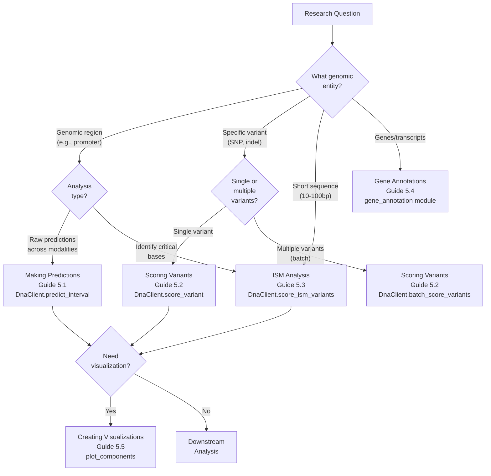
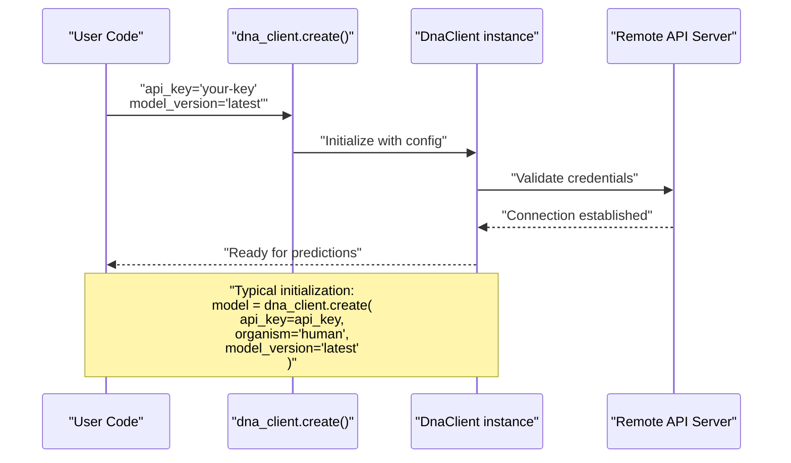
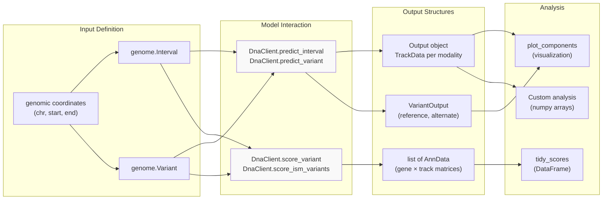
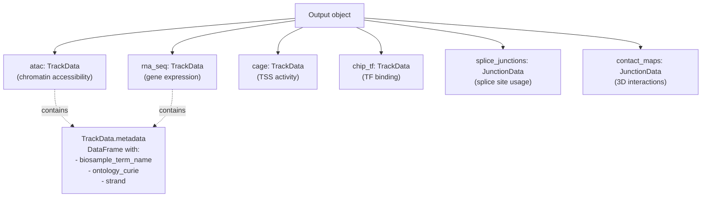
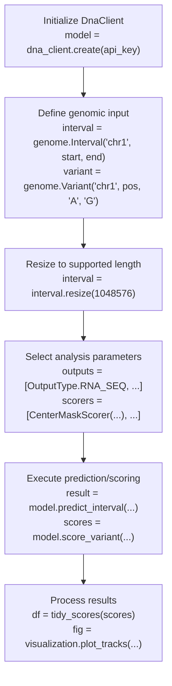

<!-- source: DeepWiki mcp.deepwiki.com · repo google-deepmind/alphagenome · page 5 User Guides · fetched 2026-10-26 -->

# User Guides

<details>
<summary>Relevant source files</summary>

The following files were used as context for generating this wiki page:

- [docs/source/faqs.md](docs/source/faqs.md)
- [docs/source/refs.bib](docs/source/refs.bib)
- [docs/source/user_guides/index.md](docs/source/user_guides/index.md)

</details>


This section provides practical, task-oriented guides for working with the AlphaGenome SDK. Each guide focuses on accomplishing a specific goal with step-by-step instructions, code patterns, and best practices.

User guides differ from the API Reference ([#4](#4)) which documents individual classes and methods, and from Examples and Tutorials ([#6](#6)) which provide complete end-to-end demonstrations. The guides here focus on specific tasks you'll perform repeatedly in your work.

## Overview

The AlphaGenome SDK supports three primary workflow patterns:

| Workflow | Purpose | Primary Guide | Key Classes |
|----------|---------|---------------|-------------|
| **Predictions** | Generate model predictions for genomic regions across multiple modalities | [Making Predictions](#5.1) | `DnaClient`, `Interval`, `Output` |
| **Variant Scoring** | Quantify functional impact of genetic variants | [Scoring Variants](#5.2) | `DnaClient`, `Variant`, `VariantScorer` configurations |
| **In-Silico Mutagenesis** | Systematically mutate sequences to identify critical bases | [ISM Analysis](#5.3) | `DnaClient.score_ism_variants` |
| **Data Preparation** | Process gene annotations and extract genomic features | [Working with Gene Annotations](#5.4) | `gene_annotation` module, `process_gtf.py` |
| **Visualization** | Create publication-quality plots of predictions | [Creating Visualizations](#5.5) | `visualization` module, `plot_components` |

**Sources:** [docs/source/user_guides/index.md:1-46]()

## Workflow Decision Guide



**Diagram: Workflow Selection Decision Tree**

This flowchart maps research questions to the appropriate guide and key SDK functions. Node labels correspond to actual method names in `DnaClient` and module names in the codebase.

**Sources:** [docs/source/faqs.md:1-385](), [docs/source/user_guides/index.md:1-46]()

## Common Prerequisites

All workflows share these initialization steps:

### API Key and Client Setup



**Diagram: Model Initialization Pattern**

**Sources:** [docs/source/faqs.md:1-20]()

### Sequence Length Constraints

The model supports specific sequence lengths. You must resize intervals to match these constraints:

| Supported Length | Typical Use Case | Resize Method |
|------------------|------------------|---------------|
| ~16KB (2^14) | Focused regulatory elements | `Interval.resize(16384)` |
| ~100KB (2^17) | Gene bodies and flanking regions | `Interval.resize(131072)` |
| ~500KB (2^19) | Multiple genes or TAD regions | `Interval.resize(524288)` |
| 1MB (2^20) | Long-range interactions (recommended) | `Interval.resize(1048576)` |

Use [genome.Interval.resize:alphagenome/data/genome.py:~74-78]() to adjust sequences to supported lengths. The method expands using actual genomic data, not padding.

**Sources:** [docs/source/faqs.md:63-79]()

## Core Data Flow Pattern

The following diagram illustrates how data structures transform through typical workflows:



**Diagram: Data Structure Transformation Pipeline**

This diagram maps the transformation of genomic coordinates through SDK classes to final analysis outputs. All node labels correspond to actual class names and method names in the codebase.

**Sources:** [docs/source/faqs.md:1-385]()

## Cross-Cutting Concepts

### Genomic Coordinate Systems

The SDK uses **0-based indexing** for all genomic coordinates:

```python
# Correct: First base of chr1
interval = genome.Interval('chr1', 0, 1)  # width = 1

# Position interpretation
interval.start  # 0 (inclusive)
interval.end    # 1 (exclusive)
```

**Exception:** `Variant.position` accepts 1-based input for compatibility with public databases (dbSNP, ClinVar), but internally converts to 0-based indexing.

**Sources:** [docs/source/faqs.md:18-36](), [docs/source/faqs.md:239-265]()

### Output Modalities and Metadata

Predictions span multiple biological assays. Each `Output` object contains:



**Diagram: Output Structure and Metadata**

Each `TrackData` object contains 5-600+ tracks representing different cell types, tissues, or experimental conditions. Access metadata to filter tracks:

```python
# Example: Filter to liver-specific tracks
liver_curie = 'UBERON:0001114'
liver_tracks = output.rna_seq.metadata[
    output.rna_seq.metadata['ontology_curie'].str.contains(liver_curie)
]
```

**Sources:** [docs/source/faqs.md:82-109](), [docs/source/user_guides/index.md:25-29]()

### Strand Handling

Genomic assays have different strandedness properties:

| Assay Type | Strandedness | Metadata Symbol | Track Count per Tissue |
|------------|--------------|-----------------|------------------------|
| ATAC-seq | Unstranded | `.` | 1 |
| RNA-seq (modern) | Stranded | `+`, `-` | 2 (forward + reverse) |
| RNA-seq (older, e.g., GTEx) | Unstranded | `.` | 1 |
| CAGE | Stranded | `+`, `-` | 2 |

Filter `TrackData` by strand using convenience methods:
- [TrackData.filter_to_positive_strand:alphagenome/data/track_data.py]()
- [TrackData.filter_to_negative_strand:alphagenome/data/track_data.py]()
- [TrackData.filter_to_unstranded:alphagenome/data/track_data.py]()

**Sources:** [docs/source/faqs.md:110-163]()

## Function-to-Guide Mapping

The following table maps common SDK methods to their corresponding guides:

| Task | Primary Method | Guide |
|------|----------------|-------|
| Predict regulatory activity for a region | `DnaClient.predict_interval(interval, outputs)` | [#5.1](#5.1) |
| Predict raw sequence without genomic context | `DnaClient.predict_sequence(sequence, outputs)` | [#5.1](#5.1) |
| Compare REF vs ALT predictions | `DnaClient.predict_variant(interval, variant, outputs)` | [#5.1](#5.1) |
| Score single variant impact | `DnaClient.score_variant(interval, variant, scorers)` | [#5.2](#5.2) |
| Score multiple variants (batch) | `DnaClient.batch_score_variants(inputs)` | [#5.2](#5.2) |
| Systematic mutagenesis analysis | `DnaClient.score_ism_variants(interval, scorers)` | [#5.3](#5.3) |
| Convert scores to DataFrame | `tidy_scores(score_results)` | [#5.2](#5.2) |
| Filter gene annotations | `gene_annotation.filter_protein_coding(gtf)` | [#5.4](#5.4) |
| Extract gene intervals | `gene_annotation.get_gene_intervals(gtf, interval)` | [#5.4](#5.4) |
| Process GTF files | `scripts/process_gtf.py` | [#5.4](#5.4) |
| Create track plots | `visualization.plot_tracks([components])` | [#5.5](#5.5) |
| Add gene annotations to plots | `plot_components.TranscriptAnnotation(gtf)` | [#5.5](#5.5) |

**Sources:** [docs/source/faqs.md:1-385](), [docs/source/user_guides/index.md:1-46]()

## Code Pattern: Basic Workflow Template

Most workflows follow this structure:



**Diagram: Standard Workflow Pattern**

**Sources:** [docs/source/faqs.md:1-385]()

## Guide Descriptions

### [Making Predictions](#5.1)
Generate model predictions for genomic regions across multiple biological modalities (RNA-seq, ATAC-seq, etc.). Covers sequence length handling, output type selection, and working with raw predictions.

**Key classes:** `DnaClient.predict_interval`, `DnaClient.predict_sequence`, `DnaClient.predict_variant`, `OutputType`, `Output`, `TrackData`

### [Scoring Variants](#5.2)
Quantify the functional impact of genetic variants using configurable scorer strategies. Includes choosing appropriate scorers, interpreting raw vs. quantile scores, and batch processing.

**Key classes:** `DnaClient.score_variant`, `DnaClient.batch_score_variants`, `variant_scorers`, `tidy_scores`

### [In-Silico Mutagenesis (ISM)](#5.3)
Perform systematic mutagenesis to identify functionally important bases within a genomic region. Explains ISM-specific considerations and interpreting nested result structures.

**Key classes:** `DnaClient.score_ism_variants`, `interval_scorers`

### [Working with Gene Annotations](#5.4)
Process GENCODE GTF files, filter transcripts by various criteria, and extract gene intervals for analysis. Covers data preparation and runtime filtering.

**Key modules:** `gene_annotation`, `transcript`, `scripts.process_gtf`

### [Creating Visualizations](#5.5)
Create customizable plots of genomic predictions with gene annotations, multiple tracks, and publication-quality formatting.

**Key modules:** `visualization`, `plot_components`, `TranscriptAnnotation`

**Sources:** [docs/source/user_guides/index.md:1-46]()

## Best Practices

### Error Prevention

1. **Validate sequence lengths before prediction:**
   ```python
   supported_lengths = [16384, 131072, 524288, 1048576]
   interval = interval.resize(max(supported_lengths))
   ```

2. **Check strand compatibility for gene-level scoring:**
   - Gene mask scorers require matching gene and interval strands
   - Use `tidy_scores(score_results, match_strand=True)` to filter automatically

3. **Handle API rate limits gracefully:**
   - The SDK includes automatic retry logic via `@retry_rpc` decorator
   - Batch operations when processing multiple variants

**Sources:** [docs/source/faqs.md:63-79]()

### Performance Optimization

1. **Use longest supported sequence length (1MB) when possible** for best prediction quality
2. **Batch score variants** using `batch_score_variants` instead of loops
3. **Reuse `DnaClient` instances** - initialization has overhead
4. **Process GTF files once** using `scripts/process_gtf.py` and load Feather files at runtime

**Sources:** [docs/source/faqs.md:63-70]()

## Next Steps

- **New users:** Start with [Quick Start Tutorial](#2.2) before diving into specific guides
- **API details:** See [API Reference](#4) for complete method signatures and parameters
- **Worked examples:** Browse [Examples and Tutorials](#6) for complete analysis workflows
- **Troubleshooting:** Consult [Frequently Asked Questions](#9.1) for common issues

**Sources:** [docs/source/user_guides/index.md:1-46]()

---

