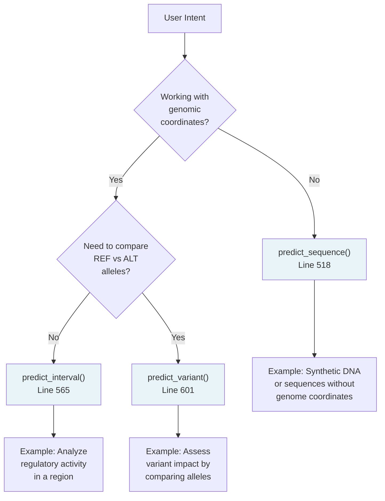
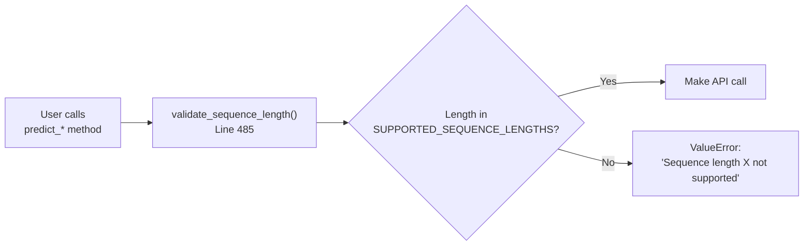
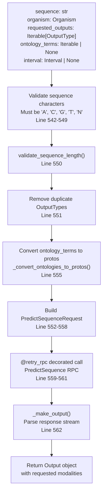
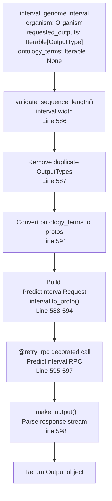
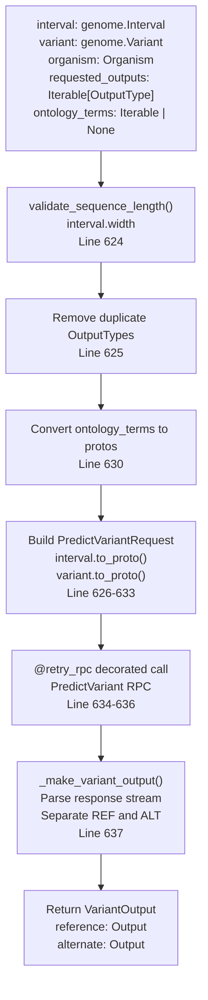
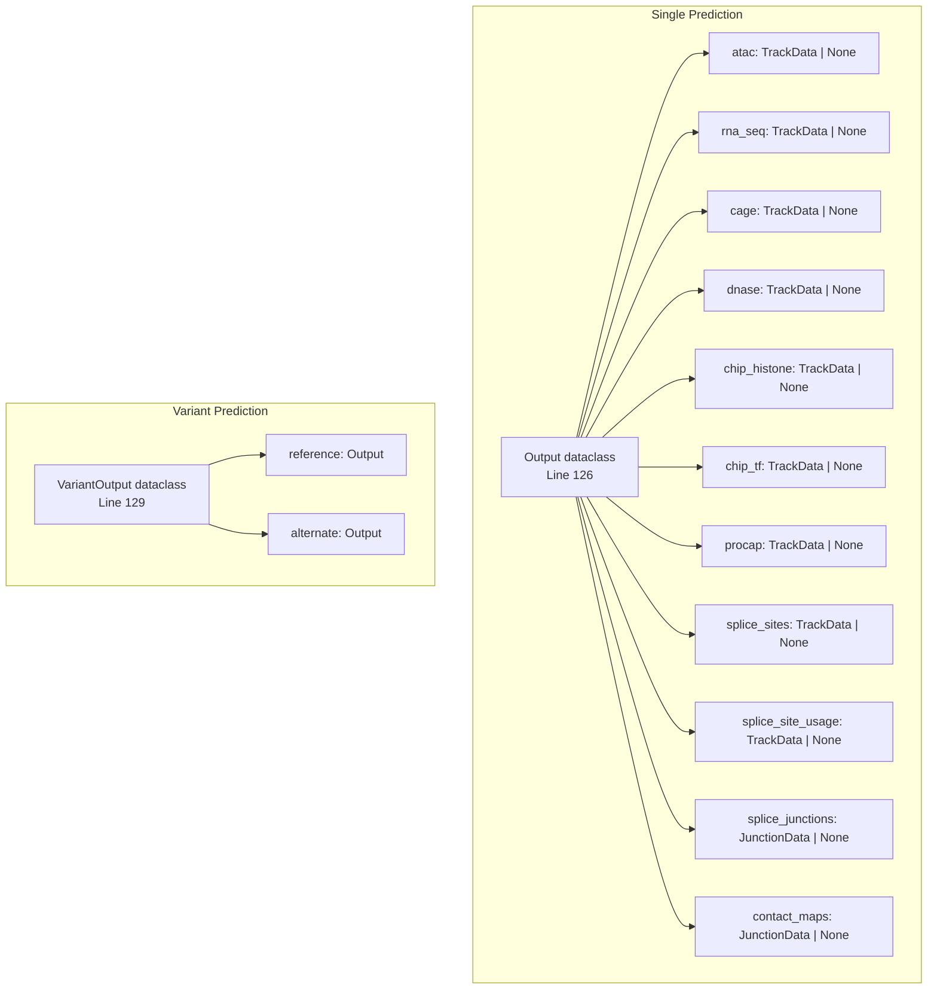
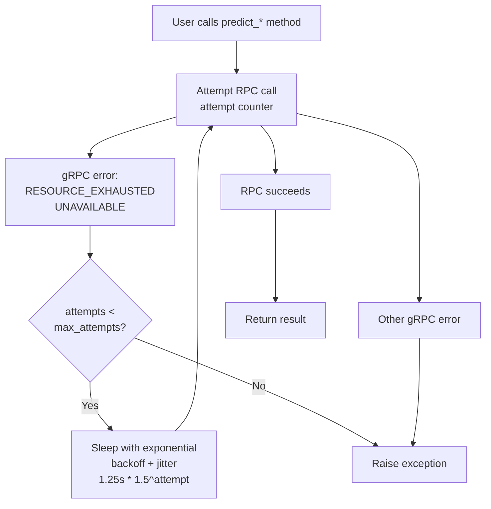

<!-- source: DeepWiki mcp.deepwiki.com · repo google-deepmind/alphagenome · page 5.1 Making Predictions · fetched 2026-10-26 -->

# Making Predictions

<details>
<summary>Relevant source files</summary>

The following files were used as context for generating this wiki page:

- [docs/source/api/models.md](docs/source/api/models.md)
- [docs/source/faqs.md](docs/source/faqs.md)
- [docs/source/refs.bib](docs/source/refs.bib)
- [src/alphagenome/models/dna_client.py](src/alphagenome/models/dna_client.py)

</details>


## Purpose and Scope

This guide provides practical instructions for making predictions using the AlphaGenome SDK. It covers the three prediction methods (`predict_sequence`, `predict_interval`, `predict_variant`), supported sequence lengths, output type selection, ontology term filtering, and result interpretation.

For conceptual background on prediction workflows and the `DnaModel` interface, see [Prediction Workflows](#3.2). For variant-specific scoring analysis, see [Scoring Variants](#5.2). For systematic mutagenesis analysis, see [In-Silico Mutagenesis (ISM)](#5.3).

## Prediction Methods Overview

The `DnaClient` class provides three methods for generating predictions, each suited to different use cases:

**Prediction Method Selection by Use Case**



**Sources:** [src/alphagenome/models/dna_client.py:518-637](), [docs/source/faqs.md:8-11]()

### Method Characteristics

| Method | Input | Output | Use Case |
|--------|-------|--------|----------|
| `predict_sequence` | Raw DNA sequence string | `Output` | Arbitrary sequences, synthetic DNA, sequences without genomic coordinates |
| `predict_interval` | `genome.Interval` object | `Output` | Genomic regions with reference genome context |
| `predict_variant` | `genome.Interval` + `genome.Variant` | `VariantOutput` | Genetic variants requiring REF/ALT comparison |

**Sources:** [src/alphagenome/models/dna_client.py:518-637]()

## Supported Sequence Lengths

The model supports four specific sequence lengths, defined as powers of 2:

**Supported Sequence Lengths**

| Constant Name | Length (bp) | Binary | Typical Use |
|---------------|-------------|--------|-------------|
| `SEQUENCE_LENGTH_16KB` | 16,384 | 2^14 | Small regulatory elements, promoters |
| `SEQUENCE_LENGTH_100KB` | 131,072 | 2^17 | Gene bodies, enhancer clusters |
| `SEQUENCE_LENGTH_500KB` | 524,288 | 2^19 | Multi-gene loci, TAD boundaries |
| `SEQUENCE_LENGTH_1MB` | 1,048,576 | 2^20 | Long-range interactions, large regulatory domains |

**Sources:** [src/alphagenome/models/dna_client.py:46-57](), [docs/source/faqs.md:63-69]()

### Handling Unsupported Lengths

For sequences with lengths not in the supported set, use `genome.Interval.resize()` to adjust to the nearest supported length:

```python
# Example: Adjust a 50kb interval to 100kb
interval = genome.Interval('chr1', 1000000, 1050000)  # 50kb
resized_interval = interval.resize(dna_client.SEQUENCE_LENGTH_100KB)
```

The `resize()` method expands intervals using actual genomic sequence data (not padding) and centers the original interval within the resized region.

**Sources:** [docs/source/faqs.md:71-78]()

### Sequence Length Validation

All prediction methods validate sequence length before making API calls:



**Sources:** [src/alphagenome/models/dna_client.py:485-491](), [src/alphagenome/models/dna_client.py:550](), [src/alphagenome/models/dna_client.py:586](), [src/alphagenome/models/dna_client.py:624]()

## Configuring Predictions

### Selecting an Organism

The `organism` parameter specifies which reference genome to use:

| Organism Value | Reference Genome | Assembly |
|----------------|------------------|----------|
| `Organism.HOMO_SAPIENS` (default) | Human | hg38 (GRCh38.p13) |
| `Organism.MUS_MUSCULUS` | Mouse | mm10 (GRCm38.p6) |

Example:
```python
output = model.predict_interval(
    interval=interval,
    organism=Organism.MUS_MUSCULUS,  # Use mouse reference
    requested_outputs=[OutputType.RNA_SEQ]
)
```

**Sources:** [src/alphagenome/models/dna_client.py:522](), [src/alphagenome/models/dna_client.py:569](), [docs/source/faqs.md:40-45]()

### Requesting Output Types

The `requested_outputs` parameter controls which biological modalities are predicted. Each `OutputType` corresponds to a specific assay type:

**Available Output Types**

| OutputType | Biological Modality | Data Structure |
|------------|---------------------|----------------|
| `OutputType.ATAC` | ATAC-seq chromatin accessibility | `TrackData` |
| `OutputType.RNA_SEQ` | RNA-seq gene expression | `TrackData` |
| `OutputType.CAGE` | CAGE transcription start sites | `TrackData` |
| `OutputType.DNASE` | DNase-seq chromatin accessibility | `TrackData` |
| `OutputType.CHIP_HISTONE` | ChIP-seq histone modifications | `TrackData` |
| `OutputType.CHIP_TF` | ChIP-seq transcription factor binding | `TrackData` |
| `OutputType.PROCAP` | PRO-cap transcription initiation | `TrackData` |
| `OutputType.SPLICE_SITES` | Splice site predictions | `TrackData` |
| `OutputType.SPLICE_SITE_USAGE` | Splice site usage probabilities | `TrackData` |
| `OutputType.SPLICE_JUNCTIONS` | Predicted splice junctions | `JunctionData` |
| `OutputType.CONTACT_MAPS` | 3D chromatin contact maps | `JunctionData` |

Example requesting multiple outputs:
```python
output = model.predict_interval(
    interval=interval,
    requested_outputs=[
        OutputType.RNA_SEQ,
        OutputType.ATAC,
        OutputType.SPLICE_JUNCTIONS
    ]
)
```

**Sources:** [src/alphagenome/models/dna_client.py:551](), [docs/source/faqs.md:82-88]()

### Filtering by Ontology Terms

The `ontology_terms` parameter filters predictions to specific tissues, cell types, or experimental conditions using standardized ontology identifiers (CURIEs):

```python
# Filter to liver-specific predictions
output = model.predict_interval(
    interval=interval,
    requested_outputs=[OutputType.RNA_SEQ],
    ontology_terms=['UBERON:0001114']  # Liver ontology term
)

# Use multiple terms
output = model.predict_interval(
    interval=interval,
    requested_outputs=[OutputType.ATAC],
    ontology_terms=[
        'UBERON:0001114',  # Liver
        'CL:0000182'       # Hepatocyte
    ]
)
```

When `ontology_terms=None` (default), predictions for all available contexts are returned (5-600+ tracks per output type).

**Supported Ontology Vocabularies:**
- **UBERON**: Anatomical structures and organs
- **CL**: Cell types
- **CLO**: Cell lines
- **EFO**: Experimental factors

**Sources:** [src/alphagenome/models/dna_client.py:524](), [src/alphagenome/models/dna_client.py:469-482](), [docs/source/faqs.md:96-108]()

## Making Predictions

### predict_sequence Method

Generates predictions for an arbitrary DNA sequence without genomic coordinates.

**Method Signature and Workflow**



**Example Usage:**
```python
sequence = "ACGTACGTACGT" * 1365  # 16,384 bp
output = model.predict_sequence(
    sequence=sequence,
    organism=Organism.HOMO_SAPIENS,
    requested_outputs=[OutputType.RNA_SEQ, OutputType.ATAC],
    ontology_terms=None,  # All contexts
    interval=None  # No genomic context
)
```

**Key Validations:**
- Sequence must contain only characters: `A`, `C`, `G`, `T`, `N` [src/alphagenome/models/dna_client.py:542-549]()
- Length must be in `SUPPORTED_SEQUENCE_LENGTHS` [src/alphagenome/models/dna_client.py:550]()

**Sources:** [src/alphagenome/models/dna_client.py:518-562]()

### predict_interval Method

Generates predictions for a genomic region defined by coordinates, using the reference genome sequence.

**Method Signature and Workflow**



**Example Usage:**
```python
# Define a 1MB interval around a gene
interval = genome.Interval(
    chromosome='chr7',
    start=27200000,
    end=27200000 + dna_client.SEQUENCE_LENGTH_1MB
)

output = model.predict_interval(
    interval=interval,
    organism=Organism.HOMO_SAPIENS,
    requested_outputs=[OutputType.RNA_SEQ],
    ontology_terms=['UBERON:0000948']  # Heart tissue
)
```

**Sources:** [src/alphagenome/models/dna_client.py:565-598]()

### predict_variant Method

Generates predictions for both reference and alternate alleles of a genetic variant, returning a `VariantOutput` containing both for comparison.

**Method Signature and Workflow**



**Example Usage:**
```python
# Define variant and surrounding context
interval = genome.Interval(
    chromosome='chr1',
    start=1000000,
    end=1000000 + dna_client.SEQUENCE_LENGTH_100KB
)

variant = genome.Variant(
    chromosome='chr1',
    position=1050000,  # 1-indexed position
    reference_bases='A',
    alternate_bases='G'
)

variant_output = model.predict_variant(
    interval=interval,
    variant=variant,
    organism=Organism.HOMO_SAPIENS,
    requested_outputs=[OutputType.RNA_SEQ, OutputType.SPLICE_JUNCTIONS]
)

# Compare reference and alternate predictions
ref_rna = variant_output.reference.rna_seq
alt_rna = variant_output.alternate.rna_seq
```

**Important Notes:**
- The variant position must fall within the interval
- The interval provides genomic context for accurate predictions
- REF/ALT alleles specified by user are used (not validated against reference genome)

**Sources:** [src/alphagenome/models/dna_client.py:601-637](), [docs/source/faqs.md:277-283]()

## Understanding Prediction Results

### Output Structure

All prediction methods return data organized into `Output` or `VariantOutput` objects:



**Sources:** [src/alphagenome/models/dna_client.py:126-129](), [src/alphagenome/models/dna_client.py:234-258](), [src/alphagenome/models/dna_client.py:285-312]()

### TrackData Structure

`TrackData` objects contain continuous genomic signal predictions (e.g., RNA-seq, ATAC-seq):

| Attribute | Type | Description |
|-----------|------|-------------|
| `values` | `np.ndarray` | Shape: `(num_tracks, sequence_length)` - Predicted signal values |
| `metadata` | `pd.DataFrame` | One row per track with biosample, ontology, strand information |
| `interval` | `genome.Interval` | Genomic coordinates for the prediction |

Example accessing track data:
```python
output = model.predict_interval(
    interval=interval,
    requested_outputs=[OutputType.RNA_SEQ]
)

rna_track_data = output.rna_seq
print(rna_track_data.values.shape)  # (num_tracks, sequence_length)
print(rna_track_data.metadata.columns)  # ['biosample', 'ontology', 'strand', ...]
```

**Sources:** [src/alphagenome/models/dna_client.py:162-176]()

### JunctionData Structure

`JunctionData` objects contain discrete event predictions (splice junctions, chromatin contacts):

| Attribute | Type | Description |
|-----------|------|-------------|
| `junctions` | `np.ndarray` | Shape: `(num_junctions, 2)` - Start/end positions of junctions |
| `values` | `np.ndarray` | Shape: `(num_tracks, num_junctions)` - Prediction strength |
| `metadata` | `pd.DataFrame` | One row per track with context information |

Example accessing junction data:
```python
output = model.predict_interval(
    interval=interval,
    requested_outputs=[OutputType.SPLICE_JUNCTIONS]
)

junction_data = output.splice_junctions
print(junction_data.junctions.shape)  # (num_junctions, 2)
print(junction_data.values.shape)     # (num_tracks, num_junctions)
```

**Sources:** [src/alphagenome/models/dna_client.py:181-188]()

### Output Metadata

Retrieve metadata about available tracks without making predictions:

```python
metadata = model.output_metadata(organism=Organism.HOMO_SAPIENS)

# Access metadata for each output type
rna_metadata = metadata.rna_seq  # pd.DataFrame
print(f"RNA-seq tracks available: {len(rna_metadata)}")
print(rna_metadata[['biosample', 'ontology', 'strand']].head())
```

The `output_metadata()` method returns an `OutputMetadata` object containing metadata DataFrames for all output types.

**Sources:** [src/alphagenome/models/dna_client.py:854-871](), [src/alphagenome/models/dna_client.py:195-231]()

## Error Handling and Validation

### Automatic Retry Logic

All prediction methods are decorated with `@retry_rpc`, which automatically retries transient failures:



**Retry Configuration (default values):**
- `max_attempts`: 5
- `initial_backoff`: 1.25 seconds
- `backoff_multiplier`: 1.5
- `retry_status_codes`: `RESOURCE_EXHAUSTED`, `UNAVAILABLE`
- `jitter`: 0.2 (20% variation in backoff time)

**Sources:** [src/alphagenome/models/dna_client.py:73-122](), [src/alphagenome/models/dna_client.py:517](), [src/alphagenome/models/dna_client.py:564](), [src/alphagenome/models/dna_client.py:600]()

### Common Validation Errors

**Invalid sequence characters:**
```python
# Raises ValueError: Invalid sequence, must only contain "ACGTN"
output = model.predict_sequence(
    sequence="ACGTXYZ" * 2048,  # Invalid characters
    requested_outputs=[OutputType.ATAC]
)
```

**Unsupported sequence length:**
```python
# Raises ValueError: Sequence length 50000 not supported
interval = genome.Interval('chr1', 1000000, 1050000)  # 50kb
output = model.predict_interval(
    interval=interval,
    requested_outputs=[OutputType.RNA_SEQ]
)
```

**Duplicate output types:**
```python
# Automatically deduplicated - no error raised
output = model.predict_interval(
    interval=interval,
    requested_outputs=[
        OutputType.RNA_SEQ,
        OutputType.RNA_SEQ,  # Duplicate ignored
        OutputType.ATAC
    ]
)
```

**Sources:** [src/alphagenome/models/dna_client.py:542-549](), [src/alphagenome/models/dna_client.py:485-491](), [src/alphagenome/models/dna_client.py:551]()

---

