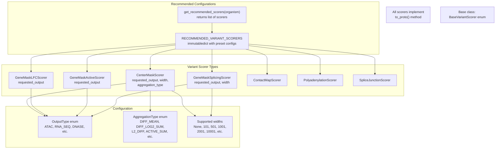
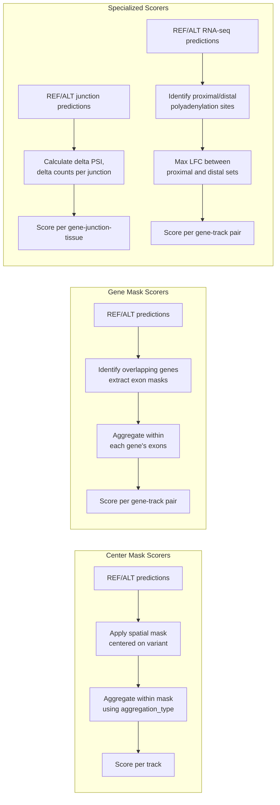
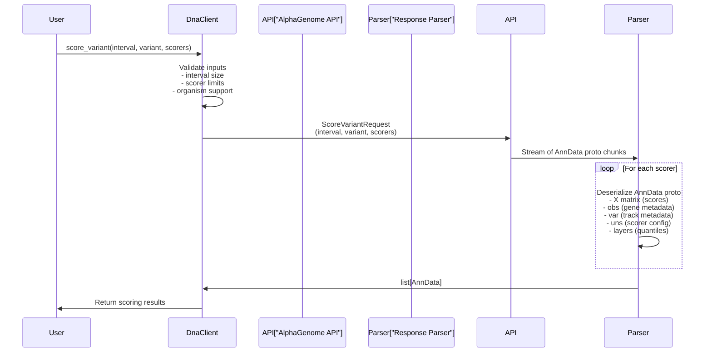
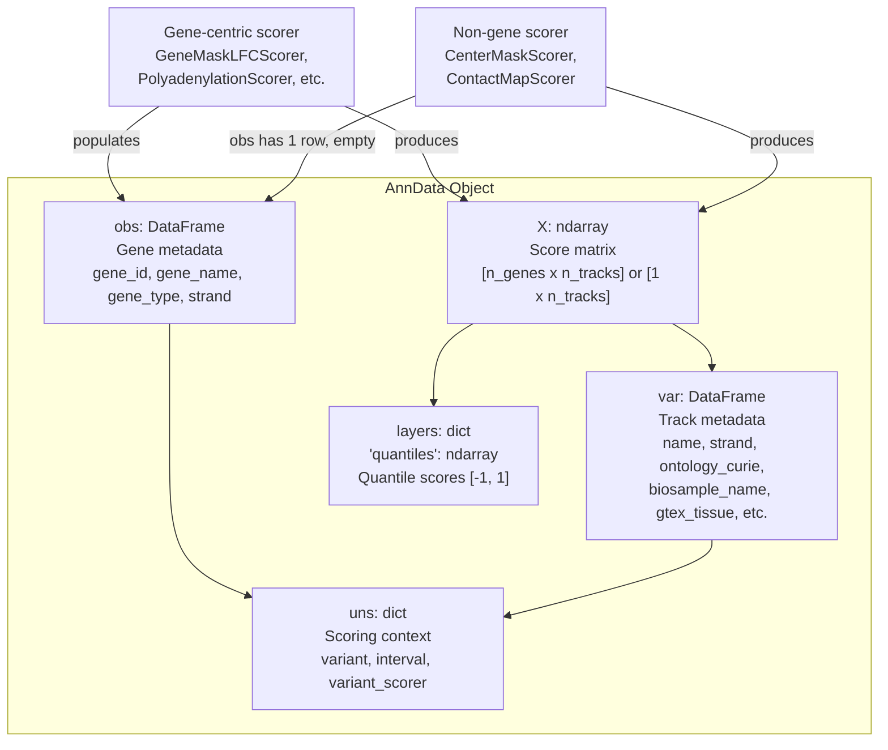
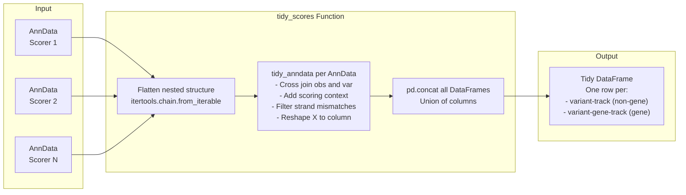

<!-- source: DeepWiki mcp.deepwiki.com · repo google-deepmind/alphagenome · page 5.2 Scoring Variants · fetched 2026-10-26 -->

# Scoring Variants

<details>
<summary>Relevant source files</summary>

The following files were used as context for generating this wiki page:

- [docs/source/faqs.md](docs/source/faqs.md)
- [docs/source/refs.bib](docs/source/refs.bib)
- [src/alphagenome/models/variant_scorers.py](src/alphagenome/models/variant_scorers.py)
- [src/alphagenome/models/variant_scorers_test.py](src/alphagenome/models/variant_scorers_test.py)

</details>


This page provides a practical guide to using variant scorers to quantify the functional impact of genetic variants. It covers selecting appropriate scorers, executing scoring operations, and interpreting results.

For conceptual background on variant scoring, see [Variant Scoring](#3.3). For complete API documentation, see [Variant and Interval Scorers](#4.4). For worked examples, see [Batch Variant Scoring](#6.2) and [Interactive Variant Scoring](#6.3).

---

## Overview

Variant scoring quantifies the predicted functional impact of a genetic variant by comparing model predictions for reference (REF) and alternate (ALT) alleles. Unlike raw predictions which return continuous genomic signals, scorers aggregate these signals into interpretable metrics suitable for downstream analysis.

**When to use variant scoring:**
- Prioritizing candidate variants from GWAS or sequencing studies
- Quantifying tissue-specific or modality-specific variant effects
- Identifying variants affecting gene expression, splicing, or chromatin accessibility
- Comparing variants across different genomic contexts

**Key characteristics:**
- Outputs are `AnnData` objects containing scores per gene-track or variant-track combination
- Scores can be converted to tidy DataFrames using `tidy_scores()`
- Both raw scores and quantile scores are available for recommended scorers
- Gene-centric scorers support strand matching to filter biologically relevant combinations

Sources: [docs/source/faqs.md:237-341](), [src/alphagenome/models/variant_scorers.py:15-67]()

---

## Variant Scorer Architecture



**Diagram: Variant Scorer Type Hierarchy and Configuration System**

The system provides seven distinct scorer types, each optimized for different modalities and use cases. The `RECOMMENDED_VARIANT_SCORERS` dictionary at [src/alphagenome/models/variant_scorers.py:559-638]() provides pre-configured scorers for common analyses.

Sources: [src/alphagenome/models/variant_scorers.py:69-143](), [src/alphagenome/models/variant_scorers.py:158-543]()

---

## Defining Variants

Variants are defined using the `Variant` class from the `genome` module:

```python
from alphagenome.data import genome

# SNV example
variant = genome.Variant(
    chromosome='chr1',
    position=12345,  # 1-indexed position
    reference_bases='A',
    alternate_bases='G'
)

# Insertion example (left-aligned)
insertion = genome.Variant(
    chromosome='chr1',
    position=12345,
    reference_bases='C',
    alternate_bases='CAT'
)

# Deletion example (left-aligned)
deletion = genome.Variant(
    chromosome='chr1',
    position=12345,
    reference_bases='ATG',
    alternate_bases='A'
)
```

**Important considerations:**

| Aspect | Details |
|--------|---------|
| Position indexing | `position` attribute is **1-indexed** for compatibility with dbSNP and other databases |
| Internal representation | Internally converted to 0-indexed via `start` and `end` properties |
| Indel alignment | Uses left-alignment following VCF conventions |
| Reference sequence | Can pass any sequence; model is agnostic to actual reference genome |
| Indel scoring | Insertions: max value over segment; Deletions: zero signal in ALT context |

Sources: [docs/source/faqs.md:239-293]()

---

## Choosing a Variant Scorer

### Recommended Scorers by Modality

The `RECOMMENDED_VARIANT_SCORERS` dictionary provides optimized configurations:

| Key | Scorer Type | Output Type | Configuration | Use Case |
|-----|-------------|-------------|---------------|----------|
| `'ATAC'` | `CenterMaskScorer` | `ATAC` | width=501, DIFF_LOG2_SUM | Chromatin accessibility changes |
| `'DNASE'` | `CenterMaskScorer` | `DNASE` | width=501, DIFF_LOG2_SUM | DNase hypersensitivity changes |
| `'CHIP_TF'` | `CenterMaskScorer` | `CHIP_TF` | width=501, DIFF_LOG2_SUM | Transcription factor binding changes |
| `'CHIP_HISTONE'` | `CenterMaskScorer` | `CHIP_HISTONE` | width=2001, DIFF_LOG2_SUM | Histone modification changes |
| `'CAGE'` | `CenterMaskScorer` | `CAGE` | width=501, DIFF_LOG2_SUM | Transcription start site changes |
| `'PROCAP'` | `CenterMaskScorer` | `PROCAP` | width=501, DIFF_LOG2_SUM | Nascent transcription changes |
| `'RNA_SEQ'` | `GeneMaskLFCScorer` | `RNA_SEQ` | N/A | Gene expression log fold change |
| `'RNA_SEQ_ACTIVE'` | `GeneMaskActiveScorer` | `RNA_SEQ` | N/A | Maximum expression level (active allele) |
| `'SPLICE_SITES'` | `GeneMaskSplicingScorer` | `SPLICE_SITES` | width=None | Splice site class probability changes |
| `'SPLICE_SITE_USAGE'` | `GeneMaskSplicingScorer` | `SPLICE_SITE_USAGE` | width=None | Splice site usage changes |
| `'SPLICE_JUNCTIONS'` | `SpliceJunctionScorer` | `SPLICE_JUNCTIONS` | N/A | Junction-level splicing changes |
| `'POLYADENYLATION'` | `PolyadenylationScorer` | `RNA_SEQ` | N/A | Polyadenylation site changes (paQTLs) |
| `'CONTACT_MAPS'` | `ContactMapScorer` | `CONTACT_MAPS` | N/A | 3D genome organization changes |

Active allele variants (suffix `_ACTIVE`) are also available for ATAC, DNASE, CHIP_TF, CHIP_HISTONE, CAGE, and PROCAP.

**Accessing recommended scorers:**

```python
from alphagenome.models import variant_scorers
from alphagenome.protos import dna_model_pb2

# Get all recommended scorers for human
human_scorers = variant_scorers.get_recommended_scorers(
    dna_model_pb2.Organism.ORGANISM_HOMO_SAPIENS
)

# Get a specific recommended scorer
atac_scorer = variant_scorers.RECOMMENDED_VARIANT_SCORERS['ATAC']
rna_scorer = variant_scorers.RECOMMENDED_VARIANT_SCORERS['RNA_SEQ']
```

Sources: [src/alphagenome/models/variant_scorers.py:559-649](), [docs/source/faqs.md:294-300]()

---

## Scorer Type Details



**Diagram: Processing Flow for Different Scorer Types**

### CenterMaskScorer

Aggregates predictions in a spatial window centered on the variant. Operates on the spatial axis only, producing one score per output track.

**Parameters:**
- `requested_output`: Output type to score (e.g., `OutputType.ATAC`)
- `width`: Window size around variant (501, 2001, 10001, 100001, 200001, or None for entire sequence)
- `aggregation_type`: How to combine REF/ALT values (see [Aggregation Types](#aggregation-types))

**Key attributes:**
- `is_signed`: Returns `True` for directional scorers (DIFF_MEAN, DIFF_SUM, DIFF_SUM_LOG2, DIFF_LOG2_SUM)
- `name`: String representation uniquely identifying the scorer configuration

Sources: [src/alphagenome/models/variant_scorers.py:158-241]()

### GeneMaskLFCScorer

Calculates log fold change of gene expression between ALT and REF alleles using gene exon masks.

**Parameters:**
- `requested_output`: Output type (typically `OutputType.RNA_SEQ`)

**Output characteristics:**
- Gene-centric: produces scores per gene-track combination
- Signed scores: positive indicates increased expression, negative indicates decreased expression
- Requires gene annotations to identify overlapping genes

Sources: [src/alphagenome/models/variant_scorers.py:286-339]()

### GeneMaskActiveScorer

Captures absolute activity level rather than difference, taking the maximum of aggregated ALT and REF signals.

**Use cases:**
- Identifying variants near highly active regulatory elements
- Cases where direction of effect is less important than activity level

Sources: [src/alphagenome/models/variant_scorers.py:341-395]()

### GeneMaskSplicingScorer

Quantifies changes in splice site class probabilities or usage within gene exon masks.

**Parameters:**
- `requested_output`: `OutputType.SPLICE_SITES` or `OutputType.SPLICE_SITE_USAGE`
- `width`: Window size (101, 1001, 10001, or None)

**Output characteristics:**
- Non-signed scores (always positive)
- Gene-centric scoring

Sources: [src/alphagenome/models/variant_scorers.py:397-459]()

### PolyadenylationScorer

Captures variant impact on RNA isoform production via polyadenylation site changes. Calculates maximum log fold change between proximal and distal polyadenylation site sets.

**Special characteristics:**
- Human-only (not supported for mouse)
- Uses `OutputType.RNA_SEQ` predictions
- Gene-centric scoring

Sources: [src/alphagenome/models/variant_scorers.py:461-505]()

### SpliceJunctionScorer

Scores splice junction changes using GTEx-derived junction annotations.

**Output characteristics:**
- Produces delta PSI (percent spliced in), delta counts, and reference counts
- Gene-centric with junction-specific information
- Tissue-specific scoring

Sources: [src/alphagenome/models/variant_scorers.py:507-543]()

### ContactMapScorer

Quantifies local 3D chromatin contact disruption using a 1MB window centered on the variant.

**Output characteristics:**
- Calculates mean absolute difference for all interactions involving the variant-containing bin
- Non-signed scores

Sources: [src/alphagenome/models/variant_scorers.py:243-284]()

---

## Aggregation Types

The `AggregationType` enum defines how REF and ALT predictions are combined:

| Type | Formula | Directionality | Use Case |
|------|---------|----------------|----------|
| `DIFF_MEAN` | mean(ALT) - mean(REF) | Signed | Simple mean difference |
| `DIFF_SUM` | sum(ALT) - sum(REF) | Signed | Sum difference (affected by window size) |
| `DIFF_SUM_LOG2` | sum(log2(ALT)) - sum(log2(REF)) | Signed | Log-scale sum difference |
| `DIFF_LOG2_SUM` | log2(sum(ALT)) - log2(sum(REF)) | Signed | **Recommended** for most continuous signals |
| `L2_DIFF` | ‖ALT - REF‖₂ | Unsigned | Magnitude of change (no direction) |
| `L2_DIFF_LOG1P` | ‖log1p(ALT) - log1p(REF)‖₂ | Unsigned | Log-scale L2 norm |
| `ACTIVE_MEAN` | max(mean(ALT), mean(REF)) | Unsigned | Active allele (mean) |
| `ACTIVE_SUM` | max(sum(ALT), sum(REF)) | Unsigned | Active allele (sum) |

**Signed vs unsigned:**
- **Signed scorers**: Indicate direction of effect (positive = increased, negative = decreased)
- **Unsigned scorers**: Indicate magnitude only (always positive)

The `is_signed` property on each scorer indicates directionality, which affects quantile score interpretation.

Sources: [src/alphagenome/models/variant_scorers.py:30-67](), [src/alphagenome/models/variant_scorers.py:198-208]()

---

## Running Variant Scoring



**Diagram: Variant Scoring Request Flow**

### Using DnaClient

```python
from alphagenome.models import dna_client, variant_scorers
from alphagenome.data import genome

# Initialize client
model = dna_client.create(api_key='your_api_key')

# Define variant and interval
variant = genome.Variant(
    chromosome='chr1',
    position=12345,
    reference_bases='A',
    alternate_bases='G'
)

# Interval must contain the variant
interval = variant.to_interval().resize(200_000)

# Select scorers
scorers = [
    variant_scorers.RECOMMENDED_VARIANT_SCORERS['RNA_SEQ'],
    variant_scorers.RECOMMENDED_VARIANT_SCORERS['ATAC'],
]

# Score the variant
results = model.score_variant(
    interval=interval,
    variant=variant,
    scorers=scorers
)

# results is a list[AnnData], one per scorer
```

**Constraints:**
- Interval must contain the variant position
- Maximum 20 scorers per request
- Supported interval sizes: ~16KB, ~100KB, ~500KB, 1MB
- Gene-centric scorers require genes overlapping the interval

Sources: [docs/source/faqs.md:267-276]()

---

## Understanding AnnData Output Structure



**Diagram: AnnData Structure for Variant Scoring Results**

### Gene-Centric Scoring Output

For scorers like `GeneMaskLFCScorer`, `GeneMaskSplicingScorer`, `PolyadenylationScorer`, and `SpliceJunctionScorer`:

```python
# Example structure
adata.X.shape  # (n_genes, n_tracks)
adata.obs.columns  # ['gene_id', 'gene_name', 'gene_type', 'strand', ...]
adata.var.columns  # ['name', 'strand', 'ontology_curie', 'biosample_name', ...]
adata.uns.keys()   # dict_keys(['variant', 'interval', 'variant_scorer'])
adata.layers.keys()  # dict_keys(['quantiles'])
```

**Gene metadata columns** (obs):
- `gene_id`: ENSEMBL gene identifier (with version suffix)
- `gene_name`: HGNC gene symbol
- `gene_type`: Gene biotype (protein_coding, lncRNA, etc.)
- `strand`: Gene strand ('+', '-')
- `junction_Start`, `junction_End`: For `SpliceJunctionScorer` only

### Non-Gene Scoring Output

For scorers like `CenterMaskScorer` and `ContactMapScorer`:

```python
adata.X.shape  # (1, n_tracks)
adata.obs  # Empty DataFrame with one row
```

**Track metadata columns** (var) include:
- `name`: Track name (e.g., "UBERON:0002107 total RNA-seq")
- `strand`: Track strand ('+', '-', '.')
- `ontology_curie`: Cell type/tissue ontology term (e.g., "UBERON:0002107")
- `biosample_name`: Human-readable biosample name
- `biosample_type`: 'tissue', 'primary_cell', 'in_vitro_differentiated_cells', etc.
- `gtex_tissue`: GTEx tissue name (when applicable)
- `Assay title`: Assay subtype (e.g., "polyA plus RNA-seq")
- `transcription_factor`: TF name for ChIP-seq tracks
- `histone_mark`: Histone mark for ChIP-seq tracks

Sources: [src/alphagenome/models/variant_scorers_test.py:143-434]()

---

## Converting to Tidy DataFrames

The `tidy_scores()` function converts AnnData objects to long-format pandas DataFrames for analysis:



**Diagram: tidy_scores() Processing Pipeline**

### Basic Usage

```python
from alphagenome.models import variant_scorers

# Convert scoring results to DataFrame
df = variant_scorers.tidy_scores(results)

# For batch scoring (nested list of AnnData)
batch_results = model.score_variants(intervals, variants, scorers)
df = variant_scorers.tidy_scores(batch_results)
```

### DataFrame Columns

The tidy DataFrame contains the following columns:

| Column | Description | Gene-Centric Only |
|--------|-------------|-------------------|
| `variant_id` | Variant identifier (e.g., "chr1:12345:A>G") | No |
| `scored_interval` | Genomic interval scored | No |
| `gene_id` | ENSEMBL gene ID (version removed) | Yes |
| `gene_name` | HGNC gene symbol | Yes |
| `gene_type` | Gene biotype | Yes |
| `gene_strand` | Gene strand | Yes |
| `junction_Start` | Junction start (SpliceJunctionScorer only) | Yes |
| `junction_End` | Junction end (SpliceJunctionScorer only) | Yes |
| `output_type` | Model output type | No |
| `variant_scorer` | Scorer configuration string | No |
| `track_name` | Track identifier | No |
| `track_strand` | Track strand | No |
| `ontology_curie` | Tissue/cell type ontology term | No |
| `biosample_name` | Human-readable biosample | No |
| `biosample_type` | Biosample category | No |
| `gtex_tissue` | GTEx tissue name | No |
| `Assay title` | Assay subtype | No |
| `transcription_factor` | TF name (ChIP-seq only) | No |
| `histone_mark` | Histone mark (ChIP-seq only) | No |
| `raw_score` | Raw variant score | No |
| `quantile_score` | Quantile-normalized score [-1, 1] | No |

### Function Parameters

```python
variant_scorers.tidy_scores(
    scores,
    match_gene_strand=True,
    include_extended_metadata=True
)
```

**Parameters:**
- `scores`: `list[AnnData]` or `list[list[AnnData]]` from `score_variant()` or `score_variants()`
- `match_gene_strand`: If `True`, removes rows where gene strand and track strand are mismatched ('+' vs '-')
- `include_extended_metadata`: If `True`, includes columns like `biosample_name`, `gtex_tissue`, `transcription_factor`, etc. If `False`, only includes `track_name` and `track_strand`

Sources: [src/alphagenome/models/variant_scorers.py:652-876](), [src/alphagenome/models/variant_scorers_test.py:880-904]()

---

## Interpreting Scores

### Raw Scores

Raw scores are the direct output of the scoring aggregation function. Their interpretation depends on the scorer:

| Scorer Type | Raw Score Interpretation | Range |
|-------------|-------------------------|-------|
| `CenterMaskScorer` with `DIFF_LOG2_SUM` | Log2 fold change in summed signal | Unbounded |
| `CenterMaskScorer` with `L2_DIFF` | Euclidean distance between REF/ALT | [0, ∞) |
| `CenterMaskScorer` with `ACTIVE_SUM` | Maximum of REF/ALT summed signal | [0, ∞) |
| `GeneMaskLFCScorer` | Log2 fold change in gene expression | Unbounded |
| `GeneMaskActiveScorer` | Maximum expression level | [0, ∞) |
| `GeneMaskSplicingScorer` (SPLICE_SITE_USAGE) | Change in splice site usage | [0, 1] |
| `GeneMaskSplicingScorer` (SPLICE_SITES) | Change in splice site probabilities | [0, 1] |
| `PolyadenylationScorer` | Max LFC between proximal/distal PAS | [0, ∞) |
| `SpliceJunctionScorer` | Delta PSI, delta counts, ref counts | Varies by metric |
| `ContactMapScorer` | Mean absolute contact difference | [0, ∞) |

**Key consideration:** Raw scores are on different scales across scorers and tracks, making cross-comparison difficult.

### Quantile Scores

Quantile scores standardize raw scores to a common scale by ranking them against a background distribution of common variants (MAF > 0.01 in any GnomAD v3 population).

**Interpretation:**
- Range: [-1, 1] for signed scorers, [0, 0.999990] for unsigned scorers
- A quantile score of 0.99 means the variant's raw score is at the 99th percentile of common variants
- For signed scorers: 0th percentile (most negative) → -1, 50th percentile → 0, 100th percentile (most positive) → +1
- Maximum absolute value is 0.999990 due to finite background distribution (~300K variants)

**When to use each:**
- **Quantile scores**: For identifying unusually high-impact variants across different scorers/tracks
- **Raw scores**: For quantifying magnitude of effect within a specific scorer/track combination

**Availability:**
- Quantile scores are only available for `RECOMMENDED_VARIANT_SCORERS`
- Custom scorer configurations will not have quantile scores

Sources: [docs/source/faqs.md:307-341]()

---

## Strand Matching for Gene-Centric Scorers

Gene-centric scorers produce scores for all gene-track combinations. However, only strand-matched combinations are typically biologically meaningful:

**Strand matching rules:**
- Gene on '+' strand should only be scored with '+' strand tracks
- Gene on '-' strand should only be scored with '-' strand tracks
- Unstranded tracks ('.') are compatible with genes on both strands

The `match_gene_strand` parameter in `tidy_scores()` automatically filters mismatched combinations:

```python
# Default: removes mismatched strands
df = variant_scorers.tidy_scores(results, match_gene_strand=True)

# Keep all combinations (not recommended for most analyses)
df_all = variant_scorers.tidy_scores(results, match_gene_strand=False)
```

**Example filtering effect:**
```
Before filtering (match_gene_strand=False):
  gene_strand  track_strand  raw_score
  +            +             1.5
  +            -             2.0      <- Removed
  -            +             1.8      <- Removed
  -            -             2.5

After filtering (match_gene_strand=True):
  gene_strand  track_strand  raw_score
  +            +             1.5
  -            -             2.5
```

**Stranded vs unstranded assays:**
- RNA-seq tracks can be stranded (two tracks: '+' and '-') or unstranded (one track: '.')
- ATAC-seq is always unstranded ('.')
- GTEx RNA-seq data is unstranded

Sources: [src/alphagenome/models/variant_scorers.py:652-775](), [docs/source/faqs.md:110-157]()

---

## Example Workflow

```python
from alphagenome.models import dna_client, variant_scorers
from alphagenome.data import genome

# 1. Initialize client
model = dna_client.create(api_key='your_api_key')

# 2. Define variant
variant = genome.Variant(
    chromosome='chr22',
    position=36201698,
    reference_bases='A',
    alternate_bases='C'
)

# 3. Create scoring interval
interval = variant.to_interval().resize(200_000)

# 4. Select multiple scorers
scorers = [
    variant_scorers.RECOMMENDED_VARIANT_SCORERS['RNA_SEQ'],
    variant_scorers.RECOMMENDED_VARIANT_SCORERS['ATAC'],
    variant_scorers.RECOMMENDED_VARIANT_SCORERS['SPLICE_SITE_USAGE'],
]

# 5. Score the variant
results = model.score_variant(
    interval=interval,
    variant=variant,
    scorers=scorers
)

# 6. Convert to tidy DataFrame
df = variant_scorers.tidy_scores(results)

# 7. Analyze results
# Filter to high-impact variants (|quantile_score| > 0.95)
high_impact = df[df['quantile_score'].abs() > 0.95]

# Group by gene to find most affected genes
by_gene = df.groupby('gene_name')['quantile_score'].agg(['mean', 'max', 'min'])
top_genes = by_gene.sort_values('max', ascending=False).head(10)

# Filter to specific tissue
liver_scores = df[df['biosample_name'] == 'liver']

# Export results
df.to_csv('variant_scores.csv', index=False)
```

Sources: [src/alphagenome/models/variant_scorers_test.py:436-499]()

---

## Advanced Topics

### Creating Custom Scorers

While `RECOMMENDED_VARIANT_SCORERS` covers common use cases, custom configurations are supported:

```python
from alphagenome.models import variant_scorers, dna_output

# Custom CenterMaskScorer with different width/aggregation
custom_atac = variant_scorers.CenterMaskScorer(
    requested_output=dna_output.OutputType.ATAC,
    width=10_001,  # Wider window
    aggregation_type=variant_scorers.AggregationType.L2_DIFF
)

# Custom GeneMaskSplicingScorer with specific width
custom_splicing = variant_scorers.GeneMaskSplicingScorer(
    requested_output=dna_output.OutputType.SPLICE_SITES,
    width=1_001
)
```

**Limitations of custom scorers:**
- No quantile scores available
- Must respect supported output types and widths (see [src/alphagenome/models/variant_scorers.py:102-142]())
- Validation occurs in `__post_init__()` method

### Handling Empty Results

Some variants may not overlap any genes (for gene-centric scorers):

```python
results = model.score_variant(interval, variant, scorers)

# Check for empty results
for adata in results:
    if adata.X.shape[0] == 0:
        print(f"No genes found for scorer: {adata.uns['variant_scorer']}")

# tidy_scores handles empty results gracefully
df = variant_scorers.tidy_scores(results)
if df is None:
    print("All scorers returned empty results")
```

Sources: [src/alphagenome/models/variant_scorers_test.py:901-904]()

### Batch Processing

For scoring multiple variants efficiently:

```python
variants = [variant1, variant2, variant3, ...]
intervals = [interval1, interval2, interval3, ...]

# Batch scoring
batch_results = model.score_variants(
    intervals=intervals,
    variants=variants,
    scorers=scorers
)

# batch_results is list[list[AnnData]]
# Outer list: one per variant
# Inner list: one per scorer

# Convert to single tidy DataFrame
df = variant_scorers.tidy_scores(batch_results)

# Group by variant for analysis
by_variant = df.groupby('variant_id')
```

For complete batch processing examples, see [Batch Variant Scoring](#6.2).

---

## Common Issues and Solutions

| Issue | Cause | Solution |
|-------|-------|----------|
| "Unsupported requested output" error | Output type incompatible with scorer | Check `SUPPORTED_OUTPUT_TYPES` at [src/alphagenome/models/variant_scorers.py:102-137]() |
| "Unsupported width" error | Width not in allowed list | Use supported widths at [src/alphagenome/models/variant_scorers.py:139-142]() |
| No genes in output | Variant interval doesn't overlap genes | Use larger interval or check gene annotations |
| Quantile scores missing | Using custom scorer configuration | Use `RECOMMENDED_VARIANT_SCORERS` for quantile scores |
| Too many scorers error | Exceeded maximum of 20 scorers | Split into multiple requests |
| Strand mismatch warnings | Gene/track strand incompatibility | Use `match_gene_strand=True` in `tidy_scores()` |

Sources: [src/alphagenome/models/variant_scorers.py:209-231](), [docs/source/faqs.md:294-341]()

---

