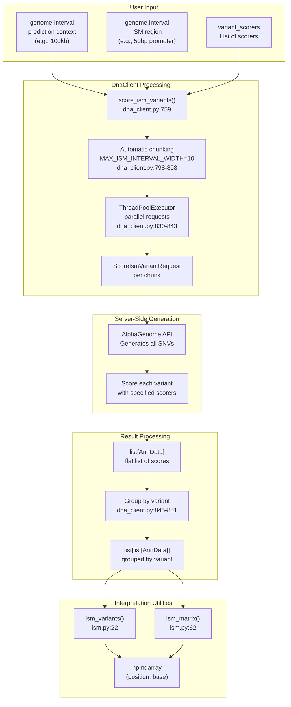
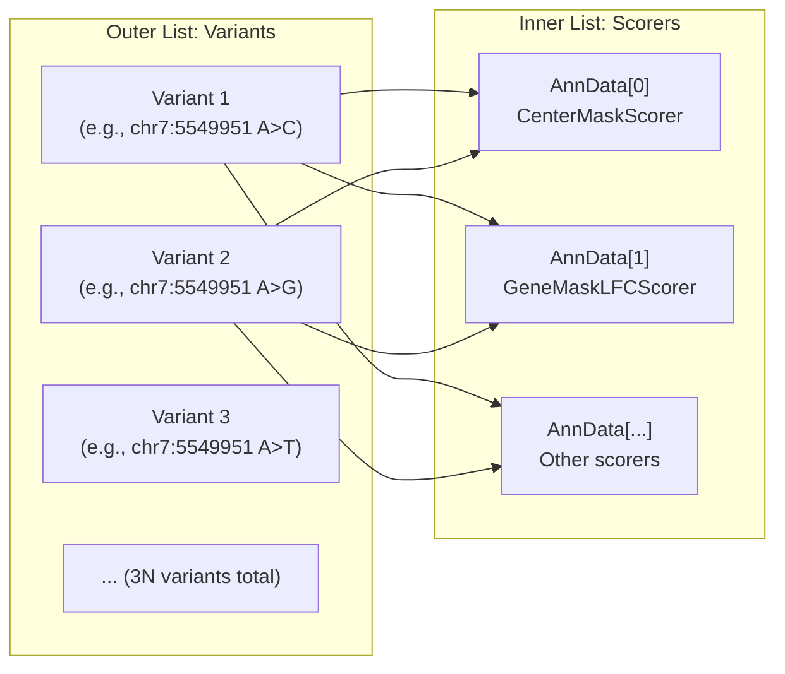
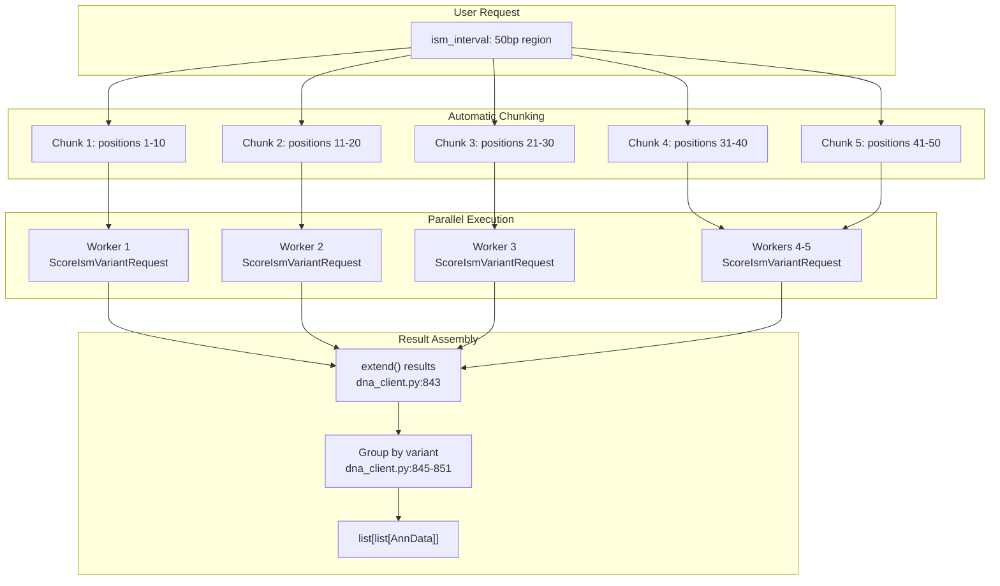

<!-- source: DeepWiki mcp.deepwiki.com · repo google-deepmind/alphagenome · page 5.3 In-Silico Mutagenesis (ISM) · fetched 2026-10-26 -->

# In-Silico Mutagenesis (ISM)

<details>
<summary>Relevant source files</summary>

The following files were used as context for generating this wiki page:

- [docs/source/api/models.md](docs/source/api/models.md)
- [src/alphagenome/interpretation/ism.py](src/alphagenome/interpretation/ism.py)
- [src/alphagenome/interpretation/ism_test.py](src/alphagenome/interpretation/ism_test.py)
- [src/alphagenome/models/dna_client.py](src/alphagenome/models/dna_client.py)

</details>


**Purpose:** This guide explains how to perform in-silico mutagenesis (ISM) analysis using the AlphaGenome SDK. ISM systematically introduces every possible single nucleotide variant at each position in a genomic region to identify functionally important bases. This page covers the `score_ism_variants` method, result interpretation, and utilities for processing ISM outputs.

**Scope:** For general variant scoring workflows, see [Scoring Variants](#5.2). For prediction basics, see [Making Predictions](#5.1). For visualization of ISM results, see [Creating Visualizations](#5.5).

---

## What is In-Silico Mutagenesis?

In-silico mutagenesis is a computational technique that systematically mutates every position in a genomic region to all possible alternative bases, then scores the functional impact of each mutation. This reveals which bases are critical for regulatory function.

For a region of length N base pairs, ISM generates 3×N variants (three alternative bases per position), scores each variant using specified variant scorers, and returns a comprehensive map of positional importance.

**Key characteristics:**
- **Systematic coverage**: Every position is mutated to A, C, G, and T (excluding the reference base)
- **Functional scoring**: Each variant is scored using the same scorers as standard variant analysis
- **High resolution**: Identifies critical bases at single-nucleotide resolution
- **Computationally intensive**: Requires scoring many variants, but optimized with parallel execution

**Sources:** [src/alphagenome/models/dna_client.py:759-852]()

---

## ISM Workflow Architecture



**Sources:** [src/alphagenome/models/dna_client.py:759-852](), [src/alphagenome/interpretation/ism.py:1-151]()

---

## Basic ISM Analysis

### Step 1: Define Intervals

ISM analysis requires two intervals:

| Interval Type | Purpose | Typical Size | Example |
|--------------|---------|--------------|---------|
| Prediction interval (`interval`) | Provides sequence context for model | 16kb - 1Mb | 100kb around TSS |
| ISM interval (`ism_interval`) | Defines region to mutate | 10-100bp | Core promoter (50bp) |

The ISM interval must be contained within the prediction interval and must be on the positive strand.

```python
# Example: ISM analysis of a promoter region
# Referenced from notebooks or typical usage

prediction_context = genome.Interval('chr7', 5500000, 5600000)  # 100kb
promoter_region = genome.Interval('chr7', 5549950, 5550050)      # 100bp
```

**Sources:** [src/alphagenome/models/dna_client.py:772-795]()

### Step 2: Call score_ism_variants

The `DnaClient.score_ism_variants` method performs the complete ISM analysis:

```python
# Method signature from dna_client.py:759-769
model.score_ism_variants(
    interval=prediction_context,
    ism_interval=promoter_region,
    variant_scorers=[],  # Empty list uses recommended scorers
    organism=Organism.HOMO_SAPIENS,
    interval_variant=None,  # Optional: apply a variant first
    progress_bar=True,
    max_workers=dna_model.DEFAULT_MAX_WORKERS
)
```

**Parameters:**
- `interval`: Genomic context for prediction (validated sequence length)
- `ism_interval`: Region to perform systematic mutagenesis (must be positive strand)
- `variant_scorers`: Scorers to apply (default: recommended for organism)
- `organism`: Target organism
- `interval_variant`: Optional variant to apply before ISM (enables epistasis analysis)
- `progress_bar`: Show tqdm progress indicator
- `max_workers`: Number of parallel threads for API calls

**Sources:** [src/alphagenome/models/dna_client.py:759-787]()

### Step 3: Understand Return Structure

The method returns `list[list[anndata.AnnData]]` - a nested structure grouped by variant:



Each inner list contains one `AnnData` object per scorer, in the same order as `variant_scorers` parameter.

**Sources:** [src/alphagenome/models/dna_client.py:845-852]()

---

## Automatic Interval Chunking

ISM requests are automatically chunked to prevent excessively large requests. The `MAX_ISM_INTERVAL_WIDTH` constant controls chunk size:

```python
# From dna_client.py:59-63
MAX_ISM_INTERVAL_WIDTH = 10
```

**Chunking behavior:**
- ISM intervals wider than 10bp are split into sequential 10bp chunks
- Each chunk generates ~30 variants (3 alternatives × 10 positions)
- Chunks are scored in parallel using `ThreadPoolExecutor`
- Results are automatically reassembled and grouped by variant



**Sources:** [src/alphagenome/models/dna_client.py:797-843]()

---

## Processing ISM Results

### Extracting Variant Scores

Each `AnnData` object contains a gene×track matrix of scores. To extract scores for analysis:

```python
# Example workflow (conceptual, based on AnnData structure)
# For position i, alternative base b, scorer s, gene g, track t:

ism_results = model.score_ism_variants(...)

# Access specific scorer results
for variant_scores in ism_results:
    scorer_0_results = variant_scores[0]  # First scorer
    
    # Extract variant information
    variant = scorer_0_results.uns['variant']
    
    # Extract score matrix
    scores = scorer_0_results.X  # Shape: (n_genes, n_tracks)
    
    # Get metadata
    gene_ids = scorer_0_results.obs['gene_id']
    track_names = scorer_0_results.var.index
```

**Sources:** [src/alphagenome/models/dna_client.py:315-367](), [src/alphagenome/models/variant_scorers.py]()

### Converting to ISM Matrix Format

The `ism_matrix` utility converts flat variant scores to a position×base matrix:

```python
# From ism.py:62-151
def ism_matrix(
    variant_scores: Sequence[float],
    variants: Sequence[genome.Variant],
    interval: genome.Interval | None = None,
    multiply_by_sequence: bool = True,
    vocabulary: str = 'ACGT',
    require_fully_filled: bool = True,
) -> np.ndarray:
```

**Key features:**
- **Automatic centering**: Returns relative effects (score - per-position mean)
- **Reference masking**: When `multiply_by_sequence=True`, only non-reference positions are non-zero
- **Validation**: Checks that all positions have 3 alternative bases

**Usage pattern:**

```python
# 1. Extract scores for a specific gene and track
scores_for_gene_track = []
variants_list = []

for variant_scores in ism_results:
    scorer_results = variant_scores[0]  # Select scorer
    variant = scorer_results.uns['variant']
    
    # Extract score for specific gene/track
    gene_idx = 0  # Example: first gene
    track_idx = 0  # Example: first track
    score = scorer_results.X[gene_idx, track_idx]
    
    scores_for_gene_track.append(score)
    variants_list.append(variant)

# 2. Convert to matrix
ism_mat = ism_matrix(
    variant_scores=scores_for_gene_track,
    variants=variants_list,
    interval=ism_interval,
    multiply_by_sequence=True
)
# Result shape: (interval.width, 4) - rows are positions, columns are A/C/G/T
```

**Sources:** [src/alphagenome/interpretation/ism.py:62-151]()

### Generating Expected Variants

The `ism_variants` utility generates the complete list of expected variants for validation:

```python
# From ism.py:22-59
def ism_variants(
    interval: genome.Interval,
    sequence: str,
    vocabulary: str = 'ACGT',
    skip_n: bool = False,
) -> list[genome.Variant]:
```

This is useful for:
- **Validation**: Ensure all expected variants were scored
- **Sequence-aware processing**: Skip 'N' positions if needed
- **Matrix construction**: Provide complete variant list to `ism_matrix`

**Sources:** [src/alphagenome/interpretation/ism.py:22-59]()

---

## Advanced Usage Patterns

### ISM on Variant Backgrounds

The `interval_variant` parameter enables epistasis analysis by applying a variant before ISM:

```python
# Example: ISM on alternate allele
# From dna_client.py:766-781

background_variant = genome.Variant('chr7', 5549980, 'C', 'T')

# This scores ISM on the T allele instead of reference C
ism_results = model.score_ism_variants(
    interval=prediction_context,
    ism_interval=promoter_region,
    interval_variant=background_variant,  # Apply this first
    organism=Organism.HOMO_SAPIENS
)
```

**Use case:** Understanding how a disease variant alters the regulatory landscape by performing ISM on both reference and alternate alleles.

**Sources:** [src/alphagenome/models/dna_client.py:766-781](), [src/alphagenome/models/dna_client.py:820-822]()

### Parallel Execution Tuning

Control parallelism with the `max_workers` parameter:

```python
# From dna_client.py:768, 830-843

# Conservative: reduce API load
ism_results = model.score_ism_variants(
    ...,
    max_workers=1  # Sequential execution
)

# Aggressive: faster completion
ism_results = model.score_ism_variants(
    ...,
    max_workers=10  # More parallel requests
)
```

**Trade-offs:**
- Higher `max_workers`: Faster completion, more simultaneous API requests
- Lower `max_workers`: Reduced API load, longer total time
- Default value from `dna_model.DEFAULT_MAX_WORKERS`

**Sources:** [src/alphagenome/models/dna_client.py:830-843]()

### Progress Monitoring

The `progress_bar` parameter controls tqdm progress display:

```python
# From dna_client.py:767, 838-842

# Show progress (default)
ism_results = model.score_ism_variants(
    ...,
    progress_bar=True
)

# Silent execution (e.g., in production)
ism_results = model.score_ism_variants(
    ...,
    progress_bar=False
)
```

Progress shows completion of chunk requests, not individual variants.

**Sources:** [src/alphagenome/models/dna_client.py:838-842]()

---

## Best Practices

### Recommended Region Sizes

| Analysis Goal | ISM Interval Size | Prediction Context | Rationale |
|--------------|------------------|-------------------|-----------|
| Transcription factor motif | 10-20bp | 16kb - 100kb | Core binding site |
| Core promoter | 50-100bp | 100kb | TSS-proximal elements |
| Enhancer fine-mapping | 100-200bp | 500kb - 1Mb | Balance resolution vs. runtime |
| Large-scale scan | Multiple 100bp intervals | 500kb - 1Mb | Split into separate calls |

**Avoid:** ISM intervals >200bp in a single call (>600 variants, long runtime)

**Sources:** [src/alphagenome/models/dna_client.py:59-63]()

### Scorer Selection

Different scorers highlight different regulatory mechanisms:

| Scorer Type | Best For | ISM Application |
|------------|---------|-----------------|
| `CenterMaskScorer` | General accessibility | Identify accessibility-critical bases |
| `GeneMaskLFCScorer` | Gene expression changes | Map expression-modulating positions |
| `GeneMaskSplicingScorer` | Splicing regulation | Identify splice-site elements |
| `SpliceJunctionScorer` | Specific junction usage | Map branch points, exonic enhancers |

**Recommendation:** Start with recommended scorers, then refine based on specific biological question.

**Sources:** [src/alphagenome/models/variant_scorers.py](), [src/alphagenome/models/dna_client.py:788-791]()

### Performance Optimization

```python
# Efficient ISM workflow

# 1. Use appropriate context size
# Larger contexts are slower but may be more accurate
interval = genome.Interval('chr7', 5500000, 5600000)  # 100kb

# 2. Limit scorers to relevant ones
from alphagenome.models import variant_scorers
scorers = [
    variant_scorers.CenterMaskScorer(),
    variant_scorers.GeneMaskLFCScorer()
]

# 3. Tune parallelism based on system
ism_results = model.score_ism_variants(
    interval=interval,
    ism_interval=ism_region,
    variant_scorers=scorers,
    max_workers=5,  # Balance API load and speed
    progress_bar=True
)

# 4. Extract only needed scores
# Don't process all genes/tracks if only interested in subset
```

**Sources:** [src/alphagenome/models/dna_client.py:759-852]()

---

## Common Patterns and Examples

### Pattern 1: Single-Track ISM Heatmap

```python
# Conceptual workflow based on data structures

# 1. Run ISM
ism_results = model.score_ism_variants(
    interval=context,
    ism_interval=region,
    variant_scorers=[variant_scorers.CenterMaskScorer()]
)

# 2. Extract scores for specific track
track_idx = 0  # Example: first track
scores = []
variants = []

for variant_group in ism_results:
    anndata_result = variant_group[0]  # First (only) scorer
    variant = anndata_result.uns['variant']
    
    # Aggregate across genes (e.g., max)
    score = np.max(anndata_result.X[:, track_idx])
    
    scores.append(score)
    variants.append(variant)

# 3. Convert to matrix
ism_mat = ism_matrix(
    variant_scores=scores,
    variants=variants,
    interval=region
)

# 4. Visualize as heatmap (shape: positions × bases)
```

**Sources:** [src/alphagenome/interpretation/ism.py:62-151]()

### Pattern 2: Multi-Scorer Comparison

```python
# Compare different scoring mechanisms

scorers = [
    variant_scorers.CenterMaskScorer(),
    variant_scorers.GeneMaskLFCScorer(),
    variant_scorers.GeneMaskSplicingScorer()
]

ism_results = model.score_ism_variants(
    interval=context,
    ism_interval=region,
    variant_scorers=scorers
)

# Extract scores per scorer
for scorer_idx, scorer in enumerate(scorers):
    scores = []
    variants = []
    
    for variant_group in ism_results:
        anndata_result = variant_group[scorer_idx]
        variant = anndata_result.uns['variant']
        
        # Process this scorer's results
        score = process_anndata(anndata_result)
        scores.append(score)
        variants.append(variant)
    
    # Generate scorer-specific matrix
    ism_mat = ism_matrix(
        variant_scores=scores,
        variants=variants,
        interval=region
    )
```

**Sources:** [src/alphagenome/models/dna_client.py:845-852]()

### Pattern 3: Epistasis Analysis

```python
# Compare ISM on reference vs. variant background

# Reference allele ISM
ref_results = model.score_ism_variants(
    interval=context,
    ism_interval=region,
    interval_variant=None  # Reference sequence
)

# Alternate allele ISM
alt_results = model.score_ism_variants(
    interval=context,
    ism_interval=region,
    interval_variant=genome.Variant('chr7', pos, 'C', 'T')
)

# Compare matrices to identify epistatic effects
ref_matrix = process_ism_to_matrix(ref_results)
alt_matrix = process_ism_to_matrix(alt_results)
epistasis = alt_matrix - ref_matrix
```

**Sources:** [src/alphagenome/models/dna_client.py:766-781]()

---

## Validation and Error Handling

### Input Validation

The `score_ism_variants` method performs validation before making API calls:

```python
# Checks performed in dna_client.py:793-796

# 1. Sequence length validation
validate_sequence_length(interval.width)

# 2. Strand validation
if ism_interval.negative_strand:
    raise ValueError('ISM interval must be on the positive strand.')
```

**Common errors:**
- ISM interval not contained in prediction interval
- ISM interval on negative strand
- Invalid sequence length for prediction interval

**Sources:** [src/alphagenome/models/dna_client.py:793-796]()

### Result Validation

The `ism_matrix` function validates score completeness:

```python
# Validation from ism.py:119-145

# Checks that all positions have exactly 3 alternative bases
# Raises ValueError if:
# - Some positions have 0 variants (missing data)
# - Some positions have <3 variants (incomplete ISM)
# - Some positions have 4 variants (invalid: includes reference)

ism_matrix(
    variant_scores=scores,
    variants=variants,
    require_fully_filled=True  # Enable validation (default)
)
```

**Disable validation** if intentionally working with incomplete ISM results:

```python
ism_matrix(
    variant_scores=scores,
    variants=variants,
    require_fully_filled=False  # Allow missing positions
)
```

**Sources:** [src/alphagenome/interpretation/ism.py:119-145]()

---

## Related Functionality

| Topic | Page | Relationship |
|-------|------|--------------|
| Standard variant scoring | [Scoring Variants](#5.2) | ISM is automated batch variant scoring |
| Choosing variant scorers | [Variant and Interval Scorers](#4.4) | Scorers apply to ISM variants |
| Visualizing results | [Creating Visualizations](#5.5) | Heatmap visualization of ISM matrices |
| Understanding AnnData | [Scoring Variants](#5.2) | Same output format as variant scoring |
| Batch processing | [DnaModel Abstract Interface](#4.2) | ISM uses parallel execution internally |

**Sources:** Documentation structure

---

