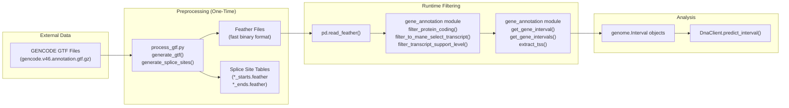
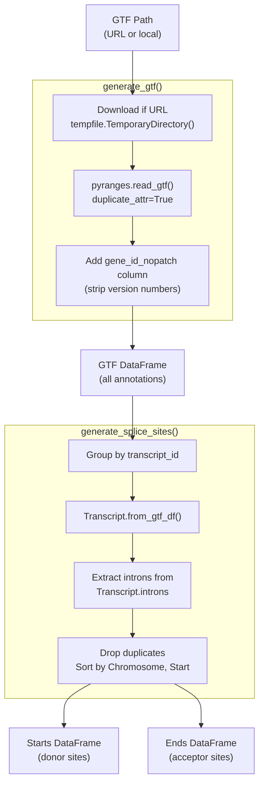
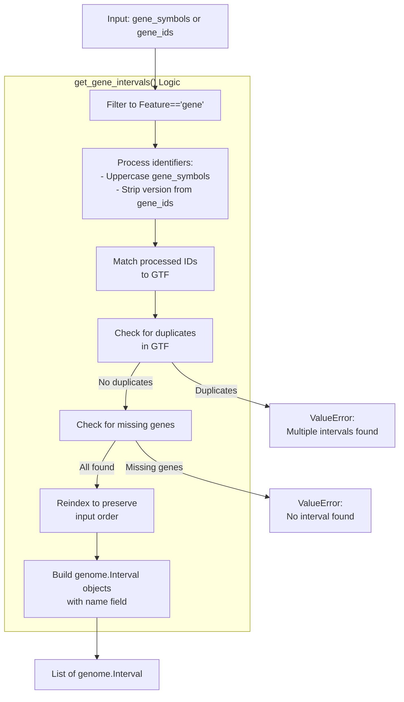
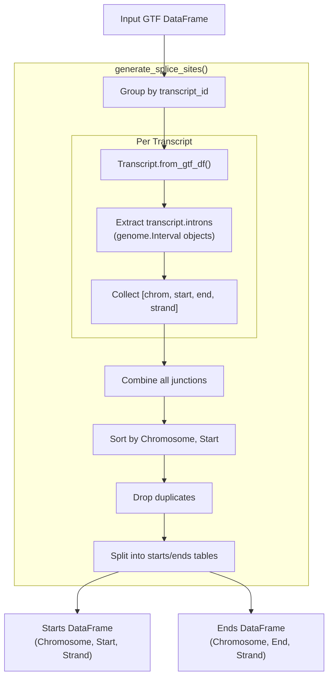

<!-- source: DeepWiki mcp.deepwiki.com · repo google-deepmind/alphagenome · page 5.4 Working with Gene Annotations · fetched 2026-10-26 -->

# Working with Gene Annotations

<details>
<summary>Relevant source files</summary>

The following files were used as context for generating this wiki page:

- [docs/source/api/data.md](docs/source/api/data.md)
- [pyproject.toml](pyproject.toml)
- [scripts/__init__.py](scripts/__init__.py)
- [scripts/process_gtf.py](scripts/process_gtf.py)
- [scripts/process_gtf_test.py](scripts/process_gtf_test.py)
- [src/alphagenome/data/gene_annotation.py](src/alphagenome/data/gene_annotation.py)
- [src/alphagenome/data/gene_annotation_test.py](src/alphagenome/data/gene_annotation_test.py)

</details>


This guide explains how to process, filter, and query gene annotation data in the AlphaGenome SDK. Gene annotations are essential for contextualizing genomic predictions, identifying gene boundaries, filtering transcripts by quality metrics, and extracting specific genomic intervals for analysis.

For information about visualizing gene structures alongside predictions, see [Creating Visualizations](#5.5). For complete API reference documentation of all gene annotation functions, see [Data Structures](#4.3). For details on the underlying data processing pipeline, see [Data Processing Pipeline](#7.2).

## Overview

The AlphaGenome SDK provides a two-stage system for working with gene annotations:

1. **Preprocessing**: Convert GENCODE GTF files to efficient Feather format using `process_gtf.py`
2. **Runtime Filtering**: Query and filter annotations using functions in the `data.gene_annotation` module

This separation allows one-time preprocessing of large GTF files, followed by fast runtime queries without repeatedly parsing the original GTF format.



**Sources:** [scripts/process_gtf.py](), [src/alphagenome/data/gene_annotation.py]()

## Processing GTF Files

The `process_gtf.py` script converts GENCODE GTF files into Feather format, which loads significantly faster than parsing GTF text.

### Running the Processing Script

The script requires the `scripts` optional dependencies:

```bash
pip install -e ".[scripts]"
```

Basic usage to process a GTF file:

```bash
python -m scripts.process_gtf \
  --gtf_path=gencode.v46.annotation.gtf.gz \
  --output_path=gencode_v46.feather
```

To also extract splice sites for tissue-agnostic junction analysis:

```bash
python -m scripts.process_gtf \
  --gtf_path=gencode.v46.annotation.gtf.gz \
  --output_path=gencode_v46.feather \
  --splice_sites_output_path=gencode_v46_splice_sites.feather
```

This generates three files:
- `gencode_v46.feather` - Complete gene annotation
- `gencode_v46_splice_sites_starts.feather` - Splice donor sites
- `gencode_v46_splice_sites_ends.feather` - Splice acceptor sites

### Script Implementation Details



**Key Features:**
- **Duplicate Attribute Handling**: Uses `duplicate_attr=True` in [scripts/process_gtf.py:76]() to handle multiple identical attributes in GENCODE GTF files
- **Patchless IDs**: Adds `gene_id_nopatch` column at [scripts/process_gtf.py:80]() for version-agnostic matching
- **URL Support**: Automatically downloads from URLs using `urllib.request` at [scripts/process_gtf.py:69-76]()

**Sources:** [scripts/process_gtf.py:15-113](), [scripts/process_gtf_test.py]()

## Loading Gene Annotations

After processing, load the Feather file as a pandas DataFrame:

```python
import pandas as pd

gtf = pd.read_feather('gencode_v46.feather')
```

The DataFrame contains standard GTF columns in pyranges format:

| Column | Description |
|--------|-------------|
| `Chromosome` | Chromosome name (e.g., 'chr1') |
| `Start` | 0-based start position |
| `End` | 1-based end position (exclusive) |
| `Strand` | '+' or '-' |
| `Feature` | Type: 'gene', 'transcript', 'exon', 'CDS', etc. |
| `gene_id` | Ensembl gene ID with version (e.g., 'ENSG00000141510.17') |
| `gene_name` | Gene symbol (e.g., 'TP53') |
| `transcript_id` | Ensembl transcript ID with version |
| `transcript_type` | Biotype (e.g., 'protein_coding') |
| `transcript_support_level` | Support level '1'-'5' |
| `tag` | Comma-separated tags (e.g., 'MANE_Select') |
| `gene_id_nopatch` | Gene ID without version number |

**Sources:** [scripts/process_gtf.py:66-81](), [src/alphagenome/data/gene_annotation.py]()

## Filtering Transcripts

The `gene_annotation` module provides several filtering functions to select high-quality transcripts. These functions return filtered DataFrames that can be chained together.

### Filter by Transcript Type

The `filter_transcript_type()` function filters by GENCODE biotype using the `TranscriptType` enum:

```python
from alphagenome.data import gene_annotation

# Filter to protein-coding transcripts
protein_coding_gtf = gene_annotation.filter_transcript_type(
    gtf, 
    (gene_annotation.TranscriptType.PROTEIN_CODING,)
)

# Filter to multiple types
gtf_filtered = gene_annotation.filter_transcript_type(
    gtf,
    (
        gene_annotation.TranscriptType.PROTEIN_CODING,
        gene_annotation.TranscriptType.LNCRNA,
    )
)
```

**Available Transcript Types:**

| Type | Description |
|------|-------------|
| `PROTEIN_CODING` | Standard protein-coding genes |
| `LNCRNA` | Long non-coding RNAs |
| `MIRNA` | microRNAs |
| `RRNA`, `TRNA` | Ribosomal and transfer RNAs |
| `NONSENSE_MEDIATED_DECAY` | NMD transcripts |
| `PROCESSED_PSEUDOGENE` | Pseudogenes |
| `IG_*_GENE`, `TR_*_GENE` | Immunoglobulin and T-cell receptor genes |

For convenience, use `filter_protein_coding()` for the most common use case:

```python
protein_coding_gtf = gene_annotation.filter_protein_coding(gtf)
```

**Sources:** [src/alphagenome/data/gene_annotation.py:25-151]()

### Filter by Transcript Support Level

The `filter_transcript_support_level()` function filters by GENCODE TSL, which indicates evidence quality:

| TSL | Description |
|-----|-------------|
| 1 | All splice junctions supported by non-suspect mRNA |
| 2 | Best supporting mRNA flagged as suspect, or multiple EST support |
| 3 | Only single EST support |
| 4 | Best supporting EST flagged as suspect |
| 5 | No single transcript supports the model |

```python
# Filter to highest quality (TSL 1-2)
high_quality_gtf = gene_annotation.filter_transcript_support_level(
    gtf,
    transcript_support_levels=['1', '2']
)

# Single level (string or list)
tsl1_gtf = gene_annotation.filter_transcript_support_level(gtf, '1')
```

**Sources:** [src/alphagenome/data/gene_annotation.py:200-259]()

### Filter to Representative Transcripts

When a gene has multiple transcripts, select a single representative:

```python
# Filter to longest transcript per gene
longest_gtf = gene_annotation.filter_to_longest_transcript(gtf)

# Filter to MANE Select transcripts (human only)
mane_gtf = gene_annotation.filter_to_mane_select_transcript(gtf)
```

**MANE Select transcripts** are manually curated, well-supported transcripts that represent the most biologically relevant isoform. This tag only exists in human GTF files from GENCODE v39 onwards.

The `filter_to_longest_transcript()` function at [src/alphagenome/data/gene_annotation.py:154-175]() identifies the longest transcript per gene based on transcript feature length.

**Sources:** [src/alphagenome/data/gene_annotation.py:154-197]()

### Chaining Filters

Filters return DataFrames and can be chained:

```python
# High-quality protein-coding MANE Select transcripts
filtered_gtf = (
    gtf
    .pipe(gene_annotation.filter_protein_coding)
    .pipe(gene_annotation.filter_transcript_support_level, ['1', '2'])
    .pipe(gene_annotation.filter_to_mane_select_transcript)
)
```

**Sources:** [src/alphagenome/data/gene_annotation.py]()

## Extracting Gene Intervals

Once transcripts are filtered, extract `genome.Interval` objects for use with prediction methods.

### Extract Single Gene Interval

```python
from alphagenome.data import gene_annotation

# By gene symbol (case-insensitive)
tp53_interval = gene_annotation.get_gene_interval(
    gtf, 
    gene_symbol='TP53'
)

# By Ensembl gene ID (with or without version)
tp53_interval = gene_annotation.get_gene_interval(
    gtf,
    gene_id='ENSG00000141510'
)
```

The returned `genome.Interval` contains the gene boundaries with strand information and the gene name in the `name` field.

**Sources:** [src/alphagenome/data/gene_annotation.py:414-444]()

### Extract Multiple Gene Intervals

```python
# Multiple genes by symbol
intervals = gene_annotation.get_gene_intervals(
    gtf,
    gene_symbols=['TP53', 'EGFR', 'BRCA1']
)

# Multiple genes by ID
intervals = gene_annotation.get_gene_intervals(
    gtf,
    gene_ids=['ENSG00000141510', 'ENSG00000146648']
)
```

The function returns a list of intervals in the same order as the input gene identifiers. This preserves order for batch processing workflows.

**Function Behavior:**



**Error Handling:**
- Raises `ValueError` if a gene has multiple entries in the GTF (ambiguous)
- Raises `ValueError` if a gene is not found
- Handles case-insensitive gene symbol matching
- Handles patched and unpatched Ensembl IDs

**Sources:** [src/alphagenome/data/gene_annotation.py:331-411](), [src/alphagenome/data/gene_annotation_test.py:152-239]()

## Extracting Transcription Start Sites

The `extract_tss()` function extracts transcription start sites (TSS) as zero-width intervals:

```python
# Extract TSS from transcript features
tss_df = gene_annotation.extract_tss(gtf, feature='transcript')

# Extract TSS from gene features
tss_df = gene_annotation.extract_tss(gtf, feature='gene')
```

The function correctly handles strand orientation:
- **Positive strand**: TSS = transcript start
- **Negative strand**: TSS = transcript end

The returned DataFrame has `Start` and `End` columns set to the same position, creating zero-width intervals suitable for TSS-centered analysis.

**Implementation Logic:**
```python
# From src/alphagenome/data/gene_annotation.py:90-92
new_start = np.where(tss.Strand == '-', tss.End, tss.Start)
tss.Start = new_start
tss.End = new_start
```

**Sources:** [src/alphagenome/data/gene_annotation.py:75-94]()

## Working with Splice Sites

The splice site tables generated by `process_gtf.py` contain tissue-agnostic junction boundaries.

### Loading Splice Sites

```python
splice_starts = pd.read_feather('gencode_v46_splice_sites_starts.feather')
splice_ends = pd.read_feather('gencode_v46_splice_sites_ends.feather')
```

Each DataFrame contains:

| Column | Description |
|--------|-------------|
| `Chromosome` | Chromosome name |
| `Start` (starts table) | Donor splice site position (0-based) |
| `End` (ends table) | Acceptor splice site position (1-based exclusive) |
| `Strand` | '+' or '-' |

### Splice Site Extraction Process



The process extracts intron boundaries from all transcripts and deduplicates them, creating a comprehensive catalog of splice sites across all tissues and conditions in the GTF.

**Sources:** [scripts/process_gtf.py:43-63](), [scripts/process_gtf_test.py:57-70]()

## Common Workflows

### Workflow 1: Get Intervals for High-Quality Protein-Coding Genes

```python
import pandas as pd
from alphagenome.data import gene_annotation

# Load GTF
gtf = pd.read_feather('gencode_v46.feather')

# Filter to high-quality protein-coding genes
filtered_gtf = (
    gtf
    .pipe(gene_annotation.filter_protein_coding)
    .pipe(gene_annotation.filter_transcript_support_level, ['1', '2'])
    .pipe(gene_annotation.filter_to_longest_transcript)
)

# Extract intervals for specific genes
gene_list = ['TP53', 'BRCA1', 'EGFR', 'MYC']
intervals = gene_annotation.get_gene_intervals(
    filtered_gtf,
    gene_symbols=gene_list
)

# Use intervals for prediction
from alphagenome import dna_client

model = dna_client.create(api_key='...')
for interval in intervals:
    output = model.predict_interval(interval)
    # Process output...
```

### Workflow 2: Extract Protein-Coding MANE Select Genes

```python
# Human-specific workflow using MANE Select
gtf = pd.read_feather('gencode_v46_human.feather')

mane_gtf = (
    gtf
    .pipe(gene_annotation.filter_protein_coding)
    .pipe(gene_annotation.filter_to_mane_select_transcript)
)

# Get all MANE Select gene intervals
gene_intervals = gene_annotation.get_gene_intervals(
    mane_gtf,
    gene_symbols=mane_gtf[mane_gtf['Feature'] == 'gene']['gene_name'].unique()
)
```

### Workflow 3: TSS-Centered Analysis

```python
# Extract TSS for all protein-coding genes
protein_gtf = gene_annotation.filter_protein_coding(gtf)
tss_df = gene_annotation.extract_tss(protein_gtf, feature='transcript')

# Create intervals centered on TSS
from alphagenome.data import genome

tss_intervals = []
for _, row in tss_df.iterrows():
    # 5kb window centered on TSS
    tss_intervals.append(
        genome.Interval(
            chromosome=row['Chromosome'],
            start=row['Start'] - 2500,
            end=row['Start'] + 2500,
            strand=row['Strand'],
            name=row['gene_name']
        )
    )
```

### Workflow 4: Upgrading Gene IDs Across GTF Versions

When working with older gene IDs, upgrade them to newer versions:

```python
# Load old and new GTF files
old_gtf = pd.read_feather('gencode_v40.feather')
new_gtf = pd.read_feather('gencode_v46.feather')

# Extract gene IDs
old_ids = old_gtf[old_gtf['Feature'] == 'gene']['gene_id']
new_ids = new_gtf[new_gtf['Feature'] == 'gene']['gene_id']

# Create mapping
id_mapping = gene_annotation.upgrade_annotation_ids(old_ids, new_ids)

# Apply mapping
upgraded_ids = id_mapping.loc[old_ids].values
```

The `upgrade_annotation_ids()` function at [src/alphagenome/data/gene_annotation.py:262-328]() strips version numbers, matches on the base ID, and returns the new versioned ID. It handles special cases like `_PAR_Y` suffixes.

**Sources:** [src/alphagenome/data/gene_annotation.py](), [src/alphagenome/data/gene_annotation_test.py]()

## Summary

The gene annotation system provides a complete workflow from raw GTF files to `genome.Interval` objects ready for prediction:

| Step | Tool | Purpose |
|------|------|---------|
| 1. Process GTF | `scripts.process_gtf` | Convert to efficient Feather format |
| 2. Load annotations | `pd.read_feather()` | Load into DataFrame |
| 3. Filter transcripts | `gene_annotation.filter_*` | Select high-quality subsets |
| 4. Extract intervals | `gene_annotation.get_gene_interval[s]` | Convert to `genome.Interval` |
| 5. Make predictions | `DnaClient.predict_interval()` | Generate model outputs |

For visualization of gene structures, see [Creating Visualizations](#5.5). For complete function signatures and parameters, see [Data Structures](#4.3).

**Sources:** [scripts/process_gtf.py](), [src/alphagenome/data/gene_annotation.py](), [docs/source/api/data.md]()

---

