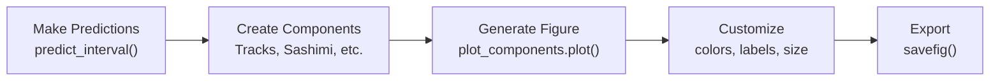
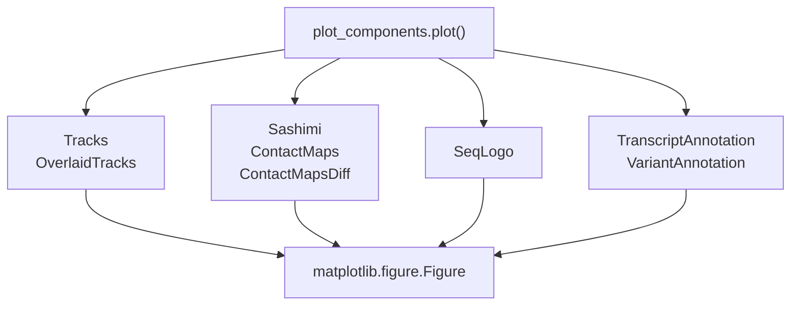

<!-- source: DeepWiki mcp.deepwiki.com · repo google-deepmind/alphagenome · page 5.5 Creating Visualizations · fetched 2026-10-26 -->

# Creating Visualizations

<details>
<summary>Relevant source files</summary>

The following files were used as context for generating this wiki page:

- [colabs/visualization_modality_tour.ipynb](colabs/visualization_modality_tour.ipynb)
- [docs/source/variant_scoring.md](docs/source/variant_scoring.md)
- [docs/source/visualization_library_basics.md](docs/source/visualization_library_basics.md)

</details>


This guide provides step-by-step instructions for creating and customizing visualizations of AlphaGenome predictions. The visualization system is built around modular plot components that can be composed to create publication-quality figures.

## Overview

The AlphaGenome SDK includes `alphagenome.visualization.plot_components` module for creating matplotlib-based visualizations. The basic workflow involves:

1. Make predictions using `DnaClient`
2. Create plot component objects from prediction outputs
3. Pass components to `plot_components.plot()` to generate a figure
4. Optionally customize and export the figure

### Basic Visualization Workflow



Sources: [colabs/visualization_modality_tour.ipynb:1-50](), [docs/source/visualization_library_basics.md:1-60]()

## Available Plot Components

The `plot_components` module provides specialized components for different data types and visualization needs:

| Component | Data Input | Use Case | Example |
|-----------|-----------|----------|---------|
| `Tracks` | `TrackData` | Display continuous genomic signals (RNA-seq, ATAC-seq, etc.) | Single condition predictions |
| `OverlaidTracks` | Two `TrackData` objects | Compare reference vs. alternate allele predictions | Variant impact visualization |
| `Sashimi` | `JunctionData` | Visualize splice junction predictions | Splicing analysis |
| `SeqLogo` | 1D array + sequence | Display sequence motifs with importance scores | ISM contribution scores |
| `ContactMaps` | `JunctionData` (2D) | Heatmap of chromatin contact predictions | 3D genome structure |
| `ContactMapsDiff` | Two `JunctionData` (2D) | Difference between REF and ALT contact maps | Variant structural impact |
| `TranscriptAnnotation` | `Transcript` objects | Show gene structure (exons, introns, TSS) | Gene context overlay |
| `VariantAnnotation` | `Interval` or `Variant` | Mark variant position on plots | Highlight region of interest |

### Component Architecture



Sources: [docs/source/visualization_library_basics.md:69-151](), [colabs/visualization_modality_tour.ipynb:50-100]()

## Step 1: Make Predictions

First, obtain predictions from the model using `DnaClient`:

```python
from alphagenome import dna_client
from alphagenome.data import genome

# Initialize client
dna_model = dna_client.create(api_key)

# Define genomic interval
interval = genome.Interval('chr22', 36_150_498, 36_252_898).resize(
    dna_client.SEQUENCE_LENGTH_1MB
)

# Define biological contexts (tissues/cell types)
ontology_terms = [
    'UBERON:0001159',  # Colon - Sigmoid
    'UBERON:0001155',  # Colon - Transverse
]

# Make predictions for RNA-seq and CAGE
output = dna_model.predict_interval(
    interval=interval,
    requested_outputs={
        dna_client.OutputType.RNA_SEQ,
        dna_client.OutputType.CAGE,
    },
    ontology_terms=ontology_terms,
)
```

Sources: [colabs/visualization_modality_tour.ipynb:159-190]()

## Step 2: Load Gene Annotations (Optional)

For displaying gene structure, load transcript annotations from GTF files:

```python
from alphagenome.data import gene_annotation, transcript
import pandas as pd

# Load GTF annotations
gtf = pd.read_feather(
    'https://storage.googleapis.com/alphagenome/reference/gencode/'
    'hg38/gencode.v46.annotation.gtf.gz.feather'
)

# Filter to protein-coding genes with high transcript support
gtf_transcript = gene_annotation.filter_transcript_support_level(
    gene_annotation.filter_protein_coding(gtf), ['1']
)

# Create transcript extractor for the interval
transcript_extractor = transcript.TranscriptExtractor(gtf_transcript)
transcripts = transcript_extractor.extract(interval)
```

Sources: [colabs/visualization_modality_tour.ipynb:114-136]()

## Step 3: Create Plot Components

Create component objects from the prediction data:

```python
from alphagenome.visualization import plot_components

# Create components list
components = [
    # Display transcript structure at top
    plot_components.TranscriptAnnotation(
        transcripts=transcripts,
        label='Genes',
    ),
    
    # Display RNA-seq predictions
    plot_components.Tracks(
        track_data=output.rna_seq,
        label='RNA-seq predictions',
        color='blue',
    ),
    
    # Display CAGE predictions
    plot_components.Tracks(
        track_data=output.cage,
        label='CAGE predictions',
        color='green',
    ),
]
```

Sources: [colabs/visualization_modality_tour.ipynb:205-225]()

## Step 4: Generate the Figure

Pass the components list to `plot_components.plot()`:

```python
# Generate figure
fig = plot_components.plot(
    components=components,
    title='Gene Expression Predictions - Colon Tissue',
    figsize=(12, 8),
)

# Display in notebook
plt.show()

# Or save to file
fig.savefig('predictions.png', dpi=300, bbox_inches='tight')
```

The `plot()` function returns a `matplotlib.figure.Figure` object with vertically stacked subplots, one for each component. All subplots share a common x-axis representing genomic coordinates.

Sources: [colabs/visualization_modality_tour.ipynb:205-225](), [docs/source/visualization_library_basics.md:19-31]()

## Visualizing Variant Effects

To compare reference and alternate allele predictions, use `OverlaidTracks`:

```python
# Make variant predictions
variant = genome.Variant('chr22', 36_200_000, 'A', 'G')
variant_output = dna_model.predict_variant(
    interval=interval,
    variant=variant,
    requested_outputs={dna_client.OutputType.ATAC},
    ontology_terms=ontology_terms,
)

# Create overlaid tracks showing REF vs ALT
components = [
    plot_components.OverlaidTracks(
        track_data_ref=variant_output.reference.atac,
        track_data_alt=variant_output.alternate.atac,
        label='ATAC-seq: REF vs ALT',
        color_ref='blue',
        color_alt='red',
    ),
    
    # Add variant position marker
    plot_components.VariantAnnotation(
        variant=variant,
        label=f'{variant.reference_bases}→{variant.alternate_bases}',
    ),
]

fig = plot_components.plot(components, title='Variant Impact on Accessibility')
```

The `OverlaidTracks` component overlays two tracks on the same axis with different colors, making it easy to visualize differences between reference and alternate predictions.

Sources: [docs/source/visualization_library_basics.md:87-94]()

## Visualizing Splice Junctions

For splicing predictions, use the `Sashimi` component to display junction arcs:

```python
# Make predictions including splice junctions
output = dna_model.predict_interval(
    interval=interval,
    requested_outputs={
        dna_client.OutputType.RNA_SEQ,
        dna_client.OutputType.SPLICE_JUNCTIONS,
    },
    ontology_terms=ontology_terms,
)

# Create Sashimi plot
components = [
    plot_components.Sashimi(
        junction_data=output.splice_junctions,
        label='Splice Junctions',
        min_junction_count=5,  # Filter low-count junctions
    ),
    
    # Show RNA-seq coverage below
    plot_components.Tracks(
        track_data=output.rna_seq,
        label='RNA-seq Coverage',
    ),
]

fig = plot_components.plot(components, title='Splicing Predictions')
```

Arc thickness in Sashimi plots corresponds to predicted junction strength, making it easy to identify dominant isoforms.

Sources: [docs/source/visualization_library_basics.md:95-102]()

## Visualizing Contact Maps

For 3D genome structure predictions, use `ContactMaps` or `ContactMapsDiff`:

```python
# Make contact map predictions
output = dna_model.predict_interval(
    interval=interval,
    requested_outputs={dna_client.OutputType.CONTACT_MAPS},
    ontology_terms=ontology_terms,
)

# Display contact heatmap
components = [
    plot_components.ContactMaps(
        junction_data=output.contact_maps,
        label='Predicted Hi-C Contacts',
        colormap='Reds',
        log_scale=True,
    ),
]

fig = plot_components.plot(components, title='3D Genome Structure')
```

For variant effects on contacts, use `ContactMapsDiff` to show the difference:

```python
# Predict variant impact on contacts
variant_output = dna_model.predict_variant(
    interval=interval,
    variant=variant,
    requested_outputs={dna_client.OutputType.CONTACT_MAPS},
    ontology_terms=ontology_terms,
)

# Show difference map
components = [
    plot_components.ContactMapsDiff(
        junction_data_ref=variant_output.reference.contact_maps,
        junction_data_alt=variant_output.alternate.contact_maps,
        label='Contact Change (ALT - REF)',
        colormap='RdBu_r',  # Diverging colormap
    ),
]
```

Sources: [docs/source/visualization_library_basics.md:110-125]()

## Customization Options

### Colors and Styling

Each component accepts color and style parameters:

```python
components = [
    plot_components.Tracks(
        track_data=output.rna_seq,
        label='RNA-seq',
        color='#1f77b4',  # Hex color
        alpha=0.8,         # Transparency
        linewidth=1.5,     # Line thickness
    ),
]
```

Common color parameters:
- `color`: Line or fill color (matplotlib color name or hex)
- `alpha`: Transparency (0.0 to 1.0)
- `colormap`: For heatmaps (e.g., 'viridis', 'Reds', 'RdBu_r')

### Figure Size and Layout

Control overall figure appearance with `plot()` parameters:

```python
fig = plot_components.plot(
    components=components,
    title='Custom Figure Title',
    figsize=(14, 6),      # Width x Height in inches
    dpi=150,              # Resolution for raster formats
    height_ratios=[1, 2, 2],  # Relative heights for subplots
)
```

### Track Metadata Filtering

For predictions with many tracks (e.g., many tissue types), filter tracks to display:

```python
# Get metadata to see available tracks
metadata = output.rna_seq.metadata

# Filter to specific tracks
selected_indices = [0, 5, 10]  # Select specific track indices
filtered_data = output.rna_seq.select_tracks(selected_indices)

# Or filter by metadata properties
liver_tracks = output.rna_seq.filter_by_metadata(
    metadata_column='ontology_id',
    values=['UBERON:0002107']  # Liver
)
```

Sources: [colabs/visualization_modality_tour.ipynb:200-250]()

## Exporting Figures

Save figures using standard matplotlib methods:

```python
# Save as PNG (raster)
fig.savefig('figure.png', dpi=300, bbox_inches='tight')

# Save as PDF (vector)
fig.savefig('figure.pdf', bbox_inches='tight')

# Save as SVG (vector, web-friendly)
fig.savefig('figure.svg', bbox_inches='tight')
```

| Format | Use Case | Advantages |
|--------|----------|------------|
| PNG | Web display, presentations | Small file size, widely supported |
| PDF | Publications, print | Vector graphics, high quality |
| SVG | Web, editing | Vector graphics, editable in Inkscape/Illustrator |

The `bbox_inches='tight'` parameter removes extra whitespace around the figure.

Sources: [colabs/visualization_modality_tour.ipynb:1-50]()

## Customization and Theming

### Style Configuration

The visualization system provides comprehensive theming support:

```python
# Custom theme configuration
from alphagenome.visualization import themes

custom_theme = themes.create_theme(
    color_palette='genomics_standard',
    font_family='Arial',
    figure_size=(12, 8),
    track_height=2.0,
    annotation_style='minimal'
)

# Apply theme to plots
plot_components.set_default_theme(custom_theme)
```

### Color Mapping Strategies

Different biological data types benefit from specialized color mapping:

| Data Type | Color Strategy | Implementation | Use Case |
|-----------|----------------|----------------|----------|
| Methylation | Blue-White-Red diverging | `methylation_colormap()` | CpG methylation levels |
| Accessibility | Sequential green | `accessibility_colormap()` | ATAC-seq signals |
| Conservation | Sequential purple | `conservation_colormap()` | PhyloP scores |
| Variant Impact | Categorical | `variant_impact_colors()` | Effect classification |

Sources: [alphagenome/visualization/themes.py:50-150](), [alphagenome/visualization/colormaps.py:1-100](), [colabs/visualization_modality_tour.ipynb:1-500]()

---

