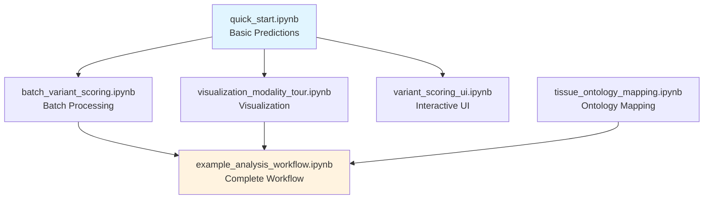
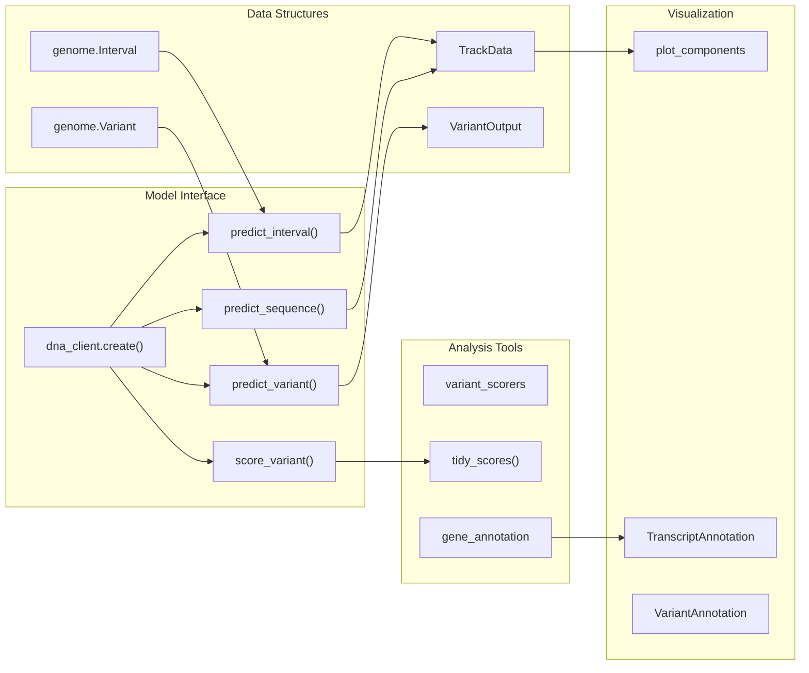
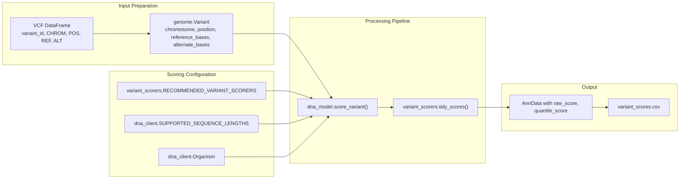
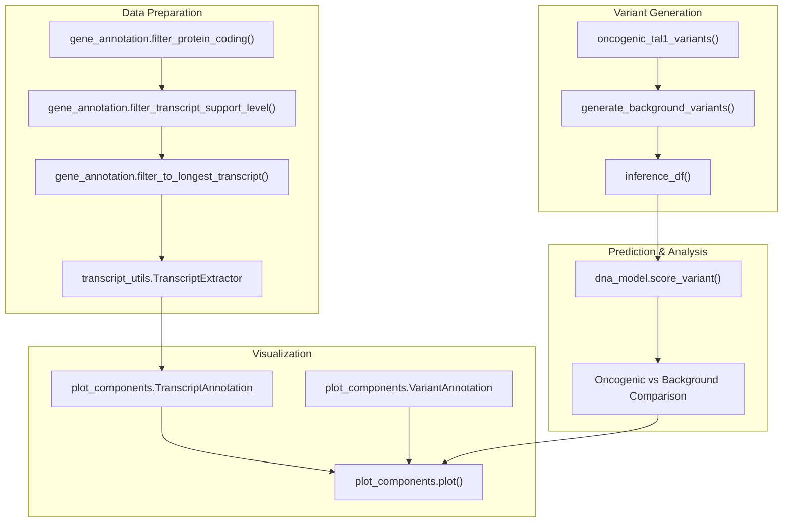
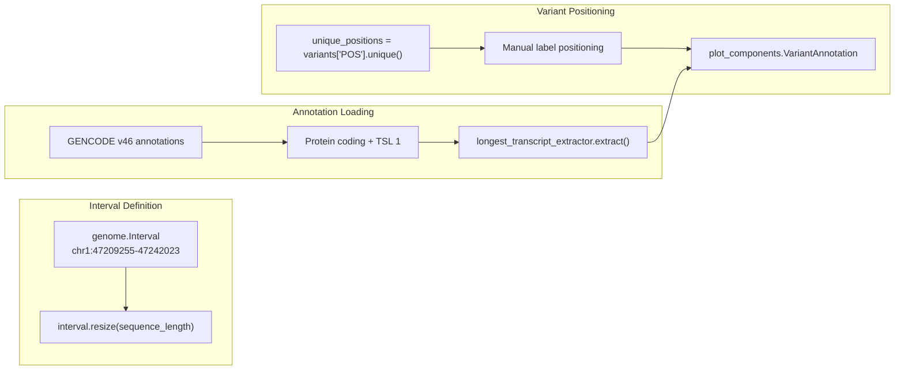
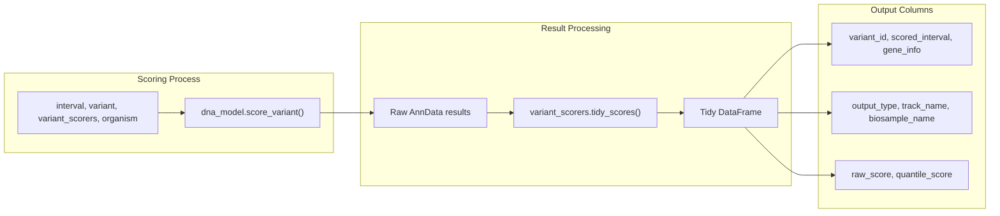

<!-- source: DeepWiki mcp.deepwiki.com · repo google-deepmind/alphagenome · page 6 Examples and Tutorials · fetched 2026-10-26 -->

# Examples and Tutorials

<details>
<summary>Relevant source files</summary>

The following files were used as context for generating this wiki page:

- [colabs/quick_start.ipynb](colabs/quick_start.ipynb)
- [docs/source/tutorials/index.md](docs/source/tutorials/index.md)

</details>


This section provides practical tutorials demonstrating key workflows with the AlphaGenome SDK. Each tutorial is a self-contained Jupyter notebook that can be run in Google Colab or locally.

The tutorials cover:
- Basic prediction workflows (quick_start.ipynb)
- Batch processing of variants (batch_variant_scoring.ipynb)
- Interactive variant analysis (variant_scoring_ui.ipynb)
- Visualization techniques (visualization_modality_tour.ipynb)
- Complete research workflows (example_analysis_workflow.ipynb)
- Biological context mapping (tissue_ontology_mapping.ipynb)

## Tutorial Structure and Dependencies

The tutorials build on each other, starting with basic concepts and progressing to advanced workflows.

**Tutorial Dependency Graph**



**Sources:** [colabs/quick_start.ipynb:1-100](), [docs/source/tutorials/index.md:1-56]()

## Core Concepts Across Tutorials

All tutorials use these fundamental SDK components:

**Key SDK Components**



**Sources:** [colabs/quick_start.ipynb:90-152]()

## Batch Variant Scoring Tutorial

The batch variant scoring tutorial demonstrates efficient processing of multiple genomic variants using the AlphaGenome API. This workflow is essential for large-scale genomic analyses.

### Core Workflow Components



**Sources:** [colabs/batch_variant_scoring.ipynb:666-790]()

### Variant Scorer Types

The tutorial demonstrates multiple scorer types available through `variant_scorers.RECOMMENDED_VARIANT_SCORERS`:

| Scorer Type | Output Type | Description |
|-------------|-------------|-------------|
| `GeneMaskLFCScorer` | `RNA_SEQ` | Gene expression predictions |
| `CenterMaskScorer` | `ATAC` | Chromatin accessibility |
| `CenterMaskScorer` | `DNASE` | DNase hypersensitivity |
| `CenterMaskScorer` | `CHIP_HISTONE` | Histone modifications |
| `CenterMaskScorer` | `CHIP_TF` | Transcription factor binding |

**Sources:** [colabs/batch_variant_scoring.ipynb:718-738]()

### Data Processing Pattern

```python
# Core pattern from the tutorial
for i, vcf_row in tqdm(vcf.iterrows(), total=len(vcf)):
    variant = genome.Variant(
        chromosome=str(vcf_row.CHROM),
        position=int(vcf_row.POS),
        reference_bases=vcf_row.REF,
        alternate_bases=vcf_row.ALT,
        name=vcf_row.variant_id,
    )
    interval = variant.reference_interval.resize(sequence_length)
    
    variant_scores = dna_model.score_variant(
        interval=interval,
        variant=variant,
        variant_scorers=selected_scorers,
        organism=organism,
    )
```

**Sources:** [colabs/batch_variant_scoring.ipynb:765-781]()

## Research Workflow Example: TAL1 Locus Analysis

The example analysis workflow demonstrates a complete research pipeline for studying oncogenic variants near the TAL1 gene associated with T-cell acute lymphoblastic leukemia.

### Analysis Pipeline Architecture



**Sources:** [colabs/example_analysis_workflow.ipynb:165-183](), [colabs/example_analysis_workflow.ipynb:213-354]()

### Key Analysis Functions

The workflow defines several utility functions for variant analysis:

| Function | Purpose | Key Parameters |
|----------|---------|----------------|
| `oncogenic_tal1_variants()` | Load known disease variants | Returns DataFrame with variant data |
| `generate_background_variants()` | Create control variants | `variant`, `max_number=100` |
| `vcf_row_to_variant()` | Convert DataFrame row to Variant | `vcf_row: pd.Series` |
| `inference_df()` | Prepare variants for prediction | `qtl_df`, `input_sequence_length` |

**Sources:** [colabs/example_analysis_workflow.ipynb:275-354]()

### Genomic Interval Processing



**Sources:** [colabs/example_analysis_workflow.ipynb:165-183](), [colabs/example_analysis_workflow.ipynb:787-833]()

## Common Data Structures and Patterns

### Variant Creation Pattern

All tutorials follow a consistent pattern for creating `genome.Variant` objects:

```python
variant = genome.Variant(
    chromosome=str(chrom),        # Must be string format
    position=int(pos),            # 1-based coordinates
    reference_bases=ref,          # Reference allele
    alternate_bases=alt,          # Alternate allele
    name=variant_id,             # Optional identifier
)
```

**Sources:** [colabs/batch_variant_scoring.ipynb:766-772](), [colabs/example_analysis_workflow.ipynb:284-291]()

### Scoring and Output Processing



**Sources:** [colabs/batch_variant_scoring.ipynb:775-783]()

### Visualization Integration

The tutorials demonstrate integration with the visualization system through `plot_components`:

| Component | Purpose | Key Parameters |
|-----------|---------|----------------|
| `TranscriptAnnotation` | Gene structure display | `transcript_extractor.extract(interval)` |
| `VariantAnnotation` | Variant position markers | `variants`, `labels`, `use_default_labels` |
| `plot_components.plot()` | Main plotting function | `tracks`, `annotations`, `interval`, `title` |

**Sources:** [colabs/example_analysis_workflow.ipynb:810-833]()

---

