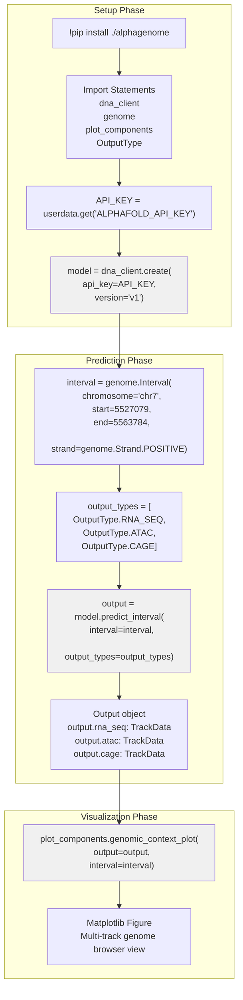
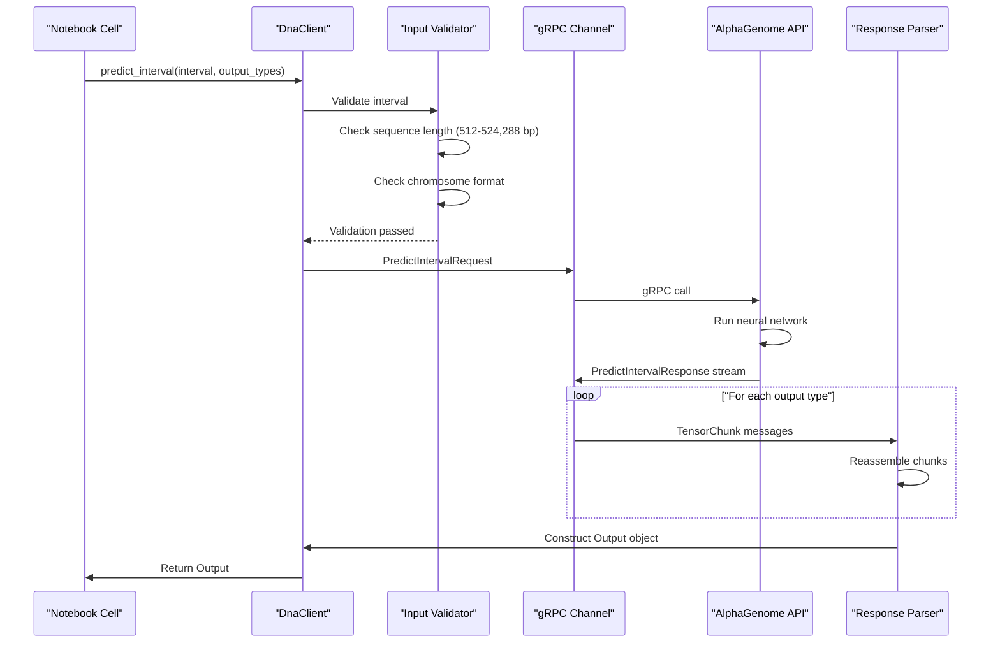
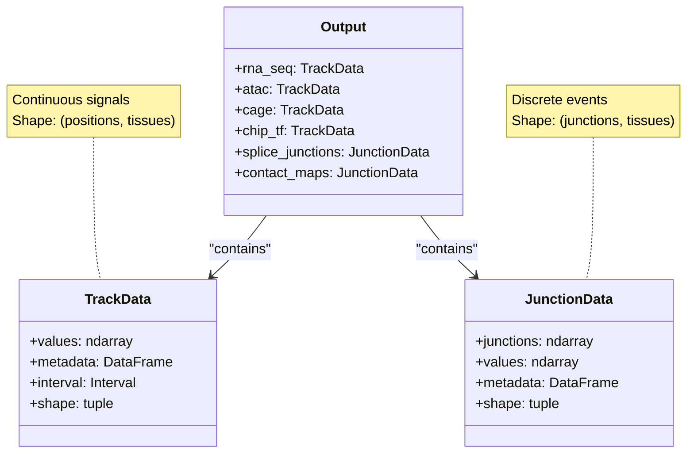
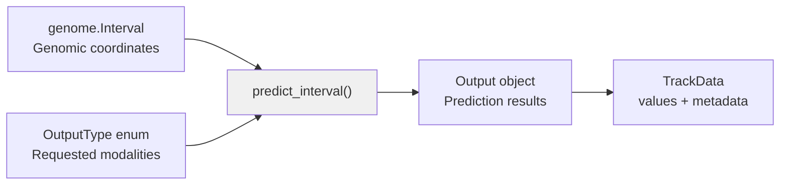

<!-- source: DeepWiki mcp.deepwiki.com · repo google-deepmind/alphagenome · page 6.1 Quick Start Notebook · fetched 2026-10-26 -->

# Quick Start Notebook

<details>
<summary>Relevant source files</summary>

The following files were used as context for generating this wiki page:

- [colabs/quick_start.ipynb](colabs/quick_start.ipynb)

</details>


## Purpose and Scope

This page provides a comprehensive walkthrough of the `quick_start.ipynb` notebook, which demonstrates the fundamental workflow for making genomic predictions using the AlphaGenome SDK. Each section of the notebook is explained in detail, covering the code entities involved, the data structures used, and the concepts demonstrated.

For a briefer overview focused on getting started quickly, see [Quick Start Tutorial](#2.2). For deeper conceptual explanations, refer to [Core Concepts](#3). For detailed API documentation, see [API Reference](#4).

## Notebook Overview

The quick start notebook demonstrates three core capabilities:

1. **Initializing the client** - Connecting to the AlphaGenome API
2. **Making predictions** - Generating multimodal genomic predictions for a specific interval
3. **Visualizing results** - Creating interpretable plots of prediction outputs

**Location**: `colab/quick_start.ipynb`

**Runtime**: Google Colab (recommended) or any Jupyter environment

**Prerequisites**:
- AlphaGenome API key (obtained from deepmind.google.com)
- Python 3.10+
- Internet connection for API calls

Sources: `colab/quick_start.ipynb`

## Notebook Workflow

The following diagram shows the complete workflow implemented in the notebook, mapping natural language concepts to concrete code entities:



Sources: `colab/quick_start.ipynb`, `alphagenome/dna_client.py`, `alphagenome/data/genome.py`, `alphagenome/visualization/plot_components.py`

## Setup and Initialization

### Installation

The notebook begins by installing the AlphaGenome SDK package:

```python
!pip install ./alphagenome
```

This assumes the SDK is located in a sibling directory. In Colab, you would typically clone the repository first or install from a specific path.

**Key Point**: The SDK is not yet available on PyPI, so it must be installed from source.

### Importing Required Modules

The notebook imports the essential components:

| Import | Purpose | Module Path |
|--------|---------|-------------|
| `dna_client` | Client factory and API communication | `alphagenome.dna_client` |
| `genome` | Core data structures (Interval, Variant, Strand) | `alphagenome.data.genome` |
| `plot_components` | Visualization functions | `alphagenome.visualization.plot_components` |
| `OutputType` | Enum specifying prediction modalities | `alphagenome.dna_model` |

### Creating the Client

The `DnaClient` is created using the factory function:

```python
model = dna_client.create(api_key=API_KEY, version='v1')
```

**Function**: `dna_client.create()`

**Parameters**:
- `api_key`: String containing your API credentials
- `version`: Model version identifier (currently `'v1'`)

**Returns**: A `DnaClient` instance that implements the `DnaModel` interface

**Implementation Details**:
- Establishes a gRPC channel to the AlphaGenome API server
- Validates the API key format
- Configures retry logic and timeout settings
- Returns a client ready to make predictions

The variable name `model` is used throughout the notebook to emphasize that `DnaClient` implements the `DnaModel` abstract interface.

Sources: `alphagenome/dna_client.py`, `colab/quick_start.ipynb`

## Making Predictions

### Defining the Genomic Interval

The notebook demonstrates prediction on a specific genomic region using the `Interval` class:

```python
interval = genome.Interval(
    chromosome='chr7',
    start=5527079,
    end=5563784,
    strand=genome.Strand.POSITIVE
)
```

**Class**: `genome.Interval`

**Key Attributes**:
- `chromosome`: String identifier (e.g., 'chr7', 'chrX')
- `start`: Zero-based start position (inclusive)
- `end`: Zero-based end position (exclusive)
- `strand`: `genome.Strand` enum (POSITIVE or NEGATIVE)

**Interval Properties**:
- Length: 36,705 bp (end - start)
- Location: Human chromosome 7, positive strand
- Genomic context: Contains the ACTB gene (β-actin)

The `Interval` class provides methods for genomic operations like `overlaps()`, `resize()`, and `pad()`. See [Genomic Data Structures](#3.1) for complete documentation.

### Selecting Output Types

The notebook requests three prediction modalities:

```python
output_types = [
    OutputType.RNA_SEQ,
    OutputType.ATAC,
    OutputType.CAGE
]
```

**Enum**: `OutputType`

**Selected Modalities**:

| Output Type | Biological Signal | Data Structure |
|-------------|------------------|----------------|
| `RNA_SEQ` | RNA expression levels | Continuous track (TrackData) |
| `ATAC` | Chromatin accessibility | Continuous track (TrackData) |
| `CAGE` | Transcription start sites | Continuous track (TrackData) |

The full set of available output types includes `CHIP_TF`, `SPLICE_JUNCTIONS`, `CONTACT_MAPS`, and others. See [Supported Features](#9.2) for the complete list.

### Executing the Prediction

```python
output = model.predict_interval(
    interval=interval,
    output_types=output_types
)
```

**Method**: `model.predict_interval()`

**Parameters**:
- `interval`: `genome.Interval` object defining the genomic region
- `output_types`: List of `OutputType` enums

**Returns**: An `Output` object containing predictions for all requested modalities

**Communication Flow**:



**Processing Time**: Predictions typically complete in 5-30 seconds, depending on interval length and number of output types requested.

Sources: `alphagenome/dna_client.py`, `alphagenome/dna_model.py`, `alphagenome/dna_output.py`

### Understanding the Output Object

The returned `Output` object has attributes corresponding to each requested modality:



**Accessing Predictions**:

```python
# RNA-seq predictions
rna_data = output.rna_seq
print(rna_data.values.shape)  # (36705, 118) - 118 tissue contexts
print(rna_data.metadata.shape)  # (118, 6) - tissue annotations

# ATAC-seq predictions
atac_data = output.atac
print(atac_data.values.shape)  # (36705, 91) - 91 tissue contexts
```

**TrackData Structure**:
- `values`: NumPy array with shape `(positions, contexts)` where positions correspond to base pairs in the interval
- `metadata`: Pandas DataFrame with columns for `ontology_id`, `ontology_name`, `sample_name`, etc.
- `interval`: The genomic interval these predictions correspond to

Sources: `alphagenome/dna_output.py`, `colab/quick_start.ipynb`

## Visualizing Predictions

### Creating the Visualization

The notebook generates a multi-track genome browser view:

```python
fig = plot_components.genomic_context_plot(
    output=output,
    interval=interval
)
plt.show()
```

**Function**: `plot_components.genomic_context_plot()`

**Parameters**:
- `output`: `Output` object from prediction
- `interval`: Original `genome.Interval` for coordinate reference
- Optional: `gene_annotation`, `highlight_regions`, `figsize`, etc.

**Returns**: Matplotlib `Figure` object

### Visualization Components

The generated plot contains multiple tracks stacked vertically:

```mermaid
graph TB
    subgraph "Figure Layout"
        Title["Figure Title<br/>Chromosome and coordinates"]
        
        subgraph "Track 1: RNA-seq"
            RNAAxis["Y-axis: Expression Level"]
            RNAData["Heatmap: 118 tissues × positions"]
            RNALabels["Tissue labels (right)"]
        end
        
        subgraph "Track 2: ATAC"
            ATACAxis["Y-axis: Accessibility"]
            ATACData["Heatmap: 91 tissues × positions"]
            ATACLabels["Tissue labels (right)"]
        end
        
        subgraph "Track 3: CAGE"
            CAGEAxis["Y-axis: TSS Activity"]
            CAGEData["Heatmap: 99 tissues × positions"]
            CAGELabels["Tissue labels (right)"]
        end
        
        XAxis["X-axis: Genomic Position (chr7:5,527,079-5,563,784)"]
    end
    
    Title --> RNAAxis
    RNAAxis --> RNAData
    RNAData --> RNALabels
    RNALabels --> ATACAxis
    ATACAxis --> ATACData
    ATACData --> ATACLabels
    ATACLabels --> CAGEAxis
    CAGEAxis --> CAGEData
    CAGEData --> CAGELabels
    CAGELabels --> XAxis
```



**Visual Encoding**:
- **Heatmap colors**: Intensity represents signal strength (e.g., expression level, accessibility)
- **Y-axis**: Each row represents a different tissue/cell type context
- **X-axis**: Genomic coordinates along the interval
- **Tissue labels**: Right side annotations showing ontology terms (e.g., "muscle tissue", "heart")

### Interpreting the Results

For the ACTB gene interval, typical observations include:

1. **RNA-seq track**: High expression in most tissues (ACTB is a housekeeping gene)
2. **ATAC track**: Open chromatin at promoter and regulatory regions
3. **CAGE track**: Sharp peaks at transcription start sites

The visualization enables:
- Identification of tissue-specific regulatory elements
- Detection of alternative transcription start sites
- Comparison of accessibility and expression patterns

For more advanced visualization techniques, see [Creating Visualizations](#5.5) and [Visualization Modality Tour](#6.4).

Sources: `alphagenome/visualization/plot_components.py`, `colab/quick_start.ipynb`

## Key Concepts Demonstrated

The quick start notebook introduces several fundamental concepts:

### 1. Client-Server Architecture

| Component | Role | Location |
|-----------|------|----------|
| `DnaClient` | Local SDK client | User's Python environment |
| AlphaGenome API | Remote inference server | Google Cloud infrastructure |
| gRPC | Communication protocol | Managed by SDK |

The SDK handles all network communication, retry logic, and data serialization transparently.

### 2. Core Data Structures



These structures are used consistently throughout the SDK for all prediction and scoring operations.

### 3. Biological Context

The notebook demonstrates working with:
- **Reference genome coordinates**: Human hg38 assembly
- **Ontology-based tissue annotations**: UBERON, CL, EFO terms
- **Multiple molecular modalities**: Transcriptomics, epigenomics, 3D structure

This multi-modal approach enables comprehensive understanding of genomic function.

Sources: `alphagenome/data/genome.py`, `alphagenome/dna_model.py`, `alphagenome/dna_output.py`

## Common Variations

While the notebook shows a single prediction, common variations include:

### Different Genomic Regions

```python
# Smaller interval (faster predictions)
small_interval = genome.Interval('chr1', 1000000, 1005000, genome.Strand.POSITIVE)

# Larger interval (requires more time)
large_interval = genome.Interval('chr1', 1000000, 1500000, genome.Strand.POSITIVE)
```

**Supported lengths**: 512 bp to 524,288 bp (512 KB)

### Different Output Types

```python
# Focus on splicing
splice_outputs = [OutputType.SPLICE_JUNCTIONS, OutputType.RNA_SEQ]

# Comprehensive analysis
all_outputs = [
    OutputType.RNA_SEQ,
    OutputType.ATAC,
    OutputType.CAGE,
    OutputType.CHIP_TF,
    OutputType.SPLICE_JUNCTIONS,
    OutputType.CONTACT_MAPS
]
```

### Different Organisms

```python
# Mouse model
mouse_model = dna_client.create(api_key=API_KEY, version='v1', organism='mm10')
mouse_interval = genome.Interval('chr3', 10000000, 10050000, genome.Strand.POSITIVE)
```

**Supported organisms**: Human (hg38), Mouse (mm10)

Sources: `alphagenome/dna_client.py`, `alphagenome/dna_model.py`

## Error Handling

The notebook doesn't explicitly show error handling, but common issues include:

### Invalid API Key

```
RpcError: UNAUTHENTICATED - Invalid API key
```

**Solution**: Verify API key is correctly set in Colab secrets or environment

### Invalid Interval Length

```
ValueError: Sequence length 100 is outside supported range [512, 524288]
```

**Solution**: Ensure interval length is between 512 bp and 524 KB

### Network Errors

```
RpcError: UNAVAILABLE - Service temporarily unavailable
```

**Solution**: The SDK automatically retries transient errors. If persistent, check network connectivity.

For comprehensive error handling documentation, see [Error Handling and Retry Logic](#7.3).

## Next Steps

After completing the quick start notebook, explore:

- **[Making Predictions](#5.1)**: Comprehensive guide to prediction parameters and options
- **[Scoring Variants](#5.2)**: Learn to quantify variant functional impact
- **[Visualization Modality Tour](#6.4)**: Explore all output types in depth
- **[In-Silico Mutagenesis](#5.3)**: Perform systematic mutation analysis
- **[API Reference](#4)**: Complete technical documentation

For interactive exploration, try:
- **[Interactive Variant Scoring](#6.3)**: UI-based variant analysis
- **[Complete Analysis Workflow](#6.5)**: End-to-end research example

Sources: `colab/quick_start.ipynb`

## Summary

The quick start notebook demonstrates the essential AlphaGenome SDK workflow:

1. **Initialize**: Create `DnaClient` with API key
2. **Define**: Specify genomic region using `genome.Interval`
3. **Predict**: Call `model.predict_interval()` with desired output types
4. **Visualize**: Generate plots using `plot_components.genomic_context_plot()`

This pattern forms the foundation for all SDK interactions, whether making simple predictions or conducting complex variant scoring analyses.

Sources: `colab/quick_start.ipynb`, `alphagenome/dna_client.py`, `alphagenome/data/genome.py`, `alphagenome/visualization/plot_components.py`

---

