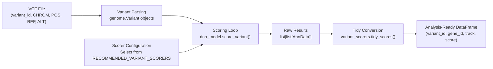
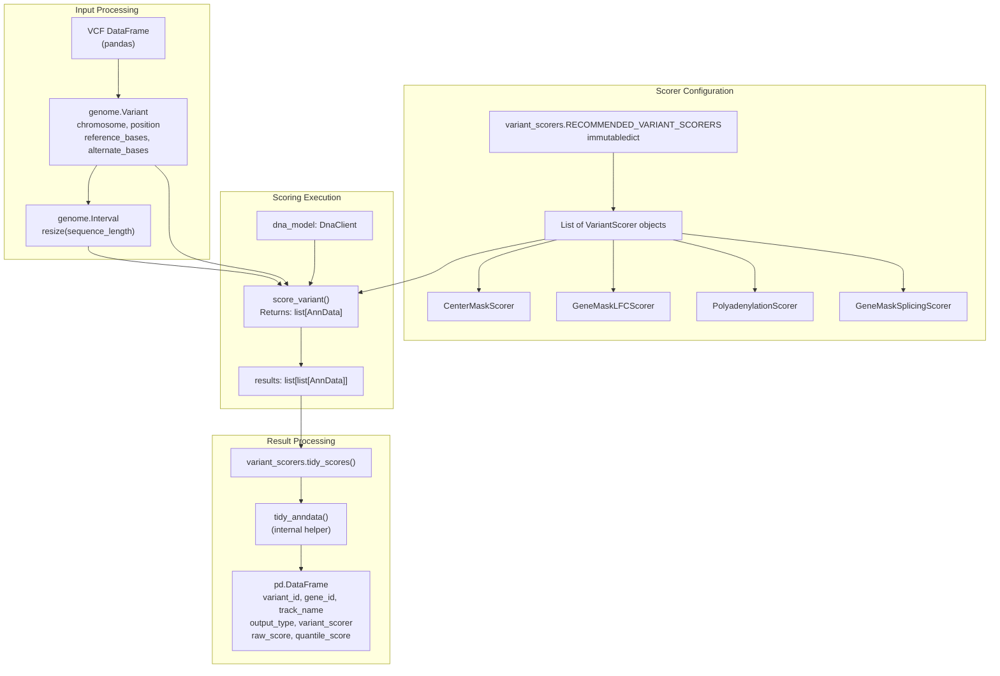
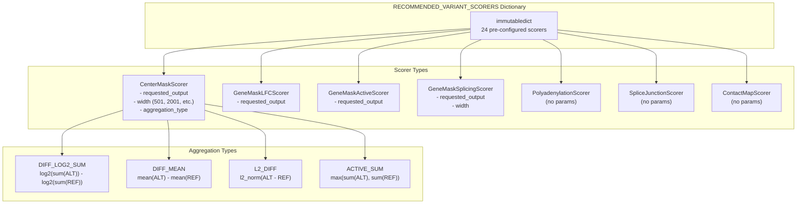
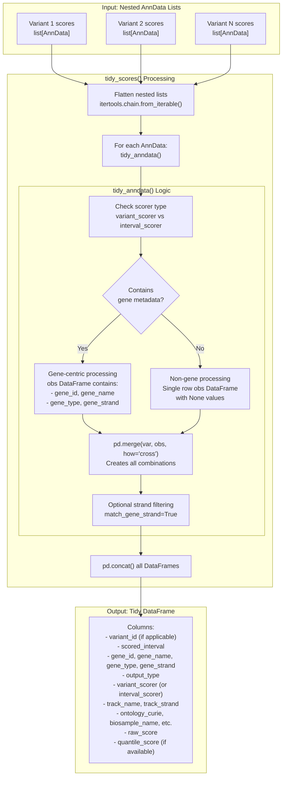

<!-- source: DeepWiki mcp.deepwiki.com · repo google-deepmind/alphagenome · page 6.2 Batch Variant Scoring · fetched 2026-10-26 -->

# Batch Variant Scoring

<details>
<summary>Relevant source files</summary>

The following files were used as context for generating this wiki page:

- [colabs/batch_variant_scoring.ipynb](colabs/batch_variant_scoring.ipynb)
- [src/alphagenome/models/variant_scorers.py](src/alphagenome/models/variant_scorers.py)
- [src/alphagenome/models/variant_scorers_test.py](src/alphagenome/models/variant_scorers_test.py)

</details>


This page demonstrates how to score multiple genetic variants in batch using the AlphaGenome SDK. It walks through a complete example from loading variant data in VCF format to producing analysis-ready results.

For information about scoring individual variants interactively, see [Interactive Variant Scoring](#6.3). For details on variant scorer types and configuration, see [Variant and Interval Scorers](#4.4).

---

## Overview

Batch variant scoring enables systematic evaluation of functional impacts across many genetic variants. The typical workflow involves:

1. Preparing variant information in a tabular format
2. Configuring variant scorers and model parameters
3. Iterating through variants to generate predictions
4. Consolidating results into a tidy DataFrame for downstream analysis

This approach is suitable for analyzing variant sets ranging from tens to thousands of variants, with each variant scored across multiple biological contexts and genomic tracks.

**Sources:** [colabs/batch_variant_scoring.ipynb:1-29]()

---

## Input Data Format

### VCF-Based Format

Batch variant scoring requires a tab-separated file containing the following columns:

| Column | Description | Example |
|--------|-------------|---------|
| `variant_id` | Unique identifier for the variant | `chr3_58394738_A_T_b38` |
| `CHROM` | Chromosome name with 'chr' prefix | `chr3` |
| `POS` | 1-based genomic position (hg38 or mm10) | `58394738` |
| `REF` | Reference nucleotide sequence | `A` |
| `ALT` | Alternate nucleotide sequence | `T` |

### Example VCF Data

```
variant_id              CHROM   POS         REF ALT
chr3_58394738_A_T_b38   chr3    58394738    A   T
chr8_28520_G_C_b38      chr8    28520       G   C
chr16_636337_G_A_b38    chr16   636337      G   A
```

The notebook example uses pandas to load this format:

```python
vcf = pd.read_csv(StringIO(vcf_file), sep='\t')
```

**Sources:** [colabs/batch_variant_scoring.ipynb:18-27](), [colabs/batch_variant_scoring.ipynb:690-706]()

---

## Batch Scoring Workflow

### High-Level Data Flow



**Sources:** [colabs/batch_variant_scoring.ipynb:688-810]()

### Core Code Entities



**Sources:** [colabs/batch_variant_scoring.ipynb:786-810](), [src/alphagenome/models/variant_scorers.py:557-638](), [src/alphagenome/models/variant_scorers.py:778-875]()

---

## Detailed Workflow Steps

### Step 1: Environment Setup

The notebook begins by installing and importing required modules:

```python
from alphagenome.data import genome
from alphagenome.models import dna_client, variant_scorers
import pandas as pd
from tqdm import tqdm

# Initialize the model client
dna_model = dna_client.create(api_key)
```

**Sources:** [colabs/batch_variant_scoring.ipynb:86-99]()

### Step 2: Load and Validate VCF Data

The VCF data is loaded into a pandas DataFrame and validated for required columns:

```python
vcf = pd.read_csv(vcf_file_path, sep='\t')

required_columns = ['variant_id', 'CHROM', 'POS', 'REF', 'ALT']
for column in required_columns:
    if column not in vcf.columns:
        raise ValueError(f'VCF file is missing required column: {column}.')
```

**Sources:** [colabs/batch_variant_scoring.ipynb:701-706]()

### Step 3: Configure Model Parameters

#### Organism Selection

```python
organism_map = {
    'human': dna_client.Organism.HOMO_SAPIENS,
    'mouse': dna_client.Organism.MUS_MUSCULUS,
}
organism = organism_map[organism_string]
```

#### Sequence Length Selection

```python
sequence_length = dna_client.SUPPORTED_SEQUENCE_LENGTHS['SEQUENCE_LENGTH_1MB']
```

Valid options from `dna_client.SUPPORTED_SEQUENCE_LENGTHS`:
- `SEQUENCE_LENGTH_16KB` (16,384 bp)
- `SEQUENCE_LENGTH_100KB` (98,304 bp)
- `SEQUENCE_LENGTH_500KB` (524,288 bp)
- `SEQUENCE_LENGTH_1MB` (1,048,576 bp)

**Sources:** [colabs/batch_variant_scoring.ipynb:708-737]()

### Step 4: Select Variant Scorers

The notebook uses `RECOMMENDED_VARIANT_SCORERS`, a dictionary containing pre-configured scorers for common use cases:

```python
all_scorers = variant_scorers.RECOMMENDED_VARIANT_SCORERS

# Select scorers based on user input
selected_scorers = [
    all_scorers['RNA_SEQ'],        # GeneMaskLFCScorer
    all_scorers['ATAC'],            # CenterMaskScorer with 501bp width
    all_scorers['DNASE'],           # CenterMaskScorer with 501bp width
    all_scorers['CHIP_HISTONE'],    # CenterMaskScorer with 2001bp width
    all_scorers['POLYADENYLATION'], # PolyadenylationScorer
    all_scorers['SPLICE_SITES'],    # GeneMaskSplicingScorer
]
```

The recommended scorers dictionary contains 24 pre-configured scorer combinations defined in [src/alphagenome/models/variant_scorers.py:559-638]().

#### Filtering Unsupported Scorers

Some scorers are organism-specific. The notebook filters out unsupported combinations:

```python
unsupported_scorers = [
    scorer for scorer in selected_scorers
    if organism.value not in variant_scorers.SUPPORTED_ORGANISMS[scorer.base_variant_scorer]
]

for unsupported_scorer in unsupported_scorers:
    selected_scorers.remove(unsupported_scorer)
```

**Sources:** [colabs/batch_variant_scoring.ipynb:739-781](), [src/alphagenome/models/variant_scorers.py:92-100]()

### Step 5: Execute Batch Scoring Loop

The main scoring loop iterates through each variant, creates genomic objects, and calls `score_variant()`:

```python
results = []

for i, vcf_row in tqdm(vcf.iterrows(), total=len(vcf)):
    # Create Variant object
    variant = genome.Variant(
        chromosome=str(vcf_row.CHROM),
        position=int(vcf_row.POS),
        reference_bases=vcf_row.REF,
        alternate_bases=vcf_row.ALT,
        name=vcf_row.variant_id,
    )
    
    # Create Interval centered on variant
    interval = variant.reference_interval.resize(sequence_length)
    
    # Score the variant
    variant_scores = dna_model.score_variant(
        interval=interval,
        variant=variant,
        variant_scorers=selected_scorers,
        organism=organism,
    )
    
    results.append(variant_scores)
```

Each call to `score_variant()` returns a list of `AnnData` objects, one per scorer. The outer list accumulates results across all variants, creating a nested structure: `list[list[AnnData]]`.

**Sources:** [colabs/batch_variant_scoring.ipynb:786-802]()

### Step 6: Convert Results to Tidy Format

The `tidy_scores()` function converts the nested AnnData structure into a single pandas DataFrame:

```python
df_scores = variant_scorers.tidy_scores(results)
```

This function:
1. Flattens the nested list structure
2. Converts each AnnData to long-form DataFrame via `tidy_anndata()`
3. Concatenates all DataFrames
4. Handles both gene-centric and variant-centric scoring outputs

**Sources:** [colabs/batch_variant_scoring.ipynb:804](), [src/alphagenome/models/variant_scorers.py:778-875]()

---

## Variant Scorer Configuration

### Recommended Scorer Dictionary

The `RECOMMENDED_VARIANT_SCORERS` dictionary provides 24 pre-configured scorer combinations:

| Key | Scorer Type | Output Type | Parameters |
|-----|-------------|-------------|------------|
| `'ATAC'` | `CenterMaskScorer` | `ATAC` | width=501, DIFF_LOG2_SUM |
| `'RNA_SEQ'` | `GeneMaskLFCScorer` | `RNA_SEQ` | - |
| `'RNA_SEQ_ACTIVE'` | `GeneMaskActiveScorer` | `RNA_SEQ` | - |
| `'DNASE'` | `CenterMaskScorer` | `DNASE` | width=501, DIFF_LOG2_SUM |
| `'CHIP_HISTONE'` | `CenterMaskScorer` | `CHIP_HISTONE` | width=2001, DIFF_LOG2_SUM |
| `'CHIP_TF'` | `CenterMaskScorer` | `CHIP_TF` | width=501, DIFF_LOG2_SUM |
| `'CAGE'` | `CenterMaskScorer` | `CAGE` | width=501, DIFF_LOG2_SUM |
| `'PROCAP'` | `CenterMaskScorer` | `PROCAP` | width=501, DIFF_LOG2_SUM |
| `'SPLICE_SITES'` | `GeneMaskSplicingScorer` | `SPLICE_SITES` | width=None |
| `'SPLICE_SITE_USAGE'` | `GeneMaskSplicingScorer` | `SPLICE_SITE_USAGE` | width=None |
| `'SPLICE_JUNCTIONS'` | `SpliceJunctionScorer` | `SPLICE_JUNCTIONS` | - |
| `'POLYADENYLATION'` | `PolyadenylationScorer` | `RNA_SEQ` | - |
| `'CONTACT_MAPS'` | `ContactMapScorer` | `CONTACT_MAPS` | - |

Active allele variants are also available (e.g., `'ATAC_ACTIVE'`, `'RNA_SEQ_ACTIVE'`) that capture maximum activity rather than differences between alleles.

### Scorer Selection Diagram



**Sources:** [src/alphagenome/models/variant_scorers.py:557-638](), [src/alphagenome/models/variant_scorers.py:30-67]()

### Organism-Specific Support

Not all scorers support all organisms. The `SUPPORTED_ORGANISMS` dictionary defines compatibility:

- Most scorers: Support both `HOMO_SAPIENS` and `MUS_MUSCULUS`
- `PolyadenylationScorer`: Only supports `HOMO_SAPIENS`

Use `get_recommended_scorers(organism)` to automatically filter to supported scorers for a given organism:

```python
scorers = variant_scorers.get_recommended_scorers(
    organism=dna_model_pb2.Organism.ORGANISM_HOMO_SAPIENS
)
```

**Sources:** [src/alphagenome/models/variant_scorers.py:92-100](), [src/alphagenome/models/variant_scorers.py:641-649]()

---

## Output Format and Processing

### AnnData to DataFrame Conversion

The `tidy_scores()` function converts the raw AnnData output structure into an analysis-ready DataFrame. This process handles multiple scorer types and output formats uniformly.

#### Conversion Architecture



**Sources:** [src/alphagenome/models/variant_scorers.py:778-875](), [src/alphagenome/models/variant_scorers.py:652-776]()

### DataFrame Schema

The resulting DataFrame contains one row per unique combination of:
- Variant (for variant scoring)
- Gene (for gene-centric scorers)
- Track (output modality/context)

#### Core Columns

| Column | Description | Example |
|--------|-------------|---------|
| `variant_id` | Variant identifier | `chr3:58394738:A>T` |
| `scored_interval` | Genomic interval used for scoring | `chr3:57870450-58919026:.` |
| `gene_id` | ENSEMBL gene ID (without version) | `ENSG00000100342` |
| `gene_name` | HGNC gene symbol | `APOL1` |
| `gene_type` | Gene biotype | `protein_coding` |
| `gene_strand` | Gene strand | `+`, `-`, or `.` |
| `output_type` | Model output type | `RNA_SEQ`, `ATAC`, `DNASE` |
| `variant_scorer` | Scorer configuration string | `CenterMaskScorer(...)` |
| `track_name` | Track identifier | `UBERON:0036149 total RNA-seq` |
| `track_strand` | Track strand | `+`, `-`, or `.` |
| `raw_score` | Raw variant effect score | `-0.003778` |
| `quantile_score` | Normalized quantile score | `-0.215740` |

#### Extended Metadata Columns

When `include_extended_metadata=True` (default), additional columns are included:

| Column | Description |
|--------|-------------|
| `Assay title` | Assay subtype (e.g., "total RNA-seq", "polyA plus RNA-seq") |
| `ontology_curie` | Cell type/tissue ontology term (e.g., "UBERON:0002107") |
| `biosample_name` | Biosample name (e.g., "liver") |
| `biosample_type` | Biosample category (e.g., "tissue", "primary_cell") |
| `biosample_life_stage` | Life stage (e.g., "adult", "embryonic") |
| `gtex_tissue` | GTEx tissue name (e.g., "Liver") |
| `data_source` | Data source identifier |
| `transcription_factor` | TF name for ChIP-seq tracks |
| `histone_mark` | Histone mark for ChIP-seq tracks |

**Sources:** [src/alphagenome/models/variant_scorers.py:814-849](), [src/alphagenome/models/variant_scorers.py:720-739]()

### Strand Matching

The `match_gene_strand` parameter (default `True`) filters out rows where gene and track strands are mismatched:

```python
# Keeps only rows where:
# - Gene strand matches track strand, OR
# - Track strand is '.' (unstranded)

# Removes rows where:
# - Gene is '+' and track is '-', OR
# - Gene is '-' and track is '+'
```

This is relevant only for gene-centric scoring where both gene and track have strand information.

**Sources:** [src/alphagenome/models/variant_scorers.py:768-774]()

---

## Performance Considerations

### Scoring Loop Timing

Each `score_variant()` call involves:
1. gRPC request to the AlphaGenome API server
2. Model prediction for REF and ALT sequences
3. Scorer computation across selected tracks
4. Response streaming back to client

For the example notebook with 4 variants and 11 scorers, total execution time is approximately 9-10 seconds (2.4 seconds per variant on average).

### Optimization Strategies

**Limit Scorer Count**: Each additional scorer increases computation time linearly. Select only the scorers relevant to your analysis question.

**Batch Related Variants**: Group variants by genomic region to enable potential future optimizations (though current API processes each variant independently).

**Sequence Length Selection**: Shorter sequences (16KB, 100KB) are faster to process than longer sequences (1MB), but may miss long-range regulatory effects. Choose based on the expected regulatory range of your variants.

**Async Processing**: For large variant sets (>100), consider implementing async/parallel requests to the API (respecting rate limits).

### Memory Usage

The nested AnnData result structure can consume significant memory for large variant sets with many scorers. The tidy DataFrame conversion consolidates this into a more memory-efficient format. Consider processing variants in chunks if memory becomes limiting.

**Example**: 4 variants × 11 scorers = 44 AnnData objects. After tidying: 121,956 rows in final DataFrame (approximately 30 genes × 30+ tracks per scorer combination).

**Sources:** [colabs/batch_variant_scoring.ipynb:122-128](), [colabs/batch_variant_scoring.ipynb:786-802]()

---

## Example Output

The notebook example generates 121,956 rows from 4 variants across 11 scorers. Here is the structure of representative rows:

### Non-Gene Centric Scorer (CenterMaskScorer - ATAC)

| variant_id | scored_interval | gene_id | output_type | variant_scorer | track_name | raw_score | quantile_score |
|------------|----------------|---------|-------------|----------------|------------|-----------|----------------|
| chr3:58394738:A>T | chr3:57870450-58919026:. | None | ATAC | CenterMaskScorer(...width=501...) | CL:0000084 ATAC-seq | -0.003778 | -0.215740 |

### Gene Centric Scorer (GeneMaskLFCScorer - RNA_SEQ)

| variant_id | scored_interval | gene_id | gene_name | gene_strand | output_type | track_name | raw_score | quantile_score |
|------------|----------------|---------|-----------|-------------|-------------|------------|-----------|----------------|
| chr3:58394738:A>T | chr3:57870450-58919026:. | ENSG00000136068 | FLNB | + | RNA_SEQ | CL:0000084 polyA plus RNA-seq | -0.000898 | -0.584379 |

The full output includes all combinations of variants, genes (where applicable), tracks, and scorers, providing comprehensive functional impact predictions across biological contexts.

**Sources:** [colabs/batch_variant_scoring.ipynb:137-680]()

---

## Complete Example Reference

The complete batch scoring workflow is demonstrated in the notebook at [colabs/batch_variant_scoring.ipynb](). Key sections:

- **Input preparation**: Lines 690-706
- **Parameter configuration**: Lines 708-781
- **Scoring loop**: Lines 786-802
- **Result processing**: Lines 804-810

For additional examples of processing and analyzing the resulting DataFrame, see the notebook's filtering demonstrations at lines 827-844.

**Sources:** [colabs/batch_variant_scoring.ipynb:688-844]()

---

