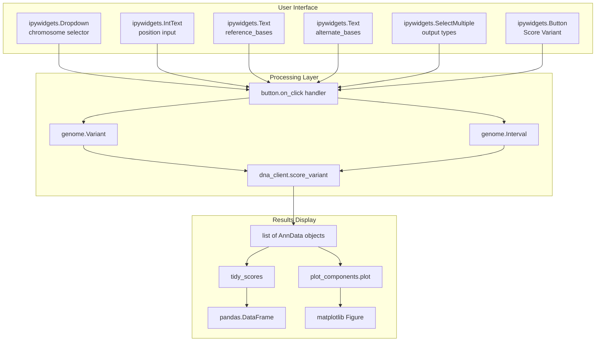
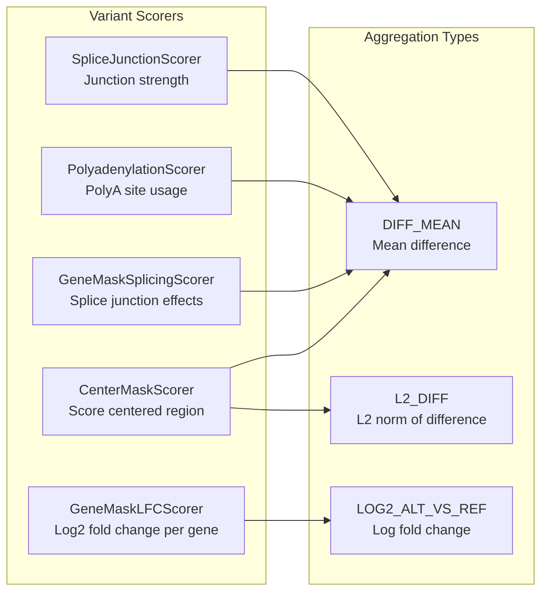

<!-- source: DeepWiki mcp.deepwiki.com · repo google-deepmind/alphagenome · page 6.3 Interactive Variant Scoring · fetched 2026-10-26 -->

# Interactive Variant Scoring

<details>
<summary>Relevant source files</summary>

The following files were used as context for generating this wiki page:

- [colabs/variant_scoring_ui.ipynb](colabs/variant_scoring_ui.ipynb)

</details>


This tutorial demonstrates how to use the `variant_scoring_ui.ipynb` notebook, which provides an interactive web-based interface for exploring individual genomic variants and their predicted functional effects. The notebook uses Jupyter widgets to create form-based inputs, allowing researchers to iteratively explore variants without writing code.

For batch processing of multiple variants programmatically, see page 6.2. For the underlying API methods, see page 4.1.

## Overview

The `variant_scoring_ui.ipynb` notebook provides:

- **Form-based variant input**: Specify chromosome, position, reference and alternate alleles through dropdown menus and text fields
- **Real-time scoring**: Submit variants to the AlphaGenome API and receive predictions immediately
- **Integrated visualization**: Automatic display of prediction results using the AlphaGenome visualization components
- **Iterative exploration**: Modify parameters and re-run analysis without restarting the notebook

This approach is ideal for:
- Exploring individual variants of interest
- Rapid hypothesis testing
- Educational demonstrations
- Users unfamiliar with Python programming

Sources: [notebooks/variant_scoring_ui.ipynb]()

## Notebook Architecture

The `variant_scoring_ui.ipynb` notebook connects user interface components to the AlphaGenome client library through Jupyter widgets.

### Component Flow Diagram



Sources: [notebooks/variant_scoring_ui.ipynb](), [alphagenome/dna_client.py](), [alphagenome/visualization/plot_components.py]()

### Data Flow

The notebook executes the following sequence when a user submits a variant:

1. **Input Collection**: Widget values are captured from form fields
2. **Variant Construction**: `genome.Variant(chromosome, position, reference_bases, alternate_bases)` is created
3. **Interval Definition**: Prediction context window is defined using `genome.Interval`
4. **API Request**: `dna_client.score_variant()` submits request to AlphaGenome API
5. **Result Processing**: Returns list of `AnnData` objects containing scores per gene and track
6. **Visualization**: `plot_components.plot()` generates matplotlib figures
7. **Tabular Display**: `tidy_scores()` converts AnnData to DataFrame for inspection

Sources: [alphagenome/dna_client.py](), [alphagenome/data/genome.py](), [alphagenome/variant_scorers.py]()

## Setting Up the Notebook

### Prerequisites

Before running the notebook, ensure you have:

1. **AlphaGenome SDK installed**: Follow installation instructions from page 2.1
2. **API credentials configured**: Obtain API key from deepmind.google.com
3. **Jupyter environment**: JupyterLab or Jupyter Notebook with ipywidgets support

### Initialization

The notebook begins by importing required modules and initializing the `DnaClient`:

```python
from alphagenome import dna_client
from alphagenome.data import genome
from alphagenome.variant_scorers import tidy_scores
from alphagenome.visualization import plot_components
import ipywidgets as widgets
```

The `DnaClient` is created using `dna_client.create()`, which reads credentials from the environment or configuration files. See page 4.1 for details on client initialization.

Sources: [notebooks/variant_scoring_ui.ipynb](), [alphagenome/dna_client.py]()

## Using the Variant Input Form

### Form Components

The notebook creates an interactive form with the following widgets:

| Widget Type | Parameter | Description | Example Value |
|-------------|-----------|-------------|---------------|
| `Dropdown` | `chromosome` | Target chromosome | `"chr17"` |
| `IntText` | `position` | Genomic coordinate (1-based) | `43044295` |
| `Text` | `reference_bases` | Reference allele sequence | `"A"` |
| `Text` | `alternate_bases` | Variant allele sequence | `"G"` |
| `IntText` | `interval_start` | Prediction window start offset | `-16384` |
| `IntText` | `interval_end` | Prediction window end offset | `16384` |
| `SelectMultiple` | `output_types` | Prediction modalities to compute | `["RNA_SEQ", "ATAC"]` |
| `SelectMultiple` | `variant_scorers` | Scoring methods to apply | `["CenterMaskScorer"]` |

### Input Validation

The notebook performs automatic validation:
- **Chromosome format**: Must match pattern `chr[1-22,X,Y,M]` for human genome
- **Position bounds**: Must be positive integer within chromosome length
- **Sequence format**: Reference and alternate bases must contain only `ACGT` characters
- **Interval size**: Combined interval must be within supported prediction lengths (see page 9.2)

Sources: [notebooks/variant_scoring_ui.ipynb](), [alphagenome/data/genome.py]()

## Scoring and Visualization

### Submitting Variants

When the "Score Variant" button is clicked:

1. A `genome.Variant` object is constructed:
   ```python
   variant = genome.Variant(
       chromosome=chromosome_widget.value,
       position=position_widget.value,
       reference_bases=ref_widget.value,
       alternate_bases=alt_widget.value
   )
   ```

2. A `genome.Interval` defines the prediction context:
   ```python
   interval = genome.Interval(
       chromosome=chromosome_widget.value,
       start=position_widget.value + interval_start_widget.value,
       end=position_widget.value + interval_end_widget.value,
       strand=genome.Strand.POSITIVE
   )
   ```

3. The client scores the variant:
   ```python
   results = client.score_variant(
       interval=interval,
       variant=variant,
       output_types=output_types_widget.value,
       variant_scorers=variant_scorers_widget.value
   )
   ```

Sources: [notebooks/variant_scoring_ui.ipynb](), [alphagenome/dna_client.py:800-850]()

### Interpreting Results

The notebook displays results in two formats:

#### Tabular View

The `tidy_scores()` function converts the list of `AnnData` objects into a pandas DataFrame:

| Column | Description |
|--------|-------------|
| `gene_name` | Gene symbol from GENCODE annotation |
| `gene_id` | Ensembl gene identifier |
| `track` | Biological modality (e.g., `"RNA_SEQ"`, `"ATAC"`) |
| `variant_scorer` | Scorer configuration name |
| `aggregation_type` | How values were aggregated (e.g., `"DIFF_MEAN"`) |
| `score` | Raw score value |
| `quantile` | Quantile normalized score (0-1) |
| `strand` | Gene strand orientation |

#### Visualization

The notebook calls `plot_components.plot()` to generate figures showing:
- **Track plots**: Continuous signal predictions for REF and ALT alleles
- **Difference plots**: ALT - REF signal differences highlighting variant effects
- **Gene annotations**: Transcript structures overlaid on predictions
- **Variant markers**: Visual indicator of variant position

Sources: [alphagenome/variant_scorers.py](), [alphagenome/visualization/plot_components.py]()

## Variant Scorer Options

### Available Scorers

The notebook supports all variant scorers documented in page 4.4. Common choices include:



### Scorer Selection Guidelines

| Scorer | Best For | Output Types Required |
|--------|----------|----------------------|
| `CenterMaskScorer` | General variant effects near variant position | Any track (RNA_SEQ, ATAC, etc.) |
| `GeneMaskLFCScorer` | Gene expression changes | RNA_SEQ, CAGE |
| `GeneMaskSplicingScorer` | Alternative splicing effects | SPLICE_JUNCTIONS |
| `PolyadenylationScorer` | PolyA site alterations | CAGE |
| `SpliceJunctionScorer` | Splice donor/acceptor variants | SPLICE_JUNCTIONS |

Sources: [alphagenome/variant_scorers.py](), [alphagenome/interval_scorers.py]()

## Integration with Client Library

The interactive variant scoring system leverages core AlphaGenome client library components:

### Client Methods Used

- `dna_client.DnaClient.score_variant()`: Score individual variants
- `dna_client.DnaClient.score_variants()`: Score multiple variants in batch
- `dna_client.DnaClient.predict_variant()`: Generate detailed predictions

### Data Structure Integration

- **Input**: `genome.Variant` objects constructed from form data
- **Context**: `genome.Interval` objects defining prediction windows  
- **Output**: `anndata.AnnData` objects containing prediction scores
- **Visualization**: `track_data.TrackData` for plot generation

### Relationship to Other Tutorials

The interactive variant scoring interface serves as a bridge between basic usage patterns and advanced analysis workflows:

| Tutorial | Relationship | Key Difference |
|----------|--------------|----------------|
| [Getting Started](#2) | Foundation | Interactive vs. programmatic interface |
| [Batch Variant Scoring](#4.1) | Complementary | Individual vs. bulk processing |
| [Analysis Workflows](#4.3) | Integration | UI component vs. complete analysis |
| [Visualization Techniques](#4.4) | Dependent | Uses visualization components |

Sources: Tutorial structure, AlphaGenome client library organization

## Usage Patterns

### Single Variant Analysis

The interface supports focused analysis of individual variants with immediate visual feedback:

1. Input variant coordinates through form interface
2. Select desired prediction outputs
3. Execute scoring through `score_variant()` call
4. Review results through integrated visualization
5. Iterate with parameter modifications

### Comparative Analysis

Users can compare multiple variants by:

1. Processing variants sequentially through the interface
2. Accumulating results in `anndata.AnnData` objects
3. Using visualization components for side-by-side comparison
4. Leveraging `score_variants()` for batch comparison

Sources: Interactive notebook design patterns, AlphaGenome API usage

---

