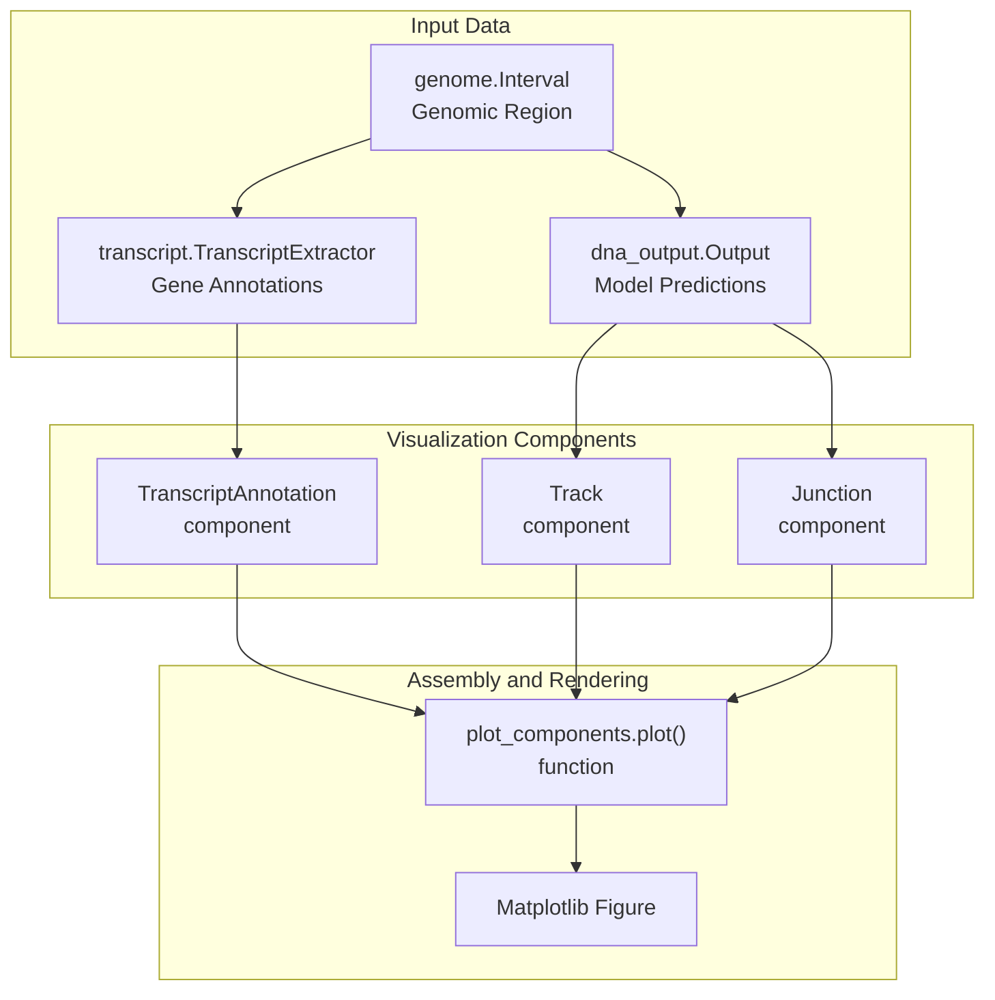
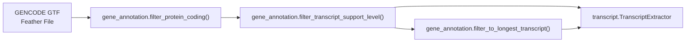
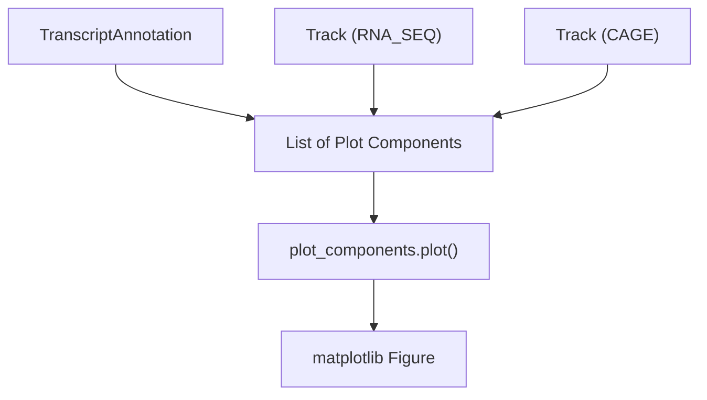
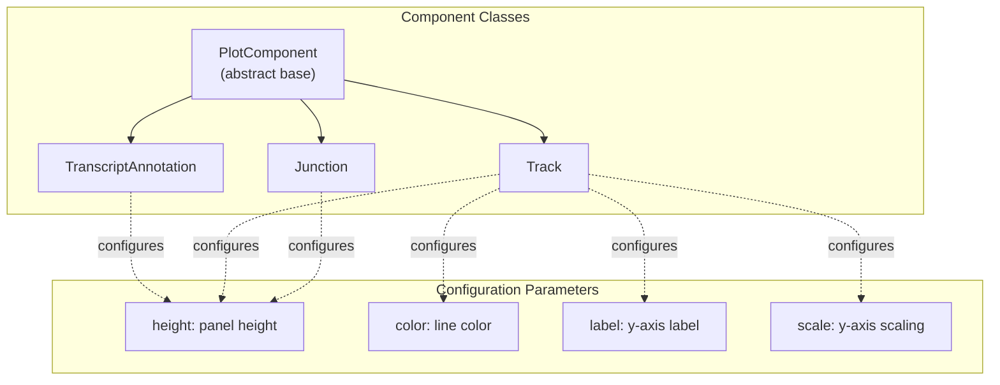
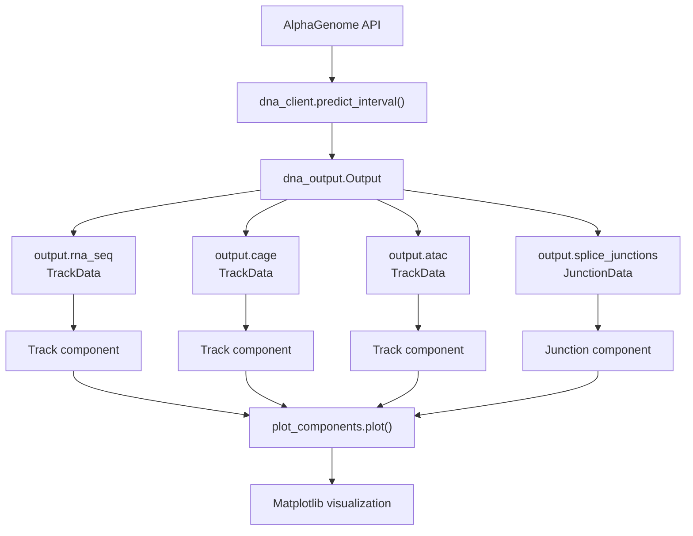

<!-- source: DeepWiki mcp.deepwiki.com · repo google-deepmind/alphagenome · page 6.4 Visualization Modality Tour · fetched 2026-10-26 -->

# Visualization Modality Tour

<details>
<summary>Relevant source files</summary>

The following files were used as context for generating this wiki page:

- [colabs/visualization_modality_tour.ipynb](colabs/visualization_modality_tour.ipynb)
- [docs/source/variant_scoring.md](docs/source/variant_scoring.md)

</details>


## Purpose and Scope

This document provides a comprehensive guide to visualizing AlphaGenome predictions across different biological modalities. It demonstrates the workflow for generating predictions, preparing gene annotations, and constructing publication-quality plots using the `alphagenome.visualization` module.

For basic visualization concepts and the plot component architecture, see [5.5](#5.5). For the underlying prediction workflow without visualization, see [5.1](#5.1).

**Sources:** [colabs/visualization_modality_tour.ipynb:1-16]()

## Visualization Architecture Overview

The AlphaGenome visualization system follows a modular, composable design where individual plot components are stacked vertically to create comprehensive genomic visualizations.



**Key Components:**

| Component Type | Purpose | Input Data |
|---------------|---------|------------|
| `TranscriptAnnotation` | Display gene models | `transcript.Transcript` objects |
| `Track` | Continuous signal tracks | `track_data.TrackData` |
| `Junction` | Discrete junction events | `track_data.JunctionData` |

**Sources:** [colabs/visualization_modality_tour.ipynb:195-210](), [alphagenome/visualization/plot_components:1-100]()

## Basic Visualization Workflow

### Step 1: Initialize Model and Load Metadata

```python
# Initialize DnaClient
dna_model = dna_client.create(api_key)

# Load output metadata for organism
output_metadata = dna_model.output_metadata(
    organism=dna_client.Organism.HOMO_SAPIENS
)
```

The `output_metadata` object contains information about available tracks, including ontology term names and track descriptions.

**Sources:** [colabs/visualization_modality_tour.ipynb:88-104]()

### Step 2: Prepare Gene Annotations



The filtering pipeline produces two extractors:
- **All transcripts:** Shows all TSL-1 protein-coding transcripts in region
- **Longest only:** Shows only the longest transcript per gene

**Sources:** [colabs/visualization_modality_tour.ipynb:114-135]()

### Step 3: Generate Predictions

```python
# Define genomic interval (must be supported length)
interval = genome.Interval('chr22', 36_150_498, 36_252_898).resize(
    dna_client.SEQUENCE_LENGTH_1MB
)

# Specify modalities and context
output = dna_model.predict_interval(
    interval=interval,
    requested_outputs={
        dna_client.OutputType.RNA_SEQ,
        dna_client.OutputType.CAGE,
    },
    ontology_terms=[
        'UBERON:0001159',  # Colon - Sigmoid
        'UBERON:0001155',  # Colon - Transverse
    ]
)
```

The returned `output` object contains `TrackData` for each requested modality.

**Sources:** [colabs/visualization_modality_tour.ipynb:166-190]()

### Step 4: Build and Render Plot



Each component is configured independently, then passed to `plot_components.plot()` which stacks them vertically with shared x-axis.

**Sources:** [colabs/visualization_modality_tour.ipynb:195-224]()

## Visualizing Different Modalities

### Gene Expression: RNA-Seq and CAGE

**RNA-Seq** captures steady-state mRNA levels across the transcript body. **CAGE** captures transcription start site usage and promoter activity.

```python
# Gene expression modalities
requested_outputs = {
    dna_client.OutputType.RNA_SEQ,
    dna_client.OutputType.CAGE,
}
```

**Visualization Pattern:**

1. **Top panel:** Transcript annotations showing gene structure
2. **Middle panels:** RNA-Seq tracks (one per tissue/cell type)
3. **Bottom panels:** CAGE tracks (one per tissue/cell type)

The RNA-Seq signal typically covers exonic regions, while CAGE shows sharp peaks at transcription start sites.

**Sources:** [colabs/visualization_modality_tour.ipynb:152-190](), [docs/source/variant_scoring.md:1-30]()

### Chromatin Accessibility: ATAC-Seq

ATAC-Seq reveals open chromatin regions indicative of regulatory elements.

```python
requested_outputs = {dna_client.OutputType.ATAC}
```

ATAC tracks typically show:
- **Sharp peaks** at promoters and enhancers
- **Broader regions** of accessible chromatin
- **Tissue-specific patterns** reflecting active regulatory landscape

**Key Attributes:**
- Stored in `output.atac` as `TrackData`
- Values represent chromatin accessibility score
- Metadata includes ontology terms for cell/tissue context

### Transcription Factor Binding: ChIP-Seq

```python
requested_outputs = {dna_client.OutputType.CHIP_TF}
```

ChIP-TF predictions show expected binding profiles for transcription factors across different cell types. Each track in the metadata represents a specific TF in a specific context.

### Splice Junctions

Unlike continuous tracks, splice junctions are discrete events represented as `JunctionData`:

```python
requested_outputs = {dna_client.OutputType.SPLICE_JUNCTIONS}
```

**Data Structure:**

| Field | Type | Description |
|-------|------|-------------|
| `junctions` | `ndarray` | Junction coordinates (acceptor, donor) |
| `values` | `ndarray` | Junction usage scores |
| `metadata` | `DataFrame` | Context information per track |

Junctions are visualized as arcs connecting donor and acceptor sites, with arc thickness indicating usage strength.

**Sources:** [colabs/visualization_modality_tour.ipynb:1-50]()

## Plot Components System

### Component Types and Configuration



**Common Parameters:**

| Parameter | Type | Purpose | Default |
|-----------|------|---------|---------|
| `height` | `float` | Relative panel height | `1.0` |
| `interval` | `Interval` | Genomic region | Required |

**Track-Specific Parameters:**

| Parameter | Type | Purpose |
|-----------|------|---------|
| `track_data` | `TrackData` | Prediction data |
| `label` | `str` | Y-axis label |
| `color` | `str` | Line color |
| `scale` | `str` | `'linear'` or `'log'` |

**Sources:** [colabs/visualization_modality_tour.ipynb:195-224]()

### Composing Multi-Panel Figures

```python
# Build component list
components = [
    # Gene models at top
    plot_components.TranscriptAnnotation(
        interval=interval,
        transcripts=longest_transcripts,
        height=0.5
    ),
    
    # RNA-Seq tracks
    plot_components.Track(
        interval=interval,
        track_data=output.rna_seq,
        label='RNA-Seq',
        height=1.0
    ),
    
    # CAGE tracks
    plot_components.Track(
        interval=interval,
        track_data=output.cage,
        label='CAGE',
        height=1.0
    ),
]

# Render figure
fig = plot_components.plot(components)
```

The `plot()` function:
1. Calculates relative heights
2. Creates shared x-axis across panels
3. Renders each component in order (top to bottom)
4. Adds coordinate axis at bottom
5. Returns matplotlib `Figure` object

**Sources:** [colabs/visualization_modality_tour.ipynb:205-224]()

## Data Flow for Visualization



**Key Classes:**

- **`Output`**: Container for all predicted modalities ([alphagenome/dna_output.py:1-100]())
- **`TrackData`**: Continuous signal with values array and metadata ([alphagenome/data/track_data.py:1-50]())
- **`JunctionData`**: Discrete events with junction coordinates ([alphagenome/data/track_data.py:50-100]())
- **`plot_components`**: Rendering functions and component classes ([alphagenome/visualization/plot_components.py:1-200]())

**Sources:** [colabs/visualization_modality_tour.ipynb:1-300]()

## Working with Ontology Terms

Ontology terms specify the biological context (tissue, cell type) for predictions:

```python
ontology_terms = [
    'UBERON:0001159',  # Colon - Sigmoid
    'UBERON:0001155',  # Colon - Transverse
    'CL:0000136',      # Cell type example
]
```

**Accessing Ontology Information:**

```python
# Get metadata for predictions
metadata = output.rna_seq.metadata

# Metadata DataFrame columns:
# - ontology_id: e.g., 'UBERON:0001159'
# - ontology_name: Human-readable name
# - track_index: Index into values array
```

The `metadata` DataFrame maps each track (column) in the `values` array to its biological context.

**Sources:** [colabs/visualization_modality_tour.ipynb:173-177]()

## Customization and Advanced Usage

### Filtering by Strand

When scoring genes, strand-specific filtering ensures signals match gene orientation:

```python
# Filter metadata to genes on positive strand
positive_strand_genes = metadata[metadata['strand'] == '+']
```

This is particularly important for directional modalities like RNA-Seq and CAGE.

### Adjusting Visual Properties

```python
# Custom colors and heights
components = [
    plot_components.Track(
        interval=interval,
        track_data=output.atac,
        label='Chromatin Accessibility',
        color='blue',
        height=1.5,  # Taller panel
        scale='log'  # Logarithmic y-axis
    ),
]
```

### Combining Multiple Intervals

For variant visualization, create components for both reference and alternate predictions:

```python
ref_components = build_components(variant_output.reference)
alt_components = build_components(variant_output.alternate)

# Render side-by-side or stacked
fig1 = plot_components.plot(ref_components)
fig2 = plot_components.plot(alt_components)
```

**Sources:** [colabs/visualization_modality_tour.ipynb:1-300]()

---

