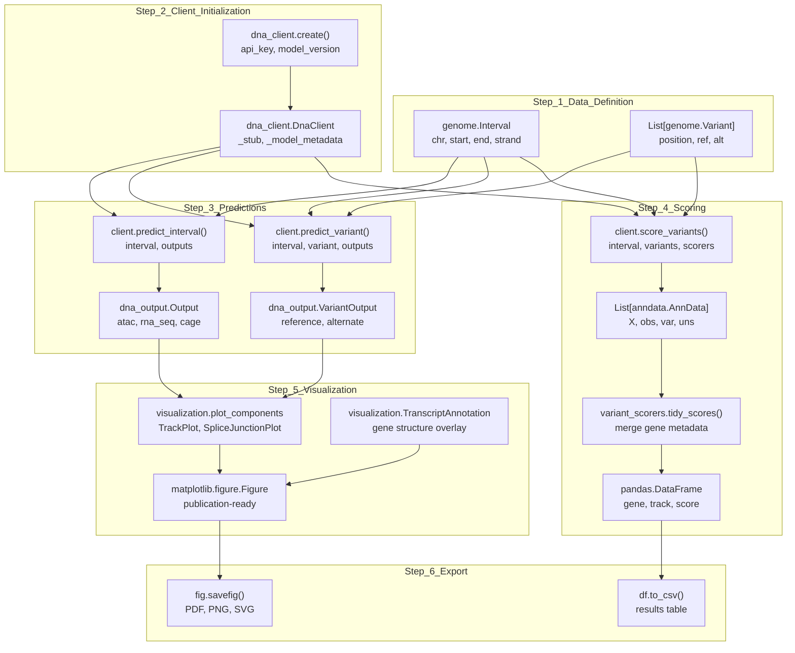
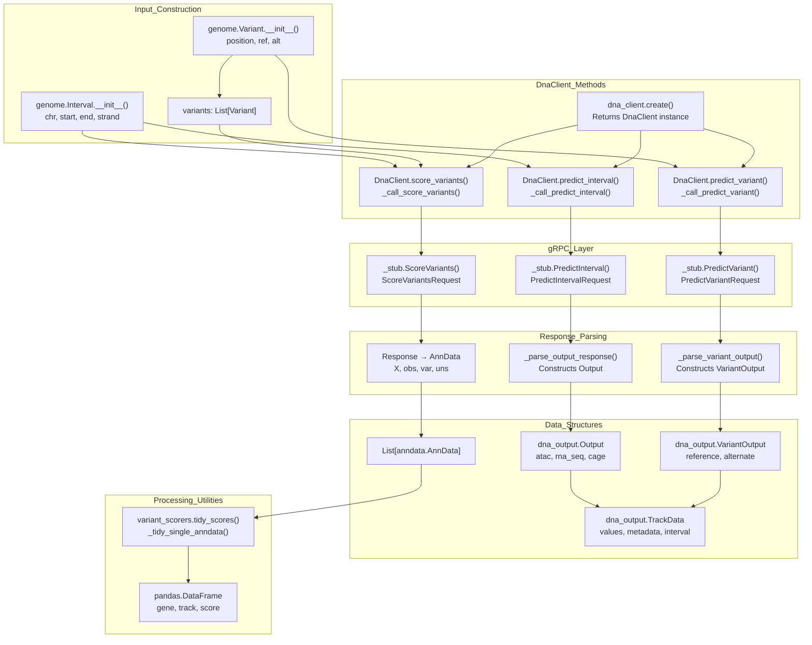
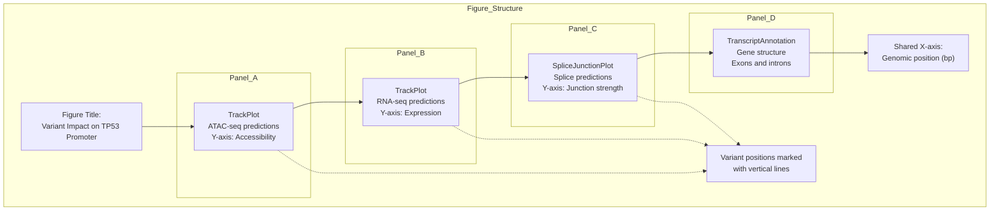
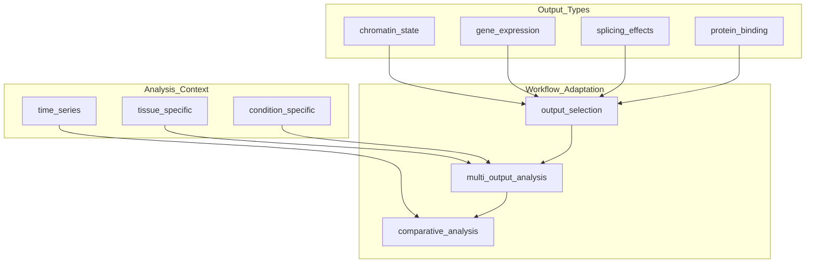

<!-- source: DeepWiki mcp.deepwiki.com · repo google-deepmind/alphagenome · page 6.5 Complete Analysis Workflow · fetched 2026-10-26 -->

# Complete Analysis Workflow

<details>
<summary>Relevant source files</summary>

The following files were used as context for generating this wiki page:

- [colabs/example_analysis_workflow.ipynb](colabs/example_analysis_workflow.ipynb)

</details>


This document provides a concrete end-to-end example demonstrating a complete analysis workflow from data loading to publication-ready figures. It shows how to combine the AlphaGenome SDK components to perform a comprehensive variant impact analysis with professional visualizations.

For basic usage, see [Quick Start Tutorial](#2.2). For detailed API documentation, see [API Reference](#4). For component-specific details, see [Making Predictions](#5.1), [Scoring Variants](#5.2), and [Creating Visualizations](#5.5).
</thinking>

## Overview

This workflow demonstrates:
1. Loading and defining genomic regions and variants
2. Making interval and variant predictions
3. Scoring variants with multiple scoring strategies
4. Processing results into analysis-ready formats
5. Creating publication-quality visualizations
6. Exporting data for downstream analysis

## Workflow Architecture

### Complete Analysis Pipeline

The following diagram shows the complete data flow from input definition through final output, mapping each step to specific SDK components:



Sources: [alphagenome/dna_client.py](), [alphagenome/dna_model.py](), [alphagenome/data/genome.py](), [alphagenome/dna_output.py](), [alphagenome/variant_scorers.py](), [alphagenome/visualization/plot_components.py]()

### Code Entity Mapping

This table maps analysis steps to specific code entities in the SDK:

| Step | Module | Primary Classes/Functions | Key Methods | Return Types |
|------|--------|--------------------------|-------------|--------------|
| Data Definition | `alphagenome.data.genome` | `Interval`, `Variant`, `Strand` | `__init__()`, `resize()`, `pad()` | `Interval`, `Variant` |
| Client Creation | `alphagenome.dna_client` | `DnaClient`, `create()` | `create(api_key)` | `DnaClient` |
| Interval Prediction | `alphagenome.dna_client` | `DnaClient` | `predict_interval()` | `dna_output.Output` |
| Variant Prediction | `alphagenome.dna_client` | `DnaClient` | `predict_variant()` | `dna_output.VariantOutput` |
| Variant Scoring | `alphagenome.dna_client` | `DnaClient` | `score_variants()` | `List[anndata.AnnData]` |
| Score Processing | `alphagenome.variant_scorers` | `tidy_scores()` | N/A | `pandas.DataFrame` |
| Visualization | `alphagenome.visualization.plot_components` | `TrackPlot`, `SpliceJunctionPlot`, `TranscriptAnnotation` | `plot()` | `matplotlib.figure.Figure` |

Sources: [alphagenome/dna_client.py](), [alphagenome/data/genome.py](), [alphagenome/dna_output.py](), [alphagenome/variant_scorers.py](), [alphagenome/visualization/plot_components.py]()

## Step-by-Step Implementation

### Step 1: Data Definition and Loading

Define the genomic region and variants of interest using the `genome` module:

```python
from alphagenome.data import genome

# Define genomic interval (e.g., promoter region)
interval = genome.Interval(
    chromosome='chr17',
    start=43044295,  # TP53 promoter region
    end=43044795,    # 500bp window
    strand=genome.Strand.MINUS
)

# Define variants to analyze
variants = [
    genome.Variant(
        chromosome='chr17',
        position=43044350,
        reference_bases='C',
        alternate_bases='T'
    ),
    genome.Variant(
        chromosome='chr17',
        position=43044425,
        reference_bases='G',
        alternate_bases='A'
    )
]
```

**Key Classes:**
- [`genome.Interval`]() - Represents genomic coordinates with chromosome, start, end, strand
- [`genome.Variant`]() - Represents genetic variants with position and alleles
- [`genome.Strand`]() - Enum for strand orientation (PLUS, MINUS)

Sources: [alphagenome/data/genome.py]()

### Step 2: Client Initialization

Create a `DnaClient` instance with API credentials:

```python
from alphagenome import dna_client

# Initialize client with API key
client = dna_client.create(
    api_key='your_api_key_here',
    model_version='v0'  # Optional: specify model version
)
```

**Key Functions:**
- [`dna_client.create()`]() - Factory function that initializes `DnaClient` with gRPC channel
- Returns `DnaClient` instance with methods for predictions and scoring

Sources: [alphagenome/dna_client.py]()

### Step 3: Making Predictions

#### Step 3A: Reference Interval Prediction

Predict functional outputs for the reference sequence:

```python
from alphagenome import dna_model

# Specify which outputs to predict
outputs = [
    dna_model.OutputType.ATAC,
    dna_model.OutputType.RNA_SEQ,
    dna_model.OutputType.CAGE,
    dna_model.OutputType.SPLICE_JUNCTIONS
]

# Predict reference interval
ref_output = client.predict_interval(
    interval=interval,
    outputs=outputs
)
```

**Returns:** [`dna_output.Output`]() object containing:
- `atac`: `TrackData` with accessibility predictions
- `rna_seq`: `TrackData` with expression predictions
- `cage`: `TrackData` with TSS activity predictions
- `splice_junctions`: `JunctionData` with splice site predictions

Sources: [alphagenome/dna_client.py](), [alphagenome/dna_model.py](), [alphagenome/dna_output.py]()

#### Step 3B: Variant Predictions

Predict the effect of each variant:

```python
# Predict each variant's effect
variant_outputs = []
for variant in variants:
    var_out = client.predict_variant(
        interval=interval,
        variant=variant,
        outputs=outputs
    )
    variant_outputs.append(var_out)
```

**Returns:** [`dna_output.VariantOutput`]() object containing:
- `reference`: `Output` for reference allele
- `alternate`: `Output` for alternate allele

Sources: [alphagenome/dna_client.py](), [alphagenome/dna_output.py]()

### Step 4: Variant Scoring

Score variants using multiple scoring strategies:

```python
from alphagenome import variant_scorers

# Define scoring strategies
scorers = [
    variant_scorers.CenterMaskScorer(
        mask_width=10,
        aggregation=variant_scorers.AggregationType.DIFF_MEAN
    ),
    variant_scorers.GeneMaskLFCScorer(
        gene_feather_path='gencode.v46.annotation.feather',
        aggregation=variant_scorers.AggregationType.LOG2_FOLD_CHANGE_MEAN
    ),
    variant_scorers.SpliceJunctionScorer(
        aggregation=variant_scorers.AggregationType.DIFF_MAX
    )
]

# Score all variants
anndata_results = client.score_variants(
    interval=interval,
    variants=variants,
    scorers=scorers,
    outputs=outputs
)
```

**Returns:** `List[anndata.AnnData]` where each `AnnData` corresponds to one scorer and contains:
- `X`: Score matrix (genes × tracks × contexts)
- `obs`: Gene metadata (gene_id, gene_name, chromosome, strand)
- `var`: Track metadata (track names)
- `uns`: Variant and interval information

Sources: [alphagenome/variant_scorers.py](), [alphagenome/dna_client.py]()

### Step 5: Data Processing

Convert nested `AnnData` objects to analysis-ready DataFrame:

```python
# Convert to tidy format
scores_df = variant_scorers.tidy_scores(
    anndata_results,
    raw_score_column='raw_score',
    quantile_score_column='quantile_score'
)

# Filter to high-impact variants
high_impact = scores_df[
    (scores_df['quantile_score'] > 0.95) |
    (scores_df['quantile_score'] < 0.05)
]

# Group by gene and scorer
summary = high_impact.groupby(['gene_name', 'scorer_type']).agg({
    'raw_score': ['mean', 'std'],
    'quantile_score': ['min', 'max']
})
```

**Key Function:**
- [`variant_scorers.tidy_scores()`]() - Converts nested `AnnData` list to flat pandas DataFrame with columns: gene_name, track, scorer_type, variant_id, raw_score, quantile_score

Sources: [alphagenome/variant_scorers.py]()

### Step 6: Visualization

Create publication-quality figures with multiple plot components:

```python
from alphagenome.visualization import plot_components
from alphagenome.data import gene_annotation
import matplotlib.pyplot as plt

# Load gene annotations
gtf_path = 'gencode.v46.annotation.feather'
genes = gene_annotation.filter_protein_coding(gtf_path)
genes = gene_annotation.filter_to_mane_select(genes)

# Create figure with multiple tracks
fig, axes = plt.subplots(4, 1, figsize=(12, 10), sharex=True)

# Plot ATAC predictions
atac_plot = plot_components.TrackPlot(
    track_data=ref_output.atac,
    title='ATAC-seq Predictions'
)
atac_plot.plot(ax=axes[0])

# Plot RNA-seq predictions
rna_plot = plot_components.TrackPlot(
    track_data=ref_output.rna_seq,
    title='RNA-seq Predictions'
)
rna_plot.plot(ax=axes[1])

# Plot splice junctions
splice_plot = plot_components.SpliceJunctionPlot(
    junction_data=ref_output.splice_junctions,
    title='Splice Junction Predictions'
)
splice_plot.plot(ax=axes[2])

# Add gene annotations
transcript_annot = plot_components.TranscriptAnnotation(
    genes=genes,
    interval=interval
)
transcript_annot.plot(ax=axes[3])

# Mark variant positions
for variant in variants:
    for ax in axes:
        ax.axvline(
            x=variant.position,
            color='red',
            linestyle='--',
            alpha=0.7,
            label=f'{variant.reference_bases}>{variant.alternate_bases}'
        )

axes[0].legend()
plt.tight_layout()
```

**Key Components:**
- [`plot_components.TrackPlot`]() - Visualizes continuous prediction tracks
- [`plot_components.SpliceJunctionPlot`]() - Visualizes discrete junction events
- [`plot_components.TranscriptAnnotation`]() - Overlays gene structure

Sources: [alphagenome/visualization/plot_components.py](), [alphagenome/data/gene_annotation.py]()

### Step 7: Export Results

Save figures and data for publication:

```python
# Save figure in multiple formats
fig.savefig('variant_analysis.pdf', dpi=300, bbox_inches='tight')
fig.savefig('variant_analysis.png', dpi=300, bbox_inches='tight')
fig.savefig('variant_analysis.svg', bbox_inches='tight')

# Export scores to CSV
scores_df.to_csv('variant_scores.csv', index=False)

# Export high-impact variants
high_impact.to_csv('high_impact_variants.csv', index=False)

# Export summary statistics
summary.to_csv('variant_summary.csv')
```

Sources: Standard matplotlib and pandas APIs

## Data Flow Through Code Components

The following diagram shows how data flows through specific SDK classes and functions:



Sources: [alphagenome/dna_client.py](), [alphagenome/data/genome.py](), [alphagenome/dna_output.py](), [alphagenome/variant_scorers.py]()

## Complete Example Output

### Typical Analysis Results

A complete workflow produces the following outputs:

| Output Type | File/Object | Description | Key Information |
|-------------|-------------|-------------|-----------------|
| Predictions | `dna_output.Output` objects | Raw model predictions | Multi-modal functional readouts per position |
| Variant Predictions | `dna_output.VariantOutput` objects | REF/ALT comparisons | Differential predictions between alleles |
| Scores | `pandas.DataFrame` | Tidy score table | gene_name, track, scorer_type, raw_score, quantile_score |
| Figures | `matplotlib.figure.Figure` | Multi-panel visualizations | Tracks, junctions, gene structures, variant markers |
| Files | PDF/PNG/SVG, CSV | Exported results | Publication-ready figures and tabular data |

### Example Score DataFrame Structure

After running `variant_scorers.tidy_scores()`, the resulting DataFrame has this structure:

| Column | Type | Description | Example Value |
|--------|------|-------------|---------------|
| `gene_name` | str | Gene symbol | "TP53" |
| `gene_id` | str | Ensembl ID | "ENSG00000141510" |
| `track` | str | Output track name | "liver_ATAC" |
| `scorer_type` | str | Scorer class name | "CenterMaskScorer" |
| `variant_id` | str | Variant identifier | "chr17_43044350_C_T" |
| `raw_score` | float | Absolute score value | 2.45 |
| `quantile_score` | float | Percentile rank | 0.97 |
| `chromosome` | str | Chromosome | "chr17" |
| `strand` | str | Gene strand | "-" |

Sources: [alphagenome/variant_scorers.py]()

### Visualization Component Layout

A typical publication figure includes:



Sources: [alphagenome/visualization/plot_components.py]()

## Workflow Configuration and Customization

### Prediction Output Selection

Analysis workflows can be customized by specifying different prediction outputs:



Sources: Core data flow and prediction pipeline diagrams

### Integration with External Analysis Tools

Workflows can be extended through integration with external bioinformatics tools:

| Integration Point | Data Format | Export Method | External Tools |
|-------------------|-------------|---------------|----------------|
| `TrackData` objects | BED/BigWig | `.to_bed()`, `.to_bigwig()` | IGV, UCSC Browser |
| `AnnData` objects | VCF/TSV | `.to_vcf()`, `.to_csv()` | PLINK, VEP |
| Visualization output | PNG/SVG | `matplotlib.savefig()` | Publication tools |

The AlphaGenome client library workflows provide flexible frameworks for genomic analysis that can be adapted to diverse research questions and integrated with existing bioinformatics pipelines.

Sources: Overall system architecture diagrams

---

