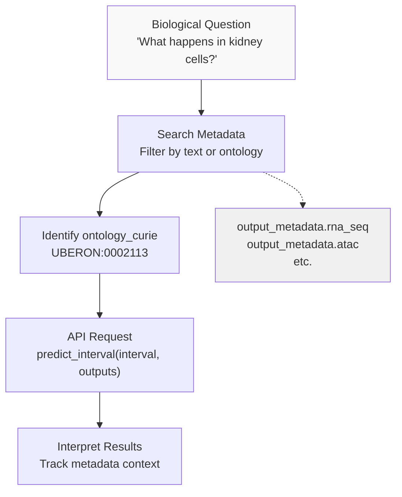
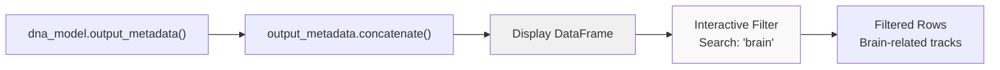
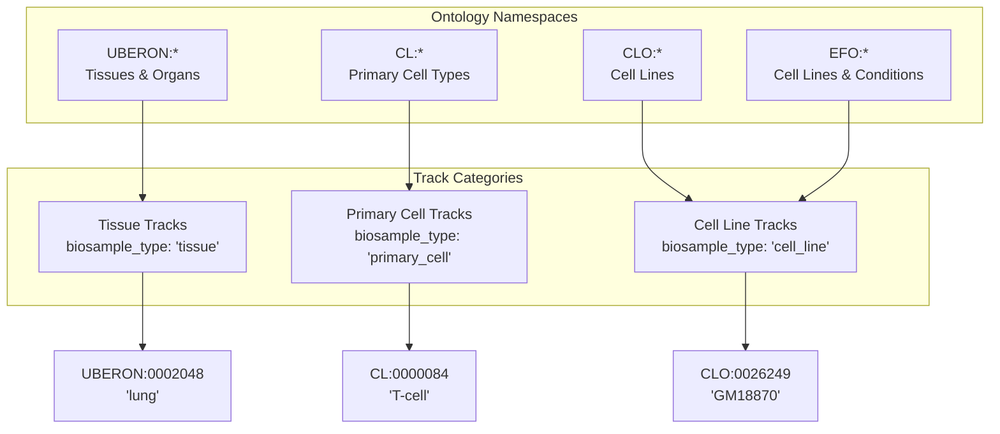
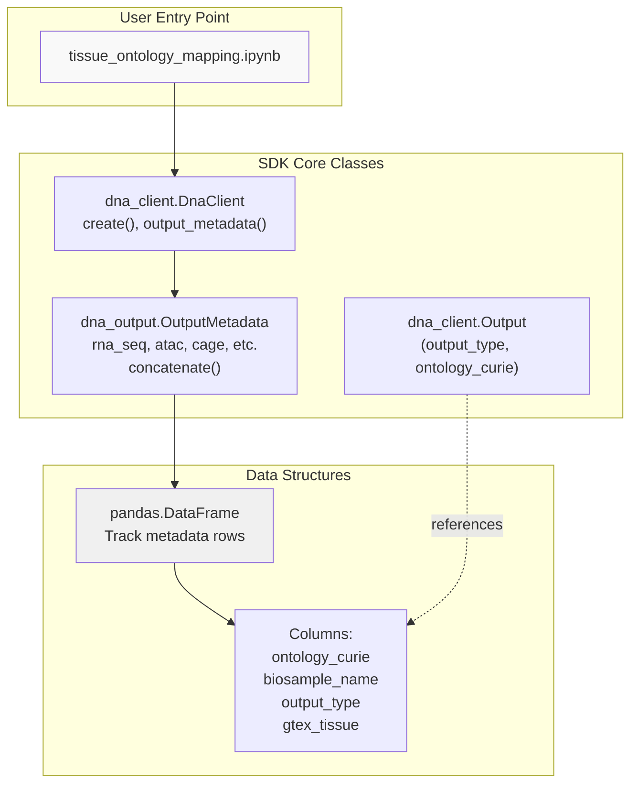

<!-- source: DeepWiki mcp.deepwiki.com · repo google-deepmind/alphagenome · page 6.6 Biological Context Mapping · fetched 2026-10-26 -->

# Biological Context Mapping

<details>
<summary>Relevant source files</summary>

The following files were used as context for generating this wiki page:

- [colabs/tissue_ontology_mapping.ipynb](colabs/tissue_ontology_mapping.ipynb)
- [docs/source/exploring_model_metadata.md](docs/source/exploring_model_metadata.md)

</details>


This tutorial demonstrates how to map biological contexts—such as tissues, cell types, and cell lines—to AlphaGenome prediction tracks using standardized ontology terms. Understanding this mapping is essential for selecting the appropriate biosample contexts when making predictions.

For information about making predictions with specific output types, see [Making Predictions](#5.1). For details on the output metadata structure and available assays, see [Exploring Model Metadata](docs/source/exploring_model_metadata.md).

## Overview

AlphaGenome generates predictions across thousands of experimental tracks, each corresponding to a specific biological context (e.g., "kidney", "T-cell", "GM12878 cell line"). These contexts are identified using standardized ontology terms encoded in CURIE (Compact Uniform Resource Identifier) format.

### Ontology Vocabularies

AlphaGenome uses four standardized ontology systems:

| Ontology | Full Name | Coverage | Example Term |
|----------|-----------|----------|--------------|
| **UBERON** | Uber-anatomy ontology | Anatomical structures and tissues | `UBERON:0002048` (lung) |
| **CL** | Cell Ontology | Cell types | `CL:0000084` (T-cell) |
| **CLO** | Cell Line Ontology | Immortalized cell lines | `CLO:0026249` (GM18870) |
| **EFO** | Experimental Factor Ontology | Cell lines and experimental conditions | `EFO:0002784` (GM12878) |

Each track in AlphaGenome is annotated with an `ontology_curie` field (e.g., `"CL:0000084"`) that uniquely identifies its biological context.

**Sources:** [colabs/tissue_ontology_mapping.ipynb:1-20](), [docs/source/exploring_model_metadata.md:1-94]()

## Accessing Output Metadata

The output metadata provides comprehensive information about all available prediction tracks. Access it using the `output_metadata()` method:

```python
from alphagenome.models import dna_client

dna_model = dna_client.create(api_key)
output_metadata = dna_model.output_metadata(
    organism=dna_client.Organism.HOMO_SAPIENS
)
```

The returned `OutputMetadata` object contains separate DataFrames for each output type:

- `output_metadata.rna_seq` - RNA-seq tracks (667 tracks across 285 biosamples)
- `output_metadata.cage` - CAGE tracks (546 tracks across 264 biosamples)
- `output_metadata.atac` - ATAC-seq tracks (167 tracks)
- `output_metadata.dnase` - DNase-seq tracks (305 tracks)
- `output_metadata.chip_histone` - Histone ChIP-seq tracks (1116 tracks)
- `output_metadata.chip_tf` - Transcription factor ChIP-seq tracks (1617 tracks)
- `output_metadata.splice_junctions` - Splice junction tracks (734 tracks)
- `output_metadata.contact_maps` - Contact map tracks (28 tracks)

**Sources:** [colabs/tissue_ontology_mapping.ipynb:60-126](), [docs/source/exploring_model_metadata.md:36-62]()

## Metadata Structure

Each metadata DataFrame contains the following key columns:

| Column | Type | Description | Example Value |
|--------|------|-------------|---------------|
| `name` | string | Full track name | `"CL:0000084 ATAC-seq"` |
| `ontology_curie` | category | Ontology identifier | `"CL:0000084"` |
| `biosample_name` | category | Human-readable name | `"T-cell"` |
| `biosample_type` | category | Sample category | `"primary_cell"` |
| `strand` | category | Strand information | `"+"`, `"-"`, or `"."` |
| `output_type` | category | Output modality | `"OutputType.ATAC"` |
| `data_source` | category | Experimental database | `"encode"`, `"fantom"`, `"4dnucleome"` |
| `biosample_life_stage` | category | Developmental stage | `"adult"`, `"embryonic"` |
| `nonzero_mean` | float | Mean signal value | 0.74 |

Additional columns vary by output type. For example, RNA-seq and splice junction tracks include a `gtex_tissue` column for tracks corresponding to GTEx project tissues.

**Sources:** [docs/source/exploring_model_metadata.md:48-94]()

## Biological Context Mapping Workflow



**Workflow Steps:**

1. **Formulate biological question** - Identify the tissue/cell type of interest
2. **Search metadata** - Use filtering to find relevant tracks
3. **Identify ontology terms** - Extract `ontology_curie` values
4. **Make API request** - Use ontology terms in `outputs` parameter
5. **Interpret results** - Use metadata to understand biological context

**Sources:** [colabs/tissue_ontology_mapping.ipynb:86-136](), [docs/source/exploring_model_metadata.md:1-94]()

## Interactive Metadata Exploration

The [tissue_ontology_mapping.ipynb]() notebook demonstrates interactive exploration using Google Colab's data table filtering:



### Key Exploration Techniques

**1. Concatenate all output types for searching:**
```python
all_metadata = output_metadata.concatenate()
# Returns single DataFrame with all tracks across all output types
```

**2. Filter by text search:**
Use Colab's built-in filtering to search across all fields (e.g., search "brain" to find brain-related biosamples).

**3. Filter programmatically:**
```python
# Find all T-cell tracks
tcell_tracks = all_metadata[
    all_metadata['biosample_name'].str.contains('T cell', case=False)
]

# Find tracks with specific ontology term
kidney_tracks = all_metadata[
    all_metadata['ontology_curie'] == 'UBERON:0002113'
]
```

**Sources:** [colabs/tissue_ontology_mapping.ipynb:129-157](), [docs/source/exploring_model_metadata.md:60-62]()

## Ontology Term Usage Patterns



**Sources:** [colabs/tissue_ontology_mapping.ipynb:157-5563](), [docs/source/exploring_model_metadata.md:54-58]()

## GTEx Tissue Mapping

For RNA-seq and splice junction outputs, tracks corresponding to GTEx (Genotype-Tissue Expression) project tissues include a `gtex_tissue` column:

```python
# Find all GTEx-annotated tracks
gtex_tracks = output_metadata.rna_seq[
    output_metadata.rna_seq['gtex_tissue'].notna()
]

# 55 unique GTEx tissues are available
gtex_tissues = gtex_tracks['gtex_tissue'].unique()
# Examples: 'Brain - Cortex', 'Liver', 'Heart - Left Ventricle'
```

**Special Note:** For "Brain - Cerebellar hemisphere", AlphaGenome uses `UBERON:0002245` rather than the GTEx-documented `UBERON:0002037` to align with Uberon's canonical ID for cerebellar hemisphere.

**Sources:** [docs/source/exploring_model_metadata.md:72-93]()

## Practical Examples

### Example 1: Finding Brain Tissue Predictions

```python
from alphagenome.models import dna_client

# Load metadata
dna_model = dna_client.create(api_key)
metadata = dna_model.output_metadata(dna_client.Organism.HOMO_SAPIENS)

# Search across all output types
all_tracks = metadata.concatenate()

# Filter for brain-related tracks
brain_tracks = all_tracks[
    all_tracks['biosample_name'].str.contains('brain', case=False, na=False)
]

# View unique biosamples
print(brain_tracks['biosample_name'].unique())
# Output: ['brain', 'Brain - Cortex', 'Brain - Cerebellar hemisphere', ...]

# Get ontology terms for API requests
brain_curies = brain_tracks['ontology_curie'].unique()
```

### Example 2: Mapping Cell Type to Ontology Term

```python
# Find specific cell type
cell_type = "CD4-positive, alpha-beta T cell"

t_cell_tracks = metadata.atac[
    metadata.atac['biosample_name'] == cell_type
]

# Extract ontology CURIE
curie = t_cell_tracks['ontology_curie'].iloc[0]
# Result: 'CL:0000624'

# Use in prediction
from alphagenome.data import genome

interval = genome.Interval("chr1", 1000000, 1100000)
outputs = [dna_client.Output(dna_client.OutputType.ATAC, curie)]

predictions = dna_model.predict_interval(interval, outputs)
```

### Example 3: Finding All Available Assays for a Tissue

```python
# Find all assays available for lung tissue
lung_curie = "UBERON:0002048"

all_metadata = metadata.concatenate()
lung_assays = all_metadata[
    all_metadata['ontology_curie'] == lung_curie
]

# Group by output type
assay_summary = lung_assays.groupby('output_type').size()
print(assay_summary)
# Output:
# OutputType.ATAC           1
# OutputType.RNA_SEQ        2
# OutputType.DNASE          1
# OutputType.CHIP_HISTONE   5
# ...
```

**Sources:** [colabs/tissue_ontology_mapping.ipynb:134-157]()

## Code Reference Map



### Key Code Entities

| Entity | Location | Purpose |
|--------|----------|---------|
| `dna_client.create()` | `alphagenome/models/dna_client.py` | Initialize model with API key |
| `DnaClient.output_metadata()` | `alphagenome/models/dna_client.py` | Retrieve track metadata |
| `OutputMetadata` | `alphagenome/models/dna_output.py` | Container for metadata DataFrames |
| `OutputMetadata.concatenate()` | `alphagenome/models/dna_output.py` | Merge all output types into single DataFrame |
| `dna_client.Output` | `alphagenome/models/dna_client.py` | Specify output type and ontology term for predictions |
| `dna_client.OutputType` | `alphagenome/models/dna_client.py` | Enum of available output modalities |

**Sources:** [colabs/tissue_ontology_mapping.ipynb:60-83](), [docs/source/exploring_model_metadata.md:36-46]()

## Summary

Biological context mapping connects your research questions to AlphaGenome's prediction capabilities through standardized ontology terms. The key steps are:

1. **Access metadata** using `dna_model.output_metadata()`
2. **Explore interactively** using DataFrame filtering or the tissue_ontology_mapping notebook
3. **Identify ontology CURIEs** for your biological contexts of interest
4. **Use in predictions** by specifying `Output(output_type, ontology_curie)` parameters
5. **Interpret results** with the rich metadata context

The standardized ontology system ensures consistent, reproducible biological annotations across all AlphaGenome predictions.

**Sources:** [colabs/tissue_ontology_mapping.ipynb:1-157](), [docs/source/exploring_model_metadata.md:1-94]()

---

