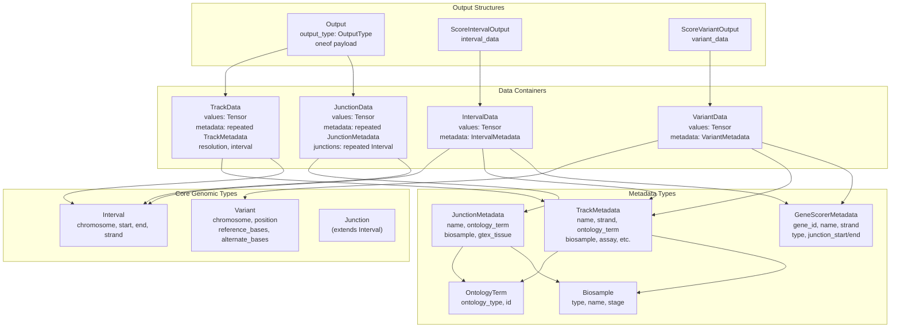
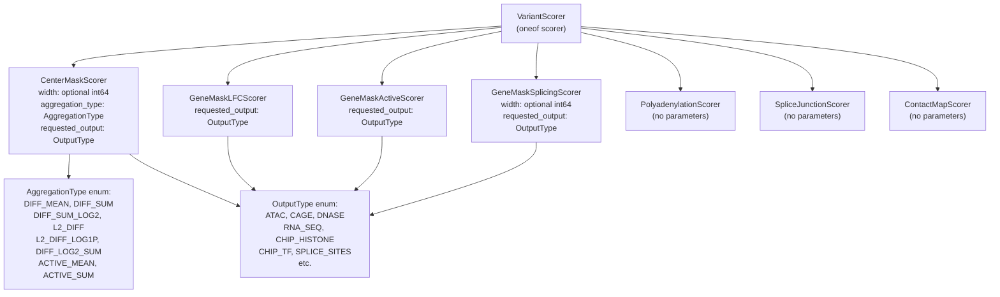
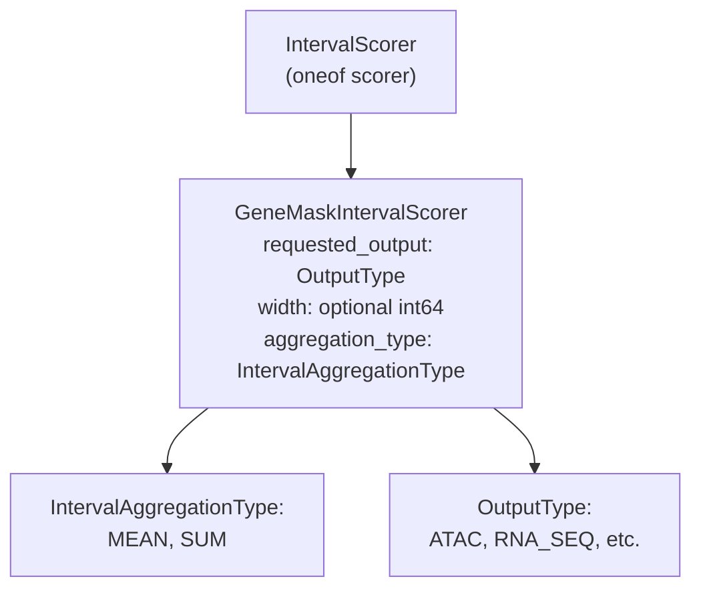
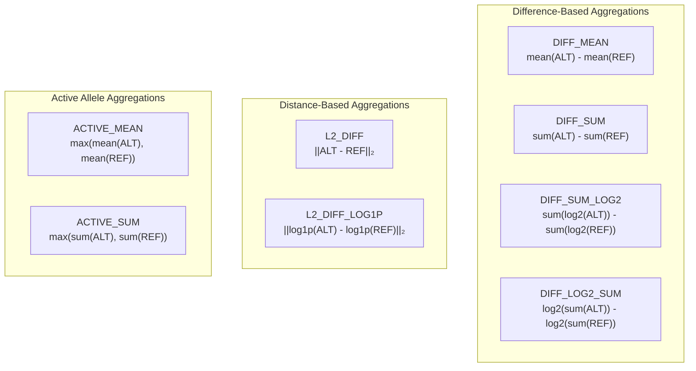
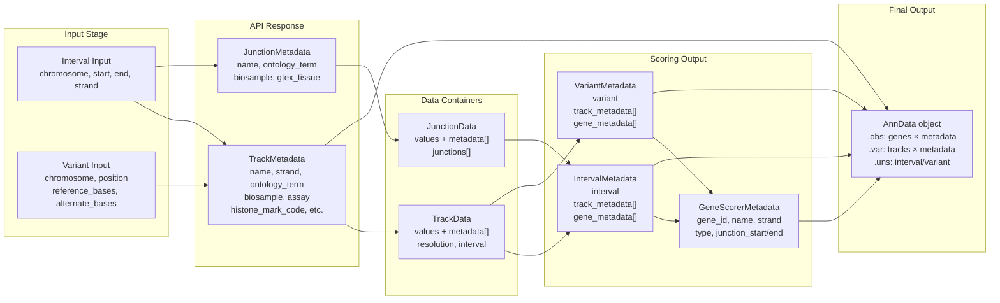
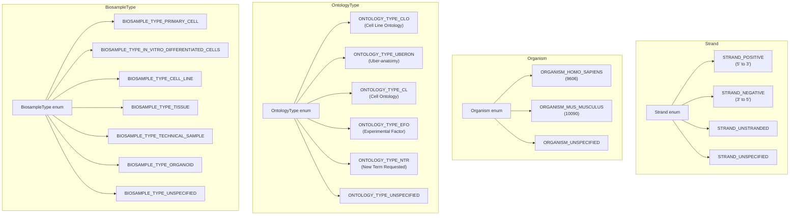
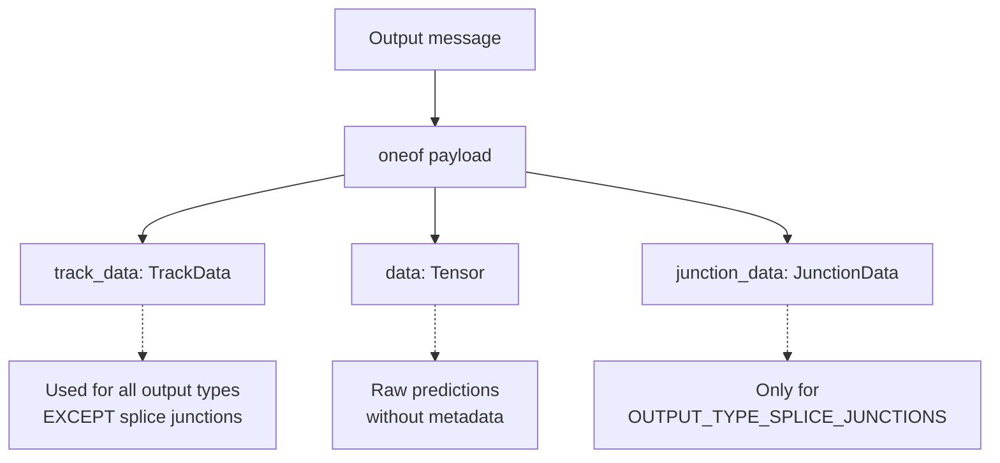

<!-- source: DeepWiki mcp.deepwiki.com · repo google-deepmind/alphagenome · page 7 Advanced Topics · fetched 2026-10-26 -->

# Advanced Topics

<details>
<summary>Relevant source files</summary>

The following files were used as context for generating this wiki page:

- [src/alphagenome/protos/dna_model.proto](src/alphagenome/protos/dna_model.proto)

</details>


## Purpose and Scope

This section provides deep technical dives into the internal architecture, data structures, and advanced usage patterns of the AlphaGenome SDK. It is intended for developers who need to understand system internals, extend functionality, or optimize performance-critical applications.

Topics covered include the Protocol Buffer schema that defines the API contract, the data processing pipeline for gene annotations, and the retry logic that ensures resilient network communication. For practical usage guides, see [User Guides](#5). For API reference documentation, see [API Reference](#4).

---

## Protocol Buffer Architecture Overview

The AlphaGenome SDK uses Protocol Buffers (protobuf) to define its API contract. All communication between the client (`DnaClient`) and the remote API server is serialized using this schema. Understanding the protobuf definitions is essential for advanced users who need to interpret raw API responses or extend the SDK.

### Message Hierarchy

The following diagram shows the core message types and their relationships as defined in the protocol buffer schema:



**Key Relationships:**

- **Core Types** (`Interval`, `Variant`) are the foundational coordinate systems for all genomic operations
- **Metadata Types** provide rich biological context for predictions and scores
- **Data Containers** combine tensors with metadata, creating self-describing data structures
- **Output Structures** wrap containers for different prediction and scoring operations

**Sources:** [src/alphagenome/protos/dna_model.proto:1-560]()

---

## Scorer Configuration Architecture

The SDK supports multiple scorer types for both variants and intervals. Each scorer has a corresponding Protocol Buffer message that defines its configuration parameters. Understanding these configurations is essential for customizing scoring behavior.

### Variant Scorer Types



**Scorer Configuration Details:**

| Scorer | Parameters | Use Case |
|--------|-----------|----------|
| `CenterMaskScorer` | `width`, `aggregation_type`, `requested_output` | General-purpose variant scoring with configurable mask size |
| `GeneMaskLFCScorer` | `requested_output` | Gene-level log fold change analysis |
| `GeneMaskActiveScorer` | `requested_output` | Active allele count scoring (maximum of REF/ALT) |
| `GeneMaskSplicingScorer` | `width`, `requested_output` | Splicing-specific scoring with mask |
| `PolyadenylationScorer` | None | Polyadenylation QTL analysis |
| `SpliceJunctionScorer` | None | Splice junction disruption scoring |
| `ContactMapScorer` | None | 3D chromatin interaction scoring |

**Sources:** [src/alphagenome/protos/dna_model.proto:301-368]()

### Interval Scorer Types



**Sources:** [src/alphagenome/protos/dna_model.proto:280-299]()

---

## Aggregation Type Mathematics

The `AggregationType` enum defines various mathematical operations for comparing reference and alternate predictions. Understanding these formulas is crucial for interpreting variant scores.

### Aggregation Type Formulas



### Detailed Aggregation Semantics

| Aggregation Type | Formula | Interpretation | Typical Use Case |
|------------------|---------|----------------|------------------|
| `DIFF_MEAN` | `mean(ALT) - mean(REF)` | Average change across positions | General variant effect size |
| `DIFF_SUM` | `sum(ALT) - sum(REF)` | Total change across positions | Total signal change |
| `DIFF_SUM_LOG2` | `sum(log₂(ALT)) - sum(log₂(REF))` | Log-scale sum difference | Fold-change in log space |
| `L2_DIFF` | `‖ALT - REF‖₂` | Euclidean distance | Overall perturbation magnitude |
| `L2_DIFF_LOG1P` | `‖log₁₊ₚ(ALT) - log₁₊ₚ(REF)‖₂` | Log-scale Euclidean distance | Perturbation on log scale |
| `DIFF_LOG2_SUM` | `log₂(sum(ALT)) - log₂(sum(REF))` | Log ratio of totals | Expression fold-change |
| `ACTIVE_MEAN` | `max(mean(ALT), mean(REF))` | Maximum average activity | Active allele identification |
| `ACTIVE_SUM` | `max(sum(ALT), sum(REF))` | Maximum total activity | Active allele total signal |

**Mathematical Notes:**

- Log-based aggregations (`DIFF_SUM_LOG2`, `DIFF_LOG2_SUM`, `L2_DIFF_LOG1P`) help normalize highly variable signals and interpret results as fold-changes
- Distance-based aggregations (`L2_DIFF`, `L2_DIFF_LOG1P`) measure overall perturbation without directionality
- Active allele aggregations (`ACTIVE_MEAN`, `ACTIVE_SUM`) identify which allele is more active, useful for dominant effect detection

**Sources:** [src/alphagenome/protos/dna_model.proto:514-547]()

---

## Metadata Propagation Through the System

Metadata is a first-class concept in the AlphaGenome SDK. Every prediction and score carries rich biological context through structured metadata fields. Understanding how metadata flows through the system is essential for interpreting results.

### Metadata Flow Architecture



**Metadata Propagation Rules:**

1. **Input Coordinates:** Interval/Variant objects define the genomic region and are preserved throughout the pipeline
2. **Track Metadata:** Each predicted track includes metadata about the biological sample, assay type, and experimental conditions
3. **Gene Metadata:** Scoring operations annotate results with gene-level information (gene ID, symbol, strand, biotype)
4. **AnnData Storage:** Final scores store all metadata in structured DataFrames (`obs` for genes, `var` for tracks, `uns` for genomic context)

**Sources:** [src/alphagenome/protos/dna_model.proto:80-238]()

---

## Enum Types and Biological Ontologies

The protocol buffer schema defines several enum types that constrain inputs to valid biological concepts. These enums ensure type safety and enable structured querying.

### Core Enum Types



### OutputType Enumeration

The `OutputType` enum defines all supported prediction modalities:

| OutputType | Description | Resolution |
|------------|-------------|------------|
| `OUTPUT_TYPE_ATAC` | ATAC-seq chromatin accessibility | 128 bp |
| `OUTPUT_TYPE_CAGE` | CAGE gene expression | 32 bp |
| `OUTPUT_TYPE_DNASE` | DNase I hypersensitive sites | 128 bp |
| `OUTPUT_TYPE_RNA_SEQ` | RNA sequencing expression | 32 bp |
| `OUTPUT_TYPE_CHIP_HISTONE` | ChIP-seq histone modifications | 128 bp |
| `OUTPUT_TYPE_CHIP_TF` | ChIP-seq transcription factor binding | 128 bp |
| `OUTPUT_TYPE_SPLICE_SITES` | Splice donor/acceptor sites | 1 bp |
| `OUTPUT_TYPE_SPLICE_SITE_USAGE` | Splice site usage fractions | 1 bp |
| `OUTPUT_TYPE_SPLICE_JUNCTIONS` | Splice junction read counts | Discrete |
| `OUTPUT_TYPE_CONTACT_MAPS` | 3D chromatin contacts | Discrete |
| `OUTPUT_TYPE_PROCAP` | PRO-cap gene expression | 32 bp |

**Sources:** [src/alphagenome/protos/dna_model.proto:387-559]()

---

## Advanced Data Structure Patterns

### Oneof Pattern for Polymorphic Payloads

The protocol buffer schema uses the `oneof` construct to represent polymorphic data structures. This pattern appears in several key messages:



This pattern allows the `Output` message to efficiently represent different data types while maintaining type safety. The SDK's Python layer converts these `oneof` fields into typed Python objects.

**Sources:** [src/alphagenome/protos/dna_model.proto:248-266]()

### Repeated Fields for Multidimensional Data

The protocol buffer schema uses `repeated` fields to represent arrays and lists. The relationship between repeated metadata and tensor dimensions is critical:

```
message TrackData {
  Tensor values = 1;  // Shape: [positions, tracks]
  repeated TrackMetadata metadata = 2;  // Length must equal values.shape[-1]
  ...
}

message JunctionData {
  Tensor values = 1;  // Shape: [junctions, tracks]
  repeated JunctionMetadata metadata = 2;  // Length must equal values.shape[-1]
  repeated Interval junctions = 3;  // Length must equal values.shape[0]
  ...
}
```

**Invariant:** The length of metadata repeated fields MUST match the corresponding tensor dimension. This constraint is validated by the SDK client before serialization and after deserialization.

**Sources:** [src/alphagenome/protos/dna_model.proto:174-204]()

---

## Performance Considerations

### Message Size and Chunking

The AlphaGenome API uses message chunking to handle large predictions that exceed gRPC message size limits. While the chunking logic is implemented in the service layer (see [Protocol Buffers and gRPC](#7.1)), understanding the implications is important for advanced users:

**Typical Message Sizes:**

| Operation | Approximate Size | Chunked? |
|-----------|------------------|----------|
| Single interval prediction (32kb, 5 output types) | ~50 MB | Yes |
| Single variant prediction (32kb, 5 output types) | ~100 MB (REF + ALT) | Yes |
| Score variant (10 scorers) | ~1 MB | No |
| Score ISM (100bp region) | ~100 MB | Yes |

### Memory Management

Large-scale variant scoring operations can generate significant memory pressure. Consider these patterns:

**Batch Processing Pattern:**
```
# Instead of loading all results at once:
# results = [model.score_variant(v, scorers) for v in large_variant_list]

# Process in batches to control memory:
batch_size = 100
for i in range(0, len(large_variant_list), batch_size):
    batch = large_variant_list[i:i+batch_size]
    batch_results = [model.score_variant(v, scorers) for v in batch]
    process_and_save(batch_results)  # Process and discard
    del batch_results  # Explicit cleanup
```

**Memory-Efficient ISM:**
```
# ISM generates num_positions × num_substitutions scores
# For 100bp region: 100 × 3 = 300 variant predictions
# Each prediction is ~100 MB → 30 GB total if held in memory
# Use generator patterns or process incrementally
```

---

## Advanced Scorer Configurations

### Combining Multiple Scorers

The SDK allows scoring variants with multiple scorers simultaneously. Each scorer produces an independent `AnnData` object in the result list:

```
# Multiple scorers applied to same variant
scorers = [
    CenterMaskScorer(aggregation_type=AggregationType.DIFF_MEAN, width=1000),
    GeneMaskLFCScorer(requested_output=OutputType.RNA_SEQ),
    SpliceJunctionScorer()
]

results = model.score_variant(interval, variant, scorers=scorers)
# results: list[AnnData] with length 3
```

**Scorer Ordering:** The order of `AnnData` objects in the result list matches the order of scorers in the input list. This deterministic behavior allows users to map results back to their corresponding scorer configurations.

### Custom Aggregation Workflows

Advanced users can implement custom aggregation logic by requesting raw predictions and computing aggregations in Python:

```
# Get raw predictions
ref_output, alt_output = model.predict_variant(interval, variant, outputs=[OutputType.RNA_SEQ])

# Access raw values
ref_values = ref_output.rna_seq.values  # numpy array
alt_values = alt_output.rna_seq.values

# Custom aggregation (example: median absolute difference)
custom_score = np.median(np.abs(alt_values - ref_values))
```

This pattern is useful when built-in aggregation types don't match your analysis requirements.

**Sources:** [src/alphagenome/protos/dna_model.proto:301-368]()

---

## Biological Context and Filtering

### OntologyTerm Structure

The `OntologyTerm` message connects predictions to standardized biological vocabularies:

```
message OntologyTerm {
  OntologyType ontology_type = 1;  // CLO, UBERON, CL, EFO, or NTR
  int64 id = 2;  // Numerical identifier within ontology
}
```

**Example:** To filter tracks for "brain" tissue:
- Ontology: `UBERON` (Uber-anatomy ontology)
- Term ID: `0000955` (brain)

The SDK provides utilities for filtering tracks by ontology terms. For practical usage, see [Biological Context Mapping](#6.6).

### Biosample Metadata

The `Biosample` message provides additional context beyond ontology terms:

```
message Biosample {
  BiosampleType type = 1;  // PRIMARY_CELL, TISSUE, CELL_LINE, etc.
  string name = 2;  // Human-readable name
  optional string stage = 3;  // Developmental stage (e.g., "adult", "embryonic")
}
```

This multi-faceted metadata allows fine-grained filtering:
- Filter by biosample type: `type == BIOSAMPLE_TYPE_PRIMARY_CELL`
- Filter by developmental stage: `stage == "adult"`
- Filter by tissue name: `name == "liver"`

**Sources:** [src/alphagenome/protos/dna_model.proto:59-78]()

---

## Data Type Conversions

### Protocol Buffer to Python Object Mapping

The SDK automatically converts protocol buffer messages to Python objects:

| Protocol Buffer Type | Python Type | Notes |
|---------------------|-------------|-------|
| `Interval` | `genome.Interval` | Immutable dataclass with validation |
| `Variant` | `genome.Variant` | Immutable dataclass with validation |
| `TrackData` | `dna_output.TrackData` | Contains numpy arrays and pandas DataFrames |
| `JunctionData` | `dna_output.JunctionData` | Contains numpy arrays and pandas DataFrames |
| `Output` | `dna_output.Output` | Named tuple with modality-specific attributes |
| `repeated TrackMetadata` | `pandas.DataFrame` | One row per track |
| `repeated JunctionMetadata` | `pandas.DataFrame` | One row per junction track |

### Tensor Representation

The `Tensor` message (imported from `tensor.proto`) stores multidimensional arrays. The SDK converts these to `numpy.ndarray`:

```
# Protocol Buffer: Tensor with shape [1000, 128]
# Python: numpy.ndarray with dtype=float32, shape=(1000, 128)
```

**Stride and Layout:** Tensors are stored in row-major (C-contiguous) format, which is the default for numpy arrays. No transposition is needed.

---

## Numerical Precision and Quantization

### Float32 Precision

All model predictions are transmitted as `float32` (32-bit floating point) values. This provides:
- **Range:** ~10⁻³⁸ to ~10³⁸
- **Precision:** ~7 decimal digits

For most genomic applications, float32 precision is sufficient. However, aggregation operations that sum many values may accumulate rounding errors:

```python
# Potential precision loss in large sums
large_sum = np.sum(predictions)  # float32 sum may lose precision

# More precise: accumulate in float64
precise_sum = np.sum(predictions, dtype=np.float64)
```

### Quantile Normalization

Some scorers return both raw and quantile-normalized scores. Quantile scores are computed by the API server and represent the percentile of the score within a reference distribution. These are always in the range [0.0, 1.0].

**Sources:** The quantile computation logic is server-side and not visible in the SDK code.

---

## Thread Safety and Concurrency

### DnaClient Thread Safety

The `DnaClient` class uses gRPC channels which are thread-safe by design. Multiple threads can safely call methods on the same `DnaClient` instance:

```python
from concurrent.futures import ThreadPoolExecutor

client = dna_client.create(api_key="...")

def score_variant(variant):
    return client.score_variant(interval, variant, scorers=[...])

# Safe: multiple threads using same client
with ThreadPoolExecutor(max_workers=10) as executor:
    results = list(executor.map(score_variant, variant_list))
```

**Caveat:** While the gRPC channel is thread-safe, the API server may rate-limit concurrent requests from the same API key. For high-throughput applications, implement request throttling.

### Async/Await Support

The current SDK implementation is synchronous. For asynchronous workflows, use thread pools as shown above or consider wrapping synchronous calls with `asyncio.to_thread()`:

```python
import asyncio

async def async_score_variant(variant):
    return await asyncio.to_thread(
        client.score_variant, interval, variant, scorers=[...]
    )
```

---

## Error Handling Deep Dive

The SDK implements sophisticated error handling and retry logic. For detailed information on retry strategies, backoff algorithms, and error code handling, see [Error Handling and Retry Logic](#7.3).

**Key Error Categories:**

1. **Client-side validation errors:** Invalid inputs detected before network communication (e.g., invalid sequence characters, unsupported lengths)
2. **Retryable network errors:** Transient failures that trigger automatic retry (e.g., `UNAVAILABLE`, `DEADLINE_EXCEEDED`)
3. **Non-retryable errors:** Permanent failures that immediately raise exceptions (e.g., `INVALID_ARGUMENT`, `UNAUTHENTICATED`)

---

## Data Processing Pipeline

The SDK includes utilities for processing external datasets into SDK-compatible formats. The most important is the GTF processing pipeline that converts GENCODE gene annotations into efficient Feather files. For detailed information, see [Data Processing Pipeline](#7.2).

**Pipeline Stages:**

1. **GTF Parsing:** Read GENCODE GTF files and handle duplicate attributes
2. **Feather Conversion:** Convert to Apache Arrow format for fast loading
3. **Splice Site Extraction:** Compute tissue-agnostic splice junction coordinates
4. **Gene Filtering:** Provide utilities for filtering by transcript support level, biotype, etc.

---

## Summary

This page covered advanced architectural concepts for the AlphaGenome SDK:

- **Protocol Buffer schema** defines the complete API contract with strongly-typed messages
- **Scorer configurations** provide flexible variant and interval scoring with multiple aggregation strategies
- **Metadata propagation** ensures biological context flows through the entire pipeline
- **Performance considerations** help optimize memory usage for large-scale analyses
- **Data type conversions** bridge protocol buffers to Python objects transparently

For implementation details on specific subsystems, see the child pages: [Protocol Buffers and gRPC](#7.1), [Data Processing Pipeline](#7.2), and [Error Handling and Retry Logic](#7.3).

---

