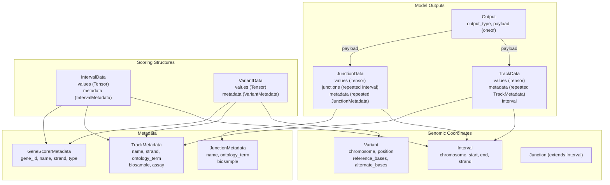
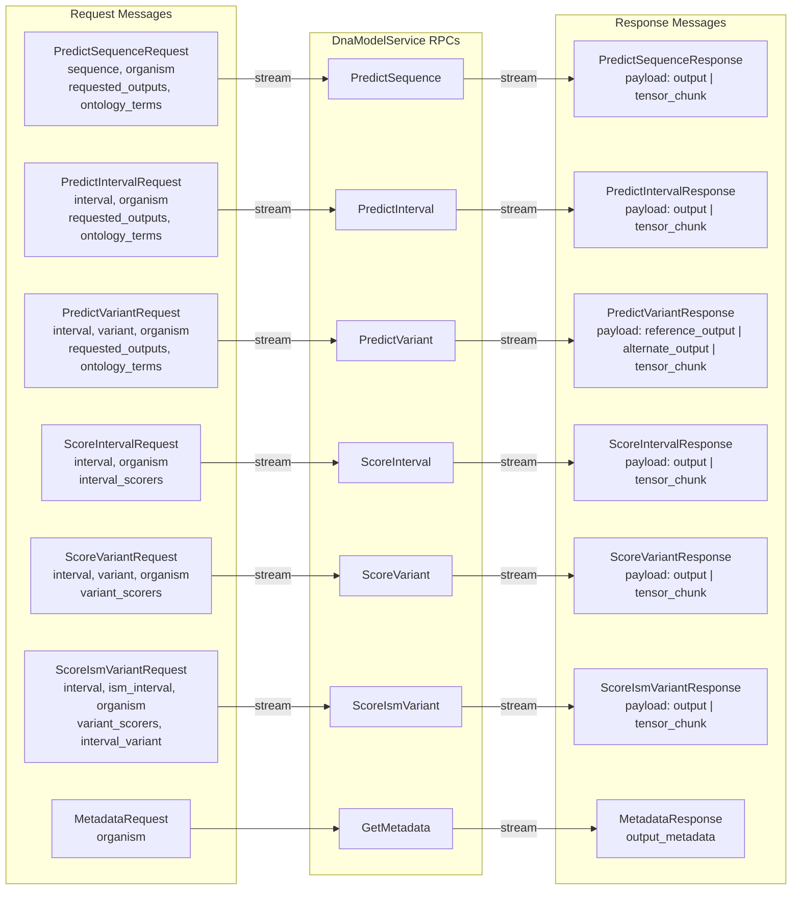
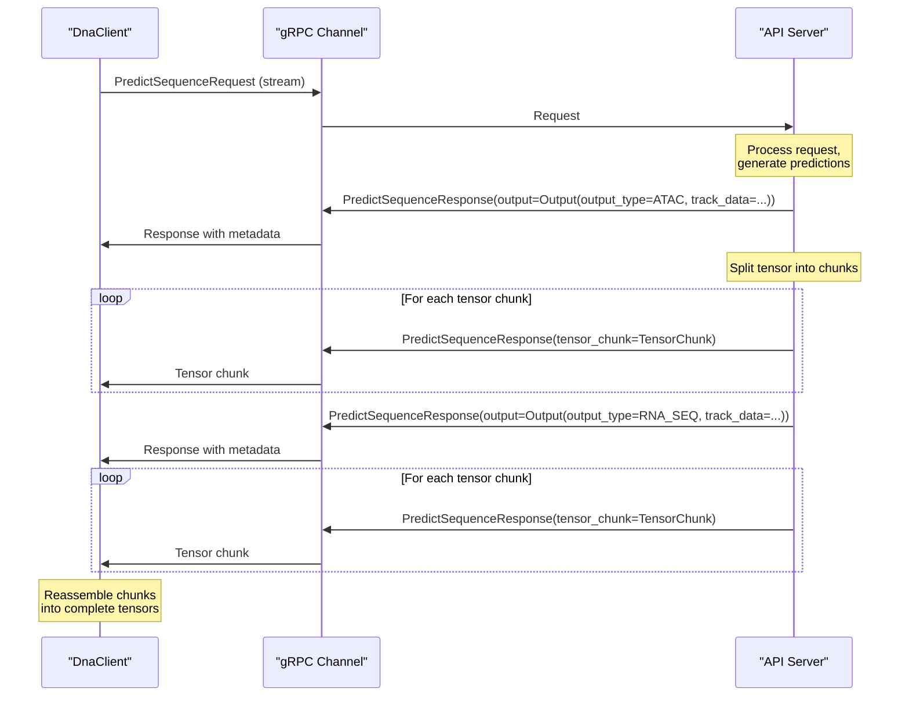
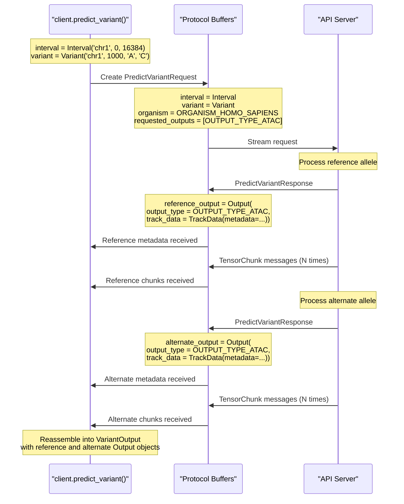
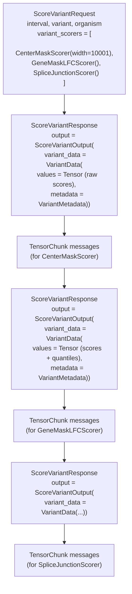

<!-- source: DeepWiki mcp.deepwiki.com · repo google-deepmind/alphagenome · page 7.1 Protocol Buffers and gRPC · fetched 2026-10-26 -->

# Protocol Buffers and gRPC

<details>
<summary>Relevant source files</summary>

The following files were used as context for generating this wiki page:

- [src/alphagenome/models/dna_client_test.py](src/alphagenome/models/dna_client_test.py)
- [src/alphagenome/protos/dna_model.proto](src/alphagenome/protos/dna_model.proto)
- [src/alphagenome/protos/dna_model_service.proto](src/alphagenome/protos/dna_model_service.proto)

</details>


## Purpose and Scope

This page documents the Protocol Buffer schemas and gRPC service definitions that form the communication layer between the AlphaGenome SDK client and the remote API server. Protocol Buffers (protobuf) define the wire format for all data structures and messages, while gRPC provides the RPC framework for bidirectional streaming communication.

For information about the client-side implementation that uses these protocols, see [DnaClient](#4.1). For details on error handling and retry logic, see [Error Handling and Retry Logic](#7.3).

## Protocol Buffer Schema Overview

The AlphaGenome API defines two proto files that establish the contract between client and server:

| Proto File | Purpose | Key Definitions |
|------------|---------|-----------------|
| `dna_model.proto` | Core data structures and enums | `Interval`, `Variant`, `TrackData`, `JunctionData`, `Output`, `OutputType`, `Organism`, scorer configurations |
| `dna_model_service.proto` | gRPC service definition | `DnaModelService`, request/response messages for each RPC method |

Sources: [src/alphagenome/protos/dna_model.proto:1-560](), [src/alphagenome/protos/dna_model_service.proto:1-269]()

### Core Data Structures (dna_model.proto)

The `dna_model.proto` file defines the fundamental building blocks for genomic data representation and model outputs.



**Diagram: Protocol Buffer Message Hierarchy for Core Data Structures**

Sources: [src/alphagenome/protos/dna_model.proto:26-247]()

#### Key Message Types

**Genomic Regions:**
- `Interval` [src/alphagenome/protos/dna_model.proto:27-39]() - Represents a genomic region with chromosome, 0-based start/end coordinates, and strand
- `Variant` [src/alphagenome/protos/dna_model.proto:42-57]() - Represents a genetic variant with 1-based position, reference bases, and alternate bases

**Prediction Outputs:**
- `Output` [src/alphagenome/protos/dna_model.proto:249-266]() - Container for a single output type with a `oneof` payload that can be `TrackData`, `JunctionData`, or raw `Tensor`
- `TrackData` [src/alphagenome/protos/dna_model.proto:174-187]() - Stores continuous track predictions (ATAC-seq, RNA-seq, etc.) with values tensor, metadata, and optional resolution
- `JunctionData` [src/alphagenome/protos/dna_model.proto:190-204]() - Stores junction predictions (splice junctions, contact maps) with values tensor, junction intervals, and metadata

**Scoring Results:**
- `IntervalData` [src/alphagenome/protos/dna_model.proto:219-225]() - Stores interval scoring results with values tensor and `IntervalMetadata`
- `VariantData` [src/alphagenome/protos/dna_model.proto:240-246]() - Stores variant scoring results with values tensor and `VariantMetadata`
- `ScoreIntervalOutput` [src/alphagenome/protos/dna_model.proto:269-272]() - Wrapper for interval scoring output
- `ScoreVariantOutput` [src/alphagenome/protos/dna_model.proto:275-278]() - Wrapper for variant scoring output

Sources: [src/alphagenome/protos/dna_model.proto:27-278]()

#### Enumerations

The proto defines several critical enums that control API behavior:

| Enum | Purpose | Values |
|------|---------|--------|
| `Strand` | DNA strand specification | `STRAND_POSITIVE` (+), `STRAND_NEGATIVE` (-), `STRAND_UNSTRANDED` (.) |
| `OutputType` | Prediction modality | `OUTPUT_TYPE_ATAC`, `OUTPUT_TYPE_RNA_SEQ`, `OUTPUT_TYPE_SPLICE_JUNCTIONS`, `OUTPUT_TYPE_CONTACT_MAPS`, etc. (11 types total) |
| `Organism` | Species selection | `ORGANISM_HOMO_SAPIENS` (9606), `ORGANISM_MUS_MUSCULUS` (10090) |
| `AggregationType` | Variant scoring aggregation | `AGGREGATION_TYPE_DIFF_MEAN`, `AGGREGATION_TYPE_L2_DIFF`, `AGGREGATION_TYPE_DIFF_SUM_LOG2`, etc. (8 types) |
| `IntervalAggregationType` | Interval scoring aggregation | `INTERVAL_AGGREGATION_TYPE_MEAN`, `INTERVAL_AGGREGATION_TYPE_SUM` |
| `OntologyType` | Biological ontology system | `ONTOLOGY_TYPE_UBERON`, `ONTOLOGY_TYPE_CL`, `ONTOLOGY_TYPE_CLO`, `ONTOLOGY_TYPE_EFO` |
| `BiosampleType` | Sample classification | `BIOSAMPLE_TYPE_PRIMARY_CELL`, `BIOSAMPLE_TYPE_TISSUE`, `BIOSAMPLE_TYPE_CELL_LINE`, etc. |

Sources: [src/alphagenome/protos/dna_model.proto:388-559]()

#### Scorer Configurations

The proto defines message types for configuring different scoring strategies:

**Variant Scorers:**
- `CenterMaskScorer` [src/alphagenome/protos/dna_model.proto:302-311]() - Masks a window around the variant center
- `GeneMaskLFCScorer` [src/alphagenome/protos/dna_model.proto:314-317]() - Gene-level log fold change scoring
- `GeneMaskSplicingScorer` [src/alphagenome/protos/dna_model.proto:326-332]() - Gene-level splicing effect scoring
- `GeneMaskActiveScorer` [src/alphagenome/protos/dna_model.proto:320-323]() - Gene-level active allele scoring
- `PolyadenylationScorer` [src/alphagenome/protos/dna_model.proto:335]() - Polyadenylation QTL scoring
- `SpliceJunctionScorer` [src/alphagenome/protos/dna_model.proto:338]() - Splice junction effect scoring
- `ContactMapScorer` [src/alphagenome/protos/dna_model.proto:341]() - Contact map effect scoring

**Interval Scorers:**
- `GeneMaskIntervalScorer` [src/alphagenome/protos/dna_model.proto:281-290]() - Gene-level interval scoring

These are wrapped in container messages (`VariantScorer`, `IntervalScorer`) that use `oneof` to allow specifying exactly one scorer type per request.

Sources: [src/alphagenome/protos/dna_model.proto:281-368]()

### Service Definition (dna_model_service.proto)

The `dna_model_service.proto` file defines the gRPC service interface with seven RPC methods.



**Diagram: gRPC Service Definition with Request/Response Message Types**

Sources: [src/alphagenome/protos/dna_model_service.proto:28-55]()

#### RPC Methods

The `DnaModelService` [src/alphagenome/protos/dna_model_service.proto:28-55]() defines the following methods:

| RPC Method | Streaming Pattern | Purpose |
|------------|-------------------|---------|
| `PredictSequence` | Bidirectional stream | Predict outputs for a raw DNA sequence string |
| `PredictInterval` | Bidirectional stream | Predict outputs for a genomic interval (fetches sequence from reference genome) |
| `PredictVariant` | Bidirectional stream | Predict outputs for both reference and alternate alleles of a variant |
| `ScoreInterval` | Bidirectional stream | Score a genomic interval using interval scorers |
| `ScoreVariant` | Bidirectional stream | Score a variant's effect using variant scorers |
| `ScoreIsmVariant` | Bidirectional stream | Score all possible single-nucleotide mutations in an interval (in-silico mutagenesis) |
| `GetMetadata` | Unary request, server stream | Retrieve metadata about available tracks and output types |

Sources: [src/alphagenome/protos/dna_model_service.proto:28-55]()

#### Request Message Structure

All prediction and scoring requests share common patterns:

**Common Fields:**
- `organism` - Species selection (`ORGANISM_HOMO_SAPIENS` or `ORGANISM_MUS_MUSCULUS`)
- `model_version` - Optional version string for model selection (defaults to latest)

**Prediction Requests:**
- `requested_outputs` - List of `OutputType` enums specifying which modalities to predict
- `ontology_terms` - Optional list of `OntologyTerm` messages to filter tracks by biological context

**Scoring Requests:**
- `interval_scorers` or `variant_scorers` - List of scorer configurations

**Examples:**

`PredictSequenceRequest` [src/alphagenome/protos/dna_model_service.proto:58-74]() includes:
- `sequence` - DNA string (must contain only "ACGTN" characters)
- `organism`, `ontology_terms`, `requested_outputs`, `model_version`

`PredictVariantRequest` [src/alphagenome/protos/dna_model_service.proto:122-141]() includes:
- `interval` - Genomic region containing the variant
- `variant` - The variant to analyze
- `organism`, `requested_outputs`, `ontology_terms`, `model_version`

`ScoreIsmVariantRequest` [src/alphagenome/protos/dna_model_service.proto:222-242]() includes:
- `interval` - Genomic context for scoring
- `ism_interval` - Sub-region to systematically mutate
- `variant_scorers` - Scoring configurations
- `interval_variant` - Optional variant to apply before ISM
- `organism`, `model_version`

Sources: [src/alphagenome/protos/dna_model_service.proto:58-242]()

## Streaming and Tensor Chunking

All prediction and scoring RPCs use bidirectional streaming to handle large tensor data efficiently. The streaming protocol prevents message size limits from being exceeded by breaking tensors into chunks.



**Diagram: Bidirectional Streaming with Tensor Chunking**

Sources: [src/alphagenome/protos/dna_model_service.proto:76-87](), [src/alphagenome/models/dna_client_test.py:54-87]()

### Response Message Pattern

All response messages use a `oneof payload` pattern that alternates between metadata messages and tensor chunks:

**PredictSequenceResponse** [src/alphagenome/protos/dna_model_service.proto:77-87]():
```protobuf
message PredictSequenceResponse {
  oneof payload {
    Output output = 1;           // Metadata for one output type
    TensorChunk tensor_chunk = 2; // Chunk of tensor data
  }
}
```

**PredictVariantResponse** [src/alphagenome/protos/dna_model_service.proto:144-158]():
```protobuf
message PredictVariantResponse {
  oneof payload {
    Output reference_output = 1;  // Reference allele output
    Output alternate_output = 2;  // Alternate allele output
    TensorChunk tensor_chunk = 3; // Chunk for last output
  }
}
```

The server sends:
1. An `Output` message containing metadata (track names, intervals, etc.) but with tensor shape only (no data)
2. A sequence of `TensorChunk` messages containing the actual tensor bytes
3. Another `Output` message for the next output type
4. More `TensorChunk` messages
5. And so on...

Sources: [src/alphagenome/protos/dna_model_service.proto:76-158](), [src/alphagenome/protos/dna_model_service.proto:176-219]()

### Chunk Reassembly Logic

The client must reassemble chunks back into complete tensors. The test code demonstrates the expected flow:

```python
def _generate_prediction_protos(
    predictions: dna_client.Output,
    requested_outputs: Sequence[dna_model_pb2.OutputType],
    bytes_per_chunk: int,
    response_proto_type: ...,
):
  """Helper to generate proto responses for the provided predictions."""
  for output_type in requested_outputs:
    prediction = predictions.get(dna_client.OutputType(output_type))
    if prediction is not None:
      if isinstance(prediction, track_data.TrackData):
        proto, chunks = track_data_utils.to_protos(
            prediction, bytes_per_chunk=bytes_per_chunk
        )
        yield response_proto_type(
            output=dna_model_pb2.Output(
                output_type=output_type, track_data=proto
            )
        )
      # ... handle other types
      
      for chunk in chunks:
        yield response_proto_type(tensor_chunk=chunk)
```

This pattern shows:
1. The metadata proto is yielded first (with `Output` containing `TrackData` or `JunctionData`)
2. Then all tensor chunks are yielded sequentially
3. This repeats for each requested output type

Sources: [src/alphagenome/models/dna_client_test.py:54-87](), [src/alphagenome/models/dna_client_test.py:89-148]()

### Chunking Benefits

Tensor chunking provides several advantages:

1. **Avoids gRPC message size limits** - Large predictions (e.g., 1M bp × 800 tracks) would exceed typical 4MB limits
2. **Enables streaming progress** - Client can process data as it arrives
3. **Reduces memory pressure** - Chunks can be processed and discarded incrementally
4. **Supports resumption** - Failed transfers can potentially resume from last successful chunk

The `TensorChunk` message is defined in a separate `tensor.proto` file (imported by both proto files) and contains raw bytes plus metadata for reassembly.

Sources: [src/alphagenome/protos/dna_model.proto:19](), [src/alphagenome/protos/dna_model_service.proto:20]()

## Message Flow Examples

### Example 1: Predicting a Variant

A complete request-response cycle for `PredictVariant`:



**Diagram: Complete Message Flow for Variant Prediction**

Sources: [src/alphagenome/protos/dna_model_service.proto:122-158](), [src/alphagenome/models/dna_client_test.py:772-814]()

### Example 2: Scoring with Multiple Scorers

When multiple scorers are requested, each produces a separate `ScoreVariantOutput` message:



**Diagram: Multiple Scorer Results in Single Streaming Response**

The client receives results in the same order as scorers were specified in the request. Each scorer produces:
- A `ScoreVariantOutput` containing `VariantData` with metadata (gene IDs, track names)
- Followed by tensor chunks for the score values
- Gene-level scorers may include both raw scores and quantile scores stacked in the tensor

Sources: [src/alphagenome/protos/dna_model_service.proto:190-219](), [src/alphagenome/models/dna_client_test.py:1386-1418](), [src/alphagenome/models/dna_client_test.py:150-203]()

## Proto-to-Python Mappings

The SDK provides Python classes that wrap proto messages for a more Pythonic interface. Key mappings:

| Proto Message | Python Class | Module |
|---------------|--------------|--------|
| `Interval` | `genome.Interval` | `alphagenome.data.genome` |
| `Variant` | `genome.Variant` | `alphagenome.data.genome` |
| `TrackData` | `track_data.TrackData` | `alphagenome.data.track_data` |
| `JunctionData` | `junction_data.JunctionData` | `alphagenome.data.junction_data` |
| `Output` | `dna_client.Output` | `alphagenome.models.dna_client` |
| `OutputType` | `dna_client.OutputType` (enum) | `alphagenome.models.dna_client` |
| `Organism` | `dna_client.Organism` (enum) | `alphagenome.models.dna_client` |
| `Strand` | `genome.Strand` (enum) | `alphagenome.data.genome` |
| `CenterMaskScorer` | `variant_scorers.CenterMaskScorer` | `alphagenome.models.variant_scorers` |
| `GeneMaskIntervalScorer` | `interval_scorers.GeneMaskScorer` | `alphagenome.models.interval_scorers` |
| `VariantData` | `anndata.AnnData` | External (anndata library) |
| `IntervalData` | `anndata.AnnData` | External (anndata library) |

### Conversion Methods

Python classes provide `to_proto()` and `from_proto()` methods for serialization:

```python
# Example from test code
interval = genome.Interval('chr1', 0, 16_384)
proto = interval.to_proto()  # Returns dna_model_pb2.Interval

variant = genome.Variant('chr1', 1000, 'A', 'C')
proto = variant.to_proto()  # Returns dna_model_pb2.Variant
```

The client internally handles all proto conversions, so users typically work with Python objects directly.

Sources: [src/alphagenome/models/dna_client_test.py:986-1088]()

### Enum Conversions

Enums have explicit conversion methods:

```python
# OutputType enum
output_type = dna_client.OutputType.ATAC
proto_enum = output_type.to_proto()  # Returns dna_model_pb2.OUTPUT_TYPE_ATAC

# Organism enum  
organism = dna_client.Organism.HOMO_SAPIENS
proto_enum = organism.to_proto()  # Returns dna_model_pb2.ORGANISM_HOMO_SAPIENS

# Strand enum
strand = genome.Strand.from_str('+')  
proto_enum = strand.to_proto()  # Returns dna_model_pb2.STRAND_POSITIVE
```

Sources: [src/alphagenome/models/dna_client_test.py:955-984](), [src/alphagenome/models/dna_client_test.py:162-170]()

### Scorer Configurations

Scorer Python classes map directly to proto messages:

```python
# Variant scorers
center_mask = variant_scorers.CenterMaskScorer(
    requested_output=dna_client.OutputType.ATAC,
    width=10_001,
    aggregation_type=variant_scorers.AggregationType.DIFF_MEAN
)
# Converts to dna_model_pb2.VariantScorer with center_mask field set

gene_mask = variant_scorers.GeneMaskLFCScorer(
    requested_output=dna_client.OutputType.RNA_SEQ
)
# Converts to dna_model_pb2.VariantScorer with gene_mask field set

# Interval scorers
interval_scorer = interval_scorers.GeneMaskScorer(
    requested_output=dna_client.OutputType.ATAC,
    width=2_001,
    aggregation_type=interval_scorers.IntervalAggregationType.MEAN
)
# Converts to dna_model_pb2.IntervalScorer with gene_mask field set
```

Sources: [src/alphagenome/models/dna_client_test.py:986-1088](), [src/alphagenome/models/dna_client_test.py:1286-1418]()

### Metadata Handling

Proto metadata messages (`TrackMetadata`, `JunctionMetadata`, `GeneScorerMetadata`) are converted to pandas DataFrames in Python:

```python
# TrackData contains metadata as DataFrame
track_data = TrackData(
    values=np.array(...),
    metadata=pd.DataFrame({
        'name': ['track_0', 'track_1', ...],
        'strand': ['+', '-', ...],
        # Additional columns from TrackMetadata proto fields
    })
)

# GeneScorerMetadata converts to obs DataFrame in AnnData
anndata_obj = AnnData(
    X=scores,
    obs=pd.DataFrame({
        'gene_id': ['ENSG00000100342', ...],
        'gene_name': ['APOL1', ...],
        'strand': ['+', ...],
        'gene_type': ['protein_coding', ...]
    })
)
```

This conversion happens automatically during response parsing in the DnaClient.

Sources: [src/alphagenome/models/dna_client_test.py:253-292](), [src/alphagenome/models/dna_client_test.py:1286-1377]()

## Error Handling in Protocol Layer

The gRPC protocol uses standard status codes to indicate errors. The client-side retry logic (documented in [Error Handling and Retry Logic](#7.3)) handles transient failures by catching `grpc.RpcError` and examining the status code:

**Retryable Status Codes:**
- `UNAVAILABLE` - Server temporarily unavailable
- `DEADLINE_EXCEEDED` - Request timeout
- `RESOURCE_EXHAUSTED` - Server overloaded

**Non-retryable Status Codes:**
- `INVALID_ARGUMENT` - Malformed request (e.g., invalid sequence characters)
- `INTERNAL` - Server internal error
- `UNAUTHENTICATED` - Invalid API key
- `PERMISSION_DENIED` - Insufficient permissions

The test code demonstrates error simulation:

```python
class _FakeRpcError(grpc.RpcError):
  """Fake RPC error for testing."""
  
  def __init__(self, code: grpc.StatusCode):
    self._code = code
    
  def code(self) -> grpc.StatusCode:
    return self._code
```

Sources: [src/alphagenome/models/dna_client_test.py:44-52](), [src/alphagenome/models/dna_client_test.py:1952-2020]()

---

