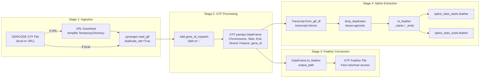
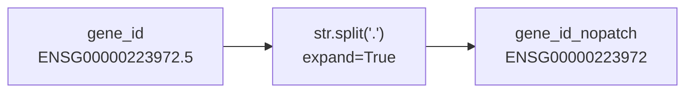
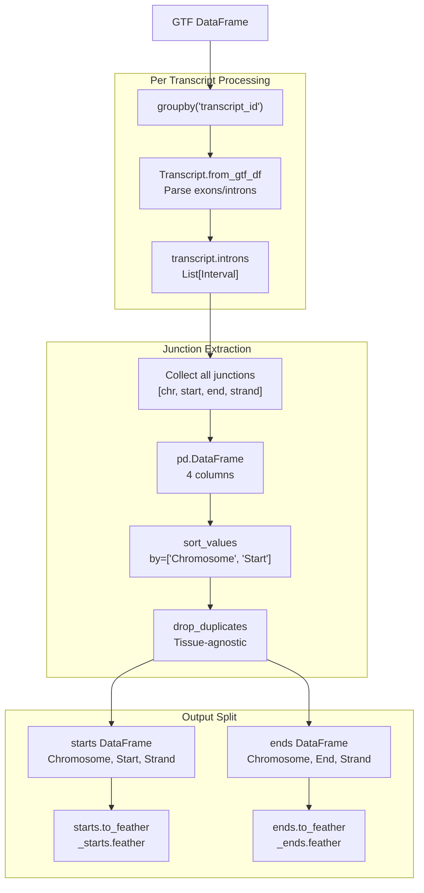
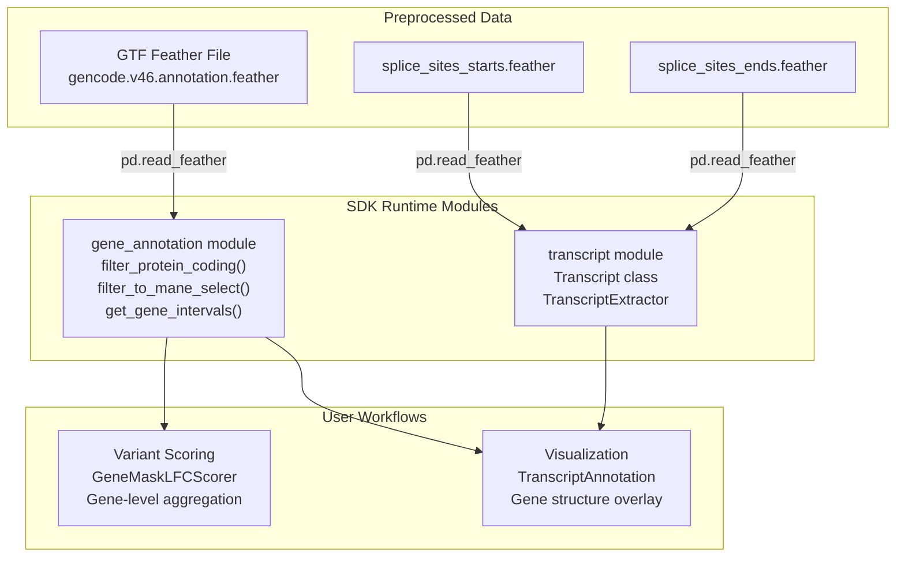

<!-- source: DeepWiki mcp.deepwiki.com · repo google-deepmind/alphagenome · page 7.2 Data Processing Pipeline · fetched 2026-10-26 -->

# Data Processing Pipeline

<details>
<summary>Relevant source files</summary>

The following files were used as context for generating this wiki page:

- [pyproject.toml](pyproject.toml)
- [scripts/__init__.py](scripts/__init__.py)
- [scripts/process_gtf.py](scripts/process_gtf.py)
- [scripts/process_gtf_test.py](scripts/process_gtf_test.py)

</details>


## Purpose and Scope

This document describes the data processing pipeline that prepares external genomic annotation data for use with the AlphaGenome SDK. The pipeline converts GENCODE GTF (Gene Transfer Format) files into optimized Feather format and extracts tissue-agnostic splice junction coordinates.

This page focuses on the preprocessing scripts and intermediate data formats. For information about using the processed data at runtime, see [Working with Gene Annotations](#5.4). For information about the core genomic data structures used throughout the SDK, see [Genomic Data Structures](#3.1).

---

## Pipeline Overview

The data processing pipeline consists of four stages that transform raw GTF files into SDK-ready data structures:



**Sources:** [scripts/process_gtf.py:1-113]()

---

## Stage 1: GTF Ingestion

The pipeline accepts GTF files from local paths or remote URLs. The `generate_gtf` function handles both cases:

### URL Handling

When a URL is provided, the function downloads the file to a temporary directory before processing:

```python
# From scripts/process_gtf.py:66-81
def generate_gtf(path: str) -> pd.DataFrame:
  url = parse.urlparse(path)
  if all([url.scheme, url.netloc]):
    with tempfile.TemporaryDirectory() as d:
      path, _ = request.urlretrieve(
          path,
          filename=os.path.join(d, os.path.basename(path)),
      )
      gtf = pyranges.read_gtf(path, as_df=True, duplicate_attr=True)
```

### GTF Parsing

The pipeline uses `pyranges.read_gtf` with the critical parameter `duplicate_attr=True`. This parameter handles GTF files from different GENCODE versions that may have duplicate attribute keys:

| Parameter | Value | Purpose |
|-----------|-------|---------|
| `as_df` | `True` | Return pandas DataFrame instead of PyRanges object |
| `duplicate_attr` | `True` | Handle repeated attribute keys in GTF attributes column |

**Sources:** [scripts/process_gtf.py:66-81]()

---

## Stage 2: GTF Processing and Field Normalization

After parsing, the pipeline adds derived fields to normalize gene identifiers across different annotation versions:



The `gene_id_nopatch` field removes version suffixes from Ensembl gene IDs, enabling consistent lookups across annotation versions:

```python
# From scripts/process_gtf.py:80-81
gtf['gene_id_nopatch'] = gtf['gene_id'].str.split('.', expand=True)[0]
```

### GTF DataFrame Schema

The resulting DataFrame contains these key columns:

| Column | Type | Example | Description |
|--------|------|---------|-------------|
| `Chromosome` | str | `"chr1"` | Chromosome name |
| `Start` | int | `11868` | 0-based start coordinate |
| `End` | int | `14409` | 1-based end coordinate (exclusive) |
| `Strand` | str | `"+"` or `"-"` | Genomic strand |
| `Feature` | str | `"gene"`, `"transcript"`, `"exon"` | GTF feature type |
| `gene_id` | str | `"ENSG00000223972.5"` | Versioned gene ID |
| `gene_id_nopatch` | str | `"ENSG00000223972"` | Unversioned gene ID |
| `transcript_id` | str | `"ENST00000456328.2"` | Transcript identifier (when applicable) |

**Sources:** [scripts/process_gtf.py:80-81](), [scripts/process_gtf_test.py:30-44]()

---

## Stage 3: Feather File Conversion

The processed GTF DataFrame is written to Feather format, a columnar storage format optimized for fast I/O:

```python
# From scripts/process_gtf.py:91-92
gtf.to_feather(_OUTPUT_PATH.value)
```

### Feather Format Benefits

| Aspect | GTF Text | Feather Binary |
|--------|----------|----------------|
| Read Speed | Slow (parsing required) | Fast (memory-mapped) |
| File Size | Large (uncompressed text) | Smaller (columnar compression) |
| Filtering | Requires full scan | Column-wise access |
| Dependencies | Custom parsers | PyArrow (standard library) |

The SDK's `gene_annotation` module loads these Feather files at runtime for filtering operations like `filter_protein_coding` and `filter_to_mane_select`.

**Sources:** [scripts/process_gtf.py:91-92](), [pyproject.toml:47]()

---

## Stage 4: Splice Site Extraction

The pipeline extracts tissue-agnostic splice junction coordinates by analyzing all transcripts and deduplicating their intron boundaries:



### Implementation Details

The `generate_splice_sites` function processes transcripts to extract intron boundaries:

```python
# From scripts/process_gtf.py:43-63
def generate_splice_sites(
    gtf: pd.DataFrame,
) -> tuple[pd.DataFrame, pd.DataFrame]:
  """Generates tissue-agnostic splice start/end sites from GTF."""
  transcripts = {
      k: transcript_utils.Transcript.from_gtf_df(df)
      for k, df in gtf.groupby('transcript_id')
  }
  junctions = []
  for _, transcript in transcripts.items():
    junctions.extend(
        [x.chromosome, x.start, x.end, x.strand] for x in transcript.introns
    )
  df = pd.DataFrame(
      junctions, columns=['Chromosome', 'Start', 'End', 'Strand']
  ).sort_values(by=['Chromosome', 'Start'])
  df = df.drop_duplicates().reset_index(drop=True)
  return (
      df[['Chromosome', 'Start', 'Strand']],
      df[['Chromosome', 'End', 'Strand']],
  )
```

### Splice Site File Structure

The function produces two separate files for efficient lookups:

**splice_sites_starts.feather:**
| Chromosome | Start | Strand |
|------------|-------|--------|
| chr1 | 14148 | + |
| chr1 | 16195 | + |
| ... | ... | ... |

**splice_sites_ends.feather:**
| Chromosome | End | Strand |
|------------|-----|--------|
| chr1 | 14148 | + |
| chr1 | 16195 | + |
| ... | ... | ... |

The deduplication step (`drop_duplicates`) ensures that each junction is represented only once, making the data tissue-agnostic. This is important because the same splice junction may appear in multiple tissues or cell types.

**Sources:** [scripts/process_gtf.py:43-63](), [scripts/process_gtf_test.py:57-70]()

---

## Pipeline Execution

### Command-Line Interface

The pipeline is invoked via the `scripts/process_gtf.py` module with three flags:

```bash
python -m scripts.process_gtf \
  --gtf_path=<input_path_or_url> \
  --output_path=<output.feather> \
  --splice_sites_output_path=<splice_sites.feather>
```

### Flag Specifications

| Flag | Required | Description |
|------|----------|-------------|
| `--gtf_path` | Yes | Local path or URL to GTF file (e.g., GENCODE v46) |
| `--output_path` | Yes | Output path for GTF Feather file (must end with `.feather`) |
| `--splice_sites_output_path` | No | Base path for splice site files (produces `_starts.feather` and `_ends.feather`) |

### Output Validation

The script validates the output path suffix:

```python
# From scripts/process_gtf.py:85-86
if not _OUTPUT_PATH.value.endswith('.feather'):
  raise ValueError('Output path must end with .feather')
```

If `--splice_sites_output_path` is provided, the script automatically appends suffixes:

```python
# From scripts/process_gtf.py:98-105
splice_sites_start_path = (
    _SPLICE_SITES_OUTPUT_PATH.value.removesuffix('.feather')
    + '_starts.feather'
)
splice_sites_end_path = (
    _SPLICE_SITES_OUTPUT_PATH.value.removesuffix('.feather')
    + '_ends.feather'
)
```

**Sources:** [scripts/process_gtf.py:30-40](), [scripts/process_gtf.py:84-109]()

---

## Dependencies

The pipeline requires specific dependencies defined in the `[project.optional-dependencies]` section for scripts:

```toml
# From pyproject.toml:77-83
scripts = [
    'absl-py',
    'alphagenome',
    'pandas',
    'pyarrow',
    'pyranges',
]
```

### Key Dependencies

| Package | Purpose |
|---------|---------|
| `pyranges` | GTF file parsing with duplicate attribute handling |
| `pandas` | DataFrame operations and Feather I/O |
| `pyarrow` | Feather format backend |
| `absl-py` | Command-line flag parsing and logging |

The `alphagenome` package itself is listed as a dependency to access `alphagenome.data.transcript`, which provides the `Transcript.from_gtf_df` method used during splice site extraction.

**Sources:** [pyproject.toml:77-83]()

---

## Data Flow: Pipeline to SDK

The processed files are consumed by SDK modules at runtime:



### SDK Consumption Patterns

**Gene Annotation Module:**
- Loads GTF Feather file once per session
- Provides filtering functions for protein-coding genes, MANE Select transcripts, and transcript support levels
- Extracts gene intervals for scoring operations

**Transcript Module:**
- Loads splice site tables for junction validation
- Builds `Transcript` objects from GTF data
- Powers `TranscriptExtractor` for identifying genes overlapping genomic regions

**Visualization Components:**
- Uses transcript data to render gene structure overlays
- Displays exons, introns, and transcript variants in prediction plots

**Sources:** [scripts/process_gtf.py:1-113](), High-Level Diagram 5

---

## Example: Processing GENCODE v46

A typical invocation for human genome annotation:

```bash
python -m scripts.process_gtf \
  --gtf_path=https://ftp.ebi.ac.uk/pub/databases/gencode/Gencode_human/release_46/gencode.v46.annotation.gtf.gz \
  --output_path=data/gencode.v46.annotation.feather \
  --splice_sites_output_path=data/gencode.v46.splice_sites.feather
```

This produces three files:
1. `data/gencode.v46.annotation.feather` - Complete GTF data
2. `data/gencode.v46.splice_sites_starts.feather` - Junction donor sites
3. `data/gencode.v46.splice_sites_ends.feather` - Junction acceptor sites

**Sources:** [scripts/process_gtf.py:30-40]()

---

## Testing

The pipeline includes unit tests that verify correct GTF parsing and splice site extraction:

### Test Data

The test uses a minimal GTF example with one gene, one transcript, and two exons:

```python
# From scripts/process_gtf_test.py:23-28
_EXAMPLE_GTF = r"""
chr1	FOO	gene	12100	21316	.	+	.	gene_id "GENE00000000001.1";
chr1	FOO	transcript	12100	18244	.	+	.	gene_id "GENE00000000001.1"; transcript_id "TRANS00000000001.2";
chr1	FOO	exon	12100	14148	.	+	.	gene_id "GENE00000000001.1"; transcript_id "TRANS00000000001.2";
chr1	FOO	exon	16196	17220	.	+	.	gene_id "GENE00000000001.1"; transcript_id "TRANS00000000001.2";
"""
```

### Splice Site Verification

The test verifies that the single intron between the two exons is correctly extracted:

```python
# From scripts/process_gtf_test.py:57-70
def test_generate_splice_sites(self):
  starts, ends = process_gtf.generate_splice_sites(_PROCESSED_GTF)
  expected = pd.DataFrame({
      'Chromosome': 'chr1',
      'Start': [14148],
      'End': [16195],
      'Strand': ['+'],
  })
```

The expected splice junction has:
- **Donor site (start):** 14148 (end of first exon)
- **Acceptor site (end):** 16195 (start of second exon - 1)

**Sources:** [scripts/process_gtf_test.py:23-70]()

---

