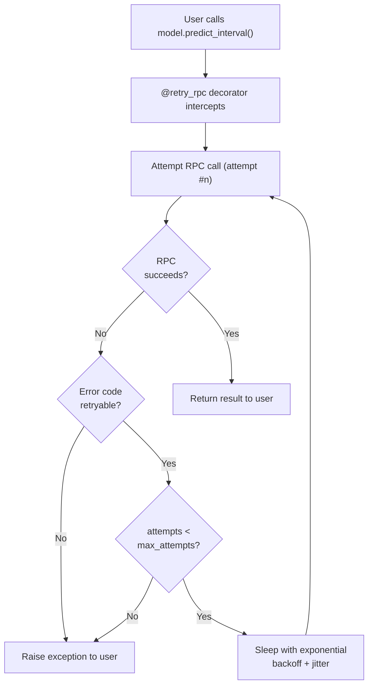
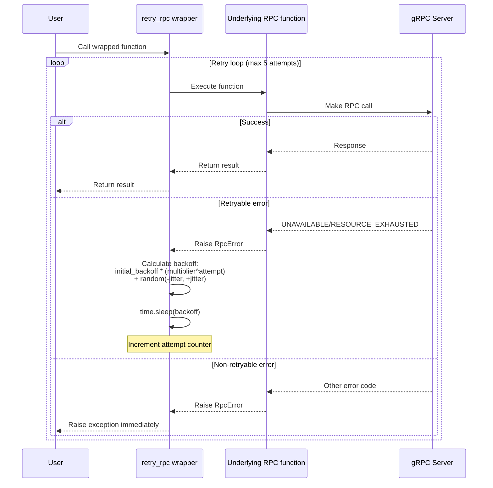
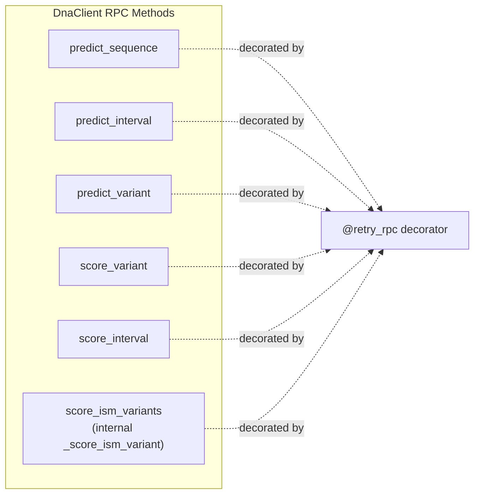
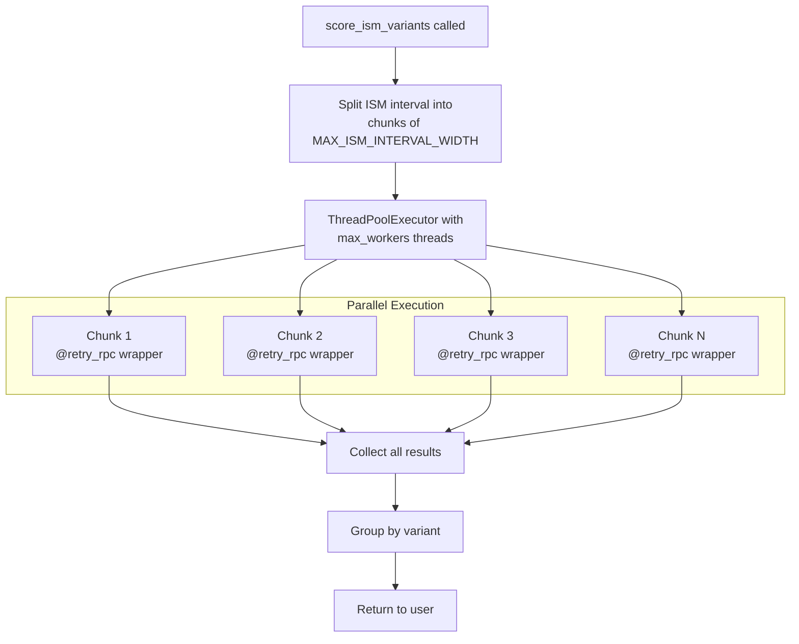
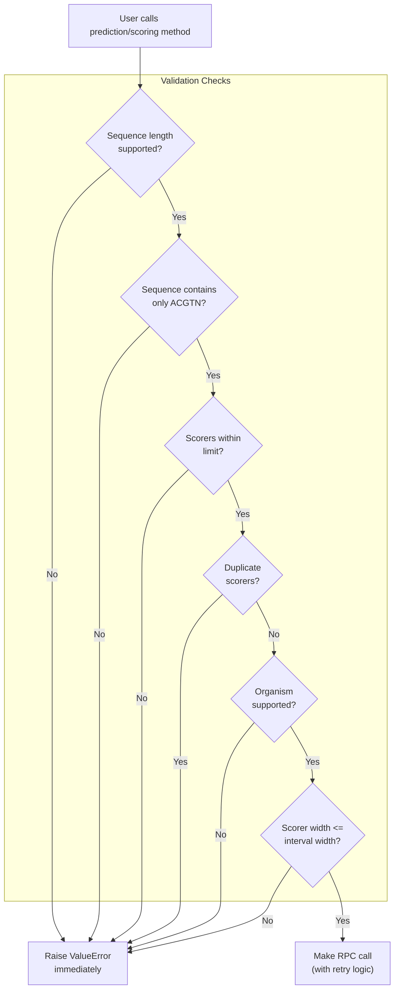
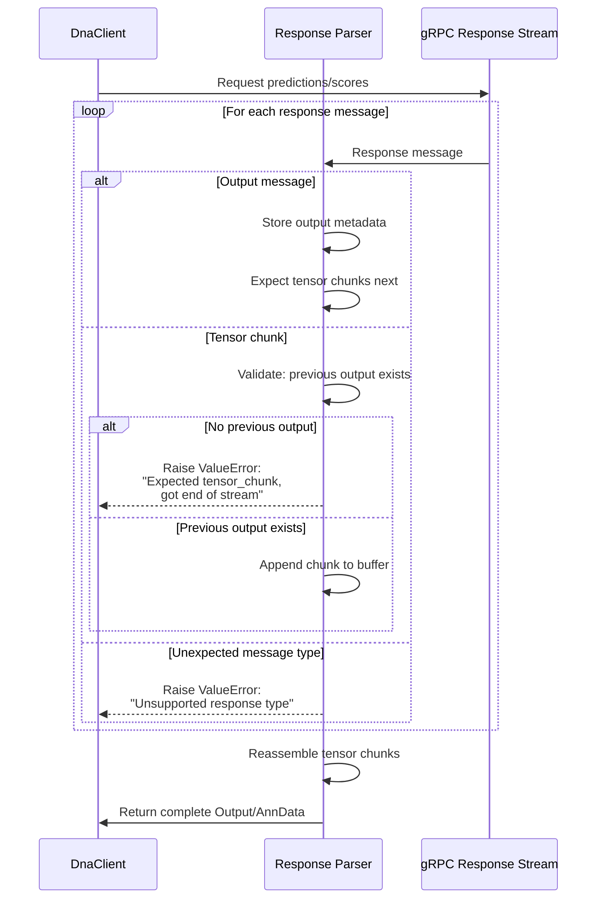

<!-- source: DeepWiki mcp.deepwiki.com · repo google-deepmind/alphagenome · page 7.3 Error Handling and Retry Logic · fetched 2026-10-26 -->

# Error Handling and Retry Logic

<details>
<summary>Relevant source files</summary>

The following files were used as context for generating this wiki page:

- [docs/source/api/models.md](docs/source/api/models.md)
- [src/alphagenome/models/dna_client.py](src/alphagenome/models/dna_client.py)
- [src/alphagenome/models/dna_client_test.py](src/alphagenome/models/dna_client_test.py)
- [src/alphagenome/protos/dna_model_service.proto](src/alphagenome/protos/dna_model_service.proto)

</details>


This document describes the error handling and retry mechanisms implemented in the AlphaGenome SDK. It covers the automatic retry logic for transient failures, client-side validation, and error handling during response parsing.

For information about the gRPC communication architecture and protocol buffers, see [7.1](#7.1). For guidance on making robust predictions and scoring requests, see [5.1](#5.1) and [5.2](#5.2).

## Overview

The AlphaGenome SDK implements a comprehensive error handling strategy with three layers:

1. **Pre-request validation**: Client-side checks before making network calls
2. **Automatic retry logic**: Transparent retry of failed RPC calls with exponential backoff
3. **Response parsing error handling**: Detection of malformed responses during stream processing

This multi-layered approach ensures that transient network failures are handled automatically while invalid requests and non-retryable errors are surfaced immediately to the user.

Sources: [src/alphagenome/models/dna_client.py:73-122]()

## The retry_rpc Decorator

### Core Mechanism

The SDK uses a `retry_rpc` decorator function that wraps all RPC calls to provide automatic retry functionality. This decorator is applied to every method in `DnaClient` that communicates with the remote server.



**Decorator Configuration**

The `retry_rpc` decorator accepts the following parameters:

| Parameter | Default Value | Description |
|-----------|---------------|-------------|
| `max_attempts` | 5 | Maximum number of RPC call attempts |
| `initial_backoff` | 1.25 seconds | Initial delay before first retry |
| `backoff_multiplier` | 1.5 | Multiplier applied to backoff on each retry |
| `retry_status_codes` | `{RESOURCE_EXHAUSTED, UNAVAILABLE}` | gRPC status codes that trigger retries |
| `jitter` | 0.2 (20%) | Random variation applied to backoff time |

Sources: [src/alphagenome/models/dna_client.py:73-83]()

### Implementation Details

The decorator is implemented as a function wrapper that catches `grpc.RpcError` exceptions and applies retry logic:



Sources: [src/alphagenome/models/dna_client.py:105-122]()

## Retryable vs Non-Retryable Errors

### Retryable Error Codes

The SDK automatically retries requests that fail with the following gRPC status codes:

| Status Code | Meaning | Reason for Retry |
|-------------|---------|------------------|
| `RESOURCE_EXHAUSTED` | Server resources temporarily unavailable | Transient capacity issue; likely to succeed after delay |
| `UNAVAILABLE` | Service is currently unavailable | Network issue or server restart; temporary condition |

These codes indicate transient failures where the same request is likely to succeed if retried after a brief delay.

### Non-Retryable Error Codes

All other gRPC status codes result in immediate failure without retry:

| Status Code | Meaning | Why No Retry |
|-------------|---------|--------------|
| `INVALID_ARGUMENT` | Request parameters are invalid | Request will never succeed without modification |
| `PERMISSION_DENIED` | Authentication/authorization failure | Credentials or permissions issue |
| `NOT_FOUND` | Requested resource doesn't exist | Resource will not appear on retry |
| `ALREADY_EXISTS` | Resource already exists | Idempotent operations only |
| `FAILED_PRECONDITION` | System state doesn't allow operation | Condition will not change automatically |
| `OUT_OF_RANGE` | Operation outside valid range | Request parameters are invalid |
| `INTERNAL` | Internal server error | May indicate bug or corrupted state |
| `DEADLINE_EXCEEDED` | Request took too long | May indicate undersized interval or server overload |

When these errors occur, the exception is raised immediately to the caller without retry attempts.

Sources: [src/alphagenome/models/dna_client.py:79-81](), [src/alphagenome/models/dna_client.py:115-118]()

## Exponential Backoff Strategy

### Backoff Calculation

The retry delay grows exponentially with each attempt to avoid overwhelming a struggling server:

```
backoff = initial_backoff * (backoff_multiplier ^ attempt_number) + jitter_adjustment
```

Where:
- `initial_backoff` = 1.25 seconds (default)
- `backoff_multiplier` = 1.5 (default)
- `jitter_adjustment` = random value in range `[-jitter * backoff, +jitter * backoff]`

**Example backoff sequence (with 20% jitter):**

| Attempt | Base Backoff | Jitter Range | Actual Wait |
|---------|--------------|--------------|-------------|
| 1 | 1.25s | 1.00s - 1.50s | ~1.25s ± 0.25s |
| 2 | 1.875s | 1.50s - 2.25s | ~1.875s ± 0.375s |
| 3 | 2.8125s | 2.25s - 3.375s | ~2.8125s ± 0.5625s |
| 4 | 4.21875s | 3.375s - 5.0625s | ~4.21875s ± 0.84375s |
| 5 | (Max attempts reached) | - | Exception raised |

### Purpose of Jitter

Jitter (random variation) prevents the "thundering herd" problem where multiple clients retry simultaneously, potentially overwhelming the server again. By randomizing retry times, clients naturally spread out their retry attempts.

Sources: [src/alphagenome/models/dna_client.py:82](), [src/alphagenome/models/dna_client.py:108-120]()

## Application to RPC Methods

### Decorated Methods

All public RPC methods in `DnaClient` are decorated with `@retry_rpc`:



**Decorated methods:**
- `DnaClient.predict_sequence` [src/alphagenome/models/dna_client.py:517-562]()
- `DnaClient.predict_interval` [src/alphagenome/models/dna_client.py:564-598]()
- `DnaClient.predict_variant` [src/alphagenome/models/dna_client.py:600-637]()
- `DnaClient.score_interval` [src/alphagenome/models/dna_client.py:639-691]()
- `DnaClient.score_variant` [src/alphagenome/models/dna_client.py:693-757]()
- Internal `_score_ism_variant` in `score_ism_variants` [src/alphagenome/models/dna_client.py:810-828]()

### ISM Scoring Parallel Retries

The `score_ism_variants` method implements special handling for parallel requests. When an ISM interval is split into multiple chunks, each chunk is retried independently:



Each chunk's RPC call is independently retried up to 5 times. If any chunk fails after all retries, the entire `score_ism_variants` call fails and raises the exception.

Sources: [src/alphagenome/models/dna_client.py:759-852](), [src/alphagenome/models/dna_client.py:810-828]()

## Client-Side Validation

### Pre-Request Validation

The SDK performs validation before making RPC calls to fail fast on invalid inputs:



### Validation Functions and Checks

**Sequence validation** (`predict_sequence`):
- Checks sequence contains only valid characters (A, C, G, T, N) [src/alphagenome/models/dna_client.py:542-549]()
- Validates sequence length is supported [src/alphagenome/models/dna_client.py:550]()

**Interval validation** (all interval-based methods):
- Validates interval width is a supported sequence length [src/alphagenome/models/dna_client.py:586](), [src/alphagenome/models/dna_client.py:624](), [src/alphagenome/models/dna_client.py:664](), [src/alphagenome/models/dna_client.py:720]()

**Scorer validation** (`score_variant`, `score_interval`):
- Checks number of scorers ≤ `MAX_VARIANT_SCORERS_PER_REQUEST` (20) [src/alphagenome/models/dna_client.py:669-673](), [src/alphagenome/models/dna_client.py:739-743]()
- Detects duplicate scorers [src/alphagenome/models/dna_client.py:665-668](), [src/alphagenome/models/dna_client.py:735-738]()
- Validates scorer width ≤ interval width [src/alphagenome/models/dna_client.py:674-678]()
- Validates organism is supported for each scorer [src/alphagenome/models/dna_client.py:721-734]()

**ISM validation** (`score_ism_variants`):
- Validates ISM interval is on positive strand [src/alphagenome/models/dna_client.py:794-795]()

These validations raise `ValueError` immediately without attempting any network communication.

Sources: [src/alphagenome/models/dna_client.py:485-492](), [src/alphagenome/models/dna_client.py:542-550](), [src/alphagenome/models/dna_client.py:664-678](), [src/alphagenome/models/dna_client.py:720-743]()

## Response Parsing Error Handling

### Stream Processing

The SDK parses streaming responses from the server and validates the message sequence:



### Error Conditions Detected

**1. Tensor chunk without output message:**
When a tensor chunk is received before its corresponding output message, the parser raises:
```
ValueError: "Expected tensor_chunk, got end of stream"
```
Sources: [src/alphagenome/models/dna_client.py:152-158]()

**2. Unexpected payload type:**
When a response contains an unknown payload type:
```
ValueError: "Unsupported response type: <type>"
```
Sources: [src/alphagenome/models/dna_client.py:278-280](), [src/alphagenome/models/dna_client.py:304-307](), [src/alphagenome/models/dna_client.py:416-419]()

**3. Unsupported output data type:**
When an output contains an unrecognized data payload:
```
ValueError: "Unsupported output type: <type>"
```
Sources: [src/alphagenome/models/dna_client.py:189-192]()

**4. Unsupported metadata type:**
When metadata contains an unexpected payload:
```
ValueError: "Unsupported metadata type: <type>"
```
Sources: [src/alphagenome/models/dna_client.py:211-215]()

These errors indicate protocol violations or version mismatches and are **not retried** automatically.

Sources: [src/alphagenome/models/dna_client.py:139-192](), [src/alphagenome/models/dna_client.py:261-283]()

## Best Practices for Resilient Code

### 1. Let the SDK Handle Retries

The retry logic is transparent to users. Write code assuming successful execution:

```python
# Good: Let decorator handle retries
model = dna_client.create(api_key)
output = model.predict_interval(
    interval,
    organism=Organism.HOMO_SAPIENS,
    requested_outputs=[OutputType.ATAC, OutputType.RNA_SEQ],
    ontology_terms=None,
)
```

### 2. Catch Non-Retryable Errors

Handle validation errors and non-retryable RPC errors explicitly:

```python
try:
    output = model.predict_sequence(
        sequence,
        organism=Organism.HOMO_SAPIENS,
        requested_outputs=[OutputType.ATAC],
        ontology_terms=None,
    )
except ValueError as e:
    # Client-side validation failed (e.g., invalid sequence)
    logger.error(f"Invalid request: {e}")
except grpc.RpcError as e:
    if e.code() == grpc.StatusCode.INVALID_ARGUMENT:
        # Server rejected request parameters
        logger.error(f"Server rejected request: {e.details()}")
    elif e.code() == grpc.StatusCode.PERMISSION_DENIED:
        # Authentication/authorization issue
        logger.error(f"Authentication failed: {e.details()}")
    else:
        # Other non-retryable or exhausted retries
        logger.error(f"Request failed: {e.code()}: {e.details()}")
```

### 3. Validate Inputs Early

Use helper functions to validate inputs before batching multiple requests:

```python
from alphagenome.models.dna_client import validate_sequence_length

# Validate before processing batch
for interval in intervals:
    try:
        validate_sequence_length(interval.width)
    except ValueError as e:
        logger.warning(f"Skipping invalid interval {interval}: {e}")
        continue
```

### 4. Handle Batch Failures Gracefully

When using batch methods, individual failures don't stop other requests:

```python
results = []
for interval, variant in zip(intervals, variants):
    try:
        scores = model.score_variant(interval, variant, variant_scorers)
        results.append((variant, scores))
    except grpc.RpcError as e:
        logger.error(f"Failed to score {variant}: {e.code()}")
        results.append((variant, None))
```

### 5. Configure Timeouts Appropriately

Set appropriate timeout when creating the client to avoid indefinite hangs:

```python
# Default: no timeout
model = dna_client.create(api_key)

# With timeout: fail if not ready in 30 seconds
model = dna_client.create(api_key, timeout=30.0)
```

Sources: [src/alphagenome/models/dna_client.py:874-907]()

### 6. Monitor Parallel ISM Operations

When using `score_ism_variants` with multiple workers, be aware that partial failures can occur:

```python
try:
    ism_scores = model.score_ism_variants(
        interval=interval,
        ism_interval=ism_region,
        variant_scorers=scorers,
        max_workers=8,  # Parallel execution
        progress_bar=True,
    )
except grpc.RpcError as e:
    # At least one chunk failed after all retries
    logger.error(f"ISM scoring failed: {e.code()}")
```

Sources: [src/alphagenome/models/dna_client.py:759-852]()

## Summary

The AlphaGenome SDK implements a robust error handling strategy:

| Layer | Mechanism | Purpose |
|-------|-----------|---------|
| **Pre-request validation** | Client-side checks before RPC | Fail fast on invalid inputs |
| **Automatic retries** | `@retry_rpc` decorator with exponential backoff | Handle transient failures transparently |
| **Response validation** | Stream parsing error detection | Detect protocol violations |

The retry logic is designed to handle common transient failures (server unavailability, resource exhaustion) automatically while surfacing non-recoverable errors immediately to the user. This design minimizes the impact of temporary network or server issues while maintaining fast failure for invalid requests.

Sources: [src/alphagenome/models/dna_client.py:73-122](), [src/alphagenome/models/dna_client.py:485-492](), [src/alphagenome/models/dna_client.py:517-852]()

---

