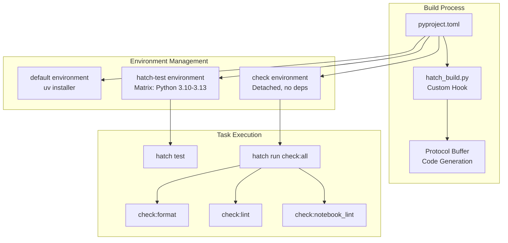
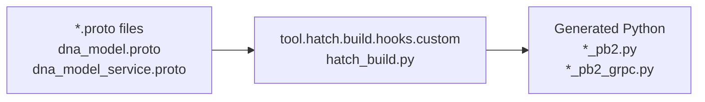
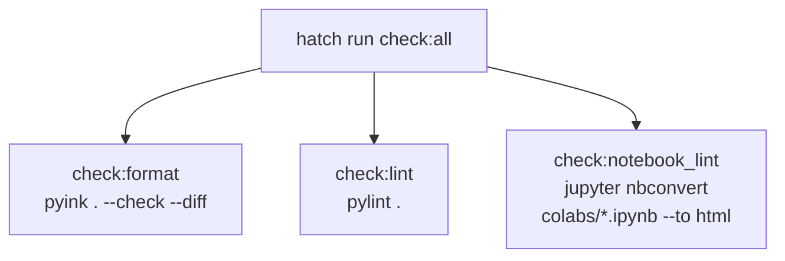
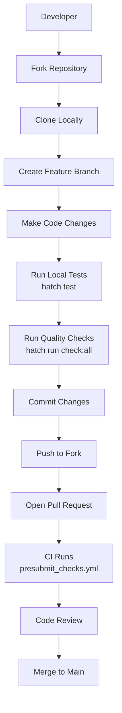
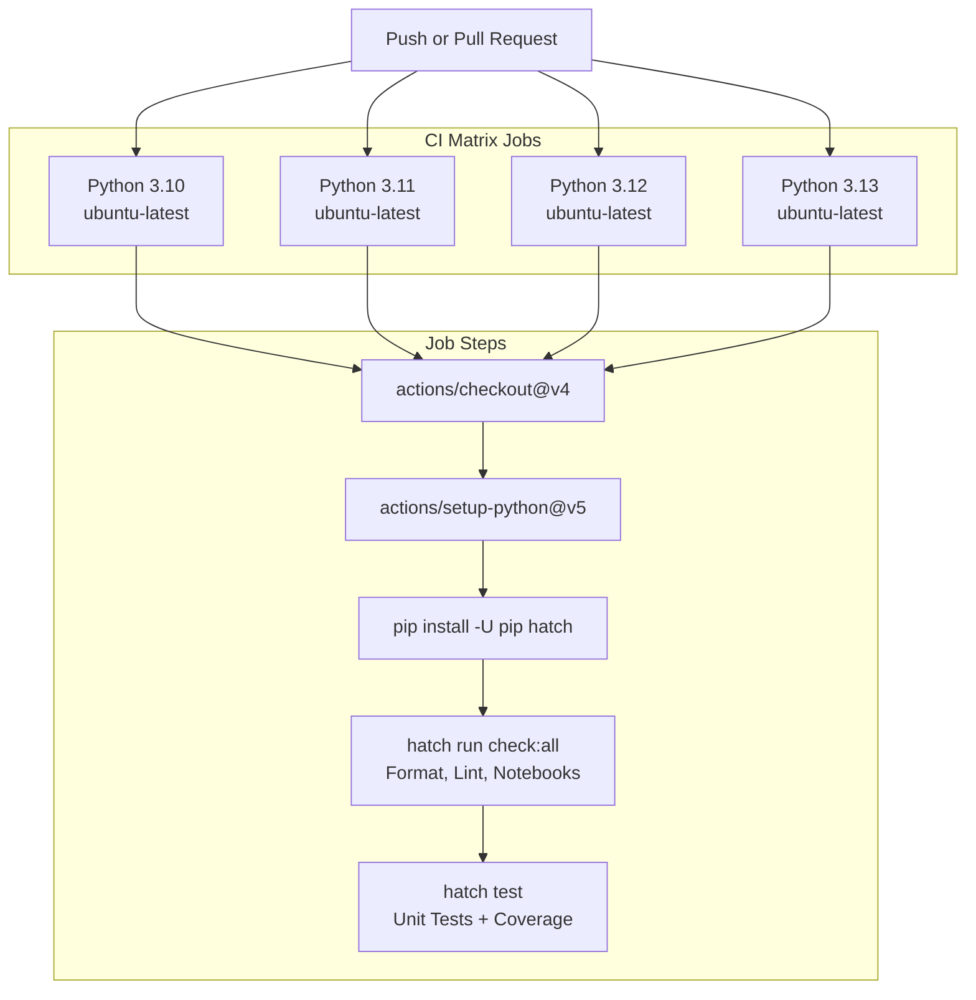
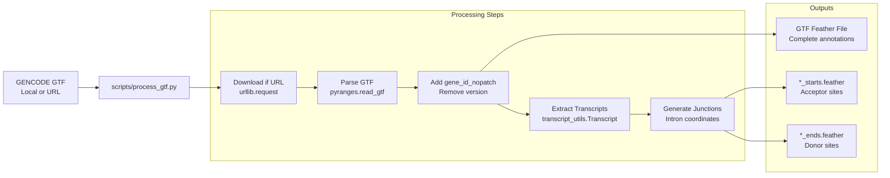
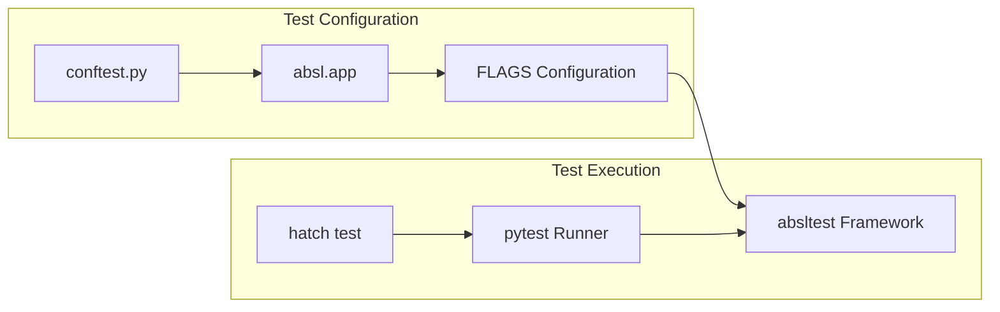

<!-- source: DeepWiki mcp.deepwiki.com · repo google-deepmind/alphagenome · page 8 Development · fetched 2026-10-26 -->

# Development

<details>
<summary>Relevant source files</summary>

The following files were used as context for generating this wiki page:

- [CONTRIBUTING.md](CONTRIBUTING.md)
- [pyproject.toml](pyproject.toml)
- [scripts/__init__.py](scripts/__init__.py)
- [scripts/process_gtf.py](scripts/process_gtf.py)
- [scripts/process_gtf_test.py](scripts/process_gtf_test.py)

</details>


This document provides information for developers and contributors working on the AlphaGenome SDK codebase. It covers the project structure, development environment setup, build system, code quality standards, and contribution workflow.

For detailed information about testing procedures and test coverage, see page 8.1 (Testing and Quality). For comprehensive project configuration details, see page 8.2 (Project Configuration).

## Project Structure

The AlphaGenome SDK repository is organized into several key directories:

```
alphagenome/
├── src/alphagenome/          # Main SDK source code
│   ├── protos/               # Protocol buffer definitions
│   ├── data/                 # Data structures (genome, gene_annotation)
│   ├── visualization/        # Plotting utilities
│   └── dna_client.py         # API client implementation
├── scripts/                  # Data processing utilities
│   ├── process_gtf.py        # GTF to Feather conversion
│   └── process_gtf_test.py   # Script tests
├── colabs/                   # Example Jupyter notebooks
├── pyproject.toml            # Project configuration and dependencies
└── conftest.py               # Test configuration
```

Sources: [scripts/process_gtf.py:1-15](), [scripts/__init__.py:15](), [pyproject.toml:1-10]()

## Development Environment Setup

The project uses `hatch` as the build tool and dependency manager. The build system is defined in `pyproject.toml` with specific requirements:

### Build System Configuration

| Component | Specification |
|-----------|--------------|
| **Build Backend** | `hatchling.build` |
| **Build Requirements** | `hatchling`, `grpcio-tools<=1.67.1`, `importlib-resources` |
| **Python Version** | `>=3.10` |
| **Supported Versions** | 3.10, 3.11, 3.12, 3.13 |

Sources: [pyproject.toml:1-12]()

### Setting Up Development Environment

Install the SDK in development mode with all dependencies:

```bash
# Clone the repository
git clone https://github.com/google-deepmind/alphagenome
cd alphagenome

# Install hatch (if not already installed)
pip install -U pip hatch

# Install project in development mode
pip install -e .

# Install optional development dependencies
pip install -e ".[dev,docs,scripts]"
```

The optional dependency groups are:
- **`dev`**: Development tools including `hatch`
- **`docs`**: Documentation generation tools (Sphinx, MyST-NB)
- **`scripts`**: Script dependencies (`pyranges`, `absl-py`)

Sources: [pyproject.toml:61-83]()

## Build System (Hatch)

The project uses Hatch for package management, virtual environment creation, and task execution. Hatch provides standardized commands defined in `pyproject.toml`.

### Build System Architecture



Sources: [pyproject.toml:85-128]()

### Hatch Environments

The project defines three main Hatch environments:

**1. Default Environment**
- Uses `uv` installer for faster dependency resolution
- Includes all runtime dependencies from `pyproject.toml`

**2. Test Environment (hatch-test)**
- Matrix execution across Python 3.10, 3.11, 3.12, 3.13
- Additional test dependencies: `google-benchmark`, `pyranges`, `typeguard==2.13.3`
- Parallel test execution enabled
- Environment variable: `MPLBACKEND=agg` (headless matplotlib)

**3. Check Environment**
- Detached (does not install project dependencies)
- Used for code quality checks
- Dependencies: `nbconvert`, `pyink>=24.3.0`, `pylint>=2.6.0`

Sources: [pyproject.toml:91-119]()

### Protocol Buffer Build Hook

The build system includes a custom build hook that generates Python bindings from Protocol Buffer definitions:



The custom hook is invoked automatically during package installation and uses `grpcio-tools` to compile `.proto` files into Python modules.

Sources: [pyproject.toml:1-3](), [pyproject.toml:85-86]()

## Code Quality Standards

The project enforces strict code quality standards through automated checks and formatting tools.

### Code Formatting (Pyink)

The project uses `pyink` (Google's Python formatter based on Black) with the following configuration:

| Setting | Value | Purpose |
|---------|-------|---------|
| `line-length` | 80 | Google style guide compliance |
| `unstable` | `true` | Enable preview style features |
| `pyink-indentation` | 2 | Two-space indentation |
| `pyink-use-majority-quotes` | `true` | Consistent quote style |
| `exclude` | `src/alphagenome/protos` | Skip generated code |

Format checking:
```bash
# Check formatting
hatch run check:format

# Auto-format code (not in CI)
pyink .
```

Sources: [pyproject.toml:130-137]()

### Quality Check Commands

The check environment provides three main commands:



These commands run sequentially and all must pass for a clean check.

Sources: [pyproject.toml:120-128]()

## Development Workflow

The AlphaGenome SDK follows a standard GitHub-based development workflow with automated quality checks and testing.

### Contribution Workflow



Sources: [CONTRIBUTING.md:15-20]()

### Contributor License Agreement

All contributions require a Contributor License Agreement (CLA):
- Visit https://cla.developers.google.com/
- Sign CLA once (applies to all Google projects)
- Required before any code can be merged

Sources: [CONTRIBUTING.md:3-13]()

## Pull Request Guidelines

All contributions must follow these guidelines:

### PR Requirements

| Requirement | Description |
|------------|-------------|
| **Size** | Create small, focused PRs addressing a single concern |
| **Description** | Provide clear description of what changed and why |
| **Issue Linking** | Link to GitHub issue if one exists |
| **Code Style** | Do not fix style/formatting unless modifying that line |
| **Responsiveness** | Respond to reviewer comments within 2-3 weeks |
| **Commit History** | Maintain clean commit history with meaningful messages |
| **Branch Status** | Keep PR up to date with `upstream/main` |
| **Test Status** | All tests must pass before merging |

### Pre-Submission Checklist

Before creating a pull request, ensure:

1. All tests pass locally:
   ```bash
   hatch test
   ```

2. Code quality checks pass:
   ```bash
   hatch run check:all
   ```

3. Code is formatted correctly:
   ```bash
   pyink .
   ```

4. Commit messages are clear and descriptive

5. PR description explains the change and its motivation

Sources: [CONTRIBUTING.md:22-58]()

## Continuous Integration

The project uses GitHub Actions for continuous integration with comprehensive testing across multiple Python versions.

### CI Matrix Execution



The CI pipeline uses `fail-fast: false` to run all Python version tests even if one fails, providing comprehensive feedback.

Sources: [pyproject.toml:98-109]()

## Data Processing Scripts

The SDK includes utility scripts for preprocessing external data sources. These scripts are located in the `scripts/` directory.

### GTF Processing Pipeline

The primary preprocessing script is `process_gtf.py`, which converts GENCODE GTF files into efficient Feather format and extracts splice site coordinates.



Sources: [scripts/process_gtf.py:15-113]()

### Script Usage

Run the GTF processing script:

```bash
# Basic usage (GTF to Feather)
python -m scripts.process_gtf \
  --gtf_path=path/to/gencode.v46.annotation.gtf.gz \
  --output_path=output/gencode_v46.feather

# With splice site extraction
python -m scripts.process_gtf \
  --gtf_path=path/to/gencode.v46.annotation.gtf.gz \
  --output_path=output/gencode_v46.feather \
  --splice_sites_output_path=output/splice_sites.feather
```

The script supports both local file paths and URLs for the GTF input.

Sources: [scripts/process_gtf.py:30-41](), [scripts/process_gtf.py:84-109]()

### Script Functions

| Function | Purpose | Input | Output |
|----------|---------|-------|--------|
| `generate_gtf()` | Load and parse GTF file | GTF path or URL | DataFrame with gene_id_nopatch |
| `generate_splice_sites()` | Extract intron coordinates | GTF DataFrame | Two DataFrames (starts, ends) |

Key implementation details:
- Uses `pyranges.read_gtf()` with `duplicate_attr=True` for GENCODE compatibility
- Creates `gene_id_nopatch` column by removing version suffixes
- Extracts tissue-agnostic splice junctions from transcript introns
- Deduplicates junction coordinates across all transcripts

Sources: [scripts/process_gtf.py:43-82]()

## Testing Infrastructure

The project uses a standardized testing setup with `absl` for configuration management and `pytest` compatibility.

### Test Configuration System



The test configuration is managed through [`conftest.py`]() which sets up the `absl` framework:

- **ABSL Integration**: Uses `absl.app.run()` for FLAGS initialization
- **Exception Handling**: Catches and ignores `SystemExit` from app initialization
- **Test Compatibility**: Ensures `absltest` works with standard pytest runners

Sources: [conftest.py:15-22]()

## Code Quality Standards

The project enforces code quality through automated checks that run as part of the CI pipeline.

### Quality Check Components

| Check Type | Tool/Standard | Execution |
|------------|---------------|-----------|
| **Code Style** | Google Python Style | `hatch run check:all` |
| **Linting** | Standard Python linters | `hatch run check:all` |
| **Type Checking** | Static type analysis | `hatch run check:all` |
| **Unit Testing** | pytest/absltest | `hatch test` |
| **Coverage** | Test coverage analysis | `hatch test` |

### Contribution Requirements

All contributions must satisfy the following requirements:

1. **Contributor License Agreement**: Required for all contributors, managed through Google's CLA system
2. **Code Review**: All submissions require review via GitHub pull requests  
3. **Automated Checks**: Must pass all presubmit checks across Python 3.10-3.13
4. **Community Guidelines**: Must follow Google's Open Source Community Guidelines

Sources: [CONTRIBUTING.md:3-25](), [.github/workflows/presubmit_checks.yml:34-37]()

## Development Dependencies

The development environment relies on several key tools and dependencies:

- **Build Tool**: `hatch` - Modern Python project management
- **Testing Framework**: `absltest` with `pytest` compatibility
- **Version Support**: Python 3.10, 3.11, 3.12, 3.13
- **CI Platform**: GitHub Actions with Ubuntu runners
- **Code Review**: GitHub pull request workflow

This infrastructure ensures consistent code quality and testing across all contributions to the AlphaGenome client library.

Sources: [.github/workflows/presubmit_checks.yml:23-37](), [conftest.py:17-20]()

---

