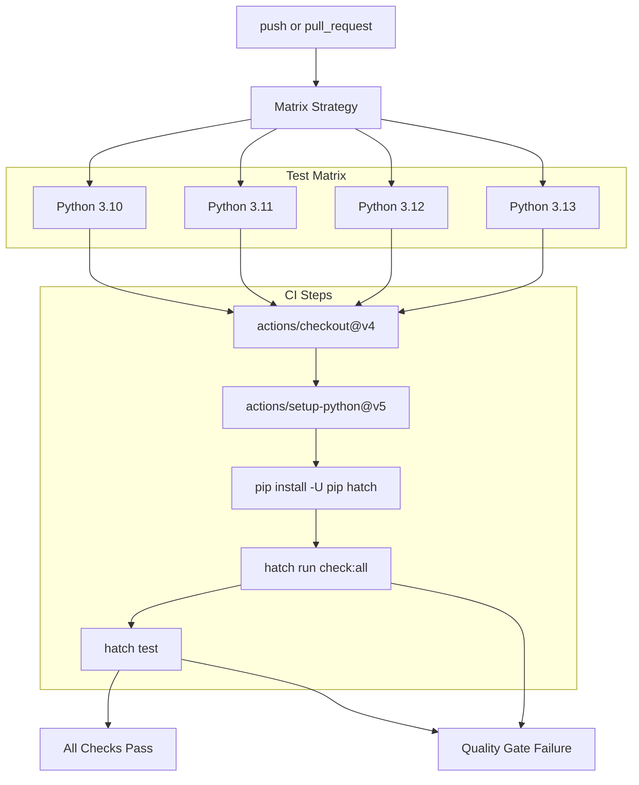
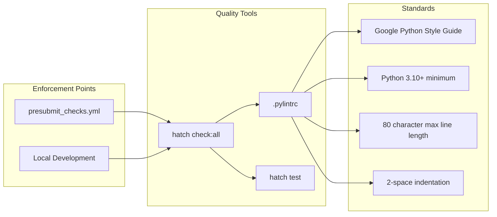
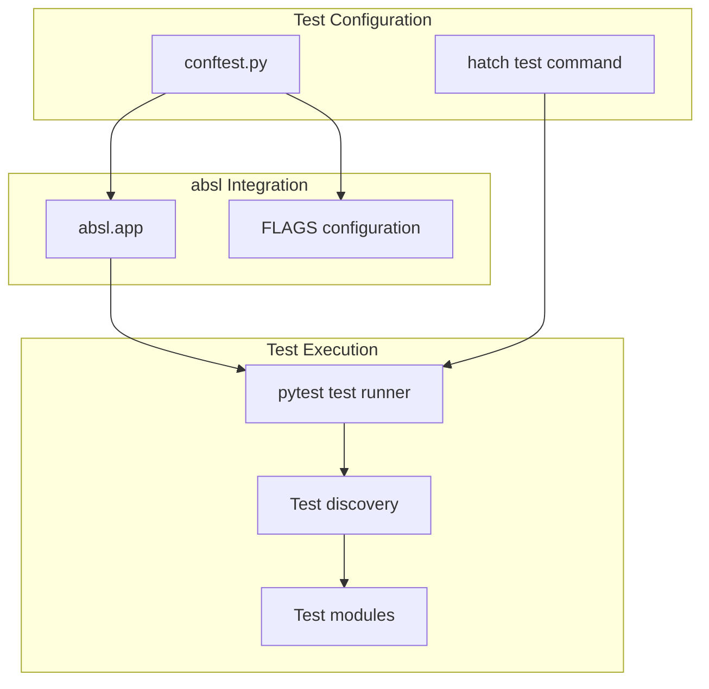
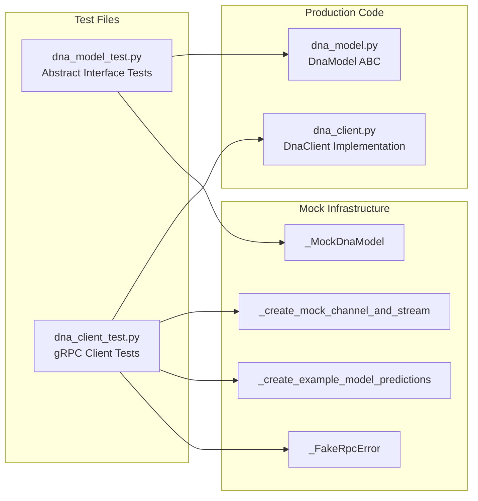
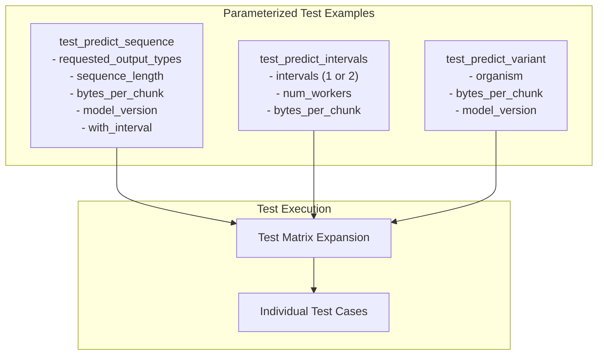
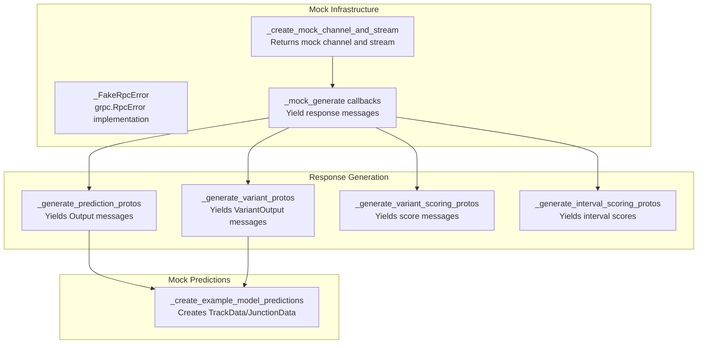
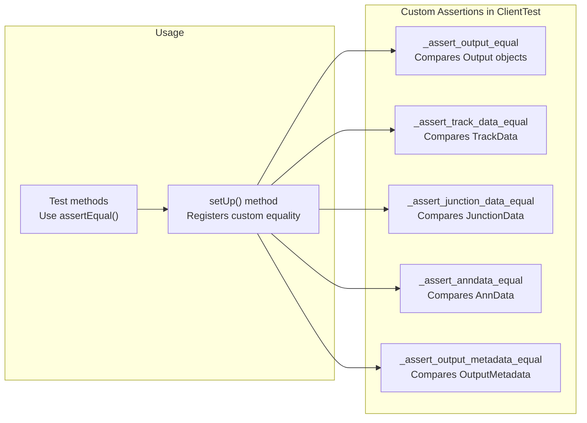
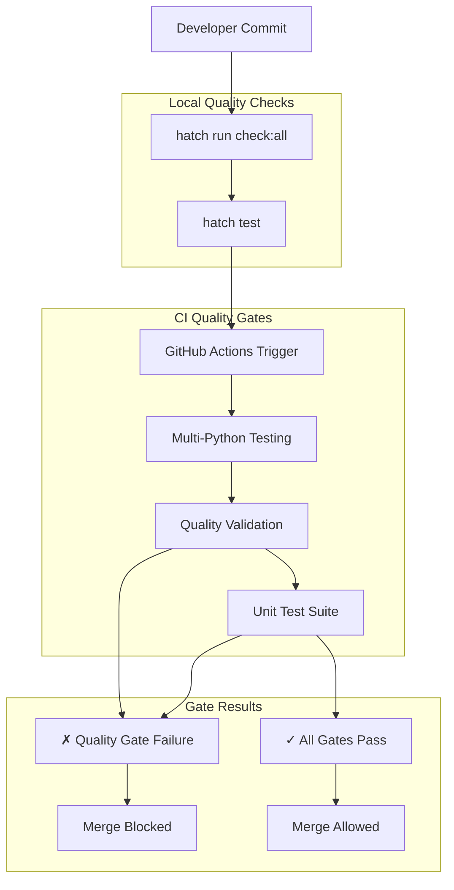

<!-- source: DeepWiki mcp.deepwiki.com · repo google-deepmind/alphagenome · page 8.1 Testing and Quality · fetched 2026-10-26 -->

# Testing and Quality

<details>
<summary>Relevant source files</summary>

The following files were used as context for generating this wiki page:

- [.github/workflows/presubmit_checks.yml](.github/workflows/presubmit_checks.yml)
- [docs/source/_templates/autosummary/class.rst](docs/source/_templates/autosummary/class.rst)
- [src/alphagenome/models/dna_client_test.py](src/alphagenome/models/dna_client_test.py)
- [src/alphagenome/models/dna_model.py](src/alphagenome/models/dna_model.py)
- [src/alphagenome/models/dna_model_test.py](src/alphagenome/models/dna_model_test.py)
- [src/alphagenome/protos/dna_model_service.proto](src/alphagenome/protos/dna_model_service.proto)

</details>


This document covers the testing infrastructure and code quality standards for the AlphaGenome client library. It includes the automated CI/CD pipeline, code quality tooling configuration, testing setup, and quality enforcement mechanisms.

For information about the development workflow and contribution guidelines, see [Contributing](#5.1). For details about the release and publishing process, see [Release Process](#5.3).

## CI/CD Pipeline

The AlphaGenome client library uses GitHub Actions for continuous integration and testing. The pipeline is defined in [.github/workflows/presubmit_checks.yml:15-37]() and runs comprehensive checks on all pull requests and pushes.

### Pipeline Architecture



Sources: [.github/workflows/presubmit_checks.yml:15-37]()

### Test Matrix Configuration

The CI system tests against multiple Python versions to ensure compatibility:

| Python Version | OS | Status |
|----------------|----|----|
| 3.10 | ubuntu-latest | Required |
| 3.11 | ubuntu-latest | Required |
| 3.12 | ubuntu-latest | Required |
| 3.13 | ubuntu-latest | Required |

The pipeline uses `fail-fast: false` [.github/workflows/presubmit_checks.yml:21]() to ensure all Python versions are tested even if one fails.

Sources: [.github/workflows/presubmit_checks.yml:20-24]()

## Code Quality Standards

The project enforces Google Python style guidelines through Pylint configuration and uses `hatch` for build and test management.

### Quality Toolchain



Sources: [.pylintrc:1-9](), [.github/workflows/presubmit_checks.yml:34-37]()

### Pylint Configuration Details

The [.pylintrc]() file implements Google's Python style guide with repository-specific customizations:

| Setting | Value | Purpose |
|---------|-------|---------|
| `py-version` | 3.10 | Minimum Python version [.pylintrc:41]() |
| `max-line-length` | 80 | Line length limit [.pylintrc:283]() |
| `indent-string` | 2 spaces | Google internal style [.pylintrc:311]() |
| `jobs` | 4 | Parallel processing [.pylintrc:29]() |

#### Ignored Directories

The configuration excludes specific directories from linting:

- `third_party` - External dependencies
- `./src/alphagenome/protos` - Generated protocol buffer files

Sources: [.pylintrc:14-15]()

#### Disabled Checks

The configuration disables numerous checks to align with Google's internal practices and reduce false positives. Key disabled checks include:

- `missing-function-docstring` [.pylintrc:108]() - Reduces docstring requirements
- `too-many-*` family - Complexity metrics [.pylintrc:144-155]()
- `no-member` [.pylintrc:118]() - Avoids false positives with dynamic attributes
- `not-callable` [.pylintrc:123]() - Prevents false positives with JAX decorators

Sources: [.pylintrc:64-170]()

## Testing Configuration

The project uses pytest for unit testing with absl integration and parameterized testing capabilities. The test suite provides comprehensive coverage of the client SDK, particularly focusing on the gRPC communication layer and data transformations.

### Test Setup Architecture



Sources: [conftest.py:15-22](), [.github/workflows/presubmit_checks.yml:36-37]()

### conftest.py Implementation

The [conftest.py:17-22]() file provides pytest configuration with absl integration:

```python
from absl import app

try:
  app.run(lambda argv: None)
except SystemExit:
  pass
```

This setup initializes the absl application framework with default FLAGS values, which is required for testing Google-style Python applications that use absl for command-line argument parsing.

Sources: [conftest.py:15-22]()

## Test Structure and Coverage

The test suite covers both the abstract interface and concrete implementation of the DNA model client.

### Test File Organization



Sources: [src/alphagenome/models/dna_model_test.py:1-322](), [src/alphagenome/models/dna_client_test.py:1-1500]()

### Core Test Classes

| Test Class | File | Lines of Code | Purpose |
|------------|------|---------------|---------|
| `ClientTest` | dna_client_test.py | ~1200 | Tests gRPC communication, request/response parsing, error handling |
| `DnaModelTest` | dna_model_test.py | ~160 | Tests batch processing methods in abstract interface |
| `_MockDnaModel` | dna_model_test.py | ~135 | Mock implementation for testing abstract interface |

Sources: [src/alphagenome/models/dna_client_test.py:308-1500](), [src/alphagenome/models/dna_model_test.py:29-165]()

## Testing Patterns and Methodologies

The test suite employs several sophisticated testing patterns to ensure reliability and maintainability.

### Parameterized Testing

The codebase extensively uses `absl.testing.parameterized` to test multiple scenarios with minimal code duplication:



Examples include:
- `test_predict_sequence` with 48 parameter combinations [src/alphagenome/models/dna_client_test.py:421-538]()
- `test_predict_intervals` with 8 parameter combinations [src/alphagenome/models/dna_client_test.py:540-589]()
- `test_predict_variant` with 12 parameter combinations [src/alphagenome/models/dna_client_test.py:735-814]()

Sources: [src/alphagenome/models/dna_client_test.py:421-814]()

### Mock gRPC Communication

The test suite implements sophisticated mocking of the gRPC communication layer:



Key helper functions:
- `_FakeRpcError`: Simulates gRPC errors with status codes [src/alphagenome/models/dna_client_test.py:44-52]()
- `_create_mock_channel_and_stream`: Creates mock gRPC channel and stream [src/alphagenome/models/dna_client_test.py:294-306]()
- `_generate_prediction_protos`: Generates proto responses for predictions [src/alphagenome/models/dna_client_test.py:54-87]()
- `_create_example_model_predictions`: Creates example data structures [src/alphagenome/models/dna_client_test.py:253-292]()

Sources: [src/alphagenome/models/dna_client_test.py:44-306]()

### Custom Equality Assertions

The test suite implements custom equality methods for complex data structures:



Registered in `setUp()` using `addTypeEqualityFunc()` [src/alphagenome/models/dna_client_test.py:408-419]():
- `_assert_output_equal`: Validates all fields in `Output` objects [src/alphagenome/models/dna_client_test.py:310-328]()
- `_assert_track_data_equal`: Validates values, metadata, and intervals [src/alphagenome/models/dna_client_test.py:365-376]()
- `_assert_junction_data_equal`: Validates junctions, values, metadata [src/alphagenome/models/dna_client_test.py:377-388]()
- `_assert_anndata_equal`: Validates AnnData objects including layers [src/alphagenome/models/dna_client_test.py:389-407]()

Sources: [src/alphagenome/models/dna_client_test.py:310-419]()

## Test Coverage by Component

The test suite provides comprehensive coverage of core functionality:

### DnaClient Methods Tested

| Method | Test Cases | Coverage |
|--------|------------|----------|
| `predict_sequence` | 48 variations | Output types, chunking, model versions, intervals |
| `predict_sequences` | 8 variations | Batch processing, parallelization, error handling |
| `predict_interval` | 12 variations | Organisms, chunking, model versions |
| `predict_intervals` | 6 variations | Multiple intervals, parallelization |
| `predict_variant` | 12 variations | REF/ALT outputs, chunking |
| `predict_variants` | 8 variations | Batch variants, single/multiple intervals |
| `score_variant` | Multiple | Scorer configurations, quantile scores |
| `score_interval` | Multiple | Interval scorers, gene metadata |
| `score_ism_variants` | Multiple | ISM systematic mutations |
| `output_metadata` | 1 | Metadata retrieval |

Sources: [src/alphagenome/models/dna_client_test.py:421-1500]()

### DnaModel Abstract Interface Tests

| Method | Test Focus |
|--------|-----------|
| `predict_sequences` | Parallel execution, parameter passing |
| `predict_intervals` | Batch processing across chromosomes |
| `predict_variants` | Single vs multiple intervals |
| `score_intervals` | Scorer configuration |
| `score_variants` | Variant scorer application |

Sources: [src/alphagenome/models/dna_model_test.py:167-318]()

### Error Handling Tests

The suite includes explicit error condition testing:

- Invalid sequence validation [src/alphagenome/models/dna_client_test.py:604-616]()
- Interval/variant length mismatch [src/alphagenome/models/dna_client_test.py:890-906]()
- gRPC error propagation [src/alphagenome/models/dna_client_test.py:590-603](), [src/alphagenome/models/dna_client_test.py:721-733](), [src/alphagenome/models/dna_client_test.py:875-888]()
- Executor shutdown on exceptions [src/alphagenome/models/dna_model.py:152-155]()

Sources: [src/alphagenome/models/dna_client_test.py:590-906](), [src/alphagenome/models/dna_model.py:152-155]()

## Quality Gates and Enforcement

The project implements quality gates at multiple levels to ensure code quality and prevent regressions.

### Quality Gate Flow



Sources: [.github/workflows/presubmit_checks.yml:15-37]()

### Hatch Integration

The project uses `hatch` as the primary build and test tool, providing consistent commands across development and CI environments:

| Command | Purpose | CI Usage |
|---------|---------|----------|
| `hatch run check:all` | Run all quality checks including Pylint | [.github/workflows/presubmit_checks.yml:35]() |
| `hatch test` | Execute unit test suite | [.github/workflows/presubmit_checks.yml:36-37]() |
| `hatch build` | Build package for distribution | Release process |

The `check:all` command encompasses multiple quality checks defined in the hatch configuration, ensuring comprehensive validation before code integration.

Sources: [.github/workflows/presubmit_checks.yml:34-37]()

---

