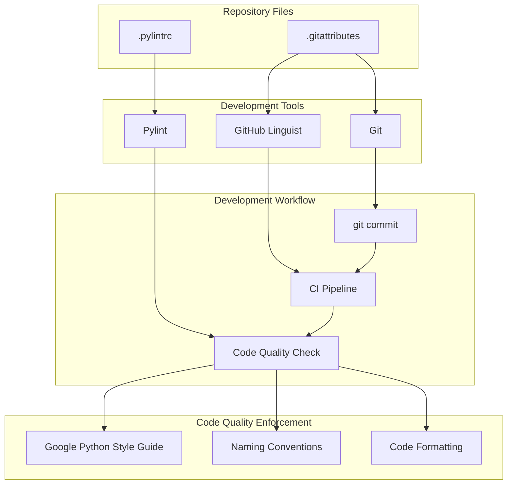
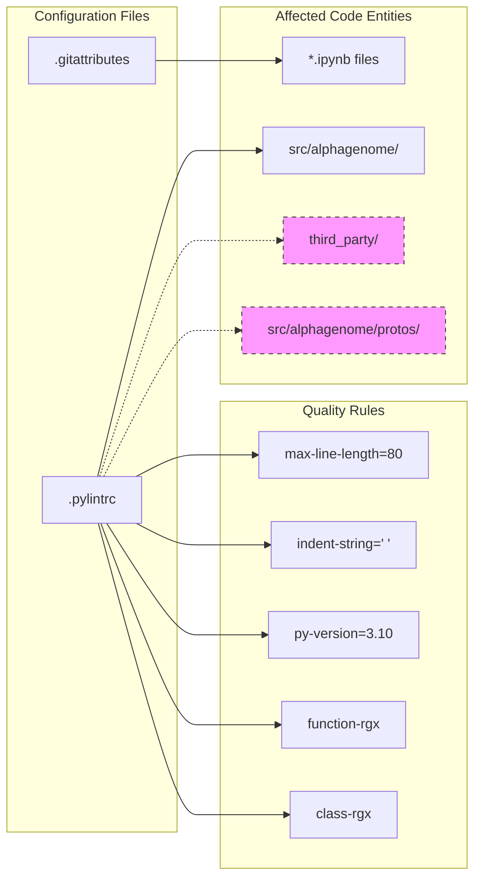

<!-- source: DeepWiki mcp.deepwiki.com · repo google-deepmind/alphagenome · page 8.2 Project Configuration · fetched 2026-10-26 -->

# Project Configuration

<details>
<summary>Relevant source files</summary>

The following files were used as context for generating this wiki page:

- [hatch_build.py](hatch_build.py)
- [pyproject.toml](pyproject.toml)
- [scripts/__init__.py](scripts/__init__.py)
- [scripts/process_gtf.py](scripts/process_gtf.py)
- [scripts/process_gtf_test.py](scripts/process_gtf_test.py)

</details>


This document provides a comprehensive reference for the AlphaGenome SDK project configuration, focusing on `pyproject.toml` and the build system. The project uses [PEP 621](https://peps.python.org/pep-0621/) standard metadata format with Hatchling as the build backend.

For information about testing configuration, see page 8.1. For details about code quality tools and linting, see the test environment configuration in this document.

## Build System Configuration

The AlphaGenome SDK uses Hatchling as its build backend with a custom build hook for Protocol Buffer compilation.

### Build Backend Declaration

The `[build-system]` section specifies the build tools and their versions:

```toml
[build-system]
build-backend = 'hatchling.build'
requires = ['hatchling', 'grpcio-tools<=1.67.1', 'importlib-resources']
```

| Package | Purpose |
|---------|---------|
| `hatchling` | PEP 517 build backend |
| `grpcio-tools<=1.67.1` | Protocol Buffer compiler for generating Python bindings |
| `importlib-resources` | Resource file access for older Python versions |

**Sources:** [pyproject.toml:1-3]()

### Custom Build Hook

The `[tool.hatch.build.hooks.custom]` section enables the custom build hook defined in `hatch_build.py`:

```toml
[tool.hatch.build.hooks.custom]
```

This hook is invoked during package building to generate Python bindings from Protocol Buffer definitions. The `GenerateProtos` class in `hatch_build.py` uses `grpc_tools.protoc` to compile three proto files:

- `alphagenome/protos/dna_model.proto`
- `alphagenome/protos/dna_model_service.proto`
- `alphagenome/protos/tensor.proto`

The generated files (`*_pb2.py` and `*_pb2_grpc.py`) are created in the source tree during build.

**Sources:** [pyproject.toml:86](), [hatch_build.py:15-50]()

## Project Metadata

### Core Identification

The `[project]` section defines the package metadata:

```toml
[project]
name = 'alphagenome'
description = 'A Python SDK for interacting and visualizing genomic models.'
readme = 'README.md'
dynamic = ['version']
license = { file = 'LICENSE' }
```

The `version` field is marked as `dynamic` and extracted from `src/alphagenome/__init__.py` via Hatch's version plugin:

```toml
[tool.hatch.version]
path = 'src/alphagenome/__init__.py'
```

**Sources:** [pyproject.toml:6-11](), [pyproject.toml:88-89]()

### Python Version Requirements

The project requires Python 3.10 or later:

```toml
requires-python = '>=3.10'
```

Test matrix covers Python 3.10, 3.11, 3.12, and 3.13:

```toml
[[tool.hatch.envs.hatch-test.matrix]]
python = ['3.13', '3.12', '3.11', '3.10']
```

**Sources:** [pyproject.toml:12](), [pyproject.toml:107-109]()

### Package Classification

The `classifiers` list provides PyPI metadata:

| Classifier Type | Value |
|----------------|-------|
| Development Status | `4 - Beta` |
| Environment | `Console` |
| Intended Audience | `Science/Research` |
| License | `Apache Software License` |
| Programming Language | Python 3.10, 3.11, 3.12, 3.13 |
| Topic | `Artificial Intelligence` |

**Sources:** [pyproject.toml:22-33]()

### Project URLs

```toml
[project.urls]
Repository = 'https://github.com/google-deepmind/alphagenome'
Documentation = 'https://www.alphagenomedocs.com/'
```

**Sources:** [pyproject.toml:57-59]()

## Dependencies

### Runtime Dependencies

The `dependencies` list specifies required packages for SDK functionality:

```toml
dependencies=[
    'absl-py',
    'anndata',
    'grpcio>=1.67.1',
    'immutabledict',
    'intervaltree',
    'jaxtyping',
    'matplotlib',
    'ml_dtypes',
    'numpy',
    'pandas',
    'protobuf>=5.28.3',
    'pyarrow',
    'scipy',
    'seaborn',
    'tqdm',
    'typeguard',
    'typing_extensions',
    'zstandard',
]
```

### Dependency Categories

| Category | Packages | Purpose |
|----------|----------|---------|
| API Communication | `grpcio`, `protobuf` | gRPC client for remote model service |
| Data Structures | `numpy`, `pandas`, `anndata`, `pyarrow` | Genomic data representation and scoring results |
| Visualization | `matplotlib`, `seaborn` | Plot generation for genomic predictions |
| Type Safety | `jaxtyping`, `typeguard`, `typing_extensions`, `ml_dtypes` | Runtime type checking and annotation support |
| Utilities | `absl-py`, `tqdm`, `immutabledict`, `intervaltree`, `scipy`, `zstandard` | Logging, progress bars, interval operations, compression |

**Sources:** [pyproject.toml:34-55]()

## Optional Dependencies

### Development Tools

The `dev` optional dependency group includes the Hatch build tool:

```toml
[project.optional-dependencies]
dev = [
  'hatch',
]
```

**Sources:** [pyproject.toml:61-64]()

### Documentation Build

The `docs` group includes Sphinx and related extensions for building documentation:

```toml
docs = [
    'ipykernel',
    'ipython',
    'myst-nb',
    'sphinx>=5.0',
    'sphinx-autodoc-typehints',
    'sphinx-book-theme',
    'sphinx-copybutton',
    'sphinx-remove-toctrees',
    'sphinx-design',
    'sphinxcontrib-bibtex>=1.0.0',
]
```

Key components:
- **Sphinx**: Documentation generator
- **myst-nb**: MyST parser for Markdown and Jupyter notebooks
- **sphinx-autodoc-typehints**: Type hint support in API documentation
- **sphinx-book-theme**: Documentation theme

**Sources:** [pyproject.toml:65-76]()

### Data Processing Scripts

The `scripts` group provides dependencies for GTF processing utilities:

```toml
scripts = [
    'absl-py',
    'alphagenome',
    'pandas',
    'pyarrow',
    'pyranges',
]
```

The `pyranges` package is used exclusively by `scripts/process_gtf.py` for reading GTF files and is not required for SDK runtime functionality.

**Sources:** [pyproject.toml:77-83](), [scripts/process_gtf.py:27]()

## Configuration File Architecture

The following diagram shows how configuration files integrate with the development workflow:



**Sources:** [.gitattributes:1-2](), [.pylintrc:1-459]()

## Configuration File Relationships

This diagram shows the relationship between configuration files and the code entities they affect:



**Sources:** [.gitattributes:1-2](), [.pylintrc:14-15](), [.pylintrc:41](), [.pylintrc:283](), [.pylintrc:311](), [.pylintrc:214](), [.pylintrc:235]()

## Configuration Summary

| File | Purpose | Key Impact |
|------|---------|------------|
| `.gitattributes` | Git repository attributes | Ensures accurate language detection by marking notebooks as documentation |
| `.pylintrc` | Code quality standards | Enforces Google Python style guide with 80-char lines, 2-space indents, and comprehensive naming conventions |

These configuration files work together to maintain consistent code quality and repository behavior across the AlphaGenome client library project. The `.pylintrc` file is particularly comprehensive, containing over 450 lines of configuration that disable specific checks while enforcing Google's Python style guidelines.

**Sources:** [.gitattributes:1-2](), [.pylintrc:1-459]()

---

