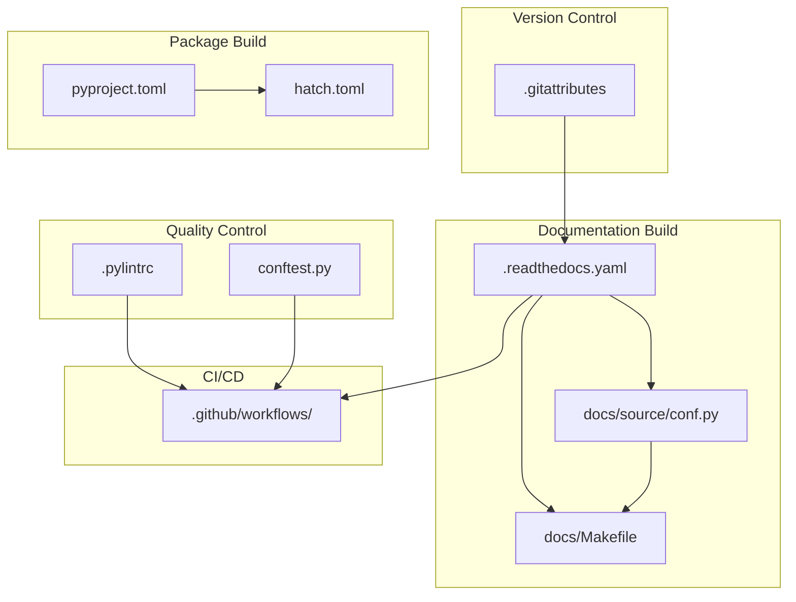
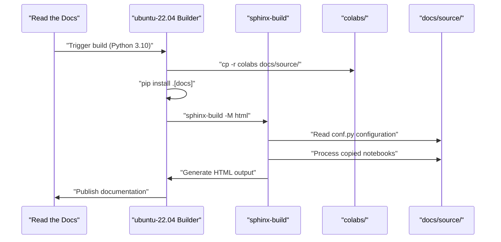

<!-- source: DeepWiki mcp.deepwiki.com · repo google-deepmind/alphagenome · page 9 Reference · fetched 2026-10-26 -->

# Reference

<details>
<summary>Relevant source files</summary>

The following files were used as context for generating this wiki page:

- [docs/source/faqs.md](docs/source/faqs.md)
- [docs/source/references.md](docs/source/references.md)
- [docs/source/refs.bib](docs/source/refs.bib)

</details>


This page provides reference material for the AlphaGenome client library infrastructure, including configuration files, documentation generation, and build/deployment systems. This covers the technical implementation details of how the project is structured, built, and published.

For specific API documentation of the client library classes and methods, see [API Reference](#3). For development workflows and contributing guidelines, see [Development](#5).

## Configuration System Overview

The AlphaGenome client library uses several configuration files to manage different aspects of the development and deployment pipeline. These files control build tools, documentation generation, version control behavior, and package publishing.

### Configuration File Ecosystem



**Documentation Configuration Integration**

Sources: [.readthedocs.yaml:1-43](), [docs/Makefile:1-21]()

## Documentation Build Pipeline

The project uses a sophisticated documentation pipeline that integrates Jupyter notebooks, Sphinx documentation, and Read the Docs hosting. The system automatically incorporates interactive examples into the published documentation.

### Documentation Build Process



**Read the Docs Configuration**

The `.readthedocs.yaml` file configures the documentation build environment:

| Configuration | Value | Purpose |
|---------------|-------|---------|
| `version` | `2` | Read the Docs config format version |
| `build.os` | `ubuntu-22.04` | Build environment OS |
| `build.tools.python` | `"3.10"` | Python version for build |
| `sphinx.builder` | `html` | Output format |
| `sphinx.configuration` | `docs/source/conf.py` | Sphinx config file |
| `sphinx.fail_on_warning` | `false` | Continue build on warnings |

**Pre-build Notebook Integration**

The build process includes a critical pre-build step that copies interactive notebooks into the documentation source tree:

```bash
cp -r colabs docs/source/
```

This command at [.readthedocs.yaml:29]() ensures that Jupyter notebooks from the `colabs/` directory are available to Sphinx during documentation generation.

Sources: [.readthedocs.yaml:18-43](), [docs/Makefile:1-21]()

## Build System Integration

### Sphinx Build Commands

The `docs/Makefile` provides standard Sphinx build targets:

| Target | Command | Purpose |
|--------|---------|---------|
| `help` | `sphinx-build -M help` | Display available build targets |
| `html` | `sphinx-build -M html` | Generate HTML documentation |
| `*` | `sphinx-build -M $@` | Route any target to Sphinx |

**Build Variables**

| Variable | Default | Purpose |
|----------|---------|---------|
| `SPHINXOPTS` | (empty) | Additional Sphinx options |
| `SPHINXBUILD` | `sphinx-build` | Sphinx build command |
| `SOURCEDIR` | `source` | Documentation source directory |
| `BUILDDIR` | `build` | Build output directory |

Sources: [docs/Makefile:6-20]()

### Git Configuration for Documentation

The `.gitattributes` file configures Git to treat Jupyter notebooks as documentation rather than code:

```
*.ipynb linguist-documentation
```

This setting at [.gitattributes:1]() ensures that GitHub's language detection correctly categorizes the repository as a Python project rather than being dominated by notebook JSON content.

Sources: [.gitattributes:1-2]()

## Package Installation Dependencies

The documentation build process installs the package with documentation dependencies:

```yaml
python:
  install:
    - method: pip
      path: .
      extra_requirements:
        - docs
```

This configuration at [.readthedocs.yaml:38-42]() installs the AlphaGenome package in development mode with the `docs` extra requirement group, ensuring all documentation generation dependencies are available during the build.

Sources: [.readthedocs.yaml:37-43]()

---

