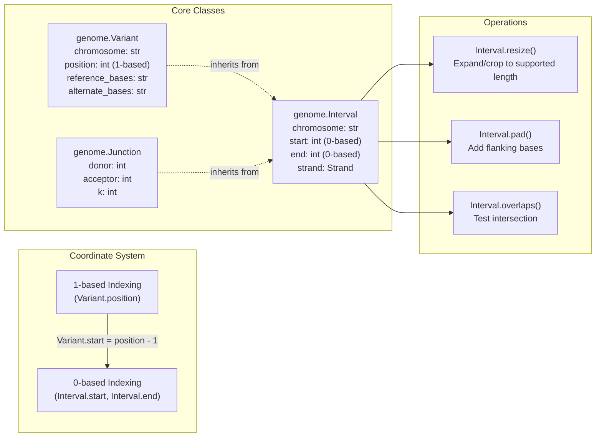
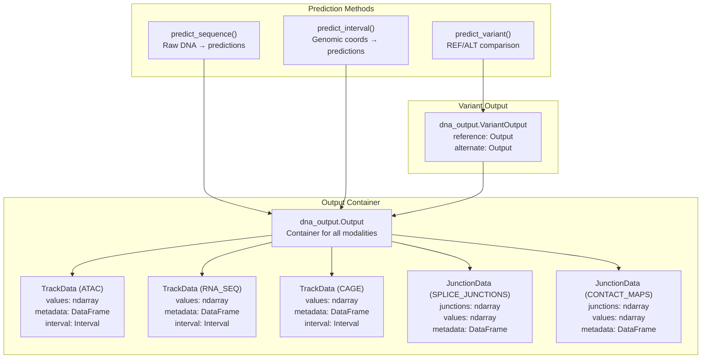
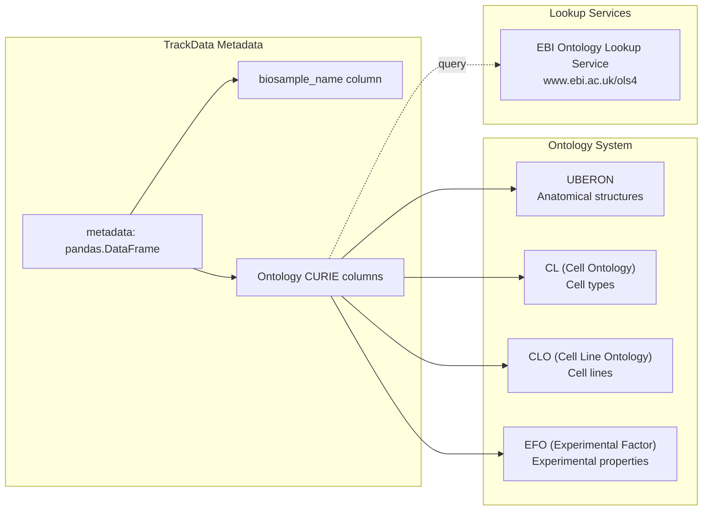
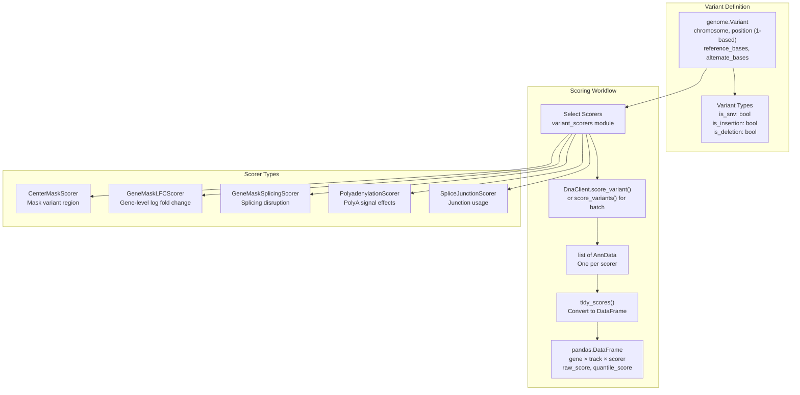
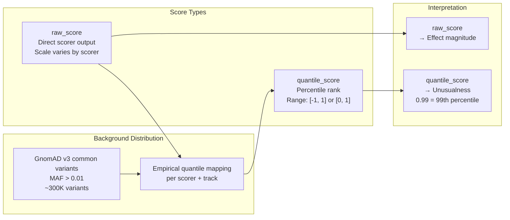
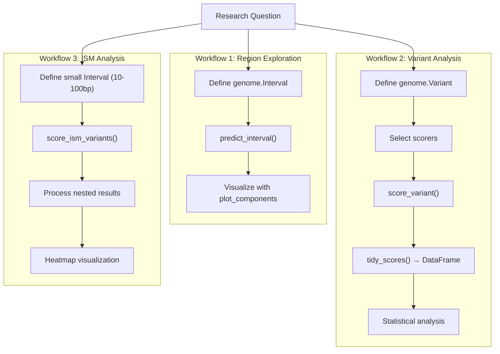

<!-- source: DeepWiki mcp.deepwiki.com · repo google-deepmind/alphagenome · page 9.1 Frequently Asked Questions · fetched 2026-10-26 -->

# Frequently Asked Questions

<details>
<summary>Relevant source files</summary>

The following files were used as context for generating this wiki page:

- [docs/source/faqs.md](docs/source/faqs.md)
- [docs/source/refs.bib](docs/source/refs.bib)

</details>


This page provides answers to common questions about the AlphaGenome SDK. It covers practical aspects of working with the API, including input specifications, output interpretation, variant scoring, and system limitations. For step-by-step tutorials, see [Quick Start Tutorial](#2.2) and [User Guides](#5). For complete API specifications, see [API Reference](#4).

---

## Model Inputs and Configuration

### Specifying Genomic Regions

The SDK uses the `genome.Interval` class to represent genomic coordinates. All coordinate systems use **0-based indexing** (Python convention), where an interval includes the base at `start` but excludes the base at `end`.



**Key Points:**
- `genome.Interval('chr1', 0, 1)` represents the first base pair only
- `genome.Interval('chr1', 0, 1).overlaps(genome.Interval('chr1', 1, 2))` returns `False`
- `genome.Variant` uses 1-based `position` for compatibility with dbSNP, but internally converts to 0-based coordinates

Sources: [docs/source/faqs.md:13-36]()

### Supported Input Specifications

| Parameter | Specification | Details |
|-----------|--------------|---------|
| **Reference Genomes** | Human: hg38 (GRCh38.p13.genome.fa)<br/>Mouse: mm10 (GRCm38.p6.genome.fa) | Use [UCSC LiftOver](https://genome.ucsc.edu/cgi-bin/hgLiftOver) for other assemblies |
| **Sequence Lengths** | ~16 KB<br/>~100 KB<br/>~500 KB<br/>1 MB (2^20 bp, recommended) | Use `Interval.resize()` to adjust to supported lengths |
| **Sequence Composition** | Any DNA sequence | Predictions most reliable for sequences similar to reference (SNPs, indels) |
| **Species Support** | Human and mouse (trained)<br/>Other species (experimental) | Quality degrades with evolutionary distance |
| **Variant Types** | SNVs, insertions, deletions | Left-aligned indels; see `genome.Variant` documentation |

Sources: [docs/source/faqs.md:40-78]()

### Arbitrary Sequences vs Reference-Based Predictions

**Q: Can I predict any DNA sequence?**

Yes, but with caveats:
- Model trained on human/mouse reference sequences
- Predictions for large deviations (structural variants, synthetic DNA, heavily padded sequences) may be unreliable
- Best results with sequences similar to reference genome

**Q: Does `Variant.reference_bases` need to match the genome?**

No. `DnaClient.predict_variant()` uses the user-specified REF/ALT alleles regardless of actual reference genome content. This allows flexibility but requires careful validation of input sequences.

Sources: [docs/source/faqs.md:47-84]()

---

## Model Outputs and Data Structures

### Output Architecture



Sources: [docs/source/faqs.md:80-177]()

### Track Metadata and Ontologies

**Q: How many tracks per output type?**

Varies from 5 to over 600 tracks. Each track represents a specific:
- Cell type or tissue
- Strand (for stranded assays)
- Transcription factor (for CHIP_TF)

**Q: How do I identify what a track represents?**

Use the `metadata` DataFrame within each `TrackData` object:
- `biosample_name`: Human-readable tissue/cell type name
- Ontology CURIEs: Standardized identifiers (e.g., `UBERON:0001114` for liver)



**Note:** See the [navigating data ontologies notebook](#6.6) for detailed examples of working with ontology terms.

Sources: [docs/source/faqs.md:82-108]()

### Strandedness in Output Tracks

DNA has two strands: **positive** (+, 5'→3') and **negative** (-, 3'→5'). Genomic assays may be:
- **Unstranded** (`.`): Single track per tissue, e.g., ATAC-seq
- **Stranded** (`+` and `-`): Two tracks per tissue, e.g., strand-specific RNA-seq

| Strand Symbol | Meaning | Track Count |
|---------------|---------|-------------|
| `+` | Positive strand | 1 per tissue |
| `-` | Negative strand | 1 per tissue |
| `.` | Unstranded | 1 per tissue |

**Convenience methods:**
- `TrackData.filter_to_negative_strand()`
- `TrackData.filter_to_positive_strand()`
- `TrackData.filter_to_unstranded()`

**Important:** Not all RNA-seq is stranded. GTEx RNA-seq data, for example, is unstranded.

Sources: [docs/source/faqs.md:110-163]()

### Saving Output Data

| Output Type | Recommended Format | Method |
|-------------|-------------------|--------|
| **Variant scores** | CSV via pandas DataFrame | Use `tidy_scores()` to convert `AnnData` → DataFrame, then `df.to_csv()` |
| **Track predictions** | NumPy binary | `numpy.save()` for single array, `numpy.savez_compressed()` for multiple arrays |
| **Visualization** | Matplotlib figure | Standard `fig.savefig()` methods |

Sources: [docs/source/faqs.md:164-177]()

---

## Variant Scoring

### Defining and Scoring Variants



Sources: [docs/source/faqs.md:237-306]()

### Variant Coordinate System

The `genome.Variant` class uses **1-based position** for the `position` attribute to match public databases (dbSNP, VCF files), but internally converts to 0-based indexing:

```
Variant.position = 100  (1-based, user-facing)
Variant.start = 99      (0-based, internal)
Variant.end = 100       (0-based, internal)
```

**For indels:** The SDK uses **left-alignment** consistent with VCF standards. See the `genome.Variant` class documentation for detailed indel handling.

Sources: [docs/source/faqs.md:239-266]()

### Variant Scorer Selection

| Modality | Recommended Scorers | Notes |
|----------|-------------------|-------|
| **Gene Expression (RNA-seq)** | `GeneMaskLFCScorer` | Log fold change at gene level |
| **Splicing** | `GeneMaskSplicingScorer`<br/>`SpliceJunctionScorer` | Junction-level and site-level metrics |
| **Polyadenylation** | `PolyadenylationScorer` | PolyA signal disruption |
| **Accessibility (ATAC)** | `CenterMaskScorer` | General-purpose masking strategy |
| **CAGE** | `CenterMaskScorer` | Transcription start site effects |

**Note:** Most scorers work with any modality, but recommendations are based on benchmarking. See [Variant Scoring](#3.3) for detailed guidance.

**Custom scorers:** Not currently supported, but users can implement custom aggregation of REF/ALT predictions directly.

Sources: [docs/source/faqs.md:294-306]()

### Raw Scores vs Quantile Scores



**Key differences:**

| Aspect | raw_score | quantile_score |
|--------|-----------|----------------|
| **Scale** | Scorer-dependent (unbounded, [0,1], etc.) | [-1, 1] for signed, [0, 1] for unsigned |
| **Comparability** | Not comparable across scorers/tracks | Standardized across all scorers/tracks |
| **Interpretation** | Effect magnitude | Percentile rank vs common variants |
| **Max values** | Unbounded | Capped at ±0.999990 due to finite background |
| **Availability** | All scorers | Recommended scorers only |

**For signed scores** (directional effects like up/down regulation):
- Quantile values map [0, 1] probability → [-1, 1] score
- -1 = most negative (0th percentile), 0 = neutral (50th percentile), +1 = most positive (100th percentile)

**Recommendation:** Use `quantile_score` to identify unusually large effects, then use `raw_score` to quantify magnitude.

Sources: [docs/source/faqs.md:307-340]()

### Indel Scoring Strategy

Insertions and deletions are handled using SpliceAI's alignment strategy:
- **Insertions:** Summarized by taking maximum value over inserted segment
- **Deletions:** Treated as zero signal in ALT context for positional comparison

This ensures consistent scoring despite length differences between REF and ALT sequences.

Sources: [docs/source/faqs.md:285-293]()

---

## Visualization

### Creating Plots

The SDK provides a matplotlib-based visualization library in the `visualization` module with plot components:
- `TrackAnnotation`: Continuous signals (RNA-seq, ATAC, etc.)
- `JunctionAnnotation`: Discrete events (splice junctions, contact maps)
- `TranscriptAnnotation`: Gene structure overlays
- `VariantAnnotation`: Variant position markers

**For detailed guides, see:**
- [Visualization library basics](#5.5)
- [Visualizing predictions tutorial](#6.4)

**Customization:** All figures are matplotlib objects and can be extended using standard matplotlib APIs. You can also work directly with the raw NumPy arrays in `TrackData.values` for custom visualizations.

Sources: [docs/source/faqs.md:204-220]()

### Transcript Annotations

**Q: Where do transcript annotations come from?**

GENCODE GTF files:
- Human: hg38 reference assembly (release 46)
- Mouse: mm10 reference assembly (release M23)

**Q: Can I plot non-protein-coding genes or all transcripts?**

Yes. The default filtering in examples can be removed:
- Remove `gene_annotation.filter_protein_coding(gtf)` to include all gene types
- Remove `gene_annotation.filter_to_longest_transcript(gtf)` to show all transcripts

**Tip:** Increase `fig_height` parameter in `TranscriptAnnotation` when plotting many transcripts to improve legibility.

Sources: [docs/source/faqs.md:221-236]()

---

## System Limitations and Best Practices

### Known Limitations

| Limitation | Details | Implications |
|------------|---------|--------------|
| **Tissue-specificity** | Capturing tissue-specific effects remains challenging | Long-range interactions may not be fully captured |
| **Species scope** | Trained on human and mouse only | Performance on other species not benchmarked |
| **Personal genomes** | Not benchmarked for individual genomes | Use with caution for patient-specific predictions |
| **Molecular scope** | Predicts molecular consequences only | Limited applicability to complex trait analysis |
| **Diploid awareness** | Single sequence input, unphased training | Does not model heterozygous states |
| **Structural variants** | Trained on SNPs and indels | Large structural variants may yield unreliable predictions |

**Best practices:**
1. Use **1 MB sequences** when possible for optimal predictions
2. Use **quantile scores** to identify unusual effects, **raw scores** for magnitude
3. Validate predictions with **experimental data** when available
4. Be cautious with sequences far from reference genome

Sources: [docs/source/faqs.md:178-203]()

### Phasing and Heterozygosity

The model processes **one sequence at a time** and was trained on **unphased data**. This means:
- Cannot distinguish maternal vs paternal alleles
- Does not inherently model heterozygous states (REF + ALT simultaneously)
- Variant effect predictions are for homozygous contexts

For compound heterozygotes or phased analysis, separate predictions are required for each haplotype.

Sources: [docs/source/faqs.md:196-203]()

---

## API Access and Support

### Terms of Use

- **Non-commercial use only**
- Subject to [AlphaGenome Terms of Service](https://deepmind.google.com/science/alphagenome/terms)
- **Outputs cannot be used for training other ML models**

Sources: [docs/source/faqs.md:343-351]()

### Citation

If using AlphaGenome in research, cite:

```bibtex
@article{alphagenome,
  title={Advancing regulatory variant effect prediction with {AlphaGenome}},
  author={Avsec, {\v Z}iga and Latysheva, Natasha and Cheng, Jun and ...},
  journal={Nature},
  volume={649},
  number={8099},
  pages={1206--1218},
  year={2026},
  doi={10.1038/s41586-025-10014-0}
}
```

Sources: [docs/source/faqs.md:352-373](), [docs/source/refs.bib:1-11]()

### Getting Help

| Issue Type | Channel | Response Time |
|-----------|---------|---------------|
| **Bugs, code issues** | [GitHub Issues](https://github.com/google-deepmind/alphagenome) | Tracked publicly |
| **Usage questions, features** | [Community Forum](https://www.alphagenomecommunity.com) | Actively monitored, fastest response |
| **General inquiries** | alphagenome@google.com | May have delays due to volume |

Sources: [docs/source/faqs.md:374-385]()

---

## Quick Reference Tools

### Interactive Notebooks

| Notebook | Purpose | Link |
|----------|---------|------|
| `quick_start.ipynb` | Basic prediction workflow | [Quick Start](#2.2) |
| `variant_scoring_ui.ipynb` | Interactive single-variant analysis | [Interactive Variant Scoring](#6.3) |
| `batch_variant_scoring.ipynb` | VCF file batch processing | [Batch Variant Scoring](#6.2) |
| `visualization_modality_tour.ipynb` | Comprehensive visualization examples | [Visualization Tour](#6.4) |
| `tissue_ontology_mapping.ipynb` | Working with ontology terms | [Biological Context Mapping](#6.6) |

### Common Workflow Patterns



Sources: [docs/source/faqs.md:1-385]()

---

