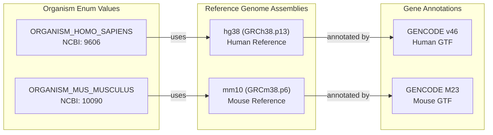
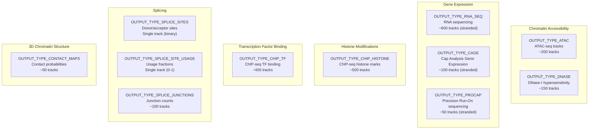
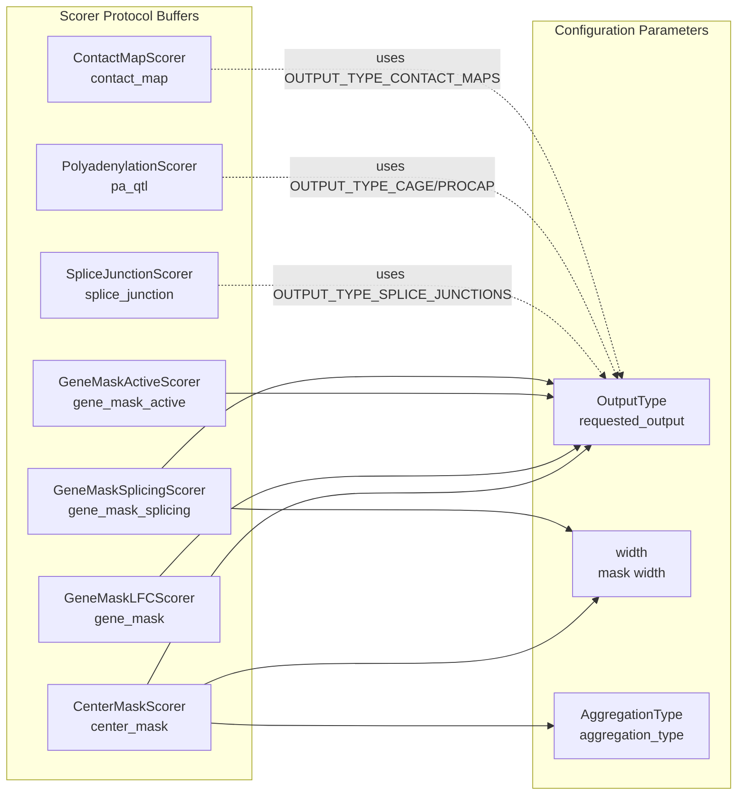

<!-- source: DeepWiki mcp.deepwiki.com · repo google-deepmind/alphagenome · page 9.2 Supported Features · fetched 2026-10-26 -->

# Supported Features

<details>
<summary>Relevant source files</summary>

The following files were used as context for generating this wiki page:

- [docs/source/faqs.md](docs/source/faqs.md)
- [docs/source/refs.bib](docs/source/refs.bib)
- [src/alphagenome/protos/dna_model.proto](src/alphagenome/protos/dna_model.proto)

</details>


This page provides a comprehensive reference of all features supported by the AlphaGenome SDK, including organisms, sequence lengths, output types, variant scorers, and aggregation strategies. For practical guidance on using these features, see [Making Predictions](#5.1) and [Scoring Variants](#5.2). For known limitations and unsupported use cases, see [Model Limitations](#9.3).

## Supported Organisms

The AlphaGenome model supports predictions for human and mouse genomic sequences. The model was trained exclusively on these two species.

| Organism | NCBI Taxonomy ID | Enum Value | Reference Genome Assembly | Reference File |
|----------|------------------|------------|---------------------------|----------------|
| Human | 9606 | `ORGANISM_HOMO_SAPIENS` | hg38 (GRCh38) | GRCh38.p13.genome.fa |
| Mouse | 10090 | `ORGANISM_MUS_MUSCULUS` | mm10 (GRCm38) | GRCm38.p6.genome.fa |



**Notes:**
- For other genome builds (e.g., hg19), use the UCSC [LiftOver](https://genome.ucsc.edu/cgi-bin/hgLiftOver) tool to convert coordinates to hg38
- Predictions on DNA from other species are possible but not formally benchmarked; prediction quality likely degrades with evolutionary distance from human and mouse

**Sources:** [src/alphagenome/protos/dna_model.proto:489-500](), [docs/source/faqs.md:40-61]()

## Supported Sequence Lengths

The model accepts genomic intervals of specific discrete lengths. Predictions at 1MB are recommended for optimal results.

| Sequence Length | Exact Value (base pairs) | Recommended Use |
|-----------------|--------------------------|-----------------|
| ~16KB | 2^14 (16,384 bp) | Short regulatory regions, promoters |
| ~100KB | ~100,000 bp | Gene bodies, local regulatory contexts |
| ~500KB | ~500,000 bp | Gene clusters, extended regulatory landscapes |
| 1MB | 2^20 (1,048,576 bp) | **Recommended**: Best prediction accuracy, captures long-range interactions |

**Resizing Intervals:**

For sequences that don't match supported lengths, use [`genome.Interval.resize()`](). This method expands or contracts intervals using actual surrounding genomic sequence data (not padding).

```python
# Example: Resize a 50KB interval to 1MB
interval = genome.Interval('chr1', 1000000, 1050000)  # 50KB
resized = interval.resize(2**20)  # Expands to 1MB centered on original interval
```

**Sources:** [docs/source/faqs.md:63-78]()

## Supported Output Types

The model predicts multiple biological modalities, each represented by an `OutputType` enum value. The number of tracks per output type varies based on the number of cell types, tissues, and experimental conditions available in training data.

### Output Type Categories and Details



| Output Type | Enum Value | Description | Typical Track Count | Strandedness |
|-------------|------------|-------------|---------------------|--------------|
| **Chromatin Accessibility** |
| ATAC-seq | `OUTPUT_TYPE_ATAC` | Chromatin accessibility from ATAC-seq | ~200 | Unstranded (`.`) |
| DNase-seq | `OUTPUT_TYPE_DNASE` | DNase I hypersensitive sites | ~150 | Unstranded (`.`) |
| **Gene Expression** |
| RNA-seq | `OUTPUT_TYPE_RNA_SEQ` | RNA sequencing coverage | ~600 | Stranded (`+`/`-`) or Unstranded (`.`) |
| CAGE | `OUTPUT_TYPE_CAGE` | Cap Analysis of Gene Expression | ~100 | Stranded (`+`/`-`) |
| PRO-cap | `OUTPUT_TYPE_PROCAP` | Precision Run-On sequencing and capping | ~50 | Stranded (`+`/`-`) |
| **Histone Modifications** |
| ChIP-seq (Histone) | `OUTPUT_TYPE_CHIP_HISTONE` | Histone modification marks (e.g., H3K27ac, H3K4me3) | ~500 | Unstranded (`.`) |
| **Transcription Factor Binding** |
| ChIP-seq (TF) | `OUTPUT_TYPE_CHIP_TF` | Transcription factor binding sites | ~400 | Unstranded (`.`) |
| **Splicing** |
| Splice Sites | `OUTPUT_TYPE_SPLICE_SITES` | Donor and acceptor splice site predictions | 1 | N/A |
| Splice Site Usage | `OUTPUT_TYPE_SPLICE_SITE_USAGE` | Fraction of time each splice site is used | 1 | N/A |
| Splice Junctions | `OUTPUT_TYPE_SPLICE_JUNCTIONS` | Split read counts for predicted junctions | ~100 | Unstranded (`.`) |
| **3D Chromatin Structure** |
| Contact Maps | `OUTPUT_TYPE_CONTACT_MAPS` | 3D chromatin contact probabilities | ~50 | N/A |

**Strandedness Convention:**
- `+`: Positive strand (5' → 3')
- `-`: Negative strand (3' → 5')
- `.`: Unstranded (measurement does not distinguish strand)

**Track Metadata:**

Each track includes metadata describing:
- **Biosample**: Cell type, tissue, or cell line (e.g., "liver", "T-cell")
- **Ontology term**: Standardized biological identifier (CURIE format)
- **Assay details**: Protocol specifics (e.g., "polyA plus RNA-seq")
- **Data source**: Origin dataset (e.g., "ENCODE", "GTEx")
- **Strand**: `+`, `-`, or `.` as described above

Access metadata via [`TrackData.metadata`]() or [`JunctionData.metadata`]() attributes. For guidance on filtering by ontology terms, see the [tissue ontology mapping notebook](colabs/tissue_ontology_mapping).

**Sources:** [src/alphagenome/protos/dna_model.proto:449-487](), [docs/source/faqs.md:82-162]()

## Supported Variant Scorers

Variant scorers aggregate reference and alternate predictions to quantify functional impact. Each scorer is configured via protocol buffer messages and accessed through the [`DnaClient.score_variant()`]() and [`DnaClient.score_ism_variants()`]() methods.

### Variant Scorer Types



| Scorer | Proto Message | Configurable Parameters | Recommended Use Case |
|--------|---------------|-------------------------|----------------------|
| **Center Mask** | `CenterMaskScorer` | `width`, `aggregation_type`, `requested_output` | General variant scoring across any output type; aggregates predictions within a window centered on variant |
| **Gene Mask (Log Fold Change)** | `GeneMaskLFCScorer` | `requested_output` | Gene expression (RNA-seq, CAGE) scoring; computes log2 fold change over entire gene body |
| **Gene Mask (Active Allele)** | `GeneMaskActiveScorer` | `requested_output` | Gene expression scoring; identifies which allele shows higher expression (allelic imbalance) |
| **Gene Mask (Splicing)** | `GeneMaskSplicingScorer` | `width`, `requested_output` | Splicing variants; aggregates splice site predictions near variant within gene context |
| **Polyadenylation** | `PolyadenylationScorer` | *(none)* | Polyadenylation QTLs (paQTLs); uses CAGE/PRO-cap predictions at 3' UTRs |
| **Splice Junction** | `SpliceJunctionScorer` | *(none)* | Splicing variants; compares predicted junction usage between REF and ALT |
| **Contact Map** | `ContactMapScorer` | *(none)* | 3D chromatin structure variants; compares contact probabilities |

**Quantile Scores:**

Most scorers provide both `raw_score` and `quantile_score` outputs. Quantile scores are standardized to [-1, 1] (for signed scores) or [0, 1] (for unsigned scores) based on background distributions from common variants (MAF > 0.01 in GnomAD v3). A quantile score of 0.99 indicates the variant's effect is at the 99th percentile of common variants. See [FAQs](#9.1) for detailed explanation.

**Sources:** [src/alphagenome/protos/dna_model.proto:301-368](), [docs/source/faqs.md:294-341]()

## Supported Aggregation Types

Aggregation types define how reference and alternate predictions are combined to produce variant scores. These are used primarily with `CenterMaskScorer` and `GeneMaskSplicingScorer`.

### Aggregation Strategy Architecture

```mermaid
graph TB
    subgraph "Difference-Based Aggregations"
        DM["AGGREGATION_TYPE_DIFF_MEAN<br/>mean(ALT) - mean(REF)"]
        DS["AGGREGATION_TYPE_DIFF_SUM<br/>sum(ALT) - sum(REF)"]
        DSL["AGGREGATION_TYPE_DIFF_SUM_LOG2<br/>sum(log2(ALT)) - sum(log2(REF))"]
        DLS["AGGREGATION_TYPE_DIFF_LOG2_SUM<br/>log2(sum(ALT)) - log2(sum(REF))"]
    end
    
    subgraph "Distance-Based Aggregations"
        L2["AGGREGATION_TYPE_L2_DIFF<br/>l2_norm(ALT - REF)"]
        L2L["AGGREGATION_TYPE_L2_DIFF_LOG1P<br/>l2_norm(log1p(ALT) - log1p(REF))"]
    end
    
    subgraph "Active Allele Aggregations"
        AM["AGGREGATION_TYPE_ACTIVE_MEAN<br/>max(mean(ALT), mean(REF))"]
        AS["AGGREGATION_TYPE_ACTIVE_SUM<br/>max(sum(ALT), sum(REF))"]
    end
    
    DM -.->|"signed score"| R1["Result: directionality<br/>(up/down regulation)"]
    DS -.->|"signed score"| R1
    DSL -.->|"signed score"| R1
    DLS -.->|"signed score"| R1
    
    L2 -.->|"unsigned score"| R2["Result: magnitude only<br/>(no directionality)"]
    L2L -.->|"unsigned score"| R2
    
    AM -.->|"unsigned score"| R3["Result: which allele<br/>is more active"]
    AS -.->|"unsigned score"| R3
```



| Aggregation Type | Enum Value | Formula | Directionality | Use Case |
|------------------|------------|---------|----------------|----------|
| **Difference of Means** | `AGGREGATION_TYPE_DIFF_MEAN` | mean(ALT) - mean(REF) | Signed | Default for most continuous tracks; captures average change |
| **Difference of Sums** | `AGGREGATION_TYPE_DIFF_SUM` | sum(ALT) - sum(REF) | Signed | Total signal change over region |
| **Diff Sum Log2** | `AGGREGATION_TYPE_DIFF_SUM_LOG2` | sum(log2(ALT)) - sum(log2(REF)) | Signed | Log-space aggregation for fold-change-like interpretation |
| **Diff Log2 Sum** | `AGGREGATION_TYPE_DIFF_LOG2_SUM` | log2(sum(ALT)) - log2(sum(REF)) | Signed | Log fold change of total signal |
| **L2 Difference** | `AGGREGATION_TYPE_L2_DIFF` | l2_norm(ALT - REF) | Unsigned | Magnitude of change without directionality |
| **L2 Diff Log1p** | `AGGREGATION_TYPE_L2_DIFF_LOG1P` | l2_norm(log1p(ALT) - log1p(REF)) | Unsigned | Log-space L2 distance; reduces impact of high-magnitude predictions |
| **Active Mean** | `AGGREGATION_TYPE_ACTIVE_MEAN` | max(mean(ALT), mean(REF)) | Unsigned | Identifies which allele has higher average signal |
| **Active Sum** | `AGGREGATION_TYPE_ACTIVE_SUM` | max(sum(ALT), sum(REF)) | Unsigned | Identifies which allele has higher total signal |

**Selecting Aggregation Types:**

- For **expression changes** (RNA-seq, CAGE): Use `DIFF_MEAN` or `DIFF_LOG2_SUM` for directional effects (up/down regulation)
- For **allelic imbalance**: Use `ACTIVE_MEAN` or `ACTIVE_SUM` to identify the more active allele
- For **accessibility/binding**: Use `L2_DIFF` for magnitude of change without caring about direction
- For **splicing**: `DIFF_SUM_LOG2` is commonly used within gene-mask context

**Sources:** [src/alphagenome/protos/dna_model.proto:515-547]()

## Supported Interval Scorers

Interval scorers aggregate predictions over genomic regions without requiring a variant. Currently, one interval scorer is supported.

| Scorer | Proto Message | Parameters | Description |
|--------|---------------|------------|-------------|
| **Gene Mask Interval** | `GeneMaskIntervalScorer` | `requested_output`, `width`, `aggregation_type` | Aggregates predictions over gene bodies using interval aggregation types (MEAN or SUM) |

**Interval Aggregation Types:**

| Aggregation Type | Enum Value | Description |
|------------------|------------|-------------|
| **Mean** | `INTERVAL_AGGREGATION_TYPE_MEAN` | Average prediction value across interval positions |
| **Sum** | `INTERVAL_AGGREGATION_TYPE_SUM` | Total prediction value across interval positions |

**Sources:** [src/alphagenome/protos/dna_model.proto:281-312]()

## Supported Ontology Types

Track metadata includes standardized biological ontology terms for filtering and analysis.

| Ontology | Enum Value | Description | Example CURIE |
|----------|------------|-------------|---------------|
| **UBERON** | `ONTOLOGY_TYPE_UBERON` | Uber-anatomy ontology (organs, tissues) | `UBERON:0001114` (liver) |
| **CL** | `ONTOLOGY_TYPE_CL` | Cell Ontology (cell types) | `CL:0000236` (B cell) |
| **CLO** | `ONTOLOGY_TYPE_CLO` | Cell Line Ontology (cell lines) | `CLO:0000019` (HeLa) |
| **EFO** | `ONTOLOGY_TYPE_EFO` | Experimental Factor Ontology (experimental conditions) | `EFO:0000246` (age) |
| **NTR** | `ONTOLOGY_TYPE_NTR` | New Term Requested (pending standardization) | N/A |

**CURIE Format:** Compact Uniform Resource Identifiers (e.g., `UBERON:0001114`) uniquely identify ontology terms. Use the [EBI Ontology Lookup Service](https://www.ebi.ac.uk/ols4) to explore relationships between terms.

**Sources:** [src/alphagenome/protos/dna_model.proto:403-421](), [docs/source/faqs.md:96-108]()

## Supported Biosample Types

Track metadata categorizes biological samples according to ENCODE conventions.

| Biosample Type | Enum Value | Description | Example |
|----------------|------------|-------------|---------|
| **Primary Cell** | `BIOSAMPLE_TYPE_PRIMARY_CELL` | Cells directly isolated from organism | Primary hepatocytes |
| **In Vitro Differentiated** | `BIOSAMPLE_TYPE_IN_VITRO_DIFFERENTIATED_CELLS` | Cells differentiated in culture | iPSC-derived neurons |
| **Cell Line** | `BIOSAMPLE_TYPE_CELL_LINE` | Immortalized cell lines | HEK293T, K562 |
| **Tissue** | `BIOSAMPLE_TYPE_TISSUE` | Intact tissue samples | Liver tissue, brain cortex |
| **Technical Sample** | `BIOSAMPLE_TYPE_TECHNICAL_SAMPLE` | Control or calibration samples | DNA standards |
| **Organoid** | `BIOSAMPLE_TYPE_ORGANOID` | 3D tissue culture models | Brain organoids |

**Sources:** [src/alphagenome/protos/dna_model.proto:425-446]()

## Supported Strandedness Values

Predictions can be stranded or unstranded depending on the assay type.

| Strand Value | Enum | Symbol | Description |
|--------------|------|--------|-------------|
| **Positive** | `STRAND_POSITIVE` | `+` | Forward strand (5' → 3' direction) |
| **Negative** | `STRAND_NEGATIVE` | `-` | Reverse strand (3' → 5' direction) |
| **Unstranded** | `STRAND_UNSTRANDED` | `.` | Measurement does not distinguish strand |

**Strand-Specific Outputs:**

- Stranded assays (RNA-seq, CAGE, PRO-cap) produce **two tracks per tissue**: one for `+` strand, one for `-` strand
- Unstranded assays (ATAC-seq, DNase-seq, ChIP-seq) produce **one track per tissue** marked as `.`

Convenience methods for strand filtering are available: [`TrackData.filter_to_positive_strand()`](), [`TrackData.filter_to_negative_strand()`](), [`TrackData.filter_to_unstranded()`]().

**Sources:** [src/alphagenome/protos/dna_model.proto:388-400](), [docs/source/faqs.md:110-162]()

## API Version and Model Version

The AlphaGenome SDK communicates with the API server using protocol buffers defined in the `v1main` package namespace.

| Component | Version/Identifier | Location |
|-----------|-------------------|----------|
| **API Package** | `google.gdm.gdmscience.alphagenome.v1main` | [src/alphagenome/protos/dna_model.proto:17]() |
| **Protocol Version** | proto3 | [src/alphagenome/protos/dna_model.proto:15]() |
| **Model Citation** | Nature 649:1206-1218 (2026) | [docs/source/refs.bib:1-11]() |

**Model Updates:**

The model served by the API may be updated without SDK changes. Check the [Changelog](#9.4) for announcements of model updates or API version changes.

**Sources:** [src/alphagenome/protos/dna_model.proto:15-24](), [docs/source/refs.bib:1-11]()

## Feature Support Summary

The following table summarizes key feature support at a glance:

| Feature Category | Count | Notes |
|------------------|-------|-------|
| **Organisms** | 2 | Human (hg38), Mouse (mm10) |
| **Sequence Lengths** | 4 | 16KB, 100KB, 500KB, 1MB (recommended) |
| **Output Types** | 11 | ATAC, CAGE, CHIP_HISTONE, CHIP_TF, CONTACT_MAPS, DNASE, PROCAP, RNA_SEQ, SPLICE_JUNCTIONS, SPLICE_SITES, SPLICE_SITE_USAGE |
| **Variant Scorers** | 7 | CenterMask, GeneMaskLFC, GeneMaskActive, GeneMaskSplicing, Polyadenylation, SpliceJunction, ContactMap |
| **Interval Scorers** | 1 | GeneMaskInterval |
| **Aggregation Types** | 8 | Difference-based (4), distance-based (2), active allele (2) |
| **Ontology Types** | 5 | UBERON, CL, CLO, EFO, NTR |
| **Biosample Types** | 6 | Primary cell, differentiated, cell line, tissue, technical, organoid |
| **Total Tracks** | ~2000+ | Varies by output type; RNA-seq has most (~600) |

For limitations and unsupported features, see [Model Limitations](#9.3).

**Sources:** [src/alphagenome/protos/dna_model.proto:1-560](), [docs/source/faqs.md:1-385]()

---

