<!-- source: DeepWiki mcp.deepwiki.com · repo google-deepmind/alphagenome · page 9.3 Model Limitations · fetched 2026-10-26 -->

# Model Limitations

Relevant source files

The following files were used as context for generating this wiki page:

- [docs/source/faqs.md](docs/source/faqs.md)
- [docs/source/refs.bib](docs/source/refs.bib)

This page documents the known limitations, constraints, and unsupported use cases of the AlphaGenome model. Understanding these boundaries is essential for correct interpretation of predictions and avoiding misuse of the system.

For information about supported features and capabilities, see [Supported Features](#9.2). For practical guidance on using the model within its design constraints, see the user guides in section 5.

---

## Overview of Limitation Categories

AlphaGenome has constraints across multiple dimensions that users should be aware of when designing experiments and interpreting results.

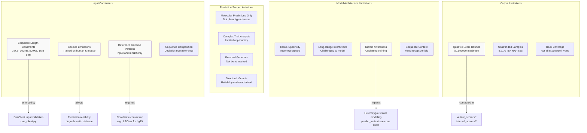

**Sources:** [docs/source/faqs.md:178-203]()

---

## Input Sequence Constraints

### Supported Sequence Lengths

The model accepts only specific sequence lengths due to its architecture design. Arbitrary-length sequences are not supported.

| Supported Length | Approximate | Exact (base pairs) | Primary Use Case |
|------------------|-------------|-------------------|------------------|
| ~16KB | 16,384 | 2^14 | Single gene, promoter analysis |
| ~100KB | 131,072 | 2^17 | Multi-gene locus, regulatory domains |
| ~500KB | 524,288 | 2^19 | Large regulatory landscapes |
| 1MB | 1,048,576 | 2^20 | Chromatin domains, TADs |

**Recommendation:** Use 1MB predictions where possible for best results, as this length provides the most complete sequence context for the model.

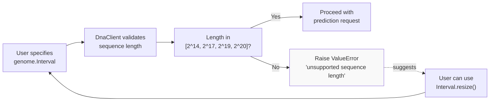

**Code Implementation:**
- Length validation occurs in the `DnaClient` class before API requests
- Use `genome.Interval.resize()` to adjust intervals to nearest supported length
- Note: `resize()` expands using actual genomic sequence, not padding

**Sources:** [docs/source/faqs.md:63-78]()

---

### Species and Reference Genome Limitations

#### Supported Species

The model is trained exclusively on **human** and **mouse** DNA:
- **Human:** hg38 assembly (GRCh38.p13.genome.fa)
- **Mouse:** mm10 assembly (GRCm38.p6.genome.fa)

#### Predictions on Other Species

While the model technically accepts any DNA sequence, predictions for species other than human and mouse have the following characteristics:

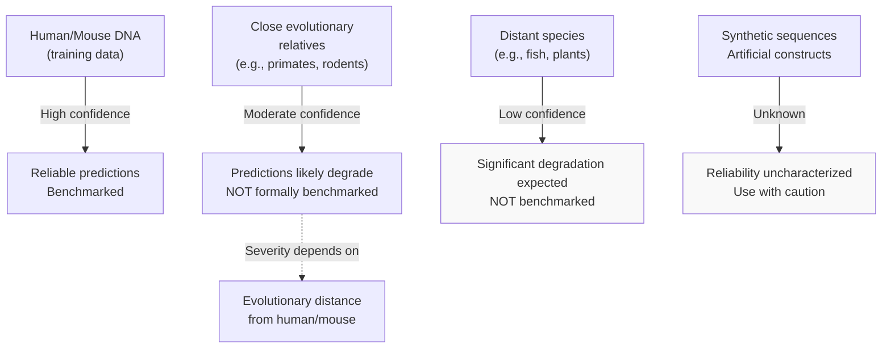

**Important:** Prediction quality degradation for non-human/mouse species has **not been formally benchmarked**. Users should interpret predictions from other species with appropriate caution.

**Sources:** [docs/source/faqs.md:57-61](), [docs/source/faqs.md:187-188]()

---

### Sequence Composition Constraints

The model is designed and evaluated for sequences that are similar to the reference genome with small variations (SNPs, indels).

| Sequence Type | Model Reliability | Notes |
|---------------|------------------|-------|
| Reference sequence | High | Native training data |
| SNPs (single nucleotide variants) | High | Extensively evaluated |
| Small indels (<50bp) | High | Left-aligned, evaluated |
| Large indels (>50bp) | Moderate | Less common in training |
| Structural variants | **Unknown** | Not characterized |
| Large padding regions | **Low** | Deviates from training distribution |
| Synthetic/artificial sequences | **Unknown** | Not evaluated |

**Key Limitation:** Sequences that differ substantially from the reference genome (e.g., synthetic DNA constructs, sequences with extensive padding, or large structural rearrangements) may produce unreliable predictions because they fall outside the training data distribution.

**Sources:** [docs/source/faqs.md:47-55]()

---

### Reference Genome Version Constraints

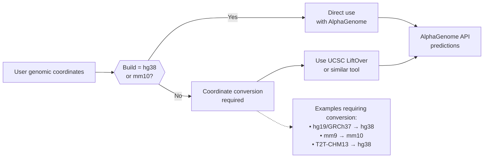

**AlphaGenome uses:**
- Human: `hg38` (GRCh38.p13.genome.fa)
- Mouse: `mm10` (GRCm38.p6.genome.fa)

**If your data uses a different build:** Use [UCSC LiftOver](https://genome.ucsc.edu/cgi-bin/hgLiftOver) or equivalent tools to convert coordinates before making predictions.

**Sources:** [docs/source/faqs.md:40-45]()

---

## Model Architecture Limitations

### Tissue-Specificity and Context-Dependent Effects

The model has improved tissue-specific prediction capabilities compared to prior models, but accurately capturing tissue-specific regulatory effects remains a fundamental challenge for genomics deep learning models.

**Limitation Manifestation:**
- A variant may show predicted effects in multiple tissues when it actually affects only a specific subset
- Tissue-specific enhancer activity may be partially captured but not with perfect fidelity
- Cell-type-specific regulatory logic (e.g., combinatorial TF binding) may be incompletely modeled

**Practical Implication:** Users should validate tissue-specific predictions against orthogonal data (e.g., eQTL studies, reporter assays) when tissue context is critical for the biological question.

**Sources:** [docs/source/faqs.md:182-186]()

---

### Long-Range Genomic Interactions

While the model processes sequences up to 1MB (providing substantial context), certain long-range regulatory mechanisms remain challenging to capture:

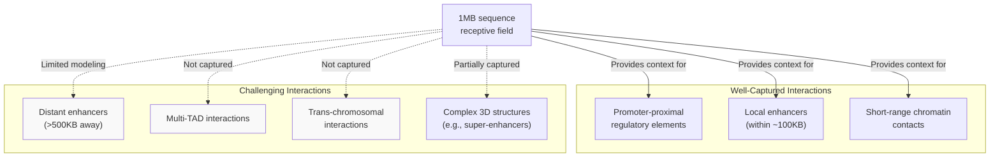

**Architectural Constraint:** The model's 1MB maximum input length means regulatory elements beyond this range cannot be directly modeled. Contact map predictions provide some long-range interaction information but are limited by the training data resolution and sequence context.

**Sources:** [docs/source/faqs.md:182-186]()

---

### Diploid Awareness and Phasing

The model has a fundamental limitation in how it handles diploid genomes:

#### Unphased Training Data

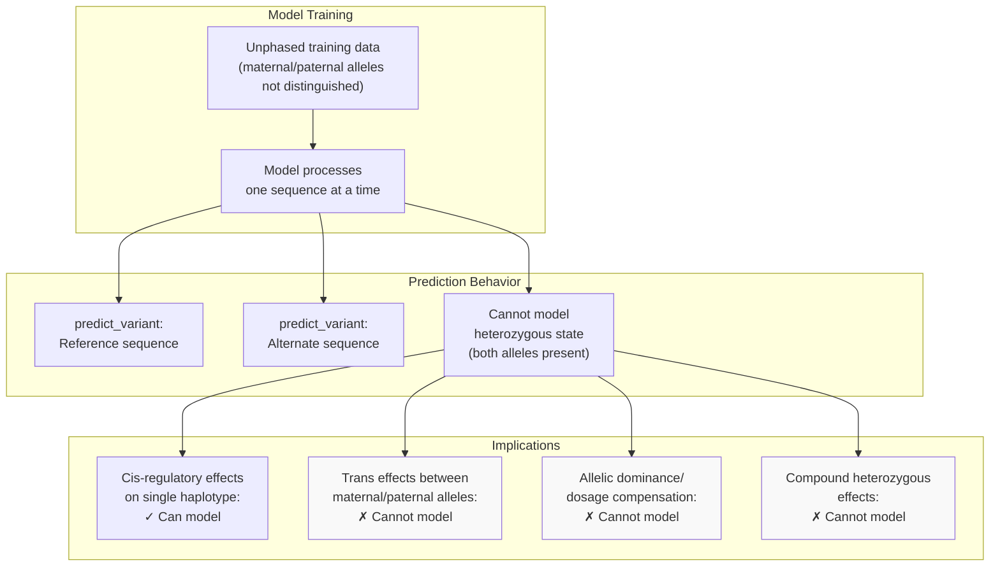

**Key Points:**
- `DnaClient.predict_variant()` predicts reference and alternate sequences independently
- The model cannot distinguish maternal vs. paternal chromosomes
- Heterozygous states (both alleles present simultaneously) are not modeled
- Predictions represent the effect of a complete allele replacement, not a heterozygous individual

**Code Manifestation:**
- `predict_variant()` returns `VariantOutput` with separate `reference` and `alternate` predictions
- No method exists to model both alleles simultaneously
- Variant scorers compare REF vs ALT, not REF vs HET vs ALT

**Sources:** [docs/source/faqs.md:196-202]()

---

## Prediction Scope Limitations

### Molecular vs. Organismal Phenotypes

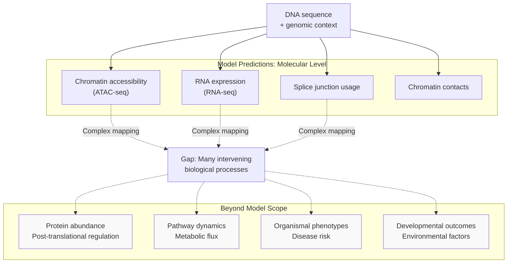

**Critical Limitation:** AlphaGenome predicts the **molecular consequences** of genetic variations (chromatin accessibility, RNA levels, splicing). It does **not** directly predict:

- Complex trait effects (height, diabetes risk, etc.)
- Disease phenotypes
- Protein function or abundance
- Gene regulatory network dynamics
- Developmental outcomes
- Environmental interactions

**Why This Matters:** Complex traits involve:
- Gene-gene interactions
- Protein regulation beyond transcription
- Metabolic and signaling networks
- Developmental timing
- Environmental factors
- Multiple biological scales

These are not modeled by a sequence-to-molecular-signal predictor.

**Sources:** [docs/source/faqs.md:191-195]()

---

### Personal Genome Analysis

The model has **not been benchmarked** for predicting individual (personal) human genomes. Specific concerns include:

| Consideration | Limitation |
|--------------|------------|
| **Rare variant combinations** | Training data predominantly contains common variants; rare variant combinations may behave unpredictably |
| **Population-specific effects** | Model trained on diverse populations but not validated for population-specific variant interpretation |
| **Compound variants** | Multiple variants in cis or trans cannot be modeled simultaneously (see diploid awareness limitation) |
| **Individual risk prediction** | Molecular predictions ≠ disease risk; clinical interpretation requires additional validation |

**Use Case Distinction:**
- ✓ **Supported:** Characterizing molecular effects of specific variants found in a personal genome
- ✗ **Not validated:** Clinical genome interpretation, disease risk prediction, diagnostic applications

**Sources:** [docs/source/faqs.md:189-190]()

---

## Output Data Limitations

### Quantile Score Boundaries

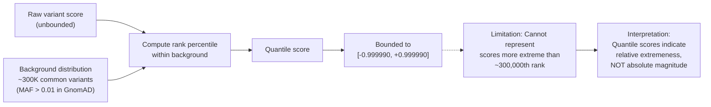

**Key Constraints:**
- Maximum quantile score: **+0.999990** (~99.999th percentile)
- Minimum quantile score: **-0.999990** (~0.001st percentile)
- **Cannot exceed these bounds** due to finite background distribution size

**Practical Implication:**
- Use quantile scores to identify unusually large effects
- Use raw scores for magnitude comparisons
- Multiple variants may have identical quantile scores at boundary (ceiling effect)

**Code Location:**
- Quantile scores computed in `variant_scorers/*` and `interval_scorers/*`
- Available only for recommended scorers

**Sources:** [docs/source/faqs.md:307-341]()

---

### Stranded vs. Unstranded Data

Not all experimental samples in the training data are strand-specific, which affects certain predictions:

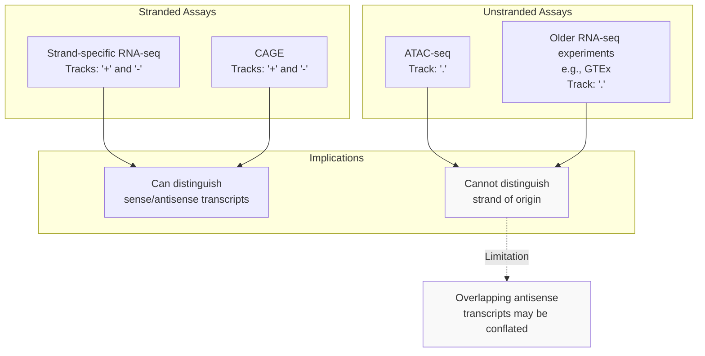

**Important Example:** GTEx RNA-seq data is unstranded, meaning predictions for GTEx tissue tracks cannot distinguish between sense and antisense transcription.

**Code Operations:**
- `TrackData.filter_to_positive_strand()`
- `TrackData.filter_to_negative_strand()`
- `TrackData.filter_to_unstranded()`

These methods are available in `alphagenome/data/track_data.py` for filtering based on strand metadata.

**Sources:** [docs/source/faqs.md:110-162]()

---

### Track Coverage and Ontology Constraints

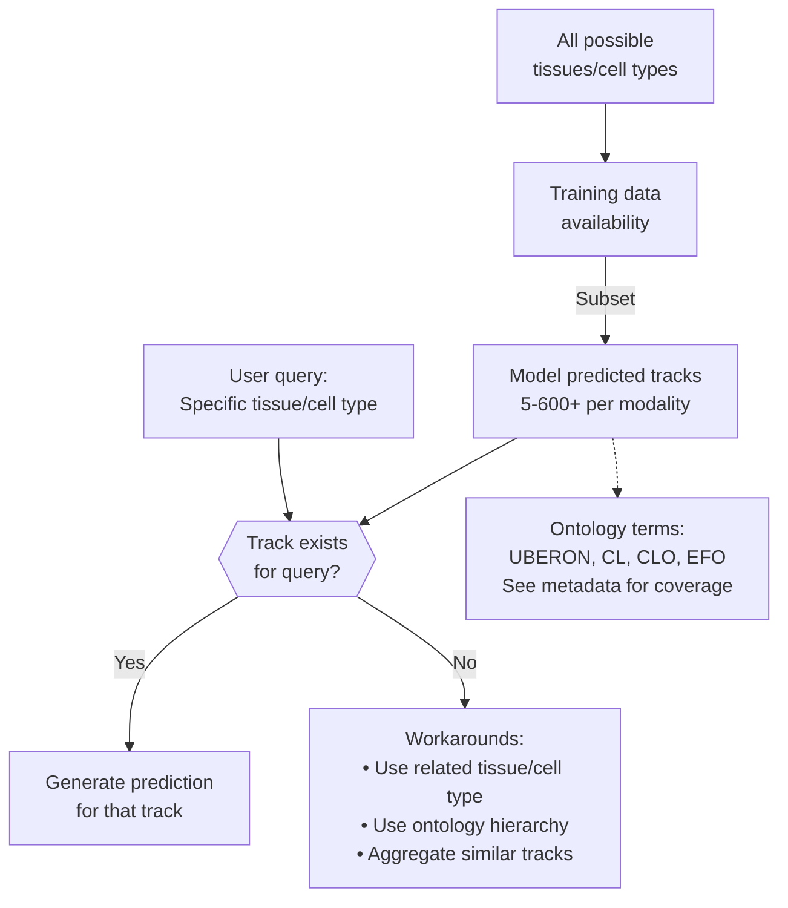

**Limitations:**
- Not all possible tissues/cell types have corresponding model tracks
- Track availability depends on training data coverage
- Some rare cell types or specialized tissues may not be represented

**Checking Coverage:**
- Inspect `TrackData.metadata` DataFrame for available tracks
- Use ontology navigation tools to find related tissue types
- See [Biological Context Mapping](#6.6) tutorial

**Sources:** [docs/source/faqs.md:82-108]()

---

## Unsupported Use Cases

### Explicit Non-Commercial Use Only

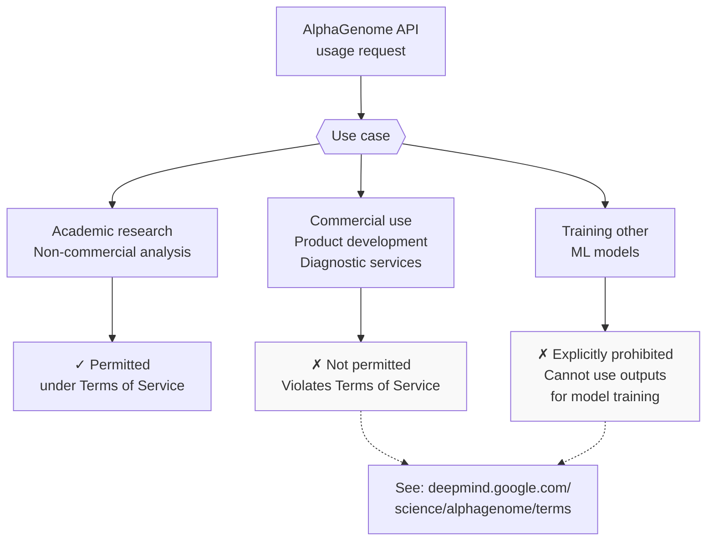

**Prohibited Uses:**
1. **Commercial applications** - Any for-profit use
2. **Training other models** - Using AlphaGenome outputs as training data for machine learning models
3. **Clinical diagnostics** - Direct clinical interpretation without appropriate validation

**Permitted Use:**
- Non-commercial research
- Academic publications
- Open-source tool development (non-commercial)

**Sources:** [docs/source/faqs.md:344-350]()

---

## Summary Table: Key Limitations and Mitigation Strategies

| Limitation Category | Specific Constraint | Mitigation Strategy | Code Reference |
|---------------------|---------------------|---------------------|----------------|
| **Sequence Length** | Only 2^14, 2^17, 2^19, 2^20 supported | Use `Interval.resize()` | `genome.Interval.resize()` |
| **Species** | Trained on human/mouse only | Interpret other species with caution | N/A - biological limitation |
| **Reference Genome** | hg38, mm10 only | Use LiftOver for coordinate conversion | External tool required |
| **Sequence Composition** | Unreliable for synthetic/heavily modified sequences | Limit to natural sequences with small variants | N/A - validation limitation |
| **Tissue Specificity** | Imperfect tissue-specific modeling | Validate against orthogonal data (eQTLs, etc.) | N/A - model limitation |
| **Long-Range Effects** | 1MB maximum context | Accept limitation or use complementary methods | N/A - architectural constraint |
| **Diploid State** | Cannot model heterozygous genomes | Model alleles separately; REF vs ALT comparison | `predict_variant()` returns separate outputs |
| **Phenotype Prediction** | Molecular predictions only | Do not interpret as disease risk | N/A - scope limitation |
| **Personal Genomes** | Not validated for individual genome interpretation | Use with appropriate caution | N/A - validation limitation |
| **Quantile Scores** | Bounded to ±0.999990 | Use raw scores for magnitude; quantiles for extremeness | `variant_scorers/*` |
| **Strand Information** | Some assays unstranded (e.g., GTEx) | Check metadata; use strand filtering carefully | `TrackData.filter_to_*_strand()` |
| **Track Coverage** | Limited to training data tissues | Use ontology to find similar tissues | `TrackData.metadata` inspection |

---

## Related Documentation

- [Supported Features](#9.2) - Complete list of supported organisms, sequence lengths, and output types
- [Frequently Asked Questions](#9.1) - Additional details and common questions about limitations
- [Making Predictions](#5.1) - Best practices for working within model constraints
- [Variant Scoring](#5.2) - Understanding scorer behavior and limitations

**Sources:** [docs/source/faqs.md:178-203](), [docs/source/faqs.md:63-78](), [docs/source/faqs.md:40-61](), [docs/source/faqs.md:307-341](), [docs/source/faqs.md:344-350]()

---

