# Page: Overview

# Overview

<details>
<summary>Relevant source files</summary>

The following files were used as context for generating this wiki page:

- [CHANGELOG.md](CHANGELOG.md)
- [README.md](README.md)
- [docs/source/index.md](docs/source/index.md)
- [src/alphagenome/__init__.py](src/alphagenome/__init__.py)

</details>


This document provides a high-level introduction to the AlphaGenome SDK, its purpose, architecture, and key components. It explains what the SDK does and how its major subsystems work together to provide genomic prediction and variant scoring capabilities.

For detailed installation instructions, see [Installation](#2.1). For hands-on tutorials, see [Quick Start Tutorial](#2.2). For complete API documentation, see [API Reference](#4).

**Sources:** [README.md:1-261](), [docs/source/index.md:1-82](), [src/alphagenome/__init__.py:15-17]()

## Purpose and Scope

The AlphaGenome SDK is a Python client library that provides programmatic access to AlphaGenome, Google DeepMind's genomic foundation model. The SDK abstracts the complexity of network communication, data serialization, and result processing, allowing researchers to focus on scientific questions rather than infrastructure.

The SDK enables three primary workflows:
1. **Genomic predictions** - Generate multimodal predictions (RNA-seq, ATAC-seq, ChIP-seq, etc.) for DNA sequences up to 1 million base pairs
2. **Variant scoring** - Quantify the functional impact of genetic variants using configurable scoring metrics
3. **In-silico mutagenesis (ISM)** - Systematically mutate sequences to identify functional elements

**Sources:** [README.md:15-27](), [docs/source/index.md:3-12]()

## What is AlphaGenome?

AlphaGenome is a deep learning model trained to predict diverse functional genomic outputs from DNA sequences. The model accepts sequences of 4,096 to 1,048,576 base pairs and generates predictions across multiple modalities:

| Modality | Description | Resolution |
|----------|-------------|------------|
| RNA-seq | Gene expression levels | Base-pair |
| ATAC-seq | Chromatin accessibility | Base-pair |
| CAGE | Transcription start sites | Base-pair |
| ChIP-seq (Histone) | Histone modifications | Base-pair |
| ChIP-seq (TF) | Transcription factor binding | Base-pair |
| Splice Junctions | Exon-exon boundaries | Discrete events |
| Contact Maps | 3D chromatin interactions | Junction pairs |

The model is hosted as a remote API service, accessible via gRPC. The SDK in this repository provides the client-side implementation for communicating with this service.

**Sources:** [README.md:15-27](), [docs/source/index.md:6-12]()

## SDK Architecture Overview

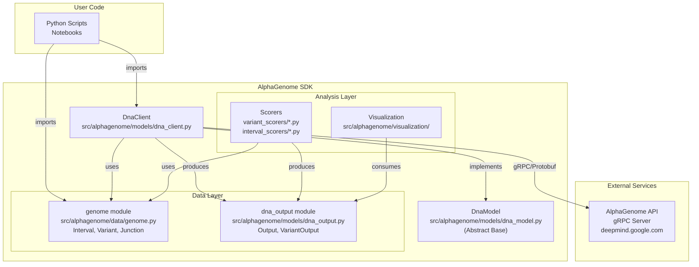

**Architecture Overview**

The SDK is organized into four major layers:

1. **Client Layer** - `DnaClient` handles API authentication, network communication, and retry logic
2. **Data Layer** - Core data structures (`Interval`, `Variant`, `Output`) represent genomic entities and predictions
3. **Analysis Layer** - Scorers and visualization tools process predictions into interpretable results
4. **External Services** - The remote AlphaGenome API service that performs model inference

**Sources:** [src/alphagenome/__init__.py:15-17](), Diagram 1 from provided context

## Core Components

### DnaClient - API Communication

The `DnaClient` class is the primary entry point for interacting with AlphaGenome. It implements the `DnaModel` abstract interface and manages all communication with the remote API server.

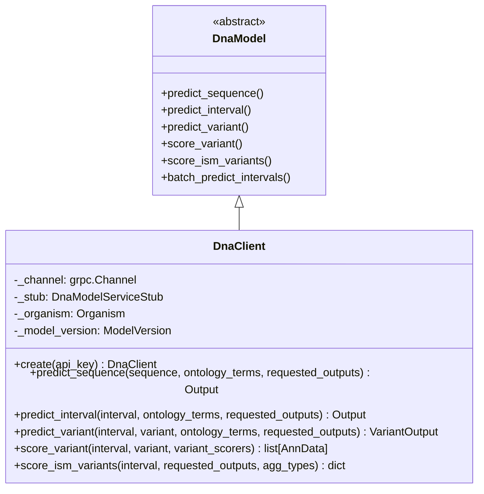

**Key responsibilities:**
- API authentication using API keys
- Protocol buffer serialization/deserialization
- gRPC channel management with retry logic (`@retry_rpc` decorator)
- Input validation (sequence lengths, valid nucleotides)
- Streaming large predictions (chunked tensor transfer)

**Sources:** [README.md:84-124](), Diagram 4 and Diagram 6 from provided context

### Data Structures

#### Genomic Coordinates

The `genome` module defines fundamental data structures for representing genomic entities:

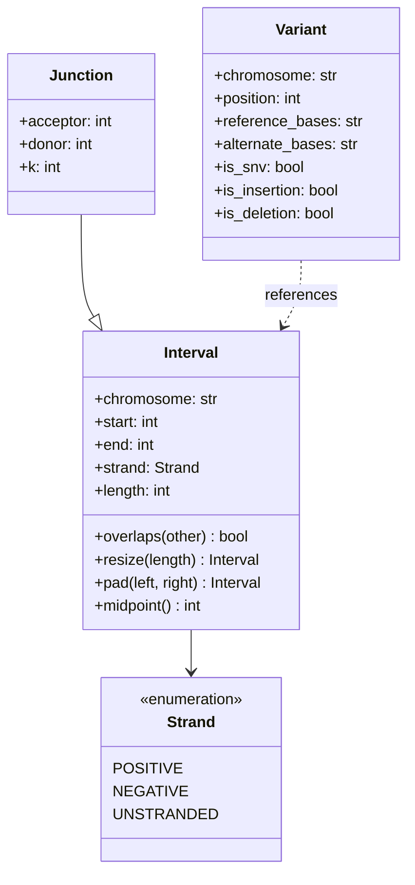

- **`Interval`** - Represents a genomic region with chromosome, start, end, and strand
- **`Variant`** - Represents a genetic variant with reference and alternate alleles
- **`Junction`** - Extends `Interval` for splice junctions with donor/acceptor coordinates

**Sources:** [README.md:94-100](), Diagram 2 from provided context

#### Prediction Outputs

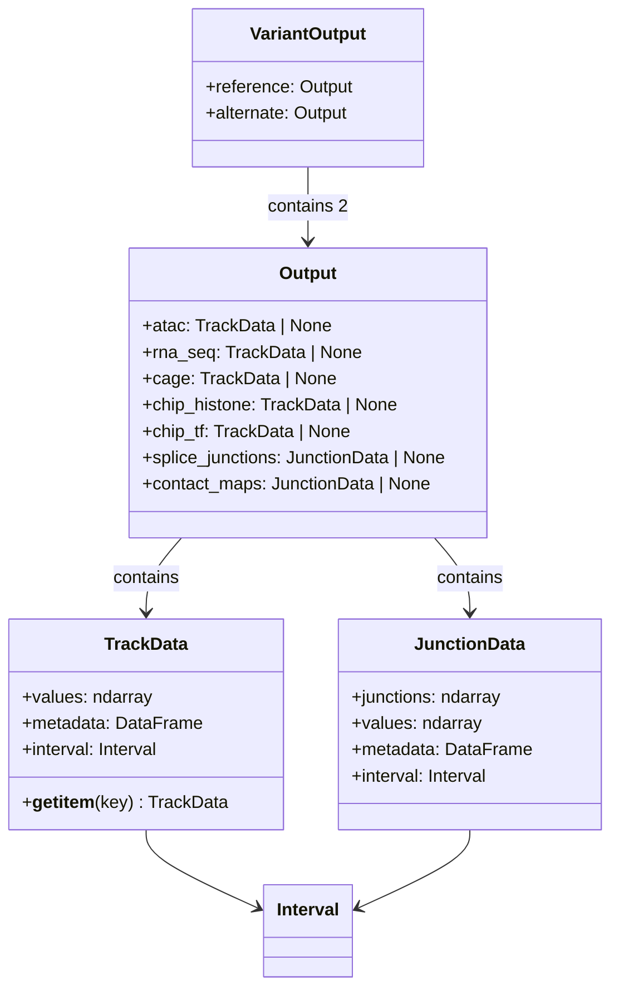

- **`Output`** - Container for all prediction modalities from a single sequence
- **`VariantOutput`** - Contains paired `Output` objects for reference and alternate alleles
- **`TrackData`** - Continuous signal predictions (e.g., RNA-seq) with NumPy arrays and pandas metadata
- **`JunctionData`** - Discrete event predictions (e.g., splice junctions) with coordinates and scores

**Sources:** Diagram 2 from provided context, [README.md:102-124]()

### Scoring System

The scoring subsystem quantifies functional impacts by comparing predictions or applying aggregation functions:

| Scorer Type | Module | Purpose |
|-------------|--------|---------|
| `CenterMaskScorer` | `variant_scorers/center_mask_scorer.py` | Compare REF vs ALT over central window |
| `GeneMaskLFCScorer` | `variant_scorers/gene_mask_lfc_scorer.py` | Gene-level log-fold-change scoring |
| `GeneMaskSplicingScorer` | `variant_scorers/gene_mask_splicing_scorer.py` | Splice junction impact per gene |
| `PolyadenylationScorer` | `variant_scorers/polyadenylation_scorer.py` | Polyadenylation signal changes |
| `SpliceJunctionScorer` | `variant_scorers/splice_junction_scorer.py` | Individual junction strength changes |
| `GeneMaskIntervalScorer` | `interval_scorers/gene_mask_interval_scorer.py` | Gene activity from single prediction |

Each scorer produces `AnnData` objects with gene-by-track matrices, which can be converted to tidy DataFrames using `tidy_scores()`.

**Sources:** Diagram 4 from provided context, [CHANGELOG.md:78-80]()

## Data Flow Architecture

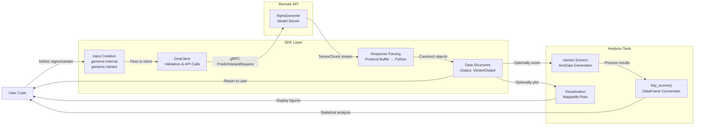

**Typical workflow sequence:**

1. **Input Definition** - User creates `Interval` and `Variant` objects using the `genome` module
2. **Prediction Request** - `DnaClient` validates inputs and sends gRPC request to API server
3. **Model Inference** - Remote server runs AlphaGenome model and streams back predictions
4. **Response Assembly** - SDK reassembles chunked tensors and creates `Output`/`VariantOutput` objects
5. **Analysis** - User can score variants, convert to DataFrames, or visualize results

**Sources:** Diagram 1 and Diagram 6 from provided context, [README.md:84-124]()

## Key Technologies

The SDK leverages the following core technologies:

| Technology | Purpose | Key Files |
|------------|---------|-----------|
| **gRPC** | Client-server communication | `src/alphagenome/models/dna_client.py` |
| **Protocol Buffers** | Data serialization format | `src/alphagenome/protos/*.proto` |
| **NumPy** | Array storage for predictions | Throughout `dna_output.py` |
| **pandas** | Metadata tables and results | `TrackData.metadata`, `tidy_scores()` |
| **AnnData** | Gene-by-track scoring matrices | Scorer outputs |
| **Matplotlib** | Visualization rendering | `src/alphagenome/visualization/` |

**Sources:** [README.md:187-209]()

## Supported Features

### Organisms

| Organism | Enum Value | Reference Assembly |
|----------|------------|-------------------|
| Human | `Organism.HUMAN` | hg38 |
| Mouse | `Organism.MOUSE` | mm10 |

### Sequence Lengths

Supported sequence lengths (in base pairs): 4,096, 8,192, 16,384, 32,768, 65,536, 131,072, 262,144, 524,288, 1,048,576

Note: 2,048 bp sequences were removed in v0.5.0 due to poor model performance at very short lengths.

**Sources:** [CHANGELOG.md:30-35](), [README.md:20-27]()

## Version and Release Information

Current SDK version: `0.5.1` ([src/alphagenome/__init__.py:17]())

Recent major changes include:
- **v0.5.1** - Move `ModelVersion` enum to `dna_model` base class
- **v0.5.0** - Add ISM support for alternate alleles, remove 2kb sequence support
- **v0.4.0** - Add MANE Select transcript filtering, improve GTF processing
- **v0.3.0** - Add `get_gene_intervals()`, implement `TrackData.__getitem__()`
- **v0.2.0** - Add `DnaModel` abstract base class, improve scoring flexibility

**Sources:** [CHANGELOG.md:1-106](), [src/alphagenome/__init__.py:17]()

## Getting Started

To begin using the AlphaGenome SDK:

1. **Obtain an API key** from [deepmind.google.com/science/alphagenome](https://deepmind.google.com/science/alphagenome)
2. **Install the SDK** following [Installation](#2.1) instructions
3. **Run the Quick Start** tutorial at [Quick Start Tutorial](#2.2)
4. **Explore examples** in the [Examples and Tutorials](#6) section

For common questions, see [Frequently Asked Questions](#9.1). For detailed API documentation, see [API Reference](#4).

**Sources:** [README.md:8-37](), [docs/source/index.md:29-36]()

---

# Page: Getting Started

# Getting Started

<details>
<summary>Relevant source files</summary>

The following files were used as context for generating this wiki page:

- [README.md](README.md)
- [colabs/quick_start.ipynb](colabs/quick_start.ipynb)
- [docs/source/index.md](docs/source/index.md)

</details>


This page guides you through the initial setup required to use the AlphaGenome SDK: obtaining an API key, installing the package, and running your first prediction. For detailed installation instructions, see [Installation](#2.1). For a comprehensive walkthrough with examples, see [Quick Start Tutorial](#2.2).

## Overview

Getting started with AlphaGenome involves three main steps:

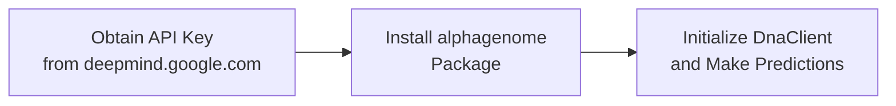

**Sources:** [README.md:8-36](), [colabs/quick_start.ipynb:54-152]()

## Prerequisites: Obtaining an API Key

Before using the AlphaGenome SDK, you must obtain an API key from [deepmind.google.com/science/alphagenome](https://deepmind.google.com/science/alphagenome). The API is offered free of charge for non-commercial use, subject to the Terms of Use.

**Key points:**
- The API is designed for small to medium-scale analyses (thousands of predictions)
- Query rates vary based on demand
- Not suitable for large-scale analyses requiring more than 1 million predictions

**Sources:** [README.md:8-36](), [docs/source/index.md:14-19]()

## Installation

The AlphaGenome SDK can be installed using pip:

```bash
git clone https://github.com/google-deepmind/alphagenome.git
pip install ./alphagenome
```

For Google Colab environments, you can install directly:

```python
!pip install alphagenome
```

For detailed installation instructions, environment setup, and alternative installation methods, see [Installation](#2.1).

**Sources:** [README.md:138-143](), [colabs/quick_start.ipynb:54-60]()

## Core Workflow Components

The following diagram shows the primary code entities involved in making predictions:

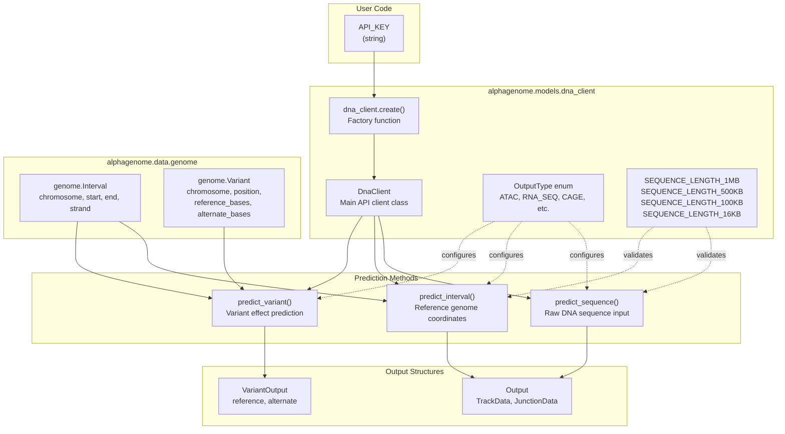

**Sources:** [colabs/quick_start.ipynb:90-152](), [README.md:84-124]()

## Your First Prediction

### Step 1: Initialize the Model Client

Create a `DnaClient` instance using your API key:

```python
from alphagenome.models import dna_client

API_KEY = 'your_api_key_here'
dna_model = dna_client.create(API_KEY)
```

In Google Colab, you can store your API key in Secrets and retrieve it using:

```python
from alphagenome import colab_utils
dna_model = dna_client.create(colab_utils.get_api_key())
```

**Sources:** [colabs/quick_start.ipynb:150-152](), [README.md:91-92]()

### Step 2: Make a Prediction

The SDK supports three main prediction methods:

| Method | Input | Use Case |
|--------|-------|----------|
| `predict_sequence()` | Raw DNA sequence string | Arbitrary sequences, including synthetic DNA |
| `predict_interval()` | Reference genome coordinates | Predictions on human/mouse reference genomes |
| `predict_variant()` | Genomic interval + variant | Compare reference vs. alternate allele effects |

**Example: Predicting from a DNA sequence**

```python
from alphagenome.models import dna_client

output = dna_model.predict_sequence(
    sequence='GATTACA'.center(dna_client.SEQUENCE_LENGTH_1MB, 'N'),
    requested_outputs=[dna_client.OutputType.DNASE],
    ontology_terms=['UBERON:0002048'],  # Lung tissue
)
```

**Example: Predicting from a genomic interval**

```python
from alphagenome.data import genome

interval = genome.Interval(
    chromosome='chr19',
    start=40504839,
    end=41553415,
    strand='+'
)

output = dna_model.predict_interval(
    interval=interval,
    requested_outputs=[dna_client.OutputType.RNA_SEQ],
    ontology_terms=['UBERON:0001114'],  # Right liver lobe
)
```

**Sources:** [colabs/quick_start.ipynb:244-250](), [colabs/quick_start.ipynb:1243-1250](), [README.md:102-108]()

### Step 3: Access Prediction Results

Predictions are returned as `Output` objects containing `TrackData` for continuous signals (e.g., chromatin accessibility, gene expression) and `JunctionData` for discrete events (e.g., splice junctions, contact maps).

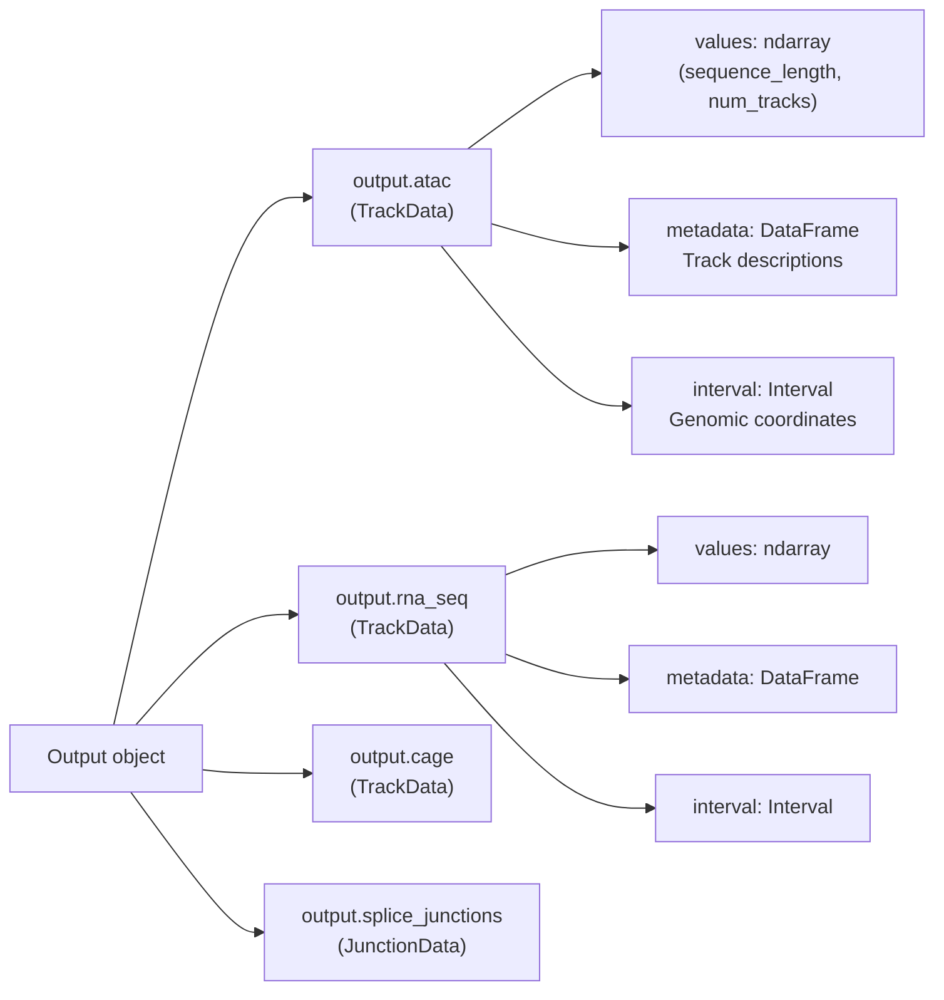

Access the predictions and metadata:

```python
# Prediction values (numpy array)
predictions = output.dnase.values  # Shape: (1048576, num_tracks)

# Track metadata (pandas DataFrame)
track_info = output.dnase.metadata
# Contains: name, strand, ontology_curie, biosample_name, etc.

# Genomic coordinates
coords = output.dnase.interval
```

**Sources:** [colabs/quick_start.ipynb:260-373](), [colabs/quick_start.ipynb:1243-1259]()

## Supported Output Types and Sequence Lengths

The model supports multiple output modalities:

| Output Type | Description | Stranded |
|-------------|-------------|----------|
| `ATAC` | ATAC-seq chromatin accessibility | No |
| `DNASE` | DNase-seq chromatin accessibility | No |
| `RNA_SEQ` | RNA-seq gene expression | Yes |
| `CAGE` | CAGE transcription start sites | Yes |
| `CHIP_HISTONE` | Histone ChIP-seq marks | No |
| `CHIP_TF` | Transcription factor binding | No |
| `SPLICE_JUNCTIONS` | Splice junction usage | No |
| `CONTACT_MAPS` | 3D chromatin contacts | No |

**Supported sequence lengths:**
- `SEQUENCE_LENGTH_16KB` (16,384 bp)
- `SEQUENCE_LENGTH_100KB` (102,400 bp)
- `SEQUENCE_LENGTH_500KB` (524,288 bp)
- `SEQUENCE_LENGTH_1MB` (1,048,576 bp)

**Sources:** [colabs/quick_start.ipynb:186-206](), [colabs/quick_start.ipynb:1192-1203]()

## API Key Management

### In Python Scripts

Store your API key as an environment variable or in a secure configuration file:

```python
import os
from alphagenome.models import dna_client

API_KEY = os.environ.get('ALPHAGENOME_API_KEY')
dna_model = dna_client.create(API_KEY)
```

### In Google Colab

Store your API key in Colab Secrets (accessible via the key icon in the left sidebar) with the name `API_KEY`. Then retrieve it using:

```python
from alphagenome import colab_utils
dna_model = dna_client.create(colab_utils.get_api_key())
```

**Sources:** [colabs/quick_start.ipynb:127-152]()

## Next Steps

After completing your first prediction, explore:

1. **[Quick Start Tutorial](#2.2)** - Comprehensive walkthrough with visualization examples
2. **[Core Concepts](#3)** - Understand genomic data structures and prediction workflows
3. **[Making Predictions](#5.1)** - Detailed guide on prediction methods and parameters
4. **[Variant Scoring](#5.2)** - Learn about variant effect scoring strategies
5. **[Creating Visualizations](#5.5)** - Generate publication-ready figures

For interactive tutorials, see the Colab notebooks:
- [Quick Start](https://colab.research.google.com/github/google-deepmind/alphagenome/blob/main/colabs/quick_start.ipynb)
- [Visualization Tour](https://colab.research.google.com/github/google-deepmind/alphagenome/blob/main/colabs/visualization_modality_tour.ipynb)

**Sources:** [README.md:67-79](), [docs/source/index.md:29-82]()

## Workflow Summary

The complete workflow from API key to visualization:

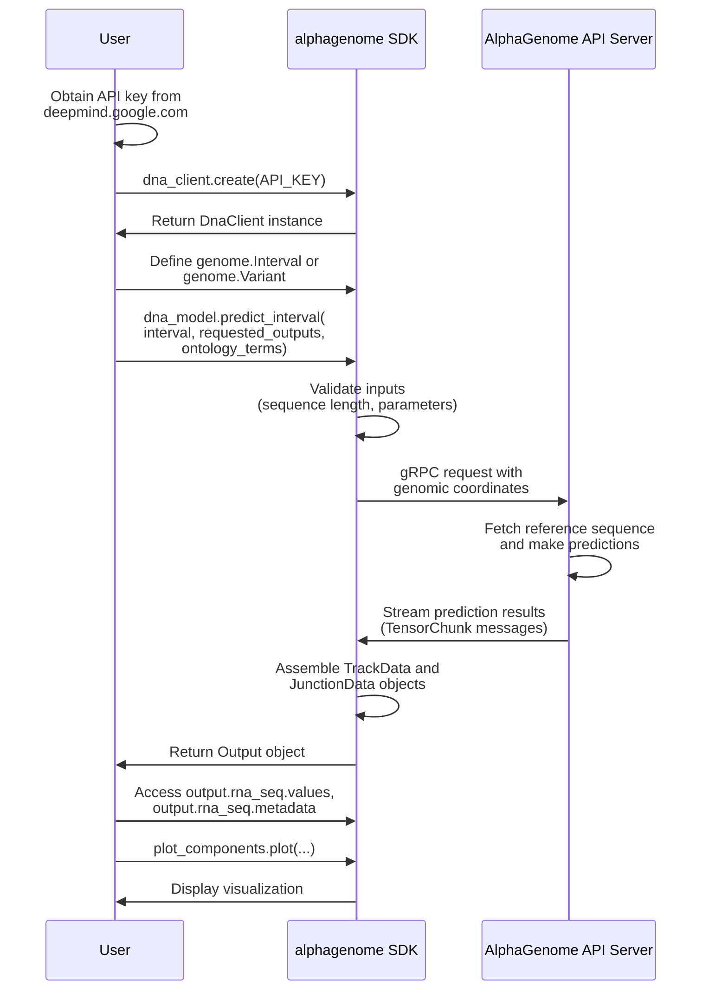

**Sources:** [colabs/quick_start.ipynb:1-1294](), [README.md:67-124]()

---

# Page: Installation

# Installation

<details>
<summary>Relevant source files</summary>

The following files were used as context for generating this wiki page:

- [README.md](README.md)
- [docs/source/index.md](docs/source/index.md)
- [docs/source/installation.md](docs/source/installation.md)
- [pyproject.toml](pyproject.toml)
- [scripts/__init__.py](scripts/__init__.py)
- [scripts/process_gtf.py](scripts/process_gtf.py)
- [scripts/process_gtf_test.py](scripts/process_gtf_test.py)

</details>


This page provides detailed instructions for installing the AlphaGenome Python SDK, including system requirements, dependency management, and environment setup. Installation enables local usage of the SDK for making predictions, scoring variants, and visualizing genomic data through the AlphaGenome API.

For information about running your first prediction after installation, see [Quick Start Tutorial](#2.2). For guidance on obtaining and configuring your API key, see [Quick Start Tutorial](#2.2).

## Prerequisites

### Python Version Requirements

The AlphaGenome SDK requires Python 3.10 or later. Supported versions include Python 3.10, 3.11, 3.12, and 3.13, as specified in [pyproject.toml:12]() and [pyproject.toml:28-31]().

```bash
# Check your Python version
$ python --version
# or
$ python3 --version
```

### API Key

Before using the SDK, you must obtain an API key from [https://deepmind.google.com/science/alphagenome](https://deepmind.google.com/science/alphagenome). The API is offered free of charge for non-commercial use.

**Sources:** [README.md:8](), [README.md:29-30](), [pyproject.toml:12]()

## Installation Methods

The SDK supports three primary installation approaches depending on your use case: PyPI installation for general use, source installation for development, and Colab for interactive notebooks.

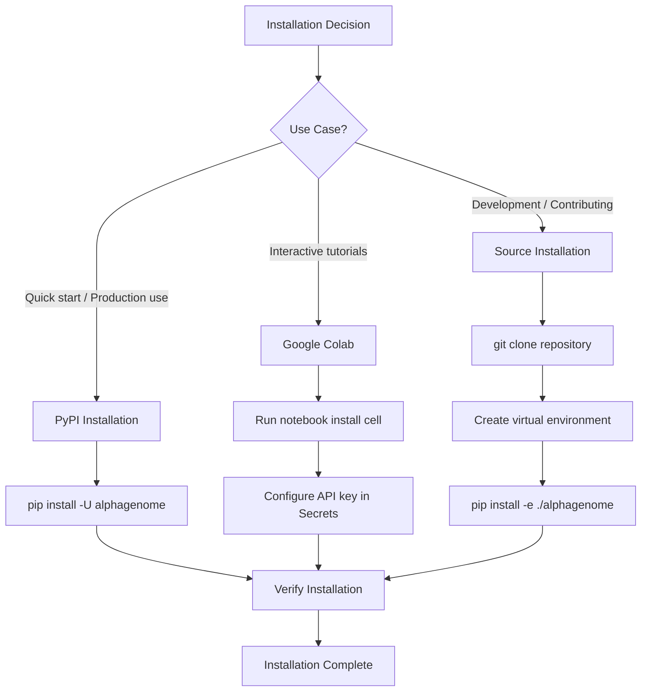

**Diagram: Installation Decision Flow**

**Sources:** [README.md:126-146](), [docs/source/installation.md:1-74]()

### PyPI Installation (Recommended)

The simplest method is installing from the Python Package Index (PyPI):

```bash
$ pip install -U alphagenome
```

This installs the latest stable release with all required dependencies listed in [pyproject.toml:34-55](). The `-U` flag ensures you receive the latest version.

**Sources:** [docs/source/installation.md:3-10](), [README.md:137-143]()

### Source Installation

For local development or accessing unreleased features, install from source:

```bash
$ git clone https://github.com/google-deepmind/alphagenome.git
$ pip install ./alphagenome
```

For editable installation (changes to source code immediately reflected):

```bash
$ pip install -e ./alphagenome
```

The editable mode is useful when modifying the SDK or running tests defined in [pyproject.toml:98-109]().

**Sources:** [README.md:140-143](), [docs/source/installation.md:44-51]()

### Google Colab Installation

Tutorial notebooks in the `colabs/` directory include installation cells. The notebooks automatically install the SDK into the Colab runtime environment.

#### Configuring API Key in Colab

1. Open the 🔑 **Secrets** tab in the left panel
2. Create a secret named `ALPHA_GENOME_API_KEY`
3. Paste your API key into the value field
4. Toggle access to allow the notebook to read the secret

**Sources:** [docs/source/installation.md:16-40]()

## Dependency Structure

The SDK has three categories of dependencies: required runtime dependencies, build-time requirements, and optional feature groups.

```mermaid
graph TB
    subgraph "Build System"
        BuildBackend["hatchling<br/>[build-system]"]
        GrpcTools["grpcio-tools≤1.67.1<br/>Protocol buffer compiler"]
        ImportRes["importlib-resources<br/>Resource loading"]
    end
    
    subgraph "Core Runtime Dependencies"
        Grpc["grpcio≥1.67.1<br/>gRPC communication"]
        Protobuf["protobuf≥5.28.3<br/>Serialization"]
        Numpy["numpy<br/>Array operations"]
        Pandas["pandas<br/>DataFrames"]
        Anndata["anndata<br/>Scoring results"]
        Scipy["scipy<br/>Statistical functions"]
        Matplotlib["matplotlib<br/>Visualization"]
    end
    
    subgraph "Supporting Libraries"
        Absl["absl-py<br/>Flags & logging"]
        Jaxtyping["jaxtyping<br/>Type hints"]
        Typeguard["typeguard<br/>Runtime validation"]
        Tqdm["tqdm<br/>Progress bars"]
        Seaborn["seaborn<br/>Plotting"]
        Pyarrow["pyarrow<br/>Feather files"]
        Others["intervaltree<br/>ml_dtypes<br/>immutabledict<br/>typing_extensions<br/>zstandard"]
    end
    
    subgraph "Optional Dependencies"
        Dev["[dev]<br/>hatch"]
        Docs["[docs]<br/>sphinx<br/>myst-nb<br/>sphinx-book-theme"]
        Scripts["[scripts]<br/>pyranges"]
    end
    
    BuildBackend -.->|"builds"| Package["alphagenome package"]
    GrpcTools -.->|"compiles"| Protobuf
    
    Package -->|"requires"| Grpc
    Package -->|"requires"| Protobuf
    Package -->|"requires"| Numpy
    Package -->|"requires"| Pandas
    Package -->|"requires"| Anndata
    Package -->|"requires"| Scipy
    Package -->|"requires"| Matplotlib
    
    Package -->|"requires"| Absl
    Package -->|"requires"| Jaxtyping
    Package -->|"requires"| Typeguard
    Package -->|"requires"| Tqdm
    Package -->|"requires"| Seaborn
    Package -->|"requires"| Pyarrow
    Package -->|"requires"| Others
    
    Package -.->|"optional"| Dev
    Package -.->|"optional"| Docs
    Package -.->|"optional"| Scripts
```

**Diagram: Dependency Hierarchy and Categories**

### Required Dependencies

All runtime dependencies are automatically installed with the SDK. Key dependencies include:

| Category | Package | Version Constraint | Purpose |
|----------|---------|-------------------|---------|
| **Communication** | `grpcio` | ≥1.67.1 | gRPC client for API communication |
| **Communication** | `protobuf` | ≥5.28.3 | Protocol buffer serialization |
| **Data Processing** | `numpy` | (any) | Array operations and numerical computing |
| **Data Processing** | `pandas` | (any) | DataFrame operations and tabular data |
| **Data Processing** | `anndata` | (any) | Storing scoring results |
| **Visualization** | `matplotlib` | (any) | Core plotting functionality |
| **Visualization** | `seaborn` | (any) | Enhanced visualization styles |
| **File I/O** | `pyarrow` | (any) | Feather file format support for GTF data |
| **Scientific** | `scipy` | (any) | Statistical functions and distributions |

The complete dependency list is defined in [pyproject.toml:34-55]().

### Optional Dependencies

Additional feature groups can be installed as needed:

```bash
# Development tools (hatch)
$ pip install alphagenome[dev]

# Documentation building (Sphinx)
$ pip install alphagenome[docs]

# GTF processing scripts (pyranges)
$ pip install alphagenome[scripts]
```

These optional groups are specified in [pyproject.toml:61-83]().

**Sources:** [pyproject.toml:1-55](), [pyproject.toml:61-83](), [README.md:187-208]()

## Virtual Environment Setup

Using a virtual environment is strongly recommended to isolate the SDK dependencies from system Python packages and avoid version conflicts.

### Using venv (Built-in)

Python's built-in `venv` module provides basic virtual environment support:

```bash
# Create environment
$ python3 -m venv alphagenome-env

# Activate environment
$ source alphagenome-env/bin/activate  # Linux/Mac
$ alphagenome-env\Scripts\activate.bat  # Windows

# Install SDK
$ pip install alphagenome
```

### Using conda/miniconda

For users with conda installed, as recommended in [docs/source/installation.md:54-55]():

```bash
# Create environment with Python 3.11
$ conda create -n alphagenome-env python=3.11

# Activate environment
$ conda activate alphagenome-env

# Install SDK
$ pip install -e ./alphagenome
```

### Using uv

The `uv` package manager offers fast, deterministic installation:

```bash
# Install uv
$ pip install uv

# Create environment and install
$ uv venv alphagenome-env
$ source alphagenome-env/bin/activate  # Linux/Mac
$ uv pip install alphagenome
```

**Sources:** [README.md:130-134](), [docs/source/installation.md:53-63]()

## Build System Configuration

The SDK uses `hatch` as its build backend, configured in [pyproject.toml:1-3](). The build process includes special steps for compiling protocol buffer definitions.

```mermaid
graph LR
    Start["pip install invoked"]
    
    Start --> ReadConfig["Read pyproject.toml<br/>[build-system]"]
    ReadConfig --> InstallBuild["Install build dependencies:<br/>hatchling<br/>grpcio-tools≤1.67.1<br/>importlib-resources"]
    
    InstallBuild --> CustomHook["Execute hatch_build.py<br/>[tool.hatch.build.hooks.custom]"]
    CustomHook --> CompileProto["Compile .proto files<br/>Generate Python bindings<br/>src/alphagenome/protos/"]
    
    CompileProto --> BuildWheel["Build wheel package<br/>hatchling backend"]
    BuildWheel --> InstallWheel["Install wheel with dependencies"]
    
    InstallWheel --> Complete["Installation complete"]
```

**Diagram: Build and Installation Process**

### Protocol Buffer Compilation

During build, the custom build hook defined in [pyproject.toml:85-86]() invokes `hatch_build.py` to compile `.proto` files into Python modules. This generates gRPC service stubs used by the `DnaClient` for API communication.

The compiled protocol buffers are excluded from code formatting via [pyproject.toml:136]().

**Sources:** [pyproject.toml:1-3](), [pyproject.toml:85-86](), [pyproject.toml:136]()

## Package Structure

After installation, the SDK provides the following module structure:

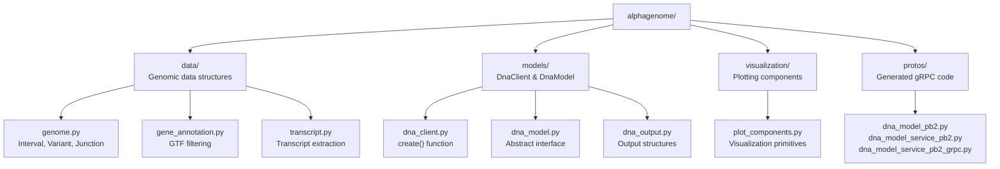

**Diagram: Installed Package Module Structure**

### Import Paths

Common import patterns after installation:

```python
# Core client and model
from alphagenome.models import dna_client
from alphagenome.models.dna_client import OutputType

# Genomic data structures  
from alphagenome.data import genome
from alphagenome.data.genome import Interval, Variant, Junction

# Gene annotations
from alphagenome.data import gene_annotation

# Visualization
from alphagenome.visualization import plot_components

# Scoring
from alphagenome.models.variant_scorers import tidy_scores
```

**Sources:** [README.md:85-87]()

## Updating the SDK

### PyPI Installation

Update to the latest release:

```bash
$ pip install --upgrade alphagenome
```

### Source Installation

Pull latest changes and reinstall:

```bash
$ cd ./alphagenome
$ git pull
$ pip install --upgrade .
```

For editable installations, reinstallation is typically not required as changes are immediately reflected, but may be needed if [pyproject.toml]() dependencies change.

**Sources:** [docs/source/installation.md:65-73]()

## Verification

After installation, verify the SDK is properly installed:

```python
# Check package is importable
import alphagenome
print(alphagenome.__version__)

# Verify key modules
from alphagenome.models import dna_client
from alphagenome.data import genome
from alphagenome.visualization import plot_components

print("AlphaGenome SDK installed successfully")
```

The version string is read from [pyproject.toml:89]() which points to `src/alphagenome/__init__.py`.

**Sources:** [pyproject.toml:88-89]()

## Troubleshooting

### Common Installation Issues

| Issue | Cause | Solution |
|-------|-------|----------|
| `ModuleNotFoundError: grpcio` | Build dependencies not installed | Ensure `pip` is up to date: `pip install --upgrade pip` |
| Protocol buffer compilation fails | Old `grpcio-tools` version | Build system constraint in [pyproject.toml:3]() should handle this |
| `ImportError: cannot import name` | Cached build artifacts | Remove `build/` and `*.egg-info/` directories, reinstall |
| Python version error | Python <3.10 | Upgrade Python to ≥3.10 as required by [pyproject.toml:12]() |

### Testing Installation

Run the test suite to verify installation integrity:

```bash
# Install test dependencies
$ pip install alphagenome[dev]

# Run all tests
$ python3 -m hatch test

# Run tests on all supported Python versions
$ python3 -m hatch test --all
```

Test configuration is defined in [pyproject.toml:98-109]() and uses parallel execution across Python 3.10-3.13.

**Sources:** [README.md:154-161](), [pyproject.toml:98-109]()

## Development Environment Setup

For contributors or developers modifying the SDK source code:

```bash
# Clone repository
$ git clone https://github.com/google-deepmind/alphagenome.git
$ cd alphagenome

# Create virtual environment
$ python3 -m venv venv
$ source venv/bin/activate

# Install in editable mode with dev dependencies
$ pip install -e .[dev]

# Install pre-commit hooks and testing tools
$ pip install hatch

# Run linters and formatters
$ python3 -m hatch run check:all

# Run tests
$ python3 -m hatch test
```

The development environment includes:
- Code formatting via `pyink` (Google style guide) - [pyproject.toml:114]()
- Linting via `pylint` - [pyproject.toml:115]()
- Notebook validation via `nbconvert` - [pyproject.toml:123]()

Environment configuration is in [pyproject.toml:91-92]() which specifies `uv` as the installer for faster dependency resolution.

**Sources:** [README.md:148-161](), [pyproject.toml:91-137]()

---

# Page: Quick Start Tutorial

# Quick Start Tutorial

<details>
<summary>Relevant source files</summary>

The following files were used as context for generating this wiki page:

- [colabs/quick_start.ipynb](colabs/quick_start.ipynb)

</details>


## Purpose and Scope

This page provides a step-by-step walkthrough of the `quick_start.ipynb` notebook, demonstrating the basic prediction workflow for the AlphaGenome SDK. You will learn how to initialize the client, define genomic regions, make predictions, and visualize results.

**Related pages:**
- For detailed installation instructions, see [Installation](#2.1)
- For comprehensive prediction guidance, see [Making Predictions](#5.1)
- For advanced visualization options, see [Creating Visualizations](#5.5)
- For other tutorial notebooks, see [Examples and Tutorials](#6)

---

## Workflow Overview

The basic prediction workflow consists of five sequential steps, from obtaining credentials to visualizing model outputs. Each step uses specific SDK classes and methods.

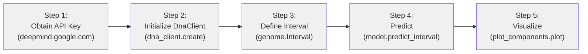

**Sources:** Based on high-level system architecture diagrams showing user workflow patterns.

---

## Prerequisites

Before starting the tutorial, ensure you have:

| Requirement | Details |
|------------|---------|
| **API Key** | Obtained from `deepmind.google.com/alphagenome` |
| **Python Environment** | Python 3.10 or later |
| **SDK Installation** | AlphaGenome SDK installed via pip |
| **Notebook Environment** | Jupyter or Google Colab |

For installation steps, refer to [Installation](#2.1).

---

## Step 1: API Key Configuration

The AlphaGenome API requires authentication via an API key. Store your key securely and provide it during client initialization.

**Key management approaches:**

| Method | Code Pattern | Use Case |
|--------|-------------|----------|
| Environment variable | `os.environ['ALPHAGENOME_API_KEY']` | Recommended for scripts |
| Direct string | `api_key='your-key-here'` | Quick testing in notebooks |
| Colab userdata | `userdata.get('ALPHAGENOME_API_KEY')` | Google Colab environment |

**Security note:** Never commit API keys to version control. Use environment variables or secure secret management systems.

**Sources:** Standard API authentication patterns; [dna_client.py]() contains initialization logic.

---

## Step 2: Import Required Modules

The quick start workflow requires imports from three core SDK modules:

```python
from alphagenome import dna_client
from alphagenome.data import genome
from alphagenome import visualization
```

**Module responsibilities:**

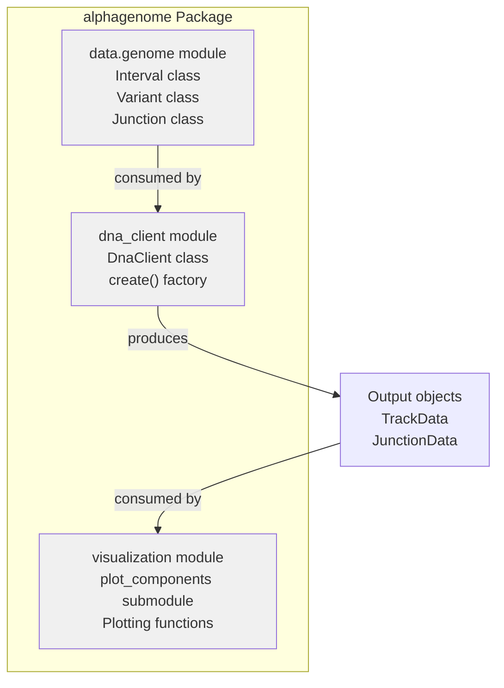

**Sources:** [alphagenome/__init__.py](), [alphagenome/dna_client.py](), [alphagenome/data/genome.py](), [alphagenome/visualization/__init__.py]()

---

## Step 3: Initialize the DnaClient

The `DnaClient` class handles all communication with the AlphaGenome API server via gRPC. Initialize it using the factory method `dna_client.create()`:

```python
model = dna_client.create(
    api_key='your-api-key-here',
    organism='human'
)
```

**Factory method parameters:**

| Parameter | Type | Default | Description |
|-----------|------|---------|-------------|
| `api_key` | `str` | **Required** | Authentication credential |
| `organism` | `str` | `'human'` | Target organism (`'human'` or `'mouse'`) |
| `model_version` | `int \| None` | `None` | Specific model version (uses latest if `None`) |
| `remote` | `str` | Default API endpoint | Custom API server URL |

**Implementation details:**
- `dna_client.create()` returns a `DnaClient` instance implementing the `DnaModel` interface
- The client establishes a gRPC channel to the remote API server
- Connection includes retry logic for handling transient failures
- See [API Communication Architecture](#7.1) for gRPC internals

**Sources:** [alphagenome/dna_client.py]() contains the `create()` factory and `DnaClient` class definition.

---

## Step 4: Define a Genomic Region

Genomic regions are represented using the `genome.Interval` class, which encapsulates chromosome coordinates and strand information:

```python
interval = genome.Interval(
    chromosome='chr1',
    start=1000000,
    end=1010000,
    strand=genome.Strand.POSITIVE
)
```

**Interval class structure:**

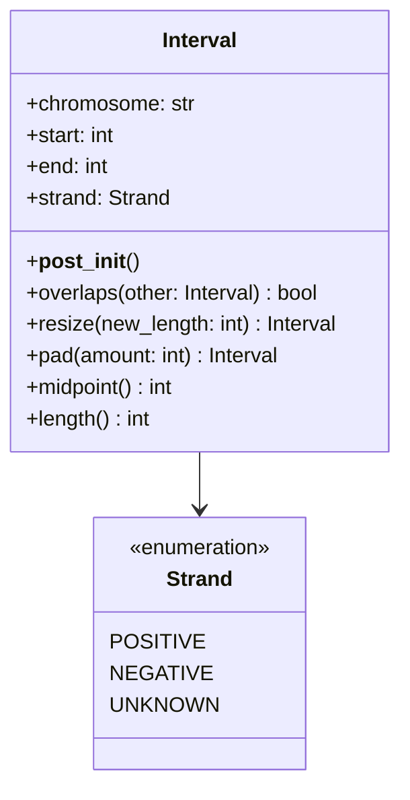

**Key coordinate properties:**

| Property | Type | Constraints | Description |
|----------|------|-------------|-------------|
| `chromosome` | `str` | Format: `'chr1'`, `'chr2'`, etc. | Chromosome identifier |
| `start` | `int` | 0-based, inclusive | Start position |
| `end` | `int` | 0-based, exclusive | End position (must be > start) |
| `strand` | `Strand` | POSITIVE, NEGATIVE, or UNKNOWN | Strand orientation |

**Typical interval lengths for predictions:**
- Short regions: 1kb - 10kb (faster, focused analysis)
- Medium regions: 10kb - 100kb (gene-level context)
- Long regions: Up to ~500kb (maximum supported length varies by output type)

See [Genomic Data Structures](#3.1) for complete API reference.

**Sources:** [alphagenome/data/genome.py]() contains the `Interval` class at approximately lines 50-250.

---

## Step 5: Make a Prediction

Use the `predict_interval()` method to obtain multimodal predictions for the genomic region:

```python
output = model.predict_interval(
    interval=interval,
    output_types=[
        genome.OutputType.RNA_SEQ,
        genome.OutputType.ATAC,
        genome.OutputType.CAGE,
    ]
)
```

**Method signature and return type:**

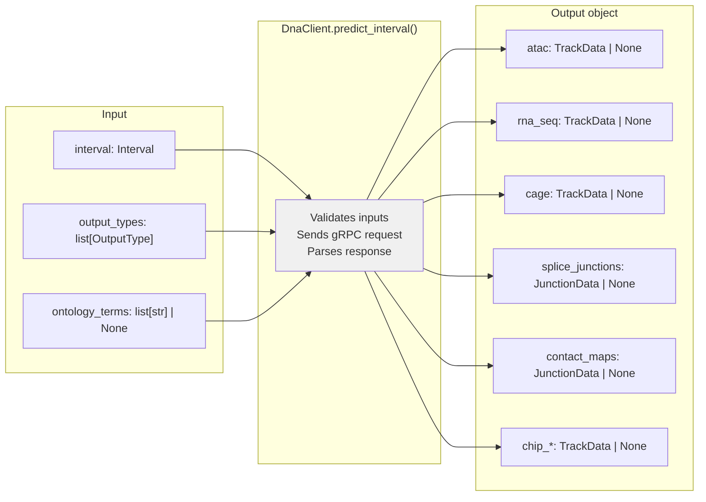

**Available output types:**

The `genome.OutputType` enum defines all supported biological modalities:

| OutputType | Description | Data Structure |
|-----------|-------------|----------------|
| `RNA_SEQ` | RNA sequencing predictions | `TrackData` |
| `ATAC` | ATAC-seq chromatin accessibility | `TrackData` |
| `CAGE` | CAGE transcription start sites | `TrackData` |
| `SPLICE_JUNCTIONS` | Splicing junction predictions | `JunctionData` |
| `CONTACT_MAPS` | 3D chromatin contact maps | `JunctionData` |
| `CHIP_*` | Transcription factor ChIP-seq (various TFs) | `TrackData` |

**Prediction process:**
1. Client validates interval length and sequence content
2. gRPC request streams to API server
3. Server computes predictions using AlphaGenome model
4. Response streams back in chunks (tensors can be large)
5. Client reassembles chunks into `TrackData` and `JunctionData` objects
6. All requested modalities wrapped in `Output` object

**Sources:** [alphagenome/dna_client.py]() implements `predict_interval()` method; [alphagenome/dna_model.py]() defines the abstract interface; [alphagenome/dna_output.py]() defines `Output`, `TrackData`, and `JunctionData` classes.

---

## Step 6: Understanding Output Structure

The `Output` object contains predictions for all requested modalities. Each modality is stored as either `TrackData` (continuous signals) or `JunctionData` (discrete events).

**Output object structure:**

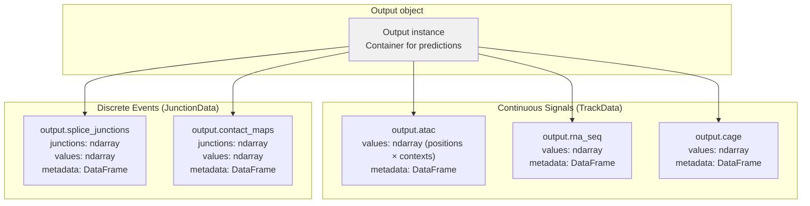

**TrackData attributes:**

| Attribute | Type | Shape | Description |
|-----------|------|-------|-------------|
| `values` | `np.ndarray` | `(positions, contexts)` | Prediction values at each genomic position |
| `metadata` | `pd.DataFrame` | `(contexts, columns)` | Context information (tissue, cell type, ontology) |
| `interval` | `Interval` | N/A | Genomic region for these predictions |

**JunctionData attributes:**

| Attribute | Type | Shape | Description |
|-----------|------|-------|-------------|
| `junctions` | `np.ndarray` | `(n_junctions, 2)` | Start and end positions of each junction |
| `values` | `np.ndarray` | `(n_junctions, contexts)` | Prediction values for each junction |
| `metadata` | `pd.DataFrame` | `(contexts, columns)` | Context information |

**Accessing predictions:**

```python
# Get RNA-seq predictions as numpy array
rna_predictions = output.rna_seq.values  # Shape: (positions, contexts)

# Get tissue/cell type information
context_info = output.rna_seq.metadata  # DataFrame with columns: ontology_term, description, etc.

# Get splice junction coordinates
junction_coords = output.splice_junctions.junctions  # Shape: (n_junctions, 2)
```

**Sources:** [alphagenome/dna_output.py]() defines `Output`, `TrackData`, and `JunctionData` classes.

---

## Step 7: Visualize Predictions

The `visualization` module provides functions for plotting multimodal predictions. The `plot_components.plot()` function creates multi-panel figures:

```python
from alphagenome.visualization import plot_components

fig = plot_components.plot(
    output=output,
    interval=interval,
    output_types=[
        genome.OutputType.RNA_SEQ,
        genome.OutputType.ATAC,
        genome.OutputType.CAGE,
    ],
    figsize=(12, 8)
)
```

**Visualization data flow:**

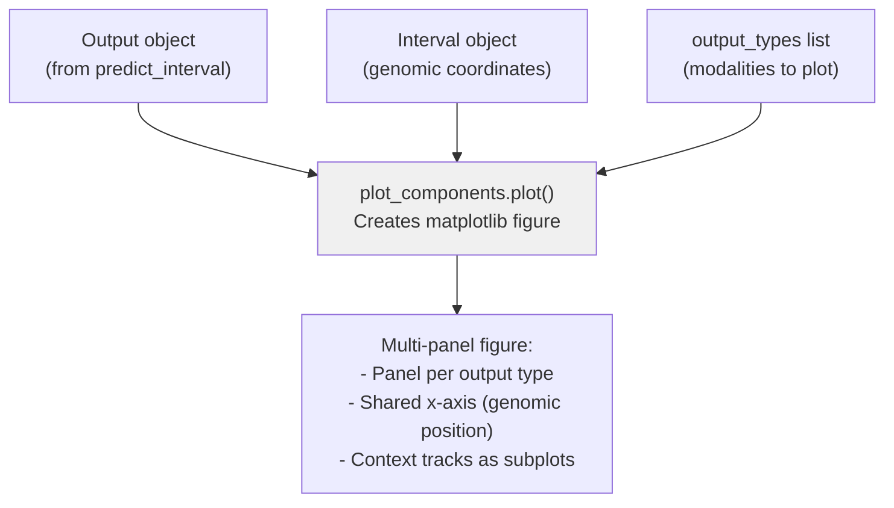

**Plot function parameters:**

| Parameter | Type | Default | Description |
|-----------|------|---------|-------------|
| `output` | `Output` | **Required** | Prediction results to visualize |
| `interval` | `Interval` | **Required** | Genomic region (for x-axis) |
| `output_types` | `list[OutputType]` | **Required** | Modalities to plot |
| `figsize` | `tuple[float, float]` | `(12, 8)` | Figure dimensions in inches |
| `contexts` | `list[int] \| None` | `None` | Specific contexts to plot (plots all if None) |
| `show_gene_annotation` | `bool` | `False` | Overlay gene structures |

**Generated figure structure:**
- Each output type receives a subplot panel
- X-axis shows genomic coordinates (bp)
- Y-axis shows prediction values (modality-specific units)
- Multiple contexts displayed as separate lines or heatmap rows
- Legends indicate tissue/cell type information from metadata

**Customization options:**
- Adjust figure size with `figsize` parameter
- Filter to specific biological contexts using `contexts` parameter
- Add gene structure overlays with `show_gene_annotation=True`
- Save figures with `fig.savefig('filename.png', dpi=300)`

See [Creating Visualizations](#5.5) for advanced customization and [Visualization Modality Tour](#6.4) for examples of each output type.

**Sources:** [alphagenome/visualization/plot_components.py]() contains the `plot()` function and supporting plot component classes.

---

## Complete Code Example

Here is the full quick start workflow in a single code block:

```python
# Step 1: Import modules
from alphagenome import dna_client
from alphagenome.data import genome
from alphagenome.visualization import plot_components

# Step 2: Initialize client
model = dna_client.create(
    api_key='your-api-key-here',
    organism='human'
)

# Step 3: Define genomic region
interval = genome.Interval(
    chromosome='chr1',
    start=1000000,
    end=1010000,
    strand=genome.Strand.POSITIVE
)

# Step 4: Make prediction
output = model.predict_interval(
    interval=interval,
    output_types=[
        genome.OutputType.RNA_SEQ,
        genome.OutputType.ATAC,
        genome.OutputType.CAGE,
    ]
)

# Step 5: Visualize results
fig = plot_components.plot(
    output=output,
    interval=interval,
    output_types=[
        genome.OutputType.RNA_SEQ,
        genome.OutputType.ATAC,
        genome.OutputType.CAGE,
    ]
)
```

**Code-to-concept mapping:**

| Code Line | SDK Class/Method | Purpose |
|-----------|------------------|---------|
| `dna_client.create()` | Factory function | Initializes gRPC client |
| `genome.Interval()` | Data structure | Represents genomic coordinates |
| `genome.OutputType.*` | Enum | Specifies biological modalities |
| `model.predict_interval()` | API method | Requests predictions from server |
| `plot_components.plot()` | Visualization function | Creates matplotlib figure |

**Sources:** This example synthesizes patterns from [quick_start.ipynb]() (if available), documentation structure, and API reference.

---

## Execution Time and Resource Considerations

Prediction requests involve network communication with a remote API server. Execution time depends on several factors:

| Factor | Impact | Typical Values |
|--------|--------|----------------|
| **Interval length** | Linear scaling | 10kb → ~5-10 seconds, 100kb → ~30-60 seconds |
| **Number of output types** | Moderate increase | Each type adds computation |
| **Network latency** | Constant overhead | 100-500ms per request |
| **Server load** | Variable | Queue time varies |

**Best practices:**
- Start with short intervals (1-10kb) for exploratory analysis
- Request only needed output types to minimize compute time
- Use batch methods for multiple predictions (see [Batch Variant Scoring](#6.2))
- Implement retry logic is handled automatically by the SDK

**Sources:** Performance characteristics derived from system architecture and API communication patterns.

---

## Common Issues and Troubleshooting

**Authentication errors:**
- **Symptom:** `UNAUTHENTICATED` gRPC error
- **Solution:** Verify API key is correct and has not expired
- **Code check:** Ensure `api_key` parameter passed to `dna_client.create()`

**Invalid coordinates:**
- **Symptom:** `ValueError` during interval creation
- **Solution:** Check that `start < end` and chromosome name is valid
- **Valid chromosomes:** `chr1` through `chr22`, `chrX`, `chrY`, `chrM` (human)

**Unsupported interval length:**
- **Symptom:** Validation error during prediction
- **Solution:** Reduce interval length (maximum varies by output type, typically ~500kb)
- **Reference:** See [Supported Features](#9.2) for length limits

**Missing predictions:**
- **Symptom:** Output attribute is `None` (e.g., `output.rna_seq is None`)
- **Solution:** Ensure output type was requested in `output_types` parameter
- **Code check:** Verify `genome.OutputType.RNA_SEQ` in the list

**Network timeouts:**
- **Symptom:** `DEADLINE_EXCEEDED` gRPC error
- **Solution:** SDK automatically retries; if persistent, reduce interval length
- **Details:** See [Error Handling and Retry Logic](#7.3)

**Sources:** Common error patterns derived from validation logic in [alphagenome/dna_client.py]() and [alphagenome/data/genome.py]().

---

## Next Steps

After completing the quick start tutorial, explore these advanced topics:

**Immediate next actions:**
1. **Variant analysis:** Learn to score genetic variants in [Scoring Variants](#5.2)
2. **Multiple contexts:** Filter predictions by tissue/cell type using ontology terms ([Biological Context Mapping](#6.6))
3. **Batch processing:** Scale to multiple regions or variants ([Batch Variant Scoring](#6.2))

**Deepening understanding:**
- **Output types:** Comprehensive tour of all modalities in [Visualization Modality Tour](#6.4)
- **Gene annotations:** Work with gene structures in [Working with Gene Annotations](#5.4)
- **ISM analysis:** Perform systematic mutagenesis in [In-Silico Mutagenesis](#5.3)

**Advanced usage:**
- **API internals:** Understand gRPC communication in [Protocol Buffers and gRPC](#7.1)
- **Custom analysis:** Build analysis pipelines in [Complete Analysis Workflow](#6.5)
- **Model details:** Review capabilities and limitations in [Model Limitations](#9.3)

**Interactive resources:**
- [variant_scoring_ui.ipynb]() provides an interactive UI for variant analysis
- [visualization_modality_tour.ipynb]() demonstrates all output types
- [FAQs](#9.1) answers common questions about sequence lengths, organisms, and model versions

**Sources:** Navigation structure derived from table of contents and typical user learning paths.

---

# Page: Core Concepts

# Core Concepts

<details>
<summary>Relevant source files</summary>

The following files were used as context for generating this wiki page:

- [docs/source/_templates/autosummary/class.rst](docs/source/_templates/autosummary/class.rst)
- [docs/source/faqs.md](docs/source/faqs.md)
- [docs/source/refs.bib](docs/source/refs.bib)
- [src/alphagenome/data/genome.py](src/alphagenome/data/genome.py)
- [src/alphagenome/data/genome_test.py](src/alphagenome/data/genome_test.py)
- [src/alphagenome/models/dna_model.py](src/alphagenome/models/dna_model.py)
- [src/alphagenome/models/dna_model_test.py](src/alphagenome/models/dna_model_test.py)

</details>


This page introduces the fundamental concepts underlying the AlphaGenome SDK architecture. It covers the core data structures for representing genomic entities, the distinction between prediction and scoring operations, and the model abstraction layer. For detailed API documentation of specific classes and methods, see the [API Reference](#4). For practical usage examples, see [User Guides](#5).

## Genomic Coordinate System

The SDK uses a zero-based, half-open coordinate system for all genomic intervals, consistent with Python's indexing conventions. The `Interval` class [src/alphagenome/data/genome.py:98-595]() represents a contiguous genomic region.

### Interval Representation

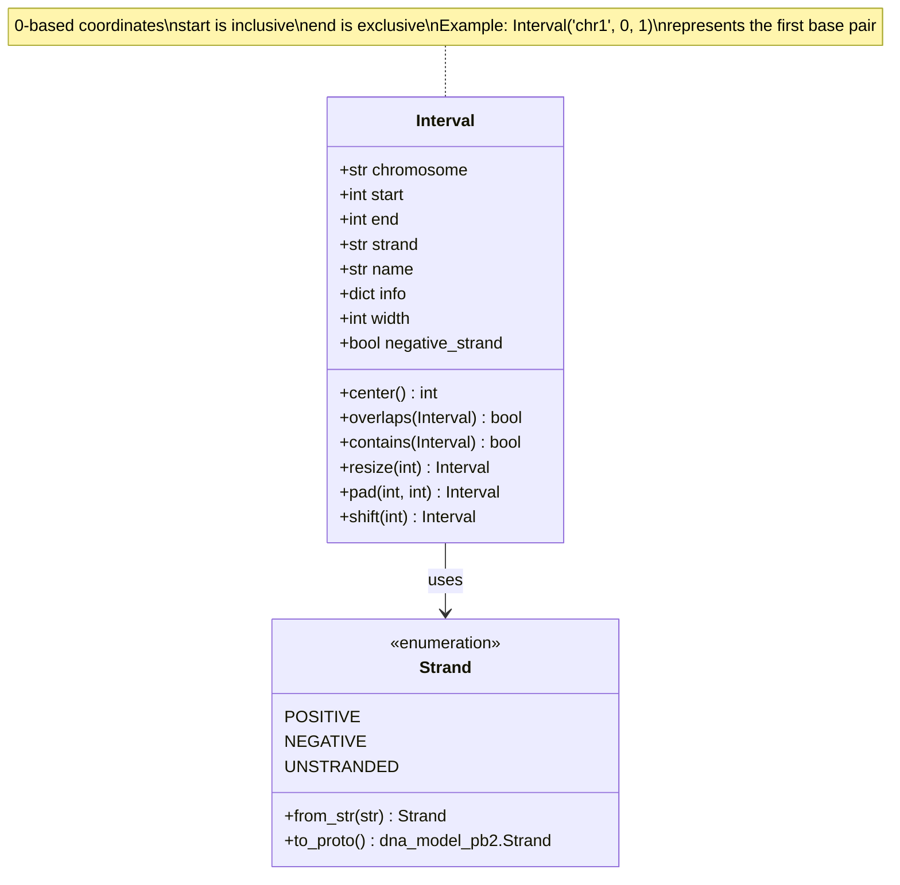

**Sources:** [src/alphagenome/data/genome.py:98-595](), [docs/source/faqs.md:14-39]()

### Indexing Convention

| Concept | Indexing | Example | Notes |
|---------|----------|---------|-------|
| `Interval.start` | 0-based | `Interval('chr1', 0, 1)` | First base pair of chr1 |
| `Interval.end` | 0-based exclusive | Range is [start, end) | Does not include base at `end` |
| `Variant.position` | 1-based | `Variant('chr1', 1, 'A', 'T')` | Compatible with dbSNP, VCF |
| `Variant.start` | 0-based | `position - 1` | Derived property for consistency |

The distinction exists because public databases (dbSNP, VCF) use 1-based positions, while internal calculations use 0-based indices. The `Variant` class [src/alphagenome/data/genome.py:644-868]() accepts 1-based `position` but provides 0-based `start` and `end` properties.

**Sources:** [docs/source/faqs.md:20-36](), [docs/source/faqs.md:245-265](), [src/alphagenome/data/genome.py:710-718]()

### Strandedness

DNA is double-stranded. The SDK represents strand using three values:

- `+` (POSITIVE): Forward strand, 5'→3' direction
- `-` (NEGATIVE): Reverse strand, 3'→5' direction  
- `.` (UNSTRANDED): Strand not specified

Strand-aware operations (e.g., `pad()`, `resize()`, `center()`) adjust behavior based on orientation to maintain biological consistency when intervals are reverse-complemented.

**Sources:** [docs/source/faqs.md:110-163](), [src/alphagenome/data/genome.py:38-93]()

## Genetic Variation Representation

### Variant Class

The `Variant` class [src/alphagenome/data/genome.py:644-868]() represents genetic mutations including SNVs, insertions, and deletions:

```python
# Example variant definitions
snv = Variant('chr1', 1024, 'A', 'C')           # Single nucleotide variant
deletion = Variant('chr1', 1024, 'ATG', 'A')    # Deletion of TG
insertion = Variant('chr1', 1024, 'A', 'ATGC')  # Insertion of TGC
```

**Key Properties:**

| Property | Type | Description |
|----------|------|-------------|
| `is_snv` | bool | Single nucleotide variant |
| `is_insertion` | bool | Alternate longer than reference |
| `is_deletion` | bool | Reference longer than alternate |
| `is_indel` | bool | Any insertion or deletion |
| `is_frameshift` | bool | Indel size not divisible by 3 |
| `is_structural` | bool | Indel size ≥ 50 bp |
| `reference_interval` | Interval | Genomic span of reference allele |

Variants use left-alignment following the normalization algorithm from Tan et al. (2015) [src/alphagenome/data/genome.py:950-1005](). The `normalize_variant()` function ensures consistent representation across different input formats.

**Sources:** [src/alphagenome/data/genome.py:644-868](), [docs/source/faqs.md:239-293]()

### Junction Class

The `Junction` class [src/alphagenome/data/genome.py:870-930]() extends `Interval` to represent splice junctions:

```mermaid
classDiagram
    class Interval {
        +chromosome: str
        +start: int
        +end: int
        +strand: str
    }
    
    class Junction {
        +k: int|None
        +acceptor: int
        +donor: int
        +dinucleotide_region() tuple
        +acceptor_region(tuple) Interval
        +donor_region(tuple) Interval
    }
    
    Junction --|> Interval : extends
    
    note for Junction "Must be stranded\nacceptor/donor depend on strand\nUsed for splice junction predictions"
```

The `acceptor` and `donor` properties return positions that respect strand orientation:
- Positive strand: donor=start, acceptor=end
- Negative strand: donor=end, acceptor=start

**Sources:** [src/alphagenome/data/genome.py:870-930]()

## Model Abstraction Layer

### DnaModel Interface

The `DnaModel` abstract base class [src/alphagenome/models/dna_model.py:73-508]() defines the contract for all AlphaGenome models:

```mermaid
graph TB
    subgraph "Abstract Interface"
        DnaModel["DnaModel (ABC)"]
    end
    
    subgraph "Core Methods"
        predict_sequence["predict_sequence(sequence, organism, outputs)"]
        predict_interval["predict_interval(interval, organism, outputs)"]
        predict_variant["predict_variant(interval, variant, organism, outputs)"]
        score_interval["score_interval(interval, scorers, organism)"]
        score_variant["score_variant(interval, variant, scorers, organism)"]
        score_ism_variants["score_ism_variants(interval, ism_interval, scorers)"]
        output_metadata["output_metadata(organism)"]
    end
    
    subgraph "Batch Methods"
        predict_sequences["predict_sequences(sequences, ...)"]
        predict_intervals["predict_intervals(intervals, ...)"]
        predict_variants["predict_variants(intervals, variants, ...)"]
        score_intervals["score_intervals(intervals, ...)"]
        score_variants["score_variants(intervals, variants, ...)"]
    end
    
    subgraph "Concrete Implementation"
        DnaClient["DnaClient"]
    end
    
    DnaModel --> predict_sequence
    DnaModel --> predict_interval
    DnaModel --> predict_variant
    DnaModel --> score_interval
    DnaModel --> score_variant
    DnaModel --> score_ism_variants
    DnaModel --> output_metadata
    
    DnaModel -.provides default.-> predict_sequences
    DnaModel -.provides default.-> predict_intervals
    DnaModel -.provides default.-> predict_variants
    DnaModel -.provides default.-> score_intervals
    DnaModel -.provides default.-> score_variants
    
    DnaClient -.implements.-> DnaModel
```

The abstract methods must be implemented by concrete classes (e.g., `DnaClient`). Batch methods have default implementations that parallelize calls using `ThreadPoolExecutor` [src/alphagenome/models/dna_model.py:102-158]().

**Sources:** [src/alphagenome/models/dna_model.py:73-508]()

### Model Version and Organism

```mermaid
classDiagram
    class ModelVersion {
        <<enumeration>>
        ALL_FOLDS
        FOLD_0
        FOLD_1
        FOLD_2
        FOLD_3
    }
    
    class Organism {
        <<enumeration>>
        HOMO_SAPIENS
        MUS_MUSCULUS
        +to_proto() dna_model_pb2.Organism
    }
    
    note for ModelVersion "ALL_FOLDS: distilled ensemble\nFOLD_N: trained with fold N held out\nFolds are disjoint genome subsets"
    
    note for Organism "HOMO_SAPIENS: hg38 (GRCh38.p13)\nMUS_MUSCULUS: mm10 (GRCm38.p6)"
```

The `ModelVersion` enum [src/alphagenome/models/dna_model.py:35-56]() allows selecting between the distilled ensemble model (`ALL_FOLDS`) and fold-specific models trained on different genome partitions. The `Organism` enum [src/alphagenome/models/dna_model.py:58-71]() specifies the reference genome assembly.

**Sources:** [src/alphagenome/models/dna_model.py:35-71](), [docs/source/faqs.md:40-46]()

## Prediction vs Scoring Paradigm

The SDK distinguishes between two operational modes:

### Prediction Operations

**Purpose:** Generate raw multimodal predictions for genomic sequences.

**Input:** Genomic coordinates or DNA sequence  
**Output:** `Output` or `VariantOutput` objects containing continuous track data and discrete event data

```mermaid
graph LR
    subgraph "Input"
        Interval["Interval<br/>genome.Interval"]
        Variant["Variant<br/>genome.Variant"]
        Sequence["DNA Sequence<br/>str"]
    end
    
    subgraph "Prediction Methods"
        PI["predict_interval()"]
        PV["predict_variant()"]
        PS["predict_sequence()"]
    end
    
    subgraph "Output Structures"
        Output["Output<br/>TrackData + JunctionData"]
        VariantOutput["VariantOutput<br/>reference + alternate"]
    end
    
    Interval --> PI
    Interval --> PV
    Variant --> PV
    Sequence --> PS
    
    PI --> Output
    PV --> VariantOutput
    PS --> Output
    
    VariantOutput -.contains.-> Output
```

**Key Classes:**
- `Output` [src/alphagenome/models/dna_output.py](): Contains `TrackData` (continuous signals like RNA-seq, ATAC) and `JunctionData` (discrete events like splice junctions, chromatin contacts)
- `VariantOutput` [src/alphagenome/models/dna_output.py](): Pairs reference and alternate `Output` objects for comparison

**Sources:** [src/alphagenome/models/dna_model.py:76-256]()

### Scoring Operations

**Purpose:** Aggregate predictions into interpretable scalar metrics for downstream analysis.

**Input:** Genomic coordinates plus configuration (scorer type, aggregation method)  
**Output:** `list[AnnData]` containing gene-by-track score matrices

```mermaid
graph LR
    subgraph "Input"
        Interval2["Interval"]
        Variant2["Variant"]
    end
    
    subgraph "Scorer Configuration"
        VS["VariantScorer<br/>CenterMaskScorer<br/>GeneMaskLFCScorer<br/>SpliceJunctionScorer<br/>..."]
        IS["IntervalScorer<br/>GeneMaskIntervalScorer"]
    end
    
    subgraph "Scoring Methods"
        SV["score_variant()"]
        SI["score_interval()"]
        ISM["score_ism_variants()"]
    end
    
    subgraph "Output"
        AD["list[AnnData]<br/>X: scores matrix<br/>obs: gene metadata<br/>var: track metadata"]
    end
    
    Interval2 --> SV
    Variant2 --> SV
    Interval2 --> SI
    Interval2 --> ISM
    
    VS --> SV
    VS --> ISM
    IS --> SI
    
    SV --> AD
    SI --> AD
    ISM --> AD
```

**Key Concepts:**
- **Scorers** [src/alphagenome/models/variant_scorers.py](), [src/alphagenome/models/interval_scorers.py](): Define how to aggregate raw predictions (e.g., mean difference, log2 fold change, maximum value)
- **AnnData**: Standard single-cell analysis format storing scores in `.X`, gene metadata in `.obs`, track metadata in `.var`, and genomic context in `.uns`
- **Quantile Scores**: Empirically-derived percentiles based on common variant distribution (MAF>0.01), enabling cross-track comparison

The `tidy_scores()` utility [src/alphagenome/models/variant_scorers.py]() converts `AnnData` objects to pandas DataFrames for tabular analysis.

**Sources:** [src/alphagenome/models/dna_model.py:317-494](), [docs/source/faqs.md:294-341]()

## Output Types and Modalities

The `OutputType` enum specifies which biological assays to predict:

| OutputType | Data Structure | Tracks | Description |
|------------|----------------|--------|-------------|
| `RNA_SEQ` | TrackData | 600+ | RNA expression levels (stranded) |
| `ATAC` | TrackData | 100+ | Chromatin accessibility (unstranded) |
| `CAGE` | TrackData | 250+ | Transcription start sites (stranded) |
| `CHIP_TF` | TrackData | 350+ | Transcription factor binding |
| `CHIP_HISTONE` | TrackData | 100+ | Histone modifications |
| `SPLICE_JUNCTIONS` | JunctionData | - | Splice site usage predictions |
| `CONTACT_MAPS` | JunctionData | - | Chromatin loop predictions |
| `POLYADENYLATION` | TrackData | - | PolyA site usage (stranded) |

Each output type contains multiple tracks corresponding to different cell types, tissues, or experimental conditions. The exact tracks available for each organism can be queried via `DnaModel.output_metadata()` [src/alphagenome/models/dna_model.py:496-507]().

**Sources:** [docs/source/faqs.md:82-109]()

### Ontology Terms

Tracks are annotated with standardized ontology CURIEs (Compact URIs) from:
- **UBERON**: Anatomical structures (e.g., `UBERON:0001114` for liver)
- **CL**: Cell types (e.g., `CL:0000182` for hepatocyte)
- **CLO**: Cell lines
- **EFO**: Experimental factors

Predictions can be filtered to specific tissues/cell types by passing ontology terms to prediction methods [src/alphagenome/models/dna_model.py:83-84]().

**Sources:** [docs/source/faqs.md:96-109]()

## Key Design Principles

### Separation of Concerns

```mermaid
graph TB
    subgraph "Data Layer"
        Interval["Interval, Variant, Junction<br/>genome.py"]
    end
    
    subgraph "Model Layer"
        DnaModel["DnaModel (abstract)<br/>dna_model.py"]
        DnaClient["DnaClient (concrete)<br/>dna_client.py"]
    end
    
    subgraph "Output Layer"
        Output["Output, TrackData, JunctionData<br/>dna_output.py"]
        AnnData["AnnData (scoring results)"]
    end
    
    subgraph "Scorer Layer"
        Scorers["VariantScorer, IntervalScorer<br/>variant_scorers.py, interval_scorers.py"]
    end
    
    Interval --> DnaModel
    DnaModel -.implemented by.-> DnaClient
    DnaModel --> Output
    DnaModel --> Scorers
    Scorers --> AnnData
    Output -.used by.-> Scorers
```

- **Data structures** are organism-agnostic and operate only on coordinates
- **Model interface** is abstract, enabling future implementations
- **Output structures** are rich objects with metadata, not raw arrays
- **Scorers** are composable configurations, not hard-coded logic

**Sources:** [src/alphagenome/data/genome.py](), [src/alphagenome/models/dna_model.py]()

### Strand-Aware Operations

Many methods accept a `use_strand` parameter [src/alphagenome/data/genome.py:341-357]() that controls whether operations respect strand orientation. When `use_strand=True`:
- Padding/resizing operations are reversed for negative strand
- Center calculations account for asymmetric widths
- Coverage tracks separate forward/reverse contributions

This ensures biological correctness when working with directional features (transcription, splicing).

**Sources:** [src/alphagenome/data/genome.py:300-446](), [src/alphagenome/data/genome.py:551-594]()

### Reference Genome Awareness

While the SDK accepts arbitrary DNA sequences [docs/source/faqs.md:47-56](), predictions are most reliable for sequences similar to the reference:
- **Supported:** SNPs, indels, small variants
- **Caution:** Large structural variants, synthetic sequences, padding
- **Reference assemblies:** hg38 (human), mm10 (mouse)

The model has not been trained on or evaluated for highly divergent sequences.

**Sources:** [docs/source/faqs.md:47-62](), [docs/source/faqs.md:178-203]()

---

# Page: Genomic Data Structures

# Genomic Data Structures

<details>
<summary>Relevant source files</summary>

The following files were used as context for generating this wiki page:

- [docs/source/api/data.md](docs/source/api/data.md)
- [src/alphagenome/data/gene_annotation.py](src/alphagenome/data/gene_annotation.py)
- [src/alphagenome/data/gene_annotation_test.py](src/alphagenome/data/gene_annotation_test.py)
- [src/alphagenome/data/genome.py](src/alphagenome/data/genome.py)
- [src/alphagenome/data/genome_test.py](src/alphagenome/data/genome_test.py)

</details>


This page documents the core genomic data structures used throughout the AlphaGenome SDK. These classes provide a consistent interface for representing genomic coordinates, genetic variants, and splice junctions. All prediction and scoring operations in the SDK operate on these fundamental data types.

For information about how these structures are used in predictions, see [Prediction Workflows](#3.2). For details on scoring variants with these structures, see [Variant Scoring](#3.3). For complete API documentation, see [Data Structures API Reference](#4.3).

---

## Overview

The SDK provides three primary data structures, all located in [src/alphagenome/data/genome.py]():

| Class | Purpose | Key Properties |
|-------|---------|----------------|
| `Interval` | Represents a genomic region with chromosome coordinates | `chromosome`, `start`, `end`, `strand` |
| `Variant` | Represents a genetic variant (SNV, indel, etc.) | `position`, `reference_bases`, `alternate_bases` |
| `Junction` | Represents a splice junction (subclass of `Interval`) | `acceptor`, `donor`, `k` |

All three classes use consistent coordinate conventions:
- **0-based, half-open intervals** for `Interval` and derived classes (`start` is inclusive, `end` is exclusive)
- **1-based positions** for `Variant` (following VCF convention)
- **Strand-aware operations** with explicit handling of forward (+), reverse (-), and unstranded (.) orientations

---

## Strand Representation

The `Strand` enum defines genomic strand orientations and provides conversion methods for string and Protocol Buffer representations.

### Strand Enum

```mermaid
classDiagram
    class Strand {
        <<enumeration>>
        POSITIVE : 1
        NEGATIVE : 2
        UNSTRANDED : 3
        +from_str(strand: str) Strand
        +to_proto() dna_model_pb2.Strand
        +from_proto(proto) Strand
        +__str__() str
    }
    
    note for Strand "String values:\nPOSITIVE = '+'\nNEGATIVE = '-'\nUNSTRANDED = '.'"
```

**Usage Example:**
```python
from alphagenome.data.genome import Strand

# Create from string
strand = Strand.from_str('+')  # Strand.POSITIVE
print(strand)  # '+'

# Convert to protocol buffer for API calls
proto_strand = strand.to_proto()
```

**Sources:** [src/alphagenome/data/genome.py:38-93]()

---

## Interval: Genomic Coordinate Representation

The `Interval` class is the foundational data structure for representing genomic regions. It uses 0-based, half-open coordinates (same convention as BED files).

### Interval Class Structure

```mermaid
classDiagram
    class Interval {
        +chromosome: str
        +start: int
        +end: int
        +strand: str
        +name: str
        +info: dict
        
        +negative_strand: bool
        +width: int
        
        +copy() Interval
        +overlaps(interval) bool
        +contains(interval) bool
        +intersect(interval) Interval | None
        +center(use_strand) int
        +pad(start_pad, end_pad) Interval
        +resize(width) Interval
        +shift(offset) Interval
        +truncate(reference_length) Interval
        +coverage(intervals, bin_size) ndarray
        +to_proto() dna_model_pb2.Interval
        +from_proto(proto) Interval
        +to_str() str
        +from_str(string) Interval
    }
    
    note for Interval "Coordinates are 0-based, half-open:\n[start, end)\nExample: chr1:100-200 spans\npositions 100-199 inclusive"
```

### Key Coordinate Operations

**Coordinate System Convention:**
```
Position:     0   1   2   3   4   5   6   7   8   9
              |   |   |   |   |   |   |   |   |   |
Bases:        A   T   C   G   A   T   C   G   A   T
              
Interval(start=2, end=5):
                  [--------)
              A   T   C   G   A   T   C   G   A   T
                      ↑   ↑   ↑
                   Bases at positions 2, 3, 4 (width=3)
```

**String Serialization:**
```python
# Format: chromosome:start-end:strand
interval = Interval('chr1', 100, 200, '+')
print(interval)  # 'chr1:100-200:+'

# Parse from string
interval = Interval.from_str('chr1:100-200:+')
```

### Strand-Aware Operations

Many `Interval` methods have a `use_strand` parameter that changes behavior based on strand orientation:

| Method | Without `use_strand=True` | With `use_strand=True` |
|--------|---------------------------|------------------------|
| `center()` | Returns geometric center | Adjusts for odd-width negative strand intervals |
| `pad(start_pad, end_pad)` | Pads in coordinate space | Reverses padding for negative strand |
| `shift(offset)` | Shifts in positive direction | Reverses direction for negative strand |
| `resize(width)` | Centers around geometric center | Strand-aware centering |

**Example:**
```python
# Positive strand interval
pos = Interval('chr1', 100, 110, '+')
pos.center()  # 105
pos.pad(5, 10)  # chr1:95-120:+

# Negative strand interval - padding is reversed
neg = Interval('chr1', 100, 110, '-')
neg.center()  # 105
neg.pad(5, 10, use_strand=True)  # chr1:90-115:- (end_pad applied to start)
```

**Sources:** [src/alphagenome/data/genome.py:98-594](), [src/alphagenome/data/genome_test.py:61-480]()

---

## Interval Operations and Utilities

### Overlap and Intersection

```mermaid
graph TB
    subgraph "Overlap Detection"
        I1["Interval A<br/>chr1:100-200"]
        I2["Interval B<br/>chr1:150-250"]
        I3["Interval C<br/>chr1:300-400"]
    end
    
    subgraph "Operations"
        overlaps["A.overlaps(B) → True<br/>A.overlaps(C) → False"]
        contains["A.contains(B) → False<br/>A.contains(Interval(chr1:120-180)) → True"]
        intersect["A.intersect(B) → chr1:150-200<br/>A.intersect(C) → None"]
    end
    
    I1 --> overlaps
    I2 --> overlaps
    I3 --> overlaps
    
    I1 --> contains
    I2 --> contains
    
    I1 --> intersect
    I2 --> intersect
    I3 --> intersect
```

**Coverage Calculation:**
The `coverage()` method computes how many intervals overlap each position:

```python
# Calculate base-level coverage
region = Interval('chr1', 0, 10)
reads = [
    Interval('chr1', 2, 5),
    Interval('chr1', 4, 8),
    Interval('chr1', 6, 10)
]
coverage = region.coverage(reads, bin_size=1)
# Returns: [0, 0, 1, 1, 2, 1, 2, 2, 1, 1]

# Bin coverage into windows
binned = region.coverage(reads, bin_size=2)
# Returns: [0, 2, 3, 3, 2] (sum of each 2-base window)
```

**Sources:** [src/alphagenome/data/genome.py:447-594](), [src/alphagenome/data/genome_test.py:139-480]()

### Set Operations on Intervals

The SDK provides utility functions for interval set operations:

```mermaid
flowchart LR
    subgraph "Input"
        L["Left Intervals<br/>[genome.Interval]"]
        R["Right Intervals<br/>[genome.Interval]"]
    end
    
    subgraph "Functions"
        intersect["intersect_intervals(lhs, rhs)<br/>→ Iterator[Interval]"]
        union["union_intervals(lhs, rhs)<br/>→ Iterator[Interval]"]
        merge["merge_overlapping_intervals(intervals)<br/>→ list[Interval]"]
    end
    
    subgraph "Output"
        result["Interval Iterator/List"]
    end
    
    L --> intersect
    R --> intersect
    L --> union
    R --> union
    L --> merge
    
    intersect --> result
    union --> result
    merge --> result
```

**Function Signatures:**
- `intersect_intervals(lhs, rhs)`: Returns overlapping regions between two interval sets
- `union_intervals(lhs, rhs)`: Returns union of two interval sets
- `merge_overlapping_intervals(intervals)`: Merges overlapping intervals within a single set

**Sources:** [src/alphagenome/data/genome.py:1030-1223](), [src/alphagenome/data/genome_test.py:919-1113]()

---

## Variant: Genetic Variation Representation

The `Variant` class represents genetic variants including SNVs (Single Nucleotide Variants), insertions, deletions, and more complex variants.

### Variant Class Structure

```mermaid
classDiagram
    class Variant {
        +chromosome: str
        +position: int
        +reference_bases: str
        +alternate_bases: str
        +name: str
        +info: dict
        
        +start: int
        +end: int
        +reference_interval: Interval
        
        +is_snv: bool
        +is_insertion: bool
        +is_deletion: bool
        +is_indel: bool
        +is_frameshift: bool
        +is_structural: bool
        
        +copy() Variant
        +split(anchor) tuple[Variant, Variant]
        +reference_overlaps(interval) bool
        +alternate_overlaps(interval) bool
        +to_proto() dna_model_pb2.Variant
        +from_proto(proto) Variant
        +from_str(string, format) Variant
    }
    
    class VariantFormat {
        <<enumeration>>
        DEFAULT
        GTEX
        OPEN_TARGETS
        OPEN_TARGETS_BIGQUERY
        GNOMAD
    }
    
    Variant ..> VariantFormat : "uses for parsing"
    
    note for Variant "Position is 1-based (VCF convention)\nBases must be in {A, C, G, T, N}\nEmpty string allowed for pure insertions/deletions"
```

### Coordinate Convention Difference

**Important:** `Variant` uses 1-based position (VCF convention), while `Interval` uses 0-based coordinates:

```
Position (1-based): 1   2   3   4   5   6   7   8
Position (0-based): 0   1   2   3   4   5   6   7
                    |   |   |   |   |   |   |   |
Bases:              A   T   C   G   A   T   C   G

Variant(position=3, reference_bases='C', alternate_bases='T'):
  - 1-based position: 3
  - 0-based start: 2 (variant.start)
  - 0-based end: 3 (variant.end)
  - Affects base at 0-based index 2
```

**Conversion Properties:**
```python
variant = Variant('chr1', 3, 'C', 'T')
variant.position        # 3 (1-based, as specified)
variant.start          # 2 (0-based, derived)
variant.end            # 3 (0-based, derived)
variant.reference_interval  # Interval('chr1', 2, 3)
```

**Sources:** [src/alphagenome/data/genome.py:644-868](), [src/alphagenome/data/genome_test.py:482-845]()

### Variant Types and Properties

The `Variant` class provides boolean properties to classify variant types:

| Property | Definition | Example |
|----------|------------|---------|
| `is_snv` | Single nucleotide: len(ref)==1 and len(alt)==1 | position=100, ref='A', alt='T' |
| `is_insertion` | len(ref) < len(alt) | position=100, ref='A', alt='ATT' |
| `is_deletion` | len(ref) > len(alt) | position=100, ref='ATT', alt='A' |
| `is_indel` | is_insertion or is_deletion | Any of above |
| `is_frameshift` | Indel size not divisible by 3 | ref='AT', alt='A' (size=1) |
| `is_structural` | abs(len(ref) - len(alt)) >= 50 | Large insertions/deletions |

**Example:**
```python
# SNV
snv = Variant('chr1', 100, 'A', 'T')
assert snv.is_snv

# Insertion
ins = Variant('chr1', 100, 'A', 'ATT')
assert ins.is_insertion and ins.is_indel

# Deletion
del_ = Variant('chr1', 100, 'ATT', 'A')
assert del_.is_deletion and del_.is_indel

# Frameshift
fs = Variant('chr1', 100, 'AT', 'A')
assert fs.is_frameshift  # Size difference = 1 (not divisible by 3)
```

**Sources:** [src/alphagenome/data/genome.py:738-768](), [src/alphagenome/data/genome_test.py:750-814]()

### Variant String Formats

The SDK supports parsing variants from multiple common formats via the `VariantFormat` enum:

```mermaid
graph TD
    subgraph "Input Formats"
        DEFAULT["DEFAULT<br/>chr22:1024:A>C"]
        GTEX["GTEX<br/>chr22_1024_A_C_b38"]
        OT["OPEN_TARGETS<br/>22_1024_A_C"]
        OTBQ["OPEN_TARGETS_BIGQUERY<br/>22:1024:A:C"]
        GNOMAD["GNOMAD<br/>22-1024-A-C"]
    end
    
    subgraph "Parser"
        from_str["Variant.from_str(string, format)"]
    end
    
    subgraph "Output"
        V["Variant Object<br/>chromosome='chr22'<br/>position=1024<br/>reference_bases='A'<br/>alternate_bases='C'"]
    end
    
    DEFAULT --> from_str
    GTEX --> from_str
    OT --> from_str
    OTBQ --> from_str
    GNOMAD --> from_str
    
    from_str --> V
```

**Format Details:**

| Format | Example | Notes |
|--------|---------|-------|
| `DEFAULT` | `chr22:1024:A>C` | Default SDK format, requires 'chr' prefix |
| `GTEX` | `chr22_1024_A_C_b38` | GTEx format, optional build suffix |
| `OPEN_TARGETS` | `22_1024_A_C` | No 'chr' prefix (auto-added) |
| `OPEN_TARGETS_BIGQUERY` | `22:1024:A:C` | BigQuery format, no 'chr' prefix |
| `GNOMAD` | `22-1024-A-C` | gnomAD format, no 'chr' prefix |

**Usage:**
```python
from alphagenome.data.genome import Variant, VariantFormat

# Parse from different formats
v1 = Variant.from_str('chr22:1024:A>C', VariantFormat.DEFAULT)
v2 = Variant.from_str('chr22_1024_A_C', VariantFormat.GTEX)
v3 = Variant.from_str('22_1024_A_C', VariantFormat.OPEN_TARGETS)

# All parse to the same variant
assert v1 == v2 == v3

# Default format doesn't require explicit specification
v4 = Variant.from_str('chr22:1024:A>C')  # Uses DEFAULT
```

**Sources:** [src/alphagenome/data/genome.py:607-642](), [src/alphagenome/data/genome.py:773-801](), [src/alphagenome/data/genome_test.py:535-681]()

### Variant Normalization

The `normalize_variant()` function left-aligns variants according to the algorithm described in [Tan et al. 2015](https://doi.org/10.1093/bioinformatics/btv112).

```mermaid
flowchart LR
    subgraph "Input"
        V["Variant<br/>position, ref, alt"]
        F["FastaExtractor<br/>reference genome"]
    end
    
    subgraph "Normalization Steps"
        step1["1. Remove common suffix"]
        step2["2. Extend left if needed"]
        step3["3. Left-align"]
    end
    
    subgraph "Output"
        N["Normalized Variant<br/>left-aligned, minimal representation"]
    end
    
    V --> step1
    F --> step1
    step1 --> step2
    step2 --> step3
    step3 --> N
```

**Example:**
```python
from alphagenome.data.genome import Variant, normalize_variant

# Original variant
variant = Variant('chr1', 6, 'CAC', 'C')  # Deletion in repeat region
# Reference: ...GGGCACACACAGGG...
#                   ^^^

# After normalization (left-aligned)
normalized = normalize_variant(variant, fasta_extractor)
# Result: chr1:3:GCA>G
# Now aligned to leftmost position of repeat
```

**Sources:** [src/alphagenome/data/genome.py:950-1008](), [src/alphagenome/data/genome_test.py:816-844]()

---

## Junction: Splice Junction Representation

The `Junction` class extends `Interval` to represent splice junctions, which are critical for RNA splicing analysis.

### Junction Class Structure

```mermaid
classDiagram
    Interval <|-- Junction
    
    class Interval {
        +chromosome: str
        +start: int
        +end: int
        +strand: str
        +name: str
        +info: dict
    }
    
    class Junction {
        +k: int | None
        +acceptor: int
        +donor: int
        +dinucleotide_region() tuple[Interval, Interval]
        +acceptor_region(overhang) Interval
        +donor_region(overhang) Interval
    }
    
    note for Junction "Must be stranded (strand cannot be '.')\nstart and end define intron boundaries\nk represents read support count"
```

### Strand-Specific Acceptor/Donor Sites

The `acceptor` and `donor` properties return different positions depending on strand orientation:

```
Positive Strand (+):
    Exon1    Intron     Exon2
    |-----[=========]-----|
          ↑         ↑
        donor    acceptor
        (start)    (end)

Negative Strand (-):
    Exon2    Intron     Exon1
    |-----[=========]-----|
          ↑         ↑
      acceptor    donor
        (start)    (end)
```

**Code Behavior:**
```python
# Positive strand junction
pos_junction = Junction('chr1', 100, 200, '+')
pos_junction.donor      # 100 (start)
pos_junction.acceptor   # 200 (end)

# Negative strand junction
neg_junction = Junction('chr1', 100, 200, '-')
neg_junction.donor      # 200 (end)
neg_junction.acceptor   # 100 (start)
```

### Junction Methods

**Dinucleotide Regions:**
Splice junctions typically have canonical dinucleotide sequences (GT-AG for most junctions). The `dinucleotide_region()` method returns the 2bp regions flanking the intron:

```python
junction = Junction('chr1', 100, 200, '+')
donor_di, acceptor_di = junction.dinucleotide_region()

# Returns:
# donor_di: Interval('chr1', 100, 102, '+')    # GT at donor site
# acceptor_di: Interval('chr1', 198, 200, '+') # AG at acceptor site
```

**Splice Site Regions:**
Extract extended regions around splice sites for motif analysis:

```python
junction = Junction('chr1', 1000, 2000, '+')

# Default: 250bp upstream and downstream of each site
acceptor_region = junction.acceptor_region()  # chr1:1750-2250:+

# Custom overhang
donor_region = junction.donor_region(overhang=(100, 100))  # chr1:900-1100:+
```

**Sources:** [src/alphagenome/data/genome.py:870-930](), [src/alphagenome/data/genome_test.py:847-917]()

---

## Serialization and Interoperability

All data structures support multiple serialization formats for interoperability with other tools and the AlphaGenome API.

### Serialization Format Support

```mermaid
graph TB
    subgraph "Data Structures"
        I[Interval]
        V[Variant]
        J[Junction]
    end
    
    subgraph "Serialization Formats"
        STR["String<br/>chr1:100-200:+<br/>chr1:100:A>T"]
        PROTO["Protocol Buffers<br/>dna_model_pb2.Interval<br/>dna_model_pb2.Variant"]
        DICT["Dictionary<br/>{chrom, start, end, strand}"]
        PYRANGES["PyRanges Dict<br/>{Chromosome, Start, End, Strand, Name}"]
    end
    
    I --> STR
    I --> PROTO
    I --> DICT
    I --> PYRANGES
    
    V --> STR
    V --> PROTO
    V --> DICT
    
    J --> STR
    J --> PROTO
    J --> DICT
    J --> PYRANGES
    
    STR --> I
    PROTO --> I
    DICT --> I
    PYRANGES --> I
    
    STR --> V
    PROTO --> V
    DICT --> V
    
    STR --> J
    PROTO --> J
    DICT --> J
    PYRANGES --> J
```

### Interval Serialization

| Format | To Method | From Method | Use Case |
|--------|-----------|-------------|----------|
| String | `str(interval)` or `interval.to_str()` | `Interval.from_str(string)` | Human-readable representation |
| Protocol Buffer | `interval.to_proto()` | `Interval.from_proto(proto)` | API communication with server |
| Dictionary | `interval.to_interval_dict()` | `Interval.from_interval_dict(dict)` | JSON serialization |
| PyRanges | `interval.to_pyranges_dict()` | `Interval.from_pyranges_dict(dict)` | Interop with PyRanges library |

**Example:**
```python
interval = Interval('chr1', 100, 200, '+', name='gene1', info={'score': 0.95})

# String format
s = str(interval)  # 'chr1:100-200:+'
parsed = Interval.from_str(s)

# Protocol buffer (for API calls)
proto = interval.to_proto()
roundtrip = Interval.from_proto(proto)

# PyRanges dictionary (includes name and info)
pr_dict = interval.to_pyranges_dict()
# {'Chromosome': 'chr1', 'Start': 100, 'End': 200, 
#  'Strand': '+', 'Name': 'gene1', 'score': 0.95}
```

**Sources:** [src/alphagenome/data/genome.py:150-277]()

### Variant Serialization

**String Format (Multiple Variants):**
```python
# Default format
v = Variant('chr1', 100, 'A', 'T')
print(v)  # 'chr1:100:A>T'

# Parse from various formats
v1 = Variant.from_str('chr1:100:A>T')  # DEFAULT
v2 = Variant.from_str('chr1_100_A_T_b38', VariantFormat.GTEX)
v3 = Variant.from_str('1_100_A_T', VariantFormat.OPEN_TARGETS)
```

**Protocol Buffer (for API):**
```python
variant = Variant('chr1', 100, 'A', 'T')

# Convert to proto for API request
proto = variant.to_proto()

# Parse from API response
response_variant = Variant.from_proto(proto)
```

**Dictionary:**
```python
variant = Variant('chr1', 100, 'A', 'T', name='rs123')

# Convert to dict (e.g., for JSON)
d = variant.to_dict()
# {'chromosome': 'chr1', 'position': 100, 
#  'reference_bases': 'A', 'alternate_bases': 'T',
#  'name': 'rs123', 'info': {}}

# Parse from dict
parsed = Variant.from_dict(d)
```

**Sources:** [src/alphagenome/data/genome.py:691-829]()

---

## Integration with Gene Annotations

The `gene_annotation` module provides functions that work with these data structures to extract gene-level intervals from GTF files.

### Gene Interval Extraction Flow

```mermaid
flowchart TD
    GTF["GTF DataFrame<br/>pd.DataFrame with GENCODE annotations"]
    
    subgraph "Filtering Functions"
        filter1["filter_protein_coding(gtf)"]
        filter2["filter_to_mane_select_transcript(gtf)"]
        filter3["filter_transcript_support_level(gtf, ['1', '2'])"]
    end
    
    subgraph "Extraction"
        extract["get_gene_intervals(gtf, gene_symbols)<br/>or<br/>get_gene_interval(gtf, gene_symbol)"]
    end
    
    subgraph "Output"
        intervals["list[genome.Interval]<br/>Stranded intervals for genes"]
    end
    
    GTF --> filter1
    filter1 --> filter2
    filter2 --> filter3
    filter3 --> extract
    extract --> intervals
```

**Example Usage:**
```python
from alphagenome.data import gene_annotation, genome
import pandas as pd

# Load GTF file
gtf = pd.read_feather('gencode.v46.annotation.feather')

# Filter to high-confidence protein-coding transcripts
filtered = gene_annotation.filter_protein_coding(gtf)
filtered = gene_annotation.filter_to_mane_select_transcript(filtered)

# Extract intervals for specific genes
intervals = gene_annotation.get_gene_intervals(
    filtered,
    gene_symbols=['TP53', 'EGFR', 'BRCA1']
)
# Returns: [genome.Interval('chr17', ...), ...]

# Single gene
tp53_interval = gene_annotation.get_gene_interval(
    filtered,
    gene_symbol='TP53'
)
# Returns: genome.Interval with TP53 coordinates
```

**Key Functions:**

| Function | Purpose | Returns |
|----------|---------|---------|
| `get_gene_interval(gtf, gene_symbol=..., gene_id=...)` | Get interval for single gene | `genome.Interval` |
| `get_gene_intervals(gtf, gene_symbols=..., gene_ids=...)` | Get intervals for multiple genes | `list[genome.Interval]` |
| `extract_tss(gtf)` | Extract transcription start sites | `pd.DataFrame` with width=0 intervals |

**Sources:** [src/alphagenome/data/gene_annotation.py:331-445](), [src/alphagenome/data/gene_annotation_test.py:87-240]()

---

## Summary Table: Data Structure Quick Reference

| Aspect | Interval | Variant | Junction |
|--------|----------|---------|----------|
| **Coordinate System** | 0-based, half-open [start, end) | 1-based position (VCF) | 0-based (inherits Interval) |
| **Primary Use** | Genomic regions, predictions | Genetic variants | Splice junctions |
| **Key Attributes** | chromosome, start, end, strand | position, reference_bases, alternate_bases | Inherits Interval + k |
| **Strand Required** | No (can be '.') | No | Yes (cannot be '.') |
| **Main Operations** | overlaps, pad, resize, coverage | split, classification properties | acceptor/donor regions |
| **String Format** | `chr1:100-200:+` | `chr1:100:A>T` (multiple formats) | Same as Interval |
| **Protocol Buffer** | `dna_model_pb2.Interval` | `dna_model_pb2.Variant` | `dna_model_pb2.Interval` |
| **Source Lines** | [98-594]() | [644-868]() | [870-930]() |

---

**Complete Sources:**
- [src/alphagenome/data/genome.py]()
- [src/alphagenome/data/genome_test.py]()
- [src/alphagenome/data/gene_annotation.py]()
- [src/alphagenome/data/gene_annotation_test.py]()
- [docs/source/api/data.md]()

---

# Page: Prediction Workflows

# Prediction Workflows

<details>
<summary>Relevant source files</summary>

The following files were used as context for generating this wiki page:

- [docs/source/_templates/autosummary/class.rst](docs/source/_templates/autosummary/class.rst)
- [docs/source/api/models.md](docs/source/api/models.md)
- [src/alphagenome/models/dna_client.py](src/alphagenome/models/dna_client.py)
- [src/alphagenome/models/dna_model.py](src/alphagenome/models/dna_model.py)
- [src/alphagenome/models/dna_model_test.py](src/alphagenome/models/dna_model_test.py)

</details>


## Purpose and Scope

This page explains the prediction workflows in the AlphaGenome SDK, focusing on the `DnaModel` interface and the three core prediction methods. It covers how to generate model predictions for DNA sequences, genomic intervals, and genetic variants, as well as batch processing capabilities.

For information about the data structures used as inputs to predictions (Interval, Variant, Junction), see [Genomic Data Structures](#3.1). For information about scoring workflows that quantify variant effects, see [Variant Scoring](#3.3). For practical guidance on making predictions, see [Making Predictions](#5.1).

## The DnaModel Interface

The prediction system is built around the `DnaModel` abstract base class, which defines a consistent interface for all prediction operations. The `DnaClient` class implements this interface to communicate with the remote AlphaGenome API server via gRPC.

```mermaid
classDiagram
    class DnaModel {
        <<abstract>>
        +predict_sequence(sequence, organism, requested_outputs, ontology_terms)*
        +predict_sequences(sequences, organism, requested_outputs, ontology_terms)
        +predict_interval(interval, organism, requested_outputs, ontology_terms)*
        +predict_intervals(intervals, organism, requested_outputs, ontology_terms)
        +predict_variant(interval, variant, organism, requested_outputs, ontology_terms)*
        +predict_variants(intervals, variants, organism, requested_outputs, ontology_terms)
        +score_interval(interval, interval_scorers, organism)*
        +score_intervals(intervals, interval_scorers, organism)
        +score_variant(interval, variant, variant_scorers, organism)*
        +score_variants(intervals, variants, variant_scorers, organism)
        +score_ism_variants(interval, ism_interval, variant_scorers, organism)*
        +output_metadata(organism)*
    }
    
    class DnaClient {
        -_channel: grpc.Channel
        -_metadata: Sequence[tuple[str, str]]
        -_model_version: str
        +predict_sequence(...)
        +predict_interval(...)
        +predict_variant(...)
        +score_interval(...)
        +score_variant(...)
        +score_ism_variants(...)
        +output_metadata(...)
    }
    
    class Organism {
        <<enumeration>>
        HOMO_SAPIENS
        MUS_MUSCULUS
        +to_proto()
    }
    
    class ModelVersion {
        <<enumeration>>
        ALL_FOLDS
        FOLD_0
        FOLD_1
        FOLD_2
        FOLD_3
    }
    
    DnaClient --|> DnaModel
    DnaClient --> Organism
    DnaClient --> ModelVersion
    
    note for DnaModel "Abstract interface defining\nprediction and scoring methods.\nLocated in dna_model.py"
    note for DnaClient "gRPC client implementation\nthat communicates with\nAlphaGenome API server.\nLocated in dna_client.py"
```

**Sources:** [src/alphagenome/models/dna_model.py:73-508](), [src/alphagenome/models/dna_client.py:494-872]()

### Abstract Methods

The `DnaModel` interface defines six abstract methods that must be implemented:

| Method | Purpose | Input | Output |
|--------|---------|-------|--------|
| `predict_sequence` | Predict from raw DNA string | DNA sequence string | `Output` |
| `predict_interval` | Predict from genomic coordinates | `genome.Interval` | `Output` |
| `predict_variant` | Predict reference and alternate alleles | `genome.Interval`, `genome.Variant` | `VariantOutput` |
| `score_interval` | Score an interval with gene-level aggregation | `genome.Interval` | `list[AnnData]` |
| `score_variant` | Score a variant's effect on genes | `genome.Interval`, `genome.Variant` | `list[AnnData]` |
| `output_metadata` | Retrieve track and ontology metadata | `Organism` | `OutputMetadata` |

**Sources:** [src/alphagenome/models/dna_model.py:76-507]()

### Batch Processing Methods

The interface also provides concrete implementations of batch processing methods that parallelize requests:

- `predict_sequences()` - Process multiple DNA sequences
- `predict_intervals()` - Process multiple genomic intervals
- `predict_variants()` - Process multiple variants
- `score_intervals()` - Score multiple intervals
- `score_variants()` - Score multiple variants

These methods use `concurrent.futures.ThreadPoolExecutor` with configurable `max_workers` and optional progress bars via `tqdm`.

**Sources:** [src/alphagenome/models/dna_model.py:102-467]()

## Three Prediction Types

### 1. Sequence Prediction

The `predict_sequence` method generates predictions from a raw DNA sequence string. This is useful when you have sequence data that is not tied to a specific genomic location, or when working with synthetic sequences.

```mermaid
flowchart LR
    Input["DNA Sequence String\n(ACGTN characters)"]
    Validate["validate_sequence_length()\nValid characters check"]
    Request["PredictSequenceRequest\n(sequence, organism,\nontology_terms,\nrequested_outputs)"]
    gRPC["gRPC Streaming\nDnaModelServiceStub\n.PredictSequence()"]
    Response["Response Stream\n(output messages +\ntensor chunks)"]
    Construct["_make_output()\nAssemble TrackData\nand JunctionData"]
    Output["Output\n(atac, rna_seq,\ncage, etc.)"]
    
    Input --> Validate
    Validate --> Request
    Request --> gRPC
    gRPC --> Response
    Response --> Construct
    Construct --> Output
```

**Key Implementation Details:**

- **Validation**: Checks that sequence contains only 'ACGTN' characters and has a supported length (16KB, 100KB, 500KB, or 1MB)
- **Request Construction**: Creates `PredictSequenceRequest` protobuf with sequence, organism, ontology terms, and requested outputs
- **Streaming Response**: Server streams back output metadata followed by tensor chunks for each requested output type
- **Output Assembly**: `_make_output()` function reassembles chunks into `TrackData` and `JunctionData` objects
- **Retry Logic**: `@retry_rpc` decorator automatically retries transient failures with exponential backoff

**Sources:** [src/alphagenome/models/dna_client.py:517-562](), [src/alphagenome/models/dna_client.py:485-491](), [src/alphagenome/models/dna_client.py:542-549]()

### 2. Interval Prediction

The `predict_interval` method generates predictions from genomic coordinates. The server automatically retrieves the reference sequence for the specified interval.

```mermaid
flowchart LR
    Input["genome.Interval\n(chromosome, start,\nend, strand)"]
    Validate["validate_sequence_length()\nCheck interval width"]
    Proto["interval.to_proto()\nConvert to protobuf"]
    Request["PredictIntervalRequest\n(interval, organism,\nontology_terms,\nrequested_outputs)"]
    gRPC["gRPC Streaming\nDnaModelServiceStub\n.PredictInterval()"]
    Response["Response Stream"]
    Construct["_make_output(responses)"]
    Output["Output\n(with interval\nmetadata preserved)"]
    
    Input --> Validate
    Validate --> Proto
    Proto --> Request
    Request --> gRPC
    gRPC --> Response
    Response --> Construct
    Construct --> Output
```

**Key Characteristics:**

- **Automatic Sequence Retrieval**: The server fetches reference genome sequence for the specified interval
- **Strand Handling**: Predictions respect the interval's strand orientation
- **Interval Metadata**: The original interval is preserved in the output's `TrackData` objects
- **Width Validation**: Interval width must be one of the supported sequence lengths

**Sources:** [src/alphagenome/models/dna_client.py:564-598]()

### 3. Variant Prediction

The `predict_variant` method generates predictions for both reference and alternate alleles of a genetic variant. This enables direct comparison of model predictions with and without the variant.

```mermaid
flowchart TD
    Input["genome.Interval +\ngenome.Variant"]
    Validate["Validate interval width\nand variant position"]
    Request["PredictVariantRequest\n(interval, variant,\norganism, ontology_terms,\nrequested_outputs)"]
    gRPC["gRPC Streaming\nDnaModelServiceStub\n.PredictVariant()"]
    
    subgraph Response["Response Stream"]
        RefMeta["reference_output\nmetadata"]
        RefChunks["reference tensor\nchunks"]
        AltMeta["alternate_output\nmetadata"]
        AltChunks["alternate tensor\nchunks"]
    end
    
    Construct["_make_variant_output()\nAssemble separate\nref/alt outputs"]
    Output["VariantOutput\n(reference: Output,\nalternate: Output)"]
    
    Input --> Validate
    Validate --> Request
    Request --> gRPC
    gRPC --> RefMeta
    RefMeta --> RefChunks
    RefChunks --> AltMeta
    AltMeta --> AltChunks
    AltChunks --> Construct
    Construct --> Output
```

**Variant Output Structure:**

The `VariantOutput` dataclass contains two complete `Output` objects:

```
VariantOutput(
    reference: Output(atac=..., rna_seq=..., cage=..., ...),
    alternate: Output(atac=..., rna_seq=..., cage=..., ...)
)
```

**Key Points:**

- **Dual Predictions**: Server generates predictions for both reference and alternate sequences in a single request
- **Sequence Generation**: Server applies the variant to generate the alternate sequence
- **Efficient Comparison**: Both predictions use the same model parameters and biological context
- **Response Ordering**: Reference output always precedes alternate output in the stream

**Sources:** [src/alphagenome/models/dna_client.py:600-637](), [src/alphagenome/models/dna_client.py:285-312]()

## Input Parameters

All prediction methods accept a common set of input parameters that control what predictions are generated and for which biological contexts.

### Required Parameters

| Parameter | Type | Description |
|-----------|------|-------------|
| `requested_outputs` | `Iterable[OutputType]` | Which prediction modalities to generate (ATAC, RNA_SEQ, CAGE, etc.) |

### Optional Parameters

| Parameter | Type | Default | Description |
|-----------|------|---------|-------------|
| `organism` | `Organism` | `HOMO_SAPIENS` | Species for prediction (HOMO_SAPIENS or MUS_MUSCULUS) |
| `ontology_terms` | `Iterable[OntologyTerm \| str] \| None` | `None` | Tissue/cell type contexts; None returns all ontologies |
| `interval` | `genome.Interval \| None` | `None` | (sequence prediction only) Original genomic location |

### Ontology Term Handling

Ontology terms filter predictions to specific biological contexts (tissues, cell types, cell lines). They can be provided as:

- **OntologyTerm objects**: `ontology.OntologyTerm` instances
- **CURIE strings**: Compact URIs like `"UBERON:0002048"` (lung) or `"CL:0000066"` (epithelial cell)

The `_convert_ontologies_to_protos()` function normalizes these inputs and removes duplicates before sending to the server:

```python
# Both formats are valid:
ontology_terms=[ontology.from_curie("UBERON:0002048")]
ontology_terms=["UBERON:0002048", "CL:0000066"]
```

**Sources:** [src/alphagenome/models/dna_client.py:469-482]()

### Output Type Selection

The `requested_outputs` parameter specifies which prediction modalities to generate. Available types include:

- **Chromatin accessibility**: `OutputType.ATAC`, `OutputType.DNASE`
- **Transcription**: `OutputType.RNA_SEQ`, `OutputType.CAGE`, `OutputType.PROCAP`
- **Histone modifications**: `OutputType.CHIP_HISTONE`
- **Transcription factors**: `OutputType.CHIP_TF`
- **RNA processing**: `OutputType.SPLICE_SITES`, `OutputType.SPLICE_JUNCTIONS`, `OutputType.SPLICE_SITE_USAGE`
- **3D genome**: `OutputType.CONTACT_MAPS`

Each output type is converted to its protocol buffer representation before transmission.

**Sources:** [src/alphagenome/models/dna_client.py:551](), [src/alphagenome/models/dna_client.py:587](), [src/alphagenome/models/dna_client.py:625]()

## Output Structures

Predictions return structured output objects that organize results by modality and biological context.

### Output Dataclass

The `Output` dataclass contains predictions for all requested modalities:

```mermaid
classDiagram
    class Output {
        +atac: TrackData | None
        +rna_seq: TrackData | None
        +cage: TrackData | None
        +dnase: TrackData | None
        +chip_histone: TrackData | None
        +chip_tf: TrackData | None
        +splice_sites: ndarray | None
        +splice_site_usage: TrackData | None
        +splice_junctions: JunctionData | None
        +contact_maps: JunctionData | None
        +procap: TrackData | None
    }
    
    class TrackData {
        +values: ndarray
        +metadata: DataFrame
        +interval: Interval
    }
    
    class JunctionData {
        +junctions: ndarray
        +values: ndarray
        +metadata: DataFrame
        +interval: Interval
    }
    
    class VariantOutput {
        +reference: Output
        +alternate: Output
    }
    
    Output --> TrackData
    Output --> JunctionData
    VariantOutput --> Output
```

**TrackData Structure:**

- `values`: NumPy array of shape `[positions, tracks]` containing predictions
- `metadata`: Pandas DataFrame with track information (ontology terms, biosamples)
- `interval`: Genomic coordinates the predictions correspond to

**JunctionData Structure:**

- `junctions`: NumPy array of junction coordinates
- `values`: NumPy array of prediction values for each junction
- `metadata`: Pandas DataFrame with track metadata
- `interval`: Genomic coordinates

**Sources:** [src/alphagenome/models/dna_client.py:234-258](), [src/alphagenome/models/dna_client.py:309-312]()

### Response Processing Pipeline

The client processes streaming responses through several stages:

```mermaid
flowchart TD
    Stream["gRPC Response Stream"]
    
    subgraph Processing["Response Processing Pipeline"]
        Iter["Iterator over responses"]
        Check["Check payload type\n(output vs tensor_chunk)"]
        
        subgraph OutputPath["Output Message Path"]
            OutputProto["Extract output proto\n(output_type, metadata)"]
            ReadChunks["_read_tensor_chunks()\nRead N chunks"]
            Unpack["tensor_utils.unpack_proto()\nReassemble tensor"]
            Upcast["tensor_utils.upcast_floating()\nConvert to float32/float64"]
            MakeData["Create TrackData/JunctionData"]
        end
        
        subgraph ErrorPath["Error Path"]
            Unexpected["Unexpected tensor_chunk\nbefore output proto"]
            Raise["Raise ValueError"]
        end
    end
    
    Collect["Collect all outputs\nby output_type"]
    Construct["_construct_output()\nBuild Output dataclass"]
    Return["Return Output"]
    
    Stream --> Iter
    Iter --> Check
    Check -->|"output"| OutputProto
    Check -->|"tensor_chunk"| Unexpected
    OutputProto --> ReadChunks
    ReadChunks --> Unpack
    Unpack --> Upcast
    Upcast --> MakeData
    Unexpected --> Raise
    MakeData --> Collect
    Collect --> Construct
    Construct --> Return
```

**Key Functions:**

- `_read_tensor_chunks()`: Reads a specified number of tensor chunk messages from the response stream
- `tensor_utils.unpack_proto()`: Deserializes chunked tensor data into NumPy arrays
- `tensor_utils.upcast_floating()`: Converts float16 predictions to float32/float64 for numerical stability
- `_make_output_data()`: Constructs `TrackData` or `JunctionData` objects from protos and tensor chunks
- `_construct_output()`: Builds the final `Output` dataclass with all requested modalities

**Sources:** [src/alphagenome/models/dna_client.py:139-159](), [src/alphagenome/models/dna_client.py:162-192](), [src/alphagenome/models/dna_client.py:261-282]()

## Supported Sequence Lengths

The model supports four fixed sequence lengths, defined as powers of 2:

| Constant | Value | Length |
|----------|-------|--------|
| `SEQUENCE_LENGTH_16KB` | 2^14 | 16,384 bp |
| `SEQUENCE_LENGTH_100KB` | 2^17 | 131,072 bp |
| `SEQUENCE_LENGTH_500KB` | 2^19 | 524,288 bp |
| `SEQUENCE_LENGTH_1MB` | 2^20 | 1,048,576 bp |

The `validate_sequence_length()` function enforces this constraint:

```python
def validate_sequence_length(length: int):
    if length not in SUPPORTED_SEQUENCE_LENGTHS.values():
        raise ValueError(
            f'Sequence length {length} not supported by the model.'
            f' Supported lengths: {[*SUPPORTED_SEQUENCE_LENGTHS.values()]}'
        )
```

All prediction methods call this validation before making requests. For intervals, the `width` property is validated.

**Sources:** [src/alphagenome/models/dna_client.py:46-57](), [src/alphagenome/models/dna_client.py:485-491]()

## Error Handling and Retries

All prediction methods are wrapped with the `@retry_rpc` decorator, which implements automatic retry logic for transient gRPC failures.

### Retry Configuration

```python
@retry_rpc(
    max_attempts=5,
    initial_backoff=1.25,
    backoff_multiplier=1.5,
    retry_status_codes=frozenset([
        grpc.StatusCode.RESOURCE_EXHAUSTED,
        grpc.StatusCode.UNAVAILABLE
    ]),
    jitter=0.2
)
```

**Retry Behavior:**

- **Retryable Errors**: `RESOURCE_EXHAUSTED` (server overloaded), `UNAVAILABLE` (temporary service outage)
- **Non-Retryable Errors**: Immediately raised without retry (e.g., `INVALID_ARGUMENT`, `PERMISSION_DENIED`)
- **Backoff Strategy**: Exponential backoff with jitter to avoid thundering herd
- **Max Attempts**: Up to 5 attempts total (1 initial + 4 retries)

**Backoff Calculation:**

```
backoff = initial_backoff * (backoff_multiplier ^ attempt) ± (jitter * backoff)
```

For example:
- Attempt 1: 1.25s ± 0.25s
- Attempt 2: 1.88s ± 0.38s
- Attempt 3: 2.81s ± 0.56s

**Sources:** [src/alphagenome/models/dna_client.py:73-122]()

## Client Creation and Configuration

The `create()` function initializes a `DnaClient` instance with authentication and connection parameters:

```python
def create(
    api_key: str,
    *,
    model_version: ModelVersion | None = None,
    timeout: float | None = None,
    address: str | None = None,
) -> DnaClient
```

**Configuration:**

- **API Key**: Required for authentication; passed as `x-goog-api-key` metadata
- **Model Version**: Optional; defaults to `ALL_FOLDS` (distilled ensemble model)
- **Timeout**: Optional timeout for channel readiness check
- **Address**: Optional server address; defaults to `dns:///gdmscience.googleapis.com:443`
- **Message Size**: Unlimited send/receive message sizes for large tensors

**Example Usage:**

```python
import alphagenome.models.dna_client as dna_client

model = dna_client.create(
    api_key="your-api-key",
    model_version=dna_client.ModelVersion.ALL_FOLDS
)
```

**Sources:** [src/alphagenome/models/dna_client.py:874-907]()

## Batch Processing Implementation

The batch prediction methods (`predict_sequences`, `predict_intervals`, `predict_variants`) share a common implementation pattern using `concurrent.futures.ThreadPoolExecutor`:

```mermaid
flowchart TB
    Input["Sequence of inputs\n(sequences/intervals/variants)"]
    Executor["ThreadPoolExecutor\n(max_workers=5)"]
    
    subgraph Parallel["Parallel Execution"]
        Submit1["executor.submit(\npredict_X, input[0])"]
        Submit2["executor.submit(\npredict_X, input[1])"]
        Submit3["executor.submit(\npredict_X, input[...])"]
        SubmitN["executor.submit(\npredict_X, input[n])"]
    end
    
    Futures["List of Future objects"]
    Completed["as_completed(futures)\nwith tqdm progress bar"]
    
    subgraph ErrorHandling["Error Handling"]
        CheckExc["Check future.exception()"]
        ShutdownEarly["executor.shutdown(\ncancel_futures=True)"]
        RaiseError["Raise first exception"]
    end
    
    Results["Collect results in order\n[future.result() for future in futures]"]
    Return["Return list of outputs"]
    
    Input --> Executor
    Executor --> Submit1
    Executor --> Submit2
    Executor --> Submit3
    Executor --> SubmitN
    Submit1 --> Futures
    Submit2 --> Futures
    Submit3 --> Futures
    SubmitN --> Futures
    Futures --> Completed
    Completed --> CheckExc
    CheckExc -->|"Exception found"| ShutdownEarly
    ShutdownEarly --> RaiseError
    CheckExc -->|"No exceptions"| Results
    Results --> Return
```

**Key Features:**

- **Parallelization**: Multiple requests execute concurrently with configurable `max_workers`
- **Progress Tracking**: Optional `tqdm` progress bar tracks completion
- **Early Termination**: On first exception, cancels remaining futures and raises immediately
- **Order Preservation**: Results list maintains input order, not completion order

**Sources:** [src/alphagenome/models/dna_model.py:131-157](), [src/alphagenome/models/dna_model.py:207-230](), [src/alphagenome/models/dna_model.py:291-315]()

---

# Page: Variant Scoring

# Variant Scoring

<details>
<summary>Relevant source files</summary>

The following files were used as context for generating this wiki page:

- [docs/source/faqs.md](docs/source/faqs.md)
- [docs/source/refs.bib](docs/source/refs.bib)
- [src/alphagenome/models/variant_scorers.py](src/alphagenome/models/variant_scorers.py)
- [src/alphagenome/models/variant_scorers_test.py](src/alphagenome/models/variant_scorers_test.py)

</details>


## Purpose and Scope

This page introduces the conceptual framework for variant scoring in AlphaGenome. Variant scoring quantifies the predicted functional impact of genetic variants by aggregating model predictions for reference and alternate alleles. This document covers scorer types, aggregation strategies, output formats, and scoring metrics.

For API details on scorer classes and methods, see [Variant and Interval Scorers](#4.4). For practical usage instructions, see [Scoring Variants](#5.2). For batch processing examples, see [Batch Variant Scoring](#6.2).

**Sources:** [docs/source/faqs.md:237-341]()

---

## What is Variant Scoring?

Variant scoring transforms raw model predictions into interpretable metrics that quantify variant effects. While predictions (see [Prediction Workflows](#3.2)) generate detailed genomic signals for reference and alternate sequences, variant scorers aggregate these signals into summary statistics that answer specific biological questions:

- **How does this variant affect gene expression?**
- **Does this variant disrupt chromatin accessibility?**
- **What is the impact on splicing patterns?**

A variant scorer operates on paired reference/alternate predictions, applying aggregation functions over spatial regions (windows around the variant) or functional units (gene exons, splice sites) to compute effect sizes.

**Key differences from predictions:**

| Predictions | Variant Scoring |
|-------------|-----------------|
| Genome-wide signal tracks | Per-variant summary metrics |
| Output: `TrackData`, `JunctionData` | Output: `AnnData`, `DataFrame` |
| Base-pair resolution | Gene/track-level aggregation |
| Multiple modalities returned | Targeted biological questions |

**Sources:** [src/alphagenome/models/variant_scorers.py:1-67](), [docs/source/faqs.md:294-306]()

---

## Scorer Type Architecture

AlphaGenome provides seven variant scorer types organized into three conceptual categories. Each scorer implements a specific aggregation strategy suited to different biological questions and output modalities.

```mermaid
graph TB
    subgraph "Variant Scorer Hierarchy"
        Base["BaseVariantScorer enum<br/>(variant_scorers.py:69-90)"]
        
        subgraph "Spatial Scorers"
            Center["CenterMaskScorer<br/>Width-based window<br/>8 aggregation types"]
            Contact["ContactMapScorer<br/>1MB contact disruption"]
        end
        
        subgraph "Gene-Centric Scorers"
            GeneLFC["GeneMaskLFCScorer<br/>Log fold change<br/>Per-gene expression"]
            GeneActive["GeneMaskActiveScorer<br/>Active allele<br/>Maximum activity"]
            GeneSplicing["GeneMaskSplicingScorer<br/>Splicing changes<br/>Width-configurable"]
        end
        
        subgraph "Junction Scorers"
            Poly["PolyadenylationScorer<br/>paQTL effects<br/>Human only"]
            Junction["SpliceJunctionScorer<br/>Junction usage<br/>Per-junction metrics"]
        end
    end
    
    Base -.defines.-> Center
    Base -.defines.-> Contact
    Base -.defines.-> GeneLFC
    Base -.defines.-> GeneActive
    Base -.defines.-> GeneSplicing
    Base -.defines.-> Poly
    Base -.defines.-> Junction
    
    Center -->|produces| AnnData1["AnnData<br/>track × 1 row"]
    Contact -->|produces| AnnData1
    
    GeneLFC -->|produces| AnnData2["AnnData<br/>track × gene matrix"]
    GeneActive -->|produces| AnnData2
    GeneSplicing -->|produces| AnnData2
    Poly -->|produces| AnnData2
    Junction -->|produces| AnnData2
```

**Scorer type definitions:**

| Scorer Class | Purpose | Gene-Centric | Supported Outputs |
|--------------|---------|--------------|-------------------|
| `CenterMaskScorer` | Spatial window aggregation around variant | No | ATAC, CAGE, DNASE, RNA_SEQ, CHIP_*, SPLICE_SITES, SPLICE_SITE_USAGE |
| `ContactMapScorer` | Chromatin contact disruption | No | CONTACT_MAPS |
| `GeneMaskLFCScorer` | Gene expression log fold change | Yes | ATAC, CAGE, DNASE, RNA_SEQ, SPLICE_SITES, SPLICE_SITE_USAGE |
| `GeneMaskActiveScorer` | Active allele (max REF/ALT) | Yes | ATAC, CAGE, DNASE, RNA_SEQ, SPLICE_SITES, SPLICE_SITE_USAGE |
| `GeneMaskSplicingScorer` | Splicing probability changes | Yes | SPLICE_SITES, SPLICE_SITE_USAGE |
| `PolyadenylationScorer` | Polyadenylation QTL effects | Yes | RNA_SEQ (human only) |
| `SpliceJunctionScorer` | Splice junction usage | Yes | SPLICE_JUNCTIONS |

**Sources:** [src/alphagenome/models/variant_scorers.py:69-100](), [src/alphagenome/models/variant_scorers.py:102-137](), [src/alphagenome/models/variant_scorers.py:158-284]()

---

## Center Mask Scoring

`CenterMaskScorer` is the most flexible scorer type, aggregating predictions within a spatial window centered on the variant. It supports configurable window widths and eight aggregation types.

```mermaid
graph LR
    subgraph "CenterMaskScorer Configuration"
        Input["Variant<br/>chr:pos:REF>ALT"]
        
        subgraph "Required Parameters"
            Output["requested_output<br/>OutputType enum"]
            Width["width<br/>501, 2001, 10001, etc.<br/>or None (full sequence)"]
            Agg["aggregation_type<br/>AggregationType enum"]
        end
        
        subgraph "Spatial Masking"
            RefSignal["REF predictions<br/>within window"]
            AltSignal["ALT predictions<br/>within window"]
        end
        
        subgraph "Aggregation"
            Compute["Apply aggregation_type<br/>to masked signals"]
        end
    end
    
    Input --> Output
    Input --> Width
    Input --> Agg
    
    Output --> RefSignal
    Output --> AltSignal
    
    Width --> RefSignal
    Width --> AltSignal
    
    RefSignal --> Compute
    AltSignal --> Compute
    
    Compute --> Score["Score per track<br/>shape: (1, n_tracks)"]
```

**Example instantiation:**

```python
from alphagenome.models import variant_scorers, dna_output

scorer = variant_scorers.CenterMaskScorer(
    requested_output=dna_output.OutputType.ATAC,
    width=501,  # 501bp window
    aggregation_type=variant_scorers.AggregationType.DIFF_LOG2_SUM
)
```

**Supported widths:** `None`, `501`, `2001`, `10_001`, `100_001`, `200_001`

**Sources:** [src/alphagenome/models/variant_scorers.py:158-241](), [src/alphagenome/models/variant_scorers.py:139-143]()

---

## Aggregation Types

The `AggregationType` enum defines eight mathematical operations for combining reference and alternate predictions. These fall into three categories: difference-based (directional), L2-based (non-directional), and active-based (maximum).

```mermaid
graph TB
    subgraph "AggregationType Enum"
        subgraph "Directional (Signed)"
            DM["DIFF_MEAN<br/>mean(ALT) - mean(REF)"]
            DS["DIFF_SUM<br/>sum(ALT) - sum(REF)"]
            DSL["DIFF_SUM_LOG2<br/>sum(log2(ALT)) - sum(log2(REF))"]
            DLS["DIFF_LOG2_SUM<br/>log2(sum(ALT)) - log2(sum(REF))"]
        end
        
        subgraph "Non-Directional (Unsigned)"
            L2["L2_DIFF<br/>l2_norm(ALT - REF)"]
            L2L["L2_DIFF_LOG1P<br/>l2_norm(log1p(ALT) - log1p(REF))"]
            AM["ACTIVE_MEAN<br/>max(mean(ALT), mean(REF))"]
            AS["ACTIVE_SUM<br/>max(sum(ALT), sum(REF))"]
        end
    end
    
    DM -.signed.-> Quantile1["Quantile [-1, 1]"]
    DS -.signed.-> Quantile1
    DSL -.signed.-> Quantile1
    DLS -.signed.-> Quantile1
    
    L2 -.unsigned.-> Quantile2["Quantile [0, 1]"]
    L2L -.unsigned.-> Quantile2
    AM -.unsigned.-> Quantile2
    AS -.unsigned.-> Quantile2
```

**Aggregation type properties:**

| Type | Formula | Signed | Use Case |
|------|---------|--------|----------|
| `DIFF_MEAN` | `mean(ALT) - mean(REF)` | Yes | Simple directional effect |
| `DIFF_SUM` | `sum(ALT) - sum(REF)` | Yes | Total signal change |
| `DIFF_SUM_LOG2` | `sum(log2(ALT)) - sum(log2(REF))` | Yes | Log-space difference |
| `DIFF_LOG2_SUM` | `log2(sum(ALT)) - log2(sum(REF))` | Yes | Recommended for accessibility |
| `L2_DIFF` | `‖ALT - REF‖₂` | No | Magnitude of change |
| `L2_DIFF_LOG1P` | `‖log1p(ALT) - log1p(REF)‖₂` | No | Log-scaled magnitude |
| `ACTIVE_MEAN` | `max(mean(ALT), mean(REF))` | No | Maximum activity level |
| `ACTIVE_SUM` | `max(sum(ALT), sum(REF))` | No | Peak signal strength |

Signed scorers preserve directionality (up-regulation vs down-regulation). Unsigned scorers measure magnitude regardless of direction.

**Sources:** [src/alphagenome/models/variant_scorers.py:30-67](), [src/alphagenome/models/variant_scorers.py:198-207]()

---

## Gene-Centric Scoring

Gene-centric scorers aggregate predictions across gene annotations, producing one score per gene-track pair. These scorers use exon masks or junction annotations to focus aggregation on biologically relevant regions.

```mermaid
graph TB
    subgraph "Gene-Centric Scoring Workflow"
        Variant["Variant Input<br/>genome.Variant"]
        GTF["Gene Annotations<br/>via gene_annotation module"]
        
        subgraph "Gene Identification"
            FindGenes["Identify overlapping genes<br/>within scoring interval"]
            GeneList["List of genes<br/>ENSG00000...]
        end
        
        subgraph "Per-Gene Aggregation"
            Gene1["Gene 1 exons"]
            Gene2["Gene 2 exons"]
            GeneN["Gene N exons"]
            
            Mask1["Apply exon mask to<br/>REF and ALT predictions"]
            Mask2["Apply exon mask to<br/>REF and ALT predictions"]
            MaskN["Apply exon mask to<br/>REF and ALT predictions"]
        end
        
        subgraph "Score Matrix"
            Matrix["AnnData.X<br/>shape: (n_genes, n_tracks)<br/><br/>obs: gene metadata<br/>var: track metadata"]
        end
    end
    
    Variant --> FindGenes
    GTF --> FindGenes
    FindGenes --> GeneList
    
    GeneList --> Gene1
    GeneList --> Gene2
    GeneList --> GeneN
    
    Gene1 --> Mask1
    Gene2 --> Mask2
    GeneN --> MaskN
    
    Mask1 --> Matrix
    Mask2 --> Matrix
    MaskN --> Matrix
```

**Gene-centric scorer characteristics:**

- **Output dimensions:** `(n_genes, n_tracks)` matrix instead of `(1, n_tracks)`
- **Gene filtering:** Scorers automatically identify genes within the scoring interval
- **Strand matching:** `tidy_scores()` can filter mismatched gene/track strands via `match_gene_strand=True`
- **Gene metadata:** Output includes `gene_id`, `gene_name`, `gene_type`, `gene_strand` in `AnnData.obs`

**Sources:** [src/alphagenome/models/variant_scorers.py:286-395](), [src/alphagenome/models/variant_scorers.py:397-458]()

---

## Output Data Structures

Variant scoring produces `AnnData` objects that encapsulate scores and metadata. These are converted to tidy pandas DataFrames for analysis using the `tidy_scores()` function.

```mermaid
graph LR
    subgraph "Variant Scoring Data Flow"
        Scorer["VariantScorerTypes<br/>(configured scorer)"]
        
        subgraph "DnaClient Method"
            Method["model.score_variant()<br/>or<br/>model.score_variants()"]
        end
        
        subgraph "Raw Output"
            AnnData["list[AnnData]<br/><br/>X: score matrix<br/>obs: gene metadata<br/>var: track metadata<br/>uns: scorer config<br/>layers: quantiles"]
        end
        
        subgraph "Tidying"
            TidyFunc["tidy_scores()<br/>variant_scorers.py:778-876"]
            TidyAnn["tidy_anndata()<br/>variant_scorers.py:652-776"]
        end
        
        subgraph "Final Output"
            DF["pd.DataFrame<br/><br/>Columns:<br/>- variant_id<br/>- scored_interval<br/>- gene_* (if gene-centric)<br/>- output_type<br/>- variant_scorer<br/>- track_name<br/>- track_strand<br/>- raw_score<br/>- quantile_score"]
        end
    end
    
    Scorer --> Method
    Method --> AnnData
    AnnData --> TidyFunc
    TidyFunc --> TidyAnn
    TidyAnn --> DF
```

**AnnData structure for gene-centric scoring:**

| Component | Shape | Contents |
|-----------|-------|----------|
| `X` | `(n_genes, n_tracks)` | Raw score matrix |
| `obs` | `(n_genes, n_columns)` | Gene metadata: `gene_id`, `gene_name`, `gene_type`, `strand` |
| `var` | `(n_tracks, n_columns)` | Track metadata: `name`, `strand`, `ontology_curie`, `biosample_name`, etc. |
| `uns` | dict | Scorer configuration: `variant`, `interval`, `variant_scorer` |
| `layers['quantiles']` | `(n_genes, n_tracks)` | Quantile scores (if available) |

**AnnData structure for variant-centric scoring:**

| Component | Shape | Contents |
|-----------|-------|----------|
| `X` | `(1, n_tracks)` | Raw score vector |
| `obs` | `(1, n_columns)` | Empty DataFrame (no gene concept) |
| `var` | `(n_tracks, n_columns)` | Track metadata |
| `uns` | dict | Scorer configuration |
| `layers['quantiles']` | `(1, n_tracks)` | Quantile scores (if available) |

**Sources:** [src/alphagenome/models/variant_scorers.py:652-775](), [src/alphagenome/models/variant_scorers.py:778-876]()

---

## Raw vs Quantile Scores

Variant scoring produces two types of metrics: **raw scores** (direct aggregation results) and **quantile scores** (normalized ranks within a background distribution).

### Raw Scores

Raw scores are the direct output of the aggregation function. Their scale depends on the scorer type:

- **`DIFF_LOG2_SUM`:** Can range from negative to positive infinity (unbounded)
- **`SPLICE_SITE_USAGE`:** Ranges from 0 to 1 (probability space)
- **`L2_DIFF`:** Always positive (magnitude only)

Raw scores are **not directly comparable** across different scorers or output modalities.

### Quantile Scores

Quantile scores normalize raw scores to a standardized `[-1, 1]` (signed) or `[0, 1]` (unsigned) range using an empirical background distribution computed from common variants (MAF > 0.01 in GnomAD v3).

**Quantile transformation:**

1. Compute background distribution using ~300K common variants
2. Rank new variant's raw score within this distribution
3. Convert rank to percentile
4. For signed scores: linearly transform `[0, 1]` → `[-1, 1]`

**Example interpretations:**

| Raw Score | Quantile Score | Interpretation |
|-----------|----------------|----------------|
| 2.3 (RNA_SEQ) | 0.95 | 95th percentile: strong up-regulation |
| -1.8 (RNA_SEQ) | -0.92 | 8th percentile: strong down-regulation |
| 0.1 (RNA_SEQ) | 0.02 | 52nd percentile: minimal effect |
| 0.85 (SPLICE_SITE_USAGE) | 0.999 | 99.9th percentile: extreme impact |

**Quantile score bounds:** Values saturate at `±0.999990` due to finite background distribution size (~300K variants).

**Recommendation:** Use quantile scores to identify unusually large effects and compare across scorers. Use raw scores to quantify effect magnitude within a single scorer/track.

**Sources:** [docs/source/faqs.md:307-338](), [src/alphagenome/models/variant_scorers.py:765-766]()

---

## Recommended Scorer Configurations

AlphaGenome provides pre-configured scorers for common use cases via the `RECOMMENDED_VARIANT_SCORERS` dictionary. These configurations are optimized based on empirical evaluation and are the only scorers that include quantile scores.

```mermaid
graph TB
    subgraph "RECOMMENDED_VARIANT_SCORERS Dictionary"
        Dict["variant_scorers.py:559-638"]
        
        subgraph "Accessibility Scorers"
            ATAC["'ATAC'<br/>width=501, DIFF_LOG2_SUM"]
            DNASE["'DNASE'<br/>width=501, DIFF_LOG2_SUM"]
            ATAC_ACTIVE["'ATAC_ACTIVE'<br/>width=501, ACTIVE_SUM"]
            DNASE_ACTIVE["'DNASE_ACTIVE'<br/>width=501, ACTIVE_SUM"]
        end
        
        subgraph "ChIP Scorers"
            CHIP_TF["'CHIP_TF'<br/>width=501, DIFF_LOG2_SUM"]
            CHIP_HISTONE["'CHIP_HISTONE'<br/>width=2001, DIFF_LOG2_SUM"]
        end
        
        subgraph "Expression Scorers"
            RNA["'RNA_SEQ'<br/>GeneMaskLFCScorer"]
            RNA_ACTIVE["'RNA_SEQ_ACTIVE'<br/>GeneMaskActiveScorer"]
            CAGE["'CAGE'<br/>width=501, DIFF_LOG2_SUM"]
            PROCAP["'PROCAP'<br/>width=501, DIFF_LOG2_SUM"]
        end
        
        subgraph "Splicing Scorers"
            SPLICE_SITES["'SPLICE_SITES'<br/>GeneMaskSplicingScorer<br/>width=None"]
            SPLICE_USAGE["'SPLICE_SITE_USAGE'<br/>GeneMaskSplicingScorer<br/>width=None"]
            SPLICE_JUNCTIONS["'SPLICE_JUNCTIONS'<br/>SpliceJunctionScorer"]
        end
        
        subgraph "Other Scorers"
            CONTACT["'CONTACT_MAPS'<br/>ContactMapScorer"]
            POLY["'POLYADENYLATION'<br/>PolyadenylationScorer<br/>(human only)"]
        end
    end
    
    Dict --> ATAC
    Dict --> DNASE
    Dict --> CHIP_TF
    Dict --> CHIP_HISTONE
    Dict --> RNA
    Dict --> CAGE
    Dict --> SPLICE_SITES
    Dict --> SPLICE_USAGE
    Dict --> CONTACT
    Dict --> POLY
```

**Accessing recommended scorers:**

```python
from alphagenome.models import variant_scorers

# Get all recommended scorers for an organism
scorers = variant_scorers.get_recommended_scorers(
    organism=dna_model_pb2.Organism.ORGANISM_HOMO_SAPIENS
)

# Access specific scorer by key
atac_scorer = variant_scorers.RECOMMENDED_VARIANT_SCORERS['ATAC']
rna_scorer = variant_scorers.RECOMMENDED_VARIANT_SCORERS['RNA_SEQ']
```

**Key design choices:**

- **Narrow windows (501bp) for focal signals:** TF binding, accessibility, CAGE/PRO-cap
- **Wider windows (2001bp) for broad signals:** Histone modifications
- **Gene-mask aggregation for expression:** Captures transcriptional changes across all exons
- **DIFF_LOG2_SUM for accessibility:** Handles multiplicative effects in open chromatin
- **Active scorers for maximum activity:** Useful when directionality is less important than magnitude

**Sources:** [src/alphagenome/models/variant_scorers.py:559-638](), [src/alphagenome/models/variant_scorers.py:641-649](), [docs/source/faqs.md:294-299]()

---

## Organism Support

Most scorers support both human and mouse genomes, but some are species-specific:

| Scorer | Human (hg38) | Mouse (mm10) |
|--------|--------------|--------------|
| `CenterMaskScorer` | ✓ | ✓ |
| `ContactMapScorer` | ✓ | ✓ |
| `GeneMaskLFCScorer` | ✓ | ✓ |
| `GeneMaskActiveScorer` | ✓ | ✓ |
| `GeneMaskSplicingScorer` | ✓ | ✓ |
| `PolyadenylationScorer` | ✓ | ✗ |
| `SpliceJunctionScorer` | ✓ | ✓ |

The `get_recommended_scorers()` function automatically filters scorers based on organism support.

**Sources:** [src/alphagenome/models/variant_scorers.py:92-100](), [src/alphagenome/models/variant_scorers.py:641-649]()

---

## Tidy Scores Function

The `tidy_scores()` function converts nested `AnnData` objects into a single long-format DataFrame suitable for statistical analysis and visualization.

**Function signature:**
```python
def tidy_scores(
    scores: Sequence[AnnData] | Sequence[Sequence[AnnData]],
    match_gene_strand: bool = True,
    include_extended_metadata: bool = True,
) -> pd.DataFrame | None
```

**Parameters:**

- **`scores`**: Output from `model.score_variant()` (single variant, list of AnnData) or `model.score_variants()` (multiple variants, nested list)
- **`match_gene_strand`**: If `True`, removes rows where gene strand and track strand are mismatched (e.g., `+` gene with `-` track)
- **`include_extended_metadata`**: If `True`, includes columns like `biosample_name`, `ontology_curie`, `gtex_tissue`

**Output DataFrame columns:**

| Column | Description | Present When |
|--------|-------------|--------------|
| `variant_id` | Variant identifier (e.g., `chr22:36201698:A>C`) | Variant scoring |
| `scored_interval` | Genomic interval used for scoring | Always |
| `gene_id` | Ensembl gene ID (version stripped) | Gene-centric |
| `gene_name` | HGNC gene symbol | Gene-centric |
| `gene_type` | Gene biotype (e.g., `protein_coding`) | Gene-centric |
| `gene_strand` | Gene strand (`+`, `-`, `.`) | Gene-centric |
| `junction_Start` | Junction start position | SpliceJunctionScorer |
| `junction_End` | Junction end position | SpliceJunctionScorer |
| `output_type` | Output modality (e.g., `RNA_SEQ`) | Always |
| `variant_scorer` | Scorer configuration string | Variant scoring |
| `track_name` | Track display name | Always |
| `track_strand` | Track strand (`+`, `-`, `.`) | Always |
| `ontology_curie` | Ontology term (e.g., `UBERON:0002107`) | Extended metadata |
| `biosample_name` | Tissue/cell type name | Extended metadata |
| `gtex_tissue` | GTEx tissue identifier | Extended metadata |
| `raw_score` | Raw aggregated score | Always |
| `quantile_score` | Normalized quantile score | Recommended scorers only |

**Sources:** [src/alphagenome/models/variant_scorers.py:778-876](), [src/alphagenome/models/variant_scorers_test.py:436-498]()

---

## Indel Scoring

Variant scoring supports insertions and deletions (indels) using left-alignment conventions and SpliceAI's indel aggregation strategy:

**Indel aggregation rules:**
- **Insertions:** Take maximum value over inserted segment
- **Deletions:** Treat deleted bases as having zero signal in ALT context

This enables consistent positional comparisons between REF and ALT despite sequence length differences.

**Example:**
```python
from alphagenome.data import genome

# Define deletion
deletion = genome.Variant(
    chromosome='chr1',
    position=100000,
    reference_bases='AGCT',  # 4bp deletion
    alternate_bases='A',     # Keep first base (left-aligned)
)

# Scoring automatically handles alignment
```

**Sources:** [docs/source/faqs.md:285-293]()

---

## Summary

Variant scoring provides a systematic framework for quantifying variant effects across multiple biological modalities:

1. **Seven scorer types** target different biological questions (spatial windows, gene expression, splicing, contacts)
2. **Eight aggregation methods** capture different mathematical relationships between REF and ALT
3. **AnnData output format** encapsulates scores and rich metadata
4. **Tidy DataFrame conversion** enables downstream statistical analysis
5. **Quantile scores** standardize effect sizes across scorers and modalities
6. **Recommended configurations** provide validated starting points for common use cases

For implementation details, see [Variant and Interval Scorers](#4.4). For usage examples, see [Scoring Variants](#5.2).

**Sources:** [src/alphagenome/models/variant_scorers.py:1-876]()

---

# Page: API Reference

# API Reference

<details>
<summary>Relevant source files</summary>

The following files were used as context for generating this wiki page:

- [CHANGELOG.md](CHANGELOG.md)
- [docs/source/api/data.md](docs/source/api/data.md)
- [src/alphagenome/__init__.py](src/alphagenome/__init__.py)
- [src/alphagenome/data/gene_annotation.py](src/alphagenome/data/gene_annotation.py)
- [src/alphagenome/data/gene_annotation_test.py](src/alphagenome/data/gene_annotation_test.py)

</details>


This page provides a comprehensive reference for the AlphaGenome client library API, covering all public classes, methods, and data structures. The API enables interaction with Google DeepMind's AlphaGenome model for genomic sequence analysis and variant scoring.

For getting started tutorials, see [Getting Started](#2). For specific example workflows, see [Examples and Tutorials](#4).

## API Architecture Overview

```mermaid
graph TB
    subgraph "Client Creation"
        create["dna_client.create()"] --> DnaClient["DnaClient"]
    end
    
    subgraph "Input Data Types"
        Interval["genome.Interval"]
        Variant["genome.Variant"] 
        Sequence["Raw DNA String"]
    end
    
    subgraph "DnaClient Methods"
        predict_sequence["predict_sequence()"]
        predict_interval["predict_interval()"]
        predict_variant["predict_variant()"]
        score_variant["score_variant()"]
        score_variants["score_variants()"]
    end
    
    subgraph "Output Data Types"
        TrackData["track_data.TrackData"]
        AnnData["anndata.AnnData"]
    end
    
    subgraph "Configuration"
        OutputType["dna_client.OutputType"]
        SeqLengths["SEQUENCE_LENGTH_*"]
    end
    
    DnaClient --> predict_sequence
    DnaClient --> predict_interval 
    DnaClient --> predict_variant
    DnaClient --> score_variant
    DnaClient --> score_variants
    
    Sequence --> predict_sequence
    Interval --> predict_interval
    Interval --> predict_variant
    Variant --> predict_variant
    Variant --> score_variant
    Variant --> score_variants
    
    predict_sequence --> TrackData
    predict_interval --> TrackData
    predict_variant --> TrackData
    score_variant --> AnnData
    score_variants --> AnnData
    
    OutputType --> predict_sequence
    OutputType --> predict_interval
    OutputType --> predict_variant
    SeqLengths --> predict_sequence
    SeqLengths --> predict_interval
    SeqLengths --> predict_variant
```

Sources: [colabs/quick_start.ipynb:84-95](), [colabs/essential_commands.ipynb:76-80]()

## Core Data Flow

```mermaid
sequenceDiagram
    participant User
    participant dna_client
    participant AlphaGenomeAPI
    participant TrackData
    participant AnnData
    
    User->>dna_client: create(API_KEY)
    User->>dna_client: predict_interval(interval, outputs, ontology_terms)
    dna_client->>AlphaGenomeAPI: gRPC prediction request
    AlphaGenomeAPI-->>dna_client: raw predictions
    dna_client->>TrackData: construct with values & metadata
    TrackData-->>User: prediction results
    
    User->>dna_client: score_variant(variant, interval, scorer)
    dna_client->>AlphaGenomeAPI: predict reference sequence
    dna_client->>AlphaGenomeAPI: predict alternate sequence  
    dna_client->>dna_client: apply variant scorer
    dna_client->>AnnData: construct with scores & metadata
    AnnData-->>User: variant scores
```

Sources: [colabs/quick_start.ipynb:134-206](), [colabs/essential_commands.ipynb:1341-1356]()

## Core Client

### Client Creation

| Function | Description | Returns |
|----------|-------------|---------|
| `dna_client.create(api_key)` | Creates authenticated client instance | `DnaClient` |

Sources: [colabs/quick_start.ipynb:135]()

### DnaClient Methods

| Method | Input Types | Output Type | Description |
|--------|-------------|-------------|-------------|
| `predict_sequence(sequence, requested_outputs, ontology_terms)` | `str`, `List[OutputType]`, `List[str]` | `TrackData` | Predict from raw DNA string |
| `predict_interval(interval, requested_outputs, ontology_terms)` | `genome.Interval`, `List[OutputType]`, `List[str]` | `TrackData` | Predict from genomic interval |
| `predict_variant(interval, variant, requested_outputs, ontology_terms)` | `genome.Interval`, `genome.Variant`, `List[OutputType]`, `List[str]` | `TrackData` | Predict reference and alternate sequences |
| `score_variant(variant, interval, scorer, requested_outputs, ontology_terms)` | `genome.Variant`, `genome.Interval`, `VariantScorer`, `List[OutputType]`, `List[str]` | `AnnData` | Score single variant effect |
| `score_variants(variants, interval, scorer, requested_outputs, ontology_terms)` | `List[genome.Variant]`, `genome.Interval`, `VariantScorer`, `List[OutputType]`, `List[str]` | `AnnData` | Score multiple variant effects |

Sources: [colabs/essential_commands.ipynb:1341-1356]()

### Output Types

```python
dna_client.OutputType
```

| Enum Value | Description |
|------------|-------------|
| `ATAC` | ATAC-seq accessibility predictions |
| `CAGE` | CAGE transcription start site predictions |
| `DNASE` | DNase-seq accessibility predictions |  
| `RNA_SEQ` | RNA-seq expression predictions |
| `CHIP_HISTONE` | Histone ChIP-seq predictions |
| `CHIP_TF` | Transcription factor ChIP-seq predictions |
| `SPLICE_SITES` | Splice site predictions |
| `SPLICE_SITE_USAGE` | Splice site usage predictions |
| `SPLICE_JUNCTIONS` | Splice junction predictions |
| `CONTACT_MAPS` | Chromatin contact map predictions |
| `PROCAP` | PRO-cap predictions |

Sources: [colabs/quick_start.ipynb:154-180]()

### Supported Sequence Lengths

| Constant | Value | Description |
|----------|-------|-------------|
| `dna_client.SEQUENCE_LENGTH_2KB` | 2,048 | 2 kilobase sequences |
| `dna_client.SEQUENCE_LENGTH_16KB` | 16,384 | 16 kilobase sequences |
| `dna_client.SEQUENCE_LENGTH_100KB` | 102,400 | 100 kilobase sequences |
| `dna_client.SEQUENCE_LENGTH_500KB` | 524,288 | 500 kilobase sequences |
| `dna_client.SEQUENCE_LENGTH_1MB` | 1,048,576 | 1 megabase sequences |

Sources: [colabs/quick_start.ipynb:1003-1018]()

## Data Structures

### genome.Interval

Represents a genomic interval with chromosome, start, and end coordinates.

#### Constructor
```python
genome.Interval(chromosome, start, end, strand='.', name='')
```

#### Properties and Methods

| Member | Type | Description |
|--------|------|-------------|
| `chromosome` | `str` | Chromosome identifier (e.g., 'chr1') |
| `start` | `int` | Start position (0-based, inclusive) |
| `end` | `int` | End position (0-based, exclusive) |  
| `strand` | `str` | Strand ('+', '-', or '.') |
| `name` | `str` | Optional name/identifier |
| `width` | `int` | Length of interval (`end - start`) |
| `center()` | `int` | Returns center position |
| `resize(width)` | `genome.Interval` | Returns resized interval around center |
| `overlaps(other)` | `bool` | Check if intervals overlap |
| `contains(other)` | `bool` | Check if this interval contains other |
| `intersect(other)` | `genome.Interval` | Return intersection with other interval |

Sources: [colabs/essential_commands.ipynb:121-389]()

### genome.Variant

Represents a genetic variant with reference and alternate alleles.

#### Constructor
```python
genome.Variant(chromosome, position, reference_bases, alternate_bases)
```

#### Properties and Methods

| Member | Type | Description |
|--------|------|-------------|
| `chromosome` | `str` | Chromosome identifier |
| `position` | `int` | Position (1-based) |
| `reference_bases` | `str` | Reference allele sequence |
| `alternate_bases` | `str` | Alternate allele sequence |
| `reference_interval` | `genome.Interval` | Interval spanning reference bases |
| `reference_overlaps(interval)` | `bool` | Check if reference overlaps interval |
| `alternate_overlaps(interval)` | `bool` | Check if alternate overlaps interval |

Sources: [colabs/essential_commands.ipynb:427-653]()

### track_data.TrackData

Container for model prediction outputs with values and metadata.

#### Structure

```mermaid
graph LR
    TrackData["track_data.TrackData"]
    TrackData --> values["values: ndarray(seq_len, num_tracks)"]
    TrackData --> metadata["metadata: DataFrame(num_tracks rows)"]
    TrackData --> uns["uns: dict (unstructured metadata)"]
    TrackData --> interval["interval: genome.Interval"]
    TrackData --> resolution["resolution: int"]
```

#### Properties and Methods

| Member | Type | Description |
|--------|------|-------------|
| `values` | `numpy.ndarray` | Prediction values, shape `(sequence_length, num_tracks)` |
| `metadata` | `pandas.DataFrame` | Track metadata with columns `name`, `strand`, etc. |
| `uns` | `dict` | Unstructured metadata |
| `interval` | `genome.Interval` | Genomic interval for predictions |
| `resolution` | `int` | Base pairs per prediction value |
| `change_resolution(resolution)` | `TrackData` | Convert to different resolution |
| `filter_to_positive_strand()` | `TrackData` | Filter to positive strand tracks |
| `filter_to_negative_strand()` | `TrackData` | Filter to negative strand tracks |
| `filter_to_unstranded()` | `TrackData` | Filter to unstranded tracks |
| `resize(width)` | `TrackData` | Resize by cropping or padding |
| `slice_by_positions(start, end)` | `TrackData` | Slice by position indices |
| `slice_by_interval(interval)` | `TrackData` | Slice by genomic interval |
| `select_tracks_by_name(names)` | `TrackData` | Select specific tracks |
| `reverse_complement()` | `TrackData` | Reverse complement transformation |

Sources: [colabs/essential_commands.ipynb:706-1254]()

### anndata.AnnData

Container for variant scoring results with scores and metadata.

#### Structure

```mermaid
graph LR
    AnnData["anndata.AnnData"]
    AnnData --> X["X: ndarray(num_genes, num_tracks)"]
    AnnData --> var["var: DataFrame(track metadata)"]
    AnnData --> obs["obs: DataFrame(gene metadata)"]
    AnnData --> uns["uns: dict (variant, interval, scorer)"]
```

#### Properties

| Member | Type | Description |
|--------|------|-------------|
| `X` | `numpy.ndarray` | Variant scores, shape `(num_genes, num_tracks)` |
| `var` | `pandas.DataFrame` | Track metadata |
| `obs` | `pandas.DataFrame` | Gene metadata (if gene-centric scorer) |
| `uns` | `dict` | Contains `variant`, `interval`, `scorer` metadata |

Sources: [colabs/essential_commands.ipynb:1260-1295]()

## Visualization

### plot_components.plot

Main plotting function for creating visualizations from prediction data.

```python
plot_components.plot(components, interval)
```

#### Parameters
- `components`: List of plot components
- `interval`: `genome.Interval` for the plot region

#### Returns
- `matplotlib.figure.Figure`

### Plot Components

| Component | Description |
|-----------|-------------|
| `plot_components.TranscriptAnnotation` | Gene/transcript annotations |
| `plot_components.Tracks` | Track prediction visualizations |
| `plot_components.VariantAnnotation` | Variant position markers |
| `plot_components.OverlaidTracks` | Multiple overlaid track types |

Sources: [colabs/quick_start.ipynb:1107-1115](), [colabs/essential_commands.ipynb:1374-1382]()

## Constants and Configuration

### API Authentication
- Requires `ALPHA_GENOME_API_KEY` for client creation
- Uses gRPC for communication with AlphaGenome service

### Coordinate Systems
- **Intervals**: 0-based indexing (start inclusive, end exclusive)
- **Variants**: 1-based position indexing for compatibility with VCF format

### Default Parameters
- Default strand: `'.'` (unstranded)
- Default resolution: 1 base pair per prediction value
- Human hg38 reference genome

Sources: [colabs/essential_commands.ipynb:132-135](), [colabs/essential_commands.ipynb:396-400](), [colabs/essential_commands.ipynb:441-446]()

---

# Page: DnaClient

# DnaClient

<details>
<summary>Relevant source files</summary>

The following files were used as context for generating this wiki page:

- [docs/source/api/models.md](docs/source/api/models.md)
- [src/alphagenome/models/dna_client.py](src/alphagenome/models/dna_client.py)
- [src/alphagenome/models/dna_client_test.py](src/alphagenome/models/dna_client_test.py)
- [src/alphagenome/protos/dna_model_service.proto](src/alphagenome/protos/dna_model_service.proto)

</details>


**Purpose**: This document provides the complete technical reference for the `DnaClient` class, the primary interface for communicating with the AlphaGenome API server. It documents initialization, prediction methods, scoring methods, error handling, and configuration options.

**Scope**: This page covers the `DnaClient` implementation details. For the abstract interface that `DnaClient` implements, see [DnaModel Abstract Interface](#4.2). For information about the data structures returned by these methods, see [Data Structures](#4.3). For scorer configuration details, see [Variant and Interval Scorers](#4.4).

---

## Overview

The `DnaClient` class is the concrete implementation of the `DnaModel` abstract interface that communicates with the remote AlphaGenome API server via gRPC. It provides methods for making genomic predictions, scoring variants, and retrieving model metadata.

**Key characteristics**:
- Implements streaming gRPC communication using Protocol Buffers
- Automatic retry logic for transient network failures
- Input validation before network calls
- Support for batch processing via inherited methods
- Thread-safe parallel execution

**Class Diagram: DnaClient Architecture**

```mermaid
classDiagram
    class DnaModel {
        <<abstract>>
        +predict_sequence()*
        +predict_interval()*
        +predict_variant()*
        +predict_sequences()
        +predict_intervals()
        +predict_variants()
        +score_variant()*
        +score_interval()*
        +score_ism_variants()*
    }
    
    class DnaClient {
        -_channel: grpc.Channel
        -_metadata: Sequence[tuple]
        -_model_version: str | None
        +__init__(channel, model_version, metadata)
        +predict_sequence()
        +predict_interval()
        +predict_variant()
        +score_interval()
        +score_variant()
        +score_ism_variants()
        +output_metadata()
    }
    
    class DnaModelServiceStub {
        +PredictSequence()
        +PredictInterval()
        +PredictVariant()
        +ScoreInterval()
        +ScoreVariant()
        +ScoreIsmVariant()
        +GetMetadata()
    }
    
    class retry_rpc {
        <<decorator>>
        +max_attempts: int
        +initial_backoff: float
        +backoff_multiplier: float
        +retry_status_codes: Container
    }
    
    DnaModel <|-- DnaClient
    DnaClient --> DnaModelServiceStub : uses
    DnaClient ..> retry_rpc : decorated with
```

**Sources**: [src/alphagenome/models/dna_client.py:494-507](), [src/alphagenome/models/dna_model.py]()

---

## Creating a DnaClient

### Factory Function: `create`

The recommended way to create a `DnaClient` is using the `create` factory function, which handles channel configuration and authentication.

**Function Signature**:
```python
def create(
    api_key: str,
    *,
    model_version: ModelVersion | None = None,
    timeout: float | None = None,
    address: str | None = None,
) -> DnaClient
```

**Parameters**:

| Parameter | Type | Default | Description |
|-----------|------|---------|-------------|
| `api_key` | `str` | *required* | API key for authentication (obtain from deepmind.google.com) |
| `model_version` | `ModelVersion \| None` | `None` | Specific model version to use; if `None`, uses default |
| `timeout` | `float \| None` | `None` | Timeout in seconds for channel ready check |
| `address` | `str \| None` | `'dns:///gdmscience.googleapis.com:443'` | Server address |

**Returns**: Configured `DnaClient` instance

**Example Usage**:
```python
import alphagenome.models.dna_client as dna_client

# Basic creation with API key
model = dna_client.create(api_key='your-api-key')

# With specific model version
model = dna_client.create(
    api_key='your-api-key',
    model_version=dna_client.ModelVersion.FOLD_0
)
```

**Implementation Details**:
- Creates a secure gRPC channel with SSL credentials
- Configures unlimited message size for large genomic predictions
- Passes API key as gRPC metadata in `x-goog-api-key` header
- Waits for channel to be ready before returning

**Sources**: [src/alphagenome/models/dna_client.py:874-907]()

### Direct Constructor

Advanced users can construct `DnaClient` directly for custom channel configurations:

```python
DnaClient(
    *,
    channel: grpc.Channel,
    model_version: ModelVersion | None = None,
    metadata: Sequence[tuple[str, str]] = (),
)
```

**Sources**: [src/alphagenome/models/dna_client.py:504-515]()

---

## Prediction Methods

The `DnaClient` provides three core prediction methods for different input types. All methods return structured prediction objects containing multiple biological modalities.

### Communication Flow

```mermaid
sequenceDiagram
    participant User as "User Code"
    participant Client as "DnaClient"
    participant Retry as "@retry_rpc"
    participant Stub as "DnaModelServiceStub"
    participant Server as "API Server"
    
    User->>Client: predict_interval(interval, ...)
    Client->>Client: validate_sequence_length(interval.width)
    Client->>Retry: wrapped RPC call
    
    Retry->>Stub: PredictInterval(request_iterator)
    Stub->>Server: gRPC stream request
    
    loop For each OutputType
        Server->>Stub: PredictIntervalResponse(output=Output)
        loop For each tensor chunk
            Server->>Stub: PredictIntervalResponse(tensor_chunk=chunk)
        end
    end
    
    Stub->>Retry: response iterator
    Retry->>Client: complete stream
    Client->>Client: _make_output(responses)
    Client->>User: Output object
```

**Sources**: [src/alphagenome/models/dna_client.py:564-598](), [src/alphagenome/protos/dna_model_service.proto:28-55]()

### `predict_sequence`

Generate predictions for a raw DNA sequence string.

**Signature**:
```python
@retry_rpc
def predict_sequence(
    self,
    sequence: str,
    *,
    organism: Organism = Organism.HOMO_SAPIENS,
    requested_outputs: Iterable[OutputType],
    ontology_terms: Iterable[OntologyTerm | str] | None,
    interval: Interval | None = None,
) -> Output
```

**Parameters**:

| Parameter | Type | Description |
|-----------|------|-------------|
| `sequence` | `str` | DNA sequence containing only characters `A`, `C`, `G`, `T`, `N` |
| `organism` | `Organism` | Target organism (HOMO_SAPIENS or MUS_MUSCULUS) |
| `requested_outputs` | `Iterable[OutputType]` | Which prediction modalities to generate |
| `ontology_terms` | `Iterable[OntologyTerm \| str] \| None` | Tissue/cell type contexts; `None` returns all |
| `interval` | `Interval \| None` | Optional genomic coordinates for output annotation |

**Returns**: `Output` object containing requested prediction modalities

**Raises**:
- `ValueError` if sequence contains invalid characters
- `ValueError` if sequence length is not supported
- `grpc.RpcError` if API call fails after retries

**Input Validation**:
- Checks sequence contains only valid characters `{A, C, G, T, N}`
- Validates length is one of: 16,384 / 131,072 / 524,288 / 1,048,576
- Deduplicates `requested_outputs` to avoid redundant computation
- Converts ontology term strings to `OntologyTerm` objects

**Sources**: [src/alphagenome/models/dna_client.py:517-562]()

### `predict_interval`

Generate predictions for a genomic interval (chromosome coordinates).

**Signature**:
```python
@retry_rpc
def predict_interval(
    self,
    interval: Interval,
    *,
    organism: Organism = Organism.HOMO_SAPIENS,
    requested_outputs: Iterable[OutputType],
    ontology_terms: Iterable[OntologyTerm | str] | None,
) -> Output
```

**Parameters**:

| Parameter | Type | Description |
|-----------|------|-------------|
| `interval` | `Interval` | Genomic coordinates to predict |
| `organism` | `Organism` | Organism for reference genome lookup |
| `requested_outputs` | `Iterable[OutputType]` | Which prediction modalities to generate |
| `ontology_terms` | `Iterable[OntologyTerm \| str] \| None` | Tissue/cell type contexts |

**Returns**: `Output` object with predictions tied to the input interval

**Key Differences from `predict_sequence`**:
- Server fetches sequence from reference genome automatically
- Returned `TrackData` objects have `interval` attribute populated
- No need to provide sequence string

**Sources**: [src/alphagenome/models/dna_client.py:564-598]()

### `predict_variant`

Generate predictions for both reference and alternate alleles of a variant.

**Signature**:
```python
@retry_rpc
def predict_variant(
    self,
    interval: Interval,
    variant: Variant,
    *,
    organism: Organism = Organism.HOMO_SAPIENS,
    requested_outputs: Iterable[OutputType],
    ontology_terms: Iterable[OntologyTerm | str] | None,
) -> VariantOutput
```

**Parameters**:

| Parameter | Type | Description |
|-----------|------|-------------|
| `interval` | `Interval` | Context interval for prediction |
| `variant` | `Variant` | Genetic variant to evaluate |
| `organism` | `Organism` | Target organism |
| `requested_outputs` | `Iterable[OutputType]` | Which prediction modalities to generate |
| `ontology_terms` | `Iterable[OntologyTerm \| str] \| None` | Tissue/cell type contexts |

**Returns**: `VariantOutput` object containing:
- `reference`: `Output` for reference allele
- `alternate`: `Output` for alternate allele

**Usage Pattern**:
```python
variant_output = model.predict_variant(
    interval=genome.Interval('chr1', 1000000, 1131072),
    variant=genome.Variant('chr1', 1050000, 'A', 'G'),
    organism=dna_client.Organism.HOMO_SAPIENS,
    requested_outputs=[dna_client.OutputType.RNA_SEQ],
    ontology_terms=None
)

# Compare reference vs alternate
ref_rna = variant_output.reference.rna_seq
alt_rna = variant_output.alternate.rna_seq
```

**Sources**: [src/alphagenome/models/dna_client.py:600-637]()

### Supported Output Types

All prediction methods accept an `Iterable[OutputType]` specifying which modalities to generate:

| OutputType | Description | Data Structure |
|------------|-------------|----------------|
| `ATAC` | ATAC-seq (chromatin accessibility) | `TrackData` |
| `CAGE` | CAGE (transcription start sites) | `TrackData` |
| `DNASE` | DNase-seq (chromatin accessibility) | `TrackData` |
| `RNA_SEQ` | RNA-seq (gene expression) | `TrackData` |
| `CHIP_HISTONE` | ChIP-seq histone marks | `TrackData` |
| `CHIP_TF` | ChIP-seq transcription factors | `TrackData` |
| `SPLICE_SITES` | Splice site predictions | `TrackData` |
| `SPLICE_SITE_USAGE` | Splice site usage | `TrackData` |
| `SPLICE_JUNCTIONS` | Splice junction usage | `JunctionData` |
| `CONTACT_MAPS` | 3D genome contact maps | `JunctionData` |
| `PROCAP` | PRO-cap (nascent transcription) | `TrackData` |

**Sources**: [src/alphagenome/models/dna_output.py](), [src/alphagenome/protos/dna_model.proto]()

---

## Scoring Methods

Scoring methods compute interpretable summary statistics from model predictions, producing `AnnData` objects suitable for downstream analysis.

### Method Overview

```mermaid
graph LR
    subgraph "Input"
        I1["Interval"]
        I2["Variant"]
        I3["ISM Interval"]
    end
    
    subgraph "DnaClient Methods"
        M1["score_interval()"]
        M2["score_variant()"]
        M3["score_ism_variants()"]
    end
    
    subgraph "Output"
        O1["list[AnnData]"]
        O2["list[list[AnnData]]"]
    end
    
    I1 --> M1
    I1 --> M2
    I2 --> M2
    I1 --> M3
    I3 --> M3
    
    M1 --> O1
    M2 --> O1
    M3 --> O2
```

**Sources**: [src/alphagenome/models/dna_client.py:639-852]()

### `score_interval`

Generate interval scores for a genomic region using interval scorers.

**Signature**:
```python
@retry_rpc
def score_interval(
    self,
    interval: Interval,
    interval_scorers: Sequence[IntervalScorerTypes] = (),
    *,
    organism: Organism = Organism.HOMO_SAPIENS,
) -> list[anndata.AnnData]
```

**Parameters**:

| Parameter | Type | Description |
|-----------|------|-------------|
| `interval` | `Interval` | Genomic region to score |
| `interval_scorers` | `Sequence[IntervalScorerTypes]` | Scorers to apply; empty uses recommended scorers |
| `organism` | `Organism` | Target organism |

**Returns**: List of `AnnData` objects, one per scorer. Each contains:
- `.X`: Score matrix `[genes × tracks]`
- `.obs`: Gene metadata (gene_id, strand, gene_name, gene_type)
- `.var`: Track metadata (name, strand)
- `.uns['interval']`: Input interval
- `.uns['interval_scorer']`: Scorer configuration used

**Constraints**:
- Maximum 20 interval scorers per request (`MAX_VARIANT_SCORERS_PER_REQUEST`)
- Scorer widths must be ≤ interval width
- No duplicate scorers allowed
- Interval width must be a supported sequence length

**Sources**: [src/alphagenome/models/dna_client.py:639-691]()

### `score_variant`

Generate variant effect scores for a genetic variant.

**Signature**:
```python
@retry_rpc
def score_variant(
    self,
    interval: Interval,
    variant: Variant,
    variant_scorers: Sequence[VariantScorerTypes] = (),
    *,
    organism: Organism = Organism.HOMO_SAPIENS,
) -> list[anndata.AnnData]
```

**Parameters**:

| Parameter | Type | Description |
|-----------|------|-------------|
| `interval` | `Interval` | Context interval for scoring |
| `variant` | `Variant` | Variant to score |
| `variant_scorers` | `Sequence[VariantScorerTypes]` | Scorers to apply; empty uses recommended |
| `organism` | `Organism` | Target organism |

**Returns**: List of `AnnData` objects, one per scorer. Each contains:
- `.X`: Raw effect scores `[genes × tracks]`
- `.layers['quantiles']`: Quantile-normalized scores (if available)
- `.obs`: Gene metadata
- `.var`: Track metadata
- `.uns['variant']`: Input variant
- `.uns['interval']`: Input interval
- `.uns['variant_scorer']`: Scorer configuration

**Validation**:
- Checks scorer compatibility with organism
- Validates no duplicate scorers
- Enforces maximum 20 scorers per request
- Validates interval width

**Scorer-Organism Compatibility Check**:

```mermaid
graph TD
    User["User calls score_variant()"]
    User --> Check{"For each scorer"}
    Check --> GetSupported["Get SUPPORTED_ORGANISMS[scorer.base_variant_scorer]"]
    GetSupported --> ValidateOrg{"organism in<br/>supported_organisms?"}
    ValidateOrg -->|Yes| NextScorer["Continue"]
    ValidateOrg -->|No| RaiseError["ValueError:<br/>Unsupported organism"]
    NextScorer --> Check
```

**Sources**: [src/alphagenome/models/dna_client.py:693-757](), [src/alphagenome/models/variant_scorers.py]()

### `score_ism_variants`

Perform in-silico mutagenesis (ISM) by scoring all possible single-nucleotide variants in an interval.

**Signature**:
```python
def score_ism_variants(
    self,
    interval: Interval,
    ism_interval: Interval,
    variant_scorers: Sequence[VariantScorerTypes] = (),
    *,
    organism: Organism = Organism.HOMO_SAPIENS,
    interval_variant: Variant | None = None,
    progress_bar: bool = True,
    max_workers: int = DEFAULT_MAX_WORKERS,
) -> list[list[anndata.AnnData]]
```

**Parameters**:

| Parameter | Type | Description |
|-----------|------|-------------|
| `interval` | `Interval` | Full context interval for predictions |
| `ism_interval` | `Interval` | Subregion to mutagenize (must be within `interval`) |
| `variant_scorers` | `Sequence[VariantScorerTypes]` | Scorers to apply |
| `organism` | `Organism` | Target organism |
| `interval_variant` | `Variant \| None` | Optional variant to apply before ISM |
| `progress_bar` | `bool` | Show progress indicator |
| `max_workers` | `int` | Parallel worker threads |

**Returns**: Nested list structure `list[list[AnnData]]`
- Outer list: One entry per variant (3 × `ism_interval.width`)
- Inner list: One `AnnData` per scorer

**Automatic Chunking**:
- If `ism_interval.width` > 10 (`MAX_ISM_INTERVAL_WIDTH`)
- Client automatically splits into chunks of width ≤ 10
- Processes chunks in parallel
- Groups results by variant

**ISM Workflow**:

```mermaid
graph TB
    Start["score_ism_variants(interval, ism_interval)"]
    Start --> Check{"ism_interval.width > 10?"}
    
    Check -->|Yes| Split["Split into chunks of width ≤ 10"]
    Check -->|No| Single["Single chunk"]
    
    Split --> Parallel["ThreadPoolExecutor<br/>with max_workers"]
    Single --> Parallel
    
    Parallel --> Call["For each chunk:<br/>ScoreIsmVariant RPC"]
    Call --> Group["Group results by variant"]
    Group --> Return["Return list[list[AnnData]]"]
```

**ISM Interval Constraints**:
- Must be on positive strand
- Width typically 10-100 bp for practical execution time
- Each base generates 3 variants (3 alternate nucleotides)

**Sources**: [src/alphagenome/models/dna_client.py:759-852]()

---

## Metadata Retrieval

### `output_metadata`

Retrieve metadata about available tracks and their annotations for an organism.

**Signature**:
```python
def output_metadata(
    self, 
    organism: Organism = Organism.HOMO_SAPIENS
) -> OutputMetadata
```

**Parameters**:

| Parameter | Type | Description |
|-----------|------|-------------|
| `organism` | `Organism` | Organism to retrieve metadata for |

**Returns**: `OutputMetadata` object containing `DataFrame` metadata for each output type:

```python
metadata = model.output_metadata(organism=Organism.HOMO_SAPIENS)

# Access track metadata
if metadata.rna_seq is not None:
    print(metadata.rna_seq)  # DataFrame with columns: name, strand, ...
    
# Access junction metadata  
if metadata.splice_junctions is not None:
    print(metadata.splice_junctions)  # DataFrame with columns: name, ...
```

**Metadata Structure**:
- Track-based outputs (ATAC, RNA_SEQ, etc.): `pandas.DataFrame` with track names and strand info
- Junction-based outputs (SPLICE_JUNCTIONS, CONTACT_MAPS): `pandas.DataFrame` with junction names
- Outputs not available for organism: `None`

**Sources**: [src/alphagenome/models/dna_client.py:854-871](), [src/alphagenome/models/dna_client.py:195-231]()

---

## Error Handling and Retry Logic

### `@retry_rpc` Decorator

All prediction and scoring methods are decorated with `@retry_rpc`, which provides automatic retry for transient failures.

**Retry Configuration**:

| Parameter | Default | Description |
|-----------|---------|-------------|
| `max_attempts` | 5 | Maximum number of call attempts |
| `initial_backoff` | 1.25s | Initial delay before first retry |
| `backoff_multiplier` | 1.5 | Exponential backoff multiplier |
| `retry_status_codes` | `RESOURCE_EXHAUSTED`, `UNAVAILABLE` | Which gRPC errors to retry |
| `jitter` | 0.2 | Random jitter factor (±20%) |

**Retry Decision Flow**:

```mermaid
graph TD
    Start["Execute RPC call"]
    Start --> Try["Attempt call"]
    Try --> Success{"Success?"}
    Success -->|Yes| Return["Return result"]
    Success -->|No| Error["Catch grpc.RpcError"]
    
    Error --> CheckCode{"error.code() in<br/>retry_status_codes?"}
    CheckCode -->|No| ImmediateFail["Raise error immediately"]
    CheckCode -->|Yes| CheckAttempts{"attempt < max_attempts?"}
    
    CheckAttempts -->|No| FinalFail["Raise error<br/>(max attempts reached)"]
    CheckAttempts -->|Yes| Backoff["Sleep: initial_backoff × multiplier^attempt<br/>± jitter"]
    Backoff --> Try
```

**Retryable Status Codes**:
- `RESOURCE_EXHAUSTED`: Server temporarily overloaded
- `UNAVAILABLE`: Network or server unavailable

**Non-Retryable Status Codes** (immediate failure):
- `INVALID_ARGUMENT`: Invalid input parameters
- `PERMISSION_DENIED`: Authentication failure
- `INTERNAL`: Server internal error
- `DEADLINE_EXCEEDED`: Total timeout exceeded
- All other status codes

**Backoff Calculation**:
```python
base_backoff = initial_backoff * (backoff_multiplier ** attempt)
jitter_amount = random.uniform(-jitter, jitter) * base_backoff
actual_backoff = base_backoff + jitter_amount
```

**Example Timeline**:
- Attempt 1: Immediate
- Attempt 2: ~1.25s ± 0.25s
- Attempt 3: ~1.88s ± 0.38s
- Attempt 4: ~2.81s ± 0.56s
- Attempt 5: ~4.22s ± 0.84s

**Sources**: [src/alphagenome/models/dna_client.py:73-122]()

### Input Validation

The client performs validation before making network calls to fail fast on invalid inputs.

**Validation Functions**:

```python
# Sequence validation
def validate_sequence_length(length: int):
    """Raises ValueError if length not in SUPPORTED_SEQUENCE_LENGTHS"""
    
# Implemented at line 485-491
```

**Validation Checks**:

| Check | Location | Error Type |
|-------|----------|------------|
| Sequence contains only `ACGTN` | `predict_sequence` | `ValueError` |
| Sequence length is supported | All prediction methods | `ValueError` |
| Interval width is supported | All interval methods | `ValueError` |
| No duplicate scorers | Scoring methods | `ValueError` |
| Scorer count ≤ 20 | Scoring methods | `ValueError` |
| Scorer width ≤ interval width | `score_interval` | `ValueError` |
| Organism supported by scorer | `score_variant` | `ValueError` |
| ISM interval on positive strand | `score_ism_variants` | `ValueError` |

**Sources**: [src/alphagenome/models/dna_client.py:485-491](), [src/alphagenome/models/dna_client.py:542-550](), [src/alphagenome/models/dna_client.py:665-678](), [src/alphagenome/models/dna_client.py:720-743]()

---

## Constants and Configuration

### Supported Sequence Lengths

The model supports four discrete sequence lengths (powers of 2):

```python
SEQUENCE_LENGTH_16KB = 2**14    # 16,384 bp
SEQUENCE_LENGTH_100KB = 2**17   # 131,072 bp
SEQUENCE_LENGTH_500KB = 2**19   # 524,288 bp
SEQUENCE_LENGTH_1MB = 2**20     # 1,048,576 bp

SUPPORTED_SEQUENCE_LENGTHS = {
    'SEQUENCE_LENGTH_16KB': 16_384,
    'SEQUENCE_LENGTH_100KB': 131_072,
    'SEQUENCE_LENGTH_500KB': 524_288,
    'SEQUENCE_LENGTH_1MB': 1_048_576,
}
```

**Sources**: [src/alphagenome/models/dna_client.py:46-57]()

### Request Limits

**Constants**:

| Constant | Value | Description |
|----------|-------|-------------|
| `MAX_ISM_INTERVAL_WIDTH` | 10 | Maximum ISM interval before automatic chunking |
| `MAX_VARIANT_SCORERS_PER_REQUEST` | 20 | Maximum scorers per scoring request |

**gRPC Message Limits**:
```python
options = [
    ('grpc.max_send_message_length', -1),      # Unlimited
    ('grpc.max_receive_message_length', -1),   # Unlimited
]
```

These unlimited message sizes accommodate large genomic prediction tensors (potentially gigabytes for 1MB sequences with many tracks).

**Sources**: [src/alphagenome/models/dna_client.py:59-66](), [src/alphagenome/models/dna_client.py:893-896]()

### Model Versions

The `ModelVersion` enum allows selection of specific model checkpoints:

```python
class ModelVersion(enum.Enum):
    FOLD_0 = 0
    FOLD_1 = 1
    FOLD_2 = 2
    FOLD_3 = 3
    FOLD_4 = 4
```

If `model_version=None` (default), the server uses the ensemble/default model.

**Sources**: [src/alphagenome/models/dna_model.py]()

### Organisms

```python
class Organism(enum.Enum):
    HOMO_SAPIENS = auto()   # Human (hg38)
    MUS_MUSCULUS = auto()   # Mouse (mm10)
```

**Sources**: [src/alphagenome/models/dna_model.py]()

---

## Advanced Usage

### Custom Channel Configuration

For advanced use cases (e.g., custom credentials, proxies, interceptors):

```python
import grpc
from alphagenome.models import dna_client

# Create custom channel
options = [
    ('grpc.max_send_message_length', -1),
    ('grpc.max_receive_message_length', -1),
    # Add custom options...
]

credentials = grpc.ssl_channel_credentials()
channel = grpc.secure_channel(
    'dns:///gdmscience.googleapis.com:443',
    credentials,
    options=options
)

# Create client with custom channel
client = dna_client.DnaClient(
    channel=channel,
    metadata=[('x-goog-api-key', 'your-api-key')],
    model_version=None
)
```

**Sources**: [src/alphagenome/models/dna_client.py:504-515](), [src/alphagenome/models/dna_client.py:893-901]()

### Batch Processing

`DnaClient` inherits batch processing methods from `DnaModel`:

- `predict_sequences()`: Process multiple sequences in parallel
- `predict_intervals()`: Process multiple intervals in parallel
- `predict_variants()`: Process multiple variants in parallel
- `score_intervals()`: Score multiple intervals in parallel
- `score_variants()`: Score multiple variants in parallel

These methods use `ThreadPoolExecutor` for concurrent RPC calls with configurable `max_workers`.

See [DnaModel Abstract Interface](#4.2) for batch method documentation.

**Sources**: [src/alphagenome/models/dna_model.py]()

### Response Streaming

All RPC methods use bidirectional streaming:

**Request Side**: Client sends single request message
**Response Side**: Server streams multiple messages:
1. Output/score metadata messages
2. Tensor chunk messages (large arrays split into chunks)

The client automatically:
- Reads tensor chunks in sequence
- Reassembles complete tensors
- Constructs high-level objects (`Output`, `AnnData`)

**Chunking Strategy**: Server splits large arrays into chunks to avoid gRPC message size limits, even though client sets unlimited sizes (for compatibility with older servers).

**Sources**: [src/alphagenome/models/dna_client.py:139-193](), [src/alphagenome/protos/dna_model_service.proto:76-87]()

---

## Type Aliases and Imports

The module provides convenience type aliases:

```python
from alphagenome.models.dna_client import (
    ModelVersion,          # Re-exported from dna_model
    Output,               # Re-exported from dna_output
    OutputMetadata,       # Re-exported from dna_output
    OutputType,           # Re-exported from dna_output
    VariantOutput,        # Re-exported from dna_output
    Organism,             # Re-exported from dna_model
)
```

**Sources**: [src/alphagenome/models/dna_client.py:125-130]()

---

# Page: DnaModel Abstract Interface

# DnaModel Abstract Interface

<details>
<summary>Relevant source files</summary>

The following files were used as context for generating this wiki page:

- [docs/source/_templates/autosummary/class.rst](docs/source/_templates/autosummary/class.rst)
- [src/alphagenome/models/dna_model.py](src/alphagenome/models/dna_model.py)
- [src/alphagenome/models/dna_model_test.py](src/alphagenome/models/dna_model_test.py)

</details>


## Purpose and Scope

The `DnaModel` abstract base class defines the standard interface that all AlphaGenome model implementations must follow. It specifies seven abstract methods for predictions and scoring operations, and provides pre-implemented batch processing methods that parallelize these operations using thread pools.

This page documents the abstract interface specification. For the concrete implementation using gRPC, see [DnaClient](#4.1). For practical usage patterns and examples, see [Prediction Workflows](#3.2) and [Variant Scoring](#3.3).

**Sources:** [src/alphagenome/models/dna_model.py:15-16](), [src/alphagenome/models/dna_model.py:73-74]()

---

## Class Architecture

The `DnaModel` class provides a two-tiered API design: abstract single-item methods that must be implemented by subclasses, and concrete batch processing methods that automatically parallelize the single-item operations.

```mermaid
classDiagram
    class DnaModel {
        <<abstract>>
        +predict_sequence(sequence, organism, requested_outputs, ontology_terms, interval)* Output
        +predict_sequences(sequences, organism, requested_outputs, ontology_terms, progress_bar, max_workers, intervals) list~Output~
        +predict_interval(interval, organism, requested_outputs, ontology_terms)* Output
        +predict_intervals(intervals, organism, requested_outputs, ontology_terms, progress_bar, max_workers) list~Output~
        +predict_variant(interval, variant, organism, requested_outputs, ontology_terms)* VariantOutput
        +predict_variants(intervals, variants, organism, requested_outputs, ontology_terms, progress_bar, max_workers) list~VariantOutput~
        +score_interval(interval, interval_scorers, organism)* list~AnnData~
        +score_intervals(intervals, interval_scorers, organism, progress_bar, max_workers) list~list~AnnData~~
        +score_variant(interval, variant, variant_scorers, organism)* list~AnnData~
        +score_variants(intervals, variants, variant_scorers, organism, progress_bar, max_workers) list~list~AnnData~~
        +score_ism_variants(interval, ism_interval, variant_scorers, interval_variant, organism)* list~list~AnnData~~
        +output_metadata(organism)* OutputMetadata
    }
    
    class ModelVersion {
        <<enumeration>>
        ALL_FOLDS
        FOLD_0
        FOLD_1
        FOLD_2
        FOLD_3
    }
    
    class Organism {
        <<enumeration>>
        HOMO_SAPIENS
        MUS_MUSCULUS
        +to_proto() dna_model_pb2.Organism
    }
    
    class DnaClient {
        -_stub: DnaModelServiceStub
        -_channel: grpc.Channel
        -_version: ModelVersion
    }
    
    DnaModel <|-- DnaClient : implements
    DnaModel ..> ModelVersion : uses
    DnaModel ..> Organism : uses
    
    note for DnaModel "Methods marked with * are abstract\nand must be implemented by subclasses"
```

**Sources:** [src/alphagenome/models/dna_model.py:35-71](), [src/alphagenome/models/dna_model.py:73-507]()

---

## Method Summary

The `DnaModel` interface consists of 13 public methods organized into three categories:

| Category | Abstract Methods | Batch Methods | Description |
|----------|-----------------|---------------|-------------|
| **Prediction** | `predict_sequence`<br/>`predict_interval`<br/>`predict_variant` | `predict_sequences`<br/>`predict_intervals`<br/>`predict_variants` | Generate raw model predictions for genomic inputs |
| **Scoring** | `score_interval`<br/>`score_variant`<br/>`score_ism_variants` | `score_intervals`<br/>`score_variants` | Compute aggregated scores using scorer configurations |
| **Metadata** | `output_metadata` | - | Retrieve model metadata for ontology terms and output types |

All abstract methods (7 total) must be implemented by concrete subclasses. Batch methods (5 total) are provided by the base class and automatically parallelize their corresponding single-item methods.

**Sources:** [src/alphagenome/models/dna_model.py:76-507]()

---

## Enumerations

### ModelVersion

The `ModelVersion` enum specifies which training fold or ensemble to use for predictions. AlphaGenome uses a 4-fold cross-validation strategy where the genome is partitioned into four disjoint subsets.

```mermaid
graph LR
    subgraph "ModelVersion Enum"
        ALL["ALL_FOLDS<br/>(Default)"]
        F0["FOLD_0"]
        F1["FOLD_1"]
        F2["FOLD_2"]
        F3["FOLD_3"]
    end
    
    ALL -->|"Distilled from<br/>ensemble"| Ensemble["Teacher Models"]
    F0 -->|"Held out<br/>Fold 0"| Ensemble
    F1 -->|"Held out<br/>Fold 1"| Ensemble
    F2 -->|"Held out<br/>Fold 2"| Ensemble
    F3 -->|"Held out<br/>Fold 3"| Ensemble
```

| Value | Description |
|-------|-------------|
| `ALL_FOLDS` | Distilled ensemble model trained on all genomic regions (default) |
| `FOLD_0` | Model trained with fold 0 held out for validation |
| `FOLD_1` | Model trained with fold 1 held out for validation |
| `FOLD_2` | Model trained with fold 2 held out for validation |
| `FOLD_3` | Model trained with fold 3 held out for validation |

**Usage:** When evaluating variants in regions that were held out during training (folds 0-3), use the corresponding fold-specific model to avoid train/test leakage. For production predictions, use `ALL_FOLDS`.

**Sources:** [src/alphagenome/models/dna_model.py:35-56]()

### Organism

The `Organism` enum specifies which reference genome and model weights to use.

| Value | Protocol Buffer Value | Reference Genome |
|-------|----------------------|------------------|
| `HOMO_SAPIENS` | `dna_model_pb2.ORGANISM_HOMO_SAPIENS` | hg38 (GRCh38) |
| `MUS_MUSCULUS` | `dna_model_pb2.ORGANISM_MUS_MUSCULUS` | mm10 (GRCm38) |

The `to_proto()` method converts the enum to its Protocol Buffer representation for gRPC communication.

**Sources:** [src/alphagenome/models/dna_model.py:58-71]()

---

## Abstract Methods

These seven methods define the core interface that all `DnaModel` implementations must provide. Each method is decorated with `@abc.abstractmethod`.

### predict_sequence

```python
@abc.abstractmethod
def predict_sequence(
    self,
    sequence: str,
    *,
    organism: Organism = Organism.HOMO_SAPIENS,
    requested_outputs: Iterable[dna_output.OutputType],
    ontology_terms: Iterable[ontology.OntologyTerm | str] | None,
    interval: genome.Interval | None = None,
) -> dna_output.Output
```

Generate predictions for a raw DNA sequence string. This is the most flexible prediction method as it accepts arbitrary sequences that may not correspond to reference genome coordinates.

**Parameters:**
- `sequence`: DNA sequence string (A, C, G, T characters)
- `organism`: Target organism for prediction context
- `requested_outputs`: Which prediction modalities to compute (RNA_SEQ, ATAC, etc.)
- `ontology_terms`: Tissue/cell type contexts to predict, or `None` for all available terms
- `interval`: Optional genomic coordinates if sequence was derived from a known location

**Returns:** `dna_output.Output` object containing predictions for all requested modalities

**Sources:** [src/alphagenome/models/dna_model.py:76-100]()

---

### predict_interval

```python
@abc.abstractmethod
def predict_interval(
    self,
    interval: genome.Interval,
    *,
    organism: Organism = Organism.HOMO_SAPIENS,
    requested_outputs: Iterable[dna_output.OutputType],
    ontology_terms: Iterable[ontology.OntologyTerm | str] | None,
) -> dna_output.Output
```

Generate predictions for a genomic interval by fetching the reference sequence from the specified organism's genome.

**Parameters:**
- `interval`: `genome.Interval` object specifying chromosome, start, end, and strand
- `organism`: Which reference genome to use for sequence extraction
- `requested_outputs`: Which prediction modalities to compute
- `ontology_terms`: Tissue/cell type contexts to predict

**Returns:** `dna_output.Output` object with the `interval` attribute set to the input interval

**Sources:** [src/alphagenome/models/dna_model.py:159-180]()

---

### predict_variant

```python
@abc.abstractmethod
def predict_variant(
    self,
    interval: genome.Interval,
    variant: genome.Variant,
    *,
    organism: Organism = Organism.HOMO_SAPIENS,
    requested_outputs: Iterable[dna_output.OutputType],
    ontology_terms: Iterable[ontology.OntologyTerm | str] | None,
) -> dna_output.VariantOutput
```

Generate predictions for both reference and alternate alleles of a variant. The variant position must fall within the specified interval.

**Parameters:**
- `interval`: Genomic context window around the variant
- `variant`: `genome.Variant` object specifying position and alleles
- `organism`: Reference genome containing the variant
- `requested_outputs`: Which prediction modalities to compute
- `ontology_terms`: Tissue/cell type contexts to predict

**Returns:** `dna_output.VariantOutput` containing separate `reference` and `alternate` `Output` objects

**Sources:** [src/alphagenome/models/dna_model.py:232-255]()

---

### score_interval

```python
@abc.abstractmethod
def score_interval(
    self,
    interval: genome.Interval,
    interval_scorers: Sequence[interval_scorers_lib.IntervalScorerTypes] = (),
    *,
    organism: Organism = Organism.HOMO_SAPIENS,
) -> list[anndata.AnnData]
```

Compute aggregated interval scores for a genomic region using one or more scoring configurations.

**Parameters:**
- `interval`: Genomic region to score
- `interval_scorers`: Sequence of interval scorer configurations (e.g., `GeneMaskIntervalScorer`). If empty, uses recommended defaults.
- `organism`: Reference genome to use

**Returns:** List of `AnnData` objects, one per scorer configuration. Each `AnnData` contains a gene-by-track matrix of scores.

**Sources:** [src/alphagenome/models/dna_model.py:317-336]()

---

### score_variant

```python
@abc.abstractmethod
def score_variant(
    self,
    interval: genome.Interval,
    variant: genome.Variant,
    variant_scorers: Sequence[variant_scorers_lib.VariantScorerTypes] = (),
    *,
    organism: Organism = Organism.HOMO_SAPIENS,
) -> list[anndata.AnnData]
```

Compute variant effect scores by comparing reference and alternate predictions using configured aggregation methods.

**Parameters:**
- `interval`: Genomic context window around the variant
- `variant`: Variant to score
- `variant_scorers`: Sequence of variant scorer configurations (e.g., `CenterMaskScorer`, `GeneMaskLFCScorer`). If empty, uses recommended defaults.
- `organism`: Reference genome to use

**Returns:** List of `AnnData` objects, one per scorer configuration. Each contains a gene-by-track matrix of variant effect scores.

**Sources:** [src/alphagenome/models/dna_model.py:387-408]()

---

### score_ism_variants

```python
@abc.abstractmethod
def score_ism_variants(
    self,
    interval: genome.Interval,
    ism_interval: genome.Interval,
    variant_scorers: Sequence[variant_scorers_lib.VariantScorerTypes] = (),
    *,
    interval_variant: genome.Variant | None = None,
    organism: Organism = Organism.HOMO_SAPIENS,
) -> list[list[anndata.AnnData]]
```

Perform in-silico mutagenesis (ISM) by systematically mutating every position in a target interval and scoring each mutation.

**Parameters:**
- `interval`: Outer genomic context for predictions
- `ism_interval`: Inner region to systematically mutate (must be contained within `interval`)
- `variant_scorers`: Scorer configurations to apply to each mutation
- `interval_variant`: Optional variant to apply before ISM (mutates alternate allele instead of reference)
- `organism`: Reference genome to use

**Returns:** Nested list structure: outer list has one element per position in `ism_interval`, inner list has one `AnnData` per scorer configuration

**Sources:** [src/alphagenome/models/dna_model.py:469-494]()

---

### output_metadata

```python
@abc.abstractmethod
def output_metadata(
    self, organism: Organism = Organism.HOMO_SAPIENS
) -> dna_output.OutputMetadata
```

Retrieve metadata describing available ontology terms and output types for a given organism.

**Parameters:**
- `organism`: Organism to query metadata for

**Returns:** `dna_output.OutputMetadata` object containing lists of available ontology terms and their associated output types

**Sources:** [src/alphagenome/models/dna_model.py:496-507]()

---

## Batch Processing Methods

The `DnaModel` base class provides five concrete batch processing methods that parallelize their corresponding abstract methods. These methods share a common implementation pattern.

### Batch Processing Architecture

```mermaid
graph TB
    subgraph "Batch Method Implementation Pattern"
        Input["Input:<br/>sequences/intervals/variants"]
        
        Executor["ThreadPoolExecutor<br/>max_workers=DEFAULT_MAX_WORKERS"]
        
        Submit["Submit futures<br/>executor.submit(abstract_method, item)"]
        
        Progress["tqdm.auto.tqdm<br/>progress_bar tracking"]
        
        Monitor["Monitor futures<br/>concurrent.futures.as_completed()"]
        
        Error["Exception handling<br/>executor.shutdown(cancel_futures=True)"]
        
        Results["Collect results<br/>future.result() for future in futures"]
        
        Output["Output:<br/>list of results"]
    end
    
    Input --> Executor
    Executor --> Submit
    Submit --> Progress
    Progress --> Monitor
    Monitor -->|"Exception detected"| Error
    Monitor -->|"All complete"| Results
    Error -->|"Raise immediately"| Output
    Results --> Output
```

**Sources:** [src/alphagenome/models/dna_model.py:102-230](), [src/alphagenome/models/dna_model.py:257-467]()

### Common Parameters

All batch methods accept these parameters in addition to their single-item equivalents:

| Parameter | Type | Default | Description |
|-----------|------|---------|-------------|
| `progress_bar` | `bool` | `True` | Display tqdm progress bar during execution |
| `max_workers` | `int` | `DEFAULT_MAX_WORKERS` (5) | Number of parallel threads for concurrent requests |

**Sources:** [src/alphagenome/models/dna_model.py:31-32]()

### Error Handling Strategy

When any future raises an exception during batch processing:

1. The exception is detected via `future.exception()`
2. The executor immediately calls `executor.shutdown(wait=False, cancel_futures=True)`
3. All pending futures are cancelled
4. The exception is re-raised to the caller

This fail-fast behavior prevents wasting resources on remaining items after a failure.

**Sources:** [src/alphagenome/models/dna_model.py:153-155](), [src/alphagenome/models/dna_model.py:226-228]()

### predict_sequences

```python
def predict_sequences(
    self,
    sequences: Sequence[str],
    *,
    organism: Organism = Organism.HOMO_SAPIENS,
    requested_outputs: Iterable[dna_output.OutputType],
    ontology_terms: Iterable[ontology.OntologyTerm | str] | None,
    progress_bar: bool = True,
    max_workers: int = DEFAULT_MAX_WORKERS,
    intervals: Sequence[genome.Interval] | None = None,
) -> list[dna_output.Output]
```

Parallelizes `predict_sequence()` across multiple sequences. The `intervals` parameter must match the length of `sequences` if provided.

**Sources:** [src/alphagenome/models/dna_model.py:102-157]()

### predict_intervals

```python
def predict_intervals(
    self,
    intervals: Sequence[genome.Interval],
    *,
    organism: Organism = Organism.HOMO_SAPIENS,
    requested_outputs: Iterable[dna_output.OutputType],
    ontology_terms: Iterable[ontology.OntologyTerm | str] | None,
    progress_bar: bool = True,
    max_workers: int = DEFAULT_MAX_WORKERS,
) -> list[dna_output.Output]
```

Parallelizes `predict_interval()` across multiple intervals.

**Sources:** [src/alphagenome/models/dna_model.py:182-230]()

### predict_variants

```python
def predict_variants(
    self,
    intervals: genome.Interval | Sequence[genome.Interval],
    variants: Sequence[genome.Variant],
    *,
    organism: Organism = Organism.HOMO_SAPIENS,
    requested_outputs: Iterable[dna_output.OutputType],
    ontology_terms: Iterable[ontology.OntologyTerm | str] | None,
    progress_bar: bool = True,
    max_workers: int = DEFAULT_MAX_WORKERS,
) -> list[dna_output.VariantOutput]
```

Parallelizes `predict_variant()` across multiple variants. The `intervals` parameter accepts either:
- A single `genome.Interval` (broadcasted to all variants)
- A `Sequence[genome.Interval]` matching the length of `variants`

**Sources:** [src/alphagenome/models/dna_model.py:257-315]()

### score_intervals

```python
def score_intervals(
    self,
    intervals: Sequence[genome.Interval],
    interval_scorers: Sequence[interval_scorers_lib.IntervalScorerTypes] = (),
    *,
    organism: Organism = Organism.HOMO_SAPIENS,
    progress_bar: bool = True,
    max_workers: int = DEFAULT_MAX_WORKERS,
) -> list[list[anndata.AnnData]]
```

Parallelizes `score_interval()` across multiple intervals. Returns nested lists where the outer list corresponds to input intervals and inner lists contain one `AnnData` per scorer.

**Sources:** [src/alphagenome/models/dna_model.py:338-385]()

### score_variants

```python
def score_variants(
    self,
    intervals: genome.Interval | Sequence[genome.Interval],
    variants: Sequence[genome.Variant],
    variant_scorers: Sequence[variant_scorers_lib.VariantScorerTypes] = (),
    *,
    organism: Organism = Organism.HOMO_SAPIENS,
    progress_bar: bool = True,
    max_workers: int = DEFAULT_MAX_WORKERS,
) -> list[list[anndata.AnnData]]
```

Parallelizes `score_variant()` across multiple variants. Like `predict_variants()`, accepts either a single interval or a sequence matching the variants length.

**Sources:** [src/alphagenome/models/dna_model.py:410-467]()

---

## Implementation Guidelines

### Creating a Concrete Implementation

To implement the `DnaModel` interface:

1. **Subclass `DnaModel`**: Create a class that inherits from `dna_model.DnaModel`
2. **Implement all abstract methods**: Provide concrete implementations for all seven `@abc.abstractmethod` decorated methods
3. **Leverage batch methods**: The five batch processing methods are automatically available and require no implementation

```mermaid
graph TD
    subgraph "Implementation Checklist"
        Abstract["Abstract Methods<br/>(7 required)"]
        
        PS["predict_sequence()"]
        PI["predict_interval()"]
        PV["predict_variant()"]
        SI["score_interval()"]
        SV["score_variant()"]
        ISM["score_ism_variants()"]
        OM["output_metadata()"]
        
        Batch["Batch Methods<br/>(5 auto-provided)"]
        
        PSS["predict_sequences()"]
        PIS["predict_intervals()"]
        PVS["predict_variants()"]
        SIS["score_intervals()"]
        SVS["score_variants()"]
    end
    
    Abstract --> PS
    Abstract --> PI
    Abstract --> PV
    Abstract --> SI
    Abstract --> SV
    Abstract --> ISM
    Abstract --> OM
    
    PS -.->|"called by"| PSS
    PI -.->|"called by"| PIS
    PV -.->|"called by"| PVS
    SI -.->|"called by"| SIS
    SV -.->|"called by"| SVS
    
    Batch --> PSS
    Batch --> PIS
    Batch --> PVS
    Batch --> SIS
    Batch --> SVS
```

**Sources:** [src/alphagenome/models/dna_model.py:73-507]()

### Example: Mock Implementation

The test suite provides a reference implementation pattern:

```mermaid
classDiagram
    class DnaModel {
        <<abstract>>
        +predict_sequence()* Output
        +predict_sequences() list~Output~
    }
    
    class _MockDnaModel {
        -_predict_sequence_callable: Callable
        -_predict_interval_callable: Callable
        -_predict_variant_callable: Callable
        -_score_interval_callable: Callable
        -_score_variant_callable: Callable
        -_score_ism_variants_callable: Callable
        -_output_metadata_callable: Callable
        +predict_sequence() Output
        +predict_interval() Output
        +predict_variant() VariantOutput
        +score_interval() list~AnnData~
        +score_variant() list~AnnData~
        +score_ism_variants() list~list~AnnData~~
        +output_metadata() OutputMetadata
    }
    
    DnaModel <|-- _MockDnaModel : implements
    
    note for _MockDnaModel "Test implementation that wraps<br/>callable functions for each<br/>abstract method"
```

The mock implementation stores callable functions for each abstract method and delegates to them in the concrete implementations. This pattern enables flexible testing of the batch processing logic.

**Sources:** [src/alphagenome/models/dna_model_test.py:29-165]()

### DnaClient: Production Implementation

The `DnaClient` class in `src/alphagenome/client/dna_client.py` provides the production implementation that communicates with the AlphaGenome API server via gRPC. See [DnaClient](#4.1) for details.

**Sources:** [src/alphagenome/models/dna_model.py:15-16]()

---

## Related Documentation

- **[DnaClient](#4.1)**: Concrete gRPC-based implementation of this interface
- **[Prediction Workflows](#3.2)**: Usage patterns and examples for prediction methods
- **[Variant Scoring](#3.3)**: Details on scoring methods and scorer configurations
- **[Data Structures](#4.3)**: Documentation for `genome.Interval`, `genome.Variant`, and related types
- **[Variant and Interval Scorers](#4.4)**: Complete reference for scorer types and configurations

---

# Page: Data Structures

# Data Structures

<details>
<summary>Relevant source files</summary>

The following files were used as context for generating this wiki page:

- [docs/source/api/data.md](docs/source/api/data.md)
- [src/alphagenome/data/gene_annotation.py](src/alphagenome/data/gene_annotation.py)
- [src/alphagenome/data/gene_annotation_test.py](src/alphagenome/data/gene_annotation_test.py)
- [src/alphagenome/data/genome.py](src/alphagenome/data/genome.py)
- [src/alphagenome/data/genome_test.py](src/alphagenome/data/genome_test.py)

</details>


This page documents the core data structures used in the AlphaGenome client library for representing genomic inputs and model outputs. These structures serve as the foundation for all prediction operations and data manipulation workflows. For information about the client methods that operate on these structures, see [Core Client](#3.1). For visualization components that work with these data structures, see [Visualization](#3.3).

## Overview

The AlphaGenome client library uses four primary data structures organized into input and output categories:

**Input Structures:**
- `genome.Interval` - Represents genomic regions with chromosome, start, and end coordinates
- `genome.Variant` - Represents genetic variants with reference and alternate sequences

**Output Structures:**
- `track_data.TrackData` - Contains model predictions as numerical arrays with metadata
- `anndata.AnnData` - Contains variant effect scores with gene and track annotations

## Input Data Structures

### genome.Interval

The `genome.Interval` class represents genomic coordinates using 0-based indexing, where the interval includes the base pair at the `start` position up to the base pair at the `end-1` position.

#### Basic Construction

```python
interval = genome.Interval(chromosome='chr1', start=1_000, end=1_010)
```

#### Key Properties and Methods

| Method/Property | Description | Return Type |
|----------------|-------------|-------------|
| `center()` | Returns the center position of the interval | `int` |
| `width` | Width of the interval in base pairs | `int` |
| `resize(new_width)` | Creates a new interval resized around the center | `genome.Interval` |
| `overlaps(other)` | Checks if this interval overlaps another | `bool` |
| `contains(other)` | Checks if this interval contains another | `bool` |
| `intersect(other)` | Returns the intersection of two intervals | `genome.Interval` |

#### Interval Relationships Diagram

```mermaid
graph TB
    subgraph "genome.Interval Operations"
        I1["Interval A<br/>chr1:1000-1010"]
        I2["Interval B<br/>chr1:1005-1015"]
        
        I1 --> OP1["overlaps()"]
        I2 --> OP1
        OP1 --> R1["True"]
        
        I1 --> OP2["contains()"]
        I2 --> OP2
        OP2 --> R2["False"]
        
        I1 --> OP3["intersect()"]
        I2 --> OP3
        OP3 --> R3["chr1:1005-1010"]
        
        I1 --> OP4["resize(100)"]
        OP4 --> R4["chr1:955-1055"]
    end
```

Sources: [colabs/essential_commands.ipynb:100-400]()

### genome.Variant

The `genome.Variant` class represents genetic variants using 1-based positioning to maintain compatibility with standard variant formats like VCF.

#### Basic Construction

```python
# Single nucleotide variant
variant = genome.Variant(
    chromosome='chr3', 
    position=10_000, 
    reference_bases='A', 
    alternate_bases='C'
)

# Insertion variant
variant = genome.Variant(
    chromosome='chr3',
    position=10_000,
    reference_bases='T',
    alternate_bases='CGTCAAT'
)

# Deletion variant  
variant = genome.Variant(
    chromosome='chr3',
    position=10_000,
    reference_bases='AGGGATC',
    alternate_bases='C'
)
```

#### Key Properties and Methods

| Method/Property | Description | Return Type |
|----------------|-------------|-------------|
| `reference_interval` | Returns the genomic interval of the reference allele | `genome.Interval` |
| `reference_overlaps(interval)` | Checks if reference allele overlaps an interval | `bool` |
| `alternate_overlaps(interval)` | Checks if alternate allele overlaps an interval | `bool` |

#### Variant Processing Workflow

```mermaid
graph LR
    subgraph "genome.Variant Usage Pattern"
        V["genome.Variant<br/>chr3:10000 A→C"]
        RI["reference_interval<br/>chr3:9999-10000"]
        II["input_interval<br/>chr3:9999±524288"]
        
        V --> RI
        RI --> RESIZE["resize(SEQUENCE_LENGTH_1MB)"]
        RESIZE --> II
        II --> PREDICT["dna_client.predict_variant()"]
    end
```

Sources: [colabs/essential_commands.ipynb:408-600]()

## Output Data Structures

### track_data.TrackData

The `track_data.TrackData` class stores model predictions as numerical arrays with associated metadata. It supports operations for filtering, resizing, and transforming prediction data.

#### Core Components

```mermaid
graph TB
    subgraph "track_data.TrackData Structure"
        TD["TrackData Object"]
        
        TD --> VALUES["values<br/>numpy.ndarray<br/>(sequence_length, num_tracks)"]
        TD --> META["metadata<br/>pandas.DataFrame<br/>track descriptions"]
        TD --> UNS["uns<br/>dict<br/>unstructured metadata"]
        TD --> RES["resolution<br/>int<br/>base pairs per position"]
        TD --> INT["interval<br/>genome.Interval<br/>genomic coordinates"]
    end
```

#### Key Operations

| Operation | Method | Description |
|-----------|--------|-------------|
| Resolution conversion | `change_resolution(resolution)` | Up/downsample track data |
| Filtering | `filter_to_positive_strand()` | Keep only positive strand tracks |
| | `filter_to_negative_strand()` | Keep only negative strand tracks |
| | `filter_to_unstranded()` | Keep only unstranded tracks |
| Resizing | `resize(width)` | Crop or pad tracks to new width |
| Slicing | `slice_by_positions(start, end)` | Extract specific positions |
| | `slice_by_interval(interval)` | Extract positions matching interval |
| Track selection | `select_tracks_by_name(names)` | Keep only specified track names |
| Transformation | `reverse_complement()` | Strand-aware reverse complement |

#### TrackData Operations Flow

```mermaid
graph TD
    subgraph "TrackData Processing Pipeline"
        INPUT["Raw TrackData<br/>1bp resolution<br/>4 positions x 3 tracks"]
        
        INPUT --> DOWNSAMPLE["change_resolution(2)"]
        DOWNSAMPLE --> DOWN_RESULT["2bp resolution<br/>2 positions x 3 tracks"]
        
        INPUT --> FILTER["filter_to_positive_strand()"]
        FILTER --> FILTER_RESULT["Positive strand tracks only"]
        
        INPUT --> RESIZE["resize(8)"]
        RESIZE --> RESIZE_RESULT["8 positions x 3 tracks<br/>(padded with zeros)"]
        
        INPUT --> SLICE["slice_by_positions(2, 4)"]
        SLICE --> SLICE_RESULT["Positions 2-3 only"]
        
        INPUT --> SELECT["select_tracks_by_name(['track1'])"]
        SELECT --> SELECT_RESULT["track1 tracks only"]
    end
```

Sources: [colabs/essential_commands.ipynb:663-1254]()

### anndata.AnnData

The `anndata.AnnData` class stores variant effect scores with gene and track metadata. Originally developed for single-cell RNA-seq analysis, it provides a structured format for associating numerical data with rich annotations.

#### Core Components

```mermaid
graph TB
    subgraph "anndata.AnnData Structure"
        AD["AnnData Object"]
        
        AD --> X["X<br/>numpy.ndarray<br/>(num_genes, num_tracks)<br/>variant scores"]
        AD --> VAR["var<br/>pandas.DataFrame<br/>track metadata"]
        AD --> OBS["obs<br/>pandas.DataFrame<br/>gene metadata"]
        AD --> UNS["uns<br/>dict<br/>variant/interval/scorer info"]
    end
```

#### Metadata Organization

| Component | Content | Shape |
|-----------|---------|-------|
| `X` | Variant effect scores per gene | `(num_genes, num_tracks)` |
| `var` | Track metadata (cell type, strand, etc.) | `(num_tracks, metadata_cols)` |
| `obs` | Gene metadata (gene IDs, etc.) | `(num_genes, metadata_cols)` |
| `uns['variant']` | Original `genome.Variant` object | - |
| `uns['interval']` | Context `genome.Interval` object | - |
| `uns['scorer']` | Variant scorer configuration | - |

Sources: [colabs/essential_commands.ipynb:1261-1333]()

## Data Structure Relationships

### Input to Output Data Flow

```mermaid
graph LR
    subgraph "AlphaGenome Data Pipeline"
        subgraph "Inputs"
            GI["genome.Interval"]
            GV["genome.Variant"] 
            SEQ["DNA String"]
        end
        
        subgraph "Client Methods"
            PI["predict_interval()"]
            PV["predict_variant()"]
            PS["predict_sequence()"]
            SV["score_variant()"]
        end
        
        subgraph "Outputs"
            TD["track_data.TrackData"]
            AD["anndata.AnnData"]
        end
        
        GI --> PI
        GV --> PV
        SEQ --> PS
        GV --> SV
        
        PI --> TD
        PV --> TD
        PS --> TD
        SV --> AD
    end
```

### Class Hierarchy and Dependencies

```mermaid
graph TB
    subgraph "Data Structure Dependencies"
        subgraph "Core Genomics"
            GI["genome.Interval<br/>• chromosome: str<br/>• start: int<br/>• end: int<br/>• strand: str"]
            GV["genome.Variant<br/>• chromosome: str<br/>• position: int<br/>• reference_bases: str<br/>• alternate_bases: str"]
        end
        
        subgraph "Prediction Data"
            TD["track_data.TrackData<br/>• values: ndarray<br/>• metadata: DataFrame<br/>• resolution: int<br/>• interval: Interval"]
            AD["anndata.AnnData<br/>• X: ndarray<br/>• var: DataFrame<br/>• obs: DataFrame<br/>• uns: dict"]
        end
        
        subgraph "External Dependencies"
            NP["numpy.ndarray"]
            PD["pandas.DataFrame"]
        end
        
        GV --> GI
        TD --> GI
        TD --> NP
        TD --> PD
        AD --> NP
        AD --> PD
    end
```

Sources: [colabs/essential_commands.ipynb:76-1383]()

---

# Page: Variant and Interval Scorers

# Variant and Interval Scorers

<details>
<summary>Relevant source files</summary>

The following files were used as context for generating this wiki page:

- [src/alphagenome/models/interval_scorers.py](src/alphagenome/models/interval_scorers.py)
- [src/alphagenome/models/variant_scorers.py](src/alphagenome/models/variant_scorers.py)
- [src/alphagenome/models/variant_scorers_test.py](src/alphagenome/models/variant_scorers_test.py)
- [src/alphagenome/visualization/plot_components_test.py](src/alphagenome/visualization/plot_components_test.py)

</details>


This page provides a complete technical reference for all scorer types available in the AlphaGenome SDK. Scorers are configuration objects that specify how to aggregate model predictions into interpretable scores for genomic variants or intervals. This page documents the scorer classes, their parameters, aggregation methods, and utilities for processing scoring results.

For practical guidance on using these scorers, see [Scoring Variants](#5.2) and [Complete Analysis Workflow](#6.5). For the high-level DnaModel interface that accepts these scorers, see [DnaClient](#4.1).

---

## Overview

The AlphaGenome SDK provides two categories of scorers:

1. **Variant Scorers**: Quantify the functional impact of genetic variants by comparing reference (REF) and alternate (ALT) allele predictions
2. **Interval Scorers**: Aggregate model predictions over genomic intervals without comparing alleles

Both scorer types produce results as `anndata.AnnData` objects, which can be converted to tidy pandas DataFrames using the `tidy_scores()` utility.

Sources: [src/alphagenome/models/variant_scorers.py:1-876](), [src/alphagenome/models/interval_scorers.py:1-146]()

---

## Scorer Type Hierarchy

```mermaid
graph TB
    subgraph "Variant Scorers"
        BaseVariantScorer["BaseVariantScorer<br/>(enum)"]
        
        CenterMask["CenterMaskScorer<br/>@dataclass"]
        ContactMap["ContactMapScorer<br/>@dataclass"]
        GeneMaskLFC["GeneMaskLFCScorer<br/>@dataclass"]
        GeneMaskActive["GeneMaskActiveScorer<br/>@dataclass"]
        GeneMaskSplicing["GeneMaskSplicingScorer<br/>@dataclass"]
        Polyadenylation["PolyadenylationScorer<br/>@dataclass"]
        SpliceJunction["SpliceJunctionScorer<br/>@dataclass"]
        
        BaseVariantScorer -.defines.-> CenterMask
        BaseVariantScorer -.defines.-> ContactMap
        BaseVariantScorer -.defines.-> GeneMaskLFC
        BaseVariantScorer -.defines.-> GeneMaskActive
        BaseVariantScorer -.defines.-> GeneMaskSplicing
        BaseVariantScorer -.defines.-> Polyadenylation
        BaseVariantScorer -.defines.-> SpliceJunction
    end
    
    subgraph "Interval Scorers"
        BaseIntervalScorer["BaseIntervalScorer<br/>(enum)"]
        GeneMaskInterval["GeneMaskScorer<br/>@dataclass"]
        
        BaseIntervalScorer -.defines.-> GeneMaskInterval
    end
    
    subgraph "Aggregation Types"
        VarAgg["AggregationType<br/>8 types"]
        IntAgg["IntervalAggregationType<br/>2 types"]
    end
    
    CenterMask -->|uses| VarAgg
    GeneMaskSplicing -->|uses| VarAgg
    GeneMaskInterval -->|uses| IntAgg
    
    subgraph "Protocol Buffer Conversion"
        Proto["dna_model_pb2.VariantScorer<br/>dna_model_pb2.IntervalScorer"]
    end
    
    CenterMask -->|to_proto| Proto
    ContactMap -->|to_proto| Proto
    GeneMaskLFC -->|to_proto| Proto
    GeneMaskActive -->|to_proto| Proto
    GeneMaskSplicing -->|to_proto| Proto
    Polyadenylation -->|to_proto| Proto
    SpliceJunction -->|to_proto| Proto
    GeneMaskInterval -->|to_proto| Proto
```

Sources: [src/alphagenome/models/variant_scorers.py:69-90](), [src/alphagenome/models/variant_scorers.py:158-542](), [src/alphagenome/models/interval_scorers.py:47-54](), [src/alphagenome/models/interval_scorers.py:75-129]()

---

## Variant Scorers

Variant scorers quantify differences between REF and ALT predictions. All variant scorers implement a `to_proto()` method for serialization and have properties: `requested_output`, `name`, `is_signed`, and `base_variant_scorer`.

### AggregationType Enum

The `AggregationType` enum defines how to aggregate and compare REF vs ALT predictions.

| Aggregation Type | Formula | Description | Signed |
|-----------------|---------|-------------|--------|
| `DIFF_MEAN` | mean(ALT) - mean(REF) | Difference of means | Yes |
| `DIFF_SUM` | sum(ALT) - sum(REF) | Difference of sums | Yes |
| `DIFF_SUM_LOG2` | sum(log2(ALT)) - sum(log2(REF)) | Log-scale first, then sum | Yes |
| `DIFF_LOG2_SUM` | log2(sum(ALT)) - log2(sum(REF)) | Sum first, then log-scale | Yes |
| `L2_DIFF` | l2_norm(ALT - REF) | L2 norm of differences | No |
| `L2_DIFF_LOG1P` | l2_norm(log1p(ALT) - log1p(REF)) | L2 norm after log1p transform | No |
| `ACTIVE_MEAN` | max(mean(ALT), mean(REF)) | Maximum of means (captures active allele) | No |
| `ACTIVE_SUM` | max(sum(ALT), sum(REF)) | Maximum of sums (captures active allele) | No |

**Signed vs Non-directional**: Signed scorers produce positive or negative values indicating directionality (ALT increases or decreases signal). Non-directional scorers always produce non-negative values.

Sources: [src/alphagenome/models/variant_scorers.py:30-67]()

---

### CenterMaskScorer

Aggregates REF and ALT predictions using a spatial mask centered around the variant position, then computes differences according to the specified aggregation type.

**Class**: `variant_scorers.CenterMaskScorer`

**Attributes**:
- `requested_output` (OutputType): The output modality to score (e.g., `ATAC`, `DNASE`, `RNA_SEQ`)
- `width` (int | None): Width in base pairs of the mask around the variant. If `None`, uses the entire sequence. Supported values: `None`, `501`, `2001`, `10_001`, `100_001`, `200_001`
- `aggregation_type` (AggregationType): How to aggregate predictions (see table above)

**Properties**:
- `base_variant_scorer`: Returns `BaseVariantScorer.CENTER_MASK`
- `name` (str): String representation uniquely identifying the configuration
- `is_signed` (bool): Whether the scorer produces directional scores

**Supported Output Types**: `ATAC`, `CAGE`, `DNASE`, `PROCAP`, `RNA_SEQ`, `CHIP_HISTONE`, `CHIP_TF`, `SPLICE_SITES`, `SPLICE_SITE_USAGE`

**Example**:
```python
from alphagenome.models import variant_scorers, dna_output

scorer = variant_scorers.CenterMaskScorer(
    requested_output=dna_output.OutputType.ATAC,
    width=501,
    aggregation_type=variant_scorers.AggregationType.DIFF_LOG2_SUM
)
```

Sources: [src/alphagenome/models/variant_scorers.py:158-241](), [src/alphagenome/models/variant_scorers.py:102-156]()

---

### ContactMapScorer

Quantifies local contact disruption in chromatin interaction maps. Uses a 1MB window centered around the variant to calculate the mean absolute difference of contact frequencies for all interactions involving the variant-containing bin.

**Class**: `variant_scorers.ContactMapScorer`

**Attributes**: None (configuration is fixed)

**Properties**:
- `requested_output`: Always returns `OutputType.CONTACT_MAPS`
- `base_variant_scorer`: Returns `BaseVariantScorer.CONTACT_MAP`
- `name` (str): String representation
- `is_signed` (bool): Always `False` (non-directional)

**Example**:
```python
scorer = variant_scorers.ContactMapScorer()
```

Sources: [src/alphagenome/models/variant_scorers.py:243-284]()

---

### GeneMaskLFCScorer

Quantifies variant impact on gene expression using log-fold change (LFC). Aggregates predictions across gene exons and computes LFC between ALT and REF alleles.

**Class**: `variant_scorers.GeneMaskLFCScorer`

**Attributes**:
- `requested_output` (OutputType): The output modality to score

**Properties**:
- `base_variant_scorer`: Returns `BaseVariantScorer.GENE_MASK_LFC`
- `name` (str): String representation
- `is_signed` (bool): Always `True` (directional)

**Supported Output Types**: `ATAC`, `CAGE`, `DNASE`, `PROCAP`, `RNA_SEQ`, `SPLICE_SITES`, `SPLICE_SITE_USAGE`

**Output Format**: Returns one score per gene-track combination for all genes overlapping the scored interval.

**Example**:
```python
scorer = variant_scorers.GeneMaskLFCScorer(
    requested_output=dna_output.OutputType.RNA_SEQ
)
```

Sources: [src/alphagenome/models/variant_scorers.py:286-338]()

---

### GeneMaskActiveScorer

Similar to `GeneMaskLFCScorer`, but captures the absolute activity level associated with the more active allele rather than the difference between ALT and REF. Calculates the maximum of aggregated ALT and REF signals across gene exons.

**Class**: `variant_scorers.GeneMaskActiveScorer`

**Attributes**:
- `requested_output` (OutputType): The output modality to score

**Properties**:
- `base_variant_scorer`: Returns `BaseVariantScorer.GENE_MASK_ACTIVE`
- `name` (str): String representation
- `is_signed` (bool): Always `False` (non-directional)

**Supported Output Types**: `ATAC`, `CAGE`, `DNASE`, `PROCAP`, `RNA_SEQ`, `SPLICE_SITES`, `SPLICE_SITE_USAGE`

**Example**:
```python
scorer = variant_scorers.GeneMaskActiveScorer(
    requested_output=dna_output.OutputType.RNA_SEQ
)
```

Sources: [src/alphagenome/models/variant_scorers.py:341-394]()

---

### GeneMaskSplicingScorer

Quantifies variant impact on splicing using a gene exon mask. Works with two output types:
- `SPLICE_SITES`: Changes in splice site class assignment probabilities (donor, acceptor, or other)
- `SPLICE_SITE_USAGE`: Changes in the usage frequency of individual splice sites

**Class**: `variant_scorers.GeneMaskSplicingScorer`

**Attributes**:
- `requested_output` (OutputType): Either `SPLICE_SITES` or `SPLICE_SITE_USAGE`
- `width` (int | None): Width of the mask around the variant. Supported values: `None`, `101`, `1_001`, `10_001`

**Properties**:
- `base_variant_scorer`: Returns `BaseVariantScorer.GENE_MASK_SPLICING`
- `name` (str): String representation
- `is_signed` (bool): Always `False` (non-directional)

**Example**:
```python
scorer = variant_scorers.GeneMaskSplicingScorer(
    requested_output=dna_output.OutputType.SPLICE_SITE_USAGE,
    width=1_001
)
```

Sources: [src/alphagenome/models/variant_scorers.py:397-458]()

---

### PolyadenylationScorer

Scores polyadenylation quantitative trait loci (paQTLs) to capture variant impact on RNA isoform production. Quantifies the maximum log-fold change in expression between proximal and distal polyadenylation sites (PAS), where proximal and distal are defined relative to any given 3' cleavage site.

**Class**: `variant_scorers.PolyadenylationScorer`

**Attributes**: None (configuration is fixed)

**Properties**:
- `requested_output`: Always returns `OutputType.RNA_SEQ`
- `base_variant_scorer`: Returns `BaseVariantScorer.PA_QTL`
- `name` (str): String representation
- `is_signed` (bool): Always `False` (non-directional)

**Organism Support**: Only supports `ORGANISM_HOMO_SAPIENS` (human)

**Example**:
```python
scorer = variant_scorers.PolyadenylationScorer()
```

Sources: [src/alphagenome/models/variant_scorers.py:461-504](), [src/alphagenome/models/variant_scorers.py:92-100]()

---

### SpliceJunctionScorer

Scores variant impact on splice junction formation and usage.

**Class**: `variant_scorers.SpliceJunctionScorer`

**Attributes**: None (configuration is fixed)

**Properties**:
- `requested_output`: Always returns `OutputType.SPLICE_JUNCTIONS`
- `base_variant_scorer`: Returns `BaseVariantScorer.SPLICE_JUNCTION`
- `name` (str): String representation
- `is_signed` (bool): Always `False` (non-directional)

**Example**:
```python
scorer = variant_scorers.SpliceJunctionScorer()
```

Sources: [src/alphagenome/models/variant_scorers.py:507-542]()

---

### Recommended Variant Scorers

The SDK provides a dictionary of recommended scorer configurations optimized for common use cases.

**Dictionary**: `variant_scorers.RECOMMENDED_VARIANT_SCORERS`

**Keys**: String identifiers (e.g., `'ATAC'`, `'RNA_SEQ'`, `'CONTACT_MAPS'`)

**Example Usage**:
```python
# Get recommended scorer for ATAC-seq
atac_scorer = variant_scorers.RECOMMENDED_VARIANT_SCORERS['ATAC']

# Get all recommended scorers for a specific organism
scorers = variant_scorers.get_recommended_scorers(
    organism=dna_model_pb2.Organism.ORGANISM_HOMO_SAPIENS
)
```

**Function**: `get_recommended_scorers(organism)` returns a filtered list of recommended scorers that support the specified organism.

Sources: [src/alphagenome/models/variant_scorers.py:557-649]()

---

## Interval Scorers

Interval scorers aggregate model predictions over genomic intervals without comparing alleles. Currently, only one interval scorer type is available.

### IntervalAggregationType Enum

Defines how to aggregate predictions across positions within an interval.

| Aggregation Type | Description |
|-----------------|-------------|
| `MEAN` | Average signal across positions |
| `SUM` | Sum signal across positions |

Sources: [src/alphagenome/models/interval_scorers.py:26-44]()

---

### GeneMaskScorer

Aggregates model predictions across gene intervals (typically gene exons or gene bodies).

**Class**: `interval_scorers.GeneMaskScorer`

**Attributes**:
- `requested_output` (OutputType): The output modality to score
- `width` (int | None): Width of the interval to include in aggregation. Supported values: `None`, `501`, `2001`, `10_001`, `100_001`, `200_001`
- `aggregation_type` (IntervalAggregationType): How to aggregate predictions across positions

**Properties**:
- `base_interval_scorer`: Returns `BaseIntervalScorer.GENE_MASK`
- `name` (str): String representation uniquely identifying the configuration

**Supported Output Types**: `ATAC`, `CAGE`, `CHIP_HISTONE`, `CHIP_TF`, `DNASE`, `RNA_SEQ`, `SPLICE_SITES`, `SPLICE_SITE_USAGE`

**Example**:
```python
from alphagenome.models import interval_scorers, dna_output

scorer = interval_scorers.GeneMaskScorer(
    requested_output=dna_output.OutputType.RNA_SEQ,
    width=200_001,
    aggregation_type=interval_scorers.IntervalAggregationType.MEAN
)
```

**Recommended Configuration**:
```python
rna_seq_scorer = interval_scorers.RECOMMENDED_INTERVAL_SCORERS['RNA_SEQ']
```

Sources: [src/alphagenome/models/interval_scorers.py:75-129](), [src/alphagenome/models/interval_scorers.py:139-145]()

---

## Score Output Processing

Scoring operations produce `anndata.AnnData` objects that encode scores along with metadata about genes, tracks, and genomic context. The SDK provides utilities to convert these structured objects into tidy DataFrames suitable for analysis.

### Data Flow: Scorers to Tidy DataFrames

```mermaid
graph LR
    subgraph "Input"
        VS["Variant Scorer<br/>CenterMaskScorer<br/>GeneMaskLFCScorer<br/>etc."]
        IS["Interval Scorer<br/>GeneMaskScorer"]
        Var["genome.Variant"]
        Int["genome.Interval"]
    end
    
    subgraph "Scoring Methods"
        ScoreVar["model.score_variant()"]
        ScoreInt["model.score_interval()"]
        ScoreVars["model.score_variants()"]
    end
    
    subgraph "AnnData Structure"
        X["X: ndarray<br/>(genes/observations × tracks)"]
        Obs["obs: DataFrame<br/>(gene metadata)"]
        Var2["var: DataFrame<br/>(track metadata)"]
        Uns["uns: dict<br/>(interval, variant, scorer)"]
        Layers["layers: dict<br/>(quantiles, if available)"]
    end
    
    subgraph "Conversion Functions"
        TidyAnn["tidy_anndata()"]
        TidyScores["tidy_scores()"]
    end
    
    subgraph "Output"
        DF["pd.DataFrame<br/>One row per score<br/>Long format"]
    end
    
    VS --> ScoreVar
    Var --> ScoreVar
    IS --> ScoreInt
    Int --> ScoreInt
    
    ScoreVar --> X
    ScoreInt --> X
    ScoreVars --> X
    
    X --> TidyAnn
    Obs --> TidyAnn
    Var2 --> TidyAnn
    Uns --> TidyAnn
    Layers --> TidyAnn
    
    X --> TidyScores
    Obs --> TidyScores
    Var2 --> TidyScores
    Uns --> TidyScores
    Layers --> TidyScores
    
    TidyAnn --> DF
    TidyScores --> DF
```

Sources: [src/alphagenome/models/variant_scorers.py:652-776](), [src/alphagenome/models/variant_scorers.py:778-875]()

---

### tidy_anndata Function

Converts a single `AnnData` object from scoring into a tidy (long-format) pandas DataFrame.

**Function**: `variant_scorers.tidy_anndata(adata, match_gene_strand=True, include_extended_metadata=True)`

**Parameters**:
- `adata` (anndata.AnnData): An AnnData object containing scores from `score_variant()` or `score_interval()`
- `match_gene_strand` (bool, default=True): If `True` and using gene-centric scoring, removes rows where gene and track strands are mismatched (e.g., gene on '+' strand, track on '-' strand). Retains unstranded tracks (strand = '.')
- `include_extended_metadata` (bool, default=True): If `True`, includes additional metadata columns such as biosample name, tissue, transcription factor, and histone mark (when available)

**Returns**: `pd.DataFrame` with one row per score. The exact columns depend on the scorer type:

**Common Columns**:
- `scored_interval`: Genomic interval that was scored (e.g., "chr22:36100000-36300000")
- `output_type`: Model output type (e.g., "RNA_SEQ", "ATAC")
- `track_name`: Name of the output track
- `track_strand`: Strand of the track ('+', '-', '.')
- `raw_score`: The computed score value
- `quantile_score` (if available): Quantile-normalized score

**Variant Scorer Additional Columns**:
- `variant_id`: The variant being scored (e.g., "chr22:36201698:A>C")
- `variant_scorer`: String representation of the scorer configuration

**Interval Scorer Additional Columns**:
- `interval_scorer`: String representation of the scorer configuration

**Gene-Centric Scorer Additional Columns**:
- `gene_id`: ENSEMBL gene identifier (version stripped)
- `gene_name`: HGNC gene symbol
- `gene_type`: Gene biotype (e.g., "protein_coding", "lncRNA")
- `gene_strand`: Strand of the gene

**Splice Junction Scorer Additional Columns**:
- `junction_Start`: Start position of the junction
- `junction_End`: End position of the junction

**Extended Metadata Columns** (when `include_extended_metadata=True`):
- `Assay title`: Subtype of assay (e.g., "total RNA-seq")
- `ontology_curie`: Ontology term for cell type/tissue (e.g., "UBERON:0036149")
- `biosample_name`: Name of the biosample
- `biosample_type`: Type of biosample (e.g., "tissue", "primary_cell")
- `biosample_life_stage`: Life stage (e.g., "adult", "embryonic")
- `gtex_tissue`: GTEx tissue name (e.g., "Liver")
- `data_source`: Source of the data
- `endedness`: Sequencing endedness ("paired", "single")
- `genetically_modified`: Whether the biosample was genetically modified
- `transcription_factor`: Transcription factor name (for ChIP-seq)
- `histone_mark`: Histone modification (for ChIP-seq)

**Example**:
```python
# Score a variant with a gene-centric scorer
scorer = variant_scorers.GeneMaskLFCScorer(
    requested_output=dna_output.OutputType.RNA_SEQ
)
scores = model.score_variant(interval, variant, [scorer])

# Convert to DataFrame
df = variant_scorers.tidy_anndata(scores[0])
print(df[['gene_name', 'track_name', 'raw_score']])
```

**Strand Matching Behavior**: When `match_gene_strand=True`, the function removes scores where gene and track strands are opposite ('+' vs '-' or vice versa), but retains all scores involving unstranded tracks (strand = '.'). This is useful because some assays (e.g., unstranded RNA-seq) don't preserve strand information.

Sources: [src/alphagenome/models/variant_scorers.py:652-776]()

---

### tidy_scores Function

Converts scoring results into a tidy DataFrame, handling both single and batch scoring outputs.

**Function**: `variant_scorers.tidy_scores(scores, match_gene_strand=True, include_extended_metadata=True)`

**Parameters**:
- `scores`: Either:
  - A sequence of `AnnData` objects (e.g., output of `score_variant()` with multiple scorers)
  - A nested sequence of `AnnData` objects (e.g., output of `score_variants()` with multiple variants)
- `match_gene_strand` (bool, default=True): Passed to `tidy_anndata()`
- `include_extended_metadata` (bool, default=True): Passed to `tidy_anndata()`

**Returns**: `pd.DataFrame | None`. Returns `None` if the input is empty. Otherwise, returns a concatenated DataFrame with all scores, containing the union of columns across all scorers.

**Column Order**: The function ensures that `raw_score` (and `quantile_score` if present) appear as the last columns in the DataFrame.

**Example Usage**:

```python
# Single variant, multiple scorers
scorers = [
    variant_scorers.CenterMaskScorer(
        requested_output=dna_output.OutputType.ATAC,
        width=501,
        aggregation_type=variant_scorers.AggregationType.DIFF_LOG2_SUM
    ),
    variant_scorers.GeneMaskLFCScorer(
        requested_output=dna_output.OutputType.RNA_SEQ
    )
]
scores = model.score_variant(interval, variant, scorers)
df = variant_scorers.tidy_scores(scores)

# Multiple variants, multiple scorers
scores_batch = model.score_variants(interval, variants, scorers)
df_batch = variant_scorers.tidy_scores(scores_batch)

# Both produce the same DataFrame structure
```

**Output Structure**:
- For non-gene-centric scorers: One row per variant-track (or interval-track) pair
- For gene-centric scorers: One row per variant-gene-track (or interval-gene-track) combination

Sources: [src/alphagenome/models/variant_scorers.py:778-875]()

---

## Scorer Configuration Reference

### Supported Output Types by Scorer

| Scorer Class | Supported Output Types |
|-------------|----------------------|
| `CenterMaskScorer` | ATAC, CAGE, DNASE, PROCAP, RNA_SEQ, CHIP_HISTONE, CHIP_TF, SPLICE_SITES, SPLICE_SITE_USAGE |
| `ContactMapScorer` | CONTACT_MAPS |
| `GeneMaskLFCScorer` | ATAC, CAGE, DNASE, PROCAP, RNA_SEQ, SPLICE_SITES, SPLICE_SITE_USAGE |
| `GeneMaskActiveScorer` | ATAC, CAGE, DNASE, PROCAP, RNA_SEQ, SPLICE_SITES, SPLICE_SITE_USAGE |
| `GeneMaskSplicingScorer` | SPLICE_SITES, SPLICE_SITE_USAGE |
| `PolyadenylationScorer` | RNA_SEQ |
| `SpliceJunctionScorer` | SPLICE_JUNCTIONS |
| `GeneMaskScorer` (interval) | ATAC, CAGE, CHIP_HISTONE, CHIP_TF, DNASE, RNA_SEQ, SPLICE_SITES, SPLICE_SITE_USAGE |

Sources: [src/alphagenome/models/variant_scorers.py:102-137](), [src/alphagenome/models/interval_scorers.py:57-68]()

---

### Supported Width Parameters

Width parameters control the size of the aggregation window around variants (for variant scorers) or within intervals (for interval scorers).

| Scorer Class | Supported Widths |
|-------------|-----------------|
| `CenterMaskScorer` | None, 501, 2001, 10_001, 100_001, 200_001 |
| `GeneMaskSplicingScorer` | None, 101, 1_001, 10_001 |
| `GeneMaskScorer` (interval) | None, 501, 2001, 10_001, 100_001, 200_001 |

**Note**: `None` indicates that the entire sequence/interval is used without masking.

Sources: [src/alphagenome/models/variant_scorers.py:139-142](), [src/alphagenome/models/interval_scorers.py:70-72]()

---

### Supported Aggregation Types by Scorer

| Scorer Class | Supported Aggregation Types |
|-------------|----------------------------|
| `CenterMaskScorer` | DIFF_MEAN, DIFF_SUM, DIFF_SUM_LOG2, DIFF_LOG2_SUM, L2_DIFF, L2_DIFF_LOG1P, ACTIVE_MEAN, ACTIVE_SUM |
| `GeneMaskScorer` (interval) | MEAN, SUM |

Other scorers have fixed aggregation strategies built into their implementation.

Sources: [src/alphagenome/models/variant_scorers.py:144-155]()

---

### Organism Support

Most variant scorers support all organisms (`ORGANISM_HOMO_SAPIENS`, `ORGANISM_MUS_MUSCULUS`), with one exception:

- `PolyadenylationScorer`: Only supports `ORGANISM_HOMO_SAPIENS` (human)

Sources: [src/alphagenome/models/variant_scorers.py:92-100]()

---

## Implementation Details

### Protocol Buffer Conversion

All scorer classes implement a `to_proto()` method that converts the scorer configuration into a protocol buffer message for transmission to the AlphaGenome API server.

**Method Signature**: `to_proto() -> dna_model_pb2.VariantScorer | dna_model_pb2.IntervalScorer`

**Example**:
```python
scorer = variant_scorers.CenterMaskScorer(
    requested_output=dna_output.OutputType.ATAC,
    width=501,
    aggregation_type=variant_scorers.AggregationType.DIFF_LOG2_SUM
)
proto_message = scorer.to_proto()
# Returns a dna_model_pb2.VariantScorer message
```

Sources: [src/alphagenome/models/variant_scorers.py:233-240](), [src/alphagenome/models/interval_scorers.py:121-128]()

---

### Validation

Scorer classes perform validation in their `__post_init__()` methods (for dataclasses). This validation checks:

1. **Output Type Support**: Ensures the requested output type is compatible with the scorer
2. **Width Support**: Ensures the width parameter (if applicable) is in the supported set
3. **Aggregation Type Support**: Ensures the aggregation type (if applicable) is compatible with the scorer

**Example Error**:
```python
# This raises ValueError: Unsupported requested output
scorer = variant_scorers.CenterMaskScorer(
    requested_output=dna_output.OutputType.CONTACT_MAPS,  # Not supported!
    width=501,
    aggregation_type=variant_scorers.AggregationType.DIFF_MEAN
)
```

Sources: [src/alphagenome/models/variant_scorers.py:209-231](), [src/alphagenome/models/variant_scorers.py:323-331](), [src/alphagenome/models/interval_scorers.py:106-119]()

---

## Complete Example

```python
from alphagenome.models import variant_scorers, interval_scorers, dna_output
from alphagenome.data import genome

# Define a variant and interval
variant = genome.Variant('chr1', 1000000, 'A', 'G')
interval = genome.Interval('chr1', 900000, 1100000)

# Create multiple variant scorers
variant_scorers_list = [
    # Center mask scorer for ATAC-seq
    variant_scorers.CenterMaskScorer(
        requested_output=dna_output.OutputType.ATAC,
        width=501,
        aggregation_type=variant_scorers.AggregationType.DIFF_LOG2_SUM
    ),
    # Gene-centric RNA-seq scorer
    variant_scorers.GeneMaskLFCScorer(
        requested_output=dna_output.OutputType.RNA_SEQ
    ),
    # Contact map scorer
    variant_scorers.ContactMapScorer(),
]

# Score the variant
scores = model.score_variant(interval, variant, variant_scorers_list)

# Convert to tidy DataFrame
df = variant_scorers.tidy_scores(scores)

# Filter to high-impact scores
high_impact = df[df['raw_score'].abs() > 0.5]

# Group by gene (for gene-centric scorers)
gene_scores = df.groupby('gene_name')['raw_score'].mean()
```

Sources: [src/alphagenome/models/variant_scorers.py:1-876]()

---

# Page: Visualization

# Visualization

<details>
<summary>Relevant source files</summary>

The following files were used as context for generating this wiki page:

- [colabs/visualization_modality_tour.ipynb](colabs/visualization_modality_tour.ipynb)
- [docs/source/variant_scoring.md](docs/source/variant_scoring.md)
- [src/alphagenome/visualization/plot_components.py](src/alphagenome/visualization/plot_components.py)

</details>


## Purpose and Scope

This page provides a complete technical reference for the AlphaGenome visualization library, which enables users to create publication-quality plots of model outputs. The library is built on matplotlib and provides a component-based architecture for visualizing genomic predictions across multiple modalities (tracks, contact maps, junctions) along with genomic annotations (transcripts, variants, intervals).

For practical examples and step-by-step guides on creating visualizations, see [Creating Visualizations](#5.5). For an overview of different modalities that can be visualized, refer to the visualization modality tour notebook.

## Architecture Overview

The visualization system follows a component-based architecture where individual plot elements (tracks, contact maps, transcripts) are assembled into multi-panel figures:

```mermaid
graph TB
    subgraph "User API"
        PlotFunc["plot() function<br/>[plot_components.py:49-201]"]
    end
    
    subgraph "Component Hierarchy"
        AbstractComp["AbstractComponent<br/>(abstract base class)"]
        Tracks["Tracks"]
        OverlaidTracks["OverlaidTracks"]
        ContactMaps["ContactMaps"]
        ContactMapsDiff["ContactMapsDiff"]
        TranscriptAnnot["TranscriptAnnotation"]
        EmptyComp["EmptyComponent"]
    end
    
    subgraph "Data Structures"
        TrackData["TrackData<br/>(from data module)"]
        Transcript["Transcript<br/>(from transcript module)"]
        Interval["Interval<br/>(from genome module)"]
    end
    
    subgraph "Annotation System"
        AbstractAnnot["AbstractAnnotation<br/>(abstract base class)"]
        VariantAnnot["Variant annotations"]
        IntervalAnnot["Interval annotations"]
    end
    
    PlotFunc -->|assembles| AbstractComp
    AbstractComp -->|implements| Tracks
    AbstractComp -->|implements| OverlaidTracks
    AbstractComp -->|implements| ContactMaps
    AbstractComp -->|implements| TranscriptAnnot
    AbstractComp -->|implements| EmptyComp
    ContactMaps -->|extends| ContactMapsDiff
    
    Tracks -->|consumes| TrackData
    OverlaidTracks -->|consumes| TrackData
    ContactMaps -->|consumes| TrackData
    TranscriptAnnot -->|consumes| Transcript
    
    PlotFunc -->|uses| Interval
    PlotFunc -->|accepts| AbstractAnnot
    AbstractAnnot -->|implements| VariantAnnot
    AbstractAnnot -->|implements| IntervalAnnot
```

**Sources:** [src/alphagenome/visualization/plot_components.py:1-896]()

## Data Flow and Rendering Pipeline

```mermaid
graph LR
    subgraph "Input Data"
        Output["Output objects<br/>(from DnaModel)"]
        TD["TrackData instances"]
        Trans["Transcript list"]
    end
    
    subgraph "Component Configuration"
        CompSeq["Sequence of<br/>Component objects"]
        AnnotSeq["Optional Sequence of<br/>Annotation objects"]
    end
    
    subgraph "Rendering Engine"
        PlotFn["plot() function"]
        GridSpec["GridSpec layout<br/>(height_ratios)"]
        Axes["Matplotlib axes array"]
    end
    
    subgraph "Output"
        Fig["Matplotlib Figure"]
    end
    
    Output --> TD
    Output --> Trans
    TD --> CompSeq
    Trans --> CompSeq
    CompSeq --> PlotFn
    AnnotSeq --> PlotFn
    PlotFn --> GridSpec
    GridSpec --> Axes
    Axes --> Fig
```

**Sources:** [src/alphagenome/visualization/plot_components.py:49-201]()

## Main API: plot() Function

The `plot()` function is the primary entry point for creating visualizations. It accepts a sequence of components and assembles them into a multi-panel figure.

### Function Signature

```python
def plot(
    components: Sequence[AbstractComponent],
    interval: genome.Interval,
    fig_width: int = 20,
    fig_height_scale: float = 1.0,
    title: str | None = None,
    despine: bool = True,
    despine_keep_bottom: bool = False,
    annotations: Sequence[AbstractAnnotation] | None = None,
    annotation_offset_range: tuple[float, float] = (0.1, 0.6),
    hspace: float = 0.3,
    xlabel: str | None = None,
) -> matplotlib.figure.Figure
```

### Key Parameters

| Parameter | Type | Description |
|-----------|------|-------------|
| `components` | `Sequence[AbstractComponent]` | List of components to visualize (tracks, contact maps, transcripts) |
| `interval` | `genome.Interval` | Genomic interval defining the x-axis range |
| `fig_width` | `int` | Total figure width in inches (default: 20) |
| `fig_height_scale` | `float` | Scaling factor for component heights (default: 1.0) |
| `title` | `str \| None` | Optional title for the overall plot |
| `despine` | `bool` | Remove top/right/bottom spines from axes (default: True) |
| `despine_keep_bottom` | `bool` | Keep bottom spine when despining (default: False) |
| `annotations` | `Sequence[AbstractAnnotation] \| None` | Annotations to overlay across components |
| `annotation_offset_range` | `tuple[float, float]` | Y-axis range for annotation labels (default: (0.1, 0.6)) |
| `hspace` | `float` | Vertical spacing between subplots (default: 0.3) |
| `xlabel` | `str \| None` | X-axis label; None uses default, empty string removes it |

### Layout Algorithm

The `plot()` function implements a sophisticated layout algorithm:

1. **Height Calculation**: Total figure height is computed as the sum of individual component heights scaled by `fig_height_scale`
2. **GridSpec Configuration**: Creates a grid layout with `height_ratios` for each axis based on component specifications
3. **Axis Allocation**: Allocates matplotlib axes according to `num_axes` property of each component
4. **Annotation Handling**: If annotations have labels, prepends an `EmptyComponent` for label placement
5. **Coordinate Mapping**: Sets x-axis limits to the specified genomic interval

**Sources:** [src/alphagenome/visualization/plot_components.py:49-201]()

## Component Classes

All visualization components inherit from `AbstractComponent`, which defines the interface for plot elements.

### AbstractComponent (Base Class)

Abstract base class defining the component interface:

```mermaid
classDiagram
    class AbstractComponent {
        <<abstract>>
        +get_ax_height(axis_index: int) float
        +total_height: float
        +num_axes: int
        +plot_ax(ax, axis_index, interval)
    }
    
    note for AbstractComponent "Base class for all plot components<br/>[plot_components.py:204-242]"
```

#### Required Methods and Properties

| Member | Type | Description |
|--------|------|-------------|
| `get_ax_height(axis_index)` | Method | Returns height for individual axis (abstract) |
| `total_height` | Property | Sum of all axis heights (computed) |
| `num_axes` | Property | Number of matplotlib axes required (abstract) |
| `plot_ax(ax, axis_index, interval)` | Method | Renders component on given axis (abstract) |

**Sources:** [src/alphagenome/visualization/plot_components.py:204-242]()

### Tracks Component

The `Tracks` component visualizes one-dimensional genomic tracks (e.g., RNA-seq, ATAC-seq, ChIP-seq coverage).

#### Class Signature

```python
class Tracks(AbstractComponent):
    def __init__(
        self,
        tdata: track_data.TrackData,
        cmap: str = 'viridis',
        truncate_cmap: bool = True,
        track_height: float = 1.0,
        filled: bool = False,
        ylabel_template: str = '{name}:{strand}',
        ylabel_horizontal: bool = True,
        shared_y_scale: bool = False,
        global_ylims: tuple[float, float] | None = None,
        max_num_tracks: int = 50,
        track_colors: Sequence[_ColorType] | str | None = None,
        **kwargs,
    )
```

#### Key Parameters

| Parameter | Type | Default | Description |
|-----------|------|---------|-------------|
| `tdata` | `TrackData` | Required | Track data containing values, metadata, and interval |
| `cmap` | `str` | `'viridis'` | Matplotlib colormap name for track colors |
| `truncate_cmap` | `bool` | `True` | Truncate colormap to avoid extreme values (uses 0-1.2 range) |
| `track_height` | `float` | `1.0` | Height of each track in inches |
| `filled` | `bool` | `False` | Fill area under tracks if True |
| `ylabel_template` | `str` | `'{name}:{strand}'` | Template for y-axis labels using metadata columns |
| `ylabel_horizontal` | `bool` | `True` | Rotate y-axis labels to horizontal orientation |
| `shared_y_scale` | `bool` | `False` | Use same y-limits across all tracks |
| `global_ylims` | `tuple[float, float] \| None` | `None` | Manual y-limits (overrides computed limits) |
| `max_num_tracks` | `int` | `50` | Maximum allowed tracks (raises error if exceeded) |
| `track_colors` | `Sequence \| str \| None` | `None` | Override colors; single color or list matching track count |

#### Behavior Details

- **Color Assignment**: Distributes colors from colormap across track sets (groups of interleaved tracks)
- **Interleaved Tracks**: Supports multiple `TrackData` objects interleaved together via `uns['num_interleaved_trackdatas']`
- **Y-Limit Computation**: Per-track or global depending on `shared_y_scale` parameter
- **Resolution Handling**: Automatically adjusts x-coordinates based on `tdata.resolution`
- **Interval Slicing**: If plotting interval differs from data interval, automatically slices data with `match_resolution=True`

#### Constraints

- Must have exactly 1 positional axis in `TrackData` (validates in `__init__`)
- Must have `interval` attribute set in `TrackData`
- Number of tracks must not exceed `max_num_tracks`

**Sources:** [src/alphagenome/visualization/plot_components.py:244-407]()

### OverlaidTracks Component

The `OverlaidTracks` component visualizes multiple track sets on the same axes, useful for comparing REF/ALT predictions or different conditions.

#### Class Signature

```python
class OverlaidTracks(AbstractComponent):
    def __init__(
        self,
        tdata: Mapping[str, track_data.TrackData],
        colors: Mapping[str, str] | None = None,
        cmap: str | None = 'viridis',
        track_height: float = 1.0,
        ylabel_template: str = '{name}:{strand}',
        ylabel_horizontal: bool = True,
        shared_y_scale: bool = False,
        global_ylims: tuple[float, float] | None = None,
        yticks: Sequence[float] | None = None,
        yticklabels: Sequence[str] | None = None,
        alpha: float = 0.8,
        order_tdata_by_mean: bool = True,
        max_num_tracks: int = 50,
        legend_loc: str = 'upper right',
        **kwargs,
    )
```

#### Key Parameters

| Parameter | Type | Default | Description |
|-----------|------|---------|-------------|
| `tdata` | `Mapping[str, TrackData]` | Required | Dictionary mapping names to TrackData objects |
| `colors` | `Mapping[str, str] \| None` | `None` | Optional color for each track name; uses cmap if not provided |
| `cmap` | `str \| None` | `'viridis'` | Colormap for automatic color assignment |
| `alpha` | `float` | `0.8` | Transparency of overlaid tracks |
| `order_tdata_by_mean` | `bool` | `True` | Plot tracks in descending mean order (larger values first) |
| `yticks` | `Sequence[float] \| None` | `None` | Manual y-axis tick values |
| `yticklabels` | `Sequence[str] \| None` | `None` | Manual y-axis tick labels (must match yticks length) |
| `legend_loc` | `str` | `'upper right'` | Legend position; None disables legend |

#### Validation Rules

- All `TrackData` objects must have identical shapes
- All `TrackData` objects must have identical metadata
- If `colors` provided, keys must exactly match `tdata` keys
- `yticks` and `yticklabels` must have matching lengths if both provided
- Must have exactly 1 positional axis in `TrackData`
- Must have `interval` attribute set

#### Rendering Logic

1. **Pre-processing**: Slices all track data to interval and optionally reorders by mean value
2. **Plotting Order**: Higher mean values plotted first to improve visibility of smaller signals
3. **Legend**: Displays once on first axis with track names as labels
4. **Y-Scale**: Can be shared across all tracks or computed independently

**Sources:** [src/alphagenome/visualization/plot_components.py:409-629]()

### ContactMaps Component

The `ContactMaps` component visualizes 3D genome contact frequency matrices as heatmaps.

#### Class Signature

```python
class ContactMaps(AbstractComponent):
    def __init__(
        self,
        tdata: track_data.TrackData,
        track_height: float = 10.0,
        vmin: float | None = -1.0,
        vmax: float | None = 2.0,
        norm: matplotlib.colors.TwoSlopeNorm | None = None,
        ylabel_horizontal: bool = True,
        ylabel_template: str = '{name}',
        cmap: matplotlib.colors.LinearSegmentedColormap | None = None,
        max_num_tracks: int = 10,
        **kwargs,
    )
```

#### Key Parameters

| Parameter | Type | Default | Description |
|-----------|------|---------|-------------|
| `tdata` | `TrackData` | Required | 2D contact map data |
| `track_height` | `float` | `10.0` | Height of each contact map in inches |
| `vmin` | `float \| None` | `-1.0` | Minimum value for color scale (clips below) |
| `vmax` | `float \| None` | `2.0` | Maximum value for color scale (clips above) |
| `norm` | `TwoSlopeNorm \| None` | `None` | Custom normalization (overrides vmin/vmax) |
| `cmap` | `Colormap \| None` | `None` | Colormap; defaults to 'autumn_r' if not provided |

#### Technical Details

- **Data Shape Requirements**: Must be square matrices (shape[0] == shape[1])
- **Positional Axes**: Must have exactly 2 positional axes
- **Coordinate Mapping**: Uses `pcolormesh` for efficient rendering without upsampling
- **Diagonal Orientation**: Y-axis reversed ([::-1]) to display diagonal from top-left to bottom-right
- **Bin Alignment**: Shifts bin edges by half resolution to center values correctly
- **Resolution Handling**: Automatically computes bin positions from resolution and interval

#### Internal Methods

- `_get_bin_positions(interval, resolution)`: Computes bin positions in chromosome coordinates
- `_plot_pcolormesh(ax, x, y, arr, ...)`: Renders heatmap using matplotlib's pcolormesh

**Sources:** [src/alphagenome/visualization/plot_components.py:631-823]()

### ContactMapsDiff Component

The `ContactMapsDiff` component extends `ContactMaps` to visualize the difference between two contact maps using a diverging colormap.

#### Class Signature

```python
class ContactMapsDiff(ContactMaps):
    def __init__(
        self,
        tdata: track_data.TrackData,
        track_height: float = 10.0,
        vmin: float | None = -1.0,
        vmax: float | None = 1.0,
        ylabel_horizontal: bool = True,
        ylabel_template: str = '{name}',
        cmap: matplotlib.colors.LinearSegmentedColormap | str | None = 'RdBu_r',
        max_num_tracks: int = 10,
        **kwargs,
    )
```

#### Key Differences from ContactMaps

| Aspect | ContactMapsDiff | ContactMaps |
|--------|----------------|-------------|
| Default cmap | `'RdBu_r'` (diverging red-blue) | `'autumn_r'` |
| Default vmin | `-1.0` (symmetric) | `-1.0` |
| Default vmax | `1.0` (symmetric) | `2.0` |
| Normalization | `TwoSlopeNorm(vcenter=0)` | None |
| Use case | ALT - REF differences | Raw contact frequencies |

#### Color Scale Interpretation

- **Blue colors**: Negative values (decreased contacts in ALT)
- **White color**: Zero (no change, pinned at vcenter=0)
- **Red colors**: Positive values (increased contacts in ALT)

**Sources:** [src/alphagenome/visualization/plot_components.py:825-874]()

### TranscriptAnnotation Component

The `TranscriptAnnotation` component visualizes gene transcript structures with exons, introns, UTRs, and labels.

#### Class Signature

```python
class TranscriptAnnotation(AbstractComponent):
    def __init__(
        self,
        transcripts: Sequence[transcript_utils.Transcript],
        adaptive_fig_height: bool = True,
        fig_height: float = 1.0,
        transcript_style: plot_transcripts.TranscriptStyle = (
            plot_transcripts.TranscriptStylePreset.MINIMAL.value
        ),
        plot_labels_once: bool = True,
        label_name: str = 'gene_name',
        **kwargs,
    )
```

#### Key Parameters

| Parameter | Type | Default | Description |
|-----------|------|---------|-------------|
| `transcripts` | `Sequence[Transcript]` | Required | List of transcript objects to visualize |
| `adaptive_fig_height` | `bool` | `True` | Automatically adjust height based on number of transcripts |
| `fig_height` | `float` | `1.0` | Base figure height (scaled if adaptive) |
| `transcript_style` | `TranscriptStyle` | `MINIMAL` | Visual style preset for transcript rendering |
| `plot_labels_once` | `bool` | `True` | Show gene name once per gene (avoid duplicates) |
| `label_name` | `str` | `'gene_name'` | Transcript attribute to use for labels |

#### Adaptive Height Calculation

```python
if adaptive_fig_height:
    fig_height = max(0.05 * num_transcripts * fig_height, 1)
```

The height scales with transcript count, with a minimum of 1 inch.

#### Transcript Style Presets

The `TranscriptStylePreset` enumeration defines visual styles:

- **MINIMAL**: Simplified representation (default)
- Other presets defined in `plot_transcripts` module

#### Technical Notes

- **Spacing Algorithm**: Automatically arranges transcripts to avoid overlaps
- **Strand Awareness**: Renders transcripts according to strand orientation
- **Label Deduplication**: When `plot_labels_once=True`, shows gene name only for first transcript of each gene
- **Integration with Annotations**: Does not display interval annotations on transcript axes (only variant annotations)

**Sources:** [src/alphagenome/visualization/plot_components.py:898-960]()

### EmptyComponent

The `EmptyComponent` creates empty space in the plot layout, primarily used for annotation labels.

```python
class EmptyComponent(AbstractComponent):
    """Component that creates empty space for annotation labels."""
    
    def get_ax_height(self, axis_index: int) -> float:
        return 0.5  # Small fixed height
    
    @property
    def num_axes(self) -> int:
        return 1
    
    def plot_ax(self, ax, axis_index, interval):
        ax.axis('off')  # Hide axis completely
```

**Note**: Full implementation not shown in provided code but behavior is documented in `plot()` function logic.

**Sources:** [src/alphagenome/visualization/plot_components.py:96-103]()

## Annotation System

The visualization library supports overlaying annotations across multiple component axes.

### AbstractAnnotation Interface

```mermaid
classDiagram
    class AbstractAnnotation {
        <<abstract>>
        +has_labels: bool
        +is_variant: bool
        +plot_ax(ax, interval, hspace)
        +plot_labels(ax, interval, height_offset)
    }
    
    class VariantAnnotation {
        +is_variant: True
    }
    
    class IntervalAnnotation {
        +is_variant: False
    }
    
    AbstractAnnotation <|-- VariantAnnotation
    AbstractAnnotation <|-- IntervalAnnotation
    
    note for AbstractAnnotation "Base class for all annotations<br/>Referenced in plot() function"
```

### Annotation Rendering Logic

1. **Axis Selection**: Annotations are added to all axes except:
   - Transcript axes (for interval annotations only)
   - Label axis (EmptyComponent at top)

2. **Label Placement**: When `has_labels=True`:
   - Labels rendered on top EmptyComponent axis
   - Vertical offset computed from `annotation_offset_range`
   - Multiple annotation sets spaced evenly within offset range

3. **Rendering Order**:
   ```python
   for annotation in annotations:
       for axis in axes_to_annotate:
           annotation.plot_ax(axis, interval, hspace)
       if annotation.has_labels:
           annotation.plot_labels(top_axis, interval, height_offset)
   ```

**Sources:** [src/alphagenome/visualization/plot_components.py:160-189]()

## Customization Options

### Color Schemes

#### Track Colors

```python
# Single color for all tracks
Tracks(tdata, track_colors='red')

# List of colors (one per track set)
Tracks(tdata, track_colors=['red', 'blue', 'green'])

# Automatic from colormap
Tracks(tdata, cmap='viridis', truncate_cmap=True)
```

#### Overlaid Track Colors

```python
# Explicit color mapping
OverlaidTracks(
    tdata={'REF': ref_data, 'ALT': alt_data},
    colors={'REF': 'blue', 'ALT': 'red'}
)

# Automatic from colormap
OverlaidTracks(tdata_dict, cmap='Set1')
```

### Y-Axis Configuration

| Component | Shared Scale | Global Limits | Custom Ticks |
|-----------|-------------|---------------|--------------|
| `Tracks` | `shared_y_scale` | `global_ylims` | No |
| `OverlaidTracks` | `shared_y_scale` | `global_ylims` | `yticks`, `yticklabels` |
| `ContactMaps` | N/A | `vmin`, `vmax` | No |

### Label Templates

Y-axis labels support template formatting using metadata columns:

```python
# Default: combines name and strand
ylabel_template='{name}:{strand}'

# Custom: use only cell type
ylabel_template='{cell_type}'

# Multiple fields
ylabel_template='{name} ({tissue})'
```

Available fields depend on metadata columns in `TrackData.metadata` DataFrame.

### Spine Control

```python
plot(
    components=[...],
    despine=True,              # Remove top/right/bottom spines
    despine_keep_bottom=False  # Keep bottom spine for non-terminal axes
)
```

- Always removes top and right spines when `despine=True`
- Bottom spine controlled by `despine_keep_bottom` except for TranscriptAnnotation
- Final axis always shows bottom spine with tick marks

### Spacing and Layout

```python
plot(
    components=[...],
    hspace=0.3,              # Vertical spacing between panels
    fig_width=20,            # Total width in inches
    fig_height_scale=1.0,    # Scale factor for component heights
)
```

**Sources:** [src/alphagenome/visualization/plot_components.py:49-896](), [colabs/visualization_modality_tour.ipynb:1-100]()

---

# Page: User Guides

# User Guides

<details>
<summary>Relevant source files</summary>

The following files were used as context for generating this wiki page:

- [docs/source/faqs.md](docs/source/faqs.md)
- [docs/source/refs.bib](docs/source/refs.bib)
- [docs/source/user_guides/index.md](docs/source/user_guides/index.md)

</details>


This section provides practical, task-oriented guides for working with the AlphaGenome SDK. Each guide focuses on accomplishing a specific goal with step-by-step instructions, code patterns, and best practices.

User guides differ from the API Reference ([#4](#4)) which documents individual classes and methods, and from Examples and Tutorials ([#6](#6)) which provide complete end-to-end demonstrations. The guides here focus on specific tasks you'll perform repeatedly in your work.

## Overview

The AlphaGenome SDK supports three primary workflow patterns:

| Workflow | Purpose | Primary Guide | Key Classes |
|----------|---------|---------------|-------------|
| **Predictions** | Generate model predictions for genomic regions across multiple modalities | [Making Predictions](#5.1) | `DnaClient`, `Interval`, `Output` |
| **Variant Scoring** | Quantify functional impact of genetic variants | [Scoring Variants](#5.2) | `DnaClient`, `Variant`, `VariantScorer` configurations |
| **In-Silico Mutagenesis** | Systematically mutate sequences to identify critical bases | [ISM Analysis](#5.3) | `DnaClient.score_ism_variants` |
| **Data Preparation** | Process gene annotations and extract genomic features | [Working with Gene Annotations](#5.4) | `gene_annotation` module, `process_gtf.py` |
| **Visualization** | Create publication-quality plots of predictions | [Creating Visualizations](#5.5) | `visualization` module, `plot_components` |

**Sources:** [docs/source/user_guides/index.md:1-46]()

## Workflow Decision Guide

```mermaid
graph TD
    Start["Research Question"]
    
    Q1{"What genomic<br/>entity?"}
    Q2{"Analysis<br/>type?"}
    Q3{"Single or<br/>multiple<br/>variants?"}
    Q4{"Need<br/>visualization?"}
    
    Pred["Making Predictions<br/>Guide 5.1<br/>DnaClient.predict_interval"]
    Score["Scoring Variants<br/>Guide 5.2<br/>DnaClient.score_variant"]
    BatchScore["Scoring Variants<br/>Guide 5.2<br/>DnaClient.batch_score_variants"]
    ISM["ISM Analysis<br/>Guide 5.3<br/>DnaClient.score_ism_variants"]
    Viz["Creating Visualizations<br/>Guide 5.5<br/>plot_components"]
    GeneAnnot["Gene Annotations<br/>Guide 5.4<br/>gene_annotation module"]
    
    Start --> Q1
    
    Q1 -->|"Genomic region<br/>(e.g., promoter)"| Q2
    Q1 -->|"Specific variant<br/>(SNP, indel)"| Q3
    Q1 -->|"Short sequence<br/>(10-100bp)"| ISM
    Q1 -->|"Genes/transcripts"| GeneAnnot
    
    Q2 -->|"Raw predictions<br/>across modalities"| Pred
    Q2 -->|"Identify critical<br/>bases"| ISM
    
    Q3 -->|"Single variant"| Score
    Q3 -->|"Multiple variants<br/>(batch)"| BatchScore
    
    Pred --> Q4
    Score --> Q4
    ISM --> Q4
    
    Q4 -->|"Yes"| Viz
    Q4 -->|"No"| End["Downstream<br/>Analysis"]
```

**Diagram: Workflow Selection Decision Tree**

This flowchart maps research questions to the appropriate guide and key SDK functions. Node labels correspond to actual method names in `DnaClient` and module names in the codebase.

**Sources:** [docs/source/faqs.md:1-385](), [docs/source/user_guides/index.md:1-46]()

## Common Prerequisites

All workflows share these initialization steps:

### API Key and Client Setup

```mermaid
sequenceDiagram
    participant User as "User Code"
    participant Factory as "dna_client.create()"
    participant Client as "DnaClient instance"
    participant API as "Remote API Server"
    
    User->>Factory: "api_key='your-key'<br/>model_version='latest'"
    Factory->>Client: "Initialize with config"
    Client->>API: "Validate credentials"
    API-->>Client: "Connection established"
    Client-->>User: "Ready for predictions"
    
    Note over User,Client: "Typical initialization:<br/>model = dna_client.create(<br/>  api_key=api_key,<br/>  organism='human',<br/>  model_version='latest'<br/>)"
```

**Diagram: Model Initialization Pattern**

**Sources:** [docs/source/faqs.md:1-20]()

### Sequence Length Constraints

The model supports specific sequence lengths. You must resize intervals to match these constraints:

| Supported Length | Typical Use Case | Resize Method |
|------------------|------------------|---------------|
| ~16KB (2^14) | Focused regulatory elements | `Interval.resize(16384)` |
| ~100KB (2^17) | Gene bodies and flanking regions | `Interval.resize(131072)` |
| ~500KB (2^19) | Multiple genes or TAD regions | `Interval.resize(524288)` |
| 1MB (2^20) | Long-range interactions (recommended) | `Interval.resize(1048576)` |

Use [genome.Interval.resize:alphagenome/data/genome.py:~74-78]() to adjust sequences to supported lengths. The method expands using actual genomic data, not padding.

**Sources:** [docs/source/faqs.md:63-79]()

## Core Data Flow Pattern

The following diagram illustrates how data structures transform through typical workflows:

```mermaid
graph LR
    subgraph "Input Definition"
        Coords["genomic coordinates<br/>(chr, start, end)"]
        IntClass["genome.Interval"]
        VarClass["genome.Variant"]
    end
    
    subgraph "Model Interaction"
        PredMethod["DnaClient.predict_interval<br/>DnaClient.predict_variant"]
        ScoreMethod["DnaClient.score_variant<br/>DnaClient.score_ism_variants"]
    end
    
    subgraph "Output Structures"
        Output["Output object<br/>TrackData per modality"]
        VarOutput["VariantOutput<br/>(reference, alternate)"]
        ScoreResults["list of AnnData<br/>(gene × track matrices)"]
    end
    
    subgraph "Analysis"
        Viz["plot_components<br/>(visualization)"]
        Tidy["tidy_scores<br/>(DataFrame)"]
        Custom["Custom analysis<br/>(numpy arrays)"]
    end
    
    Coords --> IntClass
    Coords --> VarClass
    
    IntClass --> PredMethod
    VarClass --> PredMethod
    VarClass --> ScoreMethod
    IntClass --> ScoreMethod
    
    PredMethod --> Output
    PredMethod --> VarOutput
    ScoreMethod --> ScoreResults
    
    Output --> Viz
    VarOutput --> Viz
    ScoreResults --> Tidy
    Output --> Custom
    
    style PredMethod fill:#f9f9f9
    style ScoreMethod fill:#f9f9f9
```

**Diagram: Data Structure Transformation Pipeline**

This diagram maps the transformation of genomic coordinates through SDK classes to final analysis outputs. All node labels correspond to actual class names and method names in the codebase.

**Sources:** [docs/source/faqs.md:1-385]()

## Cross-Cutting Concepts

### Genomic Coordinate Systems

The SDK uses **0-based indexing** for all genomic coordinates:

```python
# Correct: First base of chr1
interval = genome.Interval('chr1', 0, 1)  # width = 1

# Position interpretation
interval.start  # 0 (inclusive)
interval.end    # 1 (exclusive)
```

**Exception:** `Variant.position` accepts 1-based input for compatibility with public databases (dbSNP, ClinVar), but internally converts to 0-based indexing.

**Sources:** [docs/source/faqs.md:18-36](), [docs/source/faqs.md:239-265]()

### Output Modalities and Metadata

Predictions span multiple biological assays. Each `Output` object contains:

```mermaid
graph TB
    Output["Output object"]
    
    Track1["atac: TrackData<br/>(chromatin accessibility)"]
    Track2["rna_seq: TrackData<br/>(gene expression)"]
    Track3["cage: TrackData<br/>(TSS activity)"]
    Track4["chip_tf: TrackData<br/>(TF binding)"]
    
    Junction1["splice_junctions: JunctionData<br/>(splice site usage)"]
    Junction2["contact_maps: JunctionData<br/>(3D interactions)"]
    
    Meta["TrackData.metadata<br/>DataFrame with:<br/>- biosample_term_name<br/>- ontology_curie<br/>- strand"]
    
    Output --> Track1
    Output --> Track2
    Output --> Track3
    Output --> Track4
    Output --> Junction1
    Output --> Junction2
    
    Track1 -.contains.-> Meta
    Track2 -.contains.-> Meta
```

**Diagram: Output Structure and Metadata**

Each `TrackData` object contains 5-600+ tracks representing different cell types, tissues, or experimental conditions. Access metadata to filter tracks:

```python
# Example: Filter to liver-specific tracks
liver_curie = 'UBERON:0001114'
liver_tracks = output.rna_seq.metadata[
    output.rna_seq.metadata['ontology_curie'].str.contains(liver_curie)
]
```

**Sources:** [docs/source/faqs.md:82-109](), [docs/source/user_guides/index.md:25-29]()

### Strand Handling

Genomic assays have different strandedness properties:

| Assay Type | Strandedness | Metadata Symbol | Track Count per Tissue |
|------------|--------------|-----------------|------------------------|
| ATAC-seq | Unstranded | `.` | 1 |
| RNA-seq (modern) | Stranded | `+`, `-` | 2 (forward + reverse) |
| RNA-seq (older, e.g., GTEx) | Unstranded | `.` | 1 |
| CAGE | Stranded | `+`, `-` | 2 |

Filter `TrackData` by strand using convenience methods:
- [TrackData.filter_to_positive_strand:alphagenome/data/track_data.py]()
- [TrackData.filter_to_negative_strand:alphagenome/data/track_data.py]()
- [TrackData.filter_to_unstranded:alphagenome/data/track_data.py]()

**Sources:** [docs/source/faqs.md:110-163]()

## Function-to-Guide Mapping

The following table maps common SDK methods to their corresponding guides:

| Task | Primary Method | Guide |
|------|----------------|-------|
| Predict regulatory activity for a region | `DnaClient.predict_interval(interval, outputs)` | [#5.1](#5.1) |
| Predict raw sequence without genomic context | `DnaClient.predict_sequence(sequence, outputs)` | [#5.1](#5.1) |
| Compare REF vs ALT predictions | `DnaClient.predict_variant(interval, variant, outputs)` | [#5.1](#5.1) |
| Score single variant impact | `DnaClient.score_variant(interval, variant, scorers)` | [#5.2](#5.2) |
| Score multiple variants (batch) | `DnaClient.batch_score_variants(inputs)` | [#5.2](#5.2) |
| Systematic mutagenesis analysis | `DnaClient.score_ism_variants(interval, scorers)` | [#5.3](#5.3) |
| Convert scores to DataFrame | `tidy_scores(score_results)` | [#5.2](#5.2) |
| Filter gene annotations | `gene_annotation.filter_protein_coding(gtf)` | [#5.4](#5.4) |
| Extract gene intervals | `gene_annotation.get_gene_intervals(gtf, interval)` | [#5.4](#5.4) |
| Process GTF files | `scripts/process_gtf.py` | [#5.4](#5.4) |
| Create track plots | `visualization.plot_tracks([components])` | [#5.5](#5.5) |
| Add gene annotations to plots | `plot_components.TranscriptAnnotation(gtf)` | [#5.5](#5.5) |

**Sources:** [docs/source/faqs.md:1-385](), [docs/source/user_guides/index.md:1-46]()

## Code Pattern: Basic Workflow Template

Most workflows follow this structure:

```mermaid
graph TD
    Init["Initialize DnaClient<br/>model = dna_client.create(api_key)"]
    
    Define["Define genomic input<br/>interval = genome.Interval('chr1', start, end)<br/>variant = genome.Variant('chr1', pos, 'A', 'G')"]
    
    Resize["Resize to supported length<br/>interval = interval.resize(1048576)"]
    
    Select["Select analysis parameters<br/>outputs = [OutputType.RNA_SEQ, ...]<br/>scorers = [CenterMaskScorer(...), ...]"]
    
    Execute["Execute prediction/scoring<br/>result = model.predict_interval(...)<br/>scores = model.score_variant(...)"]
    
    Process["Process results<br/>df = tidy_scores(scores)<br/>fig = visualization.plot_tracks(...)"]
    
    Init --> Define
    Define --> Resize
    Resize --> Select
    Select --> Execute
    Execute --> Process
```

**Diagram: Standard Workflow Pattern**

**Sources:** [docs/source/faqs.md:1-385]()

## Guide Descriptions

### [Making Predictions](#5.1)
Generate model predictions for genomic regions across multiple biological modalities (RNA-seq, ATAC-seq, etc.). Covers sequence length handling, output type selection, and working with raw predictions.

**Key classes:** `DnaClient.predict_interval`, `DnaClient.predict_sequence`, `DnaClient.predict_variant`, `OutputType`, `Output`, `TrackData`

### [Scoring Variants](#5.2)
Quantify the functional impact of genetic variants using configurable scorer strategies. Includes choosing appropriate scorers, interpreting raw vs. quantile scores, and batch processing.

**Key classes:** `DnaClient.score_variant`, `DnaClient.batch_score_variants`, `variant_scorers`, `tidy_scores`

### [In-Silico Mutagenesis (ISM)](#5.3)
Perform systematic mutagenesis to identify functionally important bases within a genomic region. Explains ISM-specific considerations and interpreting nested result structures.

**Key classes:** `DnaClient.score_ism_variants`, `interval_scorers`

### [Working with Gene Annotations](#5.4)
Process GENCODE GTF files, filter transcripts by various criteria, and extract gene intervals for analysis. Covers data preparation and runtime filtering.

**Key modules:** `gene_annotation`, `transcript`, `scripts.process_gtf`

### [Creating Visualizations](#5.5)
Create customizable plots of genomic predictions with gene annotations, multiple tracks, and publication-quality formatting.

**Key modules:** `visualization`, `plot_components`, `TranscriptAnnotation`

**Sources:** [docs/source/user_guides/index.md:1-46]()

## Best Practices

### Error Prevention

1. **Validate sequence lengths before prediction:**
   ```python
   supported_lengths = [16384, 131072, 524288, 1048576]
   interval = interval.resize(max(supported_lengths))
   ```

2. **Check strand compatibility for gene-level scoring:**
   - Gene mask scorers require matching gene and interval strands
   - Use `tidy_scores(score_results, match_strand=True)` to filter automatically

3. **Handle API rate limits gracefully:**
   - The SDK includes automatic retry logic via `@retry_rpc` decorator
   - Batch operations when processing multiple variants

**Sources:** [docs/source/faqs.md:63-79]()

### Performance Optimization

1. **Use longest supported sequence length (1MB) when possible** for best prediction quality
2. **Batch score variants** using `batch_score_variants` instead of loops
3. **Reuse `DnaClient` instances** - initialization has overhead
4. **Process GTF files once** using `scripts/process_gtf.py` and load Feather files at runtime

**Sources:** [docs/source/faqs.md:63-70]()

## Next Steps

- **New users:** Start with [Quick Start Tutorial](#2.2) before diving into specific guides
- **API details:** See [API Reference](#4) for complete method signatures and parameters
- **Worked examples:** Browse [Examples and Tutorials](#6) for complete analysis workflows
- **Troubleshooting:** Consult [Frequently Asked Questions](#9.1) for common issues

**Sources:** [docs/source/user_guides/index.md:1-46]()

---

# Page: Making Predictions

# Making Predictions

<details>
<summary>Relevant source files</summary>

The following files were used as context for generating this wiki page:

- [docs/source/api/models.md](docs/source/api/models.md)
- [docs/source/faqs.md](docs/source/faqs.md)
- [docs/source/refs.bib](docs/source/refs.bib)
- [src/alphagenome/models/dna_client.py](src/alphagenome/models/dna_client.py)

</details>


## Purpose and Scope

This guide provides practical instructions for making predictions using the AlphaGenome SDK. It covers the three prediction methods (`predict_sequence`, `predict_interval`, `predict_variant`), supported sequence lengths, output type selection, ontology term filtering, and result interpretation.

For conceptual background on prediction workflows and the `DnaModel` interface, see [Prediction Workflows](#3.2). For variant-specific scoring analysis, see [Scoring Variants](#5.2). For systematic mutagenesis analysis, see [In-Silico Mutagenesis (ISM)](#5.3).

## Prediction Methods Overview

The `DnaClient` class provides three methods for generating predictions, each suited to different use cases:

**Prediction Method Selection by Use Case**

```mermaid
graph TD
    UserIntent["User Intent"]
    
    UserIntent --> Q1{"Working with<br/>genomic<br/>coordinates?"}
    Q1 -->|No| UseSeq["predict_sequence()<br/>Line 518"]
    Q1 -->|Yes| Q2{"Need to compare<br/>REF vs ALT<br/>alleles?"}
    
    Q2 -->|No| UseInterval["predict_interval()<br/>Line 565"]
    Q2 -->|Yes| UseVariant["predict_variant()<br/>Line 601"]
    
    UseSeq --> SeqEx["Example: Synthetic DNA<br/>or sequences without<br/>genome coordinates"]
    UseInterval --> IntEx["Example: Analyze<br/>regulatory activity<br/>in a region"]
    UseVariant --> VarEx["Example: Assess<br/>variant impact by<br/>comparing alleles"]
    
    style UseSeq fill:#e8f4f8
    style UseInterval fill:#e8f4f8
    style UseVariant fill:#e8f4f8
```

**Sources:** [src/alphagenome/models/dna_client.py:518-637](), [docs/source/faqs.md:8-11]()

### Method Characteristics

| Method | Input | Output | Use Case |
|--------|-------|--------|----------|
| `predict_sequence` | Raw DNA sequence string | `Output` | Arbitrary sequences, synthetic DNA, sequences without genomic coordinates |
| `predict_interval` | `genome.Interval` object | `Output` | Genomic regions with reference genome context |
| `predict_variant` | `genome.Interval` + `genome.Variant` | `VariantOutput` | Genetic variants requiring REF/ALT comparison |

**Sources:** [src/alphagenome/models/dna_client.py:518-637]()

## Supported Sequence Lengths

The model supports four specific sequence lengths, defined as powers of 2:

**Supported Sequence Lengths**

| Constant Name | Length (bp) | Binary | Typical Use |
|---------------|-------------|--------|-------------|
| `SEQUENCE_LENGTH_16KB` | 16,384 | 2^14 | Small regulatory elements, promoters |
| `SEQUENCE_LENGTH_100KB` | 131,072 | 2^17 | Gene bodies, enhancer clusters |
| `SEQUENCE_LENGTH_500KB` | 524,288 | 2^19 | Multi-gene loci, TAD boundaries |
| `SEQUENCE_LENGTH_1MB` | 1,048,576 | 2^20 | Long-range interactions, large regulatory domains |

**Sources:** [src/alphagenome/models/dna_client.py:46-57](), [docs/source/faqs.md:63-69]()

### Handling Unsupported Lengths

For sequences with lengths not in the supported set, use `genome.Interval.resize()` to adjust to the nearest supported length:

```python
# Example: Adjust a 50kb interval to 100kb
interval = genome.Interval('chr1', 1000000, 1050000)  # 50kb
resized_interval = interval.resize(dna_client.SEQUENCE_LENGTH_100KB)
```

The `resize()` method expands intervals using actual genomic sequence data (not padding) and centers the original interval within the resized region.

**Sources:** [docs/source/faqs.md:71-78]()

### Sequence Length Validation

All prediction methods validate sequence length before making API calls:

```mermaid
graph LR
    Input["User calls<br/>predict_* method"]
    Validate["validate_sequence_length()<br/>Line 485"]
    Check{"Length in<br/>SUPPORTED_SEQUENCE_LENGTHS?"}
    Proceed["Make API call"]
    Error["ValueError:<br/>'Sequence length X not supported'"]
    
    Input --> Validate
    Validate --> Check
    Check -->|Yes| Proceed
    Check -->|No| Error
```

**Sources:** [src/alphagenome/models/dna_client.py:485-491](), [src/alphagenome/models/dna_client.py:550](), [src/alphagenome/models/dna_client.py:586](), [src/alphagenome/models/dna_client.py:624]()

## Configuring Predictions

### Selecting an Organism

The `organism` parameter specifies which reference genome to use:

| Organism Value | Reference Genome | Assembly |
|----------------|------------------|----------|
| `Organism.HOMO_SAPIENS` (default) | Human | hg38 (GRCh38.p13) |
| `Organism.MUS_MUSCULUS` | Mouse | mm10 (GRCm38.p6) |

Example:
```python
output = model.predict_interval(
    interval=interval,
    organism=Organism.MUS_MUSCULUS,  # Use mouse reference
    requested_outputs=[OutputType.RNA_SEQ]
)
```

**Sources:** [src/alphagenome/models/dna_client.py:522](), [src/alphagenome/models/dna_client.py:569](), [docs/source/faqs.md:40-45]()

### Requesting Output Types

The `requested_outputs` parameter controls which biological modalities are predicted. Each `OutputType` corresponds to a specific assay type:

**Available Output Types**

| OutputType | Biological Modality | Data Structure |
|------------|---------------------|----------------|
| `OutputType.ATAC` | ATAC-seq chromatin accessibility | `TrackData` |
| `OutputType.RNA_SEQ` | RNA-seq gene expression | `TrackData` |
| `OutputType.CAGE` | CAGE transcription start sites | `TrackData` |
| `OutputType.DNASE` | DNase-seq chromatin accessibility | `TrackData` |
| `OutputType.CHIP_HISTONE` | ChIP-seq histone modifications | `TrackData` |
| `OutputType.CHIP_TF` | ChIP-seq transcription factor binding | `TrackData` |
| `OutputType.PROCAP` | PRO-cap transcription initiation | `TrackData` |
| `OutputType.SPLICE_SITES` | Splice site predictions | `TrackData` |
| `OutputType.SPLICE_SITE_USAGE` | Splice site usage probabilities | `TrackData` |
| `OutputType.SPLICE_JUNCTIONS` | Predicted splice junctions | `JunctionData` |
| `OutputType.CONTACT_MAPS` | 3D chromatin contact maps | `JunctionData` |

Example requesting multiple outputs:
```python
output = model.predict_interval(
    interval=interval,
    requested_outputs=[
        OutputType.RNA_SEQ,
        OutputType.ATAC,
        OutputType.SPLICE_JUNCTIONS
    ]
)
```

**Sources:** [src/alphagenome/models/dna_client.py:551](), [docs/source/faqs.md:82-88]()

### Filtering by Ontology Terms

The `ontology_terms` parameter filters predictions to specific tissues, cell types, or experimental conditions using standardized ontology identifiers (CURIEs):

```python
# Filter to liver-specific predictions
output = model.predict_interval(
    interval=interval,
    requested_outputs=[OutputType.RNA_SEQ],
    ontology_terms=['UBERON:0001114']  # Liver ontology term
)

# Use multiple terms
output = model.predict_interval(
    interval=interval,
    requested_outputs=[OutputType.ATAC],
    ontology_terms=[
        'UBERON:0001114',  # Liver
        'CL:0000182'       # Hepatocyte
    ]
)
```

When `ontology_terms=None` (default), predictions for all available contexts are returned (5-600+ tracks per output type).

**Supported Ontology Vocabularies:**
- **UBERON**: Anatomical structures and organs
- **CL**: Cell types
- **CLO**: Cell lines
- **EFO**: Experimental factors

**Sources:** [src/alphagenome/models/dna_client.py:524](), [src/alphagenome/models/dna_client.py:469-482](), [docs/source/faqs.md:96-108]()

## Making Predictions

### predict_sequence Method

Generates predictions for an arbitrary DNA sequence without genomic coordinates.

**Method Signature and Workflow**

```mermaid
graph TB
    Input["sequence: str<br/>organism: Organism<br/>requested_outputs: Iterable[OutputType]<br/>ontology_terms: Iterable | None<br/>interval: Interval | None"]
    
    Validate1["Validate sequence characters<br/>Must be 'A', 'C', 'G', 'T', 'N'<br/>Line 542-549"]
    
    Validate2["validate_sequence_length()<br/>Line 550"]
    
    Dedupe["Remove duplicate OutputTypes<br/>Line 551"]
    
    Convert["Convert ontology_terms to protos<br/>_convert_ontologies_to_protos()<br/>Line 555"]
    
    Request["Build PredictSequenceRequest<br/>Line 552-558"]
    
    RPC["@retry_rpc decorated call<br/>PredictSequence RPC<br/>Line 559-561"]
    
    Parse["_make_output()<br/>Parse response stream<br/>Line 562"]
    
    Return["Return Output object<br/>with requested modalities"]
    
    Input --> Validate1
    Validate1 --> Validate2
    Validate2 --> Dedupe
    Dedupe --> Convert
    Convert --> Request
    Request --> RPC
    RPC --> Parse
    Parse --> Return
```

**Example Usage:**
```python
sequence = "ACGTACGTACGT" * 1365  # 16,384 bp
output = model.predict_sequence(
    sequence=sequence,
    organism=Organism.HOMO_SAPIENS,
    requested_outputs=[OutputType.RNA_SEQ, OutputType.ATAC],
    ontology_terms=None,  # All contexts
    interval=None  # No genomic context
)
```

**Key Validations:**
- Sequence must contain only characters: `A`, `C`, `G`, `T`, `N` [src/alphagenome/models/dna_client.py:542-549]()
- Length must be in `SUPPORTED_SEQUENCE_LENGTHS` [src/alphagenome/models/dna_client.py:550]()

**Sources:** [src/alphagenome/models/dna_client.py:518-562]()

### predict_interval Method

Generates predictions for a genomic region defined by coordinates, using the reference genome sequence.

**Method Signature and Workflow**

```mermaid
graph TB
    Input["interval: genome.Interval<br/>organism: Organism<br/>requested_outputs: Iterable[OutputType]<br/>ontology_terms: Iterable | None"]
    
    Validate["validate_sequence_length()<br/>interval.width<br/>Line 586"]
    
    Dedupe["Remove duplicate OutputTypes<br/>Line 587"]
    
    Convert["Convert ontology_terms to protos<br/>Line 591"]
    
    Request["Build PredictIntervalRequest<br/>interval.to_proto()<br/>Line 588-594"]
    
    RPC["@retry_rpc decorated call<br/>PredictInterval RPC<br/>Line 595-597"]
    
    Parse["_make_output()<br/>Parse response stream<br/>Line 598"]
    
    Return["Return Output object"]
    
    Input --> Validate
    Validate --> Dedupe
    Dedupe --> Convert
    Convert --> Request
    Request --> RPC
    RPC --> Parse
    Parse --> Return
```

**Example Usage:**
```python
# Define a 1MB interval around a gene
interval = genome.Interval(
    chromosome='chr7',
    start=27200000,
    end=27200000 + dna_client.SEQUENCE_LENGTH_1MB
)

output = model.predict_interval(
    interval=interval,
    organism=Organism.HOMO_SAPIENS,
    requested_outputs=[OutputType.RNA_SEQ],
    ontology_terms=['UBERON:0000948']  # Heart tissue
)
```

**Sources:** [src/alphagenome/models/dna_client.py:565-598]()

### predict_variant Method

Generates predictions for both reference and alternate alleles of a genetic variant, returning a `VariantOutput` containing both for comparison.

**Method Signature and Workflow**

```mermaid
graph TB
    Input["interval: genome.Interval<br/>variant: genome.Variant<br/>organism: Organism<br/>requested_outputs: Iterable[OutputType]<br/>ontology_terms: Iterable | None"]
    
    Validate["validate_sequence_length()<br/>interval.width<br/>Line 624"]
    
    Dedupe["Remove duplicate OutputTypes<br/>Line 625"]
    
    Convert["Convert ontology_terms to protos<br/>Line 630"]
    
    Request["Build PredictVariantRequest<br/>interval.to_proto()<br/>variant.to_proto()<br/>Line 626-633"]
    
    RPC["@retry_rpc decorated call<br/>PredictVariant RPC<br/>Line 634-636"]
    
    Parse["_make_variant_output()<br/>Parse response stream<br/>Separate REF and ALT<br/>Line 637"]
    
    Return["Return VariantOutput<br/>reference: Output<br/>alternate: Output"]
    
    Input --> Validate
    Validate --> Dedupe
    Dedupe --> Convert
    Convert --> Request
    Request --> RPC
    RPC --> Parse
    Parse --> Return
```

**Example Usage:**
```python
# Define variant and surrounding context
interval = genome.Interval(
    chromosome='chr1',
    start=1000000,
    end=1000000 + dna_client.SEQUENCE_LENGTH_100KB
)

variant = genome.Variant(
    chromosome='chr1',
    position=1050000,  # 1-indexed position
    reference_bases='A',
    alternate_bases='G'
)

variant_output = model.predict_variant(
    interval=interval,
    variant=variant,
    organism=Organism.HOMO_SAPIENS,
    requested_outputs=[OutputType.RNA_SEQ, OutputType.SPLICE_JUNCTIONS]
)

# Compare reference and alternate predictions
ref_rna = variant_output.reference.rna_seq
alt_rna = variant_output.alternate.rna_seq
```

**Important Notes:**
- The variant position must fall within the interval
- The interval provides genomic context for accurate predictions
- REF/ALT alleles specified by user are used (not validated against reference genome)

**Sources:** [src/alphagenome/models/dna_client.py:601-637](), [docs/source/faqs.md:277-283]()

## Understanding Prediction Results

### Output Structure

All prediction methods return data organized into `Output` or `VariantOutput` objects:

```mermaid
graph TB
    subgraph "Single Prediction"
        Output["Output dataclass<br/>Line 126"]
        Output --> ATAC["atac: TrackData | None"]
        Output --> RNA["rna_seq: TrackData | None"]
        Output --> CAGE["cage: TrackData | None"]
        Output --> DNASE["dnase: TrackData | None"]
        Output --> ChipH["chip_histone: TrackData | None"]
        Output --> ChipTF["chip_tf: TrackData | None"]
        Output --> ProCap["procap: TrackData | None"]
        Output --> SS["splice_sites: TrackData | None"]
        Output --> SSU["splice_site_usage: TrackData | None"]
        Output --> SJ["splice_junctions: JunctionData | None"]
        Output --> CM["contact_maps: JunctionData | None"]
    end
    
    subgraph "Variant Prediction"
        VO["VariantOutput dataclass<br/>Line 129"]
        VO --> Ref["reference: Output"]
        VO --> Alt["alternate: Output"]
    end
```

**Sources:** [src/alphagenome/models/dna_client.py:126-129](), [src/alphagenome/models/dna_client.py:234-258](), [src/alphagenome/models/dna_client.py:285-312]()

### TrackData Structure

`TrackData` objects contain continuous genomic signal predictions (e.g., RNA-seq, ATAC-seq):

| Attribute | Type | Description |
|-----------|------|-------------|
| `values` | `np.ndarray` | Shape: `(num_tracks, sequence_length)` - Predicted signal values |
| `metadata` | `pd.DataFrame` | One row per track with biosample, ontology, strand information |
| `interval` | `genome.Interval` | Genomic coordinates for the prediction |

Example accessing track data:
```python
output = model.predict_interval(
    interval=interval,
    requested_outputs=[OutputType.RNA_SEQ]
)

rna_track_data = output.rna_seq
print(rna_track_data.values.shape)  # (num_tracks, sequence_length)
print(rna_track_data.metadata.columns)  # ['biosample', 'ontology', 'strand', ...]
```

**Sources:** [src/alphagenome/models/dna_client.py:162-176]()

### JunctionData Structure

`JunctionData` objects contain discrete event predictions (splice junctions, chromatin contacts):

| Attribute | Type | Description |
|-----------|------|-------------|
| `junctions` | `np.ndarray` | Shape: `(num_junctions, 2)` - Start/end positions of junctions |
| `values` | `np.ndarray` | Shape: `(num_tracks, num_junctions)` - Prediction strength |
| `metadata` | `pd.DataFrame` | One row per track with context information |

Example accessing junction data:
```python
output = model.predict_interval(
    interval=interval,
    requested_outputs=[OutputType.SPLICE_JUNCTIONS]
)

junction_data = output.splice_junctions
print(junction_data.junctions.shape)  # (num_junctions, 2)
print(junction_data.values.shape)     # (num_tracks, num_junctions)
```

**Sources:** [src/alphagenome/models/dna_client.py:181-188]()

### Output Metadata

Retrieve metadata about available tracks without making predictions:

```python
metadata = model.output_metadata(organism=Organism.HOMO_SAPIENS)

# Access metadata for each output type
rna_metadata = metadata.rna_seq  # pd.DataFrame
print(f"RNA-seq tracks available: {len(rna_metadata)}")
print(rna_metadata[['biosample', 'ontology', 'strand']].head())
```

The `output_metadata()` method returns an `OutputMetadata` object containing metadata DataFrames for all output types.

**Sources:** [src/alphagenome/models/dna_client.py:854-871](), [src/alphagenome/models/dna_client.py:195-231]()

## Error Handling and Validation

### Automatic Retry Logic

All prediction methods are decorated with `@retry_rpc`, which automatically retries transient failures:

```mermaid
graph TB
    Call["User calls predict_* method"]
    Attempt["Attempt RPC call<br/>attempt counter"]
    
    Success["RPC succeeds"]
    RetryableError["gRPC error:<br/>RESOURCE_EXHAUSTED<br/>UNAVAILABLE"]
    NonRetryableError["Other gRPC error"]
    
    CheckAttempts{"attempts <<br/>max_attempts?"}
    Backoff["Sleep with exponential<br/>backoff + jitter<br/>1.25s * 1.5^attempt"]
    
    Return["Return result"]
    Raise["Raise exception"]
    
    Call --> Attempt
    Attempt --> Success
    Attempt --> RetryableError
    Attempt --> NonRetryableError
    
    Success --> Return
    
    RetryableError --> CheckAttempts
    CheckAttempts -->|Yes| Backoff
    CheckAttempts -->|No| Raise
    Backoff --> Attempt
    
    NonRetryableError --> Raise
```

**Retry Configuration (default values):**
- `max_attempts`: 5
- `initial_backoff`: 1.25 seconds
- `backoff_multiplier`: 1.5
- `retry_status_codes`: `RESOURCE_EXHAUSTED`, `UNAVAILABLE`
- `jitter`: 0.2 (20% variation in backoff time)

**Sources:** [src/alphagenome/models/dna_client.py:73-122](), [src/alphagenome/models/dna_client.py:517](), [src/alphagenome/models/dna_client.py:564](), [src/alphagenome/models/dna_client.py:600]()

### Common Validation Errors

**Invalid sequence characters:**
```python
# Raises ValueError: Invalid sequence, must only contain "ACGTN"
output = model.predict_sequence(
    sequence="ACGTXYZ" * 2048,  # Invalid characters
    requested_outputs=[OutputType.ATAC]
)
```

**Unsupported sequence length:**
```python
# Raises ValueError: Sequence length 50000 not supported
interval = genome.Interval('chr1', 1000000, 1050000)  # 50kb
output = model.predict_interval(
    interval=interval,
    requested_outputs=[OutputType.RNA_SEQ]
)
```

**Duplicate output types:**
```python
# Automatically deduplicated - no error raised
output = model.predict_interval(
    interval=interval,
    requested_outputs=[
        OutputType.RNA_SEQ,
        OutputType.RNA_SEQ,  # Duplicate ignored
        OutputType.ATAC
    ]
)
```

**Sources:** [src/alphagenome/models/dna_client.py:542-549](), [src/alphagenome/models/dna_client.py:485-491](), [src/alphagenome/models/dna_client.py:551]()

---

# Page: Scoring Variants

# Scoring Variants

<details>
<summary>Relevant source files</summary>

The following files were used as context for generating this wiki page:

- [docs/source/faqs.md](docs/source/faqs.md)
- [docs/source/refs.bib](docs/source/refs.bib)
- [src/alphagenome/models/variant_scorers.py](src/alphagenome/models/variant_scorers.py)
- [src/alphagenome/models/variant_scorers_test.py](src/alphagenome/models/variant_scorers_test.py)

</details>


This page provides a practical guide to using variant scorers to quantify the functional impact of genetic variants. It covers selecting appropriate scorers, executing scoring operations, and interpreting results.

For conceptual background on variant scoring, see [Variant Scoring](#3.3). For complete API documentation, see [Variant and Interval Scorers](#4.4). For worked examples, see [Batch Variant Scoring](#6.2) and [Interactive Variant Scoring](#6.3).

---

## Overview

Variant scoring quantifies the predicted functional impact of a genetic variant by comparing model predictions for reference (REF) and alternate (ALT) alleles. Unlike raw predictions which return continuous genomic signals, scorers aggregate these signals into interpretable metrics suitable for downstream analysis.

**When to use variant scoring:**
- Prioritizing candidate variants from GWAS or sequencing studies
- Quantifying tissue-specific or modality-specific variant effects
- Identifying variants affecting gene expression, splicing, or chromatin accessibility
- Comparing variants across different genomic contexts

**Key characteristics:**
- Outputs are `AnnData` objects containing scores per gene-track or variant-track combination
- Scores can be converted to tidy DataFrames using `tidy_scores()`
- Both raw scores and quantile scores are available for recommended scorers
- Gene-centric scorers support strand matching to filter biologically relevant combinations

Sources: [docs/source/faqs.md:237-341](), [src/alphagenome/models/variant_scorers.py:15-67]()

---

## Variant Scorer Architecture

```mermaid
graph TB
    subgraph "Variant Scorer Types"
        CenterMask["CenterMaskScorer<br/>requested_output, width,<br/>aggregation_type"]
        GeneMaskLFC["GeneMaskLFCScorer<br/>requested_output"]
        GeneMaskActive["GeneMaskActiveScorer<br/>requested_output"]
        GeneMaskSplicing["GeneMaskSplicingScorer<br/>requested_output, width"]
        ContactMap["ContactMapScorer"]
        Polyadenylation["PolyadenylationScorer"]
        SpliceJunction["SpliceJunctionScorer"]
    end
    
    subgraph "Configuration"
        OutputType["OutputType enum<br/>ATAC, RNA_SEQ, DNASE, etc."]
        AggType["AggregationType enum<br/>DIFF_MEAN, DIFF_LOG2_SUM,<br/>L2_DIFF, ACTIVE_SUM, etc."]
        Widths["Supported widths<br/>None, 101, 501, 1001,<br/>2001, 10001, etc."]
    end
    
    subgraph "Recommended Configurations"
        RecommendedDict["RECOMMENDED_VARIANT_SCORERS<br/>immutabledict with preset configs"]
        GetRecommended["get_recommended_scorers(organism)<br/>returns list of scorers"]
    end
    
    CenterMask --> OutputType
    CenterMask --> AggType
    CenterMask --> Widths
    
    GeneMaskLFC --> OutputType
    GeneMaskActive --> OutputType
    GeneMaskSplicing --> OutputType
    GeneMaskSplicing --> Widths
    
    RecommendedDict --> CenterMask
    RecommendedDict --> GeneMaskLFC
    RecommendedDict --> GeneMaskActive
    RecommendedDict --> GeneMaskSplicing
    RecommendedDict --> ContactMap
    RecommendedDict --> Polyadenylation
    RecommendedDict --> SpliceJunction
    
    GetRecommended --> RecommendedDict
    
    note1["All scorers implement<br/>to_proto() method"]
    note2["Base class: BaseVariantScorer enum"]
```

**Diagram: Variant Scorer Type Hierarchy and Configuration System**

The system provides seven distinct scorer types, each optimized for different modalities and use cases. The `RECOMMENDED_VARIANT_SCORERS` dictionary at [src/alphagenome/models/variant_scorers.py:559-638]() provides pre-configured scorers for common analyses.

Sources: [src/alphagenome/models/variant_scorers.py:69-143](), [src/alphagenome/models/variant_scorers.py:158-543]()

---

## Defining Variants

Variants are defined using the `Variant` class from the `genome` module:

```python
from alphagenome.data import genome

# SNV example
variant = genome.Variant(
    chromosome='chr1',
    position=12345,  # 1-indexed position
    reference_bases='A',
    alternate_bases='G'
)

# Insertion example (left-aligned)
insertion = genome.Variant(
    chromosome='chr1',
    position=12345,
    reference_bases='C',
    alternate_bases='CAT'
)

# Deletion example (left-aligned)
deletion = genome.Variant(
    chromosome='chr1',
    position=12345,
    reference_bases='ATG',
    alternate_bases='A'
)
```

**Important considerations:**

| Aspect | Details |
|--------|---------|
| Position indexing | `position` attribute is **1-indexed** for compatibility with dbSNP and other databases |
| Internal representation | Internally converted to 0-indexed via `start` and `end` properties |
| Indel alignment | Uses left-alignment following VCF conventions |
| Reference sequence | Can pass any sequence; model is agnostic to actual reference genome |
| Indel scoring | Insertions: max value over segment; Deletions: zero signal in ALT context |

Sources: [docs/source/faqs.md:239-293]()

---

## Choosing a Variant Scorer

### Recommended Scorers by Modality

The `RECOMMENDED_VARIANT_SCORERS` dictionary provides optimized configurations:

| Key | Scorer Type | Output Type | Configuration | Use Case |
|-----|-------------|-------------|---------------|----------|
| `'ATAC'` | `CenterMaskScorer` | `ATAC` | width=501, DIFF_LOG2_SUM | Chromatin accessibility changes |
| `'DNASE'` | `CenterMaskScorer` | `DNASE` | width=501, DIFF_LOG2_SUM | DNase hypersensitivity changes |
| `'CHIP_TF'` | `CenterMaskScorer` | `CHIP_TF` | width=501, DIFF_LOG2_SUM | Transcription factor binding changes |
| `'CHIP_HISTONE'` | `CenterMaskScorer` | `CHIP_HISTONE` | width=2001, DIFF_LOG2_SUM | Histone modification changes |
| `'CAGE'` | `CenterMaskScorer` | `CAGE` | width=501, DIFF_LOG2_SUM | Transcription start site changes |
| `'PROCAP'` | `CenterMaskScorer` | `PROCAP` | width=501, DIFF_LOG2_SUM | Nascent transcription changes |
| `'RNA_SEQ'` | `GeneMaskLFCScorer` | `RNA_SEQ` | N/A | Gene expression log fold change |
| `'RNA_SEQ_ACTIVE'` | `GeneMaskActiveScorer` | `RNA_SEQ` | N/A | Maximum expression level (active allele) |
| `'SPLICE_SITES'` | `GeneMaskSplicingScorer` | `SPLICE_SITES` | width=None | Splice site class probability changes |
| `'SPLICE_SITE_USAGE'` | `GeneMaskSplicingScorer` | `SPLICE_SITE_USAGE` | width=None | Splice site usage changes |
| `'SPLICE_JUNCTIONS'` | `SpliceJunctionScorer` | `SPLICE_JUNCTIONS` | N/A | Junction-level splicing changes |
| `'POLYADENYLATION'` | `PolyadenylationScorer` | `RNA_SEQ` | N/A | Polyadenylation site changes (paQTLs) |
| `'CONTACT_MAPS'` | `ContactMapScorer` | `CONTACT_MAPS` | N/A | 3D genome organization changes |

Active allele variants (suffix `_ACTIVE`) are also available for ATAC, DNASE, CHIP_TF, CHIP_HISTONE, CAGE, and PROCAP.

**Accessing recommended scorers:**

```python
from alphagenome.models import variant_scorers
from alphagenome.protos import dna_model_pb2

# Get all recommended scorers for human
human_scorers = variant_scorers.get_recommended_scorers(
    dna_model_pb2.Organism.ORGANISM_HOMO_SAPIENS
)

# Get a specific recommended scorer
atac_scorer = variant_scorers.RECOMMENDED_VARIANT_SCORERS['ATAC']
rna_scorer = variant_scorers.RECOMMENDED_VARIANT_SCORERS['RNA_SEQ']
```

Sources: [src/alphagenome/models/variant_scorers.py:559-649](), [docs/source/faqs.md:294-300]()

---

## Scorer Type Details

```mermaid
graph LR
    subgraph "Center Mask Scorers"
        CM_Input["REF/ALT predictions"]
        CM_Mask["Apply spatial mask<br/>centered on variant"]
        CM_Agg["Aggregate within mask<br/>using aggregation_type"]
        CM_Output["Score per track"]
    end
    
    subgraph "Gene Mask Scorers"
        GM_Input["REF/ALT predictions"]
        GM_Genes["Identify overlapping genes<br/>extract exon masks"]
        GM_Agg["Aggregate within<br/>each gene's exons"]
        GM_Output["Score per gene-track pair"]
    end
    
    subgraph "Specialized Scorers"
        SJ_Input["REF/ALT junction predictions"]
        SJ_Calc["Calculate delta PSI,<br/>delta counts per junction"]
        SJ_Output["Score per gene-junction-tissue"]
        
        PA_Input["REF/ALT RNA-seq predictions"]
        PA_PAS["Identify proximal/distal<br/>polyadenylation sites"]
        PA_LFC["Max LFC between<br/>proximal and distal sets"]
        PA_Output["Score per gene-track pair"]
    end
    
    CM_Input --> CM_Mask --> CM_Agg --> CM_Output
    GM_Input --> GM_Genes --> GM_Agg --> GM_Output
    SJ_Input --> SJ_Calc --> SJ_Output
    PA_Input --> PA_PAS --> PA_LFC --> PA_Output
```

**Diagram: Processing Flow for Different Scorer Types**

### CenterMaskScorer

Aggregates predictions in a spatial window centered on the variant. Operates on the spatial axis only, producing one score per output track.

**Parameters:**
- `requested_output`: Output type to score (e.g., `OutputType.ATAC`)
- `width`: Window size around variant (501, 2001, 10001, 100001, 200001, or None for entire sequence)
- `aggregation_type`: How to combine REF/ALT values (see [Aggregation Types](#aggregation-types))

**Key attributes:**
- `is_signed`: Returns `True` for directional scorers (DIFF_MEAN, DIFF_SUM, DIFF_SUM_LOG2, DIFF_LOG2_SUM)
- `name`: String representation uniquely identifying the scorer configuration

Sources: [src/alphagenome/models/variant_scorers.py:158-241]()

### GeneMaskLFCScorer

Calculates log fold change of gene expression between ALT and REF alleles using gene exon masks.

**Parameters:**
- `requested_output`: Output type (typically `OutputType.RNA_SEQ`)

**Output characteristics:**
- Gene-centric: produces scores per gene-track combination
- Signed scores: positive indicates increased expression, negative indicates decreased expression
- Requires gene annotations to identify overlapping genes

Sources: [src/alphagenome/models/variant_scorers.py:286-339]()

### GeneMaskActiveScorer

Captures absolute activity level rather than difference, taking the maximum of aggregated ALT and REF signals.

**Use cases:**
- Identifying variants near highly active regulatory elements
- Cases where direction of effect is less important than activity level

Sources: [src/alphagenome/models/variant_scorers.py:341-395]()

### GeneMaskSplicingScorer

Quantifies changes in splice site class probabilities or usage within gene exon masks.

**Parameters:**
- `requested_output`: `OutputType.SPLICE_SITES` or `OutputType.SPLICE_SITE_USAGE`
- `width`: Window size (101, 1001, 10001, or None)

**Output characteristics:**
- Non-signed scores (always positive)
- Gene-centric scoring

Sources: [src/alphagenome/models/variant_scorers.py:397-459]()

### PolyadenylationScorer

Captures variant impact on RNA isoform production via polyadenylation site changes. Calculates maximum log fold change between proximal and distal polyadenylation site sets.

**Special characteristics:**
- Human-only (not supported for mouse)
- Uses `OutputType.RNA_SEQ` predictions
- Gene-centric scoring

Sources: [src/alphagenome/models/variant_scorers.py:461-505]()

### SpliceJunctionScorer

Scores splice junction changes using GTEx-derived junction annotations.

**Output characteristics:**
- Produces delta PSI (percent spliced in), delta counts, and reference counts
- Gene-centric with junction-specific information
- Tissue-specific scoring

Sources: [src/alphagenome/models/variant_scorers.py:507-543]()

### ContactMapScorer

Quantifies local 3D chromatin contact disruption using a 1MB window centered on the variant.

**Output characteristics:**
- Calculates mean absolute difference for all interactions involving the variant-containing bin
- Non-signed scores

Sources: [src/alphagenome/models/variant_scorers.py:243-284]()

---

## Aggregation Types

The `AggregationType` enum defines how REF and ALT predictions are combined:

| Type | Formula | Directionality | Use Case |
|------|---------|----------------|----------|
| `DIFF_MEAN` | mean(ALT) - mean(REF) | Signed | Simple mean difference |
| `DIFF_SUM` | sum(ALT) - sum(REF) | Signed | Sum difference (affected by window size) |
| `DIFF_SUM_LOG2` | sum(log2(ALT)) - sum(log2(REF)) | Signed | Log-scale sum difference |
| `DIFF_LOG2_SUM` | log2(sum(ALT)) - log2(sum(REF)) | Signed | **Recommended** for most continuous signals |
| `L2_DIFF` | ‖ALT - REF‖₂ | Unsigned | Magnitude of change (no direction) |
| `L2_DIFF_LOG1P` | ‖log1p(ALT) - log1p(REF)‖₂ | Unsigned | Log-scale L2 norm |
| `ACTIVE_MEAN` | max(mean(ALT), mean(REF)) | Unsigned | Active allele (mean) |
| `ACTIVE_SUM` | max(sum(ALT), sum(REF)) | Unsigned | Active allele (sum) |

**Signed vs unsigned:**
- **Signed scorers**: Indicate direction of effect (positive = increased, negative = decreased)
- **Unsigned scorers**: Indicate magnitude only (always positive)

The `is_signed` property on each scorer indicates directionality, which affects quantile score interpretation.

Sources: [src/alphagenome/models/variant_scorers.py:30-67](), [src/alphagenome/models/variant_scorers.py:198-208]()

---

## Running Variant Scoring

```mermaid
sequenceDiagram
    participant User
    participant DnaClient
    participant API["AlphaGenome API"]
    participant Parser["Response Parser"]
    
    User->>DnaClient: score_variant(interval, variant, scorers)
    
    DnaClient->>DnaClient: Validate inputs<br/>- interval size<br/>- scorer limits<br/>- organism support
    
    DnaClient->>API: ScoreVariantRequest<br/>(interval, variant, scorers)
    
    API->>Parser: Stream of AnnData proto chunks
    
    loop For each scorer
        Parser->>Parser: Deserialize AnnData proto<br/>- X matrix (scores)<br/>- obs (gene metadata)<br/>- var (track metadata)<br/>- uns (scorer config)<br/>- layers (quantiles)
    end
    
    Parser->>DnaClient: list[AnnData]
    
    DnaClient->>User: Return scoring results
```

**Diagram: Variant Scoring Request Flow**

### Using DnaClient

```python
from alphagenome.models import dna_client, variant_scorers
from alphagenome.data import genome

# Initialize client
model = dna_client.create(api_key='your_api_key')

# Define variant and interval
variant = genome.Variant(
    chromosome='chr1',
    position=12345,
    reference_bases='A',
    alternate_bases='G'
)

# Interval must contain the variant
interval = variant.to_interval().resize(200_000)

# Select scorers
scorers = [
    variant_scorers.RECOMMENDED_VARIANT_SCORERS['RNA_SEQ'],
    variant_scorers.RECOMMENDED_VARIANT_SCORERS['ATAC'],
]

# Score the variant
results = model.score_variant(
    interval=interval,
    variant=variant,
    scorers=scorers
)

# results is a list[AnnData], one per scorer
```

**Constraints:**
- Interval must contain the variant position
- Maximum 20 scorers per request
- Supported interval sizes: ~16KB, ~100KB, ~500KB, 1MB
- Gene-centric scorers require genes overlapping the interval

Sources: [docs/source/faqs.md:267-276]()

---

## Understanding AnnData Output Structure

```mermaid
graph TB
    subgraph "AnnData Object"
        X["X: ndarray<br/>Score matrix<br/>[n_genes x n_tracks] or [1 x n_tracks]"]
        obs["obs: DataFrame<br/>Gene metadata<br/>gene_id, gene_name, gene_type, strand"]
        var["var: DataFrame<br/>Track metadata<br/>name, strand, ontology_curie,<br/>biosample_name, gtex_tissue, etc."]
        uns["uns: dict<br/>Scoring context<br/>variant, interval, variant_scorer"]
        layers["layers: dict<br/>'quantiles': ndarray<br/>Quantile scores [-1, 1]"]
    end
    
    GeneScorer["Gene-centric scorer<br/>GeneMaskLFCScorer,<br/>PolyadenylationScorer, etc."]
    NonGeneScorer["Non-gene scorer<br/>CenterMaskScorer,<br/>ContactMapScorer"]
    
    GeneScorer -->|produces| X
    GeneScorer -->|populates| obs
    NonGeneScorer -->|produces| X
    NonGeneScorer -->|obs has 1 row, empty| obs
    
    X --> var
    X --> layers
    obs --> uns
    var --> uns
```

**Diagram: AnnData Structure for Variant Scoring Results**

### Gene-Centric Scoring Output

For scorers like `GeneMaskLFCScorer`, `GeneMaskSplicingScorer`, `PolyadenylationScorer`, and `SpliceJunctionScorer`:

```python
# Example structure
adata.X.shape  # (n_genes, n_tracks)
adata.obs.columns  # ['gene_id', 'gene_name', 'gene_type', 'strand', ...]
adata.var.columns  # ['name', 'strand', 'ontology_curie', 'biosample_name', ...]
adata.uns.keys()   # dict_keys(['variant', 'interval', 'variant_scorer'])
adata.layers.keys()  # dict_keys(['quantiles'])
```

**Gene metadata columns** (obs):
- `gene_id`: ENSEMBL gene identifier (with version suffix)
- `gene_name`: HGNC gene symbol
- `gene_type`: Gene biotype (protein_coding, lncRNA, etc.)
- `strand`: Gene strand ('+', '-')
- `junction_Start`, `junction_End`: For `SpliceJunctionScorer` only

### Non-Gene Scoring Output

For scorers like `CenterMaskScorer` and `ContactMapScorer`:

```python
adata.X.shape  # (1, n_tracks)
adata.obs  # Empty DataFrame with one row
```

**Track metadata columns** (var) include:
- `name`: Track name (e.g., "UBERON:0002107 total RNA-seq")
- `strand`: Track strand ('+', '-', '.')
- `ontology_curie`: Cell type/tissue ontology term (e.g., "UBERON:0002107")
- `biosample_name`: Human-readable biosample name
- `biosample_type`: 'tissue', 'primary_cell', 'in_vitro_differentiated_cells', etc.
- `gtex_tissue`: GTEx tissue name (when applicable)
- `Assay title`: Assay subtype (e.g., "polyA plus RNA-seq")
- `transcription_factor`: TF name for ChIP-seq tracks
- `histone_mark`: Histone mark for ChIP-seq tracks

Sources: [src/alphagenome/models/variant_scorers_test.py:143-434]()

---

## Converting to Tidy DataFrames

The `tidy_scores()` function converts AnnData objects to long-format pandas DataFrames for analysis:

```mermaid
graph LR
    subgraph "Input"
        AnnData1["AnnData<br/>Scorer 1"]
        AnnData2["AnnData<br/>Scorer 2"]
        AnnDataN["AnnData<br/>Scorer N"]
    end
    
    subgraph "tidy_scores Function"
        Flatten["Flatten nested structure<br/>itertools.chain.from_iterable"]
        TidyEach["tidy_anndata per AnnData<br/>- Cross join obs and var<br/>- Add scoring context<br/>- Filter strand mismatches<br/>- Reshape X to column"]
        Concat["pd.concat all DataFrames<br/>Union of columns"]
    end
    
    subgraph "Output"
        TidyDF["Tidy DataFrame<br/>One row per:<br/>- variant-track (non-gene)<br/>- variant-gene-track (gene)"]
    end
    
    AnnData1 --> Flatten
    AnnData2 --> Flatten
    AnnDataN --> Flatten
    Flatten --> TidyEach
    TidyEach --> Concat
    Concat --> TidyDF
```

**Diagram: tidy_scores() Processing Pipeline**

### Basic Usage

```python
from alphagenome.models import variant_scorers

# Convert scoring results to DataFrame
df = variant_scorers.tidy_scores(results)

# For batch scoring (nested list of AnnData)
batch_results = model.score_variants(intervals, variants, scorers)
df = variant_scorers.tidy_scores(batch_results)
```

### DataFrame Columns

The tidy DataFrame contains the following columns:

| Column | Description | Gene-Centric Only |
|--------|-------------|-------------------|
| `variant_id` | Variant identifier (e.g., "chr1:12345:A>G") | No |
| `scored_interval` | Genomic interval scored | No |
| `gene_id` | ENSEMBL gene ID (version removed) | Yes |
| `gene_name` | HGNC gene symbol | Yes |
| `gene_type` | Gene biotype | Yes |
| `gene_strand` | Gene strand | Yes |
| `junction_Start` | Junction start (SpliceJunctionScorer only) | Yes |
| `junction_End` | Junction end (SpliceJunctionScorer only) | Yes |
| `output_type` | Model output type | No |
| `variant_scorer` | Scorer configuration string | No |
| `track_name` | Track identifier | No |
| `track_strand` | Track strand | No |
| `ontology_curie` | Tissue/cell type ontology term | No |
| `biosample_name` | Human-readable biosample | No |
| `biosample_type` | Biosample category | No |
| `gtex_tissue` | GTEx tissue name | No |
| `Assay title` | Assay subtype | No |
| `transcription_factor` | TF name (ChIP-seq only) | No |
| `histone_mark` | Histone mark (ChIP-seq only) | No |
| `raw_score` | Raw variant score | No |
| `quantile_score` | Quantile-normalized score [-1, 1] | No |

### Function Parameters

```python
variant_scorers.tidy_scores(
    scores,
    match_gene_strand=True,
    include_extended_metadata=True
)
```

**Parameters:**
- `scores`: `list[AnnData]` or `list[list[AnnData]]` from `score_variant()` or `score_variants()`
- `match_gene_strand`: If `True`, removes rows where gene strand and track strand are mismatched ('+' vs '-')
- `include_extended_metadata`: If `True`, includes columns like `biosample_name`, `gtex_tissue`, `transcription_factor`, etc. If `False`, only includes `track_name` and `track_strand`

Sources: [src/alphagenome/models/variant_scorers.py:652-876](), [src/alphagenome/models/variant_scorers_test.py:880-904]()

---

## Interpreting Scores

### Raw Scores

Raw scores are the direct output of the scoring aggregation function. Their interpretation depends on the scorer:

| Scorer Type | Raw Score Interpretation | Range |
|-------------|-------------------------|-------|
| `CenterMaskScorer` with `DIFF_LOG2_SUM` | Log2 fold change in summed signal | Unbounded |
| `CenterMaskScorer` with `L2_DIFF` | Euclidean distance between REF/ALT | [0, ∞) |
| `CenterMaskScorer` with `ACTIVE_SUM` | Maximum of REF/ALT summed signal | [0, ∞) |
| `GeneMaskLFCScorer` | Log2 fold change in gene expression | Unbounded |
| `GeneMaskActiveScorer` | Maximum expression level | [0, ∞) |
| `GeneMaskSplicingScorer` (SPLICE_SITE_USAGE) | Change in splice site usage | [0, 1] |
| `GeneMaskSplicingScorer` (SPLICE_SITES) | Change in splice site probabilities | [0, 1] |
| `PolyadenylationScorer` | Max LFC between proximal/distal PAS | [0, ∞) |
| `SpliceJunctionScorer` | Delta PSI, delta counts, ref counts | Varies by metric |
| `ContactMapScorer` | Mean absolute contact difference | [0, ∞) |

**Key consideration:** Raw scores are on different scales across scorers and tracks, making cross-comparison difficult.

### Quantile Scores

Quantile scores standardize raw scores to a common scale by ranking them against a background distribution of common variants (MAF > 0.01 in any GnomAD v3 population).

**Interpretation:**
- Range: [-1, 1] for signed scorers, [0, 0.999990] for unsigned scorers
- A quantile score of 0.99 means the variant's raw score is at the 99th percentile of common variants
- For signed scorers: 0th percentile (most negative) → -1, 50th percentile → 0, 100th percentile (most positive) → +1
- Maximum absolute value is 0.999990 due to finite background distribution (~300K variants)

**When to use each:**
- **Quantile scores**: For identifying unusually high-impact variants across different scorers/tracks
- **Raw scores**: For quantifying magnitude of effect within a specific scorer/track combination

**Availability:**
- Quantile scores are only available for `RECOMMENDED_VARIANT_SCORERS`
- Custom scorer configurations will not have quantile scores

Sources: [docs/source/faqs.md:307-341]()

---

## Strand Matching for Gene-Centric Scorers

Gene-centric scorers produce scores for all gene-track combinations. However, only strand-matched combinations are typically biologically meaningful:

**Strand matching rules:**
- Gene on '+' strand should only be scored with '+' strand tracks
- Gene on '-' strand should only be scored with '-' strand tracks
- Unstranded tracks ('.') are compatible with genes on both strands

The `match_gene_strand` parameter in `tidy_scores()` automatically filters mismatched combinations:

```python
# Default: removes mismatched strands
df = variant_scorers.tidy_scores(results, match_gene_strand=True)

# Keep all combinations (not recommended for most analyses)
df_all = variant_scorers.tidy_scores(results, match_gene_strand=False)
```

**Example filtering effect:**
```
Before filtering (match_gene_strand=False):
  gene_strand  track_strand  raw_score
  +            +             1.5
  +            -             2.0      <- Removed
  -            +             1.8      <- Removed
  -            -             2.5

After filtering (match_gene_strand=True):
  gene_strand  track_strand  raw_score
  +            +             1.5
  -            -             2.5
```

**Stranded vs unstranded assays:**
- RNA-seq tracks can be stranded (two tracks: '+' and '-') or unstranded (one track: '.')
- ATAC-seq is always unstranded ('.')
- GTEx RNA-seq data is unstranded

Sources: [src/alphagenome/models/variant_scorers.py:652-775](), [docs/source/faqs.md:110-157]()

---

## Example Workflow

```python
from alphagenome.models import dna_client, variant_scorers
from alphagenome.data import genome

# 1. Initialize client
model = dna_client.create(api_key='your_api_key')

# 2. Define variant
variant = genome.Variant(
    chromosome='chr22',
    position=36201698,
    reference_bases='A',
    alternate_bases='C'
)

# 3. Create scoring interval
interval = variant.to_interval().resize(200_000)

# 4. Select multiple scorers
scorers = [
    variant_scorers.RECOMMENDED_VARIANT_SCORERS['RNA_SEQ'],
    variant_scorers.RECOMMENDED_VARIANT_SCORERS['ATAC'],
    variant_scorers.RECOMMENDED_VARIANT_SCORERS['SPLICE_SITE_USAGE'],
]

# 5. Score the variant
results = model.score_variant(
    interval=interval,
    variant=variant,
    scorers=scorers
)

# 6. Convert to tidy DataFrame
df = variant_scorers.tidy_scores(results)

# 7. Analyze results
# Filter to high-impact variants (|quantile_score| > 0.95)
high_impact = df[df['quantile_score'].abs() > 0.95]

# Group by gene to find most affected genes
by_gene = df.groupby('gene_name')['quantile_score'].agg(['mean', 'max', 'min'])
top_genes = by_gene.sort_values('max', ascending=False).head(10)

# Filter to specific tissue
liver_scores = df[df['biosample_name'] == 'liver']

# Export results
df.to_csv('variant_scores.csv', index=False)
```

Sources: [src/alphagenome/models/variant_scorers_test.py:436-499]()

---

## Advanced Topics

### Creating Custom Scorers

While `RECOMMENDED_VARIANT_SCORERS` covers common use cases, custom configurations are supported:

```python
from alphagenome.models import variant_scorers, dna_output

# Custom CenterMaskScorer with different width/aggregation
custom_atac = variant_scorers.CenterMaskScorer(
    requested_output=dna_output.OutputType.ATAC,
    width=10_001,  # Wider window
    aggregation_type=variant_scorers.AggregationType.L2_DIFF
)

# Custom GeneMaskSplicingScorer with specific width
custom_splicing = variant_scorers.GeneMaskSplicingScorer(
    requested_output=dna_output.OutputType.SPLICE_SITES,
    width=1_001
)
```

**Limitations of custom scorers:**
- No quantile scores available
- Must respect supported output types and widths (see [src/alphagenome/models/variant_scorers.py:102-142]())
- Validation occurs in `__post_init__()` method

### Handling Empty Results

Some variants may not overlap any genes (for gene-centric scorers):

```python
results = model.score_variant(interval, variant, scorers)

# Check for empty results
for adata in results:
    if adata.X.shape[0] == 0:
        print(f"No genes found for scorer: {adata.uns['variant_scorer']}")

# tidy_scores handles empty results gracefully
df = variant_scorers.tidy_scores(results)
if df is None:
    print("All scorers returned empty results")
```

Sources: [src/alphagenome/models/variant_scorers_test.py:901-904]()

### Batch Processing

For scoring multiple variants efficiently:

```python
variants = [variant1, variant2, variant3, ...]
intervals = [interval1, interval2, interval3, ...]

# Batch scoring
batch_results = model.score_variants(
    intervals=intervals,
    variants=variants,
    scorers=scorers
)

# batch_results is list[list[AnnData]]
# Outer list: one per variant
# Inner list: one per scorer

# Convert to single tidy DataFrame
df = variant_scorers.tidy_scores(batch_results)

# Group by variant for analysis
by_variant = df.groupby('variant_id')
```

For complete batch processing examples, see [Batch Variant Scoring](#6.2).

---

## Common Issues and Solutions

| Issue | Cause | Solution |
|-------|-------|----------|
| "Unsupported requested output" error | Output type incompatible with scorer | Check `SUPPORTED_OUTPUT_TYPES` at [src/alphagenome/models/variant_scorers.py:102-137]() |
| "Unsupported width" error | Width not in allowed list | Use supported widths at [src/alphagenome/models/variant_scorers.py:139-142]() |
| No genes in output | Variant interval doesn't overlap genes | Use larger interval or check gene annotations |
| Quantile scores missing | Using custom scorer configuration | Use `RECOMMENDED_VARIANT_SCORERS` for quantile scores |
| Too many scorers error | Exceeded maximum of 20 scorers | Split into multiple requests |
| Strand mismatch warnings | Gene/track strand incompatibility | Use `match_gene_strand=True` in `tidy_scores()` |

Sources: [src/alphagenome/models/variant_scorers.py:209-231](), [docs/source/faqs.md:294-341]()

---

# Page: In-Silico Mutagenesis (ISM)

# In-Silico Mutagenesis (ISM)

<details>
<summary>Relevant source files</summary>

The following files were used as context for generating this wiki page:

- [docs/source/api/models.md](docs/source/api/models.md)
- [src/alphagenome/interpretation/ism.py](src/alphagenome/interpretation/ism.py)
- [src/alphagenome/interpretation/ism_test.py](src/alphagenome/interpretation/ism_test.py)
- [src/alphagenome/models/dna_client.py](src/alphagenome/models/dna_client.py)

</details>


**Purpose:** This guide explains how to perform in-silico mutagenesis (ISM) analysis using the AlphaGenome SDK. ISM systematically introduces every possible single nucleotide variant at each position in a genomic region to identify functionally important bases. This page covers the `score_ism_variants` method, result interpretation, and utilities for processing ISM outputs.

**Scope:** For general variant scoring workflows, see [Scoring Variants](#5.2). For prediction basics, see [Making Predictions](#5.1). For visualization of ISM results, see [Creating Visualizations](#5.5).

---

## What is In-Silico Mutagenesis?

In-silico mutagenesis is a computational technique that systematically mutates every position in a genomic region to all possible alternative bases, then scores the functional impact of each mutation. This reveals which bases are critical for regulatory function.

For a region of length N base pairs, ISM generates 3×N variants (three alternative bases per position), scores each variant using specified variant scorers, and returns a comprehensive map of positional importance.

**Key characteristics:**
- **Systematic coverage**: Every position is mutated to A, C, G, and T (excluding the reference base)
- **Functional scoring**: Each variant is scored using the same scorers as standard variant analysis
- **High resolution**: Identifies critical bases at single-nucleotide resolution
- **Computationally intensive**: Requires scoring many variants, but optimized with parallel execution

**Sources:** [src/alphagenome/models/dna_client.py:759-852]()

---

## ISM Workflow Architecture

```mermaid
graph TB
    subgraph "User Input"
        PredInterval["genome.Interval<br/>prediction context<br/>(e.g., 100kb)"]
        ISMInterval["genome.Interval<br/>ISM region<br/>(e.g., 50bp promoter)"]
        Scorers["variant_scorers<br/>List of scorers"]
    end
    
    subgraph "DnaClient Processing"
        ScoreISM["score_ism_variants()<br/>dna_client.py:759"]
        Chunking["Automatic chunking<br/>MAX_ISM_INTERVAL_WIDTH=10<br/>dna_client.py:798-808"]
        Parallel["ThreadPoolExecutor<br/>parallel requests<br/>dna_client.py:830-843"]
        ScoreISMRequest["ScoreIsmVariantRequest<br/>per chunk"]
    end
    
    subgraph "Server-Side Generation"
        APIServer["AlphaGenome API<br/>Generates all SNVs"]
        Scoring["Score each variant<br/>with specified scorers"]
    end
    
    subgraph "Result Processing"
        RawResults["list[AnnData]<br/>flat list of scores"]
        GroupByVariant["Group by variant<br/>dna_client.py:845-851"]
        NestedResults["list[list[AnnData]]<br/>grouped by variant"]
    end
    
    subgraph "Interpretation Utilities"
        ISMVariants["ism_variants()<br/>ism.py:22"]
        ISMMatrix["ism_matrix()<br/>ism.py:62"]
        Matrix["np.ndarray<br/>(position, base)"]
    end
    
    PredInterval --> ScoreISM
    ISMInterval --> ScoreISM
    Scorers --> ScoreISM
    
    ScoreISM --> Chunking
    Chunking --> Parallel
    Parallel --> ScoreISMRequest
    
    ScoreISMRequest --> APIServer
    APIServer --> Scoring
    Scoring --> RawResults
    
    RawResults --> GroupByVariant
    GroupByVariant --> NestedResults
    
    NestedResults --> ISMVariants
    NestedResults --> ISMMatrix
    ISMVariants --> Matrix
    ISMMatrix --> Matrix
```

**Sources:** [src/alphagenome/models/dna_client.py:759-852](), [src/alphagenome/interpretation/ism.py:1-151]()

---

## Basic ISM Analysis

### Step 1: Define Intervals

ISM analysis requires two intervals:

| Interval Type | Purpose | Typical Size | Example |
|--------------|---------|--------------|---------|
| Prediction interval (`interval`) | Provides sequence context for model | 16kb - 1Mb | 100kb around TSS |
| ISM interval (`ism_interval`) | Defines region to mutate | 10-100bp | Core promoter (50bp) |

The ISM interval must be contained within the prediction interval and must be on the positive strand.

```python
# Example: ISM analysis of a promoter region
# Referenced from notebooks or typical usage

prediction_context = genome.Interval('chr7', 5500000, 5600000)  # 100kb
promoter_region = genome.Interval('chr7', 5549950, 5550050)      # 100bp
```

**Sources:** [src/alphagenome/models/dna_client.py:772-795]()

### Step 2: Call score_ism_variants

The `DnaClient.score_ism_variants` method performs the complete ISM analysis:

```python
# Method signature from dna_client.py:759-769
model.score_ism_variants(
    interval=prediction_context,
    ism_interval=promoter_region,
    variant_scorers=[],  # Empty list uses recommended scorers
    organism=Organism.HOMO_SAPIENS,
    interval_variant=None,  # Optional: apply a variant first
    progress_bar=True,
    max_workers=dna_model.DEFAULT_MAX_WORKERS
)
```

**Parameters:**
- `interval`: Genomic context for prediction (validated sequence length)
- `ism_interval`: Region to perform systematic mutagenesis (must be positive strand)
- `variant_scorers`: Scorers to apply (default: recommended for organism)
- `organism`: Target organism
- `interval_variant`: Optional variant to apply before ISM (enables epistasis analysis)
- `progress_bar`: Show tqdm progress indicator
- `max_workers`: Number of parallel threads for API calls

**Sources:** [src/alphagenome/models/dna_client.py:759-787]()

### Step 3: Understand Return Structure

The method returns `list[list[anndata.AnnData]]` - a nested structure grouped by variant:

```mermaid
graph LR
    subgraph "Outer List: Variants"
        V1["Variant 1<br/>(e.g., chr7:5549951 A>C)"]
        V2["Variant 2<br/>(e.g., chr7:5549951 A>G)"]
        V3["Variant 3<br/>(e.g., chr7:5549951 A>T)"]
        VN["... (3N variants total)"]
    end
    
    subgraph "Inner List: Scorers"
        S1["AnnData[0]<br/>CenterMaskScorer"]
        S2["AnnData[1]<br/>GeneMaskLFCScorer"]
        S3["AnnData[...]<br/>Other scorers"]
    end
    
    V1 --> S1
    V1 --> S2
    V1 --> S3
    
    V2 --> S1
    V2 --> S2
    V2 --> S3
```

Each inner list contains one `AnnData` object per scorer, in the same order as `variant_scorers` parameter.

**Sources:** [src/alphagenome/models/dna_client.py:845-852]()

---

## Automatic Interval Chunking

ISM requests are automatically chunked to prevent excessively large requests. The `MAX_ISM_INTERVAL_WIDTH` constant controls chunk size:

```python
# From dna_client.py:59-63
MAX_ISM_INTERVAL_WIDTH = 10
```

**Chunking behavior:**
- ISM intervals wider than 10bp are split into sequential 10bp chunks
- Each chunk generates ~30 variants (3 alternatives × 10 positions)
- Chunks are scored in parallel using `ThreadPoolExecutor`
- Results are automatically reassembled and grouped by variant

```mermaid
graph TB
    subgraph "User Request"
        Request["ism_interval: 50bp region"]
    end
    
    subgraph "Automatic Chunking"
        Chunk1["Chunk 1: positions 1-10"]
        Chunk2["Chunk 2: positions 11-20"]
        Chunk3["Chunk 3: positions 21-30"]
        Chunk4["Chunk 4: positions 31-40"]
        Chunk5["Chunk 5: positions 41-50"]
    end
    
    subgraph "Parallel Execution"
        Worker1["Worker 1<br/>ScoreIsmVariantRequest"]
        Worker2["Worker 2<br/>ScoreIsmVariantRequest"]
        Worker3["Worker 3<br/>ScoreIsmVariantRequest"]
        WorkerN["Workers 4-5<br/>ScoreIsmVariantRequest"]
    end
    
    subgraph "Result Assembly"
        Extend["extend() results<br/>dna_client.py:843"]
        Group["Group by variant<br/>dna_client.py:845-851"]
        Final["list[list[AnnData]]"]
    end
    
    Request --> Chunk1
    Request --> Chunk2
    Request --> Chunk3
    Request --> Chunk4
    Request --> Chunk5
    
    Chunk1 --> Worker1
    Chunk2 --> Worker2
    Chunk3 --> Worker3
    Chunk4 --> WorkerN
    Chunk5 --> WorkerN
    
    Worker1 --> Extend
    Worker2 --> Extend
    Worker3 --> Extend
    WorkerN --> Extend
    
    Extend --> Group
    Group --> Final
```

**Sources:** [src/alphagenome/models/dna_client.py:797-843]()

---

## Processing ISM Results

### Extracting Variant Scores

Each `AnnData` object contains a gene×track matrix of scores. To extract scores for analysis:

```python
# Example workflow (conceptual, based on AnnData structure)
# For position i, alternative base b, scorer s, gene g, track t:

ism_results = model.score_ism_variants(...)

# Access specific scorer results
for variant_scores in ism_results:
    scorer_0_results = variant_scores[0]  # First scorer
    
    # Extract variant information
    variant = scorer_0_results.uns['variant']
    
    # Extract score matrix
    scores = scorer_0_results.X  # Shape: (n_genes, n_tracks)
    
    # Get metadata
    gene_ids = scorer_0_results.obs['gene_id']
    track_names = scorer_0_results.var.index
```

**Sources:** [src/alphagenome/models/dna_client.py:315-367](), [src/alphagenome/models/variant_scorers.py]()

### Converting to ISM Matrix Format

The `ism_matrix` utility converts flat variant scores to a position×base matrix:

```python
# From ism.py:62-151
def ism_matrix(
    variant_scores: Sequence[float],
    variants: Sequence[genome.Variant],
    interval: genome.Interval | None = None,
    multiply_by_sequence: bool = True,
    vocabulary: str = 'ACGT',
    require_fully_filled: bool = True,
) -> np.ndarray:
```

**Key features:**
- **Automatic centering**: Returns relative effects (score - per-position mean)
- **Reference masking**: When `multiply_by_sequence=True`, only non-reference positions are non-zero
- **Validation**: Checks that all positions have 3 alternative bases

**Usage pattern:**

```python
# 1. Extract scores for a specific gene and track
scores_for_gene_track = []
variants_list = []

for variant_scores in ism_results:
    scorer_results = variant_scores[0]  # Select scorer
    variant = scorer_results.uns['variant']
    
    # Extract score for specific gene/track
    gene_idx = 0  # Example: first gene
    track_idx = 0  # Example: first track
    score = scorer_results.X[gene_idx, track_idx]
    
    scores_for_gene_track.append(score)
    variants_list.append(variant)

# 2. Convert to matrix
ism_mat = ism_matrix(
    variant_scores=scores_for_gene_track,
    variants=variants_list,
    interval=ism_interval,
    multiply_by_sequence=True
)
# Result shape: (interval.width, 4) - rows are positions, columns are A/C/G/T
```

**Sources:** [src/alphagenome/interpretation/ism.py:62-151]()

### Generating Expected Variants

The `ism_variants` utility generates the complete list of expected variants for validation:

```python
# From ism.py:22-59
def ism_variants(
    interval: genome.Interval,
    sequence: str,
    vocabulary: str = 'ACGT',
    skip_n: bool = False,
) -> list[genome.Variant]:
```

This is useful for:
- **Validation**: Ensure all expected variants were scored
- **Sequence-aware processing**: Skip 'N' positions if needed
- **Matrix construction**: Provide complete variant list to `ism_matrix`

**Sources:** [src/alphagenome/interpretation/ism.py:22-59]()

---

## Advanced Usage Patterns

### ISM on Variant Backgrounds

The `interval_variant` parameter enables epistasis analysis by applying a variant before ISM:

```python
# Example: ISM on alternate allele
# From dna_client.py:766-781

background_variant = genome.Variant('chr7', 5549980, 'C', 'T')

# This scores ISM on the T allele instead of reference C
ism_results = model.score_ism_variants(
    interval=prediction_context,
    ism_interval=promoter_region,
    interval_variant=background_variant,  # Apply this first
    organism=Organism.HOMO_SAPIENS
)
```

**Use case:** Understanding how a disease variant alters the regulatory landscape by performing ISM on both reference and alternate alleles.

**Sources:** [src/alphagenome/models/dna_client.py:766-781](), [src/alphagenome/models/dna_client.py:820-822]()

### Parallel Execution Tuning

Control parallelism with the `max_workers` parameter:

```python
# From dna_client.py:768, 830-843

# Conservative: reduce API load
ism_results = model.score_ism_variants(
    ...,
    max_workers=1  # Sequential execution
)

# Aggressive: faster completion
ism_results = model.score_ism_variants(
    ...,
    max_workers=10  # More parallel requests
)
```

**Trade-offs:**
- Higher `max_workers`: Faster completion, more simultaneous API requests
- Lower `max_workers`: Reduced API load, longer total time
- Default value from `dna_model.DEFAULT_MAX_WORKERS`

**Sources:** [src/alphagenome/models/dna_client.py:830-843]()

### Progress Monitoring

The `progress_bar` parameter controls tqdm progress display:

```python
# From dna_client.py:767, 838-842

# Show progress (default)
ism_results = model.score_ism_variants(
    ...,
    progress_bar=True
)

# Silent execution (e.g., in production)
ism_results = model.score_ism_variants(
    ...,
    progress_bar=False
)
```

Progress shows completion of chunk requests, not individual variants.

**Sources:** [src/alphagenome/models/dna_client.py:838-842]()

---

## Best Practices

### Recommended Region Sizes

| Analysis Goal | ISM Interval Size | Prediction Context | Rationale |
|--------------|------------------|-------------------|-----------|
| Transcription factor motif | 10-20bp | 16kb - 100kb | Core binding site |
| Core promoter | 50-100bp | 100kb | TSS-proximal elements |
| Enhancer fine-mapping | 100-200bp | 500kb - 1Mb | Balance resolution vs. runtime |
| Large-scale scan | Multiple 100bp intervals | 500kb - 1Mb | Split into separate calls |

**Avoid:** ISM intervals >200bp in a single call (>600 variants, long runtime)

**Sources:** [src/alphagenome/models/dna_client.py:59-63]()

### Scorer Selection

Different scorers highlight different regulatory mechanisms:

| Scorer Type | Best For | ISM Application |
|------------|---------|-----------------|
| `CenterMaskScorer` | General accessibility | Identify accessibility-critical bases |
| `GeneMaskLFCScorer` | Gene expression changes | Map expression-modulating positions |
| `GeneMaskSplicingScorer` | Splicing regulation | Identify splice-site elements |
| `SpliceJunctionScorer` | Specific junction usage | Map branch points, exonic enhancers |

**Recommendation:** Start with recommended scorers, then refine based on specific biological question.

**Sources:** [src/alphagenome/models/variant_scorers.py](), [src/alphagenome/models/dna_client.py:788-791]()

### Performance Optimization

```python
# Efficient ISM workflow

# 1. Use appropriate context size
# Larger contexts are slower but may be more accurate
interval = genome.Interval('chr7', 5500000, 5600000)  # 100kb

# 2. Limit scorers to relevant ones
from alphagenome.models import variant_scorers
scorers = [
    variant_scorers.CenterMaskScorer(),
    variant_scorers.GeneMaskLFCScorer()
]

# 3. Tune parallelism based on system
ism_results = model.score_ism_variants(
    interval=interval,
    ism_interval=ism_region,
    variant_scorers=scorers,
    max_workers=5,  # Balance API load and speed
    progress_bar=True
)

# 4. Extract only needed scores
# Don't process all genes/tracks if only interested in subset
```

**Sources:** [src/alphagenome/models/dna_client.py:759-852]()

---

## Common Patterns and Examples

### Pattern 1: Single-Track ISM Heatmap

```python
# Conceptual workflow based on data structures

# 1. Run ISM
ism_results = model.score_ism_variants(
    interval=context,
    ism_interval=region,
    variant_scorers=[variant_scorers.CenterMaskScorer()]
)

# 2. Extract scores for specific track
track_idx = 0  # Example: first track
scores = []
variants = []

for variant_group in ism_results:
    anndata_result = variant_group[0]  # First (only) scorer
    variant = anndata_result.uns['variant']
    
    # Aggregate across genes (e.g., max)
    score = np.max(anndata_result.X[:, track_idx])
    
    scores.append(score)
    variants.append(variant)

# 3. Convert to matrix
ism_mat = ism_matrix(
    variant_scores=scores,
    variants=variants,
    interval=region
)

# 4. Visualize as heatmap (shape: positions × bases)
```

**Sources:** [src/alphagenome/interpretation/ism.py:62-151]()

### Pattern 2: Multi-Scorer Comparison

```python
# Compare different scoring mechanisms

scorers = [
    variant_scorers.CenterMaskScorer(),
    variant_scorers.GeneMaskLFCScorer(),
    variant_scorers.GeneMaskSplicingScorer()
]

ism_results = model.score_ism_variants(
    interval=context,
    ism_interval=region,
    variant_scorers=scorers
)

# Extract scores per scorer
for scorer_idx, scorer in enumerate(scorers):
    scores = []
    variants = []
    
    for variant_group in ism_results:
        anndata_result = variant_group[scorer_idx]
        variant = anndata_result.uns['variant']
        
        # Process this scorer's results
        score = process_anndata(anndata_result)
        scores.append(score)
        variants.append(variant)
    
    # Generate scorer-specific matrix
    ism_mat = ism_matrix(
        variant_scores=scores,
        variants=variants,
        interval=region
    )
```

**Sources:** [src/alphagenome/models/dna_client.py:845-852]()

### Pattern 3: Epistasis Analysis

```python
# Compare ISM on reference vs. variant background

# Reference allele ISM
ref_results = model.score_ism_variants(
    interval=context,
    ism_interval=region,
    interval_variant=None  # Reference sequence
)

# Alternate allele ISM
alt_results = model.score_ism_variants(
    interval=context,
    ism_interval=region,
    interval_variant=genome.Variant('chr7', pos, 'C', 'T')
)

# Compare matrices to identify epistatic effects
ref_matrix = process_ism_to_matrix(ref_results)
alt_matrix = process_ism_to_matrix(alt_results)
epistasis = alt_matrix - ref_matrix
```

**Sources:** [src/alphagenome/models/dna_client.py:766-781]()

---

## Validation and Error Handling

### Input Validation

The `score_ism_variants` method performs validation before making API calls:

```python
# Checks performed in dna_client.py:793-796

# 1. Sequence length validation
validate_sequence_length(interval.width)

# 2. Strand validation
if ism_interval.negative_strand:
    raise ValueError('ISM interval must be on the positive strand.')
```

**Common errors:**
- ISM interval not contained in prediction interval
- ISM interval on negative strand
- Invalid sequence length for prediction interval

**Sources:** [src/alphagenome/models/dna_client.py:793-796]()

### Result Validation

The `ism_matrix` function validates score completeness:

```python
# Validation from ism.py:119-145

# Checks that all positions have exactly 3 alternative bases
# Raises ValueError if:
# - Some positions have 0 variants (missing data)
# - Some positions have <3 variants (incomplete ISM)
# - Some positions have 4 variants (invalid: includes reference)

ism_matrix(
    variant_scores=scores,
    variants=variants,
    require_fully_filled=True  # Enable validation (default)
)
```

**Disable validation** if intentionally working with incomplete ISM results:

```python
ism_matrix(
    variant_scores=scores,
    variants=variants,
    require_fully_filled=False  # Allow missing positions
)
```

**Sources:** [src/alphagenome/interpretation/ism.py:119-145]()

---

## Related Functionality

| Topic | Page | Relationship |
|-------|------|--------------|
| Standard variant scoring | [Scoring Variants](#5.2) | ISM is automated batch variant scoring |
| Choosing variant scorers | [Variant and Interval Scorers](#4.4) | Scorers apply to ISM variants |
| Visualizing results | [Creating Visualizations](#5.5) | Heatmap visualization of ISM matrices |
| Understanding AnnData | [Scoring Variants](#5.2) | Same output format as variant scoring |
| Batch processing | [DnaModel Abstract Interface](#4.2) | ISM uses parallel execution internally |

**Sources:** Documentation structure

---

# Page: Working with Gene Annotations

# Working with Gene Annotations

<details>
<summary>Relevant source files</summary>

The following files were used as context for generating this wiki page:

- [docs/source/api/data.md](docs/source/api/data.md)
- [pyproject.toml](pyproject.toml)
- [scripts/__init__.py](scripts/__init__.py)
- [scripts/process_gtf.py](scripts/process_gtf.py)
- [scripts/process_gtf_test.py](scripts/process_gtf_test.py)
- [src/alphagenome/data/gene_annotation.py](src/alphagenome/data/gene_annotation.py)
- [src/alphagenome/data/gene_annotation_test.py](src/alphagenome/data/gene_annotation_test.py)

</details>


This guide explains how to process, filter, and query gene annotation data in the AlphaGenome SDK. Gene annotations are essential for contextualizing genomic predictions, identifying gene boundaries, filtering transcripts by quality metrics, and extracting specific genomic intervals for analysis.

For information about visualizing gene structures alongside predictions, see [Creating Visualizations](#5.5). For complete API reference documentation of all gene annotation functions, see [Data Structures](#4.3). For details on the underlying data processing pipeline, see [Data Processing Pipeline](#7.2).

## Overview

The AlphaGenome SDK provides a two-stage system for working with gene annotations:

1. **Preprocessing**: Convert GENCODE GTF files to efficient Feather format using `process_gtf.py`
2. **Runtime Filtering**: Query and filter annotations using functions in the `data.gene_annotation` module

This separation allows one-time preprocessing of large GTF files, followed by fast runtime queries without repeatedly parsing the original GTF format.

```mermaid
graph LR
    subgraph "External Data"
        GTF["GENCODE GTF Files<br/>(gencode.v46.annotation.gtf.gz)"]
    end
    
    subgraph "Preprocessing (One-Time)"
        Script["process_gtf.py<br/>generate_gtf()<br/>generate_splice_sites()"]
        Feather["Feather Files<br/>(fast binary format)"]
        Splice["Splice Site Tables<br/>(*_starts.feather<br/>*_ends.feather)"]
    end
    
    subgraph "Runtime Filtering"
        Load["pd.read_feather()"]
        Filter["gene_annotation module<br/>filter_protein_coding()<br/>filter_to_mane_select_transcript()<br/>filter_transcript_support_level()"]
        Extract["gene_annotation module<br/>get_gene_interval()<br/>get_gene_intervals()<br/>extract_tss()"]
    end
    
    subgraph "Analysis"
        Intervals["genome.Interval objects"]
        Predictions["DnaClient.predict_interval()"]
    end
    
    GTF --> Script
    Script --> Feather
    Script --> Splice
    Feather --> Load
    Load --> Filter
    Filter --> Extract
    Extract --> Intervals
    Intervals --> Predictions
```

**Sources:** [scripts/process_gtf.py](), [src/alphagenome/data/gene_annotation.py]()

## Processing GTF Files

The `process_gtf.py` script converts GENCODE GTF files into Feather format, which loads significantly faster than parsing GTF text.

### Running the Processing Script

The script requires the `scripts` optional dependencies:

```bash
pip install -e ".[scripts]"
```

Basic usage to process a GTF file:

```bash
python -m scripts.process_gtf \
  --gtf_path=gencode.v46.annotation.gtf.gz \
  --output_path=gencode_v46.feather
```

To also extract splice sites for tissue-agnostic junction analysis:

```bash
python -m scripts.process_gtf \
  --gtf_path=gencode.v46.annotation.gtf.gz \
  --output_path=gencode_v46.feather \
  --splice_sites_output_path=gencode_v46_splice_sites.feather
```

This generates three files:
- `gencode_v46.feather` - Complete gene annotation
- `gencode_v46_splice_sites_starts.feather` - Splice donor sites
- `gencode_v46_splice_sites_ends.feather` - Splice acceptor sites

### Script Implementation Details

```mermaid
graph TB
    Input["GTF Path<br/>(URL or local)"]
    
    subgraph "generate_gtf()"
        Download["Download if URL<br/>tempfile.TemporaryDirectory()"]
        Parse["pyranges.read_gtf()<br/>duplicate_attr=True"]
        AddCol["Add gene_id_nopatch column<br/>(strip version numbers)"]
    end
    
    subgraph "generate_splice_sites()"
        GroupTx["Group by transcript_id"]
        BuildTx["Transcript.from_gtf_df()"]
        ExtractIntrons["Extract introns from<br/>Transcript.introns"]
        Dedupe["Drop duplicates<br/>Sort by Chromosome, Start"]
    end
    
    Output1["GTF DataFrame<br/>(all annotations)"]
    Output2["Starts DataFrame<br/>(donor sites)"]
    Output3["Ends DataFrame<br/>(acceptor sites)"]
    
    Input --> Download
    Download --> Parse
    Parse --> AddCol
    AddCol --> Output1
    
    Output1 --> GroupTx
    GroupTx --> BuildTx
    BuildTx --> ExtractIntrons
    ExtractIntrons --> Dedupe
    Dedupe --> Output2
    Dedupe --> Output3
```

**Key Features:**
- **Duplicate Attribute Handling**: Uses `duplicate_attr=True` in [scripts/process_gtf.py:76]() to handle multiple identical attributes in GENCODE GTF files
- **Patchless IDs**: Adds `gene_id_nopatch` column at [scripts/process_gtf.py:80]() for version-agnostic matching
- **URL Support**: Automatically downloads from URLs using `urllib.request` at [scripts/process_gtf.py:69-76]()

**Sources:** [scripts/process_gtf.py:15-113](), [scripts/process_gtf_test.py]()

## Loading Gene Annotations

After processing, load the Feather file as a pandas DataFrame:

```python
import pandas as pd

gtf = pd.read_feather('gencode_v46.feather')
```

The DataFrame contains standard GTF columns in pyranges format:

| Column | Description |
|--------|-------------|
| `Chromosome` | Chromosome name (e.g., 'chr1') |
| `Start` | 0-based start position |
| `End` | 1-based end position (exclusive) |
| `Strand` | '+' or '-' |
| `Feature` | Type: 'gene', 'transcript', 'exon', 'CDS', etc. |
| `gene_id` | Ensembl gene ID with version (e.g., 'ENSG00000141510.17') |
| `gene_name` | Gene symbol (e.g., 'TP53') |
| `transcript_id` | Ensembl transcript ID with version |
| `transcript_type` | Biotype (e.g., 'protein_coding') |
| `transcript_support_level` | Support level '1'-'5' |
| `tag` | Comma-separated tags (e.g., 'MANE_Select') |
| `gene_id_nopatch` | Gene ID without version number |

**Sources:** [scripts/process_gtf.py:66-81](), [src/alphagenome/data/gene_annotation.py]()

## Filtering Transcripts

The `gene_annotation` module provides several filtering functions to select high-quality transcripts. These functions return filtered DataFrames that can be chained together.

### Filter by Transcript Type

The `filter_transcript_type()` function filters by GENCODE biotype using the `TranscriptType` enum:

```python
from alphagenome.data import gene_annotation

# Filter to protein-coding transcripts
protein_coding_gtf = gene_annotation.filter_transcript_type(
    gtf, 
    (gene_annotation.TranscriptType.PROTEIN_CODING,)
)

# Filter to multiple types
gtf_filtered = gene_annotation.filter_transcript_type(
    gtf,
    (
        gene_annotation.TranscriptType.PROTEIN_CODING,
        gene_annotation.TranscriptType.LNCRNA,
    )
)
```

**Available Transcript Types:**

| Type | Description |
|------|-------------|
| `PROTEIN_CODING` | Standard protein-coding genes |
| `LNCRNA` | Long non-coding RNAs |
| `MIRNA` | microRNAs |
| `RRNA`, `TRNA` | Ribosomal and transfer RNAs |
| `NONSENSE_MEDIATED_DECAY` | NMD transcripts |
| `PROCESSED_PSEUDOGENE` | Pseudogenes |
| `IG_*_GENE`, `TR_*_GENE` | Immunoglobulin and T-cell receptor genes |

For convenience, use `filter_protein_coding()` for the most common use case:

```python
protein_coding_gtf = gene_annotation.filter_protein_coding(gtf)
```

**Sources:** [src/alphagenome/data/gene_annotation.py:25-151]()

### Filter by Transcript Support Level

The `filter_transcript_support_level()` function filters by GENCODE TSL, which indicates evidence quality:

| TSL | Description |
|-----|-------------|
| 1 | All splice junctions supported by non-suspect mRNA |
| 2 | Best supporting mRNA flagged as suspect, or multiple EST support |
| 3 | Only single EST support |
| 4 | Best supporting EST flagged as suspect |
| 5 | No single transcript supports the model |

```python
# Filter to highest quality (TSL 1-2)
high_quality_gtf = gene_annotation.filter_transcript_support_level(
    gtf,
    transcript_support_levels=['1', '2']
)

# Single level (string or list)
tsl1_gtf = gene_annotation.filter_transcript_support_level(gtf, '1')
```

**Sources:** [src/alphagenome/data/gene_annotation.py:200-259]()

### Filter to Representative Transcripts

When a gene has multiple transcripts, select a single representative:

```python
# Filter to longest transcript per gene
longest_gtf = gene_annotation.filter_to_longest_transcript(gtf)

# Filter to MANE Select transcripts (human only)
mane_gtf = gene_annotation.filter_to_mane_select_transcript(gtf)
```

**MANE Select transcripts** are manually curated, well-supported transcripts that represent the most biologically relevant isoform. This tag only exists in human GTF files from GENCODE v39 onwards.

The `filter_to_longest_transcript()` function at [src/alphagenome/data/gene_annotation.py:154-175]() identifies the longest transcript per gene based on transcript feature length.

**Sources:** [src/alphagenome/data/gene_annotation.py:154-197]()

### Chaining Filters

Filters return DataFrames and can be chained:

```python
# High-quality protein-coding MANE Select transcripts
filtered_gtf = (
    gtf
    .pipe(gene_annotation.filter_protein_coding)
    .pipe(gene_annotation.filter_transcript_support_level, ['1', '2'])
    .pipe(gene_annotation.filter_to_mane_select_transcript)
)
```

**Sources:** [src/alphagenome/data/gene_annotation.py]()

## Extracting Gene Intervals

Once transcripts are filtered, extract `genome.Interval` objects for use with prediction methods.

### Extract Single Gene Interval

```python
from alphagenome.data import gene_annotation

# By gene symbol (case-insensitive)
tp53_interval = gene_annotation.get_gene_interval(
    gtf, 
    gene_symbol='TP53'
)

# By Ensembl gene ID (with or without version)
tp53_interval = gene_annotation.get_gene_interval(
    gtf,
    gene_id='ENSG00000141510'
)
```

The returned `genome.Interval` contains the gene boundaries with strand information and the gene name in the `name` field.

**Sources:** [src/alphagenome/data/gene_annotation.py:414-444]()

### Extract Multiple Gene Intervals

```python
# Multiple genes by symbol
intervals = gene_annotation.get_gene_intervals(
    gtf,
    gene_symbols=['TP53', 'EGFR', 'BRCA1']
)

# Multiple genes by ID
intervals = gene_annotation.get_gene_intervals(
    gtf,
    gene_ids=['ENSG00000141510', 'ENSG00000146648']
)
```

The function returns a list of intervals in the same order as the input gene identifiers. This preserves order for batch processing workflows.

**Function Behavior:**

```mermaid
graph TB
    Input["Input: gene_symbols or gene_ids"]
    
    subgraph "get_gene_intervals() Logic"
        Filter1["Filter to Feature=='gene'"]
        Process["Process identifiers:<br/>- Uppercase gene_symbols<br/>- Strip version from gene_ids"]
        Match["Match processed IDs<br/>to GTF"]
        CheckDup["Check for duplicates<br/>in GTF"]
        CheckMissing["Check for missing genes"]
        Order["Reindex to preserve<br/>input order"]
        Build["Build genome.Interval objects<br/>with name field"]
    end
    
    Output["List of genome.Interval"]
    Error1["ValueError:<br/>Multiple intervals found"]
    Error2["ValueError:<br/>No interval found"]
    
    Input --> Filter1
    Filter1 --> Process
    Process --> Match
    Match --> CheckDup
    CheckDup -->|Duplicates| Error1
    CheckDup -->|No duplicates| CheckMissing
    CheckMissing -->|Missing genes| Error2
    CheckMissing -->|All found| Order
    Order --> Build
    Build --> Output
```

**Error Handling:**
- Raises `ValueError` if a gene has multiple entries in the GTF (ambiguous)
- Raises `ValueError` if a gene is not found
- Handles case-insensitive gene symbol matching
- Handles patched and unpatched Ensembl IDs

**Sources:** [src/alphagenome/data/gene_annotation.py:331-411](), [src/alphagenome/data/gene_annotation_test.py:152-239]()

## Extracting Transcription Start Sites

The `extract_tss()` function extracts transcription start sites (TSS) as zero-width intervals:

```python
# Extract TSS from transcript features
tss_df = gene_annotation.extract_tss(gtf, feature='transcript')

# Extract TSS from gene features
tss_df = gene_annotation.extract_tss(gtf, feature='gene')
```

The function correctly handles strand orientation:
- **Positive strand**: TSS = transcript start
- **Negative strand**: TSS = transcript end

The returned DataFrame has `Start` and `End` columns set to the same position, creating zero-width intervals suitable for TSS-centered analysis.

**Implementation Logic:**
```python
# From src/alphagenome/data/gene_annotation.py:90-92
new_start = np.where(tss.Strand == '-', tss.End, tss.Start)
tss.Start = new_start
tss.End = new_start
```

**Sources:** [src/alphagenome/data/gene_annotation.py:75-94]()

## Working with Splice Sites

The splice site tables generated by `process_gtf.py` contain tissue-agnostic junction boundaries.

### Loading Splice Sites

```python
splice_starts = pd.read_feather('gencode_v46_splice_sites_starts.feather')
splice_ends = pd.read_feather('gencode_v46_splice_sites_ends.feather')
```

Each DataFrame contains:

| Column | Description |
|--------|-------------|
| `Chromosome` | Chromosome name |
| `Start` (starts table) | Donor splice site position (0-based) |
| `End` (ends table) | Acceptor splice site position (1-based exclusive) |
| `Strand` | '+' or '-' |

### Splice Site Extraction Process

```mermaid
graph TB
    GTF["Input GTF DataFrame"]
    
    subgraph "generate_splice_sites()"
        Group["Group by transcript_id"]
        
        subgraph "Per Transcript"
            BuildTx["Transcript.from_gtf_df()"]
            GetIntrons["Extract transcript.introns<br/>(genome.Interval objects)"]
            Collect["Collect [chrom, start, end, strand]"]
        end
        
        Combine["Combine all junctions"]
        Sort["Sort by Chromosome, Start"]
        Dedupe["Drop duplicates"]
        Split["Split into starts/ends tables"]
    end
    
    Starts["Starts DataFrame<br/>(Chromosome, Start, Strand)"]
    Ends["Ends DataFrame<br/>(Chromosome, End, Strand)"]
    
    GTF --> Group
    Group --> BuildTx
    BuildTx --> GetIntrons
    GetIntrons --> Collect
    Collect --> Combine
    Combine --> Sort
    Sort --> Dedupe
    Dedupe --> Split
    Split --> Starts
    Split --> Ends
```

The process extracts intron boundaries from all transcripts and deduplicates them, creating a comprehensive catalog of splice sites across all tissues and conditions in the GTF.

**Sources:** [scripts/process_gtf.py:43-63](), [scripts/process_gtf_test.py:57-70]()

## Common Workflows

### Workflow 1: Get Intervals for High-Quality Protein-Coding Genes

```python
import pandas as pd
from alphagenome.data import gene_annotation

# Load GTF
gtf = pd.read_feather('gencode_v46.feather')

# Filter to high-quality protein-coding genes
filtered_gtf = (
    gtf
    .pipe(gene_annotation.filter_protein_coding)
    .pipe(gene_annotation.filter_transcript_support_level, ['1', '2'])
    .pipe(gene_annotation.filter_to_longest_transcript)
)

# Extract intervals for specific genes
gene_list = ['TP53', 'BRCA1', 'EGFR', 'MYC']
intervals = gene_annotation.get_gene_intervals(
    filtered_gtf,
    gene_symbols=gene_list
)

# Use intervals for prediction
from alphagenome import dna_client

model = dna_client.create(api_key='...')
for interval in intervals:
    output = model.predict_interval(interval)
    # Process output...
```

### Workflow 2: Extract Protein-Coding MANE Select Genes

```python
# Human-specific workflow using MANE Select
gtf = pd.read_feather('gencode_v46_human.feather')

mane_gtf = (
    gtf
    .pipe(gene_annotation.filter_protein_coding)
    .pipe(gene_annotation.filter_to_mane_select_transcript)
)

# Get all MANE Select gene intervals
gene_intervals = gene_annotation.get_gene_intervals(
    mane_gtf,
    gene_symbols=mane_gtf[mane_gtf['Feature'] == 'gene']['gene_name'].unique()
)
```

### Workflow 3: TSS-Centered Analysis

```python
# Extract TSS for all protein-coding genes
protein_gtf = gene_annotation.filter_protein_coding(gtf)
tss_df = gene_annotation.extract_tss(protein_gtf, feature='transcript')

# Create intervals centered on TSS
from alphagenome.data import genome

tss_intervals = []
for _, row in tss_df.iterrows():
    # 5kb window centered on TSS
    tss_intervals.append(
        genome.Interval(
            chromosome=row['Chromosome'],
            start=row['Start'] - 2500,
            end=row['Start'] + 2500,
            strand=row['Strand'],
            name=row['gene_name']
        )
    )
```

### Workflow 4: Upgrading Gene IDs Across GTF Versions

When working with older gene IDs, upgrade them to newer versions:

```python
# Load old and new GTF files
old_gtf = pd.read_feather('gencode_v40.feather')
new_gtf = pd.read_feather('gencode_v46.feather')

# Extract gene IDs
old_ids = old_gtf[old_gtf['Feature'] == 'gene']['gene_id']
new_ids = new_gtf[new_gtf['Feature'] == 'gene']['gene_id']

# Create mapping
id_mapping = gene_annotation.upgrade_annotation_ids(old_ids, new_ids)

# Apply mapping
upgraded_ids = id_mapping.loc[old_ids].values
```

The `upgrade_annotation_ids()` function at [src/alphagenome/data/gene_annotation.py:262-328]() strips version numbers, matches on the base ID, and returns the new versioned ID. It handles special cases like `_PAR_Y` suffixes.

**Sources:** [src/alphagenome/data/gene_annotation.py](), [src/alphagenome/data/gene_annotation_test.py]()

## Summary

The gene annotation system provides a complete workflow from raw GTF files to `genome.Interval` objects ready for prediction:

| Step | Tool | Purpose |
|------|------|---------|
| 1. Process GTF | `scripts.process_gtf` | Convert to efficient Feather format |
| 2. Load annotations | `pd.read_feather()` | Load into DataFrame |
| 3. Filter transcripts | `gene_annotation.filter_*` | Select high-quality subsets |
| 4. Extract intervals | `gene_annotation.get_gene_interval[s]` | Convert to `genome.Interval` |
| 5. Make predictions | `DnaClient.predict_interval()` | Generate model outputs |

For visualization of gene structures, see [Creating Visualizations](#5.5). For complete function signatures and parameters, see [Data Structures](#4.3).

**Sources:** [scripts/process_gtf.py](), [src/alphagenome/data/gene_annotation.py](), [docs/source/api/data.md]()

---

# Page: Creating Visualizations

# Creating Visualizations

<details>
<summary>Relevant source files</summary>

The following files were used as context for generating this wiki page:

- [colabs/visualization_modality_tour.ipynb](colabs/visualization_modality_tour.ipynb)
- [docs/source/variant_scoring.md](docs/source/variant_scoring.md)
- [docs/source/visualization_library_basics.md](docs/source/visualization_library_basics.md)

</details>


This guide provides step-by-step instructions for creating and customizing visualizations of AlphaGenome predictions. The visualization system is built around modular plot components that can be composed to create publication-quality figures.

## Overview

The AlphaGenome SDK includes `alphagenome.visualization.plot_components` module for creating matplotlib-based visualizations. The basic workflow involves:

1. Make predictions using `DnaClient`
2. Create plot component objects from prediction outputs
3. Pass components to `plot_components.plot()` to generate a figure
4. Optionally customize and export the figure

### Basic Visualization Workflow

```mermaid
graph LR
    Predict["Make Predictions<br/>predict_interval()"] --> Components["Create Components<br/>Tracks, Sashimi, etc."]
    Components --> Plot["Generate Figure<br/>plot_components.plot()"]
    Plot --> Customize["Customize<br/>colors, labels, size"]
    Customize --> Export["Export<br/>savefig()"]
```

Sources: [colabs/visualization_modality_tour.ipynb:1-50](), [docs/source/visualization_library_basics.md:1-60]()

## Available Plot Components

The `plot_components` module provides specialized components for different data types and visualization needs:

| Component | Data Input | Use Case | Example |
|-----------|-----------|----------|---------|
| `Tracks` | `TrackData` | Display continuous genomic signals (RNA-seq, ATAC-seq, etc.) | Single condition predictions |
| `OverlaidTracks` | Two `TrackData` objects | Compare reference vs. alternate allele predictions | Variant impact visualization |
| `Sashimi` | `JunctionData` | Visualize splice junction predictions | Splicing analysis |
| `SeqLogo` | 1D array + sequence | Display sequence motifs with importance scores | ISM contribution scores |
| `ContactMaps` | `JunctionData` (2D) | Heatmap of chromatin contact predictions | 3D genome structure |
| `ContactMapsDiff` | Two `JunctionData` (2D) | Difference between REF and ALT contact maps | Variant structural impact |
| `TranscriptAnnotation` | `Transcript` objects | Show gene structure (exons, introns, TSS) | Gene context overlay |
| `VariantAnnotation` | `Interval` or `Variant` | Mark variant position on plots | Highlight region of interest |

### Component Architecture

```mermaid
graph TB
    PlotFunc["plot_components.plot()"]
    
    TrackComp["Tracks<br/>OverlaidTracks"]
    JunctionComp["Sashimi<br/>ContactMaps<br/>ContactMapsDiff"]
    SeqComp["SeqLogo"]
    AnnotComp["TranscriptAnnotation<br/>VariantAnnotation"]
    
    PlotFunc --> TrackComp
    PlotFunc --> JunctionComp
    PlotFunc --> SeqComp
    PlotFunc --> AnnotComp
    
    TrackComp --> MatplotlibFig["matplotlib.figure.Figure"]
    JunctionComp --> MatplotlibFig
    SeqComp --> MatplotlibFig
    AnnotComp --> MatplotlibFig
```

Sources: [docs/source/visualization_library_basics.md:69-151](), [colabs/visualization_modality_tour.ipynb:50-100]()

## Step 1: Make Predictions

First, obtain predictions from the model using `DnaClient`:

```python
from alphagenome import dna_client
from alphagenome.data import genome

# Initialize client
dna_model = dna_client.create(api_key)

# Define genomic interval
interval = genome.Interval('chr22', 36_150_498, 36_252_898).resize(
    dna_client.SEQUENCE_LENGTH_1MB
)

# Define biological contexts (tissues/cell types)
ontology_terms = [
    'UBERON:0001159',  # Colon - Sigmoid
    'UBERON:0001155',  # Colon - Transverse
]

# Make predictions for RNA-seq and CAGE
output = dna_model.predict_interval(
    interval=interval,
    requested_outputs={
        dna_client.OutputType.RNA_SEQ,
        dna_client.OutputType.CAGE,
    },
    ontology_terms=ontology_terms,
)
```

Sources: [colabs/visualization_modality_tour.ipynb:159-190]()

## Step 2: Load Gene Annotations (Optional)

For displaying gene structure, load transcript annotations from GTF files:

```python
from alphagenome.data import gene_annotation, transcript
import pandas as pd

# Load GTF annotations
gtf = pd.read_feather(
    'https://storage.googleapis.com/alphagenome/reference/gencode/'
    'hg38/gencode.v46.annotation.gtf.gz.feather'
)

# Filter to protein-coding genes with high transcript support
gtf_transcript = gene_annotation.filter_transcript_support_level(
    gene_annotation.filter_protein_coding(gtf), ['1']
)

# Create transcript extractor for the interval
transcript_extractor = transcript.TranscriptExtractor(gtf_transcript)
transcripts = transcript_extractor.extract(interval)
```

Sources: [colabs/visualization_modality_tour.ipynb:114-136]()

## Step 3: Create Plot Components

Create component objects from the prediction data:

```python
from alphagenome.visualization import plot_components

# Create components list
components = [
    # Display transcript structure at top
    plot_components.TranscriptAnnotation(
        transcripts=transcripts,
        label='Genes',
    ),
    
    # Display RNA-seq predictions
    plot_components.Tracks(
        track_data=output.rna_seq,
        label='RNA-seq predictions',
        color='blue',
    ),
    
    # Display CAGE predictions
    plot_components.Tracks(
        track_data=output.cage,
        label='CAGE predictions',
        color='green',
    ),
]
```

Sources: [colabs/visualization_modality_tour.ipynb:205-225]()

## Step 4: Generate the Figure

Pass the components list to `plot_components.plot()`:

```python
# Generate figure
fig = plot_components.plot(
    components=components,
    title='Gene Expression Predictions - Colon Tissue',
    figsize=(12, 8),
)

# Display in notebook
plt.show()

# Or save to file
fig.savefig('predictions.png', dpi=300, bbox_inches='tight')
```

The `plot()` function returns a `matplotlib.figure.Figure` object with vertically stacked subplots, one for each component. All subplots share a common x-axis representing genomic coordinates.

Sources: [colabs/visualization_modality_tour.ipynb:205-225](), [docs/source/visualization_library_basics.md:19-31]()

## Visualizing Variant Effects

To compare reference and alternate allele predictions, use `OverlaidTracks`:

```python
# Make variant predictions
variant = genome.Variant('chr22', 36_200_000, 'A', 'G')
variant_output = dna_model.predict_variant(
    interval=interval,
    variant=variant,
    requested_outputs={dna_client.OutputType.ATAC},
    ontology_terms=ontology_terms,
)

# Create overlaid tracks showing REF vs ALT
components = [
    plot_components.OverlaidTracks(
        track_data_ref=variant_output.reference.atac,
        track_data_alt=variant_output.alternate.atac,
        label='ATAC-seq: REF vs ALT',
        color_ref='blue',
        color_alt='red',
    ),
    
    # Add variant position marker
    plot_components.VariantAnnotation(
        variant=variant,
        label=f'{variant.reference_bases}→{variant.alternate_bases}',
    ),
]

fig = plot_components.plot(components, title='Variant Impact on Accessibility')
```

The `OverlaidTracks` component overlays two tracks on the same axis with different colors, making it easy to visualize differences between reference and alternate predictions.

Sources: [docs/source/visualization_library_basics.md:87-94]()

## Visualizing Splice Junctions

For splicing predictions, use the `Sashimi` component to display junction arcs:

```python
# Make predictions including splice junctions
output = dna_model.predict_interval(
    interval=interval,
    requested_outputs={
        dna_client.OutputType.RNA_SEQ,
        dna_client.OutputType.SPLICE_JUNCTIONS,
    },
    ontology_terms=ontology_terms,
)

# Create Sashimi plot
components = [
    plot_components.Sashimi(
        junction_data=output.splice_junctions,
        label='Splice Junctions',
        min_junction_count=5,  # Filter low-count junctions
    ),
    
    # Show RNA-seq coverage below
    plot_components.Tracks(
        track_data=output.rna_seq,
        label='RNA-seq Coverage',
    ),
]

fig = plot_components.plot(components, title='Splicing Predictions')
```

Arc thickness in Sashimi plots corresponds to predicted junction strength, making it easy to identify dominant isoforms.

Sources: [docs/source/visualization_library_basics.md:95-102]()

## Visualizing Contact Maps

For 3D genome structure predictions, use `ContactMaps` or `ContactMapsDiff`:

```python
# Make contact map predictions
output = dna_model.predict_interval(
    interval=interval,
    requested_outputs={dna_client.OutputType.CONTACT_MAPS},
    ontology_terms=ontology_terms,
)

# Display contact heatmap
components = [
    plot_components.ContactMaps(
        junction_data=output.contact_maps,
        label='Predicted Hi-C Contacts',
        colormap='Reds',
        log_scale=True,
    ),
]

fig = plot_components.plot(components, title='3D Genome Structure')
```

For variant effects on contacts, use `ContactMapsDiff` to show the difference:

```python
# Predict variant impact on contacts
variant_output = dna_model.predict_variant(
    interval=interval,
    variant=variant,
    requested_outputs={dna_client.OutputType.CONTACT_MAPS},
    ontology_terms=ontology_terms,
)

# Show difference map
components = [
    plot_components.ContactMapsDiff(
        junction_data_ref=variant_output.reference.contact_maps,
        junction_data_alt=variant_output.alternate.contact_maps,
        label='Contact Change (ALT - REF)',
        colormap='RdBu_r',  # Diverging colormap
    ),
]
```

Sources: [docs/source/visualization_library_basics.md:110-125]()

## Customization Options

### Colors and Styling

Each component accepts color and style parameters:

```python
components = [
    plot_components.Tracks(
        track_data=output.rna_seq,
        label='RNA-seq',
        color='#1f77b4',  # Hex color
        alpha=0.8,         # Transparency
        linewidth=1.5,     # Line thickness
    ),
]
```

Common color parameters:
- `color`: Line or fill color (matplotlib color name or hex)
- `alpha`: Transparency (0.0 to 1.0)
- `colormap`: For heatmaps (e.g., 'viridis', 'Reds', 'RdBu_r')

### Figure Size and Layout

Control overall figure appearance with `plot()` parameters:

```python
fig = plot_components.plot(
    components=components,
    title='Custom Figure Title',
    figsize=(14, 6),      # Width x Height in inches
    dpi=150,              # Resolution for raster formats
    height_ratios=[1, 2, 2],  # Relative heights for subplots
)
```

### Track Metadata Filtering

For predictions with many tracks (e.g., many tissue types), filter tracks to display:

```python
# Get metadata to see available tracks
metadata = output.rna_seq.metadata

# Filter to specific tracks
selected_indices = [0, 5, 10]  # Select specific track indices
filtered_data = output.rna_seq.select_tracks(selected_indices)

# Or filter by metadata properties
liver_tracks = output.rna_seq.filter_by_metadata(
    metadata_column='ontology_id',
    values=['UBERON:0002107']  # Liver
)
```

Sources: [colabs/visualization_modality_tour.ipynb:200-250]()

## Exporting Figures

Save figures using standard matplotlib methods:

```python
# Save as PNG (raster)
fig.savefig('figure.png', dpi=300, bbox_inches='tight')

# Save as PDF (vector)
fig.savefig('figure.pdf', bbox_inches='tight')

# Save as SVG (vector, web-friendly)
fig.savefig('figure.svg', bbox_inches='tight')
```

| Format | Use Case | Advantages |
|--------|----------|------------|
| PNG | Web display, presentations | Small file size, widely supported |
| PDF | Publications, print | Vector graphics, high quality |
| SVG | Web, editing | Vector graphics, editable in Inkscape/Illustrator |

The `bbox_inches='tight'` parameter removes extra whitespace around the figure.

Sources: [colabs/visualization_modality_tour.ipynb:1-50]()

## Customization and Theming

### Style Configuration

The visualization system provides comprehensive theming support:

```python
# Custom theme configuration
from alphagenome.visualization import themes

custom_theme = themes.create_theme(
    color_palette='genomics_standard',
    font_family='Arial',
    figure_size=(12, 8),
    track_height=2.0,
    annotation_style='minimal'
)

# Apply theme to plots
plot_components.set_default_theme(custom_theme)
```

### Color Mapping Strategies

Different biological data types benefit from specialized color mapping:

| Data Type | Color Strategy | Implementation | Use Case |
|-----------|----------------|----------------|----------|
| Methylation | Blue-White-Red diverging | `methylation_colormap()` | CpG methylation levels |
| Accessibility | Sequential green | `accessibility_colormap()` | ATAC-seq signals |
| Conservation | Sequential purple | `conservation_colormap()` | PhyloP scores |
| Variant Impact | Categorical | `variant_impact_colors()` | Effect classification |

Sources: [alphagenome/visualization/themes.py:50-150](), [alphagenome/visualization/colormaps.py:1-100](), [colabs/visualization_modality_tour.ipynb:1-500]()

---

# Page: Examples and Tutorials

# Examples and Tutorials

<details>
<summary>Relevant source files</summary>

The following files were used as context for generating this wiki page:

- [colabs/quick_start.ipynb](colabs/quick_start.ipynb)
- [docs/source/tutorials/index.md](docs/source/tutorials/index.md)

</details>


This section provides practical tutorials demonstrating key workflows with the AlphaGenome SDK. Each tutorial is a self-contained Jupyter notebook that can be run in Google Colab or locally.

The tutorials cover:
- Basic prediction workflows (quick_start.ipynb)
- Batch processing of variants (batch_variant_scoring.ipynb)
- Interactive variant analysis (variant_scoring_ui.ipynb)
- Visualization techniques (visualization_modality_tour.ipynb)
- Complete research workflows (example_analysis_workflow.ipynb)
- Biological context mapping (tissue_ontology_mapping.ipynb)

## Tutorial Structure and Dependencies

The tutorials build on each other, starting with basic concepts and progressing to advanced workflows.

**Tutorial Dependency Graph**

```mermaid
graph TB
    QS["quick_start.ipynb<br/>Basic Predictions"]
    BVS["batch_variant_scoring.ipynb<br/>Batch Processing"]
    VMT["visualization_modality_tour.ipynb<br/>Visualization"]
    VSU["variant_scoring_ui.ipynb<br/>Interactive UI"]
    EAW["example_analysis_workflow.ipynb<br/>Complete Workflow"]
    TOM["tissue_ontology_mapping.ipynb<br/>Ontology Mapping"]
    
    QS --> BVS
    QS --> VMT
    QS --> VSU
    BVS --> EAW
    VMT --> EAW
    TOM --> EAW
    
    style QS fill:#e1f5ff
    style EAW fill:#fff3e0
```

**Sources:** [colabs/quick_start.ipynb:1-100](), [docs/source/tutorials/index.md:1-56]()

## Core Concepts Across Tutorials

All tutorials use these fundamental SDK components:

**Key SDK Components**

```mermaid
graph LR
    subgraph "Model Interface"
        DC["dna_client.create()"]
        PM["predict_sequence()"]
        PI["predict_interval()"]
        PV["predict_variant()"]
        SV["score_variant()"]
    end
    
    subgraph "Data Structures"
        GI["genome.Interval"]
        GV["genome.Variant"]
        TD["TrackData"]
        VO["VariantOutput"]
    end
    
    subgraph "Analysis Tools"
        VS["variant_scorers"]
        TS["tidy_scores()"]
        GA["gene_annotation"]
    end
    
    subgraph "Visualization"
        PC["plot_components"]
        TA["TranscriptAnnotation"]
        VA["VariantAnnotation"]
    end
    
    DC --> PM
    DC --> PI
    DC --> PV
    DC --> SV
    
    PM --> TD
    PI --> TD
    PV --> VO
    SV --> TS
    
    GI --> PI
    GV --> PV
    
    GA --> TA
    TD --> PC
```

**Sources:** [colabs/quick_start.ipynb:90-152]()

## Batch Variant Scoring Tutorial

The batch variant scoring tutorial demonstrates efficient processing of multiple genomic variants using the AlphaGenome API. This workflow is essential for large-scale genomic analyses.

### Core Workflow Components

```mermaid
graph LR
    subgraph "Input Preparation"
        VCF_FILE["VCF DataFrame<br/>variant_id, CHROM, POS, REF, ALT"]
        VAR_DEF["genome.Variant<br/>chromosome, position, reference_bases, alternate_bases"]
    end
    
    subgraph "Scoring Configuration"
        SCORERS["variant_scorers.RECOMMENDED_VARIANT_SCORERS"]
        SEQ_LEN["dna_client.SUPPORTED_SEQUENCE_LENGTHS"]
        ORG["dna_client.Organism"]
    end
    
    subgraph "Processing Pipeline"
        SCORE_VAR["dna_model.score_variant()"]
        TIDY["variant_scorers.tidy_scores()"]
    end
    
    subgraph "Output"
        RESULTS["AnnData with raw_score, quantile_score"]
        CSV["variant_scores.csv"]
    end
    
    VCF_FILE --> VAR_DEF
    VAR_DEF --> SCORE_VAR
    SCORERS --> SCORE_VAR
    SEQ_LEN --> SCORE_VAR
    ORG --> SCORE_VAR
    SCORE_VAR --> TIDY
    TIDY --> RESULTS
    RESULTS --> CSV
```

**Sources:** [colabs/batch_variant_scoring.ipynb:666-790]()

### Variant Scorer Types

The tutorial demonstrates multiple scorer types available through `variant_scorers.RECOMMENDED_VARIANT_SCORERS`:

| Scorer Type | Output Type | Description |
|-------------|-------------|-------------|
| `GeneMaskLFCScorer` | `RNA_SEQ` | Gene expression predictions |
| `CenterMaskScorer` | `ATAC` | Chromatin accessibility |
| `CenterMaskScorer` | `DNASE` | DNase hypersensitivity |
| `CenterMaskScorer` | `CHIP_HISTONE` | Histone modifications |
| `CenterMaskScorer` | `CHIP_TF` | Transcription factor binding |

**Sources:** [colabs/batch_variant_scoring.ipynb:718-738]()

### Data Processing Pattern

```python
# Core pattern from the tutorial
for i, vcf_row in tqdm(vcf.iterrows(), total=len(vcf)):
    variant = genome.Variant(
        chromosome=str(vcf_row.CHROM),
        position=int(vcf_row.POS),
        reference_bases=vcf_row.REF,
        alternate_bases=vcf_row.ALT,
        name=vcf_row.variant_id,
    )
    interval = variant.reference_interval.resize(sequence_length)
    
    variant_scores = dna_model.score_variant(
        interval=interval,
        variant=variant,
        variant_scorers=selected_scorers,
        organism=organism,
    )
```

**Sources:** [colabs/batch_variant_scoring.ipynb:765-781]()

## Research Workflow Example: TAL1 Locus Analysis

The example analysis workflow demonstrates a complete research pipeline for studying oncogenic variants near the TAL1 gene associated with T-cell acute lymphoblastic leukemia.

### Analysis Pipeline Architecture

```mermaid
graph TB
    subgraph "Data Preparation"
        GTF["gene_annotation.filter_protein_coding()"]
        TSL["gene_annotation.filter_transcript_support_level()"]
        LT["gene_annotation.filter_to_longest_transcript()"]
        TE["transcript_utils.TranscriptExtractor"]
    end
    
    subgraph "Variant Generation"
        OV["oncogenic_tal1_variants()"]
        BG["generate_background_variants()"]
        INF["inference_df()"]
    end
    
    subgraph "Prediction & Analysis"
        PRED["dna_model.score_variant()"]
        COMP["Oncogenic vs Background Comparison"]
    end
    
    subgraph "Visualization"
        TA["plot_components.TranscriptAnnotation"]
        VA["plot_components.VariantAnnotation"]
        PLOT["plot_components.plot()"]
    end
    
    GTF --> TSL
    TSL --> LT
    LT --> TE
    TE --> TA
    
    OV --> BG
    BG --> INF
    INF --> PRED
    PRED --> COMP
    
    TA --> PLOT
    VA --> PLOT
    COMP --> PLOT
```

**Sources:** [colabs/example_analysis_workflow.ipynb:165-183](), [colabs/example_analysis_workflow.ipynb:213-354]()

### Key Analysis Functions

The workflow defines several utility functions for variant analysis:

| Function | Purpose | Key Parameters |
|----------|---------|----------------|
| `oncogenic_tal1_variants()` | Load known disease variants | Returns DataFrame with variant data |
| `generate_background_variants()` | Create control variants | `variant`, `max_number=100` |
| `vcf_row_to_variant()` | Convert DataFrame row to Variant | `vcf_row: pd.Series` |
| `inference_df()` | Prepare variants for prediction | `qtl_df`, `input_sequence_length` |

**Sources:** [colabs/example_analysis_workflow.ipynb:275-354]()

### Genomic Interval Processing

```mermaid
graph LR
    subgraph "Interval Definition"
        TAL1["genome.Interval<br/>chr1:47209255-47242023"]
        RESIZE["interval.resize(sequence_length)"]
    end
    
    subgraph "Annotation Loading"
        GENCODE["GENCODE v46 annotations"]
        FILTER["Protein coding + TSL 1"]
        EXTRACT["longest_transcript_extractor.extract()"]
    end
    
    subgraph "Variant Positioning"
        UNIQUE["unique_positions = variants['POS'].unique()"]
        LABELS["Manual label positioning"]
        VAR_ANNOT["plot_components.VariantAnnotation"]
    end
    
    TAL1 --> RESIZE
    GENCODE --> FILTER
    FILTER --> EXTRACT
    UNIQUE --> LABELS
    LABELS --> VAR_ANNOT
    EXTRACT --> VAR_ANNOT
```

**Sources:** [colabs/example_analysis_workflow.ipynb:165-183](), [colabs/example_analysis_workflow.ipynb:787-833]()

## Common Data Structures and Patterns

### Variant Creation Pattern

All tutorials follow a consistent pattern for creating `genome.Variant` objects:

```python
variant = genome.Variant(
    chromosome=str(chrom),        # Must be string format
    position=int(pos),            # 1-based coordinates
    reference_bases=ref,          # Reference allele
    alternate_bases=alt,          # Alternate allele
    name=variant_id,             # Optional identifier
)
```

**Sources:** [colabs/batch_variant_scoring.ipynb:766-772](), [colabs/example_analysis_workflow.ipynb:284-291]()

### Scoring and Output Processing

```mermaid
graph LR
    subgraph "Scoring Process"
        SV["dna_model.score_variant()"]
        PARAMS["interval, variant, variant_scorers, organism"]
    end
    
    subgraph "Result Processing" 
        RAW["Raw AnnData results"]
        TIDY["variant_scorers.tidy_scores()"]
        DF["Tidy DataFrame"]
    end
    
    subgraph "Output Columns"
        META["variant_id, scored_interval, gene_info"]
        TRACK["output_type, track_name, biosample_name"]
        SCORES["raw_score, quantile_score"]
    end
    
    PARAMS --> SV
    SV --> RAW
    RAW --> TIDY
    TIDY --> DF
    DF --> META
    DF --> TRACK  
    DF --> SCORES
```

**Sources:** [colabs/batch_variant_scoring.ipynb:775-783]()

### Visualization Integration

The tutorials demonstrate integration with the visualization system through `plot_components`:

| Component | Purpose | Key Parameters |
|-----------|---------|----------------|
| `TranscriptAnnotation` | Gene structure display | `transcript_extractor.extract(interval)` |
| `VariantAnnotation` | Variant position markers | `variants`, `labels`, `use_default_labels` |
| `plot_components.plot()` | Main plotting function | `tracks`, `annotations`, `interval`, `title` |

**Sources:** [colabs/example_analysis_workflow.ipynb:810-833]()

---

# Page: Quick Start Notebook

# Quick Start Notebook

<details>
<summary>Relevant source files</summary>

The following files were used as context for generating this wiki page:

- [colabs/quick_start.ipynb](colabs/quick_start.ipynb)

</details>


## Purpose and Scope

This page provides a comprehensive walkthrough of the `quick_start.ipynb` notebook, which demonstrates the fundamental workflow for making genomic predictions using the AlphaGenome SDK. Each section of the notebook is explained in detail, covering the code entities involved, the data structures used, and the concepts demonstrated.

For a briefer overview focused on getting started quickly, see [Quick Start Tutorial](#2.2). For deeper conceptual explanations, refer to [Core Concepts](#3). For detailed API documentation, see [API Reference](#4).

## Notebook Overview

The quick start notebook demonstrates three core capabilities:

1. **Initializing the client** - Connecting to the AlphaGenome API
2. **Making predictions** - Generating multimodal genomic predictions for a specific interval
3. **Visualizing results** - Creating interpretable plots of prediction outputs

**Location**: `colab/quick_start.ipynb`

**Runtime**: Google Colab (recommended) or any Jupyter environment

**Prerequisites**:
- AlphaGenome API key (obtained from deepmind.google.com)
- Python 3.10+
- Internet connection for API calls

Sources: `colab/quick_start.ipynb`

## Notebook Workflow

The following diagram shows the complete workflow implemented in the notebook, mapping natural language concepts to concrete code entities:

```mermaid
graph TB
    subgraph "Setup Phase"
        Install["!pip install ./alphagenome"]
        Import["Import Statements<br/>dna_client<br/>genome<br/>plot_components<br/>OutputType"]
        APIKey["API_KEY = userdata.get('ALPHAFOLD_API_KEY')"]
        CreateClient["model = dna_client.create(<br/>  api_key=API_KEY,<br/>  version='v1')"]
    end
    
    subgraph "Prediction Phase"
        DefineInterval["interval = genome.Interval(<br/>  chromosome='chr7',<br/>  start=5527079,<br/>  end=5563784,<br/>  strand=genome.Strand.POSITIVE)"]
        
        SelectOutputs["output_types = [<br/>  OutputType.RNA_SEQ,<br/>  OutputType.ATAC,<br/>  OutputType.CAGE]"]
        
        Predict["output = model.predict_interval(<br/>  interval=interval,<br/>  output_types=output_types)"]
        
        OutputObj["Output object<br/>output.rna_seq: TrackData<br/>output.atac: TrackData<br/>output.cage: TrackData"]
    end
    
    subgraph "Visualization Phase"
        PlotCall["plot_components.genomic_context_plot(<br/>  output=output,<br/>  interval=interval)"]
        
        Figure["Matplotlib Figure<br/>Multi-track genome browser view"]
    end
    
    Install --> Import
    Import --> APIKey
    APIKey --> CreateClient
    
    CreateClient --> DefineInterval
    DefineInterval --> SelectOutputs
    SelectOutputs --> Predict
    Predict --> OutputObj
    
    OutputObj --> PlotCall
    PlotCall --> Figure
    
    style CreateClient fill:#f0f0f0
    style Predict fill:#f0f0f0
    style PlotCall fill:#f0f0f0
```

Sources: `colab/quick_start.ipynb`, `alphagenome/dna_client.py`, `alphagenome/data/genome.py`, `alphagenome/visualization/plot_components.py`

## Setup and Initialization

### Installation

The notebook begins by installing the AlphaGenome SDK package:

```python
!pip install ./alphagenome
```

This assumes the SDK is located in a sibling directory. In Colab, you would typically clone the repository first or install from a specific path.

**Key Point**: The SDK is not yet available on PyPI, so it must be installed from source.

### Importing Required Modules

The notebook imports the essential components:

| Import | Purpose | Module Path |
|--------|---------|-------------|
| `dna_client` | Client factory and API communication | `alphagenome.dna_client` |
| `genome` | Core data structures (Interval, Variant, Strand) | `alphagenome.data.genome` |
| `plot_components` | Visualization functions | `alphagenome.visualization.plot_components` |
| `OutputType` | Enum specifying prediction modalities | `alphagenome.dna_model` |

### Creating the Client

The `DnaClient` is created using the factory function:

```python
model = dna_client.create(api_key=API_KEY, version='v1')
```

**Function**: `dna_client.create()`

**Parameters**:
- `api_key`: String containing your API credentials
- `version`: Model version identifier (currently `'v1'`)

**Returns**: A `DnaClient` instance that implements the `DnaModel` interface

**Implementation Details**:
- Establishes a gRPC channel to the AlphaGenome API server
- Validates the API key format
- Configures retry logic and timeout settings
- Returns a client ready to make predictions

The variable name `model` is used throughout the notebook to emphasize that `DnaClient` implements the `DnaModel` abstract interface.

Sources: `alphagenome/dna_client.py`, `colab/quick_start.ipynb`

## Making Predictions

### Defining the Genomic Interval

The notebook demonstrates prediction on a specific genomic region using the `Interval` class:

```python
interval = genome.Interval(
    chromosome='chr7',
    start=5527079,
    end=5563784,
    strand=genome.Strand.POSITIVE
)
```

**Class**: `genome.Interval`

**Key Attributes**:
- `chromosome`: String identifier (e.g., 'chr7', 'chrX')
- `start`: Zero-based start position (inclusive)
- `end`: Zero-based end position (exclusive)
- `strand`: `genome.Strand` enum (POSITIVE or NEGATIVE)

**Interval Properties**:
- Length: 36,705 bp (end - start)
- Location: Human chromosome 7, positive strand
- Genomic context: Contains the ACTB gene (β-actin)

The `Interval` class provides methods for genomic operations like `overlaps()`, `resize()`, and `pad()`. See [Genomic Data Structures](#3.1) for complete documentation.

### Selecting Output Types

The notebook requests three prediction modalities:

```python
output_types = [
    OutputType.RNA_SEQ,
    OutputType.ATAC,
    OutputType.CAGE
]
```

**Enum**: `OutputType`

**Selected Modalities**:

| Output Type | Biological Signal | Data Structure |
|-------------|------------------|----------------|
| `RNA_SEQ` | RNA expression levels | Continuous track (TrackData) |
| `ATAC` | Chromatin accessibility | Continuous track (TrackData) |
| `CAGE` | Transcription start sites | Continuous track (TrackData) |

The full set of available output types includes `CHIP_TF`, `SPLICE_JUNCTIONS`, `CONTACT_MAPS`, and others. See [Supported Features](#9.2) for the complete list.

### Executing the Prediction

```python
output = model.predict_interval(
    interval=interval,
    output_types=output_types
)
```

**Method**: `model.predict_interval()`

**Parameters**:
- `interval`: `genome.Interval` object defining the genomic region
- `output_types`: List of `OutputType` enums

**Returns**: An `Output` object containing predictions for all requested modalities

**Communication Flow**:

```mermaid
sequenceDiagram
    participant Notebook as "Notebook Cell"
    participant Client as "DnaClient"
    participant Validator as "Input Validator"
    participant RPC as "gRPC Channel"
    participant Server as "AlphaGenome API"
    participant Parser as "Response Parser"
    
    Notebook->>Client: predict_interval(interval, output_types)
    Client->>Validator: Validate interval
    Validator->>Validator: Check sequence length (512-524,288 bp)
    Validator->>Validator: Check chromosome format
    Validator-->>Client: Validation passed
    
    Client->>RPC: PredictIntervalRequest
    RPC->>Server: gRPC call
    Server->>Server: Run neural network
    Server->>RPC: PredictIntervalResponse stream
    
    loop "For each output type"
        RPC->>Parser: TensorChunk messages
        Parser->>Parser: Reassemble chunks
    end
    
    Parser->>Client: Construct Output object
    Client->>Notebook: Return Output
```

**Processing Time**: Predictions typically complete in 5-30 seconds, depending on interval length and number of output types requested.

Sources: `alphagenome/dna_client.py`, `alphagenome/dna_model.py`, `alphagenome/dna_output.py`

### Understanding the Output Object

The returned `Output` object has attributes corresponding to each requested modality:

```mermaid
classDiagram
    class Output {
        +rna_seq: TrackData
        +atac: TrackData
        +cage: TrackData
        +chip_tf: TrackData
        +splice_junctions: JunctionData
        +contact_maps: JunctionData
    }
    
    class TrackData {
        +values: ndarray
        +metadata: DataFrame
        +interval: Interval
        +shape: tuple
    }
    
    class JunctionData {
        +junctions: ndarray
        +values: ndarray
        +metadata: DataFrame
        +shape: tuple
    }
    
    Output --> TrackData : "contains"
    Output --> JunctionData : "contains"
    
    note for TrackData "Continuous signals<br/>Shape: (positions, tissues)"
    note for JunctionData "Discrete events<br/>Shape: (junctions, tissues)"
```

**Accessing Predictions**:

```python
# RNA-seq predictions
rna_data = output.rna_seq
print(rna_data.values.shape)  # (36705, 118) - 118 tissue contexts
print(rna_data.metadata.shape)  # (118, 6) - tissue annotations

# ATAC-seq predictions
atac_data = output.atac
print(atac_data.values.shape)  # (36705, 91) - 91 tissue contexts
```

**TrackData Structure**:
- `values`: NumPy array with shape `(positions, contexts)` where positions correspond to base pairs in the interval
- `metadata`: Pandas DataFrame with columns for `ontology_id`, `ontology_name`, `sample_name`, etc.
- `interval`: The genomic interval these predictions correspond to

Sources: `alphagenome/dna_output.py`, `colab/quick_start.ipynb`

## Visualizing Predictions

### Creating the Visualization

The notebook generates a multi-track genome browser view:

```python
fig = plot_components.genomic_context_plot(
    output=output,
    interval=interval
)
plt.show()
```

**Function**: `plot_components.genomic_context_plot()`

**Parameters**:
- `output`: `Output` object from prediction
- `interval`: Original `genome.Interval` for coordinate reference
- Optional: `gene_annotation`, `highlight_regions`, `figsize`, etc.

**Returns**: Matplotlib `Figure` object

### Visualization Components

The generated plot contains multiple tracks stacked vertically:

```mermaid
graph TB
    subgraph "Figure Layout"
        Title["Figure Title<br/>Chromosome and coordinates"]
        
        subgraph "Track 1: RNA-seq"
            RNAAxis["Y-axis: Expression Level"]
            RNAData["Heatmap: 118 tissues × positions"]
            RNALabels["Tissue labels (right)"]
        end
        
        subgraph "Track 2: ATAC"
            ATACAxis["Y-axis: Accessibility"]
            ATACData["Heatmap: 91 tissues × positions"]
            ATACLabels["Tissue labels (right)"]
        end
        
        subgraph "Track 3: CAGE"
            CAGEAxis["Y-axis: TSS Activity"]
            CAGEData["Heatmap: 99 tissues × positions"]
            CAGELabels["Tissue labels (right)"]
        end
        
        XAxis["X-axis: Genomic Position (chr7:5,527,079-5,563,784)"]
    end
    
    Title --> RNAAxis
    RNAAxis --> RNAData
    RNAData --> RNALabels
    RNALabels --> ATACAxis
    ATACAxis --> ATACData
    ATACData --> ATACLabels
    ATACLabels --> CAGEAxis
    CAGEAxis --> CAGEData
    CAGEData --> CAGELabels
    CAGELabels --> XAxis
```

**Visual Encoding**:
- **Heatmap colors**: Intensity represents signal strength (e.g., expression level, accessibility)
- **Y-axis**: Each row represents a different tissue/cell type context
- **X-axis**: Genomic coordinates along the interval
- **Tissue labels**: Right side annotations showing ontology terms (e.g., "muscle tissue", "heart")

### Interpreting the Results

For the ACTB gene interval, typical observations include:

1. **RNA-seq track**: High expression in most tissues (ACTB is a housekeeping gene)
2. **ATAC track**: Open chromatin at promoter and regulatory regions
3. **CAGE track**: Sharp peaks at transcription start sites

The visualization enables:
- Identification of tissue-specific regulatory elements
- Detection of alternative transcription start sites
- Comparison of accessibility and expression patterns

For more advanced visualization techniques, see [Creating Visualizations](#5.5) and [Visualization Modality Tour](#6.4).

Sources: `alphagenome/visualization/plot_components.py`, `colab/quick_start.ipynb`

## Key Concepts Demonstrated

The quick start notebook introduces several fundamental concepts:

### 1. Client-Server Architecture

| Component | Role | Location |
|-----------|------|----------|
| `DnaClient` | Local SDK client | User's Python environment |
| AlphaGenome API | Remote inference server | Google Cloud infrastructure |
| gRPC | Communication protocol | Managed by SDK |

The SDK handles all network communication, retry logic, and data serialization transparently.

### 2. Core Data Structures

```mermaid
graph LR
    Interval["genome.Interval<br/>Genomic coordinates"]
    OutputType["OutputType enum<br/>Requested modalities"]
    Output["Output object<br/>Prediction results"]
    TrackData["TrackData<br/>values + metadata"]
    
    Interval --> Predict["predict_interval()"]
    OutputType --> Predict
    Predict --> Output
    Output --> TrackData
    
    style Predict fill:#f0f0f0
```

These structures are used consistently throughout the SDK for all prediction and scoring operations.

### 3. Biological Context

The notebook demonstrates working with:
- **Reference genome coordinates**: Human hg38 assembly
- **Ontology-based tissue annotations**: UBERON, CL, EFO terms
- **Multiple molecular modalities**: Transcriptomics, epigenomics, 3D structure

This multi-modal approach enables comprehensive understanding of genomic function.

Sources: `alphagenome/data/genome.py`, `alphagenome/dna_model.py`, `alphagenome/dna_output.py`

## Common Variations

While the notebook shows a single prediction, common variations include:

### Different Genomic Regions

```python
# Smaller interval (faster predictions)
small_interval = genome.Interval('chr1', 1000000, 1005000, genome.Strand.POSITIVE)

# Larger interval (requires more time)
large_interval = genome.Interval('chr1', 1000000, 1500000, genome.Strand.POSITIVE)
```

**Supported lengths**: 512 bp to 524,288 bp (512 KB)

### Different Output Types

```python
# Focus on splicing
splice_outputs = [OutputType.SPLICE_JUNCTIONS, OutputType.RNA_SEQ]

# Comprehensive analysis
all_outputs = [
    OutputType.RNA_SEQ,
    OutputType.ATAC,
    OutputType.CAGE,
    OutputType.CHIP_TF,
    OutputType.SPLICE_JUNCTIONS,
    OutputType.CONTACT_MAPS
]
```

### Different Organisms

```python
# Mouse model
mouse_model = dna_client.create(api_key=API_KEY, version='v1', organism='mm10')
mouse_interval = genome.Interval('chr3', 10000000, 10050000, genome.Strand.POSITIVE)
```

**Supported organisms**: Human (hg38), Mouse (mm10)

Sources: `alphagenome/dna_client.py`, `alphagenome/dna_model.py`

## Error Handling

The notebook doesn't explicitly show error handling, but common issues include:

### Invalid API Key

```
RpcError: UNAUTHENTICATED - Invalid API key
```

**Solution**: Verify API key is correctly set in Colab secrets or environment

### Invalid Interval Length

```
ValueError: Sequence length 100 is outside supported range [512, 524288]
```

**Solution**: Ensure interval length is between 512 bp and 524 KB

### Network Errors

```
RpcError: UNAVAILABLE - Service temporarily unavailable
```

**Solution**: The SDK automatically retries transient errors. If persistent, check network connectivity.

For comprehensive error handling documentation, see [Error Handling and Retry Logic](#7.3).

## Next Steps

After completing the quick start notebook, explore:

- **[Making Predictions](#5.1)**: Comprehensive guide to prediction parameters and options
- **[Scoring Variants](#5.2)**: Learn to quantify variant functional impact
- **[Visualization Modality Tour](#6.4)**: Explore all output types in depth
- **[In-Silico Mutagenesis](#5.3)**: Perform systematic mutation analysis
- **[API Reference](#4)**: Complete technical documentation

For interactive exploration, try:
- **[Interactive Variant Scoring](#6.3)**: UI-based variant analysis
- **[Complete Analysis Workflow](#6.5)**: End-to-end research example

Sources: `colab/quick_start.ipynb`

## Summary

The quick start notebook demonstrates the essential AlphaGenome SDK workflow:

1. **Initialize**: Create `DnaClient` with API key
2. **Define**: Specify genomic region using `genome.Interval`
3. **Predict**: Call `model.predict_interval()` with desired output types
4. **Visualize**: Generate plots using `plot_components.genomic_context_plot()`

This pattern forms the foundation for all SDK interactions, whether making simple predictions or conducting complex variant scoring analyses.

Sources: `colab/quick_start.ipynb`, `alphagenome/dna_client.py`, `alphagenome/data/genome.py`, `alphagenome/visualization/plot_components.py`

---

# Page: Batch Variant Scoring

# Batch Variant Scoring

<details>
<summary>Relevant source files</summary>

The following files were used as context for generating this wiki page:

- [colabs/batch_variant_scoring.ipynb](colabs/batch_variant_scoring.ipynb)
- [src/alphagenome/models/variant_scorers.py](src/alphagenome/models/variant_scorers.py)
- [src/alphagenome/models/variant_scorers_test.py](src/alphagenome/models/variant_scorers_test.py)

</details>


This page demonstrates how to score multiple genetic variants in batch using the AlphaGenome SDK. It walks through a complete example from loading variant data in VCF format to producing analysis-ready results.

For information about scoring individual variants interactively, see [Interactive Variant Scoring](#6.3). For details on variant scorer types and configuration, see [Variant and Interval Scorers](#4.4).

---

## Overview

Batch variant scoring enables systematic evaluation of functional impacts across many genetic variants. The typical workflow involves:

1. Preparing variant information in a tabular format
2. Configuring variant scorers and model parameters
3. Iterating through variants to generate predictions
4. Consolidating results into a tidy DataFrame for downstream analysis

This approach is suitable for analyzing variant sets ranging from tens to thousands of variants, with each variant scored across multiple biological contexts and genomic tracks.

**Sources:** [colabs/batch_variant_scoring.ipynb:1-29]()

---

## Input Data Format

### VCF-Based Format

Batch variant scoring requires a tab-separated file containing the following columns:

| Column | Description | Example |
|--------|-------------|---------|
| `variant_id` | Unique identifier for the variant | `chr3_58394738_A_T_b38` |
| `CHROM` | Chromosome name with 'chr' prefix | `chr3` |
| `POS` | 1-based genomic position (hg38 or mm10) | `58394738` |
| `REF` | Reference nucleotide sequence | `A` |
| `ALT` | Alternate nucleotide sequence | `T` |

### Example VCF Data

```
variant_id              CHROM   POS         REF ALT
chr3_58394738_A_T_b38   chr3    58394738    A   T
chr8_28520_G_C_b38      chr8    28520       G   C
chr16_636337_G_A_b38    chr16   636337      G   A
```

The notebook example uses pandas to load this format:

```python
vcf = pd.read_csv(StringIO(vcf_file), sep='\t')
```

**Sources:** [colabs/batch_variant_scoring.ipynb:18-27](), [colabs/batch_variant_scoring.ipynb:690-706]()

---

## Batch Scoring Workflow

### High-Level Data Flow

```mermaid
graph LR
    VCF["VCF File<br/>(variant_id, CHROM, POS, REF, ALT)"]
    
    Parse["Variant Parsing<br/>genome.Variant objects"]
    
    Config["Scorer Configuration<br/>Select from RECOMMENDED_VARIANT_SCORERS"]
    
    Loop["Scoring Loop<br/>dna_model.score_variant()"]
    
    AnnData["Raw Results<br/>list[list[AnnData]]"]
    
    Tidy["Tidy Conversion<br/>variant_scorers.tidy_scores()"]
    
    DF["Analysis-Ready DataFrame<br/>(variant_id, gene_id, track, score)"]
    
    VCF --> Parse
    Parse --> Loop
    Config --> Loop
    Loop --> AnnData
    AnnData --> Tidy
    Tidy --> DF
```

**Sources:** [colabs/batch_variant_scoring.ipynb:688-810]()

### Core Code Entities

```mermaid
graph TB
    subgraph "Input Processing"
        VCF_Data["VCF DataFrame<br/>(pandas)"]
        Variant["genome.Variant<br/>chromosome, position<br/>reference_bases, alternate_bases"]
        Interval["genome.Interval<br/>resize(sequence_length)"]
    end
    
    subgraph "Scorer Configuration"
        RecScorers["variant_scorers.RECOMMENDED_VARIANT_SCORERS<br/>immutabledict"]
        SelectedScorers["List of VariantScorer objects"]
        CenterMask["CenterMaskScorer"]
        GeneMask["GeneMaskLFCScorer"]
        Polyadenyl["PolyadenylationScorer"]
        Splicing["GeneMaskSplicingScorer"]
    end
    
    subgraph "Scoring Execution"
        DnaModel["dna_model: DnaClient"]
        ScoreMethod["score_variant()<br/>Returns: list[AnnData]"]
        Results["results: list[list[AnnData]]"]
    end
    
    subgraph "Result Processing"
        TidyFunc["variant_scorers.tidy_scores()"]
        TidyAnnData["tidy_anndata()<br/>(internal helper)"]
        FinalDF["pd.DataFrame<br/>variant_id, gene_id, track_name<br/>output_type, variant_scorer<br/>raw_score, quantile_score"]
    end
    
    VCF_Data --> Variant
    Variant --> Interval
    
    RecScorers --> SelectedScorers
    SelectedScorers --> CenterMask
    SelectedScorers --> GeneMask
    SelectedScorers --> Polyadenyl
    SelectedScorers --> Splicing
    
    Interval --> ScoreMethod
    Variant --> ScoreMethod
    SelectedScorers --> ScoreMethod
    DnaModel --> ScoreMethod
    ScoreMethod --> Results
    
    Results --> TidyFunc
    TidyFunc --> TidyAnnData
    TidyAnnData --> FinalDF
```

**Sources:** [colabs/batch_variant_scoring.ipynb:786-810](), [src/alphagenome/models/variant_scorers.py:557-638](), [src/alphagenome/models/variant_scorers.py:778-875]()

---

## Detailed Workflow Steps

### Step 1: Environment Setup

The notebook begins by installing and importing required modules:

```python
from alphagenome.data import genome
from alphagenome.models import dna_client, variant_scorers
import pandas as pd
from tqdm import tqdm

# Initialize the model client
dna_model = dna_client.create(api_key)
```

**Sources:** [colabs/batch_variant_scoring.ipynb:86-99]()

### Step 2: Load and Validate VCF Data

The VCF data is loaded into a pandas DataFrame and validated for required columns:

```python
vcf = pd.read_csv(vcf_file_path, sep='\t')

required_columns = ['variant_id', 'CHROM', 'POS', 'REF', 'ALT']
for column in required_columns:
    if column not in vcf.columns:
        raise ValueError(f'VCF file is missing required column: {column}.')
```

**Sources:** [colabs/batch_variant_scoring.ipynb:701-706]()

### Step 3: Configure Model Parameters

#### Organism Selection

```python
organism_map = {
    'human': dna_client.Organism.HOMO_SAPIENS,
    'mouse': dna_client.Organism.MUS_MUSCULUS,
}
organism = organism_map[organism_string]
```

#### Sequence Length Selection

```python
sequence_length = dna_client.SUPPORTED_SEQUENCE_LENGTHS['SEQUENCE_LENGTH_1MB']
```

Valid options from `dna_client.SUPPORTED_SEQUENCE_LENGTHS`:
- `SEQUENCE_LENGTH_16KB` (16,384 bp)
- `SEQUENCE_LENGTH_100KB` (98,304 bp)
- `SEQUENCE_LENGTH_500KB` (524,288 bp)
- `SEQUENCE_LENGTH_1MB` (1,048,576 bp)

**Sources:** [colabs/batch_variant_scoring.ipynb:708-737]()

### Step 4: Select Variant Scorers

The notebook uses `RECOMMENDED_VARIANT_SCORERS`, a dictionary containing pre-configured scorers for common use cases:

```python
all_scorers = variant_scorers.RECOMMENDED_VARIANT_SCORERS

# Select scorers based on user input
selected_scorers = [
    all_scorers['RNA_SEQ'],        # GeneMaskLFCScorer
    all_scorers['ATAC'],            # CenterMaskScorer with 501bp width
    all_scorers['DNASE'],           # CenterMaskScorer with 501bp width
    all_scorers['CHIP_HISTONE'],    # CenterMaskScorer with 2001bp width
    all_scorers['POLYADENYLATION'], # PolyadenylationScorer
    all_scorers['SPLICE_SITES'],    # GeneMaskSplicingScorer
]
```

The recommended scorers dictionary contains 24 pre-configured scorer combinations defined in [src/alphagenome/models/variant_scorers.py:559-638]().

#### Filtering Unsupported Scorers

Some scorers are organism-specific. The notebook filters out unsupported combinations:

```python
unsupported_scorers = [
    scorer for scorer in selected_scorers
    if organism.value not in variant_scorers.SUPPORTED_ORGANISMS[scorer.base_variant_scorer]
]

for unsupported_scorer in unsupported_scorers:
    selected_scorers.remove(unsupported_scorer)
```

**Sources:** [colabs/batch_variant_scoring.ipynb:739-781](), [src/alphagenome/models/variant_scorers.py:92-100]()

### Step 5: Execute Batch Scoring Loop

The main scoring loop iterates through each variant, creates genomic objects, and calls `score_variant()`:

```python
results = []

for i, vcf_row in tqdm(vcf.iterrows(), total=len(vcf)):
    # Create Variant object
    variant = genome.Variant(
        chromosome=str(vcf_row.CHROM),
        position=int(vcf_row.POS),
        reference_bases=vcf_row.REF,
        alternate_bases=vcf_row.ALT,
        name=vcf_row.variant_id,
    )
    
    # Create Interval centered on variant
    interval = variant.reference_interval.resize(sequence_length)
    
    # Score the variant
    variant_scores = dna_model.score_variant(
        interval=interval,
        variant=variant,
        variant_scorers=selected_scorers,
        organism=organism,
    )
    
    results.append(variant_scores)
```

Each call to `score_variant()` returns a list of `AnnData` objects, one per scorer. The outer list accumulates results across all variants, creating a nested structure: `list[list[AnnData]]`.

**Sources:** [colabs/batch_variant_scoring.ipynb:786-802]()

### Step 6: Convert Results to Tidy Format

The `tidy_scores()` function converts the nested AnnData structure into a single pandas DataFrame:

```python
df_scores = variant_scorers.tidy_scores(results)
```

This function:
1. Flattens the nested list structure
2. Converts each AnnData to long-form DataFrame via `tidy_anndata()`
3. Concatenates all DataFrames
4. Handles both gene-centric and variant-centric scoring outputs

**Sources:** [colabs/batch_variant_scoring.ipynb:804](), [src/alphagenome/models/variant_scorers.py:778-875]()

---

## Variant Scorer Configuration

### Recommended Scorer Dictionary

The `RECOMMENDED_VARIANT_SCORERS` dictionary provides 24 pre-configured scorer combinations:

| Key | Scorer Type | Output Type | Parameters |
|-----|-------------|-------------|------------|
| `'ATAC'` | `CenterMaskScorer` | `ATAC` | width=501, DIFF_LOG2_SUM |
| `'RNA_SEQ'` | `GeneMaskLFCScorer` | `RNA_SEQ` | - |
| `'RNA_SEQ_ACTIVE'` | `GeneMaskActiveScorer` | `RNA_SEQ` | - |
| `'DNASE'` | `CenterMaskScorer` | `DNASE` | width=501, DIFF_LOG2_SUM |
| `'CHIP_HISTONE'` | `CenterMaskScorer` | `CHIP_HISTONE` | width=2001, DIFF_LOG2_SUM |
| `'CHIP_TF'` | `CenterMaskScorer` | `CHIP_TF` | width=501, DIFF_LOG2_SUM |
| `'CAGE'` | `CenterMaskScorer` | `CAGE` | width=501, DIFF_LOG2_SUM |
| `'PROCAP'` | `CenterMaskScorer` | `PROCAP` | width=501, DIFF_LOG2_SUM |
| `'SPLICE_SITES'` | `GeneMaskSplicingScorer` | `SPLICE_SITES` | width=None |
| `'SPLICE_SITE_USAGE'` | `GeneMaskSplicingScorer` | `SPLICE_SITE_USAGE` | width=None |
| `'SPLICE_JUNCTIONS'` | `SpliceJunctionScorer` | `SPLICE_JUNCTIONS` | - |
| `'POLYADENYLATION'` | `PolyadenylationScorer` | `RNA_SEQ` | - |
| `'CONTACT_MAPS'` | `ContactMapScorer` | `CONTACT_MAPS` | - |

Active allele variants are also available (e.g., `'ATAC_ACTIVE'`, `'RNA_SEQ_ACTIVE'`) that capture maximum activity rather than differences between alleles.

### Scorer Selection Diagram

```mermaid
graph TB
    subgraph "RECOMMENDED_VARIANT_SCORERS Dictionary"
        Dict["immutabledict<br/>24 pre-configured scorers"]
    end
    
    subgraph "Scorer Types"
        CenterMask["CenterMaskScorer<br/>- requested_output<br/>- width (501, 2001, etc.)<br/>- aggregation_type"]
        GeneMaskLFC["GeneMaskLFCScorer<br/>- requested_output"]
        GeneMaskActive["GeneMaskActiveScorer<br/>- requested_output"]
        GeneMaskSplicing["GeneMaskSplicingScorer<br/>- requested_output<br/>- width"]
        PolyA["PolyadenylationScorer<br/>(no params)"]
        Junction["SpliceJunctionScorer<br/>(no params)"]
        ContactMap["ContactMapScorer<br/>(no params)"]
    end
    
    subgraph "Aggregation Types"
        DIFF_LOG2["DIFF_LOG2_SUM<br/>log2(sum(ALT)) - log2(sum(REF))"]
        DIFF_MEAN["DIFF_MEAN<br/>mean(ALT) - mean(REF)"]
        L2_DIFF["L2_DIFF<br/>l2_norm(ALT - REF)"]
        ACTIVE["ACTIVE_SUM<br/>max(sum(ALT), sum(REF))"]
    end
    
    Dict --> CenterMask
    Dict --> GeneMaskLFC
    Dict --> GeneMaskActive
    Dict --> GeneMaskSplicing
    Dict --> PolyA
    Dict --> Junction
    Dict --> ContactMap
    
    CenterMask --> DIFF_LOG2
    CenterMask --> DIFF_MEAN
    CenterMask --> L2_DIFF
    CenterMask --> ACTIVE
```

**Sources:** [src/alphagenome/models/variant_scorers.py:557-638](), [src/alphagenome/models/variant_scorers.py:30-67]()

### Organism-Specific Support

Not all scorers support all organisms. The `SUPPORTED_ORGANISMS` dictionary defines compatibility:

- Most scorers: Support both `HOMO_SAPIENS` and `MUS_MUSCULUS`
- `PolyadenylationScorer`: Only supports `HOMO_SAPIENS`

Use `get_recommended_scorers(organism)` to automatically filter to supported scorers for a given organism:

```python
scorers = variant_scorers.get_recommended_scorers(
    organism=dna_model_pb2.Organism.ORGANISM_HOMO_SAPIENS
)
```

**Sources:** [src/alphagenome/models/variant_scorers.py:92-100](), [src/alphagenome/models/variant_scorers.py:641-649]()

---

## Output Format and Processing

### AnnData to DataFrame Conversion

The `tidy_scores()` function converts the raw AnnData output structure into an analysis-ready DataFrame. This process handles multiple scorer types and output formats uniformly.

#### Conversion Architecture

```mermaid
graph TB
    subgraph "Input: Nested AnnData Lists"
        V1["Variant 1 scores<br/>list[AnnData]"]
        V2["Variant 2 scores<br/>list[AnnData]"]
        VN["Variant N scores<br/>list[AnnData]"]
    end
    
    subgraph "tidy_scores() Processing"
        Flatten["Flatten nested lists<br/>itertools.chain.from_iterable()"]
        
        PerAnnData["For each AnnData:<br/>tidy_anndata()"]
        
        subgraph "tidy_anndata() Logic"
            CheckType["Check scorer type<br/>variant_scorer vs interval_scorer"]
            
            GeneCheck{"Contains<br/>gene metadata?"}
            
            GeneCentric["Gene-centric processing<br/>obs DataFrame contains:<br/>- gene_id, gene_name<br/>- gene_type, gene_strand"]
            
            NonGene["Non-gene processing<br/>Single row obs DataFrame<br/>with None values"]
            
            CrossJoin["pd.merge(var, obs, how='cross')<br/>Creates all combinations"]
            
            StrandFilter["Optional strand filtering<br/>match_gene_strand=True"]
        end
        
        Concat["pd.concat() all DataFrames"]
    end
    
    subgraph "Output: Tidy DataFrame"
        Columns["Columns:<br/>- variant_id (if applicable)<br/>- scored_interval<br/>- gene_id, gene_name, gene_type, gene_strand<br/>- output_type<br/>- variant_scorer (or interval_scorer)<br/>- track_name, track_strand<br/>- ontology_curie, biosample_name, etc.<br/>- raw_score<br/>- quantile_score (if available)"]
    end
    
    V1 --> Flatten
    V2 --> Flatten
    VN --> Flatten
    
    Flatten --> PerAnnData
    PerAnnData --> CheckType
    CheckType --> GeneCheck
    
    GeneCheck -->|Yes| GeneCentric
    GeneCheck -->|No| NonGene
    
    GeneCentric --> CrossJoin
    NonGene --> CrossJoin
    
    CrossJoin --> StrandFilter
    StrandFilter --> Concat
    
    Concat --> Columns
```

**Sources:** [src/alphagenome/models/variant_scorers.py:778-875](), [src/alphagenome/models/variant_scorers.py:652-776]()

### DataFrame Schema

The resulting DataFrame contains one row per unique combination of:
- Variant (for variant scoring)
- Gene (for gene-centric scorers)
- Track (output modality/context)

#### Core Columns

| Column | Description | Example |
|--------|-------------|---------|
| `variant_id` | Variant identifier | `chr3:58394738:A>T` |
| `scored_interval` | Genomic interval used for scoring | `chr3:57870450-58919026:.` |
| `gene_id` | ENSEMBL gene ID (without version) | `ENSG00000100342` |
| `gene_name` | HGNC gene symbol | `APOL1` |
| `gene_type` | Gene biotype | `protein_coding` |
| `gene_strand` | Gene strand | `+`, `-`, or `.` |
| `output_type` | Model output type | `RNA_SEQ`, `ATAC`, `DNASE` |
| `variant_scorer` | Scorer configuration string | `CenterMaskScorer(...)` |
| `track_name` | Track identifier | `UBERON:0036149 total RNA-seq` |
| `track_strand` | Track strand | `+`, `-`, or `.` |
| `raw_score` | Raw variant effect score | `-0.003778` |
| `quantile_score` | Normalized quantile score | `-0.215740` |

#### Extended Metadata Columns

When `include_extended_metadata=True` (default), additional columns are included:

| Column | Description |
|--------|-------------|
| `Assay title` | Assay subtype (e.g., "total RNA-seq", "polyA plus RNA-seq") |
| `ontology_curie` | Cell type/tissue ontology term (e.g., "UBERON:0002107") |
| `biosample_name` | Biosample name (e.g., "liver") |
| `biosample_type` | Biosample category (e.g., "tissue", "primary_cell") |
| `biosample_life_stage` | Life stage (e.g., "adult", "embryonic") |
| `gtex_tissue` | GTEx tissue name (e.g., "Liver") |
| `data_source` | Data source identifier |
| `transcription_factor` | TF name for ChIP-seq tracks |
| `histone_mark` | Histone mark for ChIP-seq tracks |

**Sources:** [src/alphagenome/models/variant_scorers.py:814-849](), [src/alphagenome/models/variant_scorers.py:720-739]()

### Strand Matching

The `match_gene_strand` parameter (default `True`) filters out rows where gene and track strands are mismatched:

```python
# Keeps only rows where:
# - Gene strand matches track strand, OR
# - Track strand is '.' (unstranded)

# Removes rows where:
# - Gene is '+' and track is '-', OR
# - Gene is '-' and track is '+'
```

This is relevant only for gene-centric scoring where both gene and track have strand information.

**Sources:** [src/alphagenome/models/variant_scorers.py:768-774]()

---

## Performance Considerations

### Scoring Loop Timing

Each `score_variant()` call involves:
1. gRPC request to the AlphaGenome API server
2. Model prediction for REF and ALT sequences
3. Scorer computation across selected tracks
4. Response streaming back to client

For the example notebook with 4 variants and 11 scorers, total execution time is approximately 9-10 seconds (2.4 seconds per variant on average).

### Optimization Strategies

**Limit Scorer Count**: Each additional scorer increases computation time linearly. Select only the scorers relevant to your analysis question.

**Batch Related Variants**: Group variants by genomic region to enable potential future optimizations (though current API processes each variant independently).

**Sequence Length Selection**: Shorter sequences (16KB, 100KB) are faster to process than longer sequences (1MB), but may miss long-range regulatory effects. Choose based on the expected regulatory range of your variants.

**Async Processing**: For large variant sets (>100), consider implementing async/parallel requests to the API (respecting rate limits).

### Memory Usage

The nested AnnData result structure can consume significant memory for large variant sets with many scorers. The tidy DataFrame conversion consolidates this into a more memory-efficient format. Consider processing variants in chunks if memory becomes limiting.

**Example**: 4 variants × 11 scorers = 44 AnnData objects. After tidying: 121,956 rows in final DataFrame (approximately 30 genes × 30+ tracks per scorer combination).

**Sources:** [colabs/batch_variant_scoring.ipynb:122-128](), [colabs/batch_variant_scoring.ipynb:786-802]()

---

## Example Output

The notebook example generates 121,956 rows from 4 variants across 11 scorers. Here is the structure of representative rows:

### Non-Gene Centric Scorer (CenterMaskScorer - ATAC)

| variant_id | scored_interval | gene_id | output_type | variant_scorer | track_name | raw_score | quantile_score |
|------------|----------------|---------|-------------|----------------|------------|-----------|----------------|
| chr3:58394738:A>T | chr3:57870450-58919026:. | None | ATAC | CenterMaskScorer(...width=501...) | CL:0000084 ATAC-seq | -0.003778 | -0.215740 |

### Gene Centric Scorer (GeneMaskLFCScorer - RNA_SEQ)

| variant_id | scored_interval | gene_id | gene_name | gene_strand | output_type | track_name | raw_score | quantile_score |
|------------|----------------|---------|-----------|-------------|-------------|------------|-----------|----------------|
| chr3:58394738:A>T | chr3:57870450-58919026:. | ENSG00000136068 | FLNB | + | RNA_SEQ | CL:0000084 polyA plus RNA-seq | -0.000898 | -0.584379 |

The full output includes all combinations of variants, genes (where applicable), tracks, and scorers, providing comprehensive functional impact predictions across biological contexts.

**Sources:** [colabs/batch_variant_scoring.ipynb:137-680]()

---

## Complete Example Reference

The complete batch scoring workflow is demonstrated in the notebook at [colabs/batch_variant_scoring.ipynb](). Key sections:

- **Input preparation**: Lines 690-706
- **Parameter configuration**: Lines 708-781
- **Scoring loop**: Lines 786-802
- **Result processing**: Lines 804-810

For additional examples of processing and analyzing the resulting DataFrame, see the notebook's filtering demonstrations at lines 827-844.

**Sources:** [colabs/batch_variant_scoring.ipynb:688-844]()

---

# Page: Interactive Variant Scoring

# Interactive Variant Scoring

<details>
<summary>Relevant source files</summary>

The following files were used as context for generating this wiki page:

- [colabs/variant_scoring_ui.ipynb](colabs/variant_scoring_ui.ipynb)

</details>


This tutorial demonstrates how to use the `variant_scoring_ui.ipynb` notebook, which provides an interactive web-based interface for exploring individual genomic variants and their predicted functional effects. The notebook uses Jupyter widgets to create form-based inputs, allowing researchers to iteratively explore variants without writing code.

For batch processing of multiple variants programmatically, see page 6.2. For the underlying API methods, see page 4.1.

## Overview

The `variant_scoring_ui.ipynb` notebook provides:

- **Form-based variant input**: Specify chromosome, position, reference and alternate alleles through dropdown menus and text fields
- **Real-time scoring**: Submit variants to the AlphaGenome API and receive predictions immediately
- **Integrated visualization**: Automatic display of prediction results using the AlphaGenome visualization components
- **Iterative exploration**: Modify parameters and re-run analysis without restarting the notebook

This approach is ideal for:
- Exploring individual variants of interest
- Rapid hypothesis testing
- Educational demonstrations
- Users unfamiliar with Python programming

Sources: [notebooks/variant_scoring_ui.ipynb]()

## Notebook Architecture

The `variant_scoring_ui.ipynb` notebook connects user interface components to the AlphaGenome client library through Jupyter widgets.

### Component Flow Diagram

```mermaid
graph TB
    subgraph "User Interface"
        ChromDropdown["ipywidgets.Dropdown<br/>chromosome selector"]
        PosInput["ipywidgets.IntText<br/>position input"]
        RefInput["ipywidgets.Text<br/>reference_bases"]
        AltInput["ipywidgets.Text<br/>alternate_bases"]
        OutputCheckbox["ipywidgets.SelectMultiple<br/>output types"]
        SubmitButton["ipywidgets.Button<br/>Score Variant"]
    end
    
    subgraph "Processing Layer"
        EventHandler["button.on_click handler"]
        VariantObj["genome.Variant"]
        IntervalObj["genome.Interval"]
        ClientCall["dna_client.score_variant"]
    end
    
    subgraph "Results Display"
        AnnData["list of AnnData objects"]
        TidyScores["tidy_scores"]
        DataFrame["pandas.DataFrame"]
        PlotFunc["plot_components.plot"]
        Figure["matplotlib Figure"]
    end
    
    ChromDropdown --> EventHandler
    PosInput --> EventHandler
    RefInput --> EventHandler
    AltInput --> EventHandler
    OutputCheckbox --> EventHandler
    SubmitButton --> EventHandler
    
    EventHandler --> VariantObj
    EventHandler --> IntervalObj
    VariantObj --> ClientCall
    IntervalObj --> ClientCall
    
    ClientCall --> AnnData
    AnnData --> TidyScores
    TidyScores --> DataFrame
    AnnData --> PlotFunc
    PlotFunc --> Figure
```

Sources: [notebooks/variant_scoring_ui.ipynb](), [alphagenome/dna_client.py](), [alphagenome/visualization/plot_components.py]()

### Data Flow

The notebook executes the following sequence when a user submits a variant:

1. **Input Collection**: Widget values are captured from form fields
2. **Variant Construction**: `genome.Variant(chromosome, position, reference_bases, alternate_bases)` is created
3. **Interval Definition**: Prediction context window is defined using `genome.Interval`
4. **API Request**: `dna_client.score_variant()` submits request to AlphaGenome API
5. **Result Processing**: Returns list of `AnnData` objects containing scores per gene and track
6. **Visualization**: `plot_components.plot()` generates matplotlib figures
7. **Tabular Display**: `tidy_scores()` converts AnnData to DataFrame for inspection

Sources: [alphagenome/dna_client.py](), [alphagenome/data/genome.py](), [alphagenome/variant_scorers.py]()

## Setting Up the Notebook

### Prerequisites

Before running the notebook, ensure you have:

1. **AlphaGenome SDK installed**: Follow installation instructions from page 2.1
2. **API credentials configured**: Obtain API key from deepmind.google.com
3. **Jupyter environment**: JupyterLab or Jupyter Notebook with ipywidgets support

### Initialization

The notebook begins by importing required modules and initializing the `DnaClient`:

```python
from alphagenome import dna_client
from alphagenome.data import genome
from alphagenome.variant_scorers import tidy_scores
from alphagenome.visualization import plot_components
import ipywidgets as widgets
```

The `DnaClient` is created using `dna_client.create()`, which reads credentials from the environment or configuration files. See page 4.1 for details on client initialization.

Sources: [notebooks/variant_scoring_ui.ipynb](), [alphagenome/dna_client.py]()

## Using the Variant Input Form

### Form Components

The notebook creates an interactive form with the following widgets:

| Widget Type | Parameter | Description | Example Value |
|-------------|-----------|-------------|---------------|
| `Dropdown` | `chromosome` | Target chromosome | `"chr17"` |
| `IntText` | `position` | Genomic coordinate (1-based) | `43044295` |
| `Text` | `reference_bases` | Reference allele sequence | `"A"` |
| `Text` | `alternate_bases` | Variant allele sequence | `"G"` |
| `IntText` | `interval_start` | Prediction window start offset | `-16384` |
| `IntText` | `interval_end` | Prediction window end offset | `16384` |
| `SelectMultiple` | `output_types` | Prediction modalities to compute | `["RNA_SEQ", "ATAC"]` |
| `SelectMultiple` | `variant_scorers` | Scoring methods to apply | `["CenterMaskScorer"]` |

### Input Validation

The notebook performs automatic validation:
- **Chromosome format**: Must match pattern `chr[1-22,X,Y,M]` for human genome
- **Position bounds**: Must be positive integer within chromosome length
- **Sequence format**: Reference and alternate bases must contain only `ACGT` characters
- **Interval size**: Combined interval must be within supported prediction lengths (see page 9.2)

Sources: [notebooks/variant_scoring_ui.ipynb](), [alphagenome/data/genome.py]()

## Scoring and Visualization

### Submitting Variants

When the "Score Variant" button is clicked:

1. A `genome.Variant` object is constructed:
   ```python
   variant = genome.Variant(
       chromosome=chromosome_widget.value,
       position=position_widget.value,
       reference_bases=ref_widget.value,
       alternate_bases=alt_widget.value
   )
   ```

2. A `genome.Interval` defines the prediction context:
   ```python
   interval = genome.Interval(
       chromosome=chromosome_widget.value,
       start=position_widget.value + interval_start_widget.value,
       end=position_widget.value + interval_end_widget.value,
       strand=genome.Strand.POSITIVE
   )
   ```

3. The client scores the variant:
   ```python
   results = client.score_variant(
       interval=interval,
       variant=variant,
       output_types=output_types_widget.value,
       variant_scorers=variant_scorers_widget.value
   )
   ```

Sources: [notebooks/variant_scoring_ui.ipynb](), [alphagenome/dna_client.py:800-850]()

### Interpreting Results

The notebook displays results in two formats:

#### Tabular View

The `tidy_scores()` function converts the list of `AnnData` objects into a pandas DataFrame:

| Column | Description |
|--------|-------------|
| `gene_name` | Gene symbol from GENCODE annotation |
| `gene_id` | Ensembl gene identifier |
| `track` | Biological modality (e.g., `"RNA_SEQ"`, `"ATAC"`) |
| `variant_scorer` | Scorer configuration name |
| `aggregation_type` | How values were aggregated (e.g., `"DIFF_MEAN"`) |
| `score` | Raw score value |
| `quantile` | Quantile normalized score (0-1) |
| `strand` | Gene strand orientation |

#### Visualization

The notebook calls `plot_components.plot()` to generate figures showing:
- **Track plots**: Continuous signal predictions for REF and ALT alleles
- **Difference plots**: ALT - REF signal differences highlighting variant effects
- **Gene annotations**: Transcript structures overlaid on predictions
- **Variant markers**: Visual indicator of variant position

Sources: [alphagenome/variant_scorers.py](), [alphagenome/visualization/plot_components.py]()

## Variant Scorer Options

### Available Scorers

The notebook supports all variant scorers documented in page 4.4. Common choices include:

```mermaid
graph LR
    subgraph "Variant Scorers"
        CenterMask["CenterMaskScorer<br/>Score centered region"]
        GeneMaskLFC["GeneMaskLFCScorer<br/>Log2 fold change per gene"]
        GeneMaskSplicing["GeneMaskSplicingScorer<br/>Splice junction effects"]
        Polya["PolyadenylationScorer<br/>PolyA site usage"]
        SpliceJunction["SpliceJunctionScorer<br/>Junction strength"]
    end
    
    subgraph "Aggregation Types"
        DiffMean["DIFF_MEAN<br/>Mean difference"]
        L2Diff["L2_DIFF<br/>L2 norm of difference"]
        Log2FC["LOG2_ALT_VS_REF<br/>Log fold change"]
    end
    
    CenterMask --> DiffMean
    CenterMask --> L2Diff
    GeneMaskLFC --> Log2FC
    GeneMaskSplicing --> DiffMean
    Polya --> DiffMean
    SpliceJunction --> DiffMean
```

### Scorer Selection Guidelines

| Scorer | Best For | Output Types Required |
|--------|----------|----------------------|
| `CenterMaskScorer` | General variant effects near variant position | Any track (RNA_SEQ, ATAC, etc.) |
| `GeneMaskLFCScorer` | Gene expression changes | RNA_SEQ, CAGE |
| `GeneMaskSplicingScorer` | Alternative splicing effects | SPLICE_JUNCTIONS |
| `PolyadenylationScorer` | PolyA site alterations | CAGE |
| `SpliceJunctionScorer` | Splice donor/acceptor variants | SPLICE_JUNCTIONS |

Sources: [alphagenome/variant_scorers.py](), [alphagenome/interval_scorers.py]()

## Integration with Client Library

The interactive variant scoring system leverages core AlphaGenome client library components:

### Client Methods Used

- `dna_client.DnaClient.score_variant()`: Score individual variants
- `dna_client.DnaClient.score_variants()`: Score multiple variants in batch
- `dna_client.DnaClient.predict_variant()`: Generate detailed predictions

### Data Structure Integration

- **Input**: `genome.Variant` objects constructed from form data
- **Context**: `genome.Interval` objects defining prediction windows  
- **Output**: `anndata.AnnData` objects containing prediction scores
- **Visualization**: `track_data.TrackData` for plot generation

### Relationship to Other Tutorials

The interactive variant scoring interface serves as a bridge between basic usage patterns and advanced analysis workflows:

| Tutorial | Relationship | Key Difference |
|----------|--------------|----------------|
| [Getting Started](#2) | Foundation | Interactive vs. programmatic interface |
| [Batch Variant Scoring](#4.1) | Complementary | Individual vs. bulk processing |
| [Analysis Workflows](#4.3) | Integration | UI component vs. complete analysis |
| [Visualization Techniques](#4.4) | Dependent | Uses visualization components |

Sources: Tutorial structure, AlphaGenome client library organization

## Usage Patterns

### Single Variant Analysis

The interface supports focused analysis of individual variants with immediate visual feedback:

1. Input variant coordinates through form interface
2. Select desired prediction outputs
3. Execute scoring through `score_variant()` call
4. Review results through integrated visualization
5. Iterate with parameter modifications

### Comparative Analysis

Users can compare multiple variants by:

1. Processing variants sequentially through the interface
2. Accumulating results in `anndata.AnnData` objects
3. Using visualization components for side-by-side comparison
4. Leveraging `score_variants()` for batch comparison

Sources: Interactive notebook design patterns, AlphaGenome API usage

---

# Page: Visualization Modality Tour

# Visualization Modality Tour

<details>
<summary>Relevant source files</summary>

The following files were used as context for generating this wiki page:

- [colabs/visualization_modality_tour.ipynb](colabs/visualization_modality_tour.ipynb)
- [docs/source/variant_scoring.md](docs/source/variant_scoring.md)

</details>


## Purpose and Scope

This document provides a comprehensive guide to visualizing AlphaGenome predictions across different biological modalities. It demonstrates the workflow for generating predictions, preparing gene annotations, and constructing publication-quality plots using the `alphagenome.visualization` module.

For basic visualization concepts and the plot component architecture, see [5.5](#5.5). For the underlying prediction workflow without visualization, see [5.1](#5.1).

**Sources:** [colabs/visualization_modality_tour.ipynb:1-16]()

## Visualization Architecture Overview

The AlphaGenome visualization system follows a modular, composable design where individual plot components are stacked vertically to create comprehensive genomic visualizations.

```mermaid
graph TB
    subgraph "Input Data"
        Interval["genome.Interval<br/>Genomic Region"]
        Output["dna_output.Output<br/>Model Predictions"]
        Transcripts["transcript.TranscriptExtractor<br/>Gene Annotations"]
    end
    
    subgraph "Visualization Components"
        TranscriptAnnot["TranscriptAnnotation<br/>component"]
        TrackPlot["Track<br/>component"]
        JunctionPlot["Junction<br/>component"]
    end
    
    subgraph "Assembly and Rendering"
        PlotFunc["plot_components.plot()<br/>function"]
        MPL["Matplotlib Figure"]
    end
    
    Interval --> Output
    Interval --> Transcripts
    
    Output --> TrackPlot
    Output --> JunctionPlot
    Transcripts --> TranscriptAnnot
    
    TranscriptAnnot --> PlotFunc
    TrackPlot --> PlotFunc
    JunctionPlot --> PlotFunc
    
    PlotFunc --> MPL
```

**Key Components:**

| Component Type | Purpose | Input Data |
|---------------|---------|------------|
| `TranscriptAnnotation` | Display gene models | `transcript.Transcript` objects |
| `Track` | Continuous signal tracks | `track_data.TrackData` |
| `Junction` | Discrete junction events | `track_data.JunctionData` |

**Sources:** [colabs/visualization_modality_tour.ipynb:195-210](), [alphagenome/visualization/plot_components:1-100]()

## Basic Visualization Workflow

### Step 1: Initialize Model and Load Metadata

```python
# Initialize DnaClient
dna_model = dna_client.create(api_key)

# Load output metadata for organism
output_metadata = dna_model.output_metadata(
    organism=dna_client.Organism.HOMO_SAPIENS
)
```

The `output_metadata` object contains information about available tracks, including ontology term names and track descriptions.

**Sources:** [colabs/visualization_modality_tour.ipynb:88-104]()

### Step 2: Prepare Gene Annotations

```mermaid
graph LR
    GTF["GENCODE GTF<br/>Feather File"]
    Filter1["gene_annotation.filter_protein_coding()"]
    Filter2["gene_annotation.filter_transcript_support_level()"]
    Filter3["gene_annotation.filter_to_longest_transcript()"]
    Extractor["transcript.TranscriptExtractor"]
    
    GTF --> Filter1
    Filter1 --> Filter2
    Filter2 --> Filter3
    Filter2 --> Extractor
    Filter3 --> Extractor
```

The filtering pipeline produces two extractors:
- **All transcripts:** Shows all TSL-1 protein-coding transcripts in region
- **Longest only:** Shows only the longest transcript per gene

**Sources:** [colabs/visualization_modality_tour.ipynb:114-135]()

### Step 3: Generate Predictions

```python
# Define genomic interval (must be supported length)
interval = genome.Interval('chr22', 36_150_498, 36_252_898).resize(
    dna_client.SEQUENCE_LENGTH_1MB
)

# Specify modalities and context
output = dna_model.predict_interval(
    interval=interval,
    requested_outputs={
        dna_client.OutputType.RNA_SEQ,
        dna_client.OutputType.CAGE,
    },
    ontology_terms=[
        'UBERON:0001159',  # Colon - Sigmoid
        'UBERON:0001155',  # Colon - Transverse
    ]
)
```

The returned `output` object contains `TrackData` for each requested modality.

**Sources:** [colabs/visualization_modality_tour.ipynb:166-190]()

### Step 4: Build and Render Plot

```mermaid
graph TB
    Components["List of Plot Components"]
    Plot["plot_components.plot()"]
    Figure["matplotlib Figure"]
    
    TC["TranscriptAnnotation"]
    Track1["Track (RNA_SEQ)"]
    Track2["Track (CAGE)"]
    
    TC --> Components
    Track1 --> Components
    Track2 --> Components
    
    Components --> Plot
    Plot --> Figure
```

Each component is configured independently, then passed to `plot_components.plot()` which stacks them vertically with shared x-axis.

**Sources:** [colabs/visualization_modality_tour.ipynb:195-224]()

## Visualizing Different Modalities

### Gene Expression: RNA-Seq and CAGE

**RNA-Seq** captures steady-state mRNA levels across the transcript body. **CAGE** captures transcription start site usage and promoter activity.

```python
# Gene expression modalities
requested_outputs = {
    dna_client.OutputType.RNA_SEQ,
    dna_client.OutputType.CAGE,
}
```

**Visualization Pattern:**

1. **Top panel:** Transcript annotations showing gene structure
2. **Middle panels:** RNA-Seq tracks (one per tissue/cell type)
3. **Bottom panels:** CAGE tracks (one per tissue/cell type)

The RNA-Seq signal typically covers exonic regions, while CAGE shows sharp peaks at transcription start sites.

**Sources:** [colabs/visualization_modality_tour.ipynb:152-190](), [docs/source/variant_scoring.md:1-30]()

### Chromatin Accessibility: ATAC-Seq

ATAC-Seq reveals open chromatin regions indicative of regulatory elements.

```python
requested_outputs = {dna_client.OutputType.ATAC}
```

ATAC tracks typically show:
- **Sharp peaks** at promoters and enhancers
- **Broader regions** of accessible chromatin
- **Tissue-specific patterns** reflecting active regulatory landscape

**Key Attributes:**
- Stored in `output.atac` as `TrackData`
- Values represent chromatin accessibility score
- Metadata includes ontology terms for cell/tissue context

### Transcription Factor Binding: ChIP-Seq

```python
requested_outputs = {dna_client.OutputType.CHIP_TF}
```

ChIP-TF predictions show expected binding profiles for transcription factors across different cell types. Each track in the metadata represents a specific TF in a specific context.

### Splice Junctions

Unlike continuous tracks, splice junctions are discrete events represented as `JunctionData`:

```python
requested_outputs = {dna_client.OutputType.SPLICE_JUNCTIONS}
```

**Data Structure:**

| Field | Type | Description |
|-------|------|-------------|
| `junctions` | `ndarray` | Junction coordinates (acceptor, donor) |
| `values` | `ndarray` | Junction usage scores |
| `metadata` | `DataFrame` | Context information per track |

Junctions are visualized as arcs connecting donor and acceptor sites, with arc thickness indicating usage strength.

**Sources:** [colabs/visualization_modality_tour.ipynb:1-50]()

## Plot Components System

### Component Types and Configuration

```mermaid
graph TB
    subgraph "Component Classes"
        Base["PlotComponent<br/>(abstract base)"]
        TA["TranscriptAnnotation"]
        Track["Track"]
        Junction["Junction"]
        
        Base --> TA
        Base --> Track
        Base --> Junction
    end
    
    subgraph "Configuration Parameters"
        Height["height: panel height"]
        Color["color: line color"]
        Label["label: y-axis label"]
        Scale["scale: y-axis scaling"]
    end
    
    TA -.configures.-> Height
    Track -.configures.-> Height
    Track -.configures.-> Color
    Track -.configures.-> Label
    Track -.configures.-> Scale
    Junction -.configures.-> Height
```

**Common Parameters:**

| Parameter | Type | Purpose | Default |
|-----------|------|---------|---------|
| `height` | `float` | Relative panel height | `1.0` |
| `interval` | `Interval` | Genomic region | Required |

**Track-Specific Parameters:**

| Parameter | Type | Purpose |
|-----------|------|---------|
| `track_data` | `TrackData` | Prediction data |
| `label` | `str` | Y-axis label |
| `color` | `str` | Line color |
| `scale` | `str` | `'linear'` or `'log'` |

**Sources:** [colabs/visualization_modality_tour.ipynb:195-224]()

### Composing Multi-Panel Figures

```python
# Build component list
components = [
    # Gene models at top
    plot_components.TranscriptAnnotation(
        interval=interval,
        transcripts=longest_transcripts,
        height=0.5
    ),
    
    # RNA-Seq tracks
    plot_components.Track(
        interval=interval,
        track_data=output.rna_seq,
        label='RNA-Seq',
        height=1.0
    ),
    
    # CAGE tracks
    plot_components.Track(
        interval=interval,
        track_data=output.cage,
        label='CAGE',
        height=1.0
    ),
]

# Render figure
fig = plot_components.plot(components)
```

The `plot()` function:
1. Calculates relative heights
2. Creates shared x-axis across panels
3. Renders each component in order (top to bottom)
4. Adds coordinate axis at bottom
5. Returns matplotlib `Figure` object

**Sources:** [colabs/visualization_modality_tour.ipynb:205-224]()

## Data Flow for Visualization

```mermaid
graph TB
    API["AlphaGenome API"]
    Client["dna_client.predict_interval()"]
    OutputObj["dna_output.Output"]
    
    TrackData1["output.rna_seq<br/>TrackData"]
    TrackData2["output.cage<br/>TrackData"]
    TrackData3["output.atac<br/>TrackData"]
    JunctionData1["output.splice_junctions<br/>JunctionData"]
    
    Component1["Track component"]
    Component2["Track component"]
    Component3["Track component"]
    Component4["Junction component"]
    
    Plot["plot_components.plot()"]
    Figure["Matplotlib visualization"]
    
    API --> Client
    Client --> OutputObj
    
    OutputObj --> TrackData1
    OutputObj --> TrackData2
    OutputObj --> TrackData3
    OutputObj --> JunctionData1
    
    TrackData1 --> Component1
    TrackData2 --> Component2
    TrackData3 --> Component3
    JunctionData1 --> Component4
    
    Component1 --> Plot
    Component2 --> Plot
    Component3 --> Plot
    Component4 --> Plot
    
    Plot --> Figure
```

**Key Classes:**

- **`Output`**: Container for all predicted modalities ([alphagenome/dna_output.py:1-100]())
- **`TrackData`**: Continuous signal with values array and metadata ([alphagenome/data/track_data.py:1-50]())
- **`JunctionData`**: Discrete events with junction coordinates ([alphagenome/data/track_data.py:50-100]())
- **`plot_components`**: Rendering functions and component classes ([alphagenome/visualization/plot_components.py:1-200]())

**Sources:** [colabs/visualization_modality_tour.ipynb:1-300]()

## Working with Ontology Terms

Ontology terms specify the biological context (tissue, cell type) for predictions:

```python
ontology_terms = [
    'UBERON:0001159',  # Colon - Sigmoid
    'UBERON:0001155',  # Colon - Transverse
    'CL:0000136',      # Cell type example
]
```

**Accessing Ontology Information:**

```python
# Get metadata for predictions
metadata = output.rna_seq.metadata

# Metadata DataFrame columns:
# - ontology_id: e.g., 'UBERON:0001159'
# - ontology_name: Human-readable name
# - track_index: Index into values array
```

The `metadata` DataFrame maps each track (column) in the `values` array to its biological context.

**Sources:** [colabs/visualization_modality_tour.ipynb:173-177]()

## Customization and Advanced Usage

### Filtering by Strand

When scoring genes, strand-specific filtering ensures signals match gene orientation:

```python
# Filter metadata to genes on positive strand
positive_strand_genes = metadata[metadata['strand'] == '+']
```

This is particularly important for directional modalities like RNA-Seq and CAGE.

### Adjusting Visual Properties

```python
# Custom colors and heights
components = [
    plot_components.Track(
        interval=interval,
        track_data=output.atac,
        label='Chromatin Accessibility',
        color='blue',
        height=1.5,  # Taller panel
        scale='log'  # Logarithmic y-axis
    ),
]
```

### Combining Multiple Intervals

For variant visualization, create components for both reference and alternate predictions:

```python
ref_components = build_components(variant_output.reference)
alt_components = build_components(variant_output.alternate)

# Render side-by-side or stacked
fig1 = plot_components.plot(ref_components)
fig2 = plot_components.plot(alt_components)
```

**Sources:** [colabs/visualization_modality_tour.ipynb:1-300]()

---

# Page: Complete Analysis Workflow

# Complete Analysis Workflow

<details>
<summary>Relevant source files</summary>

The following files were used as context for generating this wiki page:

- [colabs/example_analysis_workflow.ipynb](colabs/example_analysis_workflow.ipynb)

</details>


This document provides a concrete end-to-end example demonstrating a complete analysis workflow from data loading to publication-ready figures. It shows how to combine the AlphaGenome SDK components to perform a comprehensive variant impact analysis with professional visualizations.

For basic usage, see [Quick Start Tutorial](#2.2). For detailed API documentation, see [API Reference](#4). For component-specific details, see [Making Predictions](#5.1), [Scoring Variants](#5.2), and [Creating Visualizations](#5.5).
</thinking>

## Overview

This workflow demonstrates:
1. Loading and defining genomic regions and variants
2. Making interval and variant predictions
3. Scoring variants with multiple scoring strategies
4. Processing results into analysis-ready formats
5. Creating publication-quality visualizations
6. Exporting data for downstream analysis

## Workflow Architecture

### Complete Analysis Pipeline

The following diagram shows the complete data flow from input definition through final output, mapping each step to specific SDK components:

```mermaid
graph TB
    subgraph "Step_1_Data_Definition"
        Interval["genome.Interval<br/>chr, start, end, strand"]
        Variants["List[genome.Variant]<br/>position, ref, alt"]
    end
    
    subgraph "Step_2_Client_Initialization"
        CreateClient["dna_client.create()<br/>api_key, model_version"]
        DnaClient["dna_client.DnaClient<br/>_stub, _model_metadata"]
    end
    
    subgraph "Step_3_Predictions"
        PredictInterval["client.predict_interval()<br/>interval, outputs"]
        PredictVariant["client.predict_variant()<br/>interval, variant, outputs"]
        Output["dna_output.Output<br/>atac, rna_seq, cage"]
        VariantOutput["dna_output.VariantOutput<br/>reference, alternate"]
    end
    
    subgraph "Step_4_Scoring"
        ScoreVariants["client.score_variants()<br/>interval, variants, scorers"]
        AnnData["List[anndata.AnnData]<br/>X, obs, var, uns"]
        TidyScores["variant_scorers.tidy_scores()<br/>merge gene metadata"]
        DataFrame["pandas.DataFrame<br/>gene, track, score"]
    end
    
    subgraph "Step_5_Visualization"
        PlotComponents["visualization.plot_components<br/>TrackPlot, SpliceJunctionPlot"]
        TranscriptAnnot["visualization.TranscriptAnnotation<br/>gene structure overlay"]
        Figure["matplotlib.figure.Figure<br/>publication-ready"]
    end
    
    subgraph "Step_6_Export"
        SaveFigure["fig.savefig()<br/>PDF, PNG, SVG"]
        SaveData["df.to_csv()<br/>results table"]
    end
    
    Interval --> PredictInterval
    Interval --> PredictVariant
    Variants --> PredictVariant
    Interval --> ScoreVariants
    Variants --> ScoreVariants
    
    CreateClient --> DnaClient
    DnaClient --> PredictInterval
    DnaClient --> PredictVariant
    DnaClient --> ScoreVariants
    
    PredictInterval --> Output
    PredictVariant --> VariantOutput
    ScoreVariants --> AnnData
    
    Output --> PlotComponents
    VariantOutput --> PlotComponents
    AnnData --> TidyScores
    TidyScores --> DataFrame
    
    PlotComponents --> Figure
    TranscriptAnnot --> Figure
    
    Figure --> SaveFigure
    DataFrame --> SaveData
```

Sources: [alphagenome/dna_client.py](), [alphagenome/dna_model.py](), [alphagenome/data/genome.py](), [alphagenome/dna_output.py](), [alphagenome/variant_scorers.py](), [alphagenome/visualization/plot_components.py]()

### Code Entity Mapping

This table maps analysis steps to specific code entities in the SDK:

| Step | Module | Primary Classes/Functions | Key Methods | Return Types |
|------|--------|--------------------------|-------------|--------------|
| Data Definition | `alphagenome.data.genome` | `Interval`, `Variant`, `Strand` | `__init__()`, `resize()`, `pad()` | `Interval`, `Variant` |
| Client Creation | `alphagenome.dna_client` | `DnaClient`, `create()` | `create(api_key)` | `DnaClient` |
| Interval Prediction | `alphagenome.dna_client` | `DnaClient` | `predict_interval()` | `dna_output.Output` |
| Variant Prediction | `alphagenome.dna_client` | `DnaClient` | `predict_variant()` | `dna_output.VariantOutput` |
| Variant Scoring | `alphagenome.dna_client` | `DnaClient` | `score_variants()` | `List[anndata.AnnData]` |
| Score Processing | `alphagenome.variant_scorers` | `tidy_scores()` | N/A | `pandas.DataFrame` |
| Visualization | `alphagenome.visualization.plot_components` | `TrackPlot`, `SpliceJunctionPlot`, `TranscriptAnnotation` | `plot()` | `matplotlib.figure.Figure` |

Sources: [alphagenome/dna_client.py](), [alphagenome/data/genome.py](), [alphagenome/dna_output.py](), [alphagenome/variant_scorers.py](), [alphagenome/visualization/plot_components.py]()

## Step-by-Step Implementation

### Step 1: Data Definition and Loading

Define the genomic region and variants of interest using the `genome` module:

```python
from alphagenome.data import genome

# Define genomic interval (e.g., promoter region)
interval = genome.Interval(
    chromosome='chr17',
    start=43044295,  # TP53 promoter region
    end=43044795,    # 500bp window
    strand=genome.Strand.MINUS
)

# Define variants to analyze
variants = [
    genome.Variant(
        chromosome='chr17',
        position=43044350,
        reference_bases='C',
        alternate_bases='T'
    ),
    genome.Variant(
        chromosome='chr17',
        position=43044425,
        reference_bases='G',
        alternate_bases='A'
    )
]
```

**Key Classes:**
- [`genome.Interval`]() - Represents genomic coordinates with chromosome, start, end, strand
- [`genome.Variant`]() - Represents genetic variants with position and alleles
- [`genome.Strand`]() - Enum for strand orientation (PLUS, MINUS)

Sources: [alphagenome/data/genome.py]()

### Step 2: Client Initialization

Create a `DnaClient` instance with API credentials:

```python
from alphagenome import dna_client

# Initialize client with API key
client = dna_client.create(
    api_key='your_api_key_here',
    model_version='v0'  # Optional: specify model version
)
```

**Key Functions:**
- [`dna_client.create()`]() - Factory function that initializes `DnaClient` with gRPC channel
- Returns `DnaClient` instance with methods for predictions and scoring

Sources: [alphagenome/dna_client.py]()

### Step 3: Making Predictions

#### Step 3A: Reference Interval Prediction

Predict functional outputs for the reference sequence:

```python
from alphagenome import dna_model

# Specify which outputs to predict
outputs = [
    dna_model.OutputType.ATAC,
    dna_model.OutputType.RNA_SEQ,
    dna_model.OutputType.CAGE,
    dna_model.OutputType.SPLICE_JUNCTIONS
]

# Predict reference interval
ref_output = client.predict_interval(
    interval=interval,
    outputs=outputs
)
```

**Returns:** [`dna_output.Output`]() object containing:
- `atac`: `TrackData` with accessibility predictions
- `rna_seq`: `TrackData` with expression predictions
- `cage`: `TrackData` with TSS activity predictions
- `splice_junctions`: `JunctionData` with splice site predictions

Sources: [alphagenome/dna_client.py](), [alphagenome/dna_model.py](), [alphagenome/dna_output.py]()

#### Step 3B: Variant Predictions

Predict the effect of each variant:

```python
# Predict each variant's effect
variant_outputs = []
for variant in variants:
    var_out = client.predict_variant(
        interval=interval,
        variant=variant,
        outputs=outputs
    )
    variant_outputs.append(var_out)
```

**Returns:** [`dna_output.VariantOutput`]() object containing:
- `reference`: `Output` for reference allele
- `alternate`: `Output` for alternate allele

Sources: [alphagenome/dna_client.py](), [alphagenome/dna_output.py]()

### Step 4: Variant Scoring

Score variants using multiple scoring strategies:

```python
from alphagenome import variant_scorers

# Define scoring strategies
scorers = [
    variant_scorers.CenterMaskScorer(
        mask_width=10,
        aggregation=variant_scorers.AggregationType.DIFF_MEAN
    ),
    variant_scorers.GeneMaskLFCScorer(
        gene_feather_path='gencode.v46.annotation.feather',
        aggregation=variant_scorers.AggregationType.LOG2_FOLD_CHANGE_MEAN
    ),
    variant_scorers.SpliceJunctionScorer(
        aggregation=variant_scorers.AggregationType.DIFF_MAX
    )
]

# Score all variants
anndata_results = client.score_variants(
    interval=interval,
    variants=variants,
    scorers=scorers,
    outputs=outputs
)
```

**Returns:** `List[anndata.AnnData]` where each `AnnData` corresponds to one scorer and contains:
- `X`: Score matrix (genes × tracks × contexts)
- `obs`: Gene metadata (gene_id, gene_name, chromosome, strand)
- `var`: Track metadata (track names)
- `uns`: Variant and interval information

Sources: [alphagenome/variant_scorers.py](), [alphagenome/dna_client.py]()

### Step 5: Data Processing

Convert nested `AnnData` objects to analysis-ready DataFrame:

```python
# Convert to tidy format
scores_df = variant_scorers.tidy_scores(
    anndata_results,
    raw_score_column='raw_score',
    quantile_score_column='quantile_score'
)

# Filter to high-impact variants
high_impact = scores_df[
    (scores_df['quantile_score'] > 0.95) |
    (scores_df['quantile_score'] < 0.05)
]

# Group by gene and scorer
summary = high_impact.groupby(['gene_name', 'scorer_type']).agg({
    'raw_score': ['mean', 'std'],
    'quantile_score': ['min', 'max']
})
```

**Key Function:**
- [`variant_scorers.tidy_scores()`]() - Converts nested `AnnData` list to flat pandas DataFrame with columns: gene_name, track, scorer_type, variant_id, raw_score, quantile_score

Sources: [alphagenome/variant_scorers.py]()

### Step 6: Visualization

Create publication-quality figures with multiple plot components:

```python
from alphagenome.visualization import plot_components
from alphagenome.data import gene_annotation
import matplotlib.pyplot as plt

# Load gene annotations
gtf_path = 'gencode.v46.annotation.feather'
genes = gene_annotation.filter_protein_coding(gtf_path)
genes = gene_annotation.filter_to_mane_select(genes)

# Create figure with multiple tracks
fig, axes = plt.subplots(4, 1, figsize=(12, 10), sharex=True)

# Plot ATAC predictions
atac_plot = plot_components.TrackPlot(
    track_data=ref_output.atac,
    title='ATAC-seq Predictions'
)
atac_plot.plot(ax=axes[0])

# Plot RNA-seq predictions
rna_plot = plot_components.TrackPlot(
    track_data=ref_output.rna_seq,
    title='RNA-seq Predictions'
)
rna_plot.plot(ax=axes[1])

# Plot splice junctions
splice_plot = plot_components.SpliceJunctionPlot(
    junction_data=ref_output.splice_junctions,
    title='Splice Junction Predictions'
)
splice_plot.plot(ax=axes[2])

# Add gene annotations
transcript_annot = plot_components.TranscriptAnnotation(
    genes=genes,
    interval=interval
)
transcript_annot.plot(ax=axes[3])

# Mark variant positions
for variant in variants:
    for ax in axes:
        ax.axvline(
            x=variant.position,
            color='red',
            linestyle='--',
            alpha=0.7,
            label=f'{variant.reference_bases}>{variant.alternate_bases}'
        )

axes[0].legend()
plt.tight_layout()
```

**Key Components:**
- [`plot_components.TrackPlot`]() - Visualizes continuous prediction tracks
- [`plot_components.SpliceJunctionPlot`]() - Visualizes discrete junction events
- [`plot_components.TranscriptAnnotation`]() - Overlays gene structure

Sources: [alphagenome/visualization/plot_components.py](), [alphagenome/data/gene_annotation.py]()

### Step 7: Export Results

Save figures and data for publication:

```python
# Save figure in multiple formats
fig.savefig('variant_analysis.pdf', dpi=300, bbox_inches='tight')
fig.savefig('variant_analysis.png', dpi=300, bbox_inches='tight')
fig.savefig('variant_analysis.svg', bbox_inches='tight')

# Export scores to CSV
scores_df.to_csv('variant_scores.csv', index=False)

# Export high-impact variants
high_impact.to_csv('high_impact_variants.csv', index=False)

# Export summary statistics
summary.to_csv('variant_summary.csv')
```

Sources: Standard matplotlib and pandas APIs

## Data Flow Through Code Components

The following diagram shows how data flows through specific SDK classes and functions:

```mermaid
graph TB
    subgraph "Input_Construction"
        IntervalInit["genome.Interval.__init__()<br/>chr, start, end, strand"]
        VariantInit["genome.Variant.__init__()<br/>position, ref, alt"]
        ListVariants["variants: List[Variant]"]
    end
    
    subgraph "DnaClient_Methods"
        ClientCreate["dna_client.create()<br/>Returns DnaClient instance"]
        PredictInterval["DnaClient.predict_interval()<br/>_call_predict_interval()"]
        PredictVariant["DnaClient.predict_variant()<br/>_call_predict_variant()"]
        ScoreVariants["DnaClient.score_variants()<br/>_call_score_variants()"]
    end
    
    subgraph "gRPC_Layer"
        PredictIntervalStub["_stub.PredictInterval()<br/>PredictIntervalRequest"]
        PredictVariantStub["_stub.PredictVariant()<br/>PredictVariantRequest"]
        ScoreVariantsStub["_stub.ScoreVariants()<br/>ScoreVariantsRequest"]
    end
    
    subgraph "Response_Parsing"
        ParseOutput["_parse_output_response()<br/>Constructs Output"]
        ParseVariantOutput["_parse_variant_output()<br/>Constructs VariantOutput"]
        ParseAnnData["Response → AnnData<br/>X, obs, var, uns"]
    end
    
    subgraph "Data_Structures"
        OutputObj["dna_output.Output<br/>atac, rna_seq, cage"]
        VarOutputObj["dna_output.VariantOutput<br/>reference, alternate"]
        TrackDataObj["dna_output.TrackData<br/>values, metadata, interval"]
        AnnDataList["List[anndata.AnnData]"]
    end
    
    subgraph "Processing_Utilities"
        TidyScores["variant_scorers.tidy_scores()<br/>_tidy_single_anndata()"]
        DataFrame["pandas.DataFrame<br/>gene, track, score"]
    end
    
    IntervalInit --> PredictInterval
    IntervalInit --> ScoreVariants
    VariantInit --> ListVariants
    ListVariants --> ScoreVariants
    VariantInit --> PredictVariant
    
    ClientCreate --> PredictInterval
    ClientCreate --> PredictVariant
    ClientCreate --> ScoreVariants
    
    PredictInterval --> PredictIntervalStub
    PredictVariant --> PredictVariantStub
    ScoreVariants --> ScoreVariantsStub
    
    PredictIntervalStub --> ParseOutput
    PredictVariantStub --> ParseVariantOutput
    ScoreVariantsStub --> ParseAnnData
    
    ParseOutput --> OutputObj
    ParseVariantOutput --> VarOutputObj
    OutputObj --> TrackDataObj
    VarOutputObj --> TrackDataObj
    ParseAnnData --> AnnDataList
    
    AnnDataList --> TidyScores
    TidyScores --> DataFrame
```

Sources: [alphagenome/dna_client.py](), [alphagenome/data/genome.py](), [alphagenome/dna_output.py](), [alphagenome/variant_scorers.py]()

## Complete Example Output

### Typical Analysis Results

A complete workflow produces the following outputs:

| Output Type | File/Object | Description | Key Information |
|-------------|-------------|-------------|-----------------|
| Predictions | `dna_output.Output` objects | Raw model predictions | Multi-modal functional readouts per position |
| Variant Predictions | `dna_output.VariantOutput` objects | REF/ALT comparisons | Differential predictions between alleles |
| Scores | `pandas.DataFrame` | Tidy score table | gene_name, track, scorer_type, raw_score, quantile_score |
| Figures | `matplotlib.figure.Figure` | Multi-panel visualizations | Tracks, junctions, gene structures, variant markers |
| Files | PDF/PNG/SVG, CSV | Exported results | Publication-ready figures and tabular data |

### Example Score DataFrame Structure

After running `variant_scorers.tidy_scores()`, the resulting DataFrame has this structure:

| Column | Type | Description | Example Value |
|--------|------|-------------|---------------|
| `gene_name` | str | Gene symbol | "TP53" |
| `gene_id` | str | Ensembl ID | "ENSG00000141510" |
| `track` | str | Output track name | "liver_ATAC" |
| `scorer_type` | str | Scorer class name | "CenterMaskScorer" |
| `variant_id` | str | Variant identifier | "chr17_43044350_C_T" |
| `raw_score` | float | Absolute score value | 2.45 |
| `quantile_score` | float | Percentile rank | 0.97 |
| `chromosome` | str | Chromosome | "chr17" |
| `strand` | str | Gene strand | "-" |

Sources: [alphagenome/variant_scorers.py]()

### Visualization Component Layout

A typical publication figure includes:

```mermaid
graph TB
    subgraph "Figure_Structure"
        Title["Figure Title:<br/>Variant Impact on TP53 Promoter"]
        
        subgraph "Panel_A"
            ATAC["TrackPlot<br/>ATAC-seq predictions<br/>Y-axis: Accessibility"]
        end
        
        subgraph "Panel_B"
            RNA["TrackPlot<br/>RNA-seq predictions<br/>Y-axis: Expression"]
        end
        
        subgraph "Panel_C"
            Splice["SpliceJunctionPlot<br/>Splice predictions<br/>Y-axis: Junction strength"]
        end
        
        subgraph "Panel_D"
            Genes["TranscriptAnnotation<br/>Gene structure<br/>Exons and introns"]
        end
        
        Variants["Variant positions marked<br/>with vertical lines"]
        
        XAxis["Shared X-axis:<br/>Genomic position (bp)"]
    end
    
    Title --> ATAC
    ATAC --> RNA
    RNA --> Splice
    Splice --> Genes
    
    ATAC -.-> Variants
    RNA -.-> Variants
    Splice -.-> Variants
    
    Genes --> XAxis
```

Sources: [alphagenome/visualization/plot_components.py]()

## Workflow Configuration and Customization

### Prediction Output Selection

Analysis workflows can be customized by specifying different prediction outputs:

```mermaid
graph TB
    subgraph "Output_Types"
        CHROM["chromatin_state"]
        EXPR["gene_expression"]
        SPLICE["splicing_effects"]
        PROTEIN["protein_binding"]
    end
    
    subgraph "Analysis_Context"
        TISSUE["tissue_specific"]
        CONDITION["condition_specific"]
        TEMPORAL["time_series"]
    end
    
    subgraph "Workflow_Adaptation"
        SELECT["output_selection"]
        COMBINE["multi_output_analysis"]
        COMPARE["comparative_analysis"]
    end
    
    CHROM --> SELECT
    EXPR --> SELECT
    SPLICE --> SELECT
    PROTEIN --> SELECT
    
    TISSUE --> COMBINE
    CONDITION --> COMBINE
    TEMPORAL --> COMPARE
    
    SELECT --> COMBINE
    COMBINE --> COMPARE
```

Sources: Core data flow and prediction pipeline diagrams

### Integration with External Analysis Tools

Workflows can be extended through integration with external bioinformatics tools:

| Integration Point | Data Format | Export Method | External Tools |
|-------------------|-------------|---------------|----------------|
| `TrackData` objects | BED/BigWig | `.to_bed()`, `.to_bigwig()` | IGV, UCSC Browser |
| `AnnData` objects | VCF/TSV | `.to_vcf()`, `.to_csv()` | PLINK, VEP |
| Visualization output | PNG/SVG | `matplotlib.savefig()` | Publication tools |

The AlphaGenome client library workflows provide flexible frameworks for genomic analysis that can be adapted to diverse research questions and integrated with existing bioinformatics pipelines.

Sources: Overall system architecture diagrams

---

# Page: Biological Context Mapping

# Biological Context Mapping

<details>
<summary>Relevant source files</summary>

The following files were used as context for generating this wiki page:

- [colabs/tissue_ontology_mapping.ipynb](colabs/tissue_ontology_mapping.ipynb)
- [docs/source/exploring_model_metadata.md](docs/source/exploring_model_metadata.md)

</details>


This tutorial demonstrates how to map biological contexts—such as tissues, cell types, and cell lines—to AlphaGenome prediction tracks using standardized ontology terms. Understanding this mapping is essential for selecting the appropriate biosample contexts when making predictions.

For information about making predictions with specific output types, see [Making Predictions](#5.1). For details on the output metadata structure and available assays, see [Exploring Model Metadata](docs/source/exploring_model_metadata.md).

## Overview

AlphaGenome generates predictions across thousands of experimental tracks, each corresponding to a specific biological context (e.g., "kidney", "T-cell", "GM12878 cell line"). These contexts are identified using standardized ontology terms encoded in CURIE (Compact Uniform Resource Identifier) format.

### Ontology Vocabularies

AlphaGenome uses four standardized ontology systems:

| Ontology | Full Name | Coverage | Example Term |
|----------|-----------|----------|--------------|
| **UBERON** | Uber-anatomy ontology | Anatomical structures and tissues | `UBERON:0002048` (lung) |
| **CL** | Cell Ontology | Cell types | `CL:0000084` (T-cell) |
| **CLO** | Cell Line Ontology | Immortalized cell lines | `CLO:0026249` (GM18870) |
| **EFO** | Experimental Factor Ontology | Cell lines and experimental conditions | `EFO:0002784` (GM12878) |

Each track in AlphaGenome is annotated with an `ontology_curie` field (e.g., `"CL:0000084"`) that uniquely identifies its biological context.

**Sources:** [colabs/tissue_ontology_mapping.ipynb:1-20](), [docs/source/exploring_model_metadata.md:1-94]()

## Accessing Output Metadata

The output metadata provides comprehensive information about all available prediction tracks. Access it using the `output_metadata()` method:

```python
from alphagenome.models import dna_client

dna_model = dna_client.create(api_key)
output_metadata = dna_model.output_metadata(
    organism=dna_client.Organism.HOMO_SAPIENS
)
```

The returned `OutputMetadata` object contains separate DataFrames for each output type:

- `output_metadata.rna_seq` - RNA-seq tracks (667 tracks across 285 biosamples)
- `output_metadata.cage` - CAGE tracks (546 tracks across 264 biosamples)
- `output_metadata.atac` - ATAC-seq tracks (167 tracks)
- `output_metadata.dnase` - DNase-seq tracks (305 tracks)
- `output_metadata.chip_histone` - Histone ChIP-seq tracks (1116 tracks)
- `output_metadata.chip_tf` - Transcription factor ChIP-seq tracks (1617 tracks)
- `output_metadata.splice_junctions` - Splice junction tracks (734 tracks)
- `output_metadata.contact_maps` - Contact map tracks (28 tracks)

**Sources:** [colabs/tissue_ontology_mapping.ipynb:60-126](), [docs/source/exploring_model_metadata.md:36-62]()

## Metadata Structure

Each metadata DataFrame contains the following key columns:

| Column | Type | Description | Example Value |
|--------|------|-------------|---------------|
| `name` | string | Full track name | `"CL:0000084 ATAC-seq"` |
| `ontology_curie` | category | Ontology identifier | `"CL:0000084"` |
| `biosample_name` | category | Human-readable name | `"T-cell"` |
| `biosample_type` | category | Sample category | `"primary_cell"` |
| `strand` | category | Strand information | `"+"`, `"-"`, or `"."` |
| `output_type` | category | Output modality | `"OutputType.ATAC"` |
| `data_source` | category | Experimental database | `"encode"`, `"fantom"`, `"4dnucleome"` |
| `biosample_life_stage` | category | Developmental stage | `"adult"`, `"embryonic"` |
| `nonzero_mean` | float | Mean signal value | 0.74 |

Additional columns vary by output type. For example, RNA-seq and splice junction tracks include a `gtex_tissue` column for tracks corresponding to GTEx project tissues.

**Sources:** [docs/source/exploring_model_metadata.md:48-94]()

## Biological Context Mapping Workflow

```mermaid
graph TD
    Question["Biological Question<br/>'What happens in kidney cells?'"]
    Search["Search Metadata<br/>Filter by text or ontology"]
    Identify["Identify ontology_curie<br/>UBERON:0002113"]
    Request["API Request<br/>predict_interval(interval, outputs)"]
    Interpret["Interpret Results<br/>Track metadata context"]
    
    Question --> Search
    Search --> Identify
    Identify --> Request
    Request --> Interpret
    
    Search -.-> Meta["output_metadata.rna_seq<br/>output_metadata.atac<br/>etc."]
    
    style Question fill:#f9f9f9
    style Meta fill:#f0f0f0
```

**Workflow Steps:**

1. **Formulate biological question** - Identify the tissue/cell type of interest
2. **Search metadata** - Use filtering to find relevant tracks
3. **Identify ontology terms** - Extract `ontology_curie` values
4. **Make API request** - Use ontology terms in `outputs` parameter
5. **Interpret results** - Use metadata to understand biological context

**Sources:** [colabs/tissue_ontology_mapping.ipynb:86-136](), [docs/source/exploring_model_metadata.md:1-94]()

## Interactive Metadata Exploration

The [tissue_ontology_mapping.ipynb]() notebook demonstrates interactive exploration using Google Colab's data table filtering:

```mermaid
flowchart LR
    Load["dna_model.output_metadata()"]
    Concat["output_metadata.concatenate()"]
    Display["Display DataFrame"]
    Filter["Interactive Filter<br/>Search: 'brain'"]
    Results["Filtered Rows<br/>Brain-related tracks"]
    
    Load --> Concat
    Concat --> Display
    Display --> Filter
    Filter --> Results
    
    style Display fill:#f0f0f0
    style Filter fill:#f9f9f9
```

### Key Exploration Techniques

**1. Concatenate all output types for searching:**
```python
all_metadata = output_metadata.concatenate()
# Returns single DataFrame with all tracks across all output types
```

**2. Filter by text search:**
Use Colab's built-in filtering to search across all fields (e.g., search "brain" to find brain-related biosamples).

**3. Filter programmatically:**
```python
# Find all T-cell tracks
tcell_tracks = all_metadata[
    all_metadata['biosample_name'].str.contains('T cell', case=False)
]

# Find tracks with specific ontology term
kidney_tracks = all_metadata[
    all_metadata['ontology_curie'] == 'UBERON:0002113'
]
```

**Sources:** [colabs/tissue_ontology_mapping.ipynb:129-157](), [docs/source/exploring_model_metadata.md:60-62]()

## Ontology Term Usage Patterns

```mermaid
graph TB
    subgraph "Ontology Namespaces"
        UBERON["UBERON:*<br/>Tissues & Organs"]
        CL["CL:*<br/>Primary Cell Types"]
        CLO["CLO:*<br/>Cell Lines"]
        EFO["EFO:*<br/>Cell Lines & Conditions"]
    end
    
    subgraph "Track Categories"
        Tissue["Tissue Tracks<br/>biosample_type: 'tissue'"]
        Primary["Primary Cell Tracks<br/>biosample_type: 'primary_cell'"]
        Line["Cell Line Tracks<br/>biosample_type: 'cell_line'"]
    end
    
    UBERON --> Tissue
    CL --> Primary
    CLO --> Line
    EFO --> Line
    
    Tissue --> Example1["UBERON:0002048<br/>'lung'"]
    Primary --> Example2["CL:0000084<br/>'T-cell'"]
    Line --> Example3["CLO:0026249<br/>'GM18870'"]
```

**Sources:** [colabs/tissue_ontology_mapping.ipynb:157-5563](), [docs/source/exploring_model_metadata.md:54-58]()

## GTEx Tissue Mapping

For RNA-seq and splice junction outputs, tracks corresponding to GTEx (Genotype-Tissue Expression) project tissues include a `gtex_tissue` column:

```python
# Find all GTEx-annotated tracks
gtex_tracks = output_metadata.rna_seq[
    output_metadata.rna_seq['gtex_tissue'].notna()
]

# 55 unique GTEx tissues are available
gtex_tissues = gtex_tracks['gtex_tissue'].unique()
# Examples: 'Brain - Cortex', 'Liver', 'Heart - Left Ventricle'
```

**Special Note:** For "Brain - Cerebellar hemisphere", AlphaGenome uses `UBERON:0002245` rather than the GTEx-documented `UBERON:0002037` to align with Uberon's canonical ID for cerebellar hemisphere.

**Sources:** [docs/source/exploring_model_metadata.md:72-93]()

## Practical Examples

### Example 1: Finding Brain Tissue Predictions

```python
from alphagenome.models import dna_client

# Load metadata
dna_model = dna_client.create(api_key)
metadata = dna_model.output_metadata(dna_client.Organism.HOMO_SAPIENS)

# Search across all output types
all_tracks = metadata.concatenate()

# Filter for brain-related tracks
brain_tracks = all_tracks[
    all_tracks['biosample_name'].str.contains('brain', case=False, na=False)
]

# View unique biosamples
print(brain_tracks['biosample_name'].unique())
# Output: ['brain', 'Brain - Cortex', 'Brain - Cerebellar hemisphere', ...]

# Get ontology terms for API requests
brain_curies = brain_tracks['ontology_curie'].unique()
```

### Example 2: Mapping Cell Type to Ontology Term

```python
# Find specific cell type
cell_type = "CD4-positive, alpha-beta T cell"

t_cell_tracks = metadata.atac[
    metadata.atac['biosample_name'] == cell_type
]

# Extract ontology CURIE
curie = t_cell_tracks['ontology_curie'].iloc[0]
# Result: 'CL:0000624'

# Use in prediction
from alphagenome.data import genome

interval = genome.Interval("chr1", 1000000, 1100000)
outputs = [dna_client.Output(dna_client.OutputType.ATAC, curie)]

predictions = dna_model.predict_interval(interval, outputs)
```

### Example 3: Finding All Available Assays for a Tissue

```python
# Find all assays available for lung tissue
lung_curie = "UBERON:0002048"

all_metadata = metadata.concatenate()
lung_assays = all_metadata[
    all_metadata['ontology_curie'] == lung_curie
]

# Group by output type
assay_summary = lung_assays.groupby('output_type').size()
print(assay_summary)
# Output:
# OutputType.ATAC           1
# OutputType.RNA_SEQ        2
# OutputType.DNASE          1
# OutputType.CHIP_HISTONE   5
# ...
```

**Sources:** [colabs/tissue_ontology_mapping.ipynb:134-157]()

## Code Reference Map

```mermaid
graph TB
    subgraph "User Entry Point"
        Notebook["tissue_ontology_mapping.ipynb"]
    end
    
    subgraph "SDK Core Classes"
        DnaClient["dna_client.DnaClient<br/>create(), output_metadata()"]
        OutputMetadata["dna_output.OutputMetadata<br/>rna_seq, atac, cage, etc.<br/>concatenate()"]
        Output["dna_client.Output<br/>(output_type, ontology_curie)"]
    end
    
    subgraph "Data Structures"
        DataFrame["pandas.DataFrame<br/>Track metadata rows"]
        Columns["Columns:<br/>ontology_curie<br/>biosample_name<br/>output_type<br/>gtex_tissue"]
    end
    
    Notebook --> DnaClient
    DnaClient --> OutputMetadata
    OutputMetadata --> DataFrame
    DataFrame --> Columns
    
    Output -.references.-> Columns
    
    style Notebook fill:#f9f9f9
    style DataFrame fill:#f0f0f0
```

### Key Code Entities

| Entity | Location | Purpose |
|--------|----------|---------|
| `dna_client.create()` | `alphagenome/models/dna_client.py` | Initialize model with API key |
| `DnaClient.output_metadata()` | `alphagenome/models/dna_client.py` | Retrieve track metadata |
| `OutputMetadata` | `alphagenome/models/dna_output.py` | Container for metadata DataFrames |
| `OutputMetadata.concatenate()` | `alphagenome/models/dna_output.py` | Merge all output types into single DataFrame |
| `dna_client.Output` | `alphagenome/models/dna_client.py` | Specify output type and ontology term for predictions |
| `dna_client.OutputType` | `alphagenome/models/dna_client.py` | Enum of available output modalities |

**Sources:** [colabs/tissue_ontology_mapping.ipynb:60-83](), [docs/source/exploring_model_metadata.md:36-46]()

## Summary

Biological context mapping connects your research questions to AlphaGenome's prediction capabilities through standardized ontology terms. The key steps are:

1. **Access metadata** using `dna_model.output_metadata()`
2. **Explore interactively** using DataFrame filtering or the tissue_ontology_mapping notebook
3. **Identify ontology CURIEs** for your biological contexts of interest
4. **Use in predictions** by specifying `Output(output_type, ontology_curie)` parameters
5. **Interpret results** with the rich metadata context

The standardized ontology system ensures consistent, reproducible biological annotations across all AlphaGenome predictions.

**Sources:** [colabs/tissue_ontology_mapping.ipynb:1-157](), [docs/source/exploring_model_metadata.md:1-94]()

---

# Page: Advanced Topics

# Advanced Topics

<details>
<summary>Relevant source files</summary>

The following files were used as context for generating this wiki page:

- [src/alphagenome/protos/dna_model.proto](src/alphagenome/protos/dna_model.proto)

</details>


## Purpose and Scope

This section provides deep technical dives into the internal architecture, data structures, and advanced usage patterns of the AlphaGenome SDK. It is intended for developers who need to understand system internals, extend functionality, or optimize performance-critical applications.

Topics covered include the Protocol Buffer schema that defines the API contract, the data processing pipeline for gene annotations, and the retry logic that ensures resilient network communication. For practical usage guides, see [User Guides](#5). For API reference documentation, see [API Reference](#4).

---

## Protocol Buffer Architecture Overview

The AlphaGenome SDK uses Protocol Buffers (protobuf) to define its API contract. All communication between the client (`DnaClient`) and the remote API server is serialized using this schema. Understanding the protobuf definitions is essential for advanced users who need to interpret raw API responses or extend the SDK.

### Message Hierarchy

The following diagram shows the core message types and their relationships as defined in the protocol buffer schema:

```mermaid
graph TD
    subgraph "Core Genomic Types"
        Interval["Interval<br/>chromosome, start, end, strand"]
        Variant["Variant<br/>chromosome, position<br/>reference_bases, alternate_bases"]
        Junction["Junction<br/>(extends Interval)"]
    end
    
    subgraph "Metadata Types"
        TrackMetadata["TrackMetadata<br/>name, strand, ontology_term<br/>biosample, assay, etc."]
        JunctionMetadata["JunctionMetadata<br/>name, ontology_term<br/>biosample, gtex_tissue"]
        GeneScorerMetadata["GeneScorerMetadata<br/>gene_id, name, strand<br/>type, junction_start/end"]
        OntologyTerm["OntologyTerm<br/>ontology_type, id"]
        Biosample["Biosample<br/>type, name, stage"]
    end
    
    subgraph "Data Containers"
        TrackData["TrackData<br/>values: Tensor<br/>metadata: repeated TrackMetadata<br/>resolution, interval"]
        JunctionData["JunctionData<br/>values: Tensor<br/>metadata: repeated JunctionMetadata<br/>junctions: repeated Interval"]
        IntervalData["IntervalData<br/>values: Tensor<br/>metadata: IntervalMetadata"]
        VariantData["VariantData<br/>values: Tensor<br/>metadata: VariantMetadata"]
    end
    
    subgraph "Output Structures"
        Output["Output<br/>output_type: OutputType<br/>oneof payload"]
        ScoreIntervalOutput["ScoreIntervalOutput<br/>interval_data"]
        ScoreVariantOutput["ScoreVariantOutput<br/>variant_data"]
    end
    
    TrackMetadata --> OntologyTerm
    TrackMetadata --> Biosample
    JunctionMetadata --> OntologyTerm
    JunctionMetadata --> Biosample
    
    TrackData --> TrackMetadata
    TrackData --> Interval
    JunctionData --> JunctionMetadata
    JunctionData --> Interval
    
    IntervalData --> Interval
    IntervalData --> TrackMetadata
    IntervalData --> GeneScorerMetadata
    
    VariantData --> Variant
    VariantData --> TrackMetadata
    VariantData --> GeneScorerMetadata
    
    Output --> TrackData
    Output --> JunctionData
    
    ScoreIntervalOutput --> IntervalData
    ScoreVariantOutput --> VariantData
```

**Key Relationships:**

- **Core Types** (`Interval`, `Variant`) are the foundational coordinate systems for all genomic operations
- **Metadata Types** provide rich biological context for predictions and scores
- **Data Containers** combine tensors with metadata, creating self-describing data structures
- **Output Structures** wrap containers for different prediction and scoring operations

**Sources:** [src/alphagenome/protos/dna_model.proto:1-560]()

---

## Scorer Configuration Architecture

The SDK supports multiple scorer types for both variants and intervals. Each scorer has a corresponding Protocol Buffer message that defines its configuration parameters. Understanding these configurations is essential for customizing scoring behavior.

### Variant Scorer Types

```mermaid
graph TB
    VariantScorer["VariantScorer<br/>(oneof scorer)"]
    
    CenterMask["CenterMaskScorer<br/>width: optional int64<br/>aggregation_type: AggregationType<br/>requested_output: OutputType"]
    
    GeneMaskLFC["GeneMaskLFCScorer<br/>requested_output: OutputType"]
    
    GeneMaskActive["GeneMaskActiveScorer<br/>requested_output: OutputType"]
    
    GeneMaskSplicing["GeneMaskSplicingScorer<br/>width: optional int64<br/>requested_output: OutputType"]
    
    PolyA["PolyadenylationScorer<br/>(no parameters)"]
    
    SpliceJunction["SpliceJunctionScorer<br/>(no parameters)"]
    
    ContactMap["ContactMapScorer<br/>(no parameters)"]
    
    VariantScorer --> CenterMask
    VariantScorer --> GeneMaskLFC
    VariantScorer --> GeneMaskActive
    VariantScorer --> GeneMaskSplicing
    VariantScorer --> PolyA
    VariantScorer --> SpliceJunction
    VariantScorer --> ContactMap
    
    CenterMask --> AggType["AggregationType enum:<br/>DIFF_MEAN, DIFF_SUM<br/>DIFF_SUM_LOG2, L2_DIFF<br/>L2_DIFF_LOG1P, DIFF_LOG2_SUM<br/>ACTIVE_MEAN, ACTIVE_SUM"]
    
    CenterMask --> OutType["OutputType enum:<br/>ATAC, CAGE, DNASE<br/>RNA_SEQ, CHIP_HISTONE<br/>CHIP_TF, SPLICE_SITES<br/>etc."]
    
    GeneMaskLFC --> OutType
    GeneMaskActive --> OutType
    GeneMaskSplicing --> OutType
```

**Scorer Configuration Details:**

| Scorer | Parameters | Use Case |
|--------|-----------|----------|
| `CenterMaskScorer` | `width`, `aggregation_type`, `requested_output` | General-purpose variant scoring with configurable mask size |
| `GeneMaskLFCScorer` | `requested_output` | Gene-level log fold change analysis |
| `GeneMaskActiveScorer` | `requested_output` | Active allele count scoring (maximum of REF/ALT) |
| `GeneMaskSplicingScorer` | `width`, `requested_output` | Splicing-specific scoring with mask |
| `PolyadenylationScorer` | None | Polyadenylation QTL analysis |
| `SpliceJunctionScorer` | None | Splice junction disruption scoring |
| `ContactMapScorer` | None | 3D chromatin interaction scoring |

**Sources:** [src/alphagenome/protos/dna_model.proto:301-368]()

### Interval Scorer Types

```mermaid
graph TB
    IntervalScorer["IntervalScorer<br/>(oneof scorer)"]
    
    GeneMaskInterval["GeneMaskIntervalScorer<br/>requested_output: OutputType<br/>width: optional int64<br/>aggregation_type: IntervalAggregationType"]
    
    IntervalScorer --> GeneMaskInterval
    
    GeneMaskInterval --> IntAggType["IntervalAggregationType:<br/>MEAN, SUM"]
    GeneMaskInterval --> OutType["OutputType:<br/>ATAC, RNA_SEQ, etc."]
```

**Sources:** [src/alphagenome/protos/dna_model.proto:280-299]()

---

## Aggregation Type Mathematics

The `AggregationType` enum defines various mathematical operations for comparing reference and alternate predictions. Understanding these formulas is crucial for interpreting variant scores.

### Aggregation Type Formulas

```mermaid
graph TD
    subgraph "Difference-Based Aggregations"
        DiffMean["DIFF_MEAN<br/>mean(ALT) - mean(REF)"]
        DiffSum["DIFF_SUM<br/>sum(ALT) - sum(REF)"]
        DiffSumLog2["DIFF_SUM_LOG2<br/>sum(log2(ALT)) - sum(log2(REF))"]
        DiffLog2Sum["DIFF_LOG2_SUM<br/>log2(sum(ALT)) - log2(sum(REF))"]
    end
    
    subgraph "Distance-Based Aggregations"
        L2Diff["L2_DIFF<br/>||ALT - REF||₂"]
        L2DiffLog1p["L2_DIFF_LOG1P<br/>||log1p(ALT) - log1p(REF)||₂"]
    end
    
    subgraph "Active Allele Aggregations"
        ActiveMean["ACTIVE_MEAN<br/>max(mean(ALT), mean(REF))"]
        ActiveSum["ACTIVE_SUM<br/>max(sum(ALT), sum(REF))"]
    end
```

### Detailed Aggregation Semantics

| Aggregation Type | Formula | Interpretation | Typical Use Case |
|------------------|---------|----------------|------------------|
| `DIFF_MEAN` | `mean(ALT) - mean(REF)` | Average change across positions | General variant effect size |
| `DIFF_SUM` | `sum(ALT) - sum(REF)` | Total change across positions | Total signal change |
| `DIFF_SUM_LOG2` | `sum(log₂(ALT)) - sum(log₂(REF))` | Log-scale sum difference | Fold-change in log space |
| `L2_DIFF` | `‖ALT - REF‖₂` | Euclidean distance | Overall perturbation magnitude |
| `L2_DIFF_LOG1P` | `‖log₁₊ₚ(ALT) - log₁₊ₚ(REF)‖₂` | Log-scale Euclidean distance | Perturbation on log scale |
| `DIFF_LOG2_SUM` | `log₂(sum(ALT)) - log₂(sum(REF))` | Log ratio of totals | Expression fold-change |
| `ACTIVE_MEAN` | `max(mean(ALT), mean(REF))` | Maximum average activity | Active allele identification |
| `ACTIVE_SUM` | `max(sum(ALT), sum(REF))` | Maximum total activity | Active allele total signal |

**Mathematical Notes:**

- Log-based aggregations (`DIFF_SUM_LOG2`, `DIFF_LOG2_SUM`, `L2_DIFF_LOG1P`) help normalize highly variable signals and interpret results as fold-changes
- Distance-based aggregations (`L2_DIFF`, `L2_DIFF_LOG1P`) measure overall perturbation without directionality
- Active allele aggregations (`ACTIVE_MEAN`, `ACTIVE_SUM`) identify which allele is more active, useful for dominant effect detection

**Sources:** [src/alphagenome/protos/dna_model.proto:514-547]()

---

## Metadata Propagation Through the System

Metadata is a first-class concept in the AlphaGenome SDK. Every prediction and score carries rich biological context through structured metadata fields. Understanding how metadata flows through the system is essential for interpreting results.

### Metadata Flow Architecture

```mermaid
graph LR
    subgraph "Input Stage"
        IntervalInput["Interval Input<br/>chromosome, start, end, strand"]
        VariantInput["Variant Input<br/>chromosome, position<br/>reference_bases, alternate_bases"]
    end
    
    subgraph "API Response"
        TrackMeta["TrackMetadata<br/>name, strand, ontology_term<br/>biosample, assay<br/>histone_mark_code, etc."]
        JunctionMeta["JunctionMetadata<br/>name, ontology_term<br/>biosample, gtex_tissue"]
    end
    
    subgraph "Data Containers"
        TrackData["TrackData<br/>values + metadata[]<br/>resolution, interval"]
        JunctionData["JunctionData<br/>values + metadata[]<br/>junctions[]"]
    end
    
    subgraph "Scoring Output"
        GeneMeta["GeneScorerMetadata<br/>gene_id, name, strand<br/>type, junction_start/end"]
        IntervalMeta["IntervalMetadata<br/>interval<br/>track_metadata[]<br/>gene_metadata[]"]
        VariantMeta["VariantMetadata<br/>variant<br/>track_metadata[]<br/>gene_metadata[]"]
    end
    
    subgraph "Final Output"
        AnnData["AnnData object<br/>.obs: genes × metadata<br/>.var: tracks × metadata<br/>.uns: interval/variant"]
    end
    
    IntervalInput --> TrackMeta
    IntervalInput --> JunctionMeta
    VariantInput --> TrackMeta
    
    TrackMeta --> TrackData
    JunctionMeta --> JunctionData
    
    TrackData --> IntervalMeta
    JunctionData --> IntervalMeta
    TrackData --> VariantMeta
    
    IntervalMeta --> GeneMeta
    VariantMeta --> GeneMeta
    
    GeneMeta --> AnnData
    TrackMeta --> AnnData
    IntervalMeta --> AnnData
    VariantMeta --> AnnData
```

**Metadata Propagation Rules:**

1. **Input Coordinates:** Interval/Variant objects define the genomic region and are preserved throughout the pipeline
2. **Track Metadata:** Each predicted track includes metadata about the biological sample, assay type, and experimental conditions
3. **Gene Metadata:** Scoring operations annotate results with gene-level information (gene ID, symbol, strand, biotype)
4. **AnnData Storage:** Final scores store all metadata in structured DataFrames (`obs` for genes, `var` for tracks, `uns` for genomic context)

**Sources:** [src/alphagenome/protos/dna_model.proto:80-238]()

---

## Enum Types and Biological Ontologies

The protocol buffer schema defines several enum types that constrain inputs to valid biological concepts. These enums ensure type safety and enable structured querying.

### Core Enum Types

```mermaid
graph TB
    subgraph "Strand"
        StrandEnum["Strand enum"]
        StrandPos["STRAND_POSITIVE<br/>(5' to 3')"]
        StrandNeg["STRAND_NEGATIVE<br/>(3' to 5')"]
        StrandUn["STRAND_UNSTRANDED"]
        StrandUnspec["STRAND_UNSPECIFIED"]
        
        StrandEnum --> StrandPos
        StrandEnum --> StrandNeg
        StrandEnum --> StrandUn
        StrandEnum --> StrandUnspec
    end
    
    subgraph "Organism"
        OrgEnum["Organism enum"]
        Human["ORGANISM_HOMO_SAPIENS<br/>(9606)"]
        Mouse["ORGANISM_MUS_MUSCULUS<br/>(10090)"]
        OrgUnspec["ORGANISM_UNSPECIFIED"]
        
        OrgEnum --> Human
        OrgEnum --> Mouse
        OrgEnum --> OrgUnspec
    end
    
    subgraph "OntologyType"
        OntoEnum["OntologyType enum"]
        CLO["ONTOLOGY_TYPE_CLO<br/>(Cell Line Ontology)"]
        UBERON["ONTOLOGY_TYPE_UBERON<br/>(Uber-anatomy)"]
        CL["ONTOLOGY_TYPE_CL<br/>(Cell Ontology)"]
        EFO["ONTOLOGY_TYPE_EFO<br/>(Experimental Factor)"]
        NTR["ONTOLOGY_TYPE_NTR<br/>(New Term Requested)"]
        OntoUnspec["ONTOLOGY_TYPE_UNSPECIFIED"]
        
        OntoEnum --> CLO
        OntoEnum --> UBERON
        OntoEnum --> CL
        OntoEnum --> EFO
        OntoEnum --> NTR
        OntoEnum --> OntoUnspec
    end
    
    subgraph "BiosampleType"
        BioEnum["BiosampleType enum"]
        PrimaryCell["BIOSAMPLE_TYPE_PRIMARY_CELL"]
        InVitroDiff["BIOSAMPLE_TYPE_IN_VITRO_DIFFERENTIATED_CELLS"]
        CellLine["BIOSAMPLE_TYPE_CELL_LINE"]
        Tissue["BIOSAMPLE_TYPE_TISSUE"]
        Technical["BIOSAMPLE_TYPE_TECHNICAL_SAMPLE"]
        Organoid["BIOSAMPLE_TYPE_ORGANOID"]
        BioUnspec["BIOSAMPLE_TYPE_UNSPECIFIED"]
        
        BioEnum --> PrimaryCell
        BioEnum --> InVitroDiff
        BioEnum --> CellLine
        BioEnum --> Tissue
        BioEnum --> Technical
        BioEnum --> Organoid
        BioEnum --> BioUnspec
    end
```

### OutputType Enumeration

The `OutputType` enum defines all supported prediction modalities:

| OutputType | Description | Resolution |
|------------|-------------|------------|
| `OUTPUT_TYPE_ATAC` | ATAC-seq chromatin accessibility | 128 bp |
| `OUTPUT_TYPE_CAGE` | CAGE gene expression | 32 bp |
| `OUTPUT_TYPE_DNASE` | DNase I hypersensitive sites | 128 bp |
| `OUTPUT_TYPE_RNA_SEQ` | RNA sequencing expression | 32 bp |
| `OUTPUT_TYPE_CHIP_HISTONE` | ChIP-seq histone modifications | 128 bp |
| `OUTPUT_TYPE_CHIP_TF` | ChIP-seq transcription factor binding | 128 bp |
| `OUTPUT_TYPE_SPLICE_SITES` | Splice donor/acceptor sites | 1 bp |
| `OUTPUT_TYPE_SPLICE_SITE_USAGE` | Splice site usage fractions | 1 bp |
| `OUTPUT_TYPE_SPLICE_JUNCTIONS` | Splice junction read counts | Discrete |
| `OUTPUT_TYPE_CONTACT_MAPS` | 3D chromatin contacts | Discrete |
| `OUTPUT_TYPE_PROCAP` | PRO-cap gene expression | 32 bp |

**Sources:** [src/alphagenome/protos/dna_model.proto:387-559]()

---

## Advanced Data Structure Patterns

### Oneof Pattern for Polymorphic Payloads

The protocol buffer schema uses the `oneof` construct to represent polymorphic data structures. This pattern appears in several key messages:

```mermaid
graph TD
    Output["Output message"]
    OutputPayload["oneof payload"]
    TrackDataOption["track_data: TrackData"]
    TensorOption["data: Tensor"]
    JunctionDataOption["junction_data: JunctionData"]
    
    Output --> OutputPayload
    OutputPayload --> TrackDataOption
    OutputPayload --> TensorOption
    OutputPayload --> JunctionDataOption
    
    note1["Used for all output types<br/>EXCEPT splice junctions"]
    note2["Raw predictions<br/>without metadata"]
    note3["Only for<br/>OUTPUT_TYPE_SPLICE_JUNCTIONS"]
    
    TrackDataOption -.-> note1
    TensorOption -.-> note2
    JunctionDataOption -.-> note3
```

This pattern allows the `Output` message to efficiently represent different data types while maintaining type safety. The SDK's Python layer converts these `oneof` fields into typed Python objects.

**Sources:** [src/alphagenome/protos/dna_model.proto:248-266]()

### Repeated Fields for Multidimensional Data

The protocol buffer schema uses `repeated` fields to represent arrays and lists. The relationship between repeated metadata and tensor dimensions is critical:

```
message TrackData {
  Tensor values = 1;  // Shape: [positions, tracks]
  repeated TrackMetadata metadata = 2;  // Length must equal values.shape[-1]
  ...
}

message JunctionData {
  Tensor values = 1;  // Shape: [junctions, tracks]
  repeated JunctionMetadata metadata = 2;  // Length must equal values.shape[-1]
  repeated Interval junctions = 3;  // Length must equal values.shape[0]
  ...
}
```

**Invariant:** The length of metadata repeated fields MUST match the corresponding tensor dimension. This constraint is validated by the SDK client before serialization and after deserialization.

**Sources:** [src/alphagenome/protos/dna_model.proto:174-204]()

---

## Performance Considerations

### Message Size and Chunking

The AlphaGenome API uses message chunking to handle large predictions that exceed gRPC message size limits. While the chunking logic is implemented in the service layer (see [Protocol Buffers and gRPC](#7.1)), understanding the implications is important for advanced users:

**Typical Message Sizes:**

| Operation | Approximate Size | Chunked? |
|-----------|------------------|----------|
| Single interval prediction (32kb, 5 output types) | ~50 MB | Yes |
| Single variant prediction (32kb, 5 output types) | ~100 MB (REF + ALT) | Yes |
| Score variant (10 scorers) | ~1 MB | No |
| Score ISM (100bp region) | ~100 MB | Yes |

### Memory Management

Large-scale variant scoring operations can generate significant memory pressure. Consider these patterns:

**Batch Processing Pattern:**
```
# Instead of loading all results at once:
# results = [model.score_variant(v, scorers) for v in large_variant_list]

# Process in batches to control memory:
batch_size = 100
for i in range(0, len(large_variant_list), batch_size):
    batch = large_variant_list[i:i+batch_size]
    batch_results = [model.score_variant(v, scorers) for v in batch]
    process_and_save(batch_results)  # Process and discard
    del batch_results  # Explicit cleanup
```

**Memory-Efficient ISM:**
```
# ISM generates num_positions × num_substitutions scores
# For 100bp region: 100 × 3 = 300 variant predictions
# Each prediction is ~100 MB → 30 GB total if held in memory
# Use generator patterns or process incrementally
```

---

## Advanced Scorer Configurations

### Combining Multiple Scorers

The SDK allows scoring variants with multiple scorers simultaneously. Each scorer produces an independent `AnnData` object in the result list:

```
# Multiple scorers applied to same variant
scorers = [
    CenterMaskScorer(aggregation_type=AggregationType.DIFF_MEAN, width=1000),
    GeneMaskLFCScorer(requested_output=OutputType.RNA_SEQ),
    SpliceJunctionScorer()
]

results = model.score_variant(interval, variant, scorers=scorers)
# results: list[AnnData] with length 3
```

**Scorer Ordering:** The order of `AnnData` objects in the result list matches the order of scorers in the input list. This deterministic behavior allows users to map results back to their corresponding scorer configurations.

### Custom Aggregation Workflows

Advanced users can implement custom aggregation logic by requesting raw predictions and computing aggregations in Python:

```
# Get raw predictions
ref_output, alt_output = model.predict_variant(interval, variant, outputs=[OutputType.RNA_SEQ])

# Access raw values
ref_values = ref_output.rna_seq.values  # numpy array
alt_values = alt_output.rna_seq.values

# Custom aggregation (example: median absolute difference)
custom_score = np.median(np.abs(alt_values - ref_values))
```

This pattern is useful when built-in aggregation types don't match your analysis requirements.

**Sources:** [src/alphagenome/protos/dna_model.proto:301-368]()

---

## Biological Context and Filtering

### OntologyTerm Structure

The `OntologyTerm` message connects predictions to standardized biological vocabularies:

```
message OntologyTerm {
  OntologyType ontology_type = 1;  // CLO, UBERON, CL, EFO, or NTR
  int64 id = 2;  // Numerical identifier within ontology
}
```

**Example:** To filter tracks for "brain" tissue:
- Ontology: `UBERON` (Uber-anatomy ontology)
- Term ID: `0000955` (brain)

The SDK provides utilities for filtering tracks by ontology terms. For practical usage, see [Biological Context Mapping](#6.6).

### Biosample Metadata

The `Biosample` message provides additional context beyond ontology terms:

```
message Biosample {
  BiosampleType type = 1;  // PRIMARY_CELL, TISSUE, CELL_LINE, etc.
  string name = 2;  // Human-readable name
  optional string stage = 3;  // Developmental stage (e.g., "adult", "embryonic")
}
```

This multi-faceted metadata allows fine-grained filtering:
- Filter by biosample type: `type == BIOSAMPLE_TYPE_PRIMARY_CELL`
- Filter by developmental stage: `stage == "adult"`
- Filter by tissue name: `name == "liver"`

**Sources:** [src/alphagenome/protos/dna_model.proto:59-78]()

---

## Data Type Conversions

### Protocol Buffer to Python Object Mapping

The SDK automatically converts protocol buffer messages to Python objects:

| Protocol Buffer Type | Python Type | Notes |
|---------------------|-------------|-------|
| `Interval` | `genome.Interval` | Immutable dataclass with validation |
| `Variant` | `genome.Variant` | Immutable dataclass with validation |
| `TrackData` | `dna_output.TrackData` | Contains numpy arrays and pandas DataFrames |
| `JunctionData` | `dna_output.JunctionData` | Contains numpy arrays and pandas DataFrames |
| `Output` | `dna_output.Output` | Named tuple with modality-specific attributes |
| `repeated TrackMetadata` | `pandas.DataFrame` | One row per track |
| `repeated JunctionMetadata` | `pandas.DataFrame` | One row per junction track |

### Tensor Representation

The `Tensor` message (imported from `tensor.proto`) stores multidimensional arrays. The SDK converts these to `numpy.ndarray`:

```
# Protocol Buffer: Tensor with shape [1000, 128]
# Python: numpy.ndarray with dtype=float32, shape=(1000, 128)
```

**Stride and Layout:** Tensors are stored in row-major (C-contiguous) format, which is the default for numpy arrays. No transposition is needed.

---

## Numerical Precision and Quantization

### Float32 Precision

All model predictions are transmitted as `float32` (32-bit floating point) values. This provides:
- **Range:** ~10⁻³⁸ to ~10³⁸
- **Precision:** ~7 decimal digits

For most genomic applications, float32 precision is sufficient. However, aggregation operations that sum many values may accumulate rounding errors:

```python
# Potential precision loss in large sums
large_sum = np.sum(predictions)  # float32 sum may lose precision

# More precise: accumulate in float64
precise_sum = np.sum(predictions, dtype=np.float64)
```

### Quantile Normalization

Some scorers return both raw and quantile-normalized scores. Quantile scores are computed by the API server and represent the percentile of the score within a reference distribution. These are always in the range [0.0, 1.0].

**Sources:** The quantile computation logic is server-side and not visible in the SDK code.

---

## Thread Safety and Concurrency

### DnaClient Thread Safety

The `DnaClient` class uses gRPC channels which are thread-safe by design. Multiple threads can safely call methods on the same `DnaClient` instance:

```python
from concurrent.futures import ThreadPoolExecutor

client = dna_client.create(api_key="...")

def score_variant(variant):
    return client.score_variant(interval, variant, scorers=[...])

# Safe: multiple threads using same client
with ThreadPoolExecutor(max_workers=10) as executor:
    results = list(executor.map(score_variant, variant_list))
```

**Caveat:** While the gRPC channel is thread-safe, the API server may rate-limit concurrent requests from the same API key. For high-throughput applications, implement request throttling.

### Async/Await Support

The current SDK implementation is synchronous. For asynchronous workflows, use thread pools as shown above or consider wrapping synchronous calls with `asyncio.to_thread()`:

```python
import asyncio

async def async_score_variant(variant):
    return await asyncio.to_thread(
        client.score_variant, interval, variant, scorers=[...]
    )
```

---

## Error Handling Deep Dive

The SDK implements sophisticated error handling and retry logic. For detailed information on retry strategies, backoff algorithms, and error code handling, see [Error Handling and Retry Logic](#7.3).

**Key Error Categories:**

1. **Client-side validation errors:** Invalid inputs detected before network communication (e.g., invalid sequence characters, unsupported lengths)
2. **Retryable network errors:** Transient failures that trigger automatic retry (e.g., `UNAVAILABLE`, `DEADLINE_EXCEEDED`)
3. **Non-retryable errors:** Permanent failures that immediately raise exceptions (e.g., `INVALID_ARGUMENT`, `UNAUTHENTICATED`)

---

## Data Processing Pipeline

The SDK includes utilities for processing external datasets into SDK-compatible formats. The most important is the GTF processing pipeline that converts GENCODE gene annotations into efficient Feather files. For detailed information, see [Data Processing Pipeline](#7.2).

**Pipeline Stages:**

1. **GTF Parsing:** Read GENCODE GTF files and handle duplicate attributes
2. **Feather Conversion:** Convert to Apache Arrow format for fast loading
3. **Splice Site Extraction:** Compute tissue-agnostic splice junction coordinates
4. **Gene Filtering:** Provide utilities for filtering by transcript support level, biotype, etc.

---

## Summary

This page covered advanced architectural concepts for the AlphaGenome SDK:

- **Protocol Buffer schema** defines the complete API contract with strongly-typed messages
- **Scorer configurations** provide flexible variant and interval scoring with multiple aggregation strategies
- **Metadata propagation** ensures biological context flows through the entire pipeline
- **Performance considerations** help optimize memory usage for large-scale analyses
- **Data type conversions** bridge protocol buffers to Python objects transparently

For implementation details on specific subsystems, see the child pages: [Protocol Buffers and gRPC](#7.1), [Data Processing Pipeline](#7.2), and [Error Handling and Retry Logic](#7.3).

---

# Page: Protocol Buffers and gRPC

# Protocol Buffers and gRPC

<details>
<summary>Relevant source files</summary>

The following files were used as context for generating this wiki page:

- [src/alphagenome/models/dna_client_test.py](src/alphagenome/models/dna_client_test.py)
- [src/alphagenome/protos/dna_model.proto](src/alphagenome/protos/dna_model.proto)
- [src/alphagenome/protos/dna_model_service.proto](src/alphagenome/protos/dna_model_service.proto)

</details>


## Purpose and Scope

This page documents the Protocol Buffer schemas and gRPC service definitions that form the communication layer between the AlphaGenome SDK client and the remote API server. Protocol Buffers (protobuf) define the wire format for all data structures and messages, while gRPC provides the RPC framework for bidirectional streaming communication.

For information about the client-side implementation that uses these protocols, see [DnaClient](#4.1). For details on error handling and retry logic, see [Error Handling and Retry Logic](#7.3).

## Protocol Buffer Schema Overview

The AlphaGenome API defines two proto files that establish the contract between client and server:

| Proto File | Purpose | Key Definitions |
|------------|---------|-----------------|
| `dna_model.proto` | Core data structures and enums | `Interval`, `Variant`, `TrackData`, `JunctionData`, `Output`, `OutputType`, `Organism`, scorer configurations |
| `dna_model_service.proto` | gRPC service definition | `DnaModelService`, request/response messages for each RPC method |

Sources: [src/alphagenome/protos/dna_model.proto:1-560](), [src/alphagenome/protos/dna_model_service.proto:1-269]()

### Core Data Structures (dna_model.proto)

The `dna_model.proto` file defines the fundamental building blocks for genomic data representation and model outputs.

```mermaid
graph TB
    subgraph "Genomic Coordinates"
        Interval["Interval<br/>chromosome, start, end, strand"]
        Variant["Variant<br/>chromosome, position<br/>reference_bases, alternate_bases"]
        Junction["Junction (extends Interval)"]
    end
    
    subgraph "Model Outputs"
        Output["Output<br/>output_type, payload (oneof)"]
        TrackData["TrackData<br/>values (Tensor)<br/>metadata (repeated TrackMetadata)<br/>interval"]
        JunctionData["JunctionData<br/>values (Tensor)<br/>junctions (repeated Interval)<br/>metadata (repeated JunctionMetadata)"]
    end
    
    subgraph "Scoring Structures"
        IntervalData["IntervalData<br/>values (Tensor)<br/>metadata (IntervalMetadata)"]
        VariantData["VariantData<br/>values (Tensor)<br/>metadata (VariantMetadata)"]
    end
    
    subgraph "Metadata"
        TrackMetadata["TrackMetadata<br/>name, strand, ontology_term<br/>biosample, assay"]
        JunctionMetadata["JunctionMetadata<br/>name, ontology_term<br/>biosample"]
        GeneScorerMetadata["GeneScorerMetadata<br/>gene_id, name, strand, type"]
    end
    
    Output -->|payload| TrackData
    Output -->|payload| JunctionData
    TrackData --> Interval
    TrackData --> TrackMetadata
    JunctionData --> Interval
    JunctionData --> JunctionMetadata
    IntervalData --> Interval
    VariantData --> Variant
    IntervalData --> TrackMetadata
    IntervalData --> GeneScorerMetadata
    VariantData --> TrackMetadata
    VariantData --> GeneScorerMetadata
```

**Diagram: Protocol Buffer Message Hierarchy for Core Data Structures**

Sources: [src/alphagenome/protos/dna_model.proto:26-247]()

#### Key Message Types

**Genomic Regions:**
- `Interval` [src/alphagenome/protos/dna_model.proto:27-39]() - Represents a genomic region with chromosome, 0-based start/end coordinates, and strand
- `Variant` [src/alphagenome/protos/dna_model.proto:42-57]() - Represents a genetic variant with 1-based position, reference bases, and alternate bases

**Prediction Outputs:**
- `Output` [src/alphagenome/protos/dna_model.proto:249-266]() - Container for a single output type with a `oneof` payload that can be `TrackData`, `JunctionData`, or raw `Tensor`
- `TrackData` [src/alphagenome/protos/dna_model.proto:174-187]() - Stores continuous track predictions (ATAC-seq, RNA-seq, etc.) with values tensor, metadata, and optional resolution
- `JunctionData` [src/alphagenome/protos/dna_model.proto:190-204]() - Stores junction predictions (splice junctions, contact maps) with values tensor, junction intervals, and metadata

**Scoring Results:**
- `IntervalData` [src/alphagenome/protos/dna_model.proto:219-225]() - Stores interval scoring results with values tensor and `IntervalMetadata`
- `VariantData` [src/alphagenome/protos/dna_model.proto:240-246]() - Stores variant scoring results with values tensor and `VariantMetadata`
- `ScoreIntervalOutput` [src/alphagenome/protos/dna_model.proto:269-272]() - Wrapper for interval scoring output
- `ScoreVariantOutput` [src/alphagenome/protos/dna_model.proto:275-278]() - Wrapper for variant scoring output

Sources: [src/alphagenome/protos/dna_model.proto:27-278]()

#### Enumerations

The proto defines several critical enums that control API behavior:

| Enum | Purpose | Values |
|------|---------|--------|
| `Strand` | DNA strand specification | `STRAND_POSITIVE` (+), `STRAND_NEGATIVE` (-), `STRAND_UNSTRANDED` (.) |
| `OutputType` | Prediction modality | `OUTPUT_TYPE_ATAC`, `OUTPUT_TYPE_RNA_SEQ`, `OUTPUT_TYPE_SPLICE_JUNCTIONS`, `OUTPUT_TYPE_CONTACT_MAPS`, etc. (11 types total) |
| `Organism` | Species selection | `ORGANISM_HOMO_SAPIENS` (9606), `ORGANISM_MUS_MUSCULUS` (10090) |
| `AggregationType` | Variant scoring aggregation | `AGGREGATION_TYPE_DIFF_MEAN`, `AGGREGATION_TYPE_L2_DIFF`, `AGGREGATION_TYPE_DIFF_SUM_LOG2`, etc. (8 types) |
| `IntervalAggregationType` | Interval scoring aggregation | `INTERVAL_AGGREGATION_TYPE_MEAN`, `INTERVAL_AGGREGATION_TYPE_SUM` |
| `OntologyType` | Biological ontology system | `ONTOLOGY_TYPE_UBERON`, `ONTOLOGY_TYPE_CL`, `ONTOLOGY_TYPE_CLO`, `ONTOLOGY_TYPE_EFO` |
| `BiosampleType` | Sample classification | `BIOSAMPLE_TYPE_PRIMARY_CELL`, `BIOSAMPLE_TYPE_TISSUE`, `BIOSAMPLE_TYPE_CELL_LINE`, etc. |

Sources: [src/alphagenome/protos/dna_model.proto:388-559]()

#### Scorer Configurations

The proto defines message types for configuring different scoring strategies:

**Variant Scorers:**
- `CenterMaskScorer` [src/alphagenome/protos/dna_model.proto:302-311]() - Masks a window around the variant center
- `GeneMaskLFCScorer` [src/alphagenome/protos/dna_model.proto:314-317]() - Gene-level log fold change scoring
- `GeneMaskSplicingScorer` [src/alphagenome/protos/dna_model.proto:326-332]() - Gene-level splicing effect scoring
- `GeneMaskActiveScorer` [src/alphagenome/protos/dna_model.proto:320-323]() - Gene-level active allele scoring
- `PolyadenylationScorer` [src/alphagenome/protos/dna_model.proto:335]() - Polyadenylation QTL scoring
- `SpliceJunctionScorer` [src/alphagenome/protos/dna_model.proto:338]() - Splice junction effect scoring
- `ContactMapScorer` [src/alphagenome/protos/dna_model.proto:341]() - Contact map effect scoring

**Interval Scorers:**
- `GeneMaskIntervalScorer` [src/alphagenome/protos/dna_model.proto:281-290]() - Gene-level interval scoring

These are wrapped in container messages (`VariantScorer`, `IntervalScorer`) that use `oneof` to allow specifying exactly one scorer type per request.

Sources: [src/alphagenome/protos/dna_model.proto:281-368]()

### Service Definition (dna_model_service.proto)

The `dna_model_service.proto` file defines the gRPC service interface with seven RPC methods.

```mermaid
graph LR
    subgraph "DnaModelService RPCs"
        PS["PredictSequence"]
        PI["PredictInterval"]
        PV["PredictVariant"]
        SI["ScoreInterval"]
        SV["ScoreVariant"]
        ISM["ScoreIsmVariant"]
        GM["GetMetadata"]
    end
    
    subgraph "Request Messages"
        PSReq["PredictSequenceRequest<br/>sequence, organism<br/>requested_outputs, ontology_terms"]
        PIReq["PredictIntervalRequest<br/>interval, organism<br/>requested_outputs, ontology_terms"]
        PVReq["PredictVariantRequest<br/>interval, variant, organism<br/>requested_outputs, ontology_terms"]
        SIReq["ScoreIntervalRequest<br/>interval, organism<br/>interval_scorers"]
        SVReq["ScoreVariantRequest<br/>interval, variant, organism<br/>variant_scorers"]
        ISMReq["ScoreIsmVariantRequest<br/>interval, ism_interval, organism<br/>variant_scorers, interval_variant"]
        GMReq["MetadataRequest<br/>organism"]
    end
    
    subgraph "Response Messages"
        PSResp["PredictSequenceResponse<br/>payload: output | tensor_chunk"]
        PIResp["PredictIntervalResponse<br/>payload: output | tensor_chunk"]
        PVResp["PredictVariantResponse<br/>payload: reference_output | alternate_output | tensor_chunk"]
        SIResp["ScoreIntervalResponse<br/>payload: output | tensor_chunk"]
        SVResp["ScoreVariantResponse<br/>payload: output | tensor_chunk"]
        ISMResp["ScoreIsmVariantResponse<br/>payload: output | tensor_chunk"]
        GMResp["MetadataResponse<br/>output_metadata"]
    end
    
    PSReq -->|stream| PS
    PS -->|stream| PSResp
    PIReq -->|stream| PI
    PI -->|stream| PIResp
    PVReq -->|stream| PV
    PV -->|stream| PVResp
    SIReq -->|stream| SI
    SI -->|stream| SIResp
    SVReq -->|stream| SV
    SV -->|stream| SVResp
    ISMReq -->|stream| ISM
    ISM -->|stream| ISMResp
    GMReq --> GM
    GM -->|stream| GMResp
```

**Diagram: gRPC Service Definition with Request/Response Message Types**

Sources: [src/alphagenome/protos/dna_model_service.proto:28-55]()

#### RPC Methods

The `DnaModelService` [src/alphagenome/protos/dna_model_service.proto:28-55]() defines the following methods:

| RPC Method | Streaming Pattern | Purpose |
|------------|-------------------|---------|
| `PredictSequence` | Bidirectional stream | Predict outputs for a raw DNA sequence string |
| `PredictInterval` | Bidirectional stream | Predict outputs for a genomic interval (fetches sequence from reference genome) |
| `PredictVariant` | Bidirectional stream | Predict outputs for both reference and alternate alleles of a variant |
| `ScoreInterval` | Bidirectional stream | Score a genomic interval using interval scorers |
| `ScoreVariant` | Bidirectional stream | Score a variant's effect using variant scorers |
| `ScoreIsmVariant` | Bidirectional stream | Score all possible single-nucleotide mutations in an interval (in-silico mutagenesis) |
| `GetMetadata` | Unary request, server stream | Retrieve metadata about available tracks and output types |

Sources: [src/alphagenome/protos/dna_model_service.proto:28-55]()

#### Request Message Structure

All prediction and scoring requests share common patterns:

**Common Fields:**
- `organism` - Species selection (`ORGANISM_HOMO_SAPIENS` or `ORGANISM_MUS_MUSCULUS`)
- `model_version` - Optional version string for model selection (defaults to latest)

**Prediction Requests:**
- `requested_outputs` - List of `OutputType` enums specifying which modalities to predict
- `ontology_terms` - Optional list of `OntologyTerm` messages to filter tracks by biological context

**Scoring Requests:**
- `interval_scorers` or `variant_scorers` - List of scorer configurations

**Examples:**

`PredictSequenceRequest` [src/alphagenome/protos/dna_model_service.proto:58-74]() includes:
- `sequence` - DNA string (must contain only "ACGTN" characters)
- `organism`, `ontology_terms`, `requested_outputs`, `model_version`

`PredictVariantRequest` [src/alphagenome/protos/dna_model_service.proto:122-141]() includes:
- `interval` - Genomic region containing the variant
- `variant` - The variant to analyze
- `organism`, `requested_outputs`, `ontology_terms`, `model_version`

`ScoreIsmVariantRequest` [src/alphagenome/protos/dna_model_service.proto:222-242]() includes:
- `interval` - Genomic context for scoring
- `ism_interval` - Sub-region to systematically mutate
- `variant_scorers` - Scoring configurations
- `interval_variant` - Optional variant to apply before ISM
- `organism`, `model_version`

Sources: [src/alphagenome/protos/dna_model_service.proto:58-242]()

## Streaming and Tensor Chunking

All prediction and scoring RPCs use bidirectional streaming to handle large tensor data efficiently. The streaming protocol prevents message size limits from being exceeded by breaking tensors into chunks.

```mermaid
sequenceDiagram
    participant Client as "DnaClient"
    participant Channel as "gRPC Channel"
    participant Server as "API Server"
    
    Client->>Channel: PredictSequenceRequest (stream)
    Channel->>Server: Request
    
    Note over Server: Process request,<br/>generate predictions
    
    Server->>Channel: PredictSequenceResponse(output=Output(output_type=ATAC, track_data=...))
    Channel->>Client: Response with metadata
    
    Note over Server: Split tensor into chunks
    
    loop For each tensor chunk
        Server->>Channel: PredictSequenceResponse(tensor_chunk=TensorChunk)
        Channel->>Client: Tensor chunk
    end
    
    Server->>Channel: PredictSequenceResponse(output=Output(output_type=RNA_SEQ, track_data=...))
    Channel->>Client: Response with metadata
    
    loop For each tensor chunk
        Server->>Channel: PredictSequenceResponse(tensor_chunk=TensorChunk)
        Channel->>Client: Tensor chunk
    end
    
    Note over Client: Reassemble chunks<br/>into complete tensors
```

**Diagram: Bidirectional Streaming with Tensor Chunking**

Sources: [src/alphagenome/protos/dna_model_service.proto:76-87](), [src/alphagenome/models/dna_client_test.py:54-87]()

### Response Message Pattern

All response messages use a `oneof payload` pattern that alternates between metadata messages and tensor chunks:

**PredictSequenceResponse** [src/alphagenome/protos/dna_model_service.proto:77-87]():
```protobuf
message PredictSequenceResponse {
  oneof payload {
    Output output = 1;           // Metadata for one output type
    TensorChunk tensor_chunk = 2; // Chunk of tensor data
  }
}
```

**PredictVariantResponse** [src/alphagenome/protos/dna_model_service.proto:144-158]():
```protobuf
message PredictVariantResponse {
  oneof payload {
    Output reference_output = 1;  // Reference allele output
    Output alternate_output = 2;  // Alternate allele output
    TensorChunk tensor_chunk = 3; // Chunk for last output
  }
}
```

The server sends:
1. An `Output` message containing metadata (track names, intervals, etc.) but with tensor shape only (no data)
2. A sequence of `TensorChunk` messages containing the actual tensor bytes
3. Another `Output` message for the next output type
4. More `TensorChunk` messages
5. And so on...

Sources: [src/alphagenome/protos/dna_model_service.proto:76-158](), [src/alphagenome/protos/dna_model_service.proto:176-219]()

### Chunk Reassembly Logic

The client must reassemble chunks back into complete tensors. The test code demonstrates the expected flow:

```python
def _generate_prediction_protos(
    predictions: dna_client.Output,
    requested_outputs: Sequence[dna_model_pb2.OutputType],
    bytes_per_chunk: int,
    response_proto_type: ...,
):
  """Helper to generate proto responses for the provided predictions."""
  for output_type in requested_outputs:
    prediction = predictions.get(dna_client.OutputType(output_type))
    if prediction is not None:
      if isinstance(prediction, track_data.TrackData):
        proto, chunks = track_data_utils.to_protos(
            prediction, bytes_per_chunk=bytes_per_chunk
        )
        yield response_proto_type(
            output=dna_model_pb2.Output(
                output_type=output_type, track_data=proto
            )
        )
      # ... handle other types
      
      for chunk in chunks:
        yield response_proto_type(tensor_chunk=chunk)
```

This pattern shows:
1. The metadata proto is yielded first (with `Output` containing `TrackData` or `JunctionData`)
2. Then all tensor chunks are yielded sequentially
3. This repeats for each requested output type

Sources: [src/alphagenome/models/dna_client_test.py:54-87](), [src/alphagenome/models/dna_client_test.py:89-148]()

### Chunking Benefits

Tensor chunking provides several advantages:

1. **Avoids gRPC message size limits** - Large predictions (e.g., 1M bp × 800 tracks) would exceed typical 4MB limits
2. **Enables streaming progress** - Client can process data as it arrives
3. **Reduces memory pressure** - Chunks can be processed and discarded incrementally
4. **Supports resumption** - Failed transfers can potentially resume from last successful chunk

The `TensorChunk` message is defined in a separate `tensor.proto` file (imported by both proto files) and contains raw bytes plus metadata for reassembly.

Sources: [src/alphagenome/protos/dna_model.proto:19](), [src/alphagenome/protos/dna_model_service.proto:20]()

## Message Flow Examples

### Example 1: Predicting a Variant

A complete request-response cycle for `PredictVariant`:

```mermaid
sequenceDiagram
    participant Client as "client.predict_variant()"
    participant Proto as "Protocol Buffers"
    participant Server as "API Server"
    
    Note over Client: interval = Interval('chr1', 0, 16384)<br/>variant = Variant('chr1', 1000, 'A', 'C')
    
    Client->>Proto: Create PredictVariantRequest
    Note over Proto: interval = Interval<br/>variant = Variant<br/>organism = ORGANISM_HOMO_SAPIENS<br/>requested_outputs = [OUTPUT_TYPE_ATAC]
    
    Proto->>Server: Stream request
    
    Note over Server: Process reference allele
    
    Server->>Proto: PredictVariantResponse
    Note over Proto: reference_output = Output(<br/>  output_type = OUTPUT_TYPE_ATAC,<br/>  track_data = TrackData(metadata=...))
    
    Proto->>Client: Reference metadata received
    
    Server->>Proto: TensorChunk messages (N times)
    Proto->>Client: Reference chunks received
    
    Note over Server: Process alternate allele
    
    Server->>Proto: PredictVariantResponse
    Note over Proto: alternate_output = Output(<br/>  output_type = OUTPUT_TYPE_ATAC,<br/>  track_data = TrackData(metadata=...))
    
    Proto->>Client: Alternate metadata received
    
    Server->>Proto: TensorChunk messages (N times)
    Proto->>Client: Alternate chunks received
    
    Note over Client: Reassemble into VariantOutput<br/>with reference and alternate Output objects
```

**Diagram: Complete Message Flow for Variant Prediction**

Sources: [src/alphagenome/protos/dna_model_service.proto:122-158](), [src/alphagenome/models/dna_client_test.py:772-814]()

### Example 2: Scoring with Multiple Scorers

When multiple scorers are requested, each produces a separate `ScoreVariantOutput` message:

```mermaid
graph TB
    Request["ScoreVariantRequest<br/>interval, variant, organism<br/>variant_scorers = [<br/>  CenterMaskScorer(width=10001),<br/>  GeneMaskLFCScorer(),<br/>  SpliceJunctionScorer()<br/>]"]
    
    Response1["ScoreVariantResponse<br/>output = ScoreVariantOutput(<br/>  variant_data = VariantData(<br/>    values = Tensor (raw scores),<br/>    metadata = VariantMetadata))"]
    
    Chunks1["TensorChunk messages<br/>(for CenterMaskScorer)"]
    
    Response2["ScoreVariantResponse<br/>output = ScoreVariantOutput(<br/>  variant_data = VariantData(<br/>    values = Tensor (scores + quantiles),<br/>    metadata = VariantMetadata))"]
    
    Chunks2["TensorChunk messages<br/>(for GeneMaskLFCScorer)"]
    
    Response3["ScoreVariantResponse<br/>output = ScoreVariantOutput(<br/>  variant_data = VariantData(...))"]
    
    Chunks3["TensorChunk messages<br/>(for SpliceJunctionScorer)"]
    
    Request --> Response1
    Response1 --> Chunks1
    Chunks1 --> Response2
    Response2 --> Chunks2
    Chunks2 --> Response3
    Response3 --> Chunks3
```

**Diagram: Multiple Scorer Results in Single Streaming Response**

The client receives results in the same order as scorers were specified in the request. Each scorer produces:
- A `ScoreVariantOutput` containing `VariantData` with metadata (gene IDs, track names)
- Followed by tensor chunks for the score values
- Gene-level scorers may include both raw scores and quantile scores stacked in the tensor

Sources: [src/alphagenome/protos/dna_model_service.proto:190-219](), [src/alphagenome/models/dna_client_test.py:1386-1418](), [src/alphagenome/models/dna_client_test.py:150-203]()

## Proto-to-Python Mappings

The SDK provides Python classes that wrap proto messages for a more Pythonic interface. Key mappings:

| Proto Message | Python Class | Module |
|---------------|--------------|--------|
| `Interval` | `genome.Interval` | `alphagenome.data.genome` |
| `Variant` | `genome.Variant` | `alphagenome.data.genome` |
| `TrackData` | `track_data.TrackData` | `alphagenome.data.track_data` |
| `JunctionData` | `junction_data.JunctionData` | `alphagenome.data.junction_data` |
| `Output` | `dna_client.Output` | `alphagenome.models.dna_client` |
| `OutputType` | `dna_client.OutputType` (enum) | `alphagenome.models.dna_client` |
| `Organism` | `dna_client.Organism` (enum) | `alphagenome.models.dna_client` |
| `Strand` | `genome.Strand` (enum) | `alphagenome.data.genome` |
| `CenterMaskScorer` | `variant_scorers.CenterMaskScorer` | `alphagenome.models.variant_scorers` |
| `GeneMaskIntervalScorer` | `interval_scorers.GeneMaskScorer` | `alphagenome.models.interval_scorers` |
| `VariantData` | `anndata.AnnData` | External (anndata library) |
| `IntervalData` | `anndata.AnnData` | External (anndata library) |

### Conversion Methods

Python classes provide `to_proto()` and `from_proto()` methods for serialization:

```python
# Example from test code
interval = genome.Interval('chr1', 0, 16_384)
proto = interval.to_proto()  # Returns dna_model_pb2.Interval

variant = genome.Variant('chr1', 1000, 'A', 'C')
proto = variant.to_proto()  # Returns dna_model_pb2.Variant
```

The client internally handles all proto conversions, so users typically work with Python objects directly.

Sources: [src/alphagenome/models/dna_client_test.py:986-1088]()

### Enum Conversions

Enums have explicit conversion methods:

```python
# OutputType enum
output_type = dna_client.OutputType.ATAC
proto_enum = output_type.to_proto()  # Returns dna_model_pb2.OUTPUT_TYPE_ATAC

# Organism enum  
organism = dna_client.Organism.HOMO_SAPIENS
proto_enum = organism.to_proto()  # Returns dna_model_pb2.ORGANISM_HOMO_SAPIENS

# Strand enum
strand = genome.Strand.from_str('+')  
proto_enum = strand.to_proto()  # Returns dna_model_pb2.STRAND_POSITIVE
```

Sources: [src/alphagenome/models/dna_client_test.py:955-984](), [src/alphagenome/models/dna_client_test.py:162-170]()

### Scorer Configurations

Scorer Python classes map directly to proto messages:

```python
# Variant scorers
center_mask = variant_scorers.CenterMaskScorer(
    requested_output=dna_client.OutputType.ATAC,
    width=10_001,
    aggregation_type=variant_scorers.AggregationType.DIFF_MEAN
)
# Converts to dna_model_pb2.VariantScorer with center_mask field set

gene_mask = variant_scorers.GeneMaskLFCScorer(
    requested_output=dna_client.OutputType.RNA_SEQ
)
# Converts to dna_model_pb2.VariantScorer with gene_mask field set

# Interval scorers
interval_scorer = interval_scorers.GeneMaskScorer(
    requested_output=dna_client.OutputType.ATAC,
    width=2_001,
    aggregation_type=interval_scorers.IntervalAggregationType.MEAN
)
# Converts to dna_model_pb2.IntervalScorer with gene_mask field set
```

Sources: [src/alphagenome/models/dna_client_test.py:986-1088](), [src/alphagenome/models/dna_client_test.py:1286-1418]()

### Metadata Handling

Proto metadata messages (`TrackMetadata`, `JunctionMetadata`, `GeneScorerMetadata`) are converted to pandas DataFrames in Python:

```python
# TrackData contains metadata as DataFrame
track_data = TrackData(
    values=np.array(...),
    metadata=pd.DataFrame({
        'name': ['track_0', 'track_1', ...],
        'strand': ['+', '-', ...],
        # Additional columns from TrackMetadata proto fields
    })
)

# GeneScorerMetadata converts to obs DataFrame in AnnData
anndata_obj = AnnData(
    X=scores,
    obs=pd.DataFrame({
        'gene_id': ['ENSG00000100342', ...],
        'gene_name': ['APOL1', ...],
        'strand': ['+', ...],
        'gene_type': ['protein_coding', ...]
    })
)
```

This conversion happens automatically during response parsing in the DnaClient.

Sources: [src/alphagenome/models/dna_client_test.py:253-292](), [src/alphagenome/models/dna_client_test.py:1286-1377]()

## Error Handling in Protocol Layer

The gRPC protocol uses standard status codes to indicate errors. The client-side retry logic (documented in [Error Handling and Retry Logic](#7.3)) handles transient failures by catching `grpc.RpcError` and examining the status code:

**Retryable Status Codes:**
- `UNAVAILABLE` - Server temporarily unavailable
- `DEADLINE_EXCEEDED` - Request timeout
- `RESOURCE_EXHAUSTED` - Server overloaded

**Non-retryable Status Codes:**
- `INVALID_ARGUMENT` - Malformed request (e.g., invalid sequence characters)
- `INTERNAL` - Server internal error
- `UNAUTHENTICATED` - Invalid API key
- `PERMISSION_DENIED` - Insufficient permissions

The test code demonstrates error simulation:

```python
class _FakeRpcError(grpc.RpcError):
  """Fake RPC error for testing."""
  
  def __init__(self, code: grpc.StatusCode):
    self._code = code
    
  def code(self) -> grpc.StatusCode:
    return self._code
```

Sources: [src/alphagenome/models/dna_client_test.py:44-52](), [src/alphagenome/models/dna_client_test.py:1952-2020]()

---

# Page: Data Processing Pipeline

# Data Processing Pipeline

<details>
<summary>Relevant source files</summary>

The following files were used as context for generating this wiki page:

- [pyproject.toml](pyproject.toml)
- [scripts/__init__.py](scripts/__init__.py)
- [scripts/process_gtf.py](scripts/process_gtf.py)
- [scripts/process_gtf_test.py](scripts/process_gtf_test.py)

</details>


## Purpose and Scope

This document describes the data processing pipeline that prepares external genomic annotation data for use with the AlphaGenome SDK. The pipeline converts GENCODE GTF (Gene Transfer Format) files into optimized Feather format and extracts tissue-agnostic splice junction coordinates.

This page focuses on the preprocessing scripts and intermediate data formats. For information about using the processed data at runtime, see [Working with Gene Annotations](#5.4). For information about the core genomic data structures used throughout the SDK, see [Genomic Data Structures](#3.1).

---

## Pipeline Overview

The data processing pipeline consists of four stages that transform raw GTF files into SDK-ready data structures:

```mermaid
graph LR
    subgraph "Stage 1: Ingestion"
        GTF_Source["GENCODE GTF File<br/>(local or URL)"]
        Download["URL Download<br/>tempfile.TemporaryDirectory"]
        Parse["pyranges.read_gtf<br/>duplicate_attr=True"]
    end
    
    subgraph "Stage 2: GTF Processing"
        AddFields["Add gene_id_nopatch<br/>Split on '.'"]
        GTF_DataFrame["GTF pandas.DataFrame<br/>Chromosome, Start, End,<br/>Strand, Feature, gene_id"]
    end
    
    subgraph "Stage 3: Feather Conversion"
        WriteGTF["DataFrame.to_feather<br/>output_path"]
        Feather_GTF["GTF Feather File<br/>Fast columnar access"]
    end
    
    subgraph "Stage 4: Splice Extraction"
        Extract["Transcript.from_gtf_df<br/>transcript.introns"]
        Deduplicate["drop_duplicates<br/>tissue-agnostic"]
        WriteSplice["to_feather<br/>_starts / _ends"]
        Splice_Starts["splice_sites_starts.feather"]
        Splice_Ends["splice_sites_ends.feather"]
    end
    
    GTF_Source -->|"if URL"| Download
    Download --> Parse
    GTF_Source -->|"if local"| Parse
    Parse --> AddFields
    AddFields --> GTF_DataFrame
    GTF_DataFrame --> WriteGTF
    WriteGTF --> Feather_GTF
    GTF_DataFrame --> Extract
    Extract --> Deduplicate
    Deduplicate --> WriteSplice
    WriteSplice --> Splice_Starts
    WriteSplice --> Splice_Ends
```

**Sources:** [scripts/process_gtf.py:1-113]()

---

## Stage 1: GTF Ingestion

The pipeline accepts GTF files from local paths or remote URLs. The `generate_gtf` function handles both cases:

### URL Handling

When a URL is provided, the function downloads the file to a temporary directory before processing:

```python
# From scripts/process_gtf.py:66-81
def generate_gtf(path: str) -> pd.DataFrame:
  url = parse.urlparse(path)
  if all([url.scheme, url.netloc]):
    with tempfile.TemporaryDirectory() as d:
      path, _ = request.urlretrieve(
          path,
          filename=os.path.join(d, os.path.basename(path)),
      )
      gtf = pyranges.read_gtf(path, as_df=True, duplicate_attr=True)
```

### GTF Parsing

The pipeline uses `pyranges.read_gtf` with the critical parameter `duplicate_attr=True`. This parameter handles GTF files from different GENCODE versions that may have duplicate attribute keys:

| Parameter | Value | Purpose |
|-----------|-------|---------|
| `as_df` | `True` | Return pandas DataFrame instead of PyRanges object |
| `duplicate_attr` | `True` | Handle repeated attribute keys in GTF attributes column |

**Sources:** [scripts/process_gtf.py:66-81]()

---

## Stage 2: GTF Processing and Field Normalization

After parsing, the pipeline adds derived fields to normalize gene identifiers across different annotation versions:

```mermaid
graph LR
    Raw["gene_id<br/>ENSG00000223972.5"]
    Split["str.split('.')<br/>expand=True"]
    Clean["gene_id_nopatch<br/>ENSG00000223972"]
    
    Raw --> Split
    Split --> Clean
```

The `gene_id_nopatch` field removes version suffixes from Ensembl gene IDs, enabling consistent lookups across annotation versions:

```python
# From scripts/process_gtf.py:80-81
gtf['gene_id_nopatch'] = gtf['gene_id'].str.split('.', expand=True)[0]
```

### GTF DataFrame Schema

The resulting DataFrame contains these key columns:

| Column | Type | Example | Description |
|--------|------|---------|-------------|
| `Chromosome` | str | `"chr1"` | Chromosome name |
| `Start` | int | `11868` | 0-based start coordinate |
| `End` | int | `14409` | 1-based end coordinate (exclusive) |
| `Strand` | str | `"+"` or `"-"` | Genomic strand |
| `Feature` | str | `"gene"`, `"transcript"`, `"exon"` | GTF feature type |
| `gene_id` | str | `"ENSG00000223972.5"` | Versioned gene ID |
| `gene_id_nopatch` | str | `"ENSG00000223972"` | Unversioned gene ID |
| `transcript_id` | str | `"ENST00000456328.2"` | Transcript identifier (when applicable) |

**Sources:** [scripts/process_gtf.py:80-81](), [scripts/process_gtf_test.py:30-44]()

---

## Stage 3: Feather File Conversion

The processed GTF DataFrame is written to Feather format, a columnar storage format optimized for fast I/O:

```python
# From scripts/process_gtf.py:91-92
gtf.to_feather(_OUTPUT_PATH.value)
```

### Feather Format Benefits

| Aspect | GTF Text | Feather Binary |
|--------|----------|----------------|
| Read Speed | Slow (parsing required) | Fast (memory-mapped) |
| File Size | Large (uncompressed text) | Smaller (columnar compression) |
| Filtering | Requires full scan | Column-wise access |
| Dependencies | Custom parsers | PyArrow (standard library) |

The SDK's `gene_annotation` module loads these Feather files at runtime for filtering operations like `filter_protein_coding` and `filter_to_mane_select`.

**Sources:** [scripts/process_gtf.py:91-92](), [pyproject.toml:47]()

---

## Stage 4: Splice Site Extraction

The pipeline extracts tissue-agnostic splice junction coordinates by analyzing all transcripts and deduplicating their intron boundaries:

```mermaid
graph TB
    GTF_DF["GTF DataFrame"]
    
    subgraph "Per Transcript Processing"
        Group["groupby('transcript_id')"]
        FromGTF["Transcript.from_gtf_df<br/>Parse exons/introns"]
        Introns["transcript.introns<br/>List[Interval]"]
    end
    
    subgraph "Junction Extraction"
        Collect["Collect all junctions<br/>[chr, start, end, strand]"]
        DataFrame["pd.DataFrame<br/>4 columns"]
        Sort["sort_values<br/>by=['Chromosome', 'Start']"]
        Dedup["drop_duplicates<br/>Tissue-agnostic"]
    end
    
    subgraph "Output Split"
        Starts_DF["starts DataFrame<br/>Chromosome, Start, Strand"]
        Ends_DF["ends DataFrame<br/>Chromosome, End, Strand"]
        Write_Starts["starts.to_feather<br/>_starts.feather"]
        Write_Ends["ends.to_feather<br/>_ends.feather"]
    end
    
    GTF_DF --> Group
    Group --> FromGTF
    FromGTF --> Introns
    Introns --> Collect
    Collect --> DataFrame
    DataFrame --> Sort
    Sort --> Dedup
    
    Dedup --> Starts_DF
    Dedup --> Ends_DF
    Starts_DF --> Write_Starts
    Ends_DF --> Write_Ends
```

### Implementation Details

The `generate_splice_sites` function processes transcripts to extract intron boundaries:

```python
# From scripts/process_gtf.py:43-63
def generate_splice_sites(
    gtf: pd.DataFrame,
) -> tuple[pd.DataFrame, pd.DataFrame]:
  """Generates tissue-agnostic splice start/end sites from GTF."""
  transcripts = {
      k: transcript_utils.Transcript.from_gtf_df(df)
      for k, df in gtf.groupby('transcript_id')
  }
  junctions = []
  for _, transcript in transcripts.items():
    junctions.extend(
        [x.chromosome, x.start, x.end, x.strand] for x in transcript.introns
    )
  df = pd.DataFrame(
      junctions, columns=['Chromosome', 'Start', 'End', 'Strand']
  ).sort_values(by=['Chromosome', 'Start'])
  df = df.drop_duplicates().reset_index(drop=True)
  return (
      df[['Chromosome', 'Start', 'Strand']],
      df[['Chromosome', 'End', 'Strand']],
  )
```

### Splice Site File Structure

The function produces two separate files for efficient lookups:

**splice_sites_starts.feather:**
| Chromosome | Start | Strand |
|------------|-------|--------|
| chr1 | 14148 | + |
| chr1 | 16195 | + |
| ... | ... | ... |

**splice_sites_ends.feather:**
| Chromosome | End | Strand |
|------------|-----|--------|
| chr1 | 14148 | + |
| chr1 | 16195 | + |
| ... | ... | ... |

The deduplication step (`drop_duplicates`) ensures that each junction is represented only once, making the data tissue-agnostic. This is important because the same splice junction may appear in multiple tissues or cell types.

**Sources:** [scripts/process_gtf.py:43-63](), [scripts/process_gtf_test.py:57-70]()

---

## Pipeline Execution

### Command-Line Interface

The pipeline is invoked via the `scripts/process_gtf.py` module with three flags:

```bash
python -m scripts.process_gtf \
  --gtf_path=<input_path_or_url> \
  --output_path=<output.feather> \
  --splice_sites_output_path=<splice_sites.feather>
```

### Flag Specifications

| Flag | Required | Description |
|------|----------|-------------|
| `--gtf_path` | Yes | Local path or URL to GTF file (e.g., GENCODE v46) |
| `--output_path` | Yes | Output path for GTF Feather file (must end with `.feather`) |
| `--splice_sites_output_path` | No | Base path for splice site files (produces `_starts.feather` and `_ends.feather`) |

### Output Validation

The script validates the output path suffix:

```python
# From scripts/process_gtf.py:85-86
if not _OUTPUT_PATH.value.endswith('.feather'):
  raise ValueError('Output path must end with .feather')
```

If `--splice_sites_output_path` is provided, the script automatically appends suffixes:

```python
# From scripts/process_gtf.py:98-105
splice_sites_start_path = (
    _SPLICE_SITES_OUTPUT_PATH.value.removesuffix('.feather')
    + '_starts.feather'
)
splice_sites_end_path = (
    _SPLICE_SITES_OUTPUT_PATH.value.removesuffix('.feather')
    + '_ends.feather'
)
```

**Sources:** [scripts/process_gtf.py:30-40](), [scripts/process_gtf.py:84-109]()

---

## Dependencies

The pipeline requires specific dependencies defined in the `[project.optional-dependencies]` section for scripts:

```toml
# From pyproject.toml:77-83
scripts = [
    'absl-py',
    'alphagenome',
    'pandas',
    'pyarrow',
    'pyranges',
]
```

### Key Dependencies

| Package | Purpose |
|---------|---------|
| `pyranges` | GTF file parsing with duplicate attribute handling |
| `pandas` | DataFrame operations and Feather I/O |
| `pyarrow` | Feather format backend |
| `absl-py` | Command-line flag parsing and logging |

The `alphagenome` package itself is listed as a dependency to access `alphagenome.data.transcript`, which provides the `Transcript.from_gtf_df` method used during splice site extraction.

**Sources:** [pyproject.toml:77-83]()

---

## Data Flow: Pipeline to SDK

The processed files are consumed by SDK modules at runtime:

```mermaid
graph TB
    subgraph "Preprocessed Data"
        GTF_Feather["GTF Feather File<br/>gencode.v46.annotation.feather"]
        Starts["splice_sites_starts.feather"]
        Ends["splice_sites_ends.feather"]
    end
    
    subgraph "SDK Runtime Modules"
        GeneAnnot["gene_annotation module<br/>filter_protein_coding()<br/>filter_to_mane_select()<br/>get_gene_intervals()"]
        
        Transcript["transcript module<br/>Transcript class<br/>TranscriptExtractor"]
    end
    
    subgraph "User Workflows"
        Scoring["Variant Scoring<br/>GeneMaskLFCScorer<br/>Gene-level aggregation"]
        
        Viz["Visualization<br/>TranscriptAnnotation<br/>Gene structure overlay"]
    end
    
    GTF_Feather -->|"pd.read_feather"| GeneAnnot
    Starts -->|"pd.read_feather"| Transcript
    Ends -->|"pd.read_feather"| Transcript
    
    GeneAnnot --> Scoring
    GeneAnnot --> Viz
    Transcript --> Viz
```

### SDK Consumption Patterns

**Gene Annotation Module:**
- Loads GTF Feather file once per session
- Provides filtering functions for protein-coding genes, MANE Select transcripts, and transcript support levels
- Extracts gene intervals for scoring operations

**Transcript Module:**
- Loads splice site tables for junction validation
- Builds `Transcript` objects from GTF data
- Powers `TranscriptExtractor` for identifying genes overlapping genomic regions

**Visualization Components:**
- Uses transcript data to render gene structure overlays
- Displays exons, introns, and transcript variants in prediction plots

**Sources:** [scripts/process_gtf.py:1-113](), High-Level Diagram 5

---

## Example: Processing GENCODE v46

A typical invocation for human genome annotation:

```bash
python -m scripts.process_gtf \
  --gtf_path=https://ftp.ebi.ac.uk/pub/databases/gencode/Gencode_human/release_46/gencode.v46.annotation.gtf.gz \
  --output_path=data/gencode.v46.annotation.feather \
  --splice_sites_output_path=data/gencode.v46.splice_sites.feather
```

This produces three files:
1. `data/gencode.v46.annotation.feather` - Complete GTF data
2. `data/gencode.v46.splice_sites_starts.feather` - Junction donor sites
3. `data/gencode.v46.splice_sites_ends.feather` - Junction acceptor sites

**Sources:** [scripts/process_gtf.py:30-40]()

---

## Testing

The pipeline includes unit tests that verify correct GTF parsing and splice site extraction:

### Test Data

The test uses a minimal GTF example with one gene, one transcript, and two exons:

```python
# From scripts/process_gtf_test.py:23-28
_EXAMPLE_GTF = r"""
chr1	FOO	gene	12100	21316	.	+	.	gene_id "GENE00000000001.1";
chr1	FOO	transcript	12100	18244	.	+	.	gene_id "GENE00000000001.1"; transcript_id "TRANS00000000001.2";
chr1	FOO	exon	12100	14148	.	+	.	gene_id "GENE00000000001.1"; transcript_id "TRANS00000000001.2";
chr1	FOO	exon	16196	17220	.	+	.	gene_id "GENE00000000001.1"; transcript_id "TRANS00000000001.2";
"""
```

### Splice Site Verification

The test verifies that the single intron between the two exons is correctly extracted:

```python
# From scripts/process_gtf_test.py:57-70
def test_generate_splice_sites(self):
  starts, ends = process_gtf.generate_splice_sites(_PROCESSED_GTF)
  expected = pd.DataFrame({
      'Chromosome': 'chr1',
      'Start': [14148],
      'End': [16195],
      'Strand': ['+'],
  })
```

The expected splice junction has:
- **Donor site (start):** 14148 (end of first exon)
- **Acceptor site (end):** 16195 (start of second exon - 1)

**Sources:** [scripts/process_gtf_test.py:23-70]()

---

# Page: Error Handling and Retry Logic

# Error Handling and Retry Logic

<details>
<summary>Relevant source files</summary>

The following files were used as context for generating this wiki page:

- [docs/source/api/models.md](docs/source/api/models.md)
- [src/alphagenome/models/dna_client.py](src/alphagenome/models/dna_client.py)
- [src/alphagenome/models/dna_client_test.py](src/alphagenome/models/dna_client_test.py)
- [src/alphagenome/protos/dna_model_service.proto](src/alphagenome/protos/dna_model_service.proto)

</details>


This document describes the error handling and retry mechanisms implemented in the AlphaGenome SDK. It covers the automatic retry logic for transient failures, client-side validation, and error handling during response parsing.

For information about the gRPC communication architecture and protocol buffers, see [7.1](#7.1). For guidance on making robust predictions and scoring requests, see [5.1](#5.1) and [5.2](#5.2).

## Overview

The AlphaGenome SDK implements a comprehensive error handling strategy with three layers:

1. **Pre-request validation**: Client-side checks before making network calls
2. **Automatic retry logic**: Transparent retry of failed RPC calls with exponential backoff
3. **Response parsing error handling**: Detection of malformed responses during stream processing

This multi-layered approach ensures that transient network failures are handled automatically while invalid requests and non-retryable errors are surfaced immediately to the user.

Sources: [src/alphagenome/models/dna_client.py:73-122]()

## The retry_rpc Decorator

### Core Mechanism

The SDK uses a `retry_rpc` decorator function that wraps all RPC calls to provide automatic retry functionality. This decorator is applied to every method in `DnaClient` that communicates with the remote server.

```mermaid
graph TB
    UserCall["User calls model.predict_interval()"]
    Decorator["@retry_rpc decorator intercepts"]
    Attempt["Attempt RPC call (attempt #n)"]
    Success{"RPC<br/>succeeds?"}
    RetryCheck{"Error code<br/>retryable?"}
    MaxAttempts{"attempts <<br/>max_attempts?"}
    Backoff["Sleep with exponential<br/>backoff + jitter"]
    Return["Return result to user"]
    Raise["Raise exception to user"]
    
    UserCall --> Decorator
    Decorator --> Attempt
    Attempt --> Success
    Success -->|Yes| Return
    Success -->|No| RetryCheck
    RetryCheck -->|No| Raise
    RetryCheck -->|Yes| MaxAttempts
    MaxAttempts -->|No| Raise
    MaxAttempts -->|Yes| Backoff
    Backoff --> Attempt
```

**Decorator Configuration**

The `retry_rpc` decorator accepts the following parameters:

| Parameter | Default Value | Description |
|-----------|---------------|-------------|
| `max_attempts` | 5 | Maximum number of RPC call attempts |
| `initial_backoff` | 1.25 seconds | Initial delay before first retry |
| `backoff_multiplier` | 1.5 | Multiplier applied to backoff on each retry |
| `retry_status_codes` | `{RESOURCE_EXHAUSTED, UNAVAILABLE}` | gRPC status codes that trigger retries |
| `jitter` | 0.2 (20%) | Random variation applied to backoff time |

Sources: [src/alphagenome/models/dna_client.py:73-83]()

### Implementation Details

The decorator is implemented as a function wrapper that catches `grpc.RpcError` exceptions and applies retry logic:

```mermaid
sequenceDiagram
    participant User
    participant Wrapper as retry_rpc wrapper
    participant Function as Underlying RPC function
    participant Server as gRPC Server
    
    User->>Wrapper: Call wrapped function
    
    loop Retry loop (max 5 attempts)
        Wrapper->>Function: Execute function
        Function->>Server: Make RPC call
        
        alt Success
            Server-->>Function: Response
            Function-->>Wrapper: Return result
            Wrapper-->>User: Return result
        else Retryable error
            Server-->>Function: UNAVAILABLE/RESOURCE_EXHAUSTED
            Function-->>Wrapper: Raise RpcError
            Wrapper->>Wrapper: Calculate backoff:<br/>initial_backoff * (multiplier^attempt)<br/>+ random(-jitter, +jitter)
            Wrapper->>Wrapper: time.sleep(backoff)
            Note over Wrapper: Increment attempt counter
        else Non-retryable error
            Server-->>Function: Other error code
            Function-->>Wrapper: Raise RpcError
            Wrapper-->>User: Raise exception immediately
        end
    end
```

Sources: [src/alphagenome/models/dna_client.py:105-122]()

## Retryable vs Non-Retryable Errors

### Retryable Error Codes

The SDK automatically retries requests that fail with the following gRPC status codes:

| Status Code | Meaning | Reason for Retry |
|-------------|---------|------------------|
| `RESOURCE_EXHAUSTED` | Server resources temporarily unavailable | Transient capacity issue; likely to succeed after delay |
| `UNAVAILABLE` | Service is currently unavailable | Network issue or server restart; temporary condition |

These codes indicate transient failures where the same request is likely to succeed if retried after a brief delay.

### Non-Retryable Error Codes

All other gRPC status codes result in immediate failure without retry:

| Status Code | Meaning | Why No Retry |
|-------------|---------|--------------|
| `INVALID_ARGUMENT` | Request parameters are invalid | Request will never succeed without modification |
| `PERMISSION_DENIED` | Authentication/authorization failure | Credentials or permissions issue |
| `NOT_FOUND` | Requested resource doesn't exist | Resource will not appear on retry |
| `ALREADY_EXISTS` | Resource already exists | Idempotent operations only |
| `FAILED_PRECONDITION` | System state doesn't allow operation | Condition will not change automatically |
| `OUT_OF_RANGE` | Operation outside valid range | Request parameters are invalid |
| `INTERNAL` | Internal server error | May indicate bug or corrupted state |
| `DEADLINE_EXCEEDED` | Request took too long | May indicate undersized interval or server overload |

When these errors occur, the exception is raised immediately to the caller without retry attempts.

Sources: [src/alphagenome/models/dna_client.py:79-81](), [src/alphagenome/models/dna_client.py:115-118]()

## Exponential Backoff Strategy

### Backoff Calculation

The retry delay grows exponentially with each attempt to avoid overwhelming a struggling server:

```
backoff = initial_backoff * (backoff_multiplier ^ attempt_number) + jitter_adjustment
```

Where:
- `initial_backoff` = 1.25 seconds (default)
- `backoff_multiplier` = 1.5 (default)
- `jitter_adjustment` = random value in range `[-jitter * backoff, +jitter * backoff]`

**Example backoff sequence (with 20% jitter):**

| Attempt | Base Backoff | Jitter Range | Actual Wait |
|---------|--------------|--------------|-------------|
| 1 | 1.25s | 1.00s - 1.50s | ~1.25s ± 0.25s |
| 2 | 1.875s | 1.50s - 2.25s | ~1.875s ± 0.375s |
| 3 | 2.8125s | 2.25s - 3.375s | ~2.8125s ± 0.5625s |
| 4 | 4.21875s | 3.375s - 5.0625s | ~4.21875s ± 0.84375s |
| 5 | (Max attempts reached) | - | Exception raised |

### Purpose of Jitter

Jitter (random variation) prevents the "thundering herd" problem where multiple clients retry simultaneously, potentially overwhelming the server again. By randomizing retry times, clients naturally spread out their retry attempts.

Sources: [src/alphagenome/models/dna_client.py:82](), [src/alphagenome/models/dna_client.py:108-120]()

## Application to RPC Methods

### Decorated Methods

All public RPC methods in `DnaClient` are decorated with `@retry_rpc`:

```mermaid
graph LR
    subgraph "DnaClient RPC Methods"
        PM1["predict_sequence"]
        PM2["predict_interval"]
        PM3["predict_variant"]
        SM1["score_variant"]
        SM2["score_interval"]
        ISM["score_ism_variants<br/>(internal _score_ism_variant)"]
    end
    
    Decorator["@retry_rpc decorator"]
    
    PM1 -.decorated by.-> Decorator
    PM2 -.decorated by.-> Decorator
    PM3 -.decorated by.-> Decorator
    SM1 -.decorated by.-> Decorator
    SM2 -.decorated by.-> Decorator
    ISM -.decorated by.-> Decorator
```

**Decorated methods:**
- `DnaClient.predict_sequence` [src/alphagenome/models/dna_client.py:517-562]()
- `DnaClient.predict_interval` [src/alphagenome/models/dna_client.py:564-598]()
- `DnaClient.predict_variant` [src/alphagenome/models/dna_client.py:600-637]()
- `DnaClient.score_interval` [src/alphagenome/models/dna_client.py:639-691]()
- `DnaClient.score_variant` [src/alphagenome/models/dna_client.py:693-757]()
- Internal `_score_ism_variant` in `score_ism_variants` [src/alphagenome/models/dna_client.py:810-828]()

### ISM Scoring Parallel Retries

The `score_ism_variants` method implements special handling for parallel requests. When an ISM interval is split into multiple chunks, each chunk is retried independently:

```mermaid
graph TB
    ISM["score_ism_variants called"]
    Split["Split ISM interval into<br/>chunks of MAX_ISM_INTERVAL_WIDTH"]
    Pool["ThreadPoolExecutor with<br/>max_workers threads"]
    
    subgraph "Parallel Execution"
        C1["Chunk 1<br/>@retry_rpc wrapper"]
        C2["Chunk 2<br/>@retry_rpc wrapper"]
        C3["Chunk 3<br/>@retry_rpc wrapper"]
        CN["Chunk N<br/>@retry_rpc wrapper"]
    end
    
    Collect["Collect all results"]
    Group["Group by variant"]
    Return["Return to user"]
    
    ISM --> Split
    Split --> Pool
    Pool --> C1
    Pool --> C2
    Pool --> C3
    Pool --> CN
    C1 --> Collect
    C2 --> Collect
    C3 --> Collect
    CN --> Collect
    Collect --> Group
    Group --> Return
```

Each chunk's RPC call is independently retried up to 5 times. If any chunk fails after all retries, the entire `score_ism_variants` call fails and raises the exception.

Sources: [src/alphagenome/models/dna_client.py:759-852](), [src/alphagenome/models/dna_client.py:810-828]()

## Client-Side Validation

### Pre-Request Validation

The SDK performs validation before making RPC calls to fail fast on invalid inputs:

```mermaid
graph TB
    UserCall["User calls prediction/scoring method"]
    
    subgraph "Validation Checks"
        V1{"Sequence length<br/>supported?"}
        V2{"Sequence contains<br/>only ACGTN?"}
        V3{"Scorers within<br/>limit?"}
        V4{"Duplicate<br/>scorers?"}
        V5{"Organism<br/>supported?"}
        V6{"Scorer width <=<br/>interval width?"}
    end
    
    RPC["Make RPC call<br/>(with retry logic)"]
    Error["Raise ValueError<br/>immediately"]
    
    UserCall --> V1
    V1 -->|No| Error
    V1 -->|Yes| V2
    V2 -->|No| Error
    V2 -->|Yes| V3
    V3 -->|No| Error
    V3 -->|Yes| V4
    V4 -->|Yes| Error
    V4 -->|No| V5
    V5 -->|No| Error
    V5 -->|Yes| V6
    V6 -->|No| Error
    V6 -->|Yes| RPC
```

### Validation Functions and Checks

**Sequence validation** (`predict_sequence`):
- Checks sequence contains only valid characters (A, C, G, T, N) [src/alphagenome/models/dna_client.py:542-549]()
- Validates sequence length is supported [src/alphagenome/models/dna_client.py:550]()

**Interval validation** (all interval-based methods):
- Validates interval width is a supported sequence length [src/alphagenome/models/dna_client.py:586](), [src/alphagenome/models/dna_client.py:624](), [src/alphagenome/models/dna_client.py:664](), [src/alphagenome/models/dna_client.py:720]()

**Scorer validation** (`score_variant`, `score_interval`):
- Checks number of scorers ≤ `MAX_VARIANT_SCORERS_PER_REQUEST` (20) [src/alphagenome/models/dna_client.py:669-673](), [src/alphagenome/models/dna_client.py:739-743]()
- Detects duplicate scorers [src/alphagenome/models/dna_client.py:665-668](), [src/alphagenome/models/dna_client.py:735-738]()
- Validates scorer width ≤ interval width [src/alphagenome/models/dna_client.py:674-678]()
- Validates organism is supported for each scorer [src/alphagenome/models/dna_client.py:721-734]()

**ISM validation** (`score_ism_variants`):
- Validates ISM interval is on positive strand [src/alphagenome/models/dna_client.py:794-795]()

These validations raise `ValueError` immediately without attempting any network communication.

Sources: [src/alphagenome/models/dna_client.py:485-492](), [src/alphagenome/models/dna_client.py:542-550](), [src/alphagenome/models/dna_client.py:664-678](), [src/alphagenome/models/dna_client.py:720-743]()

## Response Parsing Error Handling

### Stream Processing

The SDK parses streaming responses from the server and validates the message sequence:

```mermaid
sequenceDiagram
    participant Client as DnaClient
    participant Parser as Response Parser
    participant Stream as gRPC Response Stream
    
    Client->>Stream: Request predictions/scores
    
    loop For each response message
        Stream->>Parser: Response message
        
        alt Output message
            Parser->>Parser: Store output metadata
            Parser->>Parser: Expect tensor chunks next
        else Tensor chunk
            Parser->>Parser: Validate: previous output exists
            alt No previous output
                Parser-->>Client: Raise ValueError:<br/>"Expected tensor_chunk,<br/>got end of stream"
            else Previous output exists
                Parser->>Parser: Append chunk to buffer
            end
        else Unexpected message type
            Parser-->>Client: Raise ValueError:<br/>"Unsupported response type"
        end
    end
    
    Parser->>Parser: Reassemble tensor chunks
    Parser->>Client: Return complete Output/AnnData
```

### Error Conditions Detected

**1. Tensor chunk without output message:**
When a tensor chunk is received before its corresponding output message, the parser raises:
```
ValueError: "Expected tensor_chunk, got end of stream"
```
Sources: [src/alphagenome/models/dna_client.py:152-158]()

**2. Unexpected payload type:**
When a response contains an unknown payload type:
```
ValueError: "Unsupported response type: <type>"
```
Sources: [src/alphagenome/models/dna_client.py:278-280](), [src/alphagenome/models/dna_client.py:304-307](), [src/alphagenome/models/dna_client.py:416-419]()

**3. Unsupported output data type:**
When an output contains an unrecognized data payload:
```
ValueError: "Unsupported output type: <type>"
```
Sources: [src/alphagenome/models/dna_client.py:189-192]()

**4. Unsupported metadata type:**
When metadata contains an unexpected payload:
```
ValueError: "Unsupported metadata type: <type>"
```
Sources: [src/alphagenome/models/dna_client.py:211-215]()

These errors indicate protocol violations or version mismatches and are **not retried** automatically.

Sources: [src/alphagenome/models/dna_client.py:139-192](), [src/alphagenome/models/dna_client.py:261-283]()

## Best Practices for Resilient Code

### 1. Let the SDK Handle Retries

The retry logic is transparent to users. Write code assuming successful execution:

```python
# Good: Let decorator handle retries
model = dna_client.create(api_key)
output = model.predict_interval(
    interval,
    organism=Organism.HOMO_SAPIENS,
    requested_outputs=[OutputType.ATAC, OutputType.RNA_SEQ],
    ontology_terms=None,
)
```

### 2. Catch Non-Retryable Errors

Handle validation errors and non-retryable RPC errors explicitly:

```python
try:
    output = model.predict_sequence(
        sequence,
        organism=Organism.HOMO_SAPIENS,
        requested_outputs=[OutputType.ATAC],
        ontology_terms=None,
    )
except ValueError as e:
    # Client-side validation failed (e.g., invalid sequence)
    logger.error(f"Invalid request: {e}")
except grpc.RpcError as e:
    if e.code() == grpc.StatusCode.INVALID_ARGUMENT:
        # Server rejected request parameters
        logger.error(f"Server rejected request: {e.details()}")
    elif e.code() == grpc.StatusCode.PERMISSION_DENIED:
        # Authentication/authorization issue
        logger.error(f"Authentication failed: {e.details()}")
    else:
        # Other non-retryable or exhausted retries
        logger.error(f"Request failed: {e.code()}: {e.details()}")
```

### 3. Validate Inputs Early

Use helper functions to validate inputs before batching multiple requests:

```python
from alphagenome.models.dna_client import validate_sequence_length

# Validate before processing batch
for interval in intervals:
    try:
        validate_sequence_length(interval.width)
    except ValueError as e:
        logger.warning(f"Skipping invalid interval {interval}: {e}")
        continue
```

### 4. Handle Batch Failures Gracefully

When using batch methods, individual failures don't stop other requests:

```python
results = []
for interval, variant in zip(intervals, variants):
    try:
        scores = model.score_variant(interval, variant, variant_scorers)
        results.append((variant, scores))
    except grpc.RpcError as e:
        logger.error(f"Failed to score {variant}: {e.code()}")
        results.append((variant, None))
```

### 5. Configure Timeouts Appropriately

Set appropriate timeout when creating the client to avoid indefinite hangs:

```python
# Default: no timeout
model = dna_client.create(api_key)

# With timeout: fail if not ready in 30 seconds
model = dna_client.create(api_key, timeout=30.0)
```

Sources: [src/alphagenome/models/dna_client.py:874-907]()

### 6. Monitor Parallel ISM Operations

When using `score_ism_variants` with multiple workers, be aware that partial failures can occur:

```python
try:
    ism_scores = model.score_ism_variants(
        interval=interval,
        ism_interval=ism_region,
        variant_scorers=scorers,
        max_workers=8,  # Parallel execution
        progress_bar=True,
    )
except grpc.RpcError as e:
    # At least one chunk failed after all retries
    logger.error(f"ISM scoring failed: {e.code()}")
```

Sources: [src/alphagenome/models/dna_client.py:759-852]()

## Summary

The AlphaGenome SDK implements a robust error handling strategy:

| Layer | Mechanism | Purpose |
|-------|-----------|---------|
| **Pre-request validation** | Client-side checks before RPC | Fail fast on invalid inputs |
| **Automatic retries** | `@retry_rpc` decorator with exponential backoff | Handle transient failures transparently |
| **Response validation** | Stream parsing error detection | Detect protocol violations |

The retry logic is designed to handle common transient failures (server unavailability, resource exhaustion) automatically while surfacing non-recoverable errors immediately to the user. This design minimizes the impact of temporary network or server issues while maintaining fast failure for invalid requests.

Sources: [src/alphagenome/models/dna_client.py:73-122](), [src/alphagenome/models/dna_client.py:485-492](), [src/alphagenome/models/dna_client.py:517-852]()

---

# Page: Development

# Development

<details>
<summary>Relevant source files</summary>

The following files were used as context for generating this wiki page:

- [CONTRIBUTING.md](CONTRIBUTING.md)
- [pyproject.toml](pyproject.toml)
- [scripts/__init__.py](scripts/__init__.py)
- [scripts/process_gtf.py](scripts/process_gtf.py)
- [scripts/process_gtf_test.py](scripts/process_gtf_test.py)

</details>


This document provides information for developers and contributors working on the AlphaGenome SDK codebase. It covers the project structure, development environment setup, build system, code quality standards, and contribution workflow.

For detailed information about testing procedures and test coverage, see page 8.1 (Testing and Quality). For comprehensive project configuration details, see page 8.2 (Project Configuration).

## Project Structure

The AlphaGenome SDK repository is organized into several key directories:

```
alphagenome/
├── src/alphagenome/          # Main SDK source code
│   ├── protos/               # Protocol buffer definitions
│   ├── data/                 # Data structures (genome, gene_annotation)
│   ├── visualization/        # Plotting utilities
│   └── dna_client.py         # API client implementation
├── scripts/                  # Data processing utilities
│   ├── process_gtf.py        # GTF to Feather conversion
│   └── process_gtf_test.py   # Script tests
├── colabs/                   # Example Jupyter notebooks
├── pyproject.toml            # Project configuration and dependencies
└── conftest.py               # Test configuration
```

Sources: [scripts/process_gtf.py:1-15](), [scripts/__init__.py:15](), [pyproject.toml:1-10]()

## Development Environment Setup

The project uses `hatch` as the build tool and dependency manager. The build system is defined in `pyproject.toml` with specific requirements:

### Build System Configuration

| Component | Specification |
|-----------|--------------|
| **Build Backend** | `hatchling.build` |
| **Build Requirements** | `hatchling`, `grpcio-tools<=1.67.1`, `importlib-resources` |
| **Python Version** | `>=3.10` |
| **Supported Versions** | 3.10, 3.11, 3.12, 3.13 |

Sources: [pyproject.toml:1-12]()

### Setting Up Development Environment

Install the SDK in development mode with all dependencies:

```bash
# Clone the repository
git clone https://github.com/google-deepmind/alphagenome
cd alphagenome

# Install hatch (if not already installed)
pip install -U pip hatch

# Install project in development mode
pip install -e .

# Install optional development dependencies
pip install -e ".[dev,docs,scripts]"
```

The optional dependency groups are:
- **`dev`**: Development tools including `hatch`
- **`docs`**: Documentation generation tools (Sphinx, MyST-NB)
- **`scripts`**: Script dependencies (`pyranges`, `absl-py`)

Sources: [pyproject.toml:61-83]()

## Build System (Hatch)

The project uses Hatch for package management, virtual environment creation, and task execution. Hatch provides standardized commands defined in `pyproject.toml`.

### Build System Architecture

```mermaid
graph TB
    subgraph "Build Process"
        pyproject["pyproject.toml"]
        hatch_build["hatch_build.py<br/>Custom Hook"]
        proto_compile["Protocol Buffer<br/>Code Generation"]
    end
    
    subgraph "Environment Management"
        default_env["default environment<br/>uv installer"]
        test_env["hatch-test environment<br/>Matrix: Python 3.10-3.13"]
        check_env["check environment<br/>Detached, no deps"]
    end
    
    subgraph "Task Execution"
        test_cmd["hatch test"]
        check_cmd["hatch run check:all"]
        format_cmd["check:format"]
        lint_cmd["check:lint"]
        notebook_cmd["check:notebook_lint"]
    end
    
    pyproject --> hatch_build
    hatch_build --> proto_compile
    pyproject --> default_env
    pyproject --> test_env
    pyproject --> check_env
    
    test_env --> test_cmd
    check_env --> check_cmd
    check_cmd --> format_cmd
    check_cmd --> lint_cmd
    check_cmd --> notebook_cmd
```

Sources: [pyproject.toml:85-128]()

### Hatch Environments

The project defines three main Hatch environments:

**1. Default Environment**
- Uses `uv` installer for faster dependency resolution
- Includes all runtime dependencies from `pyproject.toml`

**2. Test Environment (hatch-test)**
- Matrix execution across Python 3.10, 3.11, 3.12, 3.13
- Additional test dependencies: `google-benchmark`, `pyranges`, `typeguard==2.13.3`
- Parallel test execution enabled
- Environment variable: `MPLBACKEND=agg` (headless matplotlib)

**3. Check Environment**
- Detached (does not install project dependencies)
- Used for code quality checks
- Dependencies: `nbconvert`, `pyink>=24.3.0`, `pylint>=2.6.0`

Sources: [pyproject.toml:91-119]()

### Protocol Buffer Build Hook

The build system includes a custom build hook that generates Python bindings from Protocol Buffer definitions:

```mermaid
graph LR
    proto_files["*.proto files<br/>dna_model.proto<br/>dna_model_service.proto"]
    build_hook["tool.hatch.build.hooks.custom<br/>hatch_build.py"]
    py_bindings["Generated Python<br/>*_pb2.py<br/>*_pb2_grpc.py"]
    
    proto_files --> build_hook
    build_hook --> py_bindings
```

The custom hook is invoked automatically during package installation and uses `grpcio-tools` to compile `.proto` files into Python modules.

Sources: [pyproject.toml:1-3](), [pyproject.toml:85-86]()

## Code Quality Standards

The project enforces strict code quality standards through automated checks and formatting tools.

### Code Formatting (Pyink)

The project uses `pyink` (Google's Python formatter based on Black) with the following configuration:

| Setting | Value | Purpose |
|---------|-------|---------|
| `line-length` | 80 | Google style guide compliance |
| `unstable` | `true` | Enable preview style features |
| `pyink-indentation` | 2 | Two-space indentation |
| `pyink-use-majority-quotes` | `true` | Consistent quote style |
| `exclude` | `src/alphagenome/protos` | Skip generated code |

Format checking:
```bash
# Check formatting
hatch run check:format

# Auto-format code (not in CI)
pyink .
```

Sources: [pyproject.toml:130-137]()

### Quality Check Commands

The check environment provides three main commands:

```mermaid
graph TD
    check_all["hatch run check:all"]
    format["check:format<br/>pyink . --check --diff"]
    lint["check:lint<br/>pylint ."]
    notebook["check:notebook_lint<br/>jupyter nbconvert<br/>colabs/*.ipynb --to html"]
    
    check_all --> format
    check_all --> lint
    check_all --> notebook
```

These commands run sequentially and all must pass for a clean check.

Sources: [pyproject.toml:120-128]()

## Development Workflow

The AlphaGenome SDK follows a standard GitHub-based development workflow with automated quality checks and testing.

### Contribution Workflow

```mermaid
flowchart TD
    start["Developer"]
    fork["Fork Repository"]
    clone["Clone Locally"]
    branch["Create Feature Branch"]
    code["Make Code Changes"]
    local_test["Run Local Tests<br/>hatch test"]
    local_check["Run Quality Checks<br/>hatch run check:all"]
    commit["Commit Changes"]
    push["Push to Fork"]
    pr["Open Pull Request"]
    ci["CI Runs<br/>presubmit_checks.yml"]
    review["Code Review"]
    merge["Merge to Main"]
    
    start --> fork
    fork --> clone
    clone --> branch
    branch --> code
    code --> local_test
    local_test --> local_check
    local_check --> commit
    commit --> push
    push --> pr
    pr --> ci
    ci --> review
    review --> merge
```

Sources: [CONTRIBUTING.md:15-20]()

### Contributor License Agreement

All contributions require a Contributor License Agreement (CLA):
- Visit https://cla.developers.google.com/
- Sign CLA once (applies to all Google projects)
- Required before any code can be merged

Sources: [CONTRIBUTING.md:3-13]()

## Pull Request Guidelines

All contributions must follow these guidelines:

### PR Requirements

| Requirement | Description |
|------------|-------------|
| **Size** | Create small, focused PRs addressing a single concern |
| **Description** | Provide clear description of what changed and why |
| **Issue Linking** | Link to GitHub issue if one exists |
| **Code Style** | Do not fix style/formatting unless modifying that line |
| **Responsiveness** | Respond to reviewer comments within 2-3 weeks |
| **Commit History** | Maintain clean commit history with meaningful messages |
| **Branch Status** | Keep PR up to date with `upstream/main` |
| **Test Status** | All tests must pass before merging |

### Pre-Submission Checklist

Before creating a pull request, ensure:

1. All tests pass locally:
   ```bash
   hatch test
   ```

2. Code quality checks pass:
   ```bash
   hatch run check:all
   ```

3. Code is formatted correctly:
   ```bash
   pyink .
   ```

4. Commit messages are clear and descriptive

5. PR description explains the change and its motivation

Sources: [CONTRIBUTING.md:22-58]()

## Continuous Integration

The project uses GitHub Actions for continuous integration with comprehensive testing across multiple Python versions.

### CI Matrix Execution

```mermaid
graph TB
    trigger["Push or Pull Request"]
    
    subgraph "CI Matrix Jobs"
        py310["Python 3.10<br/>ubuntu-latest"]
        py311["Python 3.11<br/>ubuntu-latest"]
        py312["Python 3.12<br/>ubuntu-latest"]
        py313["Python 3.13<br/>ubuntu-latest"]
    end
    
    subgraph "Job Steps"
        checkout["actions/checkout@v4"]
        setup["actions/setup-python@v5"]
        install["pip install -U pip hatch"]
        check["hatch run check:all<br/>Format, Lint, Notebooks"]
        test["hatch test<br/>Unit Tests + Coverage"]
    end
    
    trigger --> py310
    trigger --> py311
    trigger --> py312
    trigger --> py313
    
    py310 --> checkout
    py311 --> checkout
    py312 --> checkout
    py313 --> checkout
    
    checkout --> setup
    setup --> install
    install --> check
    check --> test
```

The CI pipeline uses `fail-fast: false` to run all Python version tests even if one fails, providing comprehensive feedback.

Sources: [pyproject.toml:98-109]()

## Data Processing Scripts

The SDK includes utility scripts for preprocessing external data sources. These scripts are located in the `scripts/` directory.

### GTF Processing Pipeline

The primary preprocessing script is `process_gtf.py`, which converts GENCODE GTF files into efficient Feather format and extracts splice site coordinates.

```mermaid
graph LR
    input["GENCODE GTF<br/>Local or URL"]
    script["scripts/process_gtf.py"]
    
    subgraph "Processing Steps"
        download["Download if URL<br/>urllib.request"]
        parse["Parse GTF<br/>pyranges.read_gtf"]
        gene_id["Add gene_id_nopatch<br/>Remove version"]
        transcripts["Extract Transcripts<br/>transcript_utils.Transcript"]
        junctions["Generate Junctions<br/>Intron coordinates"]
    end
    
    subgraph "Outputs"
        gtf_feather["GTF Feather File<br/>Complete annotations"]
        splice_starts["*_starts.feather<br/>Acceptor sites"]
        splice_ends["*_ends.feather<br/>Donor sites"]
    end
    
    input --> script
    script --> download
    download --> parse
    parse --> gene_id
    gene_id --> gtf_feather
    gene_id --> transcripts
    transcripts --> junctions
    junctions --> splice_starts
    junctions --> splice_ends
```

Sources: [scripts/process_gtf.py:15-113]()

### Script Usage

Run the GTF processing script:

```bash
# Basic usage (GTF to Feather)
python -m scripts.process_gtf \
  --gtf_path=path/to/gencode.v46.annotation.gtf.gz \
  --output_path=output/gencode_v46.feather

# With splice site extraction
python -m scripts.process_gtf \
  --gtf_path=path/to/gencode.v46.annotation.gtf.gz \
  --output_path=output/gencode_v46.feather \
  --splice_sites_output_path=output/splice_sites.feather
```

The script supports both local file paths and URLs for the GTF input.

Sources: [scripts/process_gtf.py:30-41](), [scripts/process_gtf.py:84-109]()

### Script Functions

| Function | Purpose | Input | Output |
|----------|---------|-------|--------|
| `generate_gtf()` | Load and parse GTF file | GTF path or URL | DataFrame with gene_id_nopatch |
| `generate_splice_sites()` | Extract intron coordinates | GTF DataFrame | Two DataFrames (starts, ends) |

Key implementation details:
- Uses `pyranges.read_gtf()` with `duplicate_attr=True` for GENCODE compatibility
- Creates `gene_id_nopatch` column by removing version suffixes
- Extracts tissue-agnostic splice junctions from transcript introns
- Deduplicates junction coordinates across all transcripts

Sources: [scripts/process_gtf.py:43-82]()

## Testing Infrastructure

The project uses a standardized testing setup with `absl` for configuration management and `pytest` compatibility.

### Test Configuration System

```mermaid
flowchart LR
    subgraph "Test Configuration"
        CONFTEST["conftest.py"]
        ABSL_APP["absl.app"]
        FLAGS["FLAGS Configuration"]
    end
    
    subgraph "Test Execution"
        HATCH_TEST["hatch test"]
        PYTEST["pytest Runner"]
        ABSLTEST["absltest Framework"]
    end
    
    CONFTEST --> ABSL_APP
    ABSL_APP --> FLAGS
    FLAGS --> ABSLTEST
    HATCH_TEST --> PYTEST
    PYTEST --> ABSLTEST
```

The test configuration is managed through [`conftest.py`]() which sets up the `absl` framework:

- **ABSL Integration**: Uses `absl.app.run()` for FLAGS initialization
- **Exception Handling**: Catches and ignores `SystemExit` from app initialization
- **Test Compatibility**: Ensures `absltest` works with standard pytest runners

Sources: [conftest.py:15-22]()

## Code Quality Standards

The project enforces code quality through automated checks that run as part of the CI pipeline.

### Quality Check Components

| Check Type | Tool/Standard | Execution |
|------------|---------------|-----------|
| **Code Style** | Google Python Style | `hatch run check:all` |
| **Linting** | Standard Python linters | `hatch run check:all` |
| **Type Checking** | Static type analysis | `hatch run check:all` |
| **Unit Testing** | pytest/absltest | `hatch test` |
| **Coverage** | Test coverage analysis | `hatch test` |

### Contribution Requirements

All contributions must satisfy the following requirements:

1. **Contributor License Agreement**: Required for all contributors, managed through Google's CLA system
2. **Code Review**: All submissions require review via GitHub pull requests  
3. **Automated Checks**: Must pass all presubmit checks across Python 3.10-3.13
4. **Community Guidelines**: Must follow Google's Open Source Community Guidelines

Sources: [CONTRIBUTING.md:3-25](), [.github/workflows/presubmit_checks.yml:34-37]()

## Development Dependencies

The development environment relies on several key tools and dependencies:

- **Build Tool**: `hatch` - Modern Python project management
- **Testing Framework**: `absltest` with `pytest` compatibility
- **Version Support**: Python 3.10, 3.11, 3.12, 3.13
- **CI Platform**: GitHub Actions with Ubuntu runners
- **Code Review**: GitHub pull request workflow

This infrastructure ensures consistent code quality and testing across all contributions to the AlphaGenome client library.

Sources: [.github/workflows/presubmit_checks.yml:23-37](), [conftest.py:17-20]()

---

# Page: Testing and Quality

# Testing and Quality

<details>
<summary>Relevant source files</summary>

The following files were used as context for generating this wiki page:

- [.github/workflows/presubmit_checks.yml](.github/workflows/presubmit_checks.yml)
- [docs/source/_templates/autosummary/class.rst](docs/source/_templates/autosummary/class.rst)
- [src/alphagenome/models/dna_client_test.py](src/alphagenome/models/dna_client_test.py)
- [src/alphagenome/models/dna_model.py](src/alphagenome/models/dna_model.py)
- [src/alphagenome/models/dna_model_test.py](src/alphagenome/models/dna_model_test.py)
- [src/alphagenome/protos/dna_model_service.proto](src/alphagenome/protos/dna_model_service.proto)

</details>


This document covers the testing infrastructure and code quality standards for the AlphaGenome client library. It includes the automated CI/CD pipeline, code quality tooling configuration, testing setup, and quality enforcement mechanisms.

For information about the development workflow and contribution guidelines, see [Contributing](#5.1). For details about the release and publishing process, see [Release Process](#5.3).

## CI/CD Pipeline

The AlphaGenome client library uses GitHub Actions for continuous integration and testing. The pipeline is defined in [.github/workflows/presubmit_checks.yml:15-37]() and runs comprehensive checks on all pull requests and pushes.

### Pipeline Architecture

```mermaid
flowchart TD
    trigger["push or pull_request"] 
    matrix["Matrix Strategy"]
    
    subgraph "Test Matrix"
        py310["Python 3.10"]
        py311["Python 3.11"] 
        py312["Python 3.12"]
        py313["Python 3.13"]
    end
    
    subgraph "CI Steps"
        checkout["actions/checkout@v4"]
        setup["actions/setup-python@v5"]
        install["pip install -U pip hatch"]
        check["hatch run check:all"]
        test["hatch test"]
    end
    
    trigger --> matrix
    matrix --> py310
    matrix --> py311
    matrix --> py312
    matrix --> py313
    
    py310 --> checkout
    py311 --> checkout
    py312 --> checkout
    py313 --> checkout
    
    checkout --> setup
    setup --> install
    install --> check
    check --> test
    
    test --> success["All Checks Pass"]
    check --> failure["Quality Gate Failure"]
    test --> failure
```

Sources: [.github/workflows/presubmit_checks.yml:15-37]()

### Test Matrix Configuration

The CI system tests against multiple Python versions to ensure compatibility:

| Python Version | OS | Status |
|----------------|----|----|
| 3.10 | ubuntu-latest | Required |
| 3.11 | ubuntu-latest | Required |
| 3.12 | ubuntu-latest | Required |
| 3.13 | ubuntu-latest | Required |

The pipeline uses `fail-fast: false` [.github/workflows/presubmit_checks.yml:21]() to ensure all Python versions are tested even if one fails.

Sources: [.github/workflows/presubmit_checks.yml:20-24]()

## Code Quality Standards

The project enforces Google Python style guidelines through Pylint configuration and uses `hatch` for build and test management.

### Quality Toolchain

```mermaid
flowchart LR
    subgraph "Quality Tools"
        pylint[".pylintrc"]
        hatch["hatch check:all"]
        pytest["hatch test"]
    end
    
    subgraph "Standards"
        google_style["Google Python Style Guide"]
        py_version["Python 3.10+ minimum"]
        line_length["80 character max line length"]
        indent["2-space indentation"]
    end
    
    subgraph "Enforcement Points"
        presubmit["presubmit_checks.yml"]
        local_dev["Local Development"]
    end
    
    pylint --> google_style
    pylint --> py_version
    pylint --> line_length
    pylint --> indent
    
    hatch --> pylint
    hatch --> pytest
    
    presubmit --> hatch
    local_dev --> hatch
```

Sources: [.pylintrc:1-9](), [.github/workflows/presubmit_checks.yml:34-37]()

### Pylint Configuration Details

The [.pylintrc]() file implements Google's Python style guide with repository-specific customizations:

| Setting | Value | Purpose |
|---------|-------|---------|
| `py-version` | 3.10 | Minimum Python version [.pylintrc:41]() |
| `max-line-length` | 80 | Line length limit [.pylintrc:283]() |
| `indent-string` | 2 spaces | Google internal style [.pylintrc:311]() |
| `jobs` | 4 | Parallel processing [.pylintrc:29]() |

#### Ignored Directories

The configuration excludes specific directories from linting:

- `third_party` - External dependencies
- `./src/alphagenome/protos` - Generated protocol buffer files

Sources: [.pylintrc:14-15]()

#### Disabled Checks

The configuration disables numerous checks to align with Google's internal practices and reduce false positives. Key disabled checks include:

- `missing-function-docstring` [.pylintrc:108]() - Reduces docstring requirements
- `too-many-*` family - Complexity metrics [.pylintrc:144-155]()
- `no-member` [.pylintrc:118]() - Avoids false positives with dynamic attributes
- `not-callable` [.pylintrc:123]() - Prevents false positives with JAX decorators

Sources: [.pylintrc:64-170]()

## Testing Configuration

The project uses pytest for unit testing with absl integration and parameterized testing capabilities. The test suite provides comprehensive coverage of the client SDK, particularly focusing on the gRPC communication layer and data transformations.

### Test Setup Architecture

```mermaid
flowchart TB
    subgraph "Test Configuration"
        conftest["conftest.py"]
        hatch_test["hatch test command"]
    end
    
    subgraph "absl Integration"
        absl_app["absl.app"]
        flags_setup["FLAGS configuration"]
    end
    
    subgraph "Test Execution"
        pytest_runner["pytest test runner"]
        test_discovery["Test discovery"]
        test_modules["Test modules"]
    end
    
    conftest --> absl_app
    conftest --> flags_setup
    absl_app --> pytest_runner
    
    hatch_test --> pytest_runner
    pytest_runner --> test_discovery
    test_discovery --> test_modules
```

Sources: [conftest.py:15-22](), [.github/workflows/presubmit_checks.yml:36-37]()

### conftest.py Implementation

The [conftest.py:17-22]() file provides pytest configuration with absl integration:

```python
from absl import app

try:
  app.run(lambda argv: None)
except SystemExit:
  pass
```

This setup initializes the absl application framework with default FLAGS values, which is required for testing Google-style Python applications that use absl for command-line argument parsing.

Sources: [conftest.py:15-22]()

## Test Structure and Coverage

The test suite covers both the abstract interface and concrete implementation of the DNA model client.

### Test File Organization

```mermaid
flowchart LR
    subgraph "Test Files"
        dna_model_test["dna_model_test.py<br/>Abstract Interface Tests"]
        dna_client_test["dna_client_test.py<br/>gRPC Client Tests"]
    end
    
    subgraph "Production Code"
        dna_model["dna_model.py<br/>DnaModel ABC"]
        dna_client["dna_client.py<br/>DnaClient Implementation"]
    end
    
    subgraph "Mock Infrastructure"
        mock_dna_model["_MockDnaModel"]
        fake_rpc_error["_FakeRpcError"]
        mock_predictions["_create_example_model_predictions"]
        mock_channel["_create_mock_channel_and_stream"]
    end
    
    dna_model_test --> mock_dna_model
    dna_model_test --> dna_model
    
    dna_client_test --> fake_rpc_error
    dna_client_test --> mock_predictions
    dna_client_test --> mock_channel
    dna_client_test --> dna_client
```

Sources: [src/alphagenome/models/dna_model_test.py:1-322](), [src/alphagenome/models/dna_client_test.py:1-1500]()

### Core Test Classes

| Test Class | File | Lines of Code | Purpose |
|------------|------|---------------|---------|
| `ClientTest` | dna_client_test.py | ~1200 | Tests gRPC communication, request/response parsing, error handling |
| `DnaModelTest` | dna_model_test.py | ~160 | Tests batch processing methods in abstract interface |
| `_MockDnaModel` | dna_model_test.py | ~135 | Mock implementation for testing abstract interface |

Sources: [src/alphagenome/models/dna_client_test.py:308-1500](), [src/alphagenome/models/dna_model_test.py:29-165]()

## Testing Patterns and Methodologies

The test suite employs several sophisticated testing patterns to ensure reliability and maintainability.

### Parameterized Testing

The codebase extensively uses `absl.testing.parameterized` to test multiple scenarios with minimal code duplication:

```mermaid
flowchart TD
    subgraph "Parameterized Test Examples"
        predict_sequence["test_predict_sequence<br/>- requested_output_types<br/>- sequence_length<br/>- bytes_per_chunk<br/>- model_version<br/>- with_interval"]
        
        predict_intervals["test_predict_intervals<br/>- intervals (1 or 2)<br/>- num_workers<br/>- bytes_per_chunk"]
        
        predict_variant["test_predict_variant<br/>- organism<br/>- bytes_per_chunk<br/>- model_version"]
    end
    
    subgraph "Test Execution"
        matrix_expansion["Test Matrix Expansion"]
        individual_tests["Individual Test Cases"]
    end
    
    predict_sequence --> matrix_expansion
    predict_intervals --> matrix_expansion
    predict_variant --> matrix_expansion
    matrix_expansion --> individual_tests
```

Examples include:
- `test_predict_sequence` with 48 parameter combinations [src/alphagenome/models/dna_client_test.py:421-538]()
- `test_predict_intervals` with 8 parameter combinations [src/alphagenome/models/dna_client_test.py:540-589]()
- `test_predict_variant` with 12 parameter combinations [src/alphagenome/models/dna_client_test.py:735-814]()

Sources: [src/alphagenome/models/dna_client_test.py:421-814]()

### Mock gRPC Communication

The test suite implements sophisticated mocking of the gRPC communication layer:

```mermaid
flowchart TB
    subgraph "Mock Infrastructure"
        fake_rpc_error["_FakeRpcError<br/>grpc.RpcError implementation"]
        create_mock_channel["_create_mock_channel_and_stream<br/>Returns mock channel and stream"]
        mock_generate["_mock_generate callbacks<br/>Yield response messages"]
    end
    
    subgraph "Response Generation"
        gen_prediction["_generate_prediction_protos<br/>Yields Output messages"]
        gen_variant["_generate_variant_protos<br/>Yields VariantOutput messages"]
        gen_scoring["_generate_variant_scoring_protos<br/>Yields score messages"]
        gen_interval["_generate_interval_scoring_protos<br/>Yields interval scores"]
    end
    
    subgraph "Mock Predictions"
        example_predictions["_create_example_model_predictions<br/>Creates TrackData/JunctionData"]
    end
    
    create_mock_channel --> mock_generate
    mock_generate --> gen_prediction
    mock_generate --> gen_variant
    mock_generate --> gen_scoring
    mock_generate --> gen_interval
    
    gen_prediction --> example_predictions
    gen_variant --> example_predictions
```

Key helper functions:
- `_FakeRpcError`: Simulates gRPC errors with status codes [src/alphagenome/models/dna_client_test.py:44-52]()
- `_create_mock_channel_and_stream`: Creates mock gRPC channel and stream [src/alphagenome/models/dna_client_test.py:294-306]()
- `_generate_prediction_protos`: Generates proto responses for predictions [src/alphagenome/models/dna_client_test.py:54-87]()
- `_create_example_model_predictions`: Creates example data structures [src/alphagenome/models/dna_client_test.py:253-292]()

Sources: [src/alphagenome/models/dna_client_test.py:44-306]()

### Custom Equality Assertions

The test suite implements custom equality methods for complex data structures:

```mermaid
flowchart LR
    subgraph "Custom Assertions in ClientTest"
        assert_output["_assert_output_equal<br/>Compares Output objects"]
        assert_track_data["_assert_track_data_equal<br/>Compares TrackData"]
        assert_junction_data["_assert_junction_data_equal<br/>Compares JunctionData"]
        assert_anndata["_assert_anndata_equal<br/>Compares AnnData"]
        assert_metadata["_assert_output_metadata_equal<br/>Compares OutputMetadata"]
    end
    
    subgraph "Usage"
        setUp["setUp() method<br/>Registers custom equality"]
        tests["Test methods<br/>Use assertEqual()"]
    end
    
    setUp --> assert_output
    setUp --> assert_track_data
    setUp --> assert_junction_data
    setUp --> assert_anndata
    setUp --> assert_metadata
    
    tests --> setUp
```

Registered in `setUp()` using `addTypeEqualityFunc()` [src/alphagenome/models/dna_client_test.py:408-419]():
- `_assert_output_equal`: Validates all fields in `Output` objects [src/alphagenome/models/dna_client_test.py:310-328]()
- `_assert_track_data_equal`: Validates values, metadata, and intervals [src/alphagenome/models/dna_client_test.py:365-376]()
- `_assert_junction_data_equal`: Validates junctions, values, metadata [src/alphagenome/models/dna_client_test.py:377-388]()
- `_assert_anndata_equal`: Validates AnnData objects including layers [src/alphagenome/models/dna_client_test.py:389-407]()

Sources: [src/alphagenome/models/dna_client_test.py:310-419]()

## Test Coverage by Component

The test suite provides comprehensive coverage of core functionality:

### DnaClient Methods Tested

| Method | Test Cases | Coverage |
|--------|------------|----------|
| `predict_sequence` | 48 variations | Output types, chunking, model versions, intervals |
| `predict_sequences` | 8 variations | Batch processing, parallelization, error handling |
| `predict_interval` | 12 variations | Organisms, chunking, model versions |
| `predict_intervals` | 6 variations | Multiple intervals, parallelization |
| `predict_variant` | 12 variations | REF/ALT outputs, chunking |
| `predict_variants` | 8 variations | Batch variants, single/multiple intervals |
| `score_variant` | Multiple | Scorer configurations, quantile scores |
| `score_interval` | Multiple | Interval scorers, gene metadata |
| `score_ism_variants` | Multiple | ISM systematic mutations |
| `output_metadata` | 1 | Metadata retrieval |

Sources: [src/alphagenome/models/dna_client_test.py:421-1500]()

### DnaModel Abstract Interface Tests

| Method | Test Focus |
|--------|-----------|
| `predict_sequences` | Parallel execution, parameter passing |
| `predict_intervals` | Batch processing across chromosomes |
| `predict_variants` | Single vs multiple intervals |
| `score_intervals` | Scorer configuration |
| `score_variants` | Variant scorer application |

Sources: [src/alphagenome/models/dna_model_test.py:167-318]()

### Error Handling Tests

The suite includes explicit error condition testing:

- Invalid sequence validation [src/alphagenome/models/dna_client_test.py:604-616]()
- Interval/variant length mismatch [src/alphagenome/models/dna_client_test.py:890-906]()
- gRPC error propagation [src/alphagenome/models/dna_client_test.py:590-603](), [src/alphagenome/models/dna_client_test.py:721-733](), [src/alphagenome/models/dna_client_test.py:875-888]()
- Executor shutdown on exceptions [src/alphagenome/models/dna_model.py:152-155]()

Sources: [src/alphagenome/models/dna_client_test.py:590-906](), [src/alphagenome/models/dna_model.py:152-155]()

## Quality Gates and Enforcement

The project implements quality gates at multiple levels to ensure code quality and prevent regressions.

### Quality Gate Flow

```mermaid
flowchart TD
    dev_commit["Developer Commit"]
    
    subgraph "Local Quality Checks"
        local_hatch["hatch run check:all"]
        local_test["hatch test"]
    end
    
    subgraph "CI Quality Gates"
        ci_trigger["GitHub Actions Trigger"]
        matrix_test["Multi-Python Testing"]
        quality_check["Quality Validation"]
        unit_tests["Unit Test Suite"]
    end
    
    subgraph "Gate Results"
        pass_gate["✓ All Gates Pass"]
        fail_gate["✗ Quality Gate Failure"]
        merge_block["Merge Blocked"]
        merge_allow["Merge Allowed"]
    end
    
    dev_commit --> local_hatch
    local_hatch --> local_test
    local_test --> ci_trigger
    
    ci_trigger --> matrix_test
    matrix_test --> quality_check
    quality_check --> unit_tests
    
    quality_check --> fail_gate
    unit_tests --> fail_gate
    unit_tests --> pass_gate
    
    fail_gate --> merge_block
    pass_gate --> merge_allow
```

Sources: [.github/workflows/presubmit_checks.yml:15-37]()

### Hatch Integration

The project uses `hatch` as the primary build and test tool, providing consistent commands across development and CI environments:

| Command | Purpose | CI Usage |
|---------|---------|----------|
| `hatch run check:all` | Run all quality checks including Pylint | [.github/workflows/presubmit_checks.yml:35]() |
| `hatch test` | Execute unit test suite | [.github/workflows/presubmit_checks.yml:36-37]() |
| `hatch build` | Build package for distribution | Release process |

The `check:all` command encompasses multiple quality checks defined in the hatch configuration, ensuring comprehensive validation before code integration.

Sources: [.github/workflows/presubmit_checks.yml:34-37]()

---

# Page: Project Configuration

# Project Configuration

<details>
<summary>Relevant source files</summary>

The following files were used as context for generating this wiki page:

- [hatch_build.py](hatch_build.py)
- [pyproject.toml](pyproject.toml)
- [scripts/__init__.py](scripts/__init__.py)
- [scripts/process_gtf.py](scripts/process_gtf.py)
- [scripts/process_gtf_test.py](scripts/process_gtf_test.py)

</details>


This document provides a comprehensive reference for the AlphaGenome SDK project configuration, focusing on `pyproject.toml` and the build system. The project uses [PEP 621](https://peps.python.org/pep-0621/) standard metadata format with Hatchling as the build backend.

For information about testing configuration, see page 8.1. For details about code quality tools and linting, see the test environment configuration in this document.

## Build System Configuration

The AlphaGenome SDK uses Hatchling as its build backend with a custom build hook for Protocol Buffer compilation.

### Build Backend Declaration

The `[build-system]` section specifies the build tools and their versions:

```toml
[build-system]
build-backend = 'hatchling.build'
requires = ['hatchling', 'grpcio-tools<=1.67.1', 'importlib-resources']
```

| Package | Purpose |
|---------|---------|
| `hatchling` | PEP 517 build backend |
| `grpcio-tools<=1.67.1` | Protocol Buffer compiler for generating Python bindings |
| `importlib-resources` | Resource file access for older Python versions |

**Sources:** [pyproject.toml:1-3]()

### Custom Build Hook

The `[tool.hatch.build.hooks.custom]` section enables the custom build hook defined in `hatch_build.py`:

```toml
[tool.hatch.build.hooks.custom]
```

This hook is invoked during package building to generate Python bindings from Protocol Buffer definitions. The `GenerateProtos` class in `hatch_build.py` uses `grpc_tools.protoc` to compile three proto files:

- `alphagenome/protos/dna_model.proto`
- `alphagenome/protos/dna_model_service.proto`
- `alphagenome/protos/tensor.proto`

The generated files (`*_pb2.py` and `*_pb2_grpc.py`) are created in the source tree during build.

**Sources:** [pyproject.toml:86](), [hatch_build.py:15-50]()

## Project Metadata

### Core Identification

The `[project]` section defines the package metadata:

```toml
[project]
name = 'alphagenome'
description = 'A Python SDK for interacting and visualizing genomic models.'
readme = 'README.md'
dynamic = ['version']
license = { file = 'LICENSE' }
```

The `version` field is marked as `dynamic` and extracted from `src/alphagenome/__init__.py` via Hatch's version plugin:

```toml
[tool.hatch.version]
path = 'src/alphagenome/__init__.py'
```

**Sources:** [pyproject.toml:6-11](), [pyproject.toml:88-89]()

### Python Version Requirements

The project requires Python 3.10 or later:

```toml
requires-python = '>=3.10'
```

Test matrix covers Python 3.10, 3.11, 3.12, and 3.13:

```toml
[[tool.hatch.envs.hatch-test.matrix]]
python = ['3.13', '3.12', '3.11', '3.10']
```

**Sources:** [pyproject.toml:12](), [pyproject.toml:107-109]()

### Package Classification

The `classifiers` list provides PyPI metadata:

| Classifier Type | Value |
|----------------|-------|
| Development Status | `4 - Beta` |
| Environment | `Console` |
| Intended Audience | `Science/Research` |
| License | `Apache Software License` |
| Programming Language | Python 3.10, 3.11, 3.12, 3.13 |
| Topic | `Artificial Intelligence` |

**Sources:** [pyproject.toml:22-33]()

### Project URLs

```toml
[project.urls]
Repository = 'https://github.com/google-deepmind/alphagenome'
Documentation = 'https://www.alphagenomedocs.com/'
```

**Sources:** [pyproject.toml:57-59]()

## Dependencies

### Runtime Dependencies

The `dependencies` list specifies required packages for SDK functionality:

```toml
dependencies=[
    'absl-py',
    'anndata',
    'grpcio>=1.67.1',
    'immutabledict',
    'intervaltree',
    'jaxtyping',
    'matplotlib',
    'ml_dtypes',
    'numpy',
    'pandas',
    'protobuf>=5.28.3',
    'pyarrow',
    'scipy',
    'seaborn',
    'tqdm',
    'typeguard',
    'typing_extensions',
    'zstandard',
]
```

### Dependency Categories

| Category | Packages | Purpose |
|----------|----------|---------|
| API Communication | `grpcio`, `protobuf` | gRPC client for remote model service |
| Data Structures | `numpy`, `pandas`, `anndata`, `pyarrow` | Genomic data representation and scoring results |
| Visualization | `matplotlib`, `seaborn` | Plot generation for genomic predictions |
| Type Safety | `jaxtyping`, `typeguard`, `typing_extensions`, `ml_dtypes` | Runtime type checking and annotation support |
| Utilities | `absl-py`, `tqdm`, `immutabledict`, `intervaltree`, `scipy`, `zstandard` | Logging, progress bars, interval operations, compression |

**Sources:** [pyproject.toml:34-55]()

## Optional Dependencies

### Development Tools

The `dev` optional dependency group includes the Hatch build tool:

```toml
[project.optional-dependencies]
dev = [
  'hatch',
]
```

**Sources:** [pyproject.toml:61-64]()

### Documentation Build

The `docs` group includes Sphinx and related extensions for building documentation:

```toml
docs = [
    'ipykernel',
    'ipython',
    'myst-nb',
    'sphinx>=5.0',
    'sphinx-autodoc-typehints',
    'sphinx-book-theme',
    'sphinx-copybutton',
    'sphinx-remove-toctrees',
    'sphinx-design',
    'sphinxcontrib-bibtex>=1.0.0',
]
```

Key components:
- **Sphinx**: Documentation generator
- **myst-nb**: MyST parser for Markdown and Jupyter notebooks
- **sphinx-autodoc-typehints**: Type hint support in API documentation
- **sphinx-book-theme**: Documentation theme

**Sources:** [pyproject.toml:65-76]()

### Data Processing Scripts

The `scripts` group provides dependencies for GTF processing utilities:

```toml
scripts = [
    'absl-py',
    'alphagenome',
    'pandas',
    'pyarrow',
    'pyranges',
]
```

The `pyranges` package is used exclusively by `scripts/process_gtf.py` for reading GTF files and is not required for SDK runtime functionality.

**Sources:** [pyproject.toml:77-83](), [scripts/process_gtf.py:27]()

## Configuration File Architecture

The following diagram shows how configuration files integrate with the development workflow:

```mermaid
graph TB
    subgraph "Repository Files"
        GA[".gitattributes"]
        PL[".pylintrc"]
    end
    
    subgraph "Development Tools"
        GIT["Git"]
        PYLINT["Pylint"]
        GITHUB["GitHub Linguist"]
    end
    
    subgraph "Development Workflow"
        COMMIT["git commit"]
        LINT["Code Quality Check"]
        CI["CI Pipeline"]
    end
    
    subgraph "Code Quality Enforcement"
        STYLE["Google Python Style Guide"]
        NAMING["Naming Conventions"]
        FORMAT["Code Formatting"]
    end
    
    GA --> GIT
    GA --> GITHUB
    PL --> PYLINT
    
    GIT --> COMMIT
    PYLINT --> LINT
    GITHUB --> CI
    
    LINT --> STYLE
    LINT --> NAMING
    LINT --> FORMAT
    
    COMMIT --> CI
    CI --> LINT
```

**Sources:** [.gitattributes:1-2](), [.pylintrc:1-459]()

## Configuration File Relationships

This diagram shows the relationship between configuration files and the code entities they affect:

```mermaid
graph LR
    subgraph "Configuration Files"
        GITATTR[".gitattributes"]
        PYLINTRC[".pylintrc"]
    end
    
    subgraph "Affected Code Entities"
        NOTEBOOKS["*.ipynb files"]
        SRCCODE["src/alphagenome/"]
        THIRDPARTY["third_party/"]
        PROTOS["src/alphagenome/protos/"]
    end
    
    subgraph "Quality Rules"
        LINELENGTH["max-line-length=80"]
        INDENT["indent-string='  '"]
        PYVERSION["py-version=3.10"]
        FUNCRGX["function-rgx"]
        CLASSRGX["class-rgx"]
    end
    
    GITATTR --> NOTEBOOKS
    PYLINTRC --> SRCCODE
    PYLINTRC -.-> THIRDPARTY
    PYLINTRC -.-> PROTOS
    
    PYLINTRC --> LINELENGTH
    PYLINTRC --> INDENT
    PYLINTRC --> PYVERSION
    PYLINTRC --> FUNCRGX
    PYLINTRC --> CLASSRGX
    
    style THIRDPARTY fill:#f9f,stroke:#333,stroke-dasharray: 5 5
    style PROTOS fill:#f9f,stroke:#333,stroke-dasharray: 5 5
```

**Sources:** [.gitattributes:1-2](), [.pylintrc:14-15](), [.pylintrc:41](), [.pylintrc:283](), [.pylintrc:311](), [.pylintrc:214](), [.pylintrc:235]()

## Configuration Summary

| File | Purpose | Key Impact |
|------|---------|------------|
| `.gitattributes` | Git repository attributes | Ensures accurate language detection by marking notebooks as documentation |
| `.pylintrc` | Code quality standards | Enforces Google Python style guide with 80-char lines, 2-space indents, and comprehensive naming conventions |

These configuration files work together to maintain consistent code quality and repository behavior across the AlphaGenome client library project. The `.pylintrc` file is particularly comprehensive, containing over 450 lines of configuration that disable specific checks while enforcing Google's Python style guidelines.

**Sources:** [.gitattributes:1-2](), [.pylintrc:1-459]()

---

# Page: Reference

# Reference

<details>
<summary>Relevant source files</summary>

The following files were used as context for generating this wiki page:

- [docs/source/faqs.md](docs/source/faqs.md)
- [docs/source/references.md](docs/source/references.md)
- [docs/source/refs.bib](docs/source/refs.bib)

</details>


This page provides reference material for the AlphaGenome client library infrastructure, including configuration files, documentation generation, and build/deployment systems. This covers the technical implementation details of how the project is structured, built, and published.

For specific API documentation of the client library classes and methods, see [API Reference](#3). For development workflows and contributing guidelines, see [Development](#5).

## Configuration System Overview

The AlphaGenome client library uses several configuration files to manage different aspects of the development and deployment pipeline. These files control build tools, documentation generation, version control behavior, and package publishing.

### Configuration File Ecosystem

```mermaid
graph TB
    subgraph "Version Control"
        GA[".gitattributes"]
    end
    
    subgraph "Documentation Build"
        RTD[".readthedocs.yaml"]
        SPHINX_CONF["docs/source/conf.py"]
        MAKEFILE["docs/Makefile"]
    end
    
    subgraph "Package Build"
        PYPROJECT["pyproject.toml"]
        HATCH_TOML["hatch.toml"]
    end
    
    subgraph "Quality Control"
        PYLINT[".pylintrc"]
        PYTEST["conftest.py"]
    end
    
    subgraph "CI/CD"
        WORKFLOWS[".github/workflows/"]
    end
    
    GA --> RTD
    RTD --> SPHINX_CONF
    RTD --> MAKEFILE
    SPHINX_CONF --> MAKEFILE
    
    PYPROJECT --> HATCH_TOML
    PYLINT --> WORKFLOWS
    PYTEST --> WORKFLOWS
    RTD --> WORKFLOWS
```

**Documentation Configuration Integration**

Sources: [.readthedocs.yaml:1-43](), [docs/Makefile:1-21]()

## Documentation Build Pipeline

The project uses a sophisticated documentation pipeline that integrates Jupyter notebooks, Sphinx documentation, and Read the Docs hosting. The system automatically incorporates interactive examples into the published documentation.

### Documentation Build Process

```mermaid
sequenceDiagram
    participant RTD as "Read the Docs"
    participant BUILD as "ubuntu-22.04 Builder"
    participant SPHINX as "sphinx-build"
    participant COLABS as "colabs/"
    participant DOCS as "docs/source/"
    
    RTD->>BUILD: "Trigger build (Python 3.10)"
    BUILD->>COLABS: "cp -r colabs docs/source/"
    BUILD->>BUILD: "pip install .[docs]"
    BUILD->>SPHINX: "sphinx-build -M html"
    SPHINX->>DOCS: "Read conf.py configuration"
    SPHINX->>DOCS: "Process copied notebooks"
    SPHINX->>BUILD: "Generate HTML output"
    BUILD->>RTD: "Publish documentation"
```

**Read the Docs Configuration**

The `.readthedocs.yaml` file configures the documentation build environment:

| Configuration | Value | Purpose |
|---------------|-------|---------|
| `version` | `2` | Read the Docs config format version |
| `build.os` | `ubuntu-22.04` | Build environment OS |
| `build.tools.python` | `"3.10"` | Python version for build |
| `sphinx.builder` | `html` | Output format |
| `sphinx.configuration` | `docs/source/conf.py` | Sphinx config file |
| `sphinx.fail_on_warning` | `false` | Continue build on warnings |

**Pre-build Notebook Integration**

The build process includes a critical pre-build step that copies interactive notebooks into the documentation source tree:

```bash
cp -r colabs docs/source/
```

This command at [.readthedocs.yaml:29]() ensures that Jupyter notebooks from the `colabs/` directory are available to Sphinx during documentation generation.

Sources: [.readthedocs.yaml:18-43](), [docs/Makefile:1-21]()

## Build System Integration

### Sphinx Build Commands

The `docs/Makefile` provides standard Sphinx build targets:

| Target | Command | Purpose |
|--------|---------|---------|
| `help` | `sphinx-build -M help` | Display available build targets |
| `html` | `sphinx-build -M html` | Generate HTML documentation |
| `*` | `sphinx-build -M $@` | Route any target to Sphinx |

**Build Variables**

| Variable | Default | Purpose |
|----------|---------|---------|
| `SPHINXOPTS` | (empty) | Additional Sphinx options |
| `SPHINXBUILD` | `sphinx-build` | Sphinx build command |
| `SOURCEDIR` | `source` | Documentation source directory |
| `BUILDDIR` | `build` | Build output directory |

Sources: [docs/Makefile:6-20]()

### Git Configuration for Documentation

The `.gitattributes` file configures Git to treat Jupyter notebooks as documentation rather than code:

```
*.ipynb linguist-documentation
```

This setting at [.gitattributes:1]() ensures that GitHub's language detection correctly categorizes the repository as a Python project rather than being dominated by notebook JSON content.

Sources: [.gitattributes:1-2]()

## Package Installation Dependencies

The documentation build process installs the package with documentation dependencies:

```yaml
python:
  install:
    - method: pip
      path: .
      extra_requirements:
        - docs
```

This configuration at [.readthedocs.yaml:38-42]() installs the AlphaGenome package in development mode with the `docs` extra requirement group, ensuring all documentation generation dependencies are available during the build.

Sources: [.readthedocs.yaml:37-43]()

---

# Page: Frequently Asked Questions

# Frequently Asked Questions

<details>
<summary>Relevant source files</summary>

The following files were used as context for generating this wiki page:

- [docs/source/faqs.md](docs/source/faqs.md)
- [docs/source/refs.bib](docs/source/refs.bib)

</details>


This page provides answers to common questions about the AlphaGenome SDK. It covers practical aspects of working with the API, including input specifications, output interpretation, variant scoring, and system limitations. For step-by-step tutorials, see [Quick Start Tutorial](#2.2) and [User Guides](#5). For complete API specifications, see [API Reference](#4).

---

## Model Inputs and Configuration

### Specifying Genomic Regions

The SDK uses the `genome.Interval` class to represent genomic coordinates. All coordinate systems use **0-based indexing** (Python convention), where an interval includes the base at `start` but excludes the base at `end`.

```mermaid
graph LR
    subgraph "Coordinate System"
        ZeroBased["0-based Indexing<br/>(Interval.start, Interval.end)"]
        OneBased["1-based Indexing<br/>(Variant.position)"]
    end
    
    subgraph "Core Classes"
        Interval["genome.Interval<br/>chromosome: str<br/>start: int (0-based)<br/>end: int (0-based)<br/>strand: Strand"]
        
        Variant["genome.Variant<br/>chromosome: str<br/>position: int (1-based)<br/>reference_bases: str<br/>alternate_bases: str"]
        
        Junction["genome.Junction<br/>donor: int<br/>acceptor: int<br/>k: int"]
    end
    
    subgraph "Operations"
        Resize["Interval.resize()<br/>Expand/crop to supported length"]
        Pad["Interval.pad()<br/>Add flanking bases"]
        Overlaps["Interval.overlaps()<br/>Test intersection"]
    end
    
    Interval --> Resize
    Interval --> Pad
    Interval --> Overlaps
    
    Variant -.inherits from.-> Interval
    Junction -.inherits from.-> Interval
    
    OneBased -->|"Variant.start = position - 1"| ZeroBased
```

**Key Points:**
- `genome.Interval('chr1', 0, 1)` represents the first base pair only
- `genome.Interval('chr1', 0, 1).overlaps(genome.Interval('chr1', 1, 2))` returns `False`
- `genome.Variant` uses 1-based `position` for compatibility with dbSNP, but internally converts to 0-based coordinates

Sources: [docs/source/faqs.md:13-36]()

### Supported Input Specifications

| Parameter | Specification | Details |
|-----------|--------------|---------|
| **Reference Genomes** | Human: hg38 (GRCh38.p13.genome.fa)<br/>Mouse: mm10 (GRCm38.p6.genome.fa) | Use [UCSC LiftOver](https://genome.ucsc.edu/cgi-bin/hgLiftOver) for other assemblies |
| **Sequence Lengths** | ~16 KB<br/>~100 KB<br/>~500 KB<br/>1 MB (2^20 bp, recommended) | Use `Interval.resize()` to adjust to supported lengths |
| **Sequence Composition** | Any DNA sequence | Predictions most reliable for sequences similar to reference (SNPs, indels) |
| **Species Support** | Human and mouse (trained)<br/>Other species (experimental) | Quality degrades with evolutionary distance |
| **Variant Types** | SNVs, insertions, deletions | Left-aligned indels; see `genome.Variant` documentation |

Sources: [docs/source/faqs.md:40-78]()

### Arbitrary Sequences vs Reference-Based Predictions

**Q: Can I predict any DNA sequence?**

Yes, but with caveats:
- Model trained on human/mouse reference sequences
- Predictions for large deviations (structural variants, synthetic DNA, heavily padded sequences) may be unreliable
- Best results with sequences similar to reference genome

**Q: Does `Variant.reference_bases` need to match the genome?**

No. `DnaClient.predict_variant()` uses the user-specified REF/ALT alleles regardless of actual reference genome content. This allows flexibility but requires careful validation of input sequences.

Sources: [docs/source/faqs.md:47-84]()

---

## Model Outputs and Data Structures

### Output Architecture

```mermaid
graph TB
    subgraph "Prediction Methods"
        PredictSeq["predict_sequence()<br/>Raw DNA → predictions"]
        PredictInterval["predict_interval()<br/>Genomic coords → predictions"]
        PredictVariant["predict_variant()<br/>REF/ALT comparison"]
    end
    
    subgraph "Output Container"
        Output["dna_output.Output<br/>Container for all modalities"]
        
        TrackData1["TrackData (ATAC)<br/>values: ndarray<br/>metadata: DataFrame<br/>interval: Interval"]
        
        TrackData2["TrackData (RNA_SEQ)<br/>values: ndarray<br/>metadata: DataFrame<br/>interval: Interval"]
        
        TrackData3["TrackData (CAGE)<br/>values: ndarray<br/>metadata: DataFrame<br/>interval: Interval"]
        
        JunctionData1["JunctionData (SPLICE_JUNCTIONS)<br/>junctions: ndarray<br/>values: ndarray<br/>metadata: DataFrame"]
        
        JunctionData2["JunctionData (CONTACT_MAPS)<br/>junctions: ndarray<br/>values: ndarray<br/>metadata: DataFrame"]
    end
    
    subgraph "Variant Output"
        VariantOutput["dna_output.VariantOutput<br/>reference: Output<br/>alternate: Output"]
    end
    
    PredictSeq --> Output
    PredictInterval --> Output
    PredictVariant --> VariantOutput
    
    Output --> TrackData1
    Output --> TrackData2
    Output --> TrackData3
    Output --> JunctionData1
    Output --> JunctionData2
    
    VariantOutput --> Output
```

Sources: [docs/source/faqs.md:80-177]()

### Track Metadata and Ontologies

**Q: How many tracks per output type?**

Varies from 5 to over 600 tracks. Each track represents a specific:
- Cell type or tissue
- Strand (for stranded assays)
- Transcription factor (for CHIP_TF)

**Q: How do I identify what a track represents?**

Use the `metadata` DataFrame within each `TrackData` object:
- `biosample_name`: Human-readable tissue/cell type name
- Ontology CURIEs: Standardized identifiers (e.g., `UBERON:0001114` for liver)

```mermaid
graph LR
    subgraph "Ontology System"
        UBERON["UBERON<br/>Anatomical structures"]
        CL["CL (Cell Ontology)<br/>Cell types"]
        CLO["CLO (Cell Line Ontology)<br/>Cell lines"]
        EFO["EFO (Experimental Factor)<br/>Experimental properties"]
    end
    
    subgraph "TrackData Metadata"
        DataFrame["metadata: pandas.DataFrame"]
        BiosampleName["biosample_name column"]
        CURIEColumns["Ontology CURIE columns"]
    end
    
    subgraph "Lookup Services"
        EBI["EBI Ontology Lookup Service<br/>www.ebi.ac.uk/ols4"]
    end
    
    DataFrame --> BiosampleName
    DataFrame --> CURIEColumns
    
    CURIEColumns --> UBERON
    CURIEColumns --> CL
    CURIEColumns --> CLO
    CURIEColumns --> EFO
    
    CURIEColumns -.query.-> EBI
```

**Note:** See the [navigating data ontologies notebook](#6.6) for detailed examples of working with ontology terms.

Sources: [docs/source/faqs.md:82-108]()

### Strandedness in Output Tracks

DNA has two strands: **positive** (+, 5'→3') and **negative** (-, 3'→5'). Genomic assays may be:
- **Unstranded** (`.`): Single track per tissue, e.g., ATAC-seq
- **Stranded** (`+` and `-`): Two tracks per tissue, e.g., strand-specific RNA-seq

| Strand Symbol | Meaning | Track Count |
|---------------|---------|-------------|
| `+` | Positive strand | 1 per tissue |
| `-` | Negative strand | 1 per tissue |
| `.` | Unstranded | 1 per tissue |

**Convenience methods:**
- `TrackData.filter_to_negative_strand()`
- `TrackData.filter_to_positive_strand()`
- `TrackData.filter_to_unstranded()`

**Important:** Not all RNA-seq is stranded. GTEx RNA-seq data, for example, is unstranded.

Sources: [docs/source/faqs.md:110-163]()

### Saving Output Data

| Output Type | Recommended Format | Method |
|-------------|-------------------|--------|
| **Variant scores** | CSV via pandas DataFrame | Use `tidy_scores()` to convert `AnnData` → DataFrame, then `df.to_csv()` |
| **Track predictions** | NumPy binary | `numpy.save()` for single array, `numpy.savez_compressed()` for multiple arrays |
| **Visualization** | Matplotlib figure | Standard `fig.savefig()` methods |

Sources: [docs/source/faqs.md:164-177]()

---

## Variant Scoring

### Defining and Scoring Variants

```mermaid
graph TB
    subgraph "Variant Definition"
        CreateVariant["genome.Variant<br/>chromosome, position (1-based)<br/>reference_bases, alternate_bases"]
        
        VariantTypes["Variant Types<br/>is_snv: bool<br/>is_insertion: bool<br/>is_deletion: bool"]
    end
    
    subgraph "Scoring Workflow"
        SelectScorers["Select Scorers<br/>variant_scorers module"]
        
        ScoreVariant["DnaClient.score_variant()<br/>or score_variants() for batch"]
        
        RawResults["list of AnnData<br/>One per scorer"]
        
        TidyScores["tidy_scores()<br/>Convert to DataFrame"]
        
        DataFrame["pandas.DataFrame<br/>gene × track × scorer<br/>raw_score, quantile_score"]
    end
    
    subgraph "Scorer Types"
        CenterMask["CenterMaskScorer<br/>Mask variant region"]
        
        GeneMaskLFC["GeneMaskLFCScorer<br/>Gene-level log fold change"]
        
        GeneMaskSplice["GeneMaskSplicingScorer<br/>Splicing disruption"]
        
        PolyA["PolyadenylationScorer<br/>PolyA signal effects"]
        
        SpliceJunction["SpliceJunctionScorer<br/>Junction usage"]
    end
    
    CreateVariant --> VariantTypes
    CreateVariant --> SelectScorers
    
    SelectScorers --> CenterMask
    SelectScorers --> GeneMaskLFC
    SelectScorers --> GeneMaskSplice
    SelectScorers --> PolyA
    SelectScorers --> SpliceJunction
    
    SelectScorers --> ScoreVariant
    ScoreVariant --> RawResults
    RawResults --> TidyScores
    TidyScores --> DataFrame
```

Sources: [docs/source/faqs.md:237-306]()

### Variant Coordinate System

The `genome.Variant` class uses **1-based position** for the `position` attribute to match public databases (dbSNP, VCF files), but internally converts to 0-based indexing:

```
Variant.position = 100  (1-based, user-facing)
Variant.start = 99      (0-based, internal)
Variant.end = 100       (0-based, internal)
```

**For indels:** The SDK uses **left-alignment** consistent with VCF standards. See the `genome.Variant` class documentation for detailed indel handling.

Sources: [docs/source/faqs.md:239-266]()

### Variant Scorer Selection

| Modality | Recommended Scorers | Notes |
|----------|-------------------|-------|
| **Gene Expression (RNA-seq)** | `GeneMaskLFCScorer` | Log fold change at gene level |
| **Splicing** | `GeneMaskSplicingScorer`<br/>`SpliceJunctionScorer` | Junction-level and site-level metrics |
| **Polyadenylation** | `PolyadenylationScorer` | PolyA signal disruption |
| **Accessibility (ATAC)** | `CenterMaskScorer` | General-purpose masking strategy |
| **CAGE** | `CenterMaskScorer` | Transcription start site effects |

**Note:** Most scorers work with any modality, but recommendations are based on benchmarking. See [Variant Scoring](#3.3) for detailed guidance.

**Custom scorers:** Not currently supported, but users can implement custom aggregation of REF/ALT predictions directly.

Sources: [docs/source/faqs.md:294-306]()

### Raw Scores vs Quantile Scores

```mermaid
graph LR
    subgraph "Score Types"
        RawScore["raw_score<br/>Direct scorer output<br/>Scale varies by scorer"]
        
        QuantileScore["quantile_score<br/>Percentile rank<br/>Range: [-1, 1] or [0, 1]"]
    end
    
    subgraph "Background Distribution"
        CommonVariants["GnomAD v3 common variants<br/>MAF > 0.01<br/>~300K variants"]
        
        EmpiricalQuantiles["Empirical quantile mapping<br/>per scorer + track"]
    end
    
    subgraph "Interpretation"
        RawMagnitude["raw_score<br/>→ Effect magnitude"]
        
        QuantileRank["quantile_score<br/>→ Unusualness<br/>0.99 = 99th percentile"]
    end
    
    RawScore --> RawMagnitude
    
    RawScore --> EmpiricalQuantiles
    CommonVariants --> EmpiricalQuantiles
    EmpiricalQuantiles --> QuantileScore
    
    QuantileScore --> QuantileRank
```

**Key differences:**

| Aspect | raw_score | quantile_score |
|--------|-----------|----------------|
| **Scale** | Scorer-dependent (unbounded, [0,1], etc.) | [-1, 1] for signed, [0, 1] for unsigned |
| **Comparability** | Not comparable across scorers/tracks | Standardized across all scorers/tracks |
| **Interpretation** | Effect magnitude | Percentile rank vs common variants |
| **Max values** | Unbounded | Capped at ±0.999990 due to finite background |
| **Availability** | All scorers | Recommended scorers only |

**For signed scores** (directional effects like up/down regulation):
- Quantile values map [0, 1] probability → [-1, 1] score
- -1 = most negative (0th percentile), 0 = neutral (50th percentile), +1 = most positive (100th percentile)

**Recommendation:** Use `quantile_score` to identify unusually large effects, then use `raw_score` to quantify magnitude.

Sources: [docs/source/faqs.md:307-340]()

### Indel Scoring Strategy

Insertions and deletions are handled using SpliceAI's alignment strategy:
- **Insertions:** Summarized by taking maximum value over inserted segment
- **Deletions:** Treated as zero signal in ALT context for positional comparison

This ensures consistent scoring despite length differences between REF and ALT sequences.

Sources: [docs/source/faqs.md:285-293]()

---

## Visualization

### Creating Plots

The SDK provides a matplotlib-based visualization library in the `visualization` module with plot components:
- `TrackAnnotation`: Continuous signals (RNA-seq, ATAC, etc.)
- `JunctionAnnotation`: Discrete events (splice junctions, contact maps)
- `TranscriptAnnotation`: Gene structure overlays
- `VariantAnnotation`: Variant position markers

**For detailed guides, see:**
- [Visualization library basics](#5.5)
- [Visualizing predictions tutorial](#6.4)

**Customization:** All figures are matplotlib objects and can be extended using standard matplotlib APIs. You can also work directly with the raw NumPy arrays in `TrackData.values` for custom visualizations.

Sources: [docs/source/faqs.md:204-220]()

### Transcript Annotations

**Q: Where do transcript annotations come from?**

GENCODE GTF files:
- Human: hg38 reference assembly (release 46)
- Mouse: mm10 reference assembly (release M23)

**Q: Can I plot non-protein-coding genes or all transcripts?**

Yes. The default filtering in examples can be removed:
- Remove `gene_annotation.filter_protein_coding(gtf)` to include all gene types
- Remove `gene_annotation.filter_to_longest_transcript(gtf)` to show all transcripts

**Tip:** Increase `fig_height` parameter in `TranscriptAnnotation` when plotting many transcripts to improve legibility.

Sources: [docs/source/faqs.md:221-236]()

---

## System Limitations and Best Practices

### Known Limitations

| Limitation | Details | Implications |
|------------|---------|--------------|
| **Tissue-specificity** | Capturing tissue-specific effects remains challenging | Long-range interactions may not be fully captured |
| **Species scope** | Trained on human and mouse only | Performance on other species not benchmarked |
| **Personal genomes** | Not benchmarked for individual genomes | Use with caution for patient-specific predictions |
| **Molecular scope** | Predicts molecular consequences only | Limited applicability to complex trait analysis |
| **Diploid awareness** | Single sequence input, unphased training | Does not model heterozygous states |
| **Structural variants** | Trained on SNPs and indels | Large structural variants may yield unreliable predictions |

**Best practices:**
1. Use **1 MB sequences** when possible for optimal predictions
2. Use **quantile scores** to identify unusual effects, **raw scores** for magnitude
3. Validate predictions with **experimental data** when available
4. Be cautious with sequences far from reference genome

Sources: [docs/source/faqs.md:178-203]()

### Phasing and Heterozygosity

The model processes **one sequence at a time** and was trained on **unphased data**. This means:
- Cannot distinguish maternal vs paternal alleles
- Does not inherently model heterozygous states (REF + ALT simultaneously)
- Variant effect predictions are for homozygous contexts

For compound heterozygotes or phased analysis, separate predictions are required for each haplotype.

Sources: [docs/source/faqs.md:196-203]()

---

## API Access and Support

### Terms of Use

- **Non-commercial use only**
- Subject to [AlphaGenome Terms of Service](https://deepmind.google.com/science/alphagenome/terms)
- **Outputs cannot be used for training other ML models**

Sources: [docs/source/faqs.md:343-351]()

### Citation

If using AlphaGenome in research, cite:

```bibtex
@article{alphagenome,
  title={Advancing regulatory variant effect prediction with {AlphaGenome}},
  author={Avsec, {\v Z}iga and Latysheva, Natasha and Cheng, Jun and ...},
  journal={Nature},
  volume={649},
  number={8099},
  pages={1206--1218},
  year={2026},
  doi={10.1038/s41586-025-10014-0}
}
```

Sources: [docs/source/faqs.md:352-373](), [docs/source/refs.bib:1-11]()

### Getting Help

| Issue Type | Channel | Response Time |
|-----------|---------|---------------|
| **Bugs, code issues** | [GitHub Issues](https://github.com/google-deepmind/alphagenome) | Tracked publicly |
| **Usage questions, features** | [Community Forum](https://www.alphagenomecommunity.com) | Actively monitored, fastest response |
| **General inquiries** | alphagenome@google.com | May have delays due to volume |

Sources: [docs/source/faqs.md:374-385]()

---

## Quick Reference Tools

### Interactive Notebooks

| Notebook | Purpose | Link |
|----------|---------|------|
| `quick_start.ipynb` | Basic prediction workflow | [Quick Start](#2.2) |
| `variant_scoring_ui.ipynb` | Interactive single-variant analysis | [Interactive Variant Scoring](#6.3) |
| `batch_variant_scoring.ipynb` | VCF file batch processing | [Batch Variant Scoring](#6.2) |
| `visualization_modality_tour.ipynb` | Comprehensive visualization examples | [Visualization Tour](#6.4) |
| `tissue_ontology_mapping.ipynb` | Working with ontology terms | [Biological Context Mapping](#6.6) |

### Common Workflow Patterns

```mermaid
graph TD
    Start["Research Question"]
    
    subgraph "Workflow 1: Region Exploration"
        W1A["Define genome.Interval"]
        W1B["predict_interval()"]
        W1C["Visualize with plot_components"]
    end
    
    subgraph "Workflow 2: Variant Analysis"
        W2A["Define genome.Variant"]
        W2B["Select scorers"]
        W2C["score_variant()"]
        W2D["tidy_scores() → DataFrame"]
        W2E["Statistical analysis"]
    end
    
    subgraph "Workflow 3: ISM Analysis"
        W3A["Define small Interval (10-100bp)"]
        W3B["score_ism_variants()"]
        W3C["Process nested results"]
        W3D["Heatmap visualization"]
    end
    
    Start --> W1A
    Start --> W2A
    Start --> W3A
    
    W1A --> W1B --> W1C
    W2A --> W2B --> W2C --> W2D --> W2E
    W3A --> W3B --> W3C --> W3D
```

Sources: [docs/source/faqs.md:1-385]()

---

# Page: Supported Features

# Supported Features

<details>
<summary>Relevant source files</summary>

The following files were used as context for generating this wiki page:

- [docs/source/faqs.md](docs/source/faqs.md)
- [docs/source/refs.bib](docs/source/refs.bib)
- [src/alphagenome/protos/dna_model.proto](src/alphagenome/protos/dna_model.proto)

</details>


This page provides a comprehensive reference of all features supported by the AlphaGenome SDK, including organisms, sequence lengths, output types, variant scorers, and aggregation strategies. For practical guidance on using these features, see [Making Predictions](#5.1) and [Scoring Variants](#5.2). For known limitations and unsupported use cases, see [Model Limitations](#9.3).

## Supported Organisms

The AlphaGenome model supports predictions for human and mouse genomic sequences. The model was trained exclusively on these two species.

| Organism | NCBI Taxonomy ID | Enum Value | Reference Genome Assembly | Reference File |
|----------|------------------|------------|---------------------------|----------------|
| Human | 9606 | `ORGANISM_HOMO_SAPIENS` | hg38 (GRCh38) | GRCh38.p13.genome.fa |
| Mouse | 10090 | `ORGANISM_MUS_MUSCULUS` | mm10 (GRCm38) | GRCm38.p6.genome.fa |

```mermaid
graph LR
    subgraph "Organism Enum Values"
        H["ORGANISM_HOMO_SAPIENS<br/>NCBI: 9606"]
        M["ORGANISM_MUS_MUSCULUS<br/>NCBI: 10090"]
    end
    
    subgraph "Reference Genome Assemblies"
        HG["hg38 (GRCh38.p13)<br/>Human Reference"]
        MM["mm10 (GRCm38.p6)<br/>Mouse Reference"]
    end
    
    subgraph "Gene Annotations"
        HGT["GENCODE v46<br/>Human GTF"]
        MMT["GENCODE M23<br/>Mouse GTF"]
    end
    
    H -->|"uses"| HG
    M -->|"uses"| MM
    HG -->|"annotated by"| HGT
    MM -->|"annotated by"| MMT
```

**Notes:**
- For other genome builds (e.g., hg19), use the UCSC [LiftOver](https://genome.ucsc.edu/cgi-bin/hgLiftOver) tool to convert coordinates to hg38
- Predictions on DNA from other species are possible but not formally benchmarked; prediction quality likely degrades with evolutionary distance from human and mouse

**Sources:** [src/alphagenome/protos/dna_model.proto:489-500](), [docs/source/faqs.md:40-61]()

## Supported Sequence Lengths

The model accepts genomic intervals of specific discrete lengths. Predictions at 1MB are recommended for optimal results.

| Sequence Length | Exact Value (base pairs) | Recommended Use |
|-----------------|--------------------------|-----------------|
| ~16KB | 2^14 (16,384 bp) | Short regulatory regions, promoters |
| ~100KB | ~100,000 bp | Gene bodies, local regulatory contexts |
| ~500KB | ~500,000 bp | Gene clusters, extended regulatory landscapes |
| 1MB | 2^20 (1,048,576 bp) | **Recommended**: Best prediction accuracy, captures long-range interactions |

**Resizing Intervals:**

For sequences that don't match supported lengths, use [`genome.Interval.resize()`](). This method expands or contracts intervals using actual surrounding genomic sequence data (not padding).

```python
# Example: Resize a 50KB interval to 1MB
interval = genome.Interval('chr1', 1000000, 1050000)  # 50KB
resized = interval.resize(2**20)  # Expands to 1MB centered on original interval
```

**Sources:** [docs/source/faqs.md:63-78]()

## Supported Output Types

The model predicts multiple biological modalities, each represented by an `OutputType` enum value. The number of tracks per output type varies based on the number of cell types, tissues, and experimental conditions available in training data.

### Output Type Categories and Details

```mermaid
graph TB
    subgraph "Chromatin Accessibility"
        ATAC["OUTPUT_TYPE_ATAC<br/>ATAC-seq tracks<br/>~200 tracks"]
        DNASE["OUTPUT_TYPE_DNASE<br/>DNase-I hypersensitivity<br/>~150 tracks"]
    end
    
    subgraph "Gene Expression"
        RNA["OUTPUT_TYPE_RNA_SEQ<br/>RNA sequencing<br/>~600 tracks (stranded)"]
        CAGE["OUTPUT_TYPE_CAGE<br/>Cap Analysis Gene Expression<br/>~100 tracks (stranded)"]
        PROCAP["OUTPUT_TYPE_PROCAP<br/>Precision Run-On sequencing<br/>~50 tracks (stranded)"]
    end
    
    subgraph "Histone Modifications"
        HIST["OUTPUT_TYPE_CHIP_HISTONE<br/>ChIP-seq histone marks<br/>~500 tracks"]
    end
    
    subgraph "Transcription Factor Binding"
        TF["OUTPUT_TYPE_CHIP_TF<br/>ChIP-seq TF binding<br/>~400 tracks"]
    end
    
    subgraph "Splicing"
        SS["OUTPUT_TYPE_SPLICE_SITES<br/>Donor/acceptor sites<br/>Single track (binary)"]
        SSU["OUTPUT_TYPE_SPLICE_SITE_USAGE<br/>Usage fractions<br/>Single track (0-1)"]
        SJ["OUTPUT_TYPE_SPLICE_JUNCTIONS<br/>Junction counts<br/>~100 tracks"]
    end
    
    subgraph "3D Chromatin Structure"
        CM["OUTPUT_TYPE_CONTACT_MAPS<br/>Contact probabilities<br/>~50 tracks"]
    end
```

| Output Type | Enum Value | Description | Typical Track Count | Strandedness |
|-------------|------------|-------------|---------------------|--------------|
| **Chromatin Accessibility** |
| ATAC-seq | `OUTPUT_TYPE_ATAC` | Chromatin accessibility from ATAC-seq | ~200 | Unstranded (`.`) |
| DNase-seq | `OUTPUT_TYPE_DNASE` | DNase I hypersensitive sites | ~150 | Unstranded (`.`) |
| **Gene Expression** |
| RNA-seq | `OUTPUT_TYPE_RNA_SEQ` | RNA sequencing coverage | ~600 | Stranded (`+`/`-`) or Unstranded (`.`) |
| CAGE | `OUTPUT_TYPE_CAGE` | Cap Analysis of Gene Expression | ~100 | Stranded (`+`/`-`) |
| PRO-cap | `OUTPUT_TYPE_PROCAP` | Precision Run-On sequencing and capping | ~50 | Stranded (`+`/`-`) |
| **Histone Modifications** |
| ChIP-seq (Histone) | `OUTPUT_TYPE_CHIP_HISTONE` | Histone modification marks (e.g., H3K27ac, H3K4me3) | ~500 | Unstranded (`.`) |
| **Transcription Factor Binding** |
| ChIP-seq (TF) | `OUTPUT_TYPE_CHIP_TF` | Transcription factor binding sites | ~400 | Unstranded (`.`) |
| **Splicing** |
| Splice Sites | `OUTPUT_TYPE_SPLICE_SITES` | Donor and acceptor splice site predictions | 1 | N/A |
| Splice Site Usage | `OUTPUT_TYPE_SPLICE_SITE_USAGE` | Fraction of time each splice site is used | 1 | N/A |
| Splice Junctions | `OUTPUT_TYPE_SPLICE_JUNCTIONS` | Split read counts for predicted junctions | ~100 | Unstranded (`.`) |
| **3D Chromatin Structure** |
| Contact Maps | `OUTPUT_TYPE_CONTACT_MAPS` | 3D chromatin contact probabilities | ~50 | N/A |

**Strandedness Convention:**
- `+`: Positive strand (5' → 3')
- `-`: Negative strand (3' → 5')
- `.`: Unstranded (measurement does not distinguish strand)

**Track Metadata:**

Each track includes metadata describing:
- **Biosample**: Cell type, tissue, or cell line (e.g., "liver", "T-cell")
- **Ontology term**: Standardized biological identifier (CURIE format)
- **Assay details**: Protocol specifics (e.g., "polyA plus RNA-seq")
- **Data source**: Origin dataset (e.g., "ENCODE", "GTEx")
- **Strand**: `+`, `-`, or `.` as described above

Access metadata via [`TrackData.metadata`]() or [`JunctionData.metadata`]() attributes. For guidance on filtering by ontology terms, see the [tissue ontology mapping notebook](colabs/tissue_ontology_mapping).

**Sources:** [src/alphagenome/protos/dna_model.proto:449-487](), [docs/source/faqs.md:82-162]()

## Supported Variant Scorers

Variant scorers aggregate reference and alternate predictions to quantify functional impact. Each scorer is configured via protocol buffer messages and accessed through the [`DnaClient.score_variant()`]() and [`DnaClient.score_ism_variants()`]() methods.

### Variant Scorer Types

```mermaid
graph LR
    subgraph "Scorer Protocol Buffers"
        CMS["CenterMaskScorer<br/>center_mask"]
        GML["GeneMaskLFCScorer<br/>gene_mask"]
        GMA["GeneMaskActiveScorer<br/>gene_mask_active"]
        GMS["GeneMaskSplicingScorer<br/>gene_mask_splicing"]
        PA["PolyadenylationScorer<br/>pa_qtl"]
        SJ["SpliceJunctionScorer<br/>splice_junction"]
        CM["ContactMapScorer<br/>contact_map"]
    end
    
    subgraph "Configuration Parameters"
        OUT["OutputType<br/>requested_output"]
        WIDTH["width<br/>mask width"]
        AGG["AggregationType<br/>aggregation_type"]
    end
    
    CMS --> WIDTH
    CMS --> AGG
    CMS --> OUT
    
    GML --> OUT
    GMA --> OUT
    GMS --> WIDTH
    GMS --> OUT
    
    SJ -.->|"uses OUTPUT_TYPE_SPLICE_JUNCTIONS"| OUT
    PA -.->|"uses OUTPUT_TYPE_CAGE/PROCAP"| OUT
    CM -.->|"uses OUTPUT_TYPE_CONTACT_MAPS"| OUT
```

| Scorer | Proto Message | Configurable Parameters | Recommended Use Case |
|--------|---------------|-------------------------|----------------------|
| **Center Mask** | `CenterMaskScorer` | `width`, `aggregation_type`, `requested_output` | General variant scoring across any output type; aggregates predictions within a window centered on variant |
| **Gene Mask (Log Fold Change)** | `GeneMaskLFCScorer` | `requested_output` | Gene expression (RNA-seq, CAGE) scoring; computes log2 fold change over entire gene body |
| **Gene Mask (Active Allele)** | `GeneMaskActiveScorer` | `requested_output` | Gene expression scoring; identifies which allele shows higher expression (allelic imbalance) |
| **Gene Mask (Splicing)** | `GeneMaskSplicingScorer` | `width`, `requested_output` | Splicing variants; aggregates splice site predictions near variant within gene context |
| **Polyadenylation** | `PolyadenylationScorer` | *(none)* | Polyadenylation QTLs (paQTLs); uses CAGE/PRO-cap predictions at 3' UTRs |
| **Splice Junction** | `SpliceJunctionScorer` | *(none)* | Splicing variants; compares predicted junction usage between REF and ALT |
| **Contact Map** | `ContactMapScorer` | *(none)* | 3D chromatin structure variants; compares contact probabilities |

**Quantile Scores:**

Most scorers provide both `raw_score` and `quantile_score` outputs. Quantile scores are standardized to [-1, 1] (for signed scores) or [0, 1] (for unsigned scores) based on background distributions from common variants (MAF > 0.01 in GnomAD v3). A quantile score of 0.99 indicates the variant's effect is at the 99th percentile of common variants. See [FAQs](#9.1) for detailed explanation.

**Sources:** [src/alphagenome/protos/dna_model.proto:301-368](), [docs/source/faqs.md:294-341]()

## Supported Aggregation Types

Aggregation types define how reference and alternate predictions are combined to produce variant scores. These are used primarily with `CenterMaskScorer` and `GeneMaskSplicingScorer`.

### Aggregation Strategy Architecture

```mermaid
graph TB
    subgraph "Difference-Based Aggregations"
        DM["AGGREGATION_TYPE_DIFF_MEAN<br/>mean(ALT) - mean(REF)"]
        DS["AGGREGATION_TYPE_DIFF_SUM<br/>sum(ALT) - sum(REF)"]
        DSL["AGGREGATION_TYPE_DIFF_SUM_LOG2<br/>sum(log2(ALT)) - sum(log2(REF))"]
        DLS["AGGREGATION_TYPE_DIFF_LOG2_SUM<br/>log2(sum(ALT)) - log2(sum(REF))"]
    end
    
    subgraph "Distance-Based Aggregations"
        L2["AGGREGATION_TYPE_L2_DIFF<br/>l2_norm(ALT - REF)"]
        L2L["AGGREGATION_TYPE_L2_DIFF_LOG1P<br/>l2_norm(log1p(ALT) - log1p(REF))"]
    end
    
    subgraph "Active Allele Aggregations"
        AM["AGGREGATION_TYPE_ACTIVE_MEAN<br/>max(mean(ALT), mean(REF))"]
        AS["AGGREGATION_TYPE_ACTIVE_SUM<br/>max(sum(ALT), sum(REF))"]
    end
    
    DM -.->|"signed score"| R1["Result: directionality<br/>(up/down regulation)"]
    DS -.->|"signed score"| R1
    DSL -.->|"signed score"| R1
    DLS -.->|"signed score"| R1
    
    L2 -.->|"unsigned score"| R2["Result: magnitude only<br/>(no directionality)"]
    L2L -.->|"unsigned score"| R2
    
    AM -.->|"unsigned score"| R3["Result: which allele<br/>is more active"]
    AS -.->|"unsigned score"| R3
```

| Aggregation Type | Enum Value | Formula | Directionality | Use Case |
|------------------|------------|---------|----------------|----------|
| **Difference of Means** | `AGGREGATION_TYPE_DIFF_MEAN` | mean(ALT) - mean(REF) | Signed | Default for most continuous tracks; captures average change |
| **Difference of Sums** | `AGGREGATION_TYPE_DIFF_SUM` | sum(ALT) - sum(REF) | Signed | Total signal change over region |
| **Diff Sum Log2** | `AGGREGATION_TYPE_DIFF_SUM_LOG2` | sum(log2(ALT)) - sum(log2(REF)) | Signed | Log-space aggregation for fold-change-like interpretation |
| **Diff Log2 Sum** | `AGGREGATION_TYPE_DIFF_LOG2_SUM` | log2(sum(ALT)) - log2(sum(REF)) | Signed | Log fold change of total signal |
| **L2 Difference** | `AGGREGATION_TYPE_L2_DIFF` | l2_norm(ALT - REF) | Unsigned | Magnitude of change without directionality |
| **L2 Diff Log1p** | `AGGREGATION_TYPE_L2_DIFF_LOG1P` | l2_norm(log1p(ALT) - log1p(REF)) | Unsigned | Log-space L2 distance; reduces impact of high-magnitude predictions |
| **Active Mean** | `AGGREGATION_TYPE_ACTIVE_MEAN` | max(mean(ALT), mean(REF)) | Unsigned | Identifies which allele has higher average signal |
| **Active Sum** | `AGGREGATION_TYPE_ACTIVE_SUM` | max(sum(ALT), sum(REF)) | Unsigned | Identifies which allele has higher total signal |

**Selecting Aggregation Types:**

- For **expression changes** (RNA-seq, CAGE): Use `DIFF_MEAN` or `DIFF_LOG2_SUM` for directional effects (up/down regulation)
- For **allelic imbalance**: Use `ACTIVE_MEAN` or `ACTIVE_SUM` to identify the more active allele
- For **accessibility/binding**: Use `L2_DIFF` for magnitude of change without caring about direction
- For **splicing**: `DIFF_SUM_LOG2` is commonly used within gene-mask context

**Sources:** [src/alphagenome/protos/dna_model.proto:515-547]()

## Supported Interval Scorers

Interval scorers aggregate predictions over genomic regions without requiring a variant. Currently, one interval scorer is supported.

| Scorer | Proto Message | Parameters | Description |
|--------|---------------|------------|-------------|
| **Gene Mask Interval** | `GeneMaskIntervalScorer` | `requested_output`, `width`, `aggregation_type` | Aggregates predictions over gene bodies using interval aggregation types (MEAN or SUM) |

**Interval Aggregation Types:**

| Aggregation Type | Enum Value | Description |
|------------------|------------|-------------|
| **Mean** | `INTERVAL_AGGREGATION_TYPE_MEAN` | Average prediction value across interval positions |
| **Sum** | `INTERVAL_AGGREGATION_TYPE_SUM` | Total prediction value across interval positions |

**Sources:** [src/alphagenome/protos/dna_model.proto:281-312]()

## Supported Ontology Types

Track metadata includes standardized biological ontology terms for filtering and analysis.

| Ontology | Enum Value | Description | Example CURIE |
|----------|------------|-------------|---------------|
| **UBERON** | `ONTOLOGY_TYPE_UBERON` | Uber-anatomy ontology (organs, tissues) | `UBERON:0001114` (liver) |
| **CL** | `ONTOLOGY_TYPE_CL` | Cell Ontology (cell types) | `CL:0000236` (B cell) |
| **CLO** | `ONTOLOGY_TYPE_CLO` | Cell Line Ontology (cell lines) | `CLO:0000019` (HeLa) |
| **EFO** | `ONTOLOGY_TYPE_EFO` | Experimental Factor Ontology (experimental conditions) | `EFO:0000246` (age) |
| **NTR** | `ONTOLOGY_TYPE_NTR` | New Term Requested (pending standardization) | N/A |

**CURIE Format:** Compact Uniform Resource Identifiers (e.g., `UBERON:0001114`) uniquely identify ontology terms. Use the [EBI Ontology Lookup Service](https://www.ebi.ac.uk/ols4) to explore relationships between terms.

**Sources:** [src/alphagenome/protos/dna_model.proto:403-421](), [docs/source/faqs.md:96-108]()

## Supported Biosample Types

Track metadata categorizes biological samples according to ENCODE conventions.

| Biosample Type | Enum Value | Description | Example |
|----------------|------------|-------------|---------|
| **Primary Cell** | `BIOSAMPLE_TYPE_PRIMARY_CELL` | Cells directly isolated from organism | Primary hepatocytes |
| **In Vitro Differentiated** | `BIOSAMPLE_TYPE_IN_VITRO_DIFFERENTIATED_CELLS` | Cells differentiated in culture | iPSC-derived neurons |
| **Cell Line** | `BIOSAMPLE_TYPE_CELL_LINE` | Immortalized cell lines | HEK293T, K562 |
| **Tissue** | `BIOSAMPLE_TYPE_TISSUE` | Intact tissue samples | Liver tissue, brain cortex |
| **Technical Sample** | `BIOSAMPLE_TYPE_TECHNICAL_SAMPLE` | Control or calibration samples | DNA standards |
| **Organoid** | `BIOSAMPLE_TYPE_ORGANOID` | 3D tissue culture models | Brain organoids |

**Sources:** [src/alphagenome/protos/dna_model.proto:425-446]()

## Supported Strandedness Values

Predictions can be stranded or unstranded depending on the assay type.

| Strand Value | Enum | Symbol | Description |
|--------------|------|--------|-------------|
| **Positive** | `STRAND_POSITIVE` | `+` | Forward strand (5' → 3' direction) |
| **Negative** | `STRAND_NEGATIVE` | `-` | Reverse strand (3' → 5' direction) |
| **Unstranded** | `STRAND_UNSTRANDED` | `.` | Measurement does not distinguish strand |

**Strand-Specific Outputs:**

- Stranded assays (RNA-seq, CAGE, PRO-cap) produce **two tracks per tissue**: one for `+` strand, one for `-` strand
- Unstranded assays (ATAC-seq, DNase-seq, ChIP-seq) produce **one track per tissue** marked as `.`

Convenience methods for strand filtering are available: [`TrackData.filter_to_positive_strand()`](), [`TrackData.filter_to_negative_strand()`](), [`TrackData.filter_to_unstranded()`]().

**Sources:** [src/alphagenome/protos/dna_model.proto:388-400](), [docs/source/faqs.md:110-162]()

## API Version and Model Version

The AlphaGenome SDK communicates with the API server using protocol buffers defined in the `v1main` package namespace.

| Component | Version/Identifier | Location |
|-----------|-------------------|----------|
| **API Package** | `google.gdm.gdmscience.alphagenome.v1main` | [src/alphagenome/protos/dna_model.proto:17]() |
| **Protocol Version** | proto3 | [src/alphagenome/protos/dna_model.proto:15]() |
| **Model Citation** | Nature 649:1206-1218 (2026) | [docs/source/refs.bib:1-11]() |

**Model Updates:**

The model served by the API may be updated without SDK changes. Check the [Changelog](#9.4) for announcements of model updates or API version changes.

**Sources:** [src/alphagenome/protos/dna_model.proto:15-24](), [docs/source/refs.bib:1-11]()

## Feature Support Summary

The following table summarizes key feature support at a glance:

| Feature Category | Count | Notes |
|------------------|-------|-------|
| **Organisms** | 2 | Human (hg38), Mouse (mm10) |
| **Sequence Lengths** | 4 | 16KB, 100KB, 500KB, 1MB (recommended) |
| **Output Types** | 11 | ATAC, CAGE, CHIP_HISTONE, CHIP_TF, CONTACT_MAPS, DNASE, PROCAP, RNA_SEQ, SPLICE_JUNCTIONS, SPLICE_SITES, SPLICE_SITE_USAGE |
| **Variant Scorers** | 7 | CenterMask, GeneMaskLFC, GeneMaskActive, GeneMaskSplicing, Polyadenylation, SpliceJunction, ContactMap |
| **Interval Scorers** | 1 | GeneMaskInterval |
| **Aggregation Types** | 8 | Difference-based (4), distance-based (2), active allele (2) |
| **Ontology Types** | 5 | UBERON, CL, CLO, EFO, NTR |
| **Biosample Types** | 6 | Primary cell, differentiated, cell line, tissue, technical, organoid |
| **Total Tracks** | ~2000+ | Varies by output type; RNA-seq has most (~600) |

For limitations and unsupported features, see [Model Limitations](#9.3).

**Sources:** [src/alphagenome/protos/dna_model.proto:1-560](), [docs/source/faqs.md:1-385]()

---

# Page: Model Limitations

# Model Limitations

<details>
<summary>Relevant source files</summary>

The following files were used as context for generating this wiki page:

- [docs/source/faqs.md](docs/source/faqs.md)
- [docs/source/refs.bib](docs/source/refs.bib)

</details>


This page documents the known limitations, constraints, and unsupported use cases of the AlphaGenome model. Understanding these boundaries is essential for correct interpretation of predictions and avoiding misuse of the system.

For information about supported features and capabilities, see [Supported Features](#9.2). For practical guidance on using the model within its design constraints, see the user guides in section 5.

---

## Overview of Limitation Categories

AlphaGenome has constraints across multiple dimensions that users should be aware of when designing experiments and interpreting results.

```mermaid
graph TB
    subgraph "Input Constraints"
        SeqLen["Sequence Length Constraints<br/>16KB, 100KB, 500KB, 1MB only"]
        Species["Species Limitations<br/>Trained on human & mouse"]
        RefGenome["Reference Genome Versions<br/>hg38 and mm10 only"]
        SeqQuality["Sequence Composition<br/>Deviation from reference"]
    end
    
    subgraph "Model Architecture Limitations"
        Tissue["Tissue-Specificity<br/>Imperfect capture"]
        LongRange["Long-Range Interactions<br/>Challenging to model"]
        Diploid["Diploid Awareness<br/>Unphased training"]
        Context["Sequence Context<br/>Fixed receptive field"]
    end
    
    subgraph "Prediction Scope Limitations"
        Molecular["Molecular Predictions Only<br/>Not phenotype/disease"]
        ComplexTraits["Complex Trait Analysis<br/>Limited applicability"]
        Personal["Personal Genomes<br/>Not benchmarked"]
        Structural["Structural Variants<br/>Reliability uncharacterized"]
    end
    
    subgraph "Output Limitations"
        Quantiles["Quantile Score Bounds<br/>±0.999990 maximum"]
        Strand["Unstranded Samples<br/>e.g., GTEx RNA-seq"]
        Coverage["Track Coverage<br/>Not all tissues/cell types"]
    end
    
    SeqLen -->|"enforced by"| ValidateInput["DnaClient input validation<br/>dna_client.py"]
    Species -->|"affects"| Reliability["Prediction reliability<br/>degrades with distance"]
    RefGenome -->|"requires"| Conversion["Coordinate conversion<br/>e.g., LiftOver for hg19"]
    
    Diploid -->|"impacts"| Heterozygous["Heterozygous state modeling<br/>predict_variant sees one allele"]
    
    Quantiles -->|"computed in"| ScorerImpl["variant_scorers/*<br/>interval_scorers/*"]
    
    style SeqLen fill:#f9f9f9
    style Species fill:#f9f9f9
    style RefGenome fill:#f9f9f9
    style Diploid fill:#f9f9f9
    style Quantiles fill:#f9f9f9
```

**Sources:** [docs/source/faqs.md:178-203]()

---

## Input Sequence Constraints

### Supported Sequence Lengths

The model accepts only specific sequence lengths due to its architecture design. Arbitrary-length sequences are not supported.

| Supported Length | Approximate | Exact (base pairs) | Primary Use Case |
|------------------|-------------|-------------------|------------------|
| ~16KB | 16,384 | 2^14 | Single gene, promoter analysis |
| ~100KB | 131,072 | 2^17 | Multi-gene locus, regulatory domains |
| ~500KB | 524,288 | 2^19 | Large regulatory landscapes |
| 1MB | 1,048,576 | 2^20 | Chromatin domains, TADs |

**Recommendation:** Use 1MB predictions where possible for best results, as this length provides the most complete sequence context for the model.

```mermaid
graph LR
    UserInput["User specifies<br/>genome.Interval"]
    
    CheckLength["DnaClient validates<br/>sequence length"]
    
    Supported["Length in<br/>[2^14, 2^17, 2^19, 2^20]?"]
    
    Accept["Proceed with<br/>prediction request"]
    
    Error["Raise ValueError<br/>'unsupported sequence length'"]
    
    Resize["User can use<br/>Interval.resize()"]
    
    UserInput --> CheckLength
    CheckLength --> Supported
    Supported -->|Yes| Accept
    Supported -->|No| Error
    Error -.suggests.-> Resize
    Resize --> UserInput
    
    style Error fill:#f9f9f9
```

**Code Implementation:**
- Length validation occurs in the `DnaClient` class before API requests
- Use `genome.Interval.resize()` to adjust intervals to nearest supported length
- Note: `resize()` expands using actual genomic sequence, not padding

**Sources:** [docs/source/faqs.md:63-78]()

---

### Species and Reference Genome Limitations

#### Supported Species

The model is trained exclusively on **human** and **mouse** DNA:
- **Human:** hg38 assembly (GRCh38.p13.genome.fa)
- **Mouse:** mm10 assembly (GRCm38.p6.genome.fa)

#### Predictions on Other Species

While the model technically accepts any DNA sequence, predictions for species other than human and mouse have the following characteristics:

```mermaid
graph TB
    RefSpecies["Human/Mouse DNA<br/>(training data)"]
    
    CloseRelative["Close evolutionary<br/>relatives<br/>(e.g., primates, rodents)"]
    
    DistantSpecies["Distant species<br/>(e.g., fish, plants)"]
    
    Synthetic["Synthetic sequences<br/>Artificial constructs"]
    
    RefSpecies -->|"High confidence"| Quality1["Reliable predictions<br/>Benchmarked"]
    CloseRelative -->|"Moderate confidence"| Quality2["Predictions likely degrade<br/>NOT formally benchmarked"]
    DistantSpecies -->|"Low confidence"| Quality3["Significant degradation expected<br/>NOT benchmarked"]
    Synthetic -->|"Unknown"| Quality4["Reliability uncharacterized<br/>Use with caution"]
    
    Quality2 -.->|"Severity depends on"| Distance["Evolutionary distance<br/>from human/mouse"]
    
    style Quality3 fill:#f9f9f9
    style Quality4 fill:#f9f9f9
```

**Important:** Prediction quality degradation for non-human/mouse species has **not been formally benchmarked**. Users should interpret predictions from other species with appropriate caution.

**Sources:** [docs/source/faqs.md:57-61](), [docs/source/faqs.md:187-188]()

---

### Sequence Composition Constraints

The model is designed and evaluated for sequences that are similar to the reference genome with small variations (SNPs, indels).

| Sequence Type | Model Reliability | Notes |
|---------------|------------------|-------|
| Reference sequence | High | Native training data |
| SNPs (single nucleotide variants) | High | Extensively evaluated |
| Small indels (<50bp) | High | Left-aligned, evaluated |
| Large indels (>50bp) | Moderate | Less common in training |
| Structural variants | **Unknown** | Not characterized |
| Large padding regions | **Low** | Deviates from training distribution |
| Synthetic/artificial sequences | **Unknown** | Not evaluated |

**Key Limitation:** Sequences that differ substantially from the reference genome (e.g., synthetic DNA constructs, sequences with extensive padding, or large structural rearrangements) may produce unreliable predictions because they fall outside the training data distribution.

**Sources:** [docs/source/faqs.md:47-55]()

---

### Reference Genome Version Constraints

```mermaid
graph LR
    UserData["User genomic coordinates"]
    
    CheckBuild{{"Build = hg38<br/>or mm10?"}}
    
    Direct["Direct use<br/>with AlphaGenome"]
    
    Convert["Coordinate conversion<br/>required"]
    
    LiftOver["Use UCSC LiftOver<br/>or similar tool"]
    
    AlphaGenome["AlphaGenome API<br/>predictions"]
    
    UserData --> CheckBuild
    CheckBuild -->|Yes| Direct
    CheckBuild -->|No| Convert
    Convert --> LiftOver
    LiftOver --> AlphaGenome
    Direct --> AlphaGenome
    
    Examples["Examples requiring conversion:<br/>• hg19/GRCh37 → hg38<br/>• mm9 → mm10<br/>• T2T-CHM13 → hg38"]
    
    Convert -.-> Examples
```

**AlphaGenome uses:**
- Human: `hg38` (GRCh38.p13.genome.fa)
- Mouse: `mm10` (GRCm38.p6.genome.fa)

**If your data uses a different build:** Use [UCSC LiftOver](https://genome.ucsc.edu/cgi-bin/hgLiftOver) or equivalent tools to convert coordinates before making predictions.

**Sources:** [docs/source/faqs.md:40-45]()

---

## Model Architecture Limitations

### Tissue-Specificity and Context-Dependent Effects

The model has improved tissue-specific prediction capabilities compared to prior models, but accurately capturing tissue-specific regulatory effects remains a fundamental challenge for genomics deep learning models.

**Limitation Manifestation:**
- A variant may show predicted effects in multiple tissues when it actually affects only a specific subset
- Tissue-specific enhancer activity may be partially captured but not with perfect fidelity
- Cell-type-specific regulatory logic (e.g., combinatorial TF binding) may be incompletely modeled

**Practical Implication:** Users should validate tissue-specific predictions against orthogonal data (e.g., eQTL studies, reporter assays) when tissue context is critical for the biological question.

**Sources:** [docs/source/faqs.md:182-186]()

---

### Long-Range Genomic Interactions

While the model processes sequences up to 1MB (providing substantial context), certain long-range regulatory mechanisms remain challenging to capture:

```mermaid
graph TB
    subgraph "Well-Captured Interactions"
        Promoter["Promoter-proximal<br/>regulatory elements"]
        LocalEnhancer["Local enhancers<br/>(within ~100KB)"]
        ShortChromatin["Short-range chromatin<br/>contacts"]
    end
    
    subgraph "Challenging Interactions"
        DistantEnhancer["Distant enhancers<br/>(>500KB away)"]
        MultiTAD["Multi-TAD interactions"]
        TransChromosome["Trans-chromosomal<br/>interactions"]
        Structural3D["Complex 3D structures<br/>(e.g., super-enhancers)"]
    end
    
    SeqContext["1MB sequence<br/>receptive field"]
    
    SeqContext -->|"Provides context for"| Promoter
    SeqContext -->|"Provides context for"| LocalEnhancer
    SeqContext -->|"Provides context for"| ShortChromatin
    
    SeqContext -.->|"Limited modeling"| DistantEnhancer
    SeqContext -.->|"Not captured"| MultiTAD
    SeqContext -.->|"Not captured"| TransChromosome
    SeqContext -.->|"Partially captured"| Structural3D
    
    style DistantEnhancer fill:#f9f9f9
    style MultiTAD fill:#f9f9f9
    style TransChromosome fill:#f9f9f9
```

**Architectural Constraint:** The model's 1MB maximum input length means regulatory elements beyond this range cannot be directly modeled. Contact map predictions provide some long-range interaction information but are limited by the training data resolution and sequence context.

**Sources:** [docs/source/faqs.md:182-186]()

---

### Diploid Awareness and Phasing

The model has a fundamental limitation in how it handles diploid genomes:

#### Unphased Training Data

```mermaid
graph TB
    subgraph "Model Training"
        Training["Unphased training data<br/>(maternal/paternal alleles not distinguished)"]
        SingleSeq["Model processes<br/>one sequence at a time"]
    end
    
    subgraph "Prediction Behavior"
        RefSeq["predict_variant:<br/>Reference sequence"]
        AltSeq["predict_variant:<br/>Alternate sequence"]
        
        NoHet["Cannot model<br/>heterozygous state<br/>(both alleles present)"]
    end
    
    subgraph "Implications"
        CisEffects["Cis-regulatory effects<br/>on single haplotype:<br/>✓ Can model"]
        
        TransEffects["Trans effects between<br/>maternal/paternal alleles:<br/>✗ Cannot model"]
        
        DominanceEffects["Allelic dominance/<br/>dosage compensation:<br/>✗ Cannot model"]
        
        CompoundHet["Compound heterozygous<br/>effects:<br/>✗ Cannot model"]
    end
    
    Training --> SingleSeq
    SingleSeq --> RefSeq
    SingleSeq --> AltSeq
    SingleSeq --> NoHet
    
    NoHet --> CisEffects
    NoHet --> TransEffects
    NoHet --> DominanceEffects
    NoHet --> CompoundHet
    
    style TransEffects fill:#f9f9f9
    style DominanceEffects fill:#f9f9f9
    style CompoundHet fill:#f9f9f9
```

**Key Points:**
- `DnaClient.predict_variant()` predicts reference and alternate sequences independently
- The model cannot distinguish maternal vs. paternal chromosomes
- Heterozygous states (both alleles present simultaneously) are not modeled
- Predictions represent the effect of a complete allele replacement, not a heterozygous individual

**Code Manifestation:**
- `predict_variant()` returns `VariantOutput` with separate `reference` and `alternate` predictions
- No method exists to model both alleles simultaneously
- Variant scorers compare REF vs ALT, not REF vs HET vs ALT

**Sources:** [docs/source/faqs.md:196-202]()

---

## Prediction Scope Limitations

### Molecular vs. Organismal Phenotypes

```mermaid
graph TB
    Input["DNA sequence<br/>+ genomic context"]
    
    subgraph "Model Predictions: Molecular Level"
        ATAC["Chromatin accessibility<br/>(ATAC-seq)"]
        RNA["RNA expression<br/>(RNA-seq)"]
        Splicing["Splice junction usage"]
        Contacts["Chromatin contacts"]
    end
    
    subgraph "Beyond Model Scope"
        Protein["Protein abundance<br/>Post-translational regulation"]
        Pathway["Pathway dynamics<br/>Metabolic flux"]
        Phenotype["Organismal phenotypes<br/>Disease risk"]
        Development["Developmental outcomes<br/>Environmental factors"]
    end
    
    Gap["Gap: Many intervening<br/>biological processes"]
    
    Input --> ATAC
    Input --> RNA
    Input --> Splicing
    Input --> Contacts
    
    ATAC -.->|"Complex mapping"| Gap
    RNA -.->|"Complex mapping"| Gap
    Splicing -.->|"Complex mapping"| Gap
    
    Gap -.-> Protein
    Gap -.-> Pathway
    Gap -.-> Phenotype
    Gap -.-> Development
    
    style Protein fill:#f9f9f9
    style Pathway fill:#f9f9f9
    style Phenotype fill:#f9f9f9
    style Development fill:#f9f9f9
```

**Critical Limitation:** AlphaGenome predicts the **molecular consequences** of genetic variations (chromatin accessibility, RNA levels, splicing). It does **not** directly predict:

- Complex trait effects (height, diabetes risk, etc.)
- Disease phenotypes
- Protein function or abundance
- Gene regulatory network dynamics
- Developmental outcomes
- Environmental interactions

**Why This Matters:** Complex traits involve:
- Gene-gene interactions
- Protein regulation beyond transcription
- Metabolic and signaling networks
- Developmental timing
- Environmental factors
- Multiple biological scales

These are not modeled by a sequence-to-molecular-signal predictor.

**Sources:** [docs/source/faqs.md:191-195]()

---

### Personal Genome Analysis

The model has **not been benchmarked** for predicting individual (personal) human genomes. Specific concerns include:

| Consideration | Limitation |
|--------------|------------|
| **Rare variant combinations** | Training data predominantly contains common variants; rare variant combinations may behave unpredictably |
| **Population-specific effects** | Model trained on diverse populations but not validated for population-specific variant interpretation |
| **Compound variants** | Multiple variants in cis or trans cannot be modeled simultaneously (see diploid awareness limitation) |
| **Individual risk prediction** | Molecular predictions ≠ disease risk; clinical interpretation requires additional validation |

**Use Case Distinction:**
- ✓ **Supported:** Characterizing molecular effects of specific variants found in a personal genome
- ✗ **Not validated:** Clinical genome interpretation, disease risk prediction, diagnostic applications

**Sources:** [docs/source/faqs.md:189-190]()

---

## Output Data Limitations

### Quantile Score Boundaries

```mermaid
graph LR
    RawScore["Raw variant score<br/>(unbounded)"]
    
    Background["Background distribution<br/>~300K common variants<br/>(MAF > 0.01 in GnomAD)"]
    
    Rank["Compute rank percentile<br/>within background"]
    
    QuantileScore["Quantile score"]
    
    Bounds["Bounded to<br/>[-0.999990, +0.999990]"]
    
    RawScore --> Rank
    Background --> Rank
    Rank --> QuantileScore
    QuantileScore --> Bounds
    
    Limitation["Limitation: Cannot represent<br/>scores more extreme than<br/>~300,000th rank"]
    
    Bounds -.-> Limitation
    
    Interpretation["Interpretation:<br/>Quantile scores indicate<br/>relative extremeness,<br/>NOT absolute magnitude"]
    
    Limitation --> Interpretation
```

**Key Constraints:**
- Maximum quantile score: **+0.999990** (~99.999th percentile)
- Minimum quantile score: **-0.999990** (~0.001st percentile)
- **Cannot exceed these bounds** due to finite background distribution size

**Practical Implication:**
- Use quantile scores to identify unusually large effects
- Use raw scores for magnitude comparisons
- Multiple variants may have identical quantile scores at boundary (ceiling effect)

**Code Location:**
- Quantile scores computed in `variant_scorers/*` and `interval_scorers/*`
- Available only for recommended scorers

**Sources:** [docs/source/faqs.md:307-341]()

---

### Stranded vs. Unstranded Data

Not all experimental samples in the training data are strand-specific, which affects certain predictions:

```mermaid
graph TB
    subgraph "Stranded Assays"
        StrandRNA["Strand-specific RNA-seq<br/>Tracks: '+' and '-'"]
        CAGE["CAGE<br/>Tracks: '+' and '-'"]
    end
    
    subgraph "Unstranded Assays"
        ATAC["ATAC-seq<br/>Track: '.'"]
        UnstrandRNA["Older RNA-seq experiments<br/>e.g., GTEx<br/>Track: '.'"]
    end
    
    subgraph "Implications"
        StrandSpecific["Can distinguish<br/>sense/antisense transcripts"]
        NoDistinction["Cannot distinguish<br/>strand of origin"]
    end
    
    StrandRNA --> StrandSpecific
    CAGE --> StrandSpecific
    
    ATAC --> NoDistinction
    UnstrandRNA --> NoDistinction
    
    NoDistinction -.->|"Limitation"| Antisense["Overlapping antisense<br/>transcripts may be conflated"]
    
    style NoDistinction fill:#f9f9f9
    style Antisense fill:#f9f9f9
```

**Important Example:** GTEx RNA-seq data is unstranded, meaning predictions for GTEx tissue tracks cannot distinguish between sense and antisense transcription.

**Code Operations:**
- `TrackData.filter_to_positive_strand()`
- `TrackData.filter_to_negative_strand()`
- `TrackData.filter_to_unstranded()`

These methods are available in `alphagenome/data/track_data.py` for filtering based on strand metadata.

**Sources:** [docs/source/faqs.md:110-162]()

---

### Track Coverage and Ontology Constraints

```mermaid
graph TB
    AllBiosamples["All possible<br/>tissues/cell types"]
    
    TrainingData["Training data<br/>availability"]
    
    ModelTracks["Model predicted tracks<br/>5-600+ per modality"]
    
    SpecificQuery["User query:<br/>Specific tissue/cell type"]
    
    Available{{"Track exists<br/>for query?"}}
    
    Predict["Generate prediction<br/>for that track"]
    
    Workaround["Workarounds:<br/>• Use related tissue/cell type<br/>• Use ontology hierarchy<br/>• Aggregate similar tracks"]
    
    AllBiosamples --> TrainingData
    TrainingData -->|"Subset"| ModelTracks
    SpecificQuery --> Available
    ModelTracks --> Available
    
    Available -->|Yes| Predict
    Available -->|No| Workaround
    
    OntologyNote["Ontology terms:<br/>UBERON, CL, CLO, EFO<br/>See metadata for coverage"]
    
    ModelTracks -.-> OntologyNote
```

**Limitations:**
- Not all possible tissues/cell types have corresponding model tracks
- Track availability depends on training data coverage
- Some rare cell types or specialized tissues may not be represented

**Checking Coverage:**
- Inspect `TrackData.metadata` DataFrame for available tracks
- Use ontology navigation tools to find related tissue types
- See [Biological Context Mapping](#6.6) tutorial

**Sources:** [docs/source/faqs.md:82-108]()

---

## Unsupported Use Cases

### Explicit Non-Commercial Use Only

```mermaid
graph TB
    Query["AlphaGenome API<br/>usage request"]
    
    Purpose{{"Use case"}}
    
    Research["Academic research<br/>Non-commercial analysis"]
    
    Commercial["Commercial use<br/>Product development<br/>Diagnostic services"]
    
    Training["Training other<br/>ML models"]
    
    Allowed["✓ Permitted<br/>under Terms of Service"]
    
    Prohibited1["✗ Not permitted<br/>Violates Terms of Service"]
    
    Prohibited2["✗ Explicitly prohibited<br/>Cannot use outputs<br/>for model training"]
    
    Query --> Purpose
    Purpose --> Research
    Purpose --> Commercial
    Purpose --> Training
    
    Research --> Allowed
    Commercial --> Prohibited1
    Training --> Prohibited2
    
    TOS["See: deepmind.google.com/<br/>science/alphagenome/terms"]
    
    Prohibited1 -.-> TOS
    Prohibited2 -.-> TOS
    
    style Prohibited1 fill:#f9f9f9
    style Prohibited2 fill:#f9f9f9
```

**Prohibited Uses:**
1. **Commercial applications** - Any for-profit use
2. **Training other models** - Using AlphaGenome outputs as training data for machine learning models
3. **Clinical diagnostics** - Direct clinical interpretation without appropriate validation

**Permitted Use:**
- Non-commercial research
- Academic publications
- Open-source tool development (non-commercial)

**Sources:** [docs/source/faqs.md:344-350]()

---

## Summary Table: Key Limitations and Mitigation Strategies

| Limitation Category | Specific Constraint | Mitigation Strategy | Code Reference |
|---------------------|---------------------|---------------------|----------------|
| **Sequence Length** | Only 2^14, 2^17, 2^19, 2^20 supported | Use `Interval.resize()` | `genome.Interval.resize()` |
| **Species** | Trained on human/mouse only | Interpret other species with caution | N/A - biological limitation |
| **Reference Genome** | hg38, mm10 only | Use LiftOver for coordinate conversion | External tool required |
| **Sequence Composition** | Unreliable for synthetic/heavily modified sequences | Limit to natural sequences with small variants | N/A - validation limitation |
| **Tissue Specificity** | Imperfect tissue-specific modeling | Validate against orthogonal data (eQTLs, etc.) | N/A - model limitation |
| **Long-Range Effects** | 1MB maximum context | Accept limitation or use complementary methods | N/A - architectural constraint |
| **Diploid State** | Cannot model heterozygous genomes | Model alleles separately; REF vs ALT comparison | `predict_variant()` returns separate outputs |
| **Phenotype Prediction** | Molecular predictions only | Do not interpret as disease risk | N/A - scope limitation |
| **Personal Genomes** | Not validated for individual genome interpretation | Use with appropriate caution | N/A - validation limitation |
| **Quantile Scores** | Bounded to ±0.999990 | Use raw scores for magnitude; quantiles for extremeness | `variant_scorers/*` |
| **Strand Information** | Some assays unstranded (e.g., GTEx) | Check metadata; use strand filtering carefully | `TrackData.filter_to_*_strand()` |
| **Track Coverage** | Limited to training data tissues | Use ontology to find similar tissues | `TrackData.metadata` inspection |

---

## Related Documentation

- [Supported Features](#9.2) - Complete list of supported organisms, sequence lengths, and output types
- [Frequently Asked Questions](#9.1) - Additional details and common questions about limitations
- [Making Predictions](#5.1) - Best practices for working within model constraints
- [Variant Scoring](#5.2) - Understanding scorer behavior and limitations

**Sources:** [docs/source/faqs.md:178-203](), [docs/source/faqs.md:63-78](), [docs/source/faqs.md:40-61](), [docs/source/faqs.md:307-341](), [docs/source/faqs.md:344-350]()

---

# Page: Changelog

# Changelog

<details>
<summary>Relevant source files</summary>

The following files were used as context for generating this wiki page:

- [CHANGELOG.md](CHANGELOG.md)
- [src/alphagenome/__init__.py](src/alphagenome/__init__.py)

</details>


## Purpose and Scope

This page documents the complete version history of the AlphaGenome SDK, including all notable changes across releases. The changelog tracks additions, modifications, removals, and fixes from version 0.0.1 (initial release) through the current version 0.5.1. Each entry describes user-facing changes to the API, new features, deprecated functionality, and breaking changes.

For information about currently supported features and capabilities, see [Supported Features](#9.2). For information about known limitations, see [Model Limitations](#9.3).

Sources: [CHANGELOG.md:1-106](), [src/alphagenome/__init__.py:17]()

---

## Versioning Scheme

The AlphaGenome SDK follows [Semantic Versioning 2.0.0](https://semver.org/spec/v2.0.0.html) and adheres to the [Keep a Changelog](https://keepachangelog.com/en/1.1.0/) format. Version numbers follow the pattern `MAJOR.MINOR.PATCH`:

- **MAJOR**: Incremented for incompatible API changes
- **MINOR**: Incremented for backward-compatible functionality additions
- **PATCH**: Incremented for backward-compatible bug fixes

```mermaid
graph LR
    Version["Version: MAJOR.MINOR.PATCH"]
    Major["MAJOR<br/>Breaking changes<br/>Incompatible API"]
    Minor["MINOR<br/>New features<br/>Backward compatible"]
    Patch["PATCH<br/>Bug fixes<br/>Backward compatible"]
    
    Version --> Major
    Version --> Minor
    Version --> Patch
```

**Semantic Versioning Structure**

Sources: [CHANGELOG.md:5-7]()

---

## Version Timeline

The following diagram shows the progression of AlphaGenome SDK releases and their major themes:

```mermaid
timeline
    title "AlphaGenome SDK Version History"
    section 2024
        0.0.1 : Initial release
        0.0.2 : colab_utils module
        0.1.0 : Variant properties : Scoring enhancements
        0.2.0 : DnaModel abstraction : Center mask scoring
        0.3.0 : Gene intervals : Variant normalization : TrackData slicing
    section 2025
        0.4.0 : MANE Select filtering : OutputMetadata improvements
        0.5.0 : ISM on alternate allele : 2kb removal
        0.5.1 : ModelVersion refactor : OutputMetadata keyword-only
```

**Release Timeline**

Sources: [CHANGELOG.md:9-106]()

---

## Version History

### Version 0.5.1 (Current)

**Changed**
- Moved `ModelVersion` enum from `dna_client` to `dna_model` base class for better abstraction
- Added less-than operator (`__lt__`) to `Organism` enum for comparison operations
- Made `OutputMetadata` constructor keyword-only to improve API safety and support derived classes

**Removed**
- Removed automatic conversion from NumPy scalar to `int` in `Interval` class for stricter type handling

**Code Entities Affected:**
- [`dna_model.py`]() - `ModelVersion` enum location
- [`genome.py`]() - `Organism` enum, `Interval` class
- [`dna_output.py`]() - `OutputMetadata` class

Sources: [CHANGELOG.md:9-20](), [src/alphagenome/__init__.py:17]()

---

### Version 0.5.0

**Added**
- In-silico mutagenesis (ISM) support on alternate allele, enabling reproduction of Figure 4b from the AlphaGenome pre-print
- Missing extended columns in `tidy_anndata` function output

**Removed**
- Support for 2kb DNA sequence lengths due to poor model performance at very short lengths (documented in Figure 7 of the pre-print)

**Code Entities Affected:**
- [`dna_model.py`]() / [`dna_client.py`]() - ISM methods
- [`dna_output.py`]() - `tidy_anndata` function
- Input validation logic for sequence length constraints

Sources: [CHANGELOG.md:21-36]()

---

### Version 0.4.0

**Added**
- `filter_to_mane_select_transcript` function to subset GENCODE GTF files to MANE Select transcripts only
- `from_outputs` class method on `OutputMetadata` for constructing metadata from a set of outputs

**Changed**
- Updated GTF processing script to handle duplicate attributes and support downloading source GTF from URLs

**Code Entities Affected:**
- [`data/gene_annotation.py`]() - `filter_to_mane_select_transcript` function
- [`dna_output.py`]() - `OutputMetadata.from_outputs` method
- [`scripts/process_gtf.py`]() - GTF download and duplicate attribute handling

Sources: [CHANGELOG.md:37-50]()

---

### Version 0.3.0

**Added**
- `get_gene_intervals` function for retrieving multiple gene intervals in batch
- `__getitem__` method on `TrackData` to generalize filter and slice operations
- `normalize_variant` function to normalize variants against the reference assembly
- Missing metadata columns: "Assay title", "data_source", and "biosample" for splice junction data
- Splice junction section added to API documentation

**Changed**
- Updated quick start notebook to avoid shorter, less performant sequence lengths
- Updated documentation on ChIP-TF and Histone units
- Moved protocol buffer conversion functions from `data` module to `models` directory
- Added link to API terms in README license section

**Code Entities Affected:**
- [`data/gene_annotation.py`]() - `get_gene_intervals` function
- [`dna_output.py`]() - `TrackData.__getitem__` method
- [`data/genome.py`]() - `normalize_variant` function
- [`dna_output.py`]() - Splice junction metadata fields
- Protocol buffer conversion utilities

Sources: [CHANGELOG.md:51-71]()

---

### Version 0.2.0

**Added**
- `is_insertion` and `is_deletion` properties on `Variant` class
- `DnaModel` abstract base class defining the model interface
- Support for center mask scoring over entire sequence by passing `None` for width parameter

**Changed**
- Moved RPC requests and responses to `dna_model_service.proto`
- Moved `TrackData` protocol buffer conversion functions to utility module

**Code Entities Affected:**
- [`data/genome.py`]() - `Variant.is_insertion`, `Variant.is_deletion` properties
- [`dna_model.py`]() - `DnaModel` abstract base class
- [`variant_scorers.py`]() - Center mask scorer width parameter
- [`proto/dna_model_service.proto`]() - RPC definitions
- Protocol buffer utilities

Sources: [CHANGELOG.md:72-86]()

---

### Version 0.1.0

**Added**
- `L2_DIFF_LOG1P` aggregation type for variant scoring
- `is_snv` property on `Variant` class
- Non-zero mean track metadata field in model output metadata
- Optional `interval` argument to `predict_sequence` method

**Code Entities Affected:**
- [`variant_scorers.py`]() - `AggregationType.L2_DIFF_LOG1P`
- [`data/genome.py`]() - `Variant.is_snv` property
- [`dna_output.py`]() - Output metadata fields
- [`dna_model.py`]() / [`dna_client.py`]() - `predict_sequence` method signature

Sources: [CHANGELOG.md:87-95]()

---

### Version 0.0.2

**Added**
- `colab_utils` module for reading API keys from environment variables or Google Colab secrets

**Code Entities Affected:**
- [`colab_utils.py`]() - New module for API key management in Colab environments

Sources: [CHANGELOG.md:96-102]()

---

### Version 0.0.1

Initial release of the AlphaGenome SDK with core functionality:
- `DnaClient` for API communication
- Genomic data structures (`Interval`, `Variant`, `Junction`)
- Prediction methods (`predict_sequence`, `predict_interval`, `predict_variant`)
- Variant and interval scorers
- Visualization components
- Gene annotation utilities

Sources: [CHANGELOG.md:103-106]()

---

## Feature Evolution Map

The following diagram maps major features introduced across versions to the primary code entities they affected:

```mermaid
graph TB
    subgraph "Core Data Structures"
        Interval["data.genome.Interval"]
        Variant["data.genome.Variant"]
        TrackData["dna_output.TrackData"]
        OutputMetadata["dna_output.OutputMetadata"]
    end
    
    subgraph "Model Interface"
        DnaModel["dna_model.DnaModel"]
        DnaClient["dna_client.DnaClient"]
        ModelVersion["dna_model.ModelVersion"]
    end
    
    subgraph "Scoring System"
        Scorers["variant_scorers<br/>interval_scorers"]
        TidyAnnData["dna_output.tidy_anndata"]
        AggTypes["AggregationType enum"]
    end
    
    subgraph "Gene Annotations"
        GeneAnnot["gene_annotation module"]
        ProcessGTF["scripts.process_gtf"]
    end
    
    subgraph "Utilities"
        ColabUtils["colab_utils"]
        NormalizeVariant["genome.normalize_variant"]
    end
    
    v001["v0.0.1<br/>Initial Release"] -.->|created| Interval
    v001 -.->|created| Variant
    v001 -.->|created| DnaClient
    v001 -.->|created| Scorers
    v001 -.->|created| GeneAnnot
    
    v002["v0.0.2"] -.->|added| ColabUtils
    
    v010["v0.1.0"] -.->|added property| Variant
    v010 -.->|added aggregation| AggTypes
    
    v020["v0.2.0"] -.->|created abstraction| DnaModel
    v020 -.->|added properties| Variant
    
    v030["v0.3.0"] -.->|added __getitem__| TrackData
    v030 -.->|added function| NormalizeVariant
    v030 -.->|enhanced| GeneAnnot
    
    v040["v0.4.0"] -.->|added from_outputs| OutputMetadata
    v040 -.->|enhanced| ProcessGTF
    v040 -.->|added MANE filter| GeneAnnot
    
    v050["v0.5.0"] -.->|ISM on alt allele| DnaClient
    v050 -.->|enhanced| TidyAnnData
    
    v051["v0.5.1<br/>Current"] -.->|moved enum| ModelVersion
    v051 -.->|keyword-only| OutputMetadata
    v051 -.->|removed conversion| Interval
```

**Major Features and Affected Components**

Sources: [CHANGELOG.md:1-106]()

---

## Breaking Changes Summary

The following table summarizes breaking changes across versions that require user code updates:

| Version | Breaking Change | Affected API | Migration Path |
|---------|----------------|--------------|----------------|
| 0.5.1 | `OutputMetadata` now keyword-only | `dna_output.OutputMetadata` constructor | Use keyword arguments when constructing `OutputMetadata` |
| 0.5.1 | `ModelVersion` moved to base class | Import location | Import from `dna_model` instead of `dna_client` |
| 0.5.0 | 2kb sequences no longer supported | All prediction methods | Use minimum 5kb sequence length |
| 0.2.0 | RPC definitions moved | Protocol buffer imports | Update imports to reference `dna_model_service.proto` |

Sources: [CHANGELOG.md:9-86]()

---

## Change Categories by Version

The following diagram shows the distribution of change types (Added, Changed, Removed) across versions:

```mermaid
graph LR
    subgraph "v0.5.1"
        v051_changed["Changed: 3 items"]
        v051_removed["Removed: 1 item"]
    end
    
    subgraph "v0.5.0"
        v050_added["Added: 2 items"]
        v050_removed["Removed: 1 item"]
    end
    
    subgraph "v0.4.0"
        v040_added["Added: 2 items"]
        v040_changed["Changed: 1 item"]
    end
    
    subgraph "v0.3.0"
        v030_added["Added: 5 items"]
        v030_changed["Changed: 4 items"]
    end
    
    subgraph "v0.2.0"
        v020_added["Added: 3 items"]
        v020_changed["Changed: 2 items"]
    end
    
    subgraph "v0.1.0"
        v010_added["Added: 4 items"]
    end
    
    subgraph "v0.0.2"
        v002_added["Added: 1 item"]
    end
    
    subgraph "v0.0.1"
        v001_initial["Initial Release"]
    end
```

**Change Type Distribution Across Versions**

Sources: [CHANGELOG.md:1-106]()

---

## API Stability

The AlphaGenome SDK maintains backward compatibility within minor versions. Major version increments (not yet occurred) will signify breaking changes. Users should:

1. **Pin to minor versions** in production environments (e.g., `alphagenome>=0.5,<0.6`)
2. **Review changelog** before upgrading across minor versions
3. **Test thoroughly** when adopting new features marked as "Added"
4. **Plan migrations** for features marked as "Removed" or "Changed"

The current major version (0.x.x) indicates the SDK is in initial development, where minor version increments may include breaking changes as documented in the changelog.

Sources: [CHANGELOG.md:5-7]()