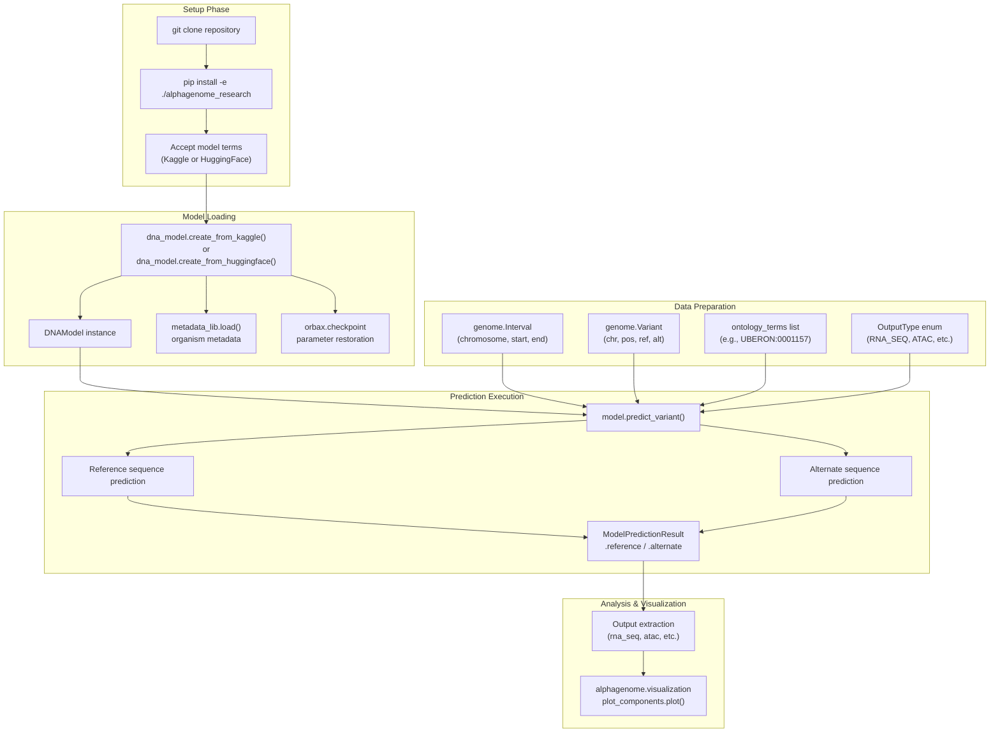
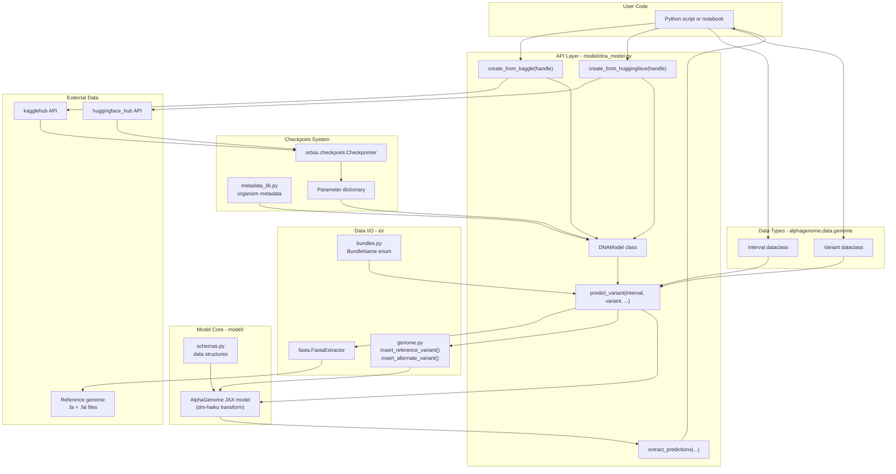
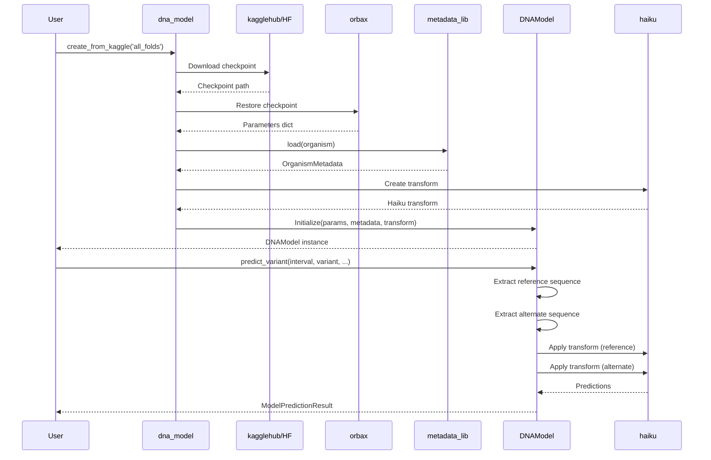

<!-- source: DeepWiki mcp.deepwiki.com · repo google-deepmind/alphagenome_research · page 2 Getting Started · fetched 2026-10-26 -->

# Getting Started

<details>
<summary>Relevant source files</summary>

The following files were used as context for generating this wiki page:

- [README.md](README.md)
- [pyproject.toml](pyproject.toml)

</details>


This page provides an overview of the initial setup process for the AlphaGenome Research codebase, covering installation, model weight acquisition, and basic usage patterns. For detailed installation instructions, see [Installation](#2.1). For a comprehensive tutorial with examples, see [Quick Start Tutorial](#2.2). For information about model distribution platforms and licensing, see [Model Weights and Distribution](#2.3).

## Prerequisites

Before installing the AlphaGenome Research package, ensure your system meets the following requirements:

| Requirement | Specification |
|-------------|---------------|
| Python Version | ≥ 3.11 (3.11, 3.12, 3.13 supported) |
| Operating System | Linux (Ubuntu recommended) |
| Inference Hardware | NVIDIA H100 GPU (minimum recommended) |
| Training Hardware | TPU v3 or higher |
| CUDA/cuDNN | Required for GPU acceleration |
| JAX | Must be correctly configured for GPU/TPU |

The package requires a functional JAX installation with proper CUDA/cuDNN configuration for GPU workloads. Refer to the [JAX installation documentation](https://docs.jax.dev/en/latest/installation.html#nvidia-gpu) for GPU setup guidance.

**Important**: Using a Python virtual environment is strongly recommended to prevent dependency conflicts with your system Python installation.

Sources: [README.md:38-75](), [pyproject.toml:12-32]()

## Installation Overview

The AlphaGenome Research package is installed via `pip` in development mode. The basic installation workflow is:

```bash
# Clone the repository
git clone https://github.com/google-deepmind/alphagenome_research.git

# Install in development mode
pip install -e ./alphagenome_research
```

This installs the `alphagenome_research` package along with all required dependencies, including:

- `jax` - Core numerical computation framework
- `dm-haiku` - Neural network library
- `tensorflow` - Dataset loading and preprocessing
- `orbax` - Checkpoint management
- `alphagenome` - AlphaGenome API package
- `pyfaidx` - FASTA file parsing
- `pyranges` - Genomic interval operations
- `kagglehub` and `huggingface_hub` - Model weight distribution

For detailed dependency specifications and optional development dependencies, see [Installation](#2.1).

Sources: [README.md:44-52](), [pyproject.toml:33-54]()

## Model Weights

Pre-trained AlphaGenome model weights are distributed via two platforms:

1. **Kaggle Models**: [https://www.kaggle.com/models/google/alphagenome](https://www.kaggle.com/models/google/alphagenome)
2. **Hugging Face**: [https://huggingface.co/collections/google/alphagenome](https://huggingface.co/collections/google/alphagenome)

Both platforms require accepting the non-commercial [model terms](https://deepmind.google.com/science/alphagenome/model-terms). Access requests are processed immediately upon acceptance.

The package provides factory methods in `dna_model` for automatic weight download and model instantiation. See [Model Weights and Distribution](#2.3) for detailed information about weight formats, versioning, and loading procedures.

Sources: [README.md:54-64](), [README.md:88-95]()

## Basic Usage Pattern

### Getting Started Workflow



Sources: [README.md:77-138]()

### Core Components and Data Flow



Sources: [README.md:80-95](), [README.md:100-138]()

## Minimal Working Example

The following example demonstrates the complete workflow from model loading to variant prediction:

```python
from alphagenome.data import genome
from alphagenome_research.model import dna_model

# Step 1: Load model from Kaggle (or use create_from_huggingface)
model = dna_model.create_from_kaggle('all_folds')

# Step 2: Define genomic interval and variant
interval = genome.Interval(
    chromosome='chr22',
    start=35677410,
    end=36725986
)

variant = genome.Variant(
    chromosome='chr22',
    position=36201698,
    reference_bases='A',
    alternate_bases='C'
)

# Step 3: Generate predictions
outputs = model.predict_variant(
    interval=interval,
    variant=variant,
    ontology_terms=['UBERON:0001157'],  # Tissue/cell type
    requested_outputs=[dna_model.OutputType.RNA_SEQ]
)

# Step 4: Access results
reference_predictions = outputs.reference.rna_seq  # Reference allele
alternate_predictions = outputs.alternate.rna_seq  # Alternate allele
```

This pattern forms the foundation for all AlphaGenome Research workflows. The `DNAModel` class encapsulates model parameters, checkpoint restoration, and prediction logic, providing a high-level interface that abstracts JAX-specific details.

Sources: [README.md:100-122]()

## Component Initialization Sequence



Sources: [README.md:87-95]()

## Environment Configuration

The package uses Hatch for environment management and supports multiple Python versions through test matrices. The `pyproject.toml` configuration defines three primary environments:

| Environment | Purpose | Key Tools |
|-------------|---------|-----------|
| `default` | Development and general usage | Standard dependencies |
| `hatch-test` | Running test suite | `typeguard==2.13.3` for runtime type checking |
| `check` | Code quality validation | `pyink` (formatting), `pylint` (linting) |

For development workflows, including running tests and code quality checks, see [Development Guide](#6).

Sources: [pyproject.toml:66-103]()

## Next Steps

After completing the basic setup:

1. **Try the Quick Start Tutorial**: See [Quick Start Tutorial](#2.2) for a walkthrough of the `quick_start.ipynb` notebook
2. **Explore Evaluation Examples**: See [Variant Evaluation Examples](#5.3) for the `variant_eval_examples.ipynb` notebook covering CAGI, GTEx, and ClinVar datasets
3. **Understand the Data Layer**: See [Data I/O System](#3) for information about TFRecord loading, FASTA operations, and data bundles
4. **Learn the Model API**: See [DNA Model API](#4.1) for comprehensive documentation of the `DNAModel` class interface
5. **Review Evaluation Metrics**: See [Evaluation System](#5) for details on performance metrics and benchmarking

For questions or issues, consult:
- **Documentation**: [https://www.alphagenomedocs.com/](https://www.alphagenomedocs.com/)
- **Community Forum**: [https://www.alphagenomecommunity.com](https://www.alphagenomecommunity.com)
- **GitHub Issues**: Bug reports and feature requests
- **Contributing Guidelines**: See [Contributing Guidelines](#6.1) for development contributions

Sources: [README.md:7-11]()

---

