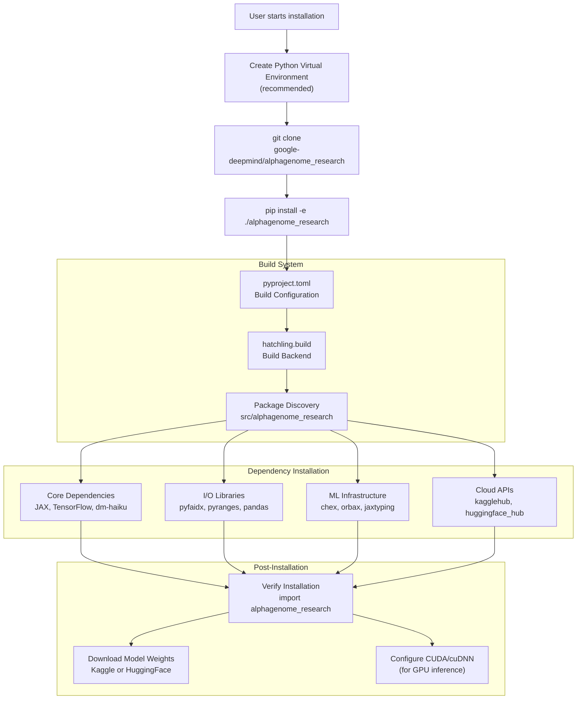
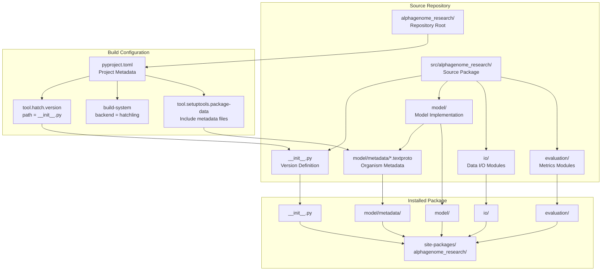
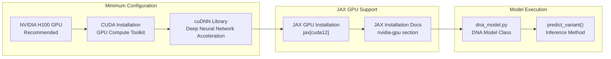
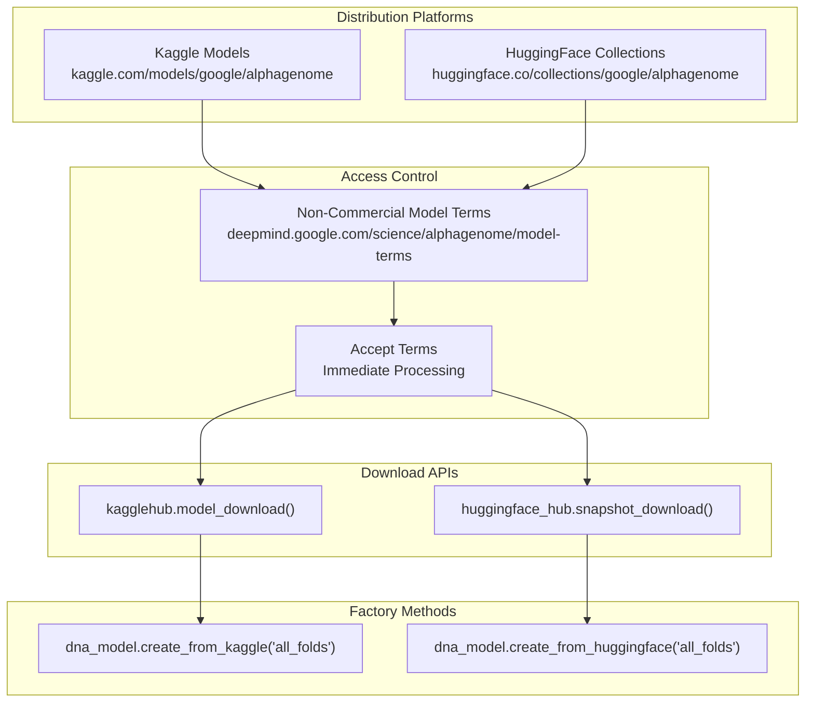

<!-- source: DeepWiki mcp.deepwiki.com · repo google-deepmind/alphagenome_research · page 2.1 Installation · fetched 2026-10-26 -->

# Installation

<details>
<summary>Relevant source files</summary>

The following files were used as context for generating this wiki page:

- [.gitignore](.gitignore)
- [README.md](README.md)
- [pyproject.toml](pyproject.toml)

</details>


This document provides detailed instructions for installing the `alphagenome_research` package, including system requirements, dependency management, and model weight acquisition. For information about using the installed package, see [Quick Start Tutorial](#2.2). For details on model weight distribution platforms and licensing, see [Model Weights and Distribution](#2.3).

---

## Purpose and Scope

This page covers:
- Python version requirements and virtual environment setup
- Package installation via pip from the GitHub repository
- Dependency specifications defined in `pyproject.toml`
- Hardware requirements for model inference and training
- Model weight download procedures from Kaggle and HuggingFace

This page does not cover API usage, model loading, or prediction workflows, which are documented in subsequent sections.

---

## Installation Flow

The following diagram illustrates the complete installation process from repository cloning to model readiness:



**Sources:** [README.md:33-53](), [pyproject.toml:1-54]()

---

## System Requirements

### Python Version

The package requires Python 3.11 or higher. This is specified in the build configuration:

| Requirement | Value | Location |
|------------|-------|----------|
| Minimum Python | 3.11 | [pyproject.toml:12]() |
| Tested Versions | 3.11, 3.12, 3.13 | [pyproject.toml:87]() |
| Build Backend | hatchling | [pyproject.toml:2-3]() |

**Sources:** [pyproject.toml:12](), [pyproject.toml:87]()

### Virtual Environment Setup

A Python virtual environment is strongly recommended to prevent dependency conflicts. The installation process assumes isolation from the system Python environment:

```bash
# Create virtual environment
python3 -m venv alphagenome_env

# Activate (Linux/macOS)
source alphagenome_env/bin/activate

# Activate (Windows)
alphagenome_env\Scripts\activate
```

**Sources:** [README.md:37-40]()

---

## Package Installation

### Repository Cloning and Installation

The package is installed in development mode using pip:

```bash
git clone https://github.com/google-deepmind/alphagenome_research.git
pip install -e ./alphagenome_research
```

The `-e` flag installs in [editable/development mode](https://setuptools.pypa.io/en/latest/userguide/development_mode.html), allowing local modifications to be reflected immediately without reinstallation.

**Sources:** [README.md:44-52]()

### Build System Configuration

The following diagram shows the relationship between build configuration files and the installed package structure:



**Sources:** [pyproject.toml:1-74](), [pyproject.toml:64]()

---

## Dependencies

### Core Dependencies

The package depends on multiple libraries spanning machine learning, genomic data processing, and cloud APIs. Dependencies are specified in the `dependencies` array:

```mermaid
graph TB
    subgraph "JAX Ecosystem"
        JAX["jax<br/>Numerical Computation"]
        HAIKU["dm-haiku<br/>Neural Network Library"]
        CHEX["chex<br/>Testing Utilities"]
        ORBAX["orbax<br/>Checkpoint Management"]
        JAXTYPING["jaxtyping<br/>Type Annotations"]
    end
    
    subgraph "TensorFlow Ecosystem"
        TF["tensorflow<br/>Data Loading (tf.data)"]
    end
    
    subgraph "Genomic I/O"
        PYFAIDX["pyfaidx<br/>FASTA File Reading"]
        PYRANGES["pyranges<br/>Genomic Interval Operations"]
        ANNDATA["anndata<br/>Annotated Data Matrices"]
    end
    
    subgraph "Data Processing"
        NUMPY["numpy<br/>Array Operations"]
        PANDAS["pandas<br/>Tabular Data"]
        PYARROW["pyarrow<br/>Columnar Data Format"]
    end
    
    subgraph "Cloud Distribution"
        KAGGLE["kagglehub<br/>Kaggle Model Download"]
        HF["huggingface_hub<br/>HuggingFace Model Download"]
    end
    
    subgraph "Infrastructure"
        ABSL["absl-py<br/>Application Framework"]
        ETILS["etils[epath]<br/>Path Utilities"]
        EINSHAPE["einshape<br/>Tensor Shape Manipulation"]
        ALPHAGENOME["alphagenome<br/>Public API"]
    end
    
    PKG["alphagenome_research"]
    
    PKG --> JAX
    PKG --> HAIKU
    PKG --> CHEX
    PKG --> ORBAX
    PKG --> JAXTYPING
    PKG --> TF
    PKG --> PYFAIDX
    PKG --> PYRANGES
    PKG --> ANNDATA
    PKG --> NUMPY
    PKG --> PANDAS
    PKG --> PYARROW
    PKG --> KAGGLE
    PKG --> HF
    PKG --> ABSL
    PKG --> ETILS
    PKG --> EINSHAPE
    PKG --> ALPHAGENOME
```



**Sources:** [pyproject.toml:33-54](), [README.md:163-183]()

### Dependency Categories

| Category | Libraries | Purpose |
|----------|-----------|---------|
| ML Framework | `jax`, `dm-haiku`, `chex` | Neural network implementation and testing |
| Data Loading | `tensorflow` | TFRecord dataset loading via `tf.data` |
| Genomic I/O | `pyfaidx`, `pyranges`, `anndata` | FASTA extraction, interval operations, matrix annotations |
| Checkpointing | `orbax` | Model weight restoration |
| Cloud APIs | `kagglehub`, `huggingface_hub` | Model weight download |
| Data Processing | `numpy`, `pandas`, `pyarrow` | Numerical and tabular operations |
| Utilities | `absl-py`, `etils`, `einshape`, `jaxtyping` | Framework, paths, shapes, types |
| Public API | `alphagenome` | High-level genome analysis interface |

**Sources:** [pyproject.toml:33-54]()

### Development Dependencies

Additional dependencies for testing and code quality are defined in separate Hatch environments:

| Environment | Dependencies | Purpose |
|-------------|--------------|---------|
| `hatch-test` | `typeguard==2.13.3` | Runtime type checking during tests |
| `check` | `pyink>=24.3.0`, `pylint>=2.6.0` | Code formatting and linting |

**Sources:** [pyproject.toml:76-103]()

---

## Hardware Requirements

### Inference Requirements

The following diagram shows the recommended hardware configuration for model inference:



**Inference hardware specifications:**
- **Recommended GPU:** NVIDIA H100 (as specified in [README.md:67-68]())
- **CUDA/cuDNN:** Properly configured (see [JAX Installation Documentation](https://docs.jax.dev/en/latest/installation.html#nvidia-gpu))
- **Minimum:** The model may run on lower-end GPUs but performance is not guaranteed

**Sources:** [README.md:66-71]()

### Training Requirements

Training is not supported in this research release package. The original model was trained on:
- **Hardware:** Tensor Processing Units (TPUs) v3 or higher
- **Reference:** [README.md:73-75]()

**Sources:** [README.md:73-75]()

---

## Model Weights

### Download Platforms

Model weights are distributed separately from the package and must be downloaded from one of two platforms:



**Download requirements:**
1. Accept the non-commercial model terms at the distribution platform
2. Requests are processed immediately upon acceptance
3. Use factory methods from `dna_model` module for automatic download

**Sources:** [README.md:54-63](), [README.md:87-95]()

### Weight Loading Factory Methods

Two factory methods abstract the weight download and model initialization process:

| Method | Platform | Code Location |
|--------|----------|---------------|
| `create_from_kaggle()` | Kaggle | model/dna_model.py |
| `create_from_huggingface()` | HuggingFace | model/dna_model.py |

Both methods:
- Download weights from the respective platform
- Load organism metadata
- Restore checkpoint parameters using Orbax
- Initialize the Haiku neural network transform
- Return a `DnaModel` instance ready for inference

**Sources:** [README.md:87-95]()

---

## Installation Verification

### Package Import Test

After installation, verify the package is correctly installed:

```python
import alphagenome_research
print(alphagenome_research.__version__)
```

The version is dynamically extracted from [src/alphagenome_research/__init__.py]() as configured in [pyproject.toml:64]().

**Sources:** [pyproject.toml:64]()

### Dependency Verification

The installation process will fail if dependencies cannot be satisfied. Critical dependencies can be verified individually:

```python
import jax
import tensorflow as tf
import haiku as hk
import pyfaidx
import pyranges as pr
```

**Sources:** [pyproject.toml:33-54]()

---

## Common Installation Issues

### Python Version Mismatch

**Symptom:** `pip install` fails with "Requires-Python" error  
**Cause:** Python version < 3.11  
**Resolution:** Upgrade to Python 3.11, 3.12, or 3.13

**Sources:** [pyproject.toml:12]()

### JAX CUDA Configuration

**Symptom:** Model runs on CPU instead of GPU  
**Cause:** JAX not configured for CUDA  
**Resolution:** Follow [JAX NVIDIA GPU installation guide](https://docs.jax.dev/en/latest/installation.html#nvidia-gpu)

**Sources:** [README.md:69-71]()

### Model Weight Access Denied

**Symptom:** Weight download fails with authentication error  
**Cause:** Model terms not accepted on distribution platform  
**Resolution:** Visit platform URL and accept non-commercial terms

**Sources:** [README.md:61-63]()

---

## Next Steps

After successful installation:
1. Review [Quick Start Tutorial](#2.2) for basic usage examples
2. Download model weights via [Model Weights and Distribution](#2.3)
3. Explore the [DNA Model API](#4.1) for prediction interfaces
4. Run example notebooks for evaluation workflows

**Sources:** [README.md:7-11]()

---

