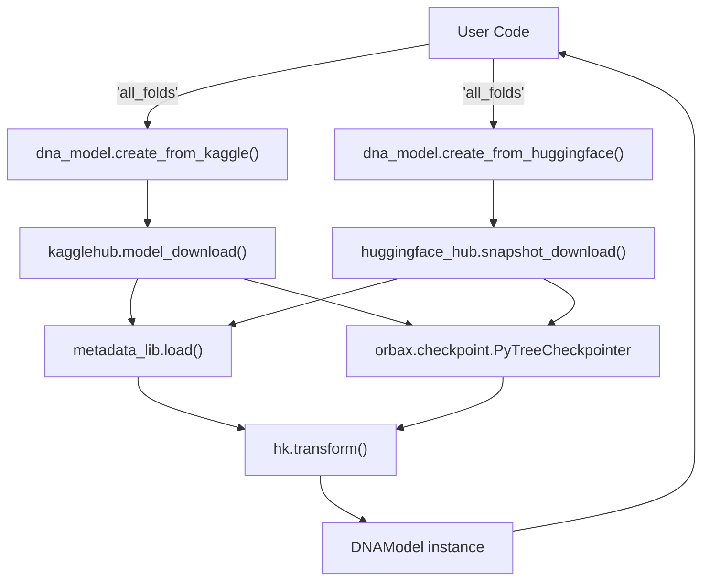
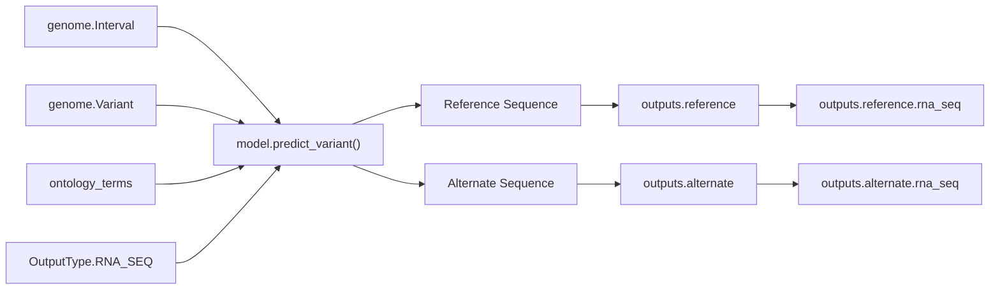
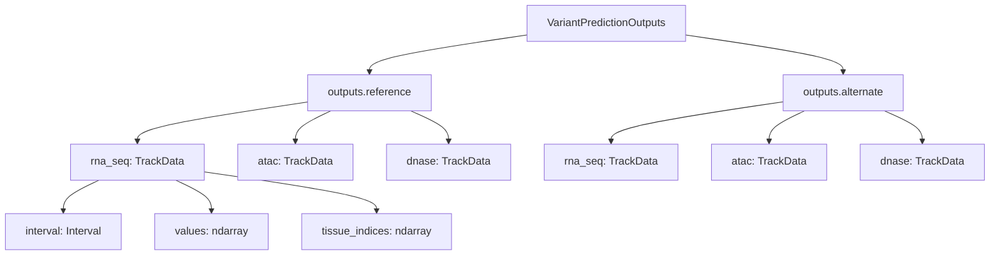
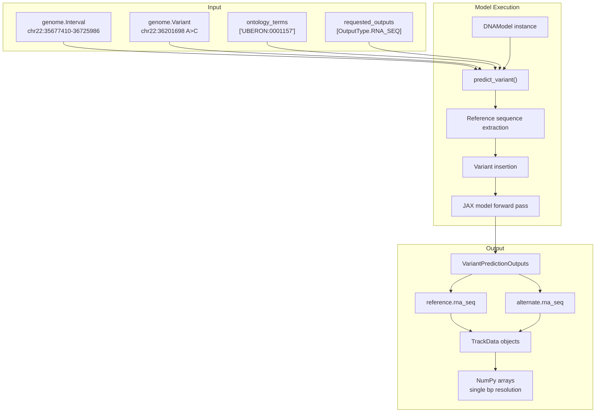

<!-- source: DeepWiki mcp.deepwiki.com · repo google-deepmind/alphagenome_research · page 2.2 Quick Start Tutorial · fetched 2026-10-26 -->

# Quick Start Tutorial

<details>
<summary>Relevant source files</summary>

The following files were used as context for generating this wiki page:

- [README.md](README.md)
- [colabs/quick_start.ipynb](colabs/quick_start.ipynb)

</details>


## Purpose and Scope

This page walks through the basic workflow for loading the AlphaGenome model and making predictions using the high-level DNA Model API. It demonstrates the core functionality needed to get started with variant effect prediction on genomic sequences.

For detailed installation instructions, see [Installation](#2.1). For information about downloading and managing model weights, see [Model Weights and Distribution](#2.3). For comprehensive API documentation, see [DNA Model API](#4.1). For advanced evaluation examples and benchmarking, see [Variant Evaluation Examples](#5.3).

**Sources:** [README.md:77-138]()

---

## Model Loading Workflow

The `DNAModel` class provides two factory methods for loading pre-trained model weights: `create_from_kaggle()` and `create_from_huggingface()`. Both methods handle checkpoint restoration, metadata loading, and model initialization automatically.

### Factory Methods

The following code demonstrates loading a model from Kaggle:

```python
from alphagenome_research.model import dna_model

# Load model from Kaggle
model = dna_model.create_from_kaggle('all_folds')

# Alternative: Load from HuggingFace
model = dna_model.create_from_huggingface('all_folds')
```

The `'all_folds'` parameter specifies which model checkpoint to load. Both methods require that you have accepted the non-commercial model terms and configured authentication for the respective platform.

### Model Loading Architecture



**Sources:** [README.md:87-95](), [model/dna_model.py]()

---

## Basic Variant Prediction

The core workflow involves three main steps:
1. Define a genomic interval and variant
2. Request specific output modalities
3. Execute prediction and retrieve results

### Defining Genomic Coordinates

The `genome.Interval` and `genome.Variant` classes define genomic locations and variants:

```python
from alphagenome.data import genome

# Define a genomic interval (region to analyze)
interval = genome.Interval(
    chromosome='chr22',
    start=35677410,
    end=36725986
)

# Define a variant within that interval
variant = genome.Variant(
    chromosome='chr22',
    position=36201698,
    reference_bases='A',
    alternate_bases='C'
)
```

The interval specifies the region of DNA to analyze (up to 1 million base pairs). The variant specifies a single nucleotide change within that region.

**Sources:** [README.md:108-114]()

### Making Predictions

The `predict_variant()` method generates predictions for both reference and alternate sequences:

```python
outputs = model.predict_variant(
    interval=interval,
    variant=variant,
    ontology_terms=['UBERON:0001157'],
    requested_outputs=[dna_model.OutputType.RNA_SEQ],
)
```

| Parameter | Type | Description |
|-----------|------|-------------|
| `interval` | `genome.Interval` | Genomic region to analyze |
| `variant` | `genome.Variant` | Variant to evaluate |
| `ontology_terms` | `list[str]` | Tissue/cell-type ontology identifiers |
| `requested_outputs` | `list[OutputType]` | Output modalities (RNA_SEQ, ATAC, DNASE, etc.) |

**Sources:** [README.md:116-121]()

### Prediction Workflow



**Sources:** [README.md:116-121]()

---

## Understanding Model Outputs

The `predict_variant()` method returns a structure containing predictions for both reference and alternate sequences. Each prediction includes the requested output modalities.

### Output Structure



Each output modality (e.g., `rna_seq`, `atac`, `dnase`) contains:
- `interval`: Genomic coordinates of the prediction
- `values`: NumPy array of predicted values at single base-pair resolution
- `tissue_indices`: Array mapping predictions to tissue/cell-type indices

**Sources:** [README.md:122-137]()

### Accessing Predictions

```python
# Access reference predictions
ref_rna_seq = outputs.reference.rna_seq
alt_rna_seq = outputs.alternate.rna_seq

# Access prediction values (NumPy arrays)
ref_values = outputs.reference.rna_seq.values
alt_values = outputs.alternate.rna_seq.values

# Access genomic interval
prediction_interval = outputs.reference.rna_seq.interval
```

The prediction arrays have single base-pair resolution, with values corresponding to predicted activity levels for the specified modality.

**Sources:** [README.md:127-129]()

---

## Visualizing Results

The AlphaGenome package includes visualization utilities for plotting predictions:

```python
from alphagenome.visualization import plot_components
import matplotlib.pyplot as plt

plot_components.plot(
    [
        plot_components.OverlaidTracks(
            tdata={
                'REF': outputs.reference.rna_seq,
                'ALT': outputs.alternate.rna_seq,
            },
            colors={'REF': 'dimgrey', 'ALT': 'red'},
        ),
    ],
    interval=outputs.reference.rna_seq.interval.resize(2**15),
    annotations=[plot_components.VariantAnnotation([variant], alpha=0.8)],
)
plt.show()
```

This creates an overlaid plot showing reference and alternate predictions, with the variant position annotated as a vertical line.

**Sources:** [README.md:123-137]()

---

## Available Output Types

The `dna_model.OutputType` enumeration defines the available prediction modalities:

| OutputType | Description |
|------------|-------------|
| `RNA_SEQ` | Gene expression predictions |
| `ATAC` | ATAC-seq chromatin accessibility |
| `DNASE` | DNase-seq chromatin accessibility |
| `CHIP_TF` | Transcription factor ChIP-seq binding |
| `SPLICE_DONOR` | Splice donor site predictions |
| `SPLICE_ACCEPTOR` | Splice acceptor site predictions |
| `SPLICE_JUNCTION` | Splice junction predictions |

You can request multiple output types in a single prediction:

```python
outputs = model.predict_variant(
    interval=interval,
    variant=variant,
    ontology_terms=['UBERON:0001157'],
    requested_outputs=[
        dna_model.OutputType.RNA_SEQ,
        dna_model.OutputType.ATAC,
        dna_model.OutputType.SPLICE_DONOR,
    ],
)
```

**Sources:** [README.md:120](), [model/dna_model.py]()

---

## Complete Example

Here is the complete example from the Quick Start section:

```python
from alphagenome.data import genome
from alphagenome.visualization import plot_components
from alphagenome_research.model import dna_model
import matplotlib.pyplot as plt

# Load model
model = dna_model.create_from_kaggle('all_folds')

# Define genomic coordinates
interval = genome.Interval(chromosome='chr22', start=35677410, end=36725986)
variant = genome.Variant(
    chromosome='chr22',
    position=36201698,
    reference_bases='A',
    alternate_bases='C',
)

# Make prediction
outputs = model.predict_variant(
    interval=interval,
    variant=variant,
    ontology_terms=['UBERON:0001157'],
    requested_outputs=[dna_model.OutputType.RNA_SEQ],
)

# Visualize results
plot_components.plot(
    [
        plot_components.OverlaidTracks(
            tdata={
                'REF': outputs.reference.rna_seq,
                'ALT': outputs.alternate.rna_seq,
            },
            colors={'REF': 'dimgrey', 'ALT': 'red'},
        ),
    ],
    interval=outputs.reference.rna_seq.interval.resize(2**15),
    annotations=[plot_components.VariantAnnotation([variant], alpha=0.8)],
)
plt.show()
```

**Sources:** [README.md:100-138]()

---

## Data Flow Summary



**Sources:** [README.md:100-138]()

---

## Next Steps

After completing this quick start tutorial, you can:

- **Explore advanced evaluation examples**: See [Variant Evaluation Examples](#5.3) for benchmarking on CAGI, GTEx, ClinVar, and other datasets
- **Understand the full API**: See [DNA Model API](#4.1) for comprehensive documentation of all available methods
- **Work with TFRecord datasets**: See [TFRecord Dataset Loading](#3.2) for loading training data
- **Implement custom metrics**: See [Regression Metrics](#5.1) for evaluation capabilities
- **Process multiple variants**: Use batch prediction methods for efficient large-scale variant scoring

**Sources:** [README.md:77-138]()

---

