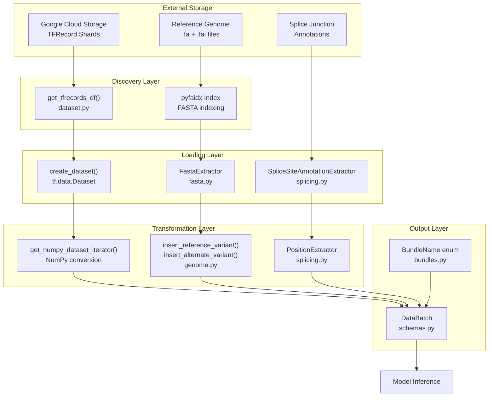
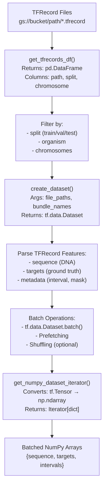
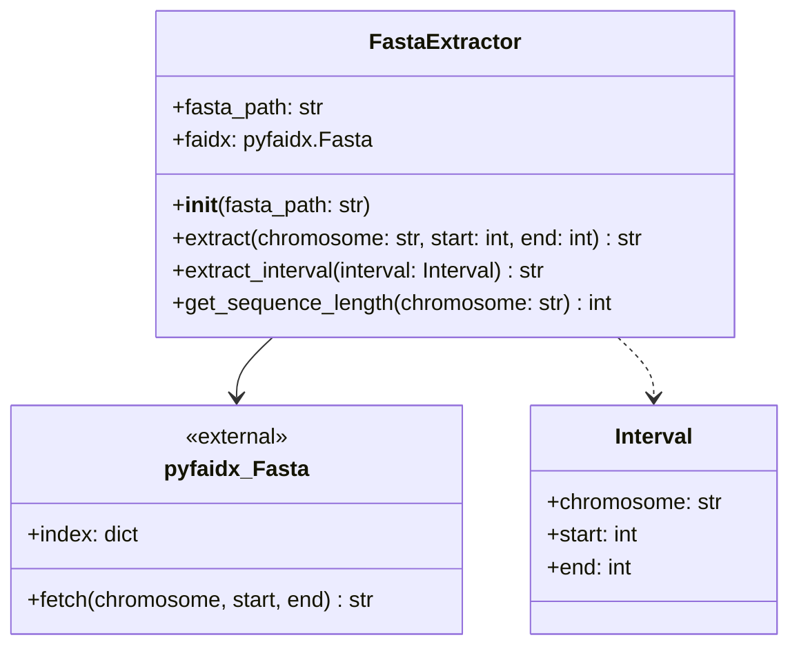
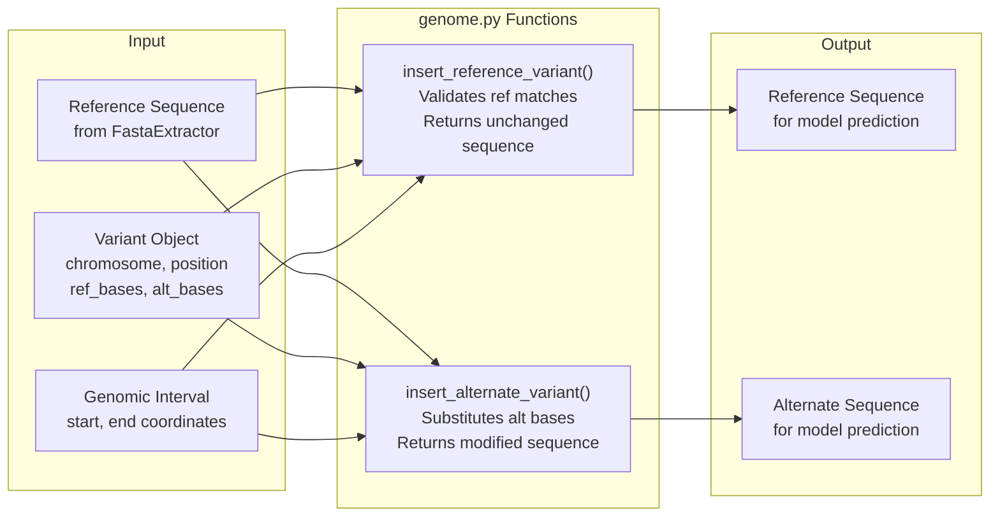
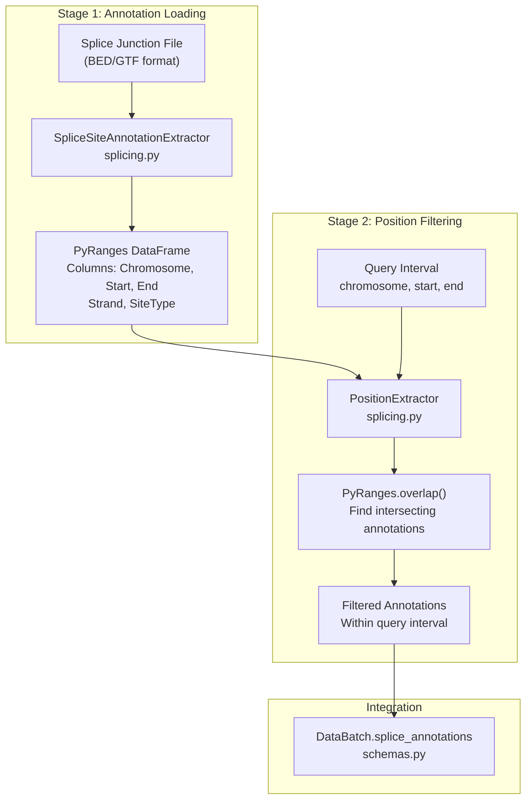
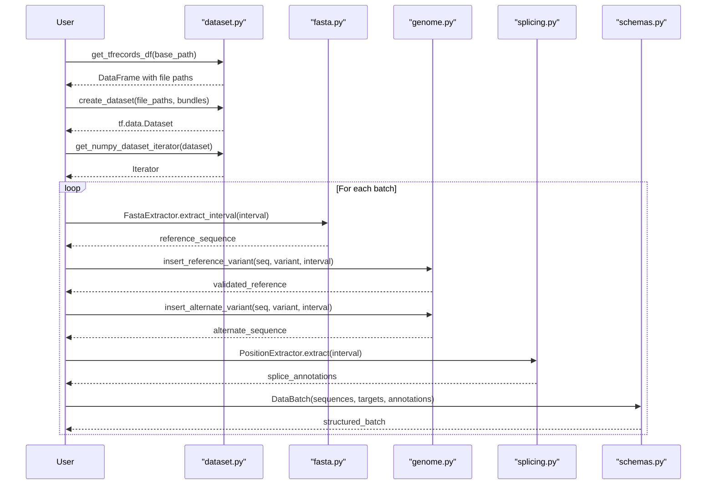

<!-- source: DeepWiki mcp.deepwiki.com · repo google-deepmind/alphagenome_research · page 3 Data I/O System · fetched 2026-10-26 -->

# Data I/O System

<details>
<summary>Relevant source files</summary>

The following files were used as context for generating this wiki page:

- [README.md](README.md)
- [src/alphagenome_research/io/__init__.py](src/alphagenome_research/io/__init__.py)

</details>


## Purpose and Scope

The Data I/O System provides the foundational layer for loading, processing, and transforming genomic data used by AlphaGenome. This system handles multiple genomic file formats including TFRecords, FASTA files, and splice junction annotations, converting them into structured data representations suitable for model inference and evaluation.

This document covers the data input pipeline from raw files to structured `DataBatch` objects. For information about model inference using these data structures, see [Model Architecture](#4). For evaluation pipelines that consume these data structures, see [Evaluation System](#5).

## System Overview

The Data I/O System consists of five primary components located in `src/alphagenome_research/io/`:

| Component | Primary Module | Purpose |
|-----------|---------------|---------|
| Bundle Definitions | `bundles.py` | Defines enumeration types for genomic output modalities (ATAC, RNA-seq, ChIP-seq, etc.) |
| TFRecord Loading | `dataset.py` | Discovers and loads training/evaluation data from TFRecord files |
| FASTA Operations | `fasta.py` | Extracts reference genome sequences from indexed FASTA files |
| Variant Integration | `genome.py` | Applies reference and alternate variants to genomic sequences |
| Splice Annotations | `splicing.py` | Processes splice junction annotations and filters by genomic positions |

**Sources:** [README.md:1-334](), Diagram 1, Diagram 2

## Architecture Overview



**Sources:** Diagram 1, Diagram 2, [README.md:26-27]()

## Bundle System

The bundle system defines typed enumerations for different genomic output modalities that AlphaGenome can predict. Each bundle type corresponds to a specific biological assay or genomic feature.

### Bundle Types

The `BundleName` enumeration in `bundles.py` defines the following output modalities:

| Bundle Name | Description | Use Case |
|-------------|-------------|----------|
| `ATAC` | ATAC-seq chromatin accessibility | Open chromatin regions |
| `DNASE` | DNase-seq hypersensitivity | Regulatory element identification |
| `RNA_SEQ` | RNA-seq gene expression | Transcription levels |
| `CHIP_TF` | ChIP-seq transcription factor binding | TF binding sites |
| `SPLICE_ACCEPTOR` | Splice acceptor site predictions | RNA splicing analysis |
| `SPLICE_DONOR` | Splice donor site predictions | RNA splicing analysis |

Each bundle type has associated metadata defining:
- Expected output dimensions
- Data normalization parameters
- Tissue/cell type ontology mappings
- Target value encodings

**Sources:** [README.md:16-17](), Diagram 1, Diagram 4

## TFRecord Dataset Pipeline

The TFRecord loading system provides efficient batch loading of pre-processed genomic data from Google Cloud Storage.

### File Discovery and Dataset Creation



### Key Functions

The `dataset.py` module provides three primary functions:

1. **`get_tfrecords_df(base_path: str) -> pd.DataFrame`**
   - Discovers TFRecord files at the specified GCS path
   - Returns DataFrame with file metadata including split assignments and chromosome coverage
   - Used for filtering datasets before loading

2. **`create_dataset(file_paths: Sequence[str], bundle_names: Sequence[str]) -> tf.data.Dataset`**
   - Creates TensorFlow Dataset from TFRecord files
   - Parses bundle-specific features according to `BundleName` specifications
   - Handles interleaved reading from multiple shards

3. **`get_numpy_dataset_iterator(dataset: tf.data.Dataset) -> Iterator[Dict[str, np.ndarray]]`**
   - Converts TensorFlow tensors to NumPy arrays
   - Returns iterator yielding batched dictionaries
   - Provides JAX/NumPy-compatible data for model inference

**Sources:** Diagram 2, [README.md:26]()

## FASTA File Operations

The FASTA extraction system provides efficient random access to reference genome sequences using indexed FASTA files.

### FastaExtractor Class



### Usage Pattern

The `FastaExtractor` class in `fasta.py` wraps the `pyfaidx` library to provide:

- **Indexed Access**: Uses `.fai` index files for O(1) sequence retrieval
- **Interval-Based Extraction**: Extracts sequences by genomic coordinates
- **Validation**: Checks chromosome names and coordinate bounds
- **Memory Efficiency**: Loads only requested sequence regions, not entire chromosomes

The extractor is used extensively in variant integration workflows where reference sequences must be retrieved before applying variant transformations.

**Sources:** Diagram 2, [README.md:179]()

## Variant Integration System

The variant integration system applies genetic variants to reference sequences, enabling variant effect prediction through reference-alternate comparisons.

### Variant Insertion Functions



### Key Components

The `genome.py` module defines:

1. **`Variant` dataclass**
   - Fields: `chromosome`, `position`, `reference_bases`, `alternate_bases`
   - Represents a single nucleotide variant (SNV) or indel
   - Used throughout evaluation pipelines

2. **`Interval` dataclass**
   - Fields: `chromosome`, `start`, `end`
   - Defines genomic coordinate ranges
   - Zero-based, half-open intervals [start, end)

3. **`insert_reference_variant(sequence: str, variant: Variant, interval: Interval) -> str`**
   - Validates that variant position falls within interval
   - Checks reference bases match the sequence
   - Returns original sequence (validation step)

4. **`insert_alternate_variant(sequence: str, variant: Variant, interval: Interval) -> str`**
   - Substitutes reference bases with alternate bases at variant position
   - Handles SNVs and indels
   - Returns modified sequence for alternate prediction

This dual-prediction approach enables effect size calculation by comparing reference and alternate model outputs.

**Sources:** Diagram 2, [README.md:100-138]()

## Splice Site Annotation System

The splice annotation system processes splice junction data and filters annotations by genomic position ranges.

### Two-Stage Extraction Pipeline



### SpliceSiteAnnotationExtractor

The `SpliceSiteAnnotationExtractor` class in `splicing.py` provides:

- **Annotation Parsing**: Reads splice junction annotations from standard formats
- **Data Structures**: Converts to `PyRanges` for efficient interval operations
- **Site Type Classification**: Distinguishes donor sites, acceptor sites, and exon boundaries
- **Strand Information**: Preserves strand directionality for splice site prediction

### PositionExtractor

The `PositionExtractor` class filters annotations by genomic intervals:

- **Interval Queries**: Accepts `Interval` objects for position-based filtering
- **Efficient Lookup**: Uses interval tree data structures for O(log n) queries
- **Batch Processing**: Can filter multiple intervals in parallel
- **Integration**: Outputs annotations synchronized with sequence windows

This system enables splice site prediction by providing ground truth annotations for training and evaluation.

**Sources:** Diagram 2, [README.md:180]()

## Data Flow Integration

### Complete Pipeline Example



### DataBatch Structure

The final output of the Data I/O System is a `DataBatch` object defined in `schemas.py`:

```
DataBatch:
  - sequence: np.ndarray          # DNA sequence (one-hot encoded)
  - targets: Dict[str, np.ndarray] # Ground truth per bundle
  - masks: Dict[str, np.ndarray]   # Valid positions per bundle
  - interval: Interval             # Genomic coordinates
  - metadata: Dict[str, Any]       # Additional context
  - splice_annotations: Optional   # Splice junction data
```

This structured format ensures type safety and consistent data representation across the codebase.

**Sources:** Diagram 1, Diagram 2, [README.md:100-138]()

## File Organization

The I/O system is organized within `src/alphagenome_research/io/`:

```
io/
├── __init__.py           # Package initialization
├── bundles.py           # Bundle type definitions
├── dataset.py           # TFRecord loading and iteration
├── fasta.py             # FASTA extraction utilities
├── genome.py            # Variant integration functions
├── splicing.py          # Splice annotation processing
└── schemas.py           # Data structure definitions
```

Supporting test files in `src/alphagenome_research/io/`:

```
io/
├── dataset_test.py      # TFRecord pipeline tests
├── fasta_test.py        # FASTA extraction tests
├── genome_test.py       # Variant insertion tests
└── splicing_test.py     # Splice annotation tests
```

**Sources:** Diagram 5, [src/alphagenome_research/io/__init__.py:1-16]()

## Dependencies

The Data I/O System relies on the following external libraries:

| Library | Purpose | Key Usage |
|---------|---------|-----------|
| `tensorflow` | TFRecord dataset loading | `tf.data.Dataset` creation and parsing |
| `pyfaidx` | FASTA file indexing | Fast random access to reference genome |
| `pyranges` | Genomic interval operations | Splice annotation filtering |
| `pandas` | Tabular data manipulation | TFRecord file discovery |
| `numpy` | Array operations | Data batch representation |

These dependencies are specified in `pyproject.toml` and automatically installed during package setup.

**Sources:** [README.md:163-183](), Diagram 5

## Usage in Model Inference

The Data I/O System integrates with the model layer through a standardized interface. Example workflow from `quick_start.ipynb`:

1. **Load Model Weights**: Use factory methods to initialize model
2. **Extract Reference Sequence**: Use `FastaExtractor` to retrieve genomic region
3. **Apply Variant**: Use `genome.py` functions to create reference/alternate sequences
4. **Structure Data**: Package into format expected by model
5. **Run Inference**: Pass to `model.predict_variant()`

This separation of concerns allows the I/O layer to evolve independently while maintaining a stable interface for model consumption.

**Sources:** [README.md:77-138](), Diagram 3

---

