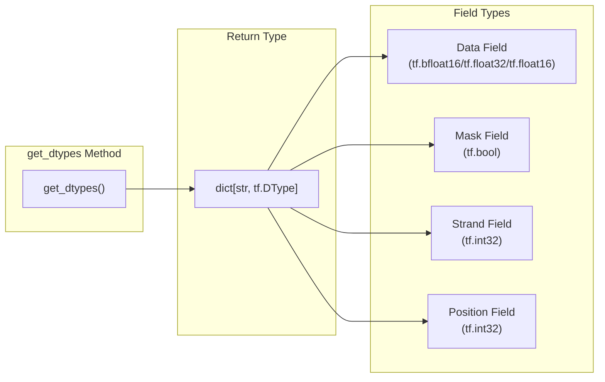
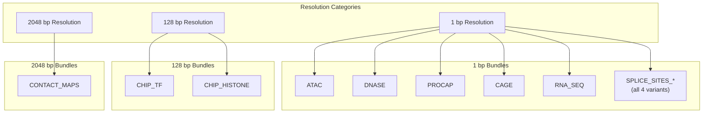
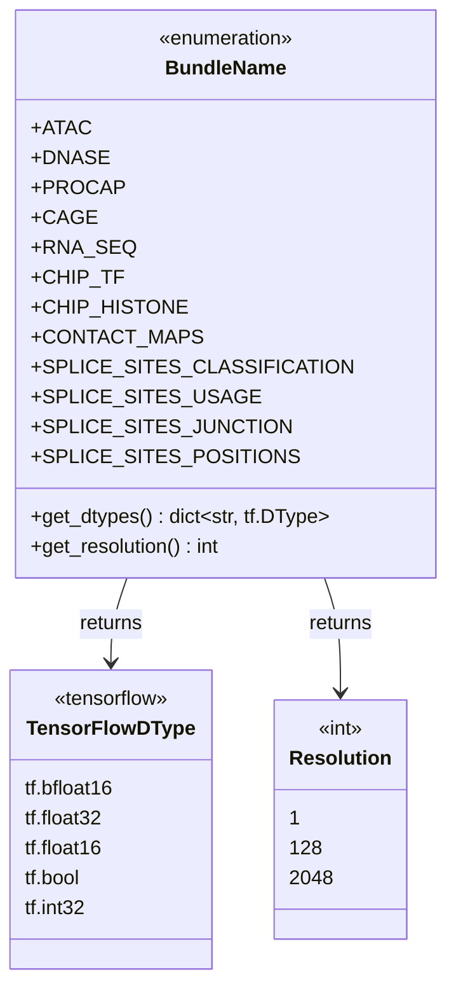
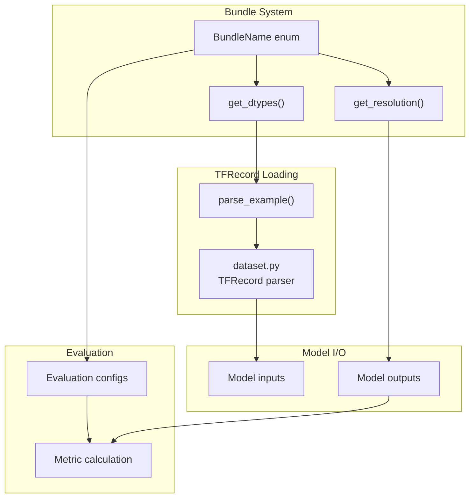

<!-- source: DeepWiki mcp.deepwiki.com · repo google-deepmind/alphagenome_research · page 3.1 Bundle Definitions · fetched 2026-10-26 -->

# Bundle Definitions

<details>
<summary>Relevant source files</summary>

The following files were used as context for generating this wiki page:

- [src/alphagenome_research/io/bundles.py](src/alphagenome_research/io/bundles.py)

</details>


## Purpose and Scope

This document describes the bundle system in AlphaGenome Research, which defines standardized data types for different genomic output modalities. A bundle represents a specific type of genomic data (e.g., ATAC-seq accessibility, RNA-seq expression, splice site annotations) along with its associated TensorFlow data types and spatial resolution. Bundles serve as the fundamental abstraction layer between raw TFRecord data and the model's input/output interface.

For information about loading bundle data from TFRecords, see [TFRecord Dataset Loading](#3.2). For splice-specific bundle processing, see [Splice Site Annotations](#3.5).

## Overview

The bundle system provides three core capabilities:

1. **Type definitions**: Maps each bundle to its constituent fields and TensorFlow dtypes
2. **Resolution specification**: Defines the base-pair resolution for each modality
3. **Standardized interface**: Ensures consistent data handling across the pipeline

Sources: [src/alphagenome_research/io/bundles.py:15-16]()

## BundleName Enumeration

The `BundleName` enum defines all supported genomic data modalities as enumeration values. Each enum member represents a distinct output track type that the AlphaGenome model can predict.

```mermaid
graph TD
    BundleName["BundleName (enum.Enum)"]
    
    subgraph "Accessibility Bundles"
        ATAC["ATAC = 'atac'"]
        DNASE["DNASE = 'dnase'"]
    end
    
    subgraph "Transcription Bundles"
        PROCAP["PROCAP = 'procap'"]
        CAGE["CAGE = 'cage'"]
        RNA_SEQ["RNA_SEQ = 'rna_seq'"]
    end
    
    subgraph "Chromatin Bundles"
        CHIP_TF["CHIP_TF = 'chip_tf'"]
        CHIP_HISTONE["CHIP_HISTONE = 'chip_histone'"]
    end
    
    subgraph "Structural Bundles"
        CONTACT_MAPS["CONTACT_MAPS = 'contact_maps'"]
    end
    
    subgraph "Splicing Bundles"
        SPLICE_CLASS["SPLICE_SITES_CLASSIFICATION = 'splice_sites'"]
        SPLICE_USAGE["SPLICE_SITES_USAGE = 'splice_site_usage'"]
        SPLICE_JUNC["SPLICE_SITES_JUNCTION = 'splice_junctions'"]
        SPLICE_POS["SPLICE_SITES_POSITIONS = 'splice_site_positions'"]
    end
    
    BundleName --> ATAC
    BundleName --> DNASE
    BundleName --> PROCAP
    BundleName --> CAGE
    BundleName --> RNA_SEQ
    BundleName --> CHIP_TF
    BundleName --> CHIP_HISTONE
    BundleName --> CONTACT_MAPS
    BundleName --> SPLICE_CLASS
    BundleName --> SPLICE_USAGE
    BundleName --> SPLICE_JUNC
    BundleName --> SPLICE_POS
```



Sources: [src/alphagenome_research/io/bundles.py:21-36]()

### Complete Bundle Listing

| Bundle Name | String Value | Biological Modality |
|-------------|--------------|---------------------|
| `ATAC` | `'atac'` | ATAC-seq chromatin accessibility |
| `DNASE` | `'dnase'` | DNase-seq chromatin accessibility |
| `PROCAP` | `'procap'` | PRO-cap nascent transcription |
| `CAGE` | `'cage'` | CAGE transcription start sites |
| `RNA_SEQ` | `'rna_seq'` | RNA-seq gene expression |
| `CHIP_TF` | `'chip_tf'` | ChIP-seq transcription factor binding |
| `CHIP_HISTONE` | `'chip_histone'` | ChIP-seq histone modifications |
| `CONTACT_MAPS` | `'contact_maps'` | Hi-C/Micro-C chromatin contacts |
| `SPLICE_SITES_CLASSIFICATION` | `'splice_sites'` | Splice site binary classification |
| `SPLICE_SITES_USAGE` | `'splice_site_usage'` | Splice site usage quantification |
| `SPLICE_SITES_JUNCTION` | `'splice_junctions'` | Splice junction read counts |
| `SPLICE_SITES_POSITIONS` | `'splice_site_positions'` | Splice site genomic positions |

Sources: [src/alphagenome_research/io/bundles.py:21-36]()

## Data Type Specification

The `get_dtypes()` method returns a dictionary mapping field names to TensorFlow dtypes for each bundle. This defines the expected data structure when parsing TFRecords or constructing model inputs/outputs.



Sources: [src/alphagenome_research/io/bundles.py:37-69]()

### Bundle Field Mappings

**Accessibility and Transcription Bundles** (Base-Pair Resolution):

| Bundle | Fields | Data Type | Mask Type |
|--------|--------|-----------|-----------|
| `ATAC` | `atac`, `atac_mask` | `tf.bfloat16` | `tf.bool` |
| `DNASE` | `dnase`, `dnase_mask` | `tf.bfloat16` | `tf.bool` |
| `PROCAP` | `procap`, `procap_mask` | `tf.bfloat16` | `tf.bool` |
| `CAGE` | `cage`, `cage_mask` | `tf.bfloat16` | `tf.bool` |
| `RNA_SEQ` | `rna_seq`, `rna_seq_mask`, `rna_seq_strand` | `tf.bfloat16` | `tf.bool`, `tf.int32` |

**ChIP Bundles** (128 bp Resolution):

| Bundle | Fields | Data Type | Mask Type |
|--------|--------|-----------|-----------|
| `CHIP_TF` | `chip_tf`, `chip_tf_mask` | `tf.float32` | `tf.bool` |
| `CHIP_HISTONE` | `chip_histone`, `chip_histone_mask` | `tf.float32` | `tf.bool` |

**Structural Bundles**:

| Bundle | Fields | Data Type | Notes |
|--------|--------|-----------|-------|
| `CONTACT_MAPS` | `contact_maps` | `tf.float32` | No mask field (2048 bp resolution) |

**Splicing Bundles**:

| Bundle | Fields | Data Type | Purpose |
|--------|--------|-----------|---------|
| `SPLICE_SITES_CLASSIFICATION` | `splice_sites` | `tf.bool` | Binary classification |
| `SPLICE_SITES_USAGE` | `splice_site_usage` | `tf.float16` | Usage quantification |
| `SPLICE_SITES_JUNCTION` | `splice_junctions` | `tf.float32` | Junction read counts |
| `SPLICE_SITES_POSITIONS` | `splice_site_positions` | `tf.int32` | Genomic coordinates |

Sources: [src/alphagenome_research/io/bundles.py:39-67]()

### Special Field Semantics

**Mask Fields**: Most bundles include a corresponding mask field (e.g., `atac_mask`, `dnase_mask`) of type `tf.bool`. These masks indicate which positions have valid data versus missing/unavailable measurements. Masks enable the model to handle incomplete data gracefully during training and evaluation.

**Strand Field**: The `RNA_SEQ` bundle uniquely includes a `rna_seq_strand` field of type `tf.int32`, encoding strand-specific expression information. This allows the model to distinguish between forward and reverse strand transcription.

**No Mask Bundles**: `CONTACT_MAPS` and all splicing bundles lack mask fields, indicating these modalities have different data availability semantics.

Sources: [src/alphagenome_research/io/bundles.py:40-67]()

## Resolution Specification

The `get_resolution()` method returns the base-pair resolution at which each bundle operates. This defines the spatial granularity of predictions and determines how sequence positions map to output indices.



Sources: [src/alphagenome_research/io/bundles.py:71-91]()

### Resolution Table

| Resolution | Bundles | Use Case |
|------------|---------|----------|
| **1 bp** | `ATAC`, `DNASE`, `PROCAP`, `CAGE`, `RNA_SEQ`, all `SPLICE_SITES_*` | High-resolution predictions at single base-pair granularity |
| **128 bp** | `CHIP_TF`, `CHIP_HISTONE` | ChIP-seq peaks, where binding events span broader regions |
| **2048 bp** | `CONTACT_MAPS` | Chromatin interaction matrices, where contacts occur at kilobase scale |

Sources: [src/alphagenome_research/io/bundles.py:71-91]()

### Resolution Implications

The resolution value directly affects:

1. **Output dimensionality**: A 1 Mbp sequence produces 1,000,000 output positions at 1 bp resolution, but only 7,812 positions at 128 bp resolution, and 488 positions at 2048 bp resolution.

2. **Memory requirements**: Higher resolution bundles require proportionally more memory for storing predictions and targets.

3. **Biological interpretation**: Resolution matches the natural scale of the assayed phenomenon (e.g., single-bp precision for accessibility, broader bins for chromatin contacts).

Sources: [src/alphagenome_research/io/bundles.py:71-91]()

## Bundle Method Interface

The `BundleName` enum provides two primary methods for querying bundle properties:



Sources: [src/alphagenome_research/io/bundles.py:37-91]()

### Method Usage Patterns

**Querying dtypes**:
```python
# Example usage (not actual code from repo)
bundle = BundleName.ATAC
dtypes = bundle.get_dtypes()
# Returns: {'atac': tf.bfloat16, 'atac_mask': tf.bool}
```

**Querying resolution**:
```python
# Example usage (not actual code from repo)
bundle = BundleName.CHIP_TF
resolution = bundle.get_resolution()
# Returns: 128
```

Sources: [src/alphagenome_research/io/bundles.py:37-91]()

## Bundle Categories by Biological Function

Bundles can be grouped into functional categories based on their biological assays:

### Chromatin Accessibility
- `ATAC`: Assay for Transposase-Accessible Chromatin sequencing
- `DNASE`: DNase I hypersensitivity sequencing

Both operate at 1 bp resolution with `tf.bfloat16` data and boolean masks.

### Nascent Transcription
- `PROCAP`: Precision Run-On and Capping assay
- `CAGE`: Cap Analysis of Gene Expression

Both capture transcription initiation events at 1 bp resolution.

### Steady-State Expression
- `RNA_SEQ`: RNA sequencing with strand information

Unique in having three fields: expression values, mask, and strand orientation.

### Protein-DNA Interactions
- `CHIP_TF`: Transcription factor ChIP-seq
- `CHIP_HISTONE`: Histone modification ChIP-seq

Both operate at 128 bp resolution with `tf.float32` precision, reflecting the broader spatial distribution of chromatin immunoprecipitation signals.

### Chromatin Architecture
- `CONTACT_MAPS`: Hi-C/Micro-C contact matrices

Operates at 2048 bp resolution without a mask field, capturing long-range chromatin interactions.

### Splicing Annotations
- `SPLICE_SITES_CLASSIFICATION`: Binary splice site presence
- `SPLICE_SITES_USAGE`: Quantitative splice site usage
- `SPLICE_SITES_JUNCTION`: Junction-level read counts
- `SPLICE_SITES_POSITIONS`: Genomic coordinates of splice sites

All operate at 1 bp resolution with varying data types to capture different aspects of RNA splicing.

Sources: [src/alphagenome_research/io/bundles.py:21-91]()

## Integration with Data Pipeline

Bundles integrate with the broader AlphaGenome data pipeline through several key interfaces:



Sources: [src/alphagenome_research/io/bundles.py:1-92]()

### Usage in Dataset Loading

The TFRecord dataset loader uses `get_dtypes()` to construct the feature specification for parsing serialized examples. This ensures type-safe deserialization from disk to memory. See [TFRecord Dataset Loading](#3.2) for implementation details.

### Usage in Evaluation

The evaluation system queries bundle resolutions to correctly align predictions with ground truth targets at the appropriate spatial scale. Different metrics may apply to different bundle categories (e.g., regression metrics for continuous bundles, classification metrics for binary bundles). See [Regression Metrics](#5.1) and [Track Prediction Evaluation](#5.2) for details.

### Usage in Model Outputs

The model produces outputs for each bundle at the specified resolution. A 1 Mbp input sequence generates output arrays sized according to each bundle's resolution: 1,000,000 elements for 1 bp bundles, 7,812 elements for 128 bp bundles, and 488 elements for 2048 bp bundles.

Sources: [src/alphagenome_research/io/bundles.py:71-91]()

## Implementation Details

The bundle system is implemented as a single Python enum class with match-case statements for method dispatch. This design provides:

1. **Type safety**: Enumeration prevents invalid bundle names
2. **Exhaustive matching**: Python's match-case ensures all bundles are handled
3. **Centralized definition**: Single source of truth for bundle properties
4. **Easy extension**: New bundles require adding one enum member and updating two match-case blocks

The implementation raises `ValueError` for unknown bundle names, ensuring fail-fast behavior if an unrecognized bundle is encountered.

Sources: [src/alphagenome_research/io/bundles.py:68-69](), [src/alphagenome_research/io/bundles.py:90-91]()

---

