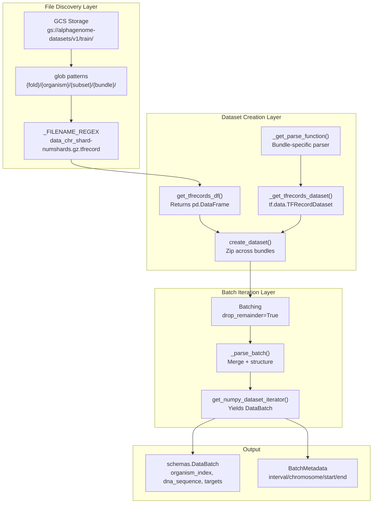
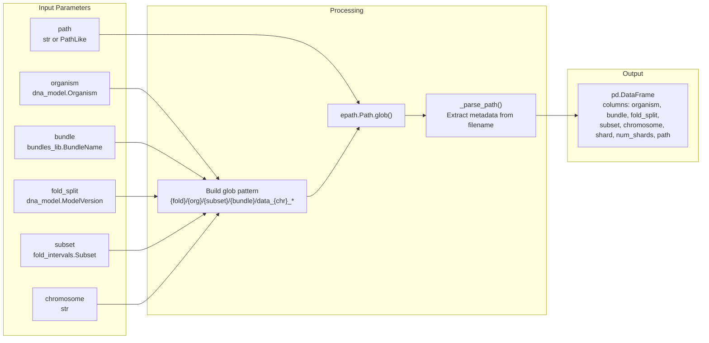
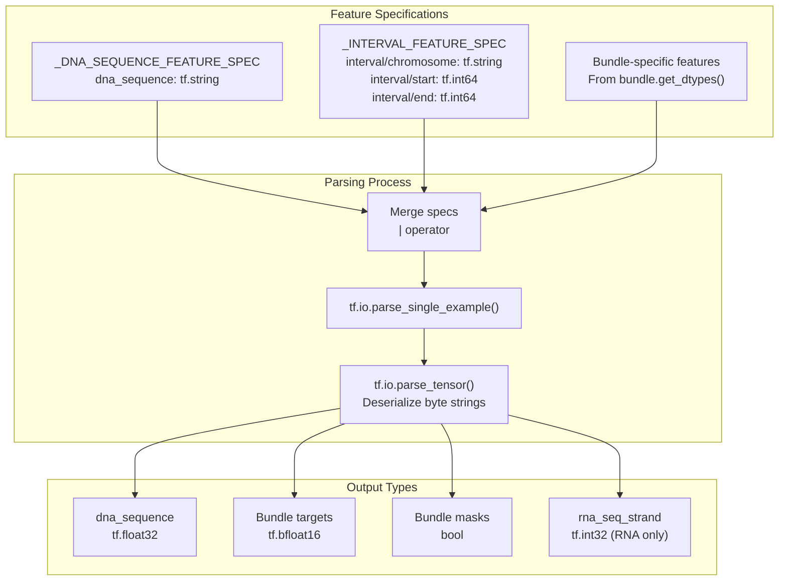
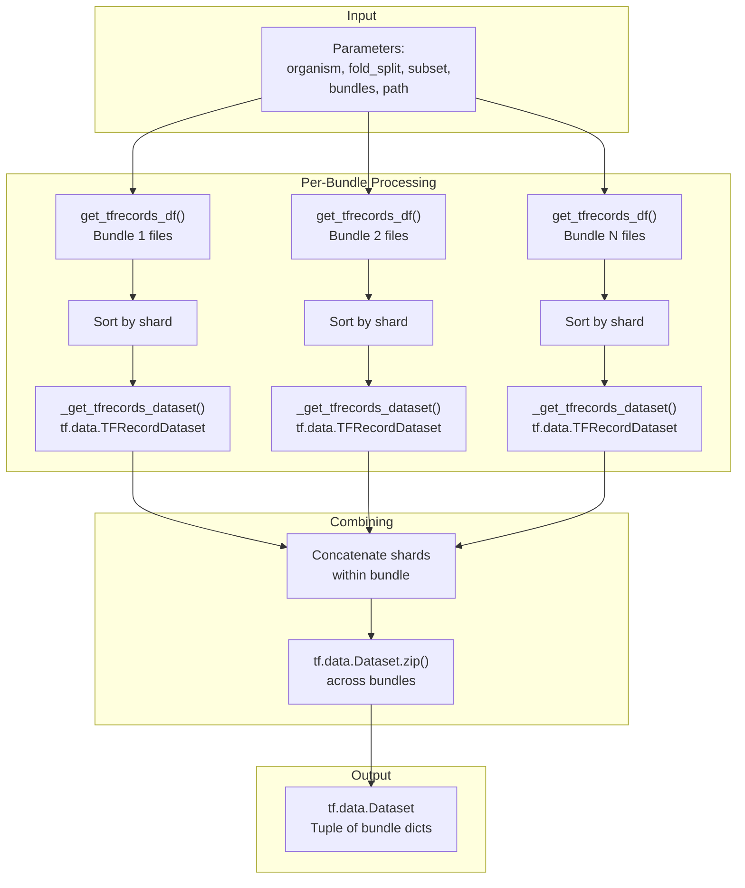
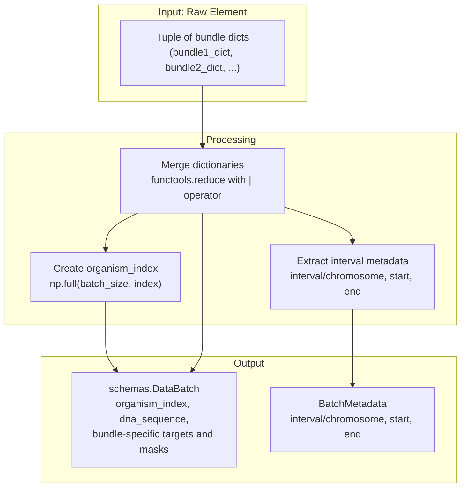
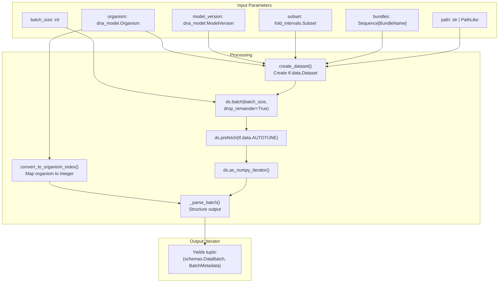

<!-- source: DeepWiki mcp.deepwiki.com · repo google-deepmind/alphagenome_research · page 3.2 TFRecord Dataset Loading · fetched 2026-10-26 -->

# TFRecord Dataset Loading

<details>
<summary>Relevant source files</summary>

The following files were used as context for generating this wiki page:

- [README.md](README.md)
- [src/alphagenome_research/io/dataset.py](src/alphagenome_research/io/dataset.py)
- [src/alphagenome_research/io/dataset_test.py](src/alphagenome_research/io/dataset_test.py)

</details>


## Purpose and Scope

This document describes the TFRecord dataset loading system, which provides functions to discover, load, and iterate over AlphaGenome training data stored in TFRecord files on Google Cloud Storage. The system handles file discovery, parsing, batching, and conversion to structured data formats for model training and evaluation.

For information about the data type definitions (bundles) that determine what fields are loaded, see [Bundle Definitions](#3.1). For information about how these datasets are used in model evaluation, see [Track Prediction Evaluation](#5.2).

---

## System Architecture

The TFRecord loading system consists of three main layers: file discovery, dataset creation, and batch iteration.



**Sources:** [src/alphagenome_research/io/dataset.py:1-256]()

---

## File Organization and Discovery

### Directory Structure

TFRecord files are organized in a hierarchical directory structure on Google Cloud Storage:

```
gs://alphagenome-datasets/v1/train/
├── {fold_split}/              # e.g., FOLD_0, FOLD_1, all_folds
│   └── {organism}/            # e.g., HOMO_SAPIENS, MUS_MUSCULUS
│       └── {subset}/          # e.g., TRAIN, VALID, TEST
│           └── {bundle}/      # e.g., ATAC, RNA_SEQ, DNASE
│               └── data_{chromosome}_{shard}-{num_shards}.gz.tfrecord
```

**Sources:** [src/alphagenome_research/io/dataset.py:56-92]()

### File Naming Convention

TFRecord filenames follow this pattern:
- `data_chr22_0-10.gz.tfrecord` - Chromosome chr22, shard 0 of 10 total shards
- `data_chr1_5-20.gz.tfrecord` - Chromosome chr1, shard 5 of 20 total shards

The filename regex pattern extracts:
- `chr` - Chromosome identifier
- `shard` - Current shard number (0-indexed)
- `num_shards` - Total number of shards

**Sources:** [src/alphagenome_research/io/dataset.py:56-58]()

### get_tfrecords_df Function



The `get_tfrecords_df()` function returns a DataFrame with one row per TFRecord file, containing:

| Column | Type | Description |
|--------|------|-------------|
| organism | str | Organism name (e.g., "HOMO_SAPIENS") |
| bundle | str | Bundle name (e.g., "ATAC", "RNA_SEQ") |
| fold_split | str | Fold split name (e.g., "FOLD_0") |
| subset | str | Subset name (e.g., "TRAIN", "VALID") |
| chromosome | str | Chromosome identifier (e.g., "chr1") |
| shard | int | Shard number (0-indexed) |
| num_shards | int | Total number of shards |
| path | str | Full path to the TFRecord file |

**Sources:** [src/alphagenome_research/io/dataset.py:61-119]()

---

## TFRecord Parsing

### Feature Specifications

The system defines three categories of feature specifications used by TensorFlow's `parse_single_example`:



**Fixed Features:**
- `dna_sequence` - Serialized tensor (shape: `[seq_len, 4]`, dtype: `float32`)
- `interval/chromosome` - String chromosome identifier
- `interval/start` - Int64 start position
- `interval/end` - Int64 end position

**Bundle-Specific Features:**
Determined dynamically via `bundle.get_dtypes()`, typically includes:
- `{bundle_name}` - Target values (e.g., `atac`, `rna_seq`)
- `{bundle_name}_mask` - Boolean mask indicating valid channels
- Additional fields like `rna_seq_strand` for RNA-seq data

**Sources:** [src/alphagenome_research/io/dataset.py:47-139]()

### Parse Function Creation

The `_get_parse_function()` creates a closure that:

1. Defines the complete feature specification by merging DNA, interval, and bundle-specific specs
2. Returns a parsing function that deserializes TFRecord proto examples
3. Converts serialized tensors back to their proper dtypes

```python
def _get_parse_function(bundle: bundles_lib.BundleName):
  feature_spec = (
      _DNA_SEQUENCE_FEATURE_SPEC
      | _INTERVAL_FEATURE_SPEC
      | {key: tf.io.FixedLenFeature([], tf.string) 
         for key in bundle.get_dtypes().keys()}
  )
  output_dtypes = bundle.get_dtypes() | {'dna_sequence': _DNA_SEQUENCE_DTYPE}
  
  def _parse(proto):
    example = tf.io.parse_single_example(proto, feature_spec)
    for key, dtype in output_dtypes.items():
      example[key] = tf.io.parse_tensor(example[key], dtype)
    return example
  
  return _parse
```

**Sources:** [src/alphagenome_research/io/dataset.py:121-139]()

---

## Dataset Creation Pipeline

### create_dataset Function

The `create_dataset()` function orchestrates the complete dataset creation process:



**Key Steps:**

1. **File Discovery**: Call `get_tfrecords_df()` for each bundle to get file paths
2. **Validation**: Ensure all bundles have the same number of files
3. **Sorting**: Sort files by shard number to ensure deterministic ordering
4. **Dataset Creation**: Create `tf.data.TFRecordDataset` for each bundle
5. **Concatenation**: Within each bundle, concatenate datasets from all shards
6. **Zipping**: Zip datasets across bundles so each element is a tuple

**Sources:** [src/alphagenome_research/io/dataset.py:160-208]()

### _get_tfrecords_dataset Function

Creates a dataset from a sequence of TFRecord file paths:

```python
def _get_tfrecords_dataset(
    paths: Sequence[str | os.PathLike[str]], 
    bundle: bundles_lib.BundleName
) -> tf.data.Dataset:
  parser = _get_parse_function(bundle)
  
  def _get(p):
    ds = tf.data.TFRecordDataset(p, compression_type='GZIP')
    ds = ds.map(parser, num_parallel_calls=tf.data.AUTOTUNE)
    return ds
  
  ds = _get(paths[0])
  for p in paths[1:]:
    ds_next = _get(p)
    ds = ds.concatenate(ds_next)
  return ds
```

Features:
- Uses GZIP compression for TFRecord files
- Parallel parsing with `tf.data.AUTOTUNE`
- Sequential concatenation of shards

**Sources:** [src/alphagenome_research/io/dataset.py:142-157]()

---

## Batch Processing and Iteration

### Batch Structure

After zipping datasets across bundles, each element is a tuple of dictionaries (one per bundle). The `_parse_batch()` function merges these into a structured format:



**Merging Logic:**
```python
if bundles is None:
  bundles = list(bundles_lib.BundleName)
if len(bundles) == 1:
  element = (element,)  # Wrap single bundle in tuple

merged_data = functools.reduce(lambda x, y: x | y, element)
```

**Sources:** [src/alphagenome_research/io/dataset.py:211-232]()

### get_numpy_dataset_iterator Function

The primary interface for consuming dataset batches:



**Configuration:**
- `drop_remainder=True` - Ensures all batches are the same size
- `prefetch(tf.data.AUTOTUNE)` - Overlaps data loading with computation
- Returns iterator yielding `(DataBatch, BatchMetadata)` tuples

**Sources:** [src/alphagenome_research/io/dataset.py:235-255]()

---

## Data Structures

### schemas.DataBatch

The primary output structure containing:

| Field | Type | Description |
|-------|------|-------------|
| `organism_index` | `np.ndarray[int32]` | Integer index of organism, shape `[batch_size]` |
| `dna_sequence` | `np.ndarray[float32]` | One-hot encoded DNA sequence, shape `[batch_size, seq_len, 4]` |
| Bundle fields | Various | Bundle-specific target arrays (e.g., `atac`, `rna_seq`) |
| Mask fields | `np.ndarray[bool]` | Bundle-specific masks (e.g., `atac_mask`, `rna_seq_mask`) |
| Auxiliary fields | Various | Additional bundle-specific metadata (e.g., `rna_seq_strand`) |

**Sources:** [src/alphagenome_research/io/dataset.py:216-232](), [src/alphagenome_research/model/schemas.py]()

### BatchMetadata

A dictionary containing genomic interval information for each example in the batch:

| Key | Type | Description |
|-----|------|-------------|
| `interval/chromosome` | `np.ndarray[str]` | Chromosome identifier, shape `[batch_size]` |
| `interval/start` | `np.ndarray[int64]` | Start position (0-indexed), shape `[batch_size]` |
| `interval/end` | `np.ndarray[int64]` | End position (exclusive), shape `[batch_size]` |

**Sources:** [src/alphagenome_research/io/dataset.py:45](), [src/alphagenome_research/io/dataset.py:226-230]()

---

## Usage Examples

### Basic Dataset Loading

```python
from alphagenome.data import fold_intervals
from alphagenome.models import dna_model
from alphagenome_research.io import bundles, dataset

# Create iterator for validation set
iterator = dataset.get_numpy_dataset_iterator(
    batch_size=8,
    organism=dna_model.Organism.HOMO_SAPIENS,
    model_version=dna_model.ModelVersion.FOLD_0,
    subset=fold_intervals.Subset.VALID,
    bundles=[bundles.BundleName.ATAC, bundles.BundleName.RNA_SEQ],
)

# Iterate over batches
for batch, metadata in iterator:
    # batch.dna_sequence: [8, seq_len, 4]
    # batch.atac: [8, seq_len, num_channels]
    # batch.rna_seq: [8, seq_len, num_channels]
    # metadata['interval/chromosome']: [8]
    process_batch(batch, metadata)
```

**Sources:** [src/alphagenome_research/io/dataset.py:235-255]()

### File Discovery

```python
import pandas as pd
from alphagenome.models import dna_model
from alphagenome_research.io import bundles, dataset

# Get metadata for all TFRecord files
df = dataset.get_tfrecords_df(
    organism=dna_model.Organism.HOMO_SAPIENS,
    bundle=bundles.BundleName.ATAC,
    fold_split=dna_model.ModelVersion.FOLD_0,
)

# Filter to specific chromosome
chr22_files = df[df['chromosome'] == 'chr22']
print(f"Found {len(chr22_files)} shards for chr22")
```

**Sources:** [src/alphagenome_research/io/dataset.py:61-119]()

### Custom Dataset Creation

```python
from alphagenome.data import fold_intervals
from alphagenome.models import dna_model
from alphagenome_research.io import bundles, dataset
import tensorflow as tf

# Create TensorFlow dataset
ds = dataset.create_dataset(
    organism=dna_model.Organism.HOMO_SAPIENS,
    fold_split=dna_model.ModelVersion.FOLD_0,
    subset=fold_intervals.Subset.TRAIN,
    bundles=[bundles.BundleName.ATAC],
)

# Apply custom transformations
ds = ds.shuffle(buffer_size=1000)
ds = ds.batch(16)
ds = ds.prefetch(tf.data.AUTOTUNE)

# Iterate with TensorFlow
for element in ds:
    # element is a tuple of dictionaries (one per bundle)
    process_tf_element(element)
```

**Sources:** [src/alphagenome_research/io/dataset.py:160-208]()

---

## Implementation Details

### Default Storage Path

The default path points to Google Cloud Storage:
```python
_DEFAULT_PATH = 'gs:///alphagenome-datasets/v1/train/'
```

Users can override this by providing a custom `path` parameter to any loading function.

**Sources:** [src/alphagenome_research/io/dataset.py:43]()

### Compression

All TFRecord files use GZIP compression:
```python
tf.data.TFRecordDataset(p, compression_type='GZIP')
```

**Sources:** [src/alphagenome_research/io/dataset.py:149]()

### Parallelism and Performance

The system uses TensorFlow's `AUTOTUNE` for automatic parallelism tuning:
- Parsing: `ds.map(parser, num_parallel_calls=tf.data.AUTOTUNE)`
- Prefetching: `ds.prefetch(tf.data.AUTOTUNE)`

**Sources:** [src/alphagenome_research/io/dataset.py:150](), [src/alphagenome_research/io/dataset.py:253]()

### Deterministic Ordering

Files are sorted by shard number before concatenation to ensure deterministic ordering across runs:
```python
dft = df[df['bundle'] == bundle].sort_values('shard')
```

**Sources:** [src/alphagenome_research/io/dataset.py:198]()

---

## Testing

The test suite (`dataset_test.py`) validates:

1. **File Discovery**: `test_get_tfrecords_df()` verifies correct parsing of directory structure
2. **Dataset Creation**: `test_create_dataset()` ensures proper concatenation and zipping
3. **Batch Iteration**: `test_get_numpy_dataset_iterator()` validates output structure
4. **Shuffling**: Tests that shuffling doesn't break the pipeline
5. **Multi-Bundle Loading**: Tests both single and multi-bundle scenarios

The tests create synthetic TFRecord files in a temporary directory with the proper structure and validate that all components correctly handle them.

**Sources:** [src/alphagenome_research/io/dataset_test.py:1-255]()

---

