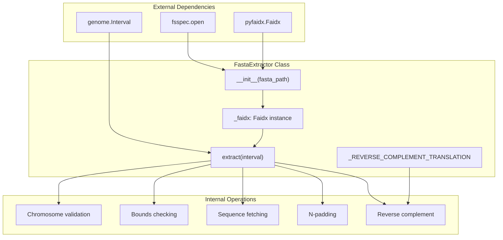
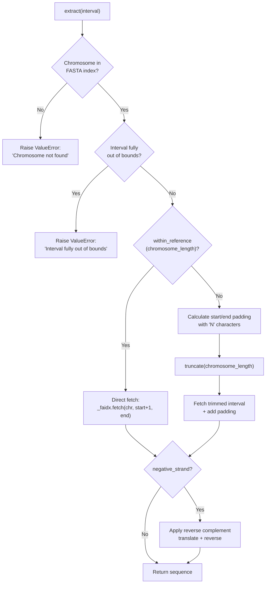
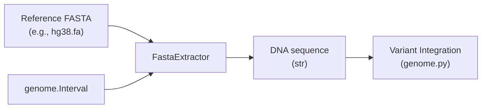

<!-- source: DeepWiki mcp.deepwiki.com · repo google-deepmind/alphagenome_research · page 3.3 FASTA File Operations · fetched 2026-10-26 -->

# FASTA File Operations

<details>
<summary>Relevant source files</summary>

The following files were used as context for generating this wiki page:

- [src/alphagenome_research/io/fasta.py](src/alphagenome_research/io/fasta.py)
- [src/alphagenome_research/io/fasta_test.py](src/alphagenome_research/io/fasta_test.py)
- [src/alphagenome_research/io/testdata/example.fa](src/alphagenome_research/io/testdata/example.fa)
- [src/alphagenome_research/io/testdata/example.fa.fai](src/alphagenome_research/io/testdata/example.fa.fai)

</details>


## Purpose and Scope

This document covers the FASTA file operations module, which provides functionality for extracting DNA sequences from reference genome FASTA files. The module is implemented in the `FastaExtractor` class and serves as a critical component in the Data I/O layer for accessing genomic reference sequences.

For variant integration operations that use extracted sequences, see [Variant and Genome Operations](#3.4). For broader context on the data loading pipeline, see [Data I/O System](#3).

**Sources:** [src/alphagenome_research/io/fasta.py:1-71]()

## FastaExtractor Class

The `FastaExtractor` class provides a high-level interface for extracting sequences from indexed FASTA files using the `pyfaidx` library underneath.

### Class Architecture



**Sources:** [src/alphagenome_research/io/fasta.py:26-71]()

### Initialization

The `FastaExtractor` is initialized with a path to a FASTA file:

```python
FastaExtractor(fasta_path: str | os.PathLike[str])
```

The constructor creates a `pyfaidx.Faidx` instance with the following configuration parameters:

| Parameter | Value | Purpose |
|-----------|-------|---------|
| `as_raw` | `True` | Returns sequences as raw strings without formatting |
| `mutable` | `False` | Prevents modification of the underlying file |
| `build_index` | `False` | Expects pre-existing `.fai` index file |
| `sequence_always_upper` | `True` | Returns sequences in uppercase |

The FASTA file path is opened through `fsspec.open()`, enabling support for both local and remote file systems.

**Sources:** [src/alphagenome_research/io/fasta.py:29-36]()

## Sequence Extraction

The core functionality is provided by the `extract()` method, which retrieves DNA sequences for specified genomic intervals.

### Extract Method Signature

```python
def extract(interval: genome.Interval) -> str
```

The method accepts a `genome.Interval` object and returns the corresponding DNA sequence as a string.

**Sources:** [src/alphagenome_research/io/fasta.py:38-70]()

### Extraction Workflow



**Sources:** [src/alphagenome_research/io/fasta.py:38-70]()

### Handling Out-of-Bounds Intervals

The extractor implements intelligent handling for intervals that extend beyond chromosome boundaries:

1. **Fully out-of-bounds**: If `interval.start >= chromosome_length` or `interval.end < 0`, a `ValueError` is raised.

2. **Partially out-of-bounds**: The sequence is padded with `'N'` characters:
   - **Start padding**: `'N' * max(-interval.start, 0)`
   - **End padding**: `'N' * max(interval.end - chromosome_length, 0)`
   - The valid portion is fetched using `interval.truncate(chromosome_length)`

**Example from tests:**
- `chr1:-10-1` returns `'NNNNNNNNNNT'` (10 N's + 1 valid base)
- `chr1:50-55:.` returns `'ANNNN'` (1 valid base + 4 N's, chromosome length = 51)

**Sources:** [src/alphagenome_research/io/fasta.py:52-65](), [src/alphagenome_research/io/fasta_test.py:34-36]()

### Strand Handling

The extractor supports both positive and negative strand extraction:

- **Positive strand** (`.` or `+`): Returns sequence as-is
- **Negative strand** (`-`): Applies reverse complement transformation

The reverse complement is computed using a translation table:

```python
_REVERSE_COMPLEMENT_TRANSLATION = str.maketrans('ATCGN', 'TAGCN')
```

The transformation: `sequence.translate(table)[::-1]`

**Test examples:**
- `chr1:0-9:+` → `'TAATATGCT'`
- `chr1:0-9:-` → `'AGCATATTA'` (reverse complement)

**Sources:** [src/alphagenome_research/io/fasta.py:23-70](), [src/alphagenome_research/io/fasta_test.py:31-32]()

## Coordinate System

The `FastaExtractor` handles the coordinate system conversion between:

- **Interval coordinates**: 0-based, half-open `[start, end)`
- **FASTA coordinates**: 1-based, closed `[start, end]`

The conversion is applied in the fetch call: `interval.start + 1` converts to 1-based indexing.

**Sources:** [src/alphagenome_research/io/fasta.py:56-64]()

## Error Handling

The extractor validates inputs and raises informative errors:

### Invalid Chromosome

```python
if (chromosome := self._faidx.index.get(interval.chromosome)) is None:
    raise ValueError(f'Chromosome "{interval.chromosome}" not found.')
```

**Test case:** Attempting to extract from non-existent chromosome `'foo'` raises `ValueError`.

**Sources:** [src/alphagenome_research/io/fasta.py:47-48](), [src/alphagenome_research/io/fasta_test.py:48-51]()

### Fully Out-of-Bounds Interval

```python
if interval.start >= chromosome_length or interval.end < 0:
    raise ValueError(f'Interval fully out of bounds. {interval=}')
```

**Test case:** `chr1:100-1000` (chromosome length = 51) raises `ValueError`.

**Sources:** [src/alphagenome_research/io/fasta.py:52-53](), [src/alphagenome_research/io/fasta_test.py:43-46]()

## Usage Patterns

### Basic Extraction

```python
from alphagenome.data import genome
from alphagenome_research.io import fasta

extractor = fasta.FastaExtractor('/path/to/reference.fa')
interval = genome.Interval('chr1', 1000, 2000)
sequence = extractor.extract(interval)
```

### Extraction with Strand Specification

```python
# Positive strand
interval_pos = genome.Interval.from_str('chr1:1000-2000:+')
seq_pos = extractor.extract(interval_pos)

# Negative strand (reverse complement)
interval_neg = genome.Interval.from_str('chr1:1000-2000:-')
seq_neg = extractor.extract(interval_neg)
```

**Sources:** [src/alphagenome_research/io/fasta_test.py:38-41]()

## Test Data

The module includes test data demonstrating its functionality:

### Test FASTA File Structure

| Chromosome | Length | Sequence |
|------------|--------|----------|
| `chr1` | 51 | `TAATATGCTATATATGATACAGATACAGATACAGATACAGATACAAAAAAA` |
| `chr2` | 78 | `GATACAGATACA...` (repeating GATACA motif) |

The corresponding `.fai` index file contains:
```
chr1    51    6    51    52
chr2    78    64   78    79
```

**Sources:** [src/alphagenome_research/io/testdata/example.fa:1-5](), [src/alphagenome_research/io/testdata/example.fa.fai:1-3]()

## Integration with AlphaGenome Pipeline

The `FastaExtractor` is used by variant integration operations to retrieve reference sequences before applying variant modifications:



The extracted sequences are then modified by `insert_reference_variant()` and `insert_alternate_variant()` functions to create variant-specific sequences for model prediction.

**Sources:** [src/alphagenome_research/io/fasta.py:1-71]()

## Dependencies

The `FastaExtractor` relies on the following external libraries:

| Library | Purpose |
|---------|---------|
| `pyfaidx` | Indexed FASTA file access |
| `fsspec` | Filesystem abstraction for local/remote files |
| `alphagenome.data.genome` | `Interval` data structure |

**Sources:** [src/alphagenome_research/io/fasta.py:17-21]()

## Performance Considerations

1. **Index Requirement**: The extractor expects a pre-existing `.fai` index file (`build_index=False`). This index must be generated beforehand using tools like `samtools faidx`.

2. **Immutable Access**: The `mutable=False` parameter ensures thread-safe read-only access to FASTA files.

3. **Memory Efficiency**: Sequences are fetched on-demand rather than loading entire chromosomes into memory.

**Sources:** [src/alphagenome_research/io/fasta.py:30-35]()

---

