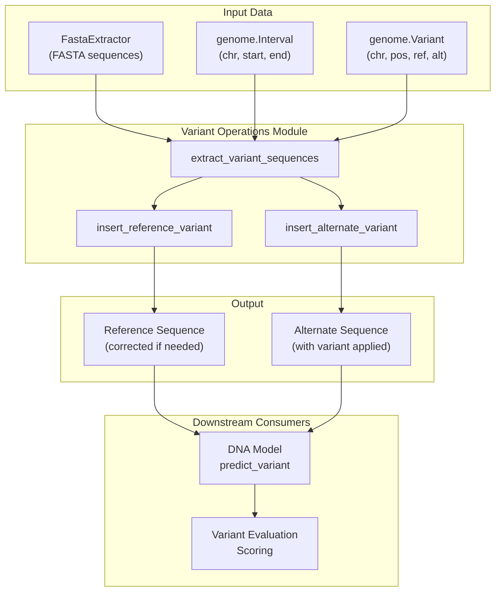
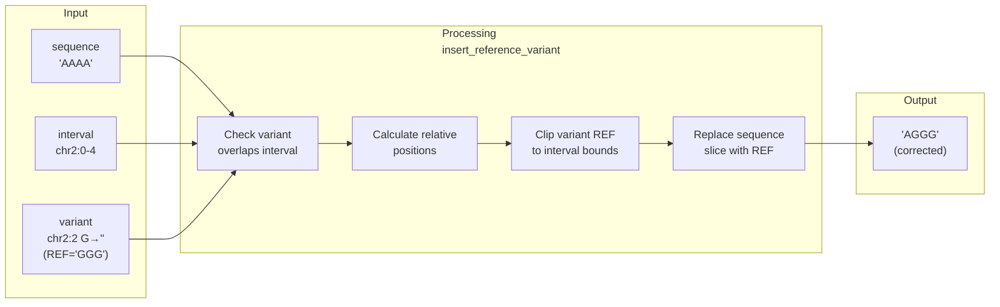
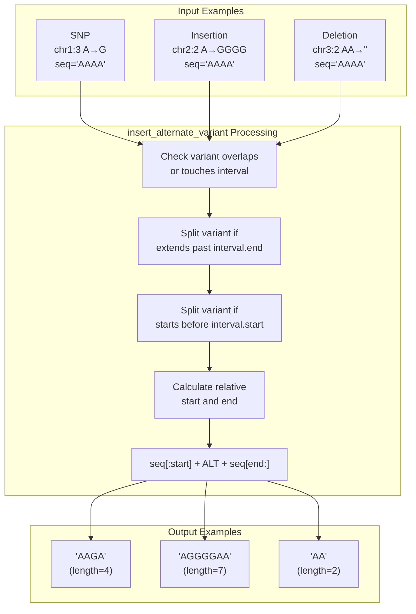
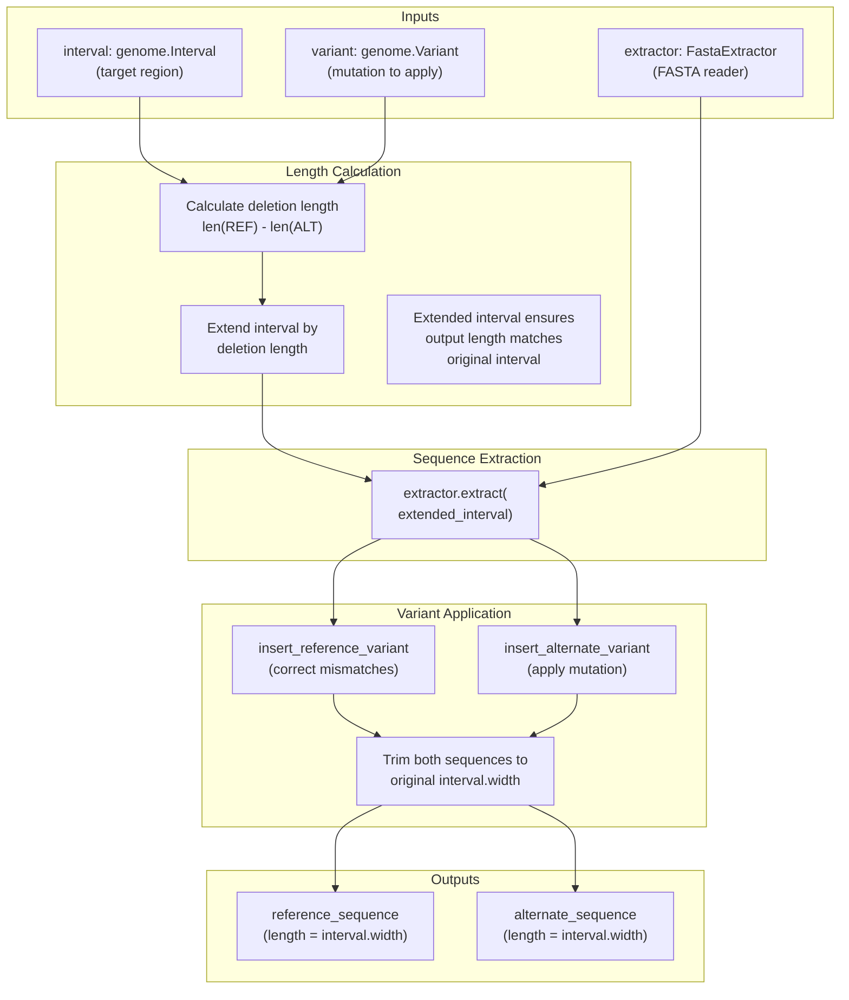
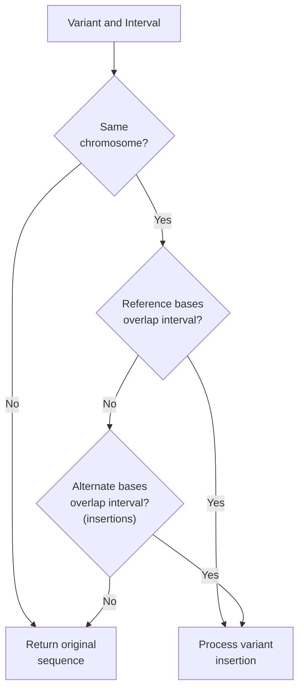
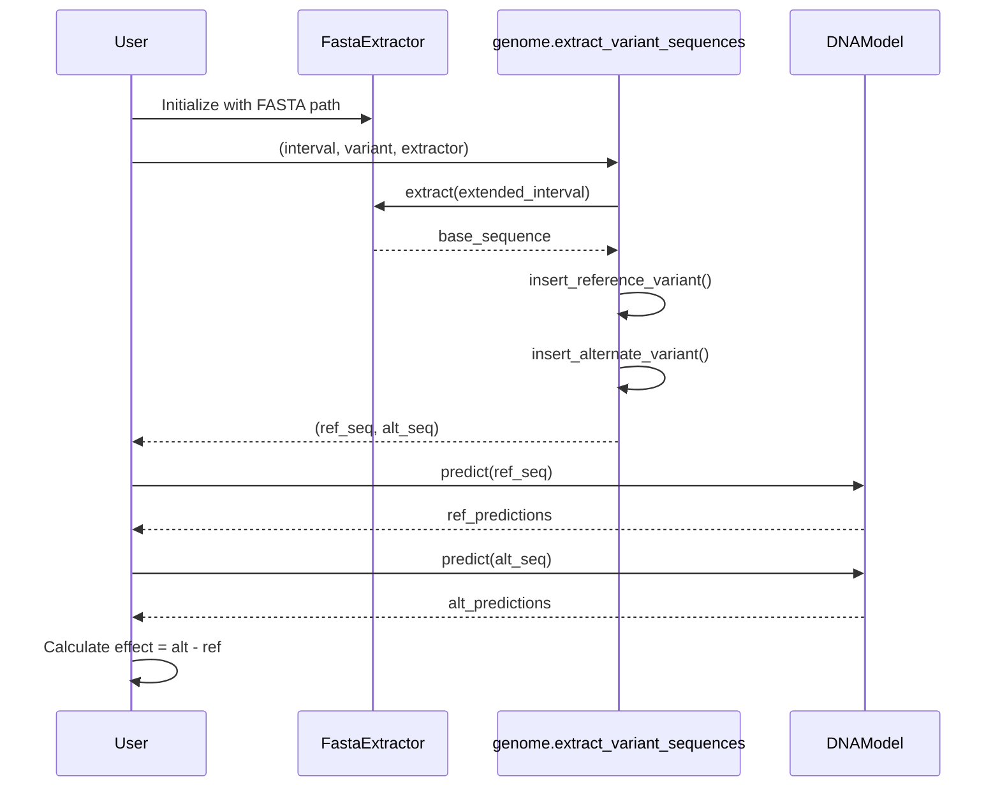

<!-- source: DeepWiki mcp.deepwiki.com · repo google-deepmind/alphagenome_research · page 3.4 Variant and Genome Operations · fetched 2026-10-26 -->

# Variant and Genome Operations

<details>
<summary>Relevant source files</summary>

The following files were used as context for generating this wiki page:

- [src/alphagenome_research/io/genome.py](src/alphagenome_research/io/genome.py)
- [src/alphagenome_research/io/genome_test.py](src/alphagenome_research/io/genome_test.py)

</details>


## Purpose and Scope

This document covers the variant integration functionality provided by the `genome.py` module in the Data I/O layer. This module provides utilities for integrating genetic variants into genomic sequences, enabling the generation of both reference and alternate sequence representations.

The core functionality allows you to:
- Insert reference variant bases into genomic sequences (correcting mismatches with the reference genome)
- Insert alternate variant bases to generate mutated sequences
- Extract paired reference/alternate sequences for variant effect prediction

For extracting sequences from FASTA files, see [FASTA File Operations](#3.3). For using these sequences with the model, see [DNA Model API](#4.1).

**Sources**: [src/alphagenome_research/io/genome.py:1-130]()

## Architecture Overview

The variant operations module serves as a transformation layer that bridges FASTA sequence extraction and model inference. It operates on genomic intervals and variants to produce sequences suitable for variant effect prediction.



**Sources**: [src/alphagenome_research/io/genome.py:15-130]()

## Core Data Types

The variant operations module relies on two primary data structures from the `alphagenome.data.genome` module:

| Type | Description | Key Attributes |
|------|-------------|----------------|
| `genome.Interval` | Genomic interval representing a region of interest | `chromosome`, `start`, `end`, `width` |
| `genome.Variant` | Genetic variant with reference and alternate alleles | `chromosome`, `start`, `end`, `reference_bases`, `alternate_bases` |

These types are imported from the core AlphaGenome data module and provide methods for overlap detection, splitting, and boundary operations.

**Sources**: [src/alphagenome_research/io/genome.py:17-19]()

## Variant Insertion Functions

### insert_reference_variant

The `insert_reference_variant` function replaces portions of a reference genome sequence with the variant's reference bases. This is useful when the reference genome sequence does not match the variant's expected reference allele.



**Function signature**: [src/alphagenome_research/io/genome.py:21-53]()

**Key behaviors**:
- Returns the original sequence unchanged if the variant does not overlap the interval
- Calculates relative positions within the interval boundaries [src/alphagenome_research/io/genome.py:41-42]()
- Clips variant reference bases to fit within the interval [src/alphagenome_research/io/genome.py:45-47]()
- Preserves the original sequence length [src/alphagenome_research/io/genome.py:49-53]()

**Sources**: [src/alphagenome_research/io/genome.py:21-53](), [src/alphagenome_research/io/genome_test.py:89-143]()

### insert_alternate_variant

The `insert_alternate_variant` function replaces reference genome sequence with the variant's alternate allele, producing the mutated sequence. Unlike `insert_reference_variant`, this function may change the sequence length due to insertions or deletions.



**Function signature**: [src/alphagenome_research/io/genome.py:56-92]()

**Key behaviors**:
- Handles variants that extend beyond interval boundaries by splitting them [src/alphagenome_research/io/genome.py:76-84]()
- Supports insertions (empty reference bases) that touch the interval [src/alphagenome_research/io/genome.py:72-73]()
- Output sequence length varies based on variant type (SNP=same, insertion=longer, deletion=shorter) [src/alphagenome_research/io/genome.py:88-92]()
- Returns original sequence if no overlap exists [src/alphagenome_research/io/genome.py:70-74]()

**Sources**: [src/alphagenome_research/io/genome.py:56-92](), [src/alphagenome_research/io/genome_test.py:26-87]()

## Sequence Extraction with Variants

### extract_variant_sequences

The `extract_variant_sequences` function provides a high-level interface for generating paired reference and alternate sequences. It handles FASTA extraction and applies both variant insertion functions to produce sequences of consistent length.



**Function signature**: [src/alphagenome_research/io/genome.py:95-129]()

**Key implementation details**:

1. **Deletion handling**: Extends the interval to compensate for sequence shrinkage [src/alphagenome_research/io/genome.py:111-119]()
   ```
   extended_length = max(0, len(REF) - len(ALT))
   extended_interval = interval.boundary_shift(end_offset=extended_length)
   ```

2. **Sequence extraction**: Uses `FastaExtractor` to retrieve the base sequence [src/alphagenome_research/io/genome.py:121]()

3. **Dual insertion**: Applies both reference and alternate variants [src/alphagenome_research/io/genome.py:122-129]()

4. **Length normalization**: Trims both outputs to the original interval width [src/alphagenome_research/io/genome.py:123-128]()

**Sources**: [src/alphagenome_research/io/genome.py:95-129](), [src/alphagenome_research/io/genome_test.py:145-207]()

## Edge Case Handling

The variant operations module handles numerous edge cases through careful position calculation and boundary checking:

| Edge Case | Handling Mechanism | Example |
|-----------|-------------------|---------|
| Variant does not overlap interval | Return original sequence unchanged | Different chromosomes [src/alphagenome_research/io/genome_test.py:70-75]() |
| Variant partially overlaps at start | Clip variant bases to interval bounds | [src/alphagenome_research/io/genome_test.py:112-117]() |
| Variant partially overlaps at end | Clip or split variant as needed | [src/alphagenome_research/io/genome_test.py:119-124]() |
| Insertion with empty reference | Check alternate overlap for pure insertions | [src/alphagenome_research/io/genome.py:72-73]() |
| Variant extends past interval.end | Split variant at interval boundary | [src/alphagenome_research/io/genome.py:76-79]() |
| Variant starts before interval.start | Split variant at interval start | [src/alphagenome_research/io/genome.py:81-84]() |

### Overlap Detection Logic



**Sources**: [src/alphagenome_research/io/genome.py:37-38,70-74](), [src/alphagenome_research/io/genome_test.py:26-143]()

## Integration with Model Inference

The variant operations module integrates directly with the DNA Model's prediction workflow. The typical usage pattern:



**Sources**: [src/alphagenome_research/io/genome.py:95-129]()

## Test Coverage

The module includes comprehensive test coverage for all variant types and edge cases:

| Test Category | Test Cases | File Reference |
|--------------|------------|----------------|
| `insert_alternate_variant` | Modification, Insertion, Deletion, No overlap, Overlap start/end, Different chromosomes | [src/alphagenome_research/io/genome_test.py:26-87]() |
| `insert_reference_variant` | Normal, Modified reference, No overlap, Overlap start/end, Different chromosomes | [src/alphagenome_research/io/genome_test.py:89-143]() |
| `extract_variant_sequences` | Normal, Modified reference, Insertion, Deletion, No overlap | [src/alphagenome_research/io/genome_test.py:145-207]() |

All tests use parameterized test cases with named scenarios to ensure comprehensive coverage of genomic variant types and position edge cases.

**Sources**: [src/alphagenome_research/io/genome_test.py:1-212]()

---

