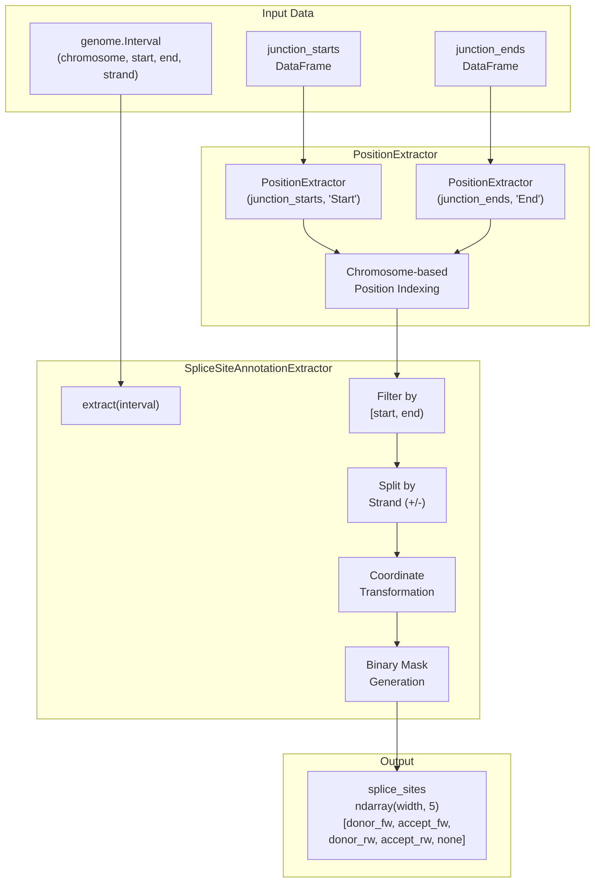
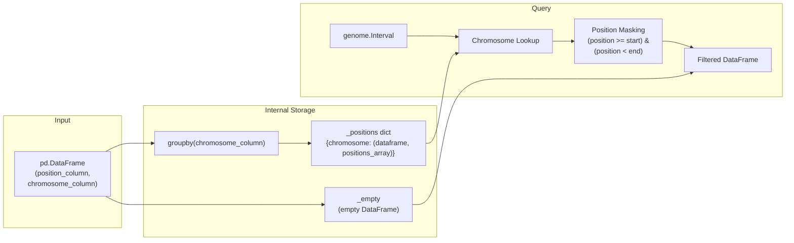
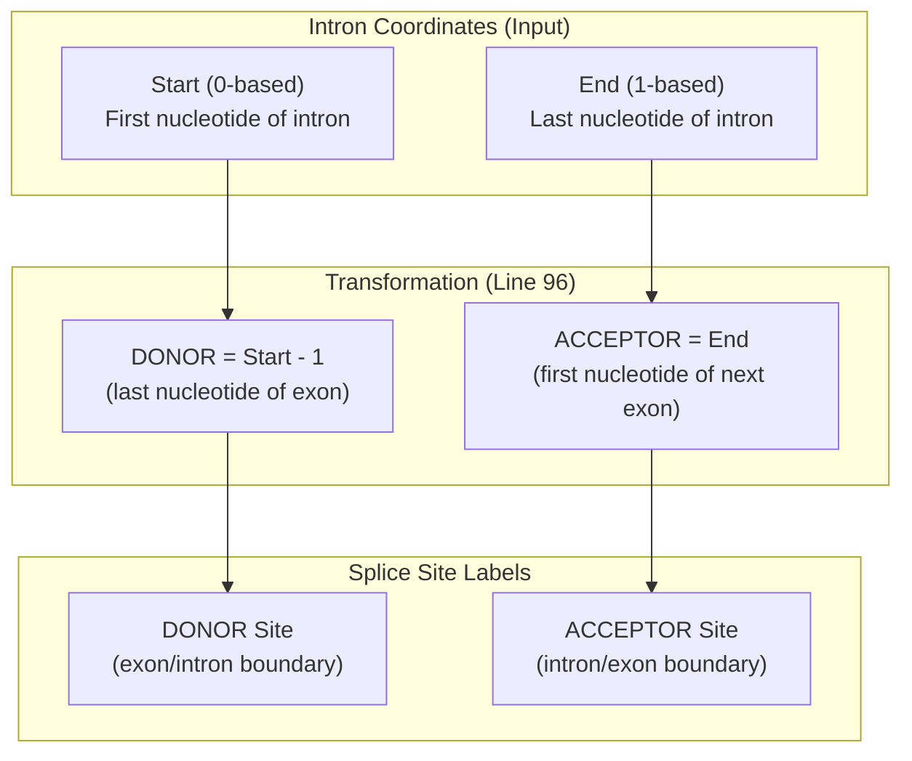
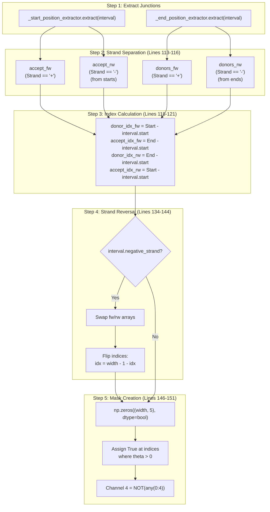
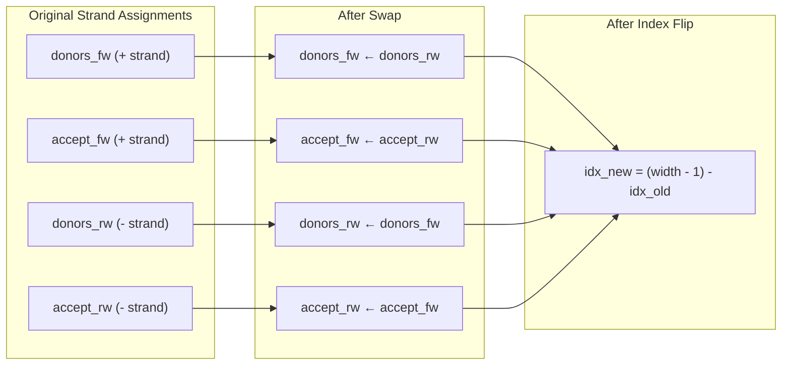
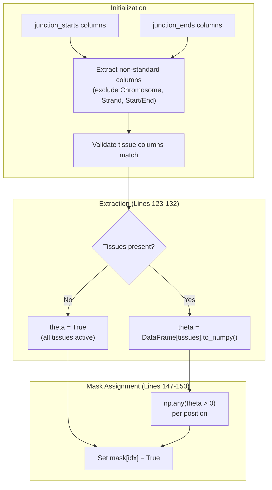
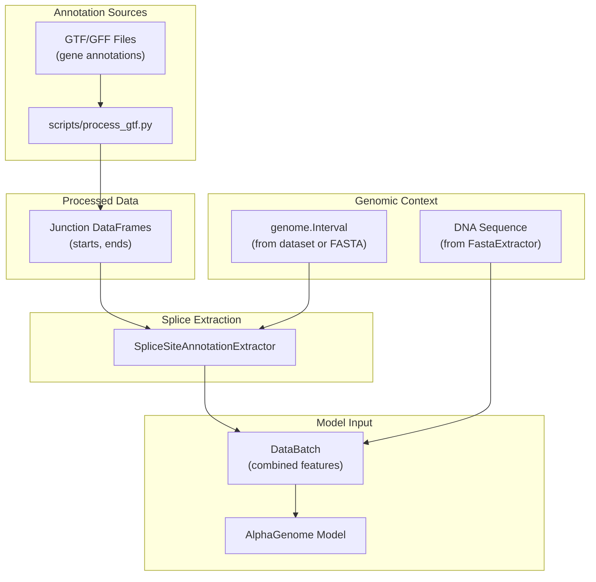

<!-- source: DeepWiki mcp.deepwiki.com · repo google-deepmind/alphagenome_research · page 3.5 Splice Site Annotations · fetched 2026-10-26 -->

# Splice Site Annotations

<details>
<summary>Relevant source files</summary>

The following files were used as context for generating this wiki page:

- [src/alphagenome_research/io/splicing.py](src/alphagenome_research/io/splicing.py)
- [src/alphagenome_research/io/splicing_test.py](src/alphagenome_research/io/splicing_test.py)

</details>


## Purpose and Scope

This document describes the splice site annotation system in AlphaGenome Research, which processes splice junction data and generates binary masks indicating donor and acceptor sites within genomic intervals. The system is part of the Data I/O layer and provides critical input features for splice-related model predictions.

For general data loading mechanisms, see [TFRecord Dataset Loading](#3.2). For information about genomic interval operations with sequences, see [FASTA File Operations](#3.3).

**Sources:** [src/alphagenome_research/io/splicing.py:1-154]()

## System Overview

The splice site annotation system consists of two primary extractors that work together to identify splice sites within genomic intervals:



**Sources:** [src/alphagenome_research/io/splicing.py:22-153]()

## PositionExtractor Class

The `PositionExtractor` class provides efficient position-based filtering for genomic intervals. Unlike interval-based extraction, this extractor focuses on single positions within semi-open intervals.

### Initialization and Data Structure



### Key Implementation Details

| Component | Description |
|-----------|-------------|
| **Interval Semantics** | Semi-open interval [start, end) |
| **Position Matching** | `position >= interval.start` AND `position < interval.end` |
| **Chromosome Indexing** | Pre-grouped by chromosome for O(1) lookup |
| **Empty Chromosome Handling** | Returns `self._empty` (empty DataFrame slice) |

The `extract` method performs filtering in constant time per chromosome:

```
extract(interval: genome.Interval) -> pd.DataFrame:
  1. Lookup chromosome in _positions dict
  2. If not found, return empty DataFrame
  3. Apply position mask: (position >= start) & (position < end)
  4. Return filtered rows
```

**Sources:** [src/alphagenome_research/io/splicing.py:22-60](), [src/alphagenome_research/io/splicing_test.py:100-112]()

## SpliceSiteAnnotationExtractor Class

The `SpliceSiteAnnotationExtractor` generates binary masks indicating the locations of splice donor and acceptor sites within genomic intervals, accounting for strand directionality and optional tissue-specific expression.

### Initialization

```python
SpliceSiteAnnotationExtractor(
    junction_starts: pd.DataFrame,  # Columns: Chromosome, Start, Strand, [tissues...]
    junction_ends: pd.DataFrame      # Columns: Chromosome, End, Strand, [tissues...]
)
```

#### Junction DataFrame Schema

| Column | Type | Description |
|--------|------|-------------|
| `Chromosome` | str | Chromosome identifier (e.g., "chr1") |
| `Start` | int | 0-based position of first nucleotide of intron |
| `End` | int | 1-based position of last nucleotide of intron |
| `Strand` | str | '+' (forward) or '-' (reverse) |
| `[Tissue_*]` | float | Optional tissue-specific expression values |

**Sources:** [src/alphagenome_research/io/splicing.py:62-100]()

## Coordinate System and Splice Site Definition

The system uses a specific coordinate transformation to convert intron boundaries to exon boundaries:

### Intron to Exon Boundary Mapping



The transformation logic at [src/alphagenome_research/io/splicing.py:91-96]() adjusts junction start positions:

```python
# Junctions describe intron intervals as [Start, End). Start point to the
# first nucleotide of the intron and End point to the first nucleotide of
# the next exon. We label DONOR the last nucleotide of the exon before the
# intron (so we move Start back by 1) and ACCEPTOR the first nucleotide of
# the exon after the intron (so End are not moved).
junction_starts.update(junction_starts['Start'] - 1)
```

**Sources:** [src/alphagenome_research/io/splicing.py:91-99]()

## Binary Mask Generation

The `extract` method generates a 5-channel binary mask with dimensions `(interval.width, 5)`:

### Mask Channel Definitions

| Channel | Index | Description |
|---------|-------|-------------|
| Donor (Forward) | 0 | Donor sites on forward strand |
| Acceptor (Forward) | 1 | Acceptor sites on forward strand |
| Donor (Reverse) | 2 | Donor sites on reverse strand |
| Acceptor (Reverse) | 3 | Acceptor sites on reverse strand |
| None | 4 | Positions without splice sites |

### Extraction Pipeline



**Sources:** [src/alphagenome_research/io/splicing.py:101-153]()

## Strand-Aware Processing

The extractor handles forward and reverse strand intervals differently to ensure the model sees data in a consistent orientation:

### Forward Strand ('+' or None)

For forward strand intervals:
- Donor sites from `junction_starts` (Strand == '+') → Channel 0
- Acceptor sites from `junction_ends` (Strand == '+') → Channel 1
- Donor sites from `junction_ends` (Strand == '-') → Channel 2
- Acceptor sites from `junction_starts` (Strand == '-') → Channel 3

### Reverse Strand ('-')

When `interval.negative_strand == True` ([src/alphagenome_research/io/splicing.py:134-144]()):

1. **Array Swapping**: Forward/reverse arrays are swapped because the model sees the reverse complement as forward strand
2. **Index Flipping**: All indices are flipped using `interval.width - 1 - idx` to account for sequence reversal



**Sources:** [src/alphagenome_research/io/splicing.py:134-144](), [src/alphagenome_research/io/splicing_test.py:70-78]()

## Tissue-Specific Annotations

The extractor supports optional tissue-specific expression data, allowing for tissue-aware splice site predictions.

### Tissue Column Handling



### Tissue Validation

The constructor validates that junction starts and ends have matching tissue columns ([src/alphagenome_research/io/splicing.py:82-89]()):

```python
self._tissues = [
    c for c in junction_starts if c not in ['Chromosome', 'Strand', 'Start']
]
ends_tissues = [
    c for c in junction_ends if c not in ['Chromosome', 'Strand', 'End']
]
if self._tissues != ends_tissues:
    raise ValueError('Tissues mismatch:', self._tissues, ends_tissues)
```

**Sources:** [src/alphagenome_research/io/splicing.py:82-89](), [src/alphagenome_research/io/splicing.py:123-132](), [src/alphagenome_research/io/splicing_test.py:44-48]()

## Usage Patterns

### Basic Splice Site Extraction

```python
import pandas as pd
from alphagenome.data import genome
from alphagenome_research.io import splicing

# Prepare junction data
junction_starts = pd.DataFrame({
    'Chromosome': ['chr1', 'chr1'],
    'Start': [1000, 2000],  # 0-based, first nucleotide of intron
    'Strand': ['+', '+']
})

junction_ends = pd.DataFrame({
    'Chromosome': ['chr1', 'chr1'],
    'End': [1500, 2500],    # 1-based, last nucleotide of intron
    'Strand': ['+', '+']
})

# Create extractor
extractor = splicing.SpliceSiteAnnotationExtractor(
    junction_starts, junction_ends
)

# Extract for genomic interval
interval = genome.Interval('chr1', 900, 3000, '+')
splice_mask = extractor.extract(interval)

# Result shape: (2100, 5)
# Channels: [donor_fw, accept_fw, donor_rw, accept_rw, none]
```

### Tissue-Specific Extraction

```python
# Add tissue expression data
junction_starts['Brain'] = [10.5, 8.2]
junction_starts['Liver'] = [2.1, 15.6]

junction_ends['Brain'] = [10.5, 8.2]
junction_ends['Liver'] = [2.1, 15.6]

extractor = splicing.SpliceSiteAnnotationExtractor(
    junction_starts, junction_ends
)

# Extraction uses tissue data for thresholding
splice_mask = extractor.extract(interval)
```

**Sources:** [src/alphagenome_research/io/splicing.py:34-60](), [src/alphagenome_research/io/splicing.py:65-100](), [src/alphagenome_research/io/splicing_test.py:26-81]()

## Integration with Data Pipeline

The splice site annotation system integrates with other Data I/O components:



The `SpliceSiteAnnotationExtractor` produces binary masks that are combined with other genomic features (sequences, variants, chromatin accessibility) to form complete model inputs. The extractor is typically instantiated once with pre-processed junction data, then used repeatedly to extract splice site annotations for different genomic intervals during model inference or evaluation.

**Sources:** [src/alphagenome_research/io/splicing.py:1-154]()

---

