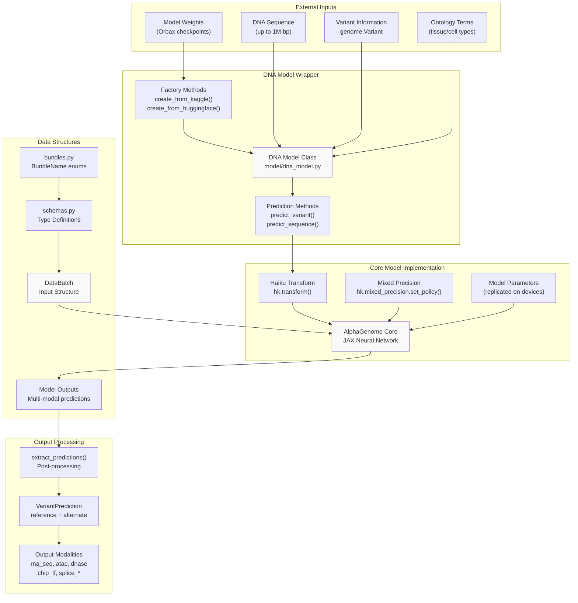
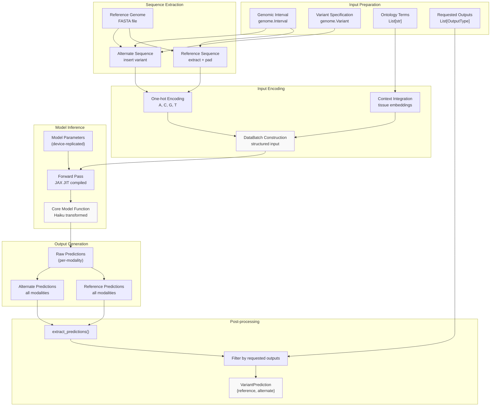
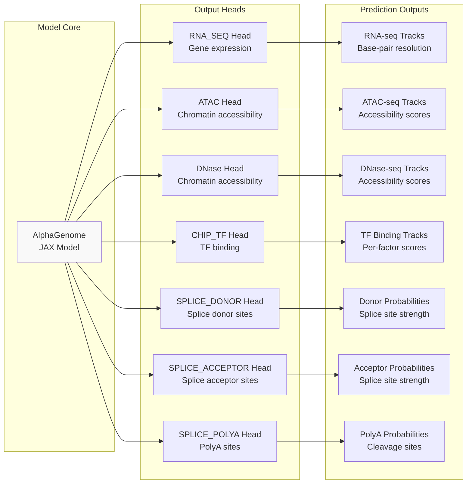
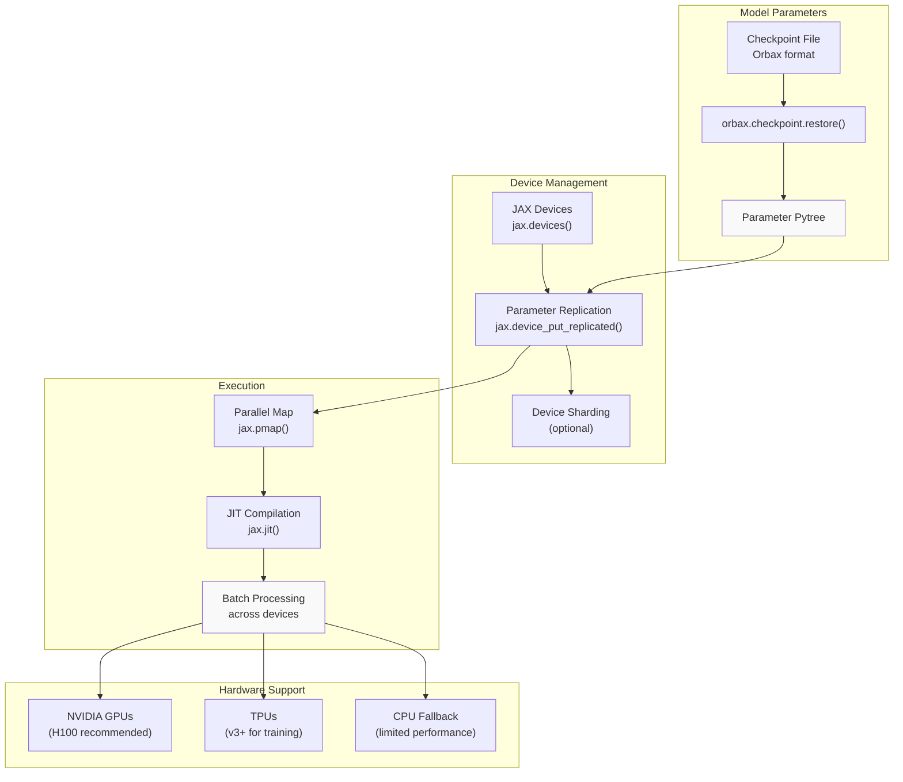
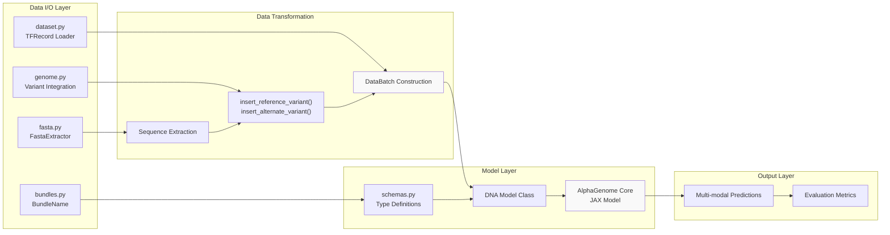
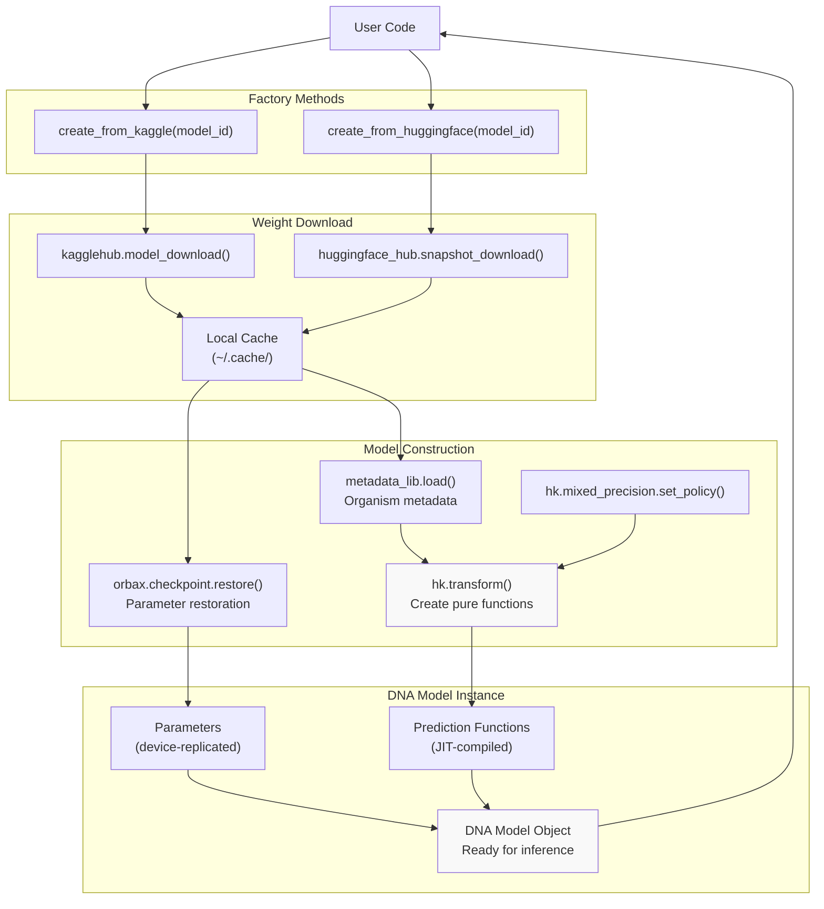

<!-- source: DeepWiki mcp.deepwiki.com · repo google-deepmind/alphagenome_research · page 4 Model Architecture · fetched 2026-10-26 -->

# Model Architecture

<details>
<summary>Relevant source files</summary>

The following files were used as context for generating this wiki page:

- [README.md](README.md)
- [src/alphagenome_research/model/__init__.py](src/alphagenome_research/model/__init__.py)

</details>


## Purpose and Scope

This document describes the AlphaGenome model architecture, including the JAX-based implementation, neural network components, data structures, and prediction pipeline. It covers the core model design, how DNA sequences are processed, and the various output modalities the model produces.

For information about the high-level DNA Model API for making predictions and scoring variants, see [DNA Model API](#4.1). For details on how the model is loaded from distribution platforms, see [Model Weights and Distribution](#2.3). For evaluation metrics and benchmarking, see [Evaluation System](#5).

## Overview

AlphaGenome is a unified DNA sequence model designed to predict regulatory variant effects across multiple genomic modalities. The model architecture is implemented in JAX and uses dm-haiku for neural network construction. It can process DNA sequences of up to 1 million base pairs and produces single base-pair resolution predictions for:

- Gene expression (RNA-seq)
- Splicing patterns (donor/acceptor sites)
- Chromatin accessibility (ATAC-seq, DNase-seq)
- Transcription factor binding (ChIP-seq)
- Chromatin contact maps

The architecture follows a three-layer design pattern:

1. **Core Model Layer**: JAX/Haiku neural network implementation
2. **Wrapper Layer**: DNA Model class providing high-level inference API
3. **Data Integration Layer**: Schemas and type definitions for inputs/outputs

Sources: [README.md:13-17](), [README.md:21-22]()

## System Architecture



**Figure 1: AlphaGenome Model Architecture Components**

This diagram shows how external inputs flow through the model layers. The DNA Model wrapper provides factory methods for loading weights and high-level prediction methods. The core JAX implementation uses Haiku transforms with mixed precision support. Data structures defined in schemas.py ensure type safety throughout the pipeline.

Sources: [README.md:80-95](), [README.md:100-138]()

## Core Components

### JAX and Haiku Implementation

The AlphaGenome model is implemented using JAX, a high-performance numerical computing library with automatic differentiation and XLA compilation. The neural network architecture is constructed using dm-haiku (Haiku), which provides a functional programming interface for building neural networks in JAX.

Key characteristics of the JAX/Haiku implementation:

| Component | Technology | Purpose |
|-----------|-----------|---------|
| Computation Framework | JAX | Automatic differentiation, JIT compilation, device parallelism |
| Neural Network Library | dm-haiku | Functional neural network construction and parameter management |
| Checkpoint Format | Orbax | Model weight serialization and restoration |
| Precision Policy | hk.mixed_precision | Mixed precision training and inference for efficiency |
| Device Support | CUDA/TPU | GPU acceleration (H100+) and TPU training (v3+) |

The Haiku `transform()` function converts stateful neural network code into pure functions that separate parameter initialization from forward pass computation. This functional approach enables efficient JAX transformations like `jit` (just-in-time compilation) and `pmap` (parallel map across devices).

Sources: [README.md:21-22](), [README.md:67-75](), [README.md:170]()

### Mixed Precision Support

The model supports mixed precision computation to optimize memory usage and inference speed. Mixed precision uses lower-precision (e.g., float16 or bfloat16) for most computations while maintaining critical operations in float32 for numerical stability.

The Haiku mixed precision policy (`hk.mixed_precision.set_policy()`) configures:
- Compute precision for layer operations
- Parameter storage precision
- Output precision for activations

This is particularly important for running on H100 GPUs and TPU accelerators where lower precision arithmetic provides significant performance benefits.

Sources: [README.md:67-71]()

### Data Structures and Schemas

The model uses strongly-typed data structures defined in `schemas.py` to ensure type safety and clear interfaces between components. These schemas define:

1. **Input Structures**: Format for DNA sequences, intervals, variants, and ontology terms
2. **Internal Representations**: Intermediate data formats used during model computation
3. **Output Structures**: Multi-modal prediction results with associated metadata

The `bundles.py` module defines the `BundleName` enumeration, which categorizes different output modalities:

- `ATAC`: ATAC-seq chromatin accessibility
- `DNASE`: DNase-seq chromatin accessibility  
- `RNA_SEQ`: Gene expression levels
- `CHIP_TF`: Transcription factor binding
- `SPLICE_DONOR`, `SPLICE_ACCEPTOR`, `SPLICE_POLYA`: Splicing predictions

Sources: [README.md:26]()

## Model Prediction Pipeline



**Figure 2: Model Prediction Pipeline Data Flow**

This diagram illustrates the end-to-end prediction pipeline from input preparation through output generation. The model performs dual predictions on both reference and alternate sequences, enabling variant effect quantification by comparing the outputs.

Sources: [README.md:100-138]()

### Prediction Methods

The DNA Model class provides several prediction methods:

| Method | Purpose | Inputs | Outputs |
|--------|---------|--------|---------|
| `predict_variant()` | Predict effect of a variant | Interval, Variant, Ontology terms, Output types | VariantPrediction (ref + alt) |
| `predict_sequence()` | Predict on sequence without variant | DNA sequence, Ontology terms, Output types | Model predictions |
| `score_variant()` | Compute variant effect score | Same as predict_variant | Numerical scores per modality |

The `predict_variant()` method is the primary interface, demonstrated in the quick start example:

```python
outputs = model.predict_variant(
    interval=interval,
    variant=variant,
    ontology_terms=['UBERON:0001157'],
    requested_outputs=[dna_model.OutputType.RNA_SEQ],
)
```

This returns a `VariantPrediction` object containing both reference and alternate predictions, allowing comparison to assess variant impact.

Sources: [README.md:97-138]()

## Output Modalities

The model produces predictions across multiple genomic modalities, each corresponding to different types of experimental data:



**Figure 3: Model Output Modalities**

Each output head produces predictions at single base-pair resolution across the input sequence window. The model can simultaneously predict across all modalities or be configured to output specific subsets.

### Modality Characteristics

| Modality | Resolution | Output Type | Use Case |
|----------|-----------|-------------|----------|
| RNA_SEQ | Per base | Continuous expression levels | Gene expression prediction, eQTL analysis |
| ATAC | Per base | Continuous accessibility scores | Chromatin state, regulatory element identification |
| DNASE | Per base | Continuous accessibility scores | Open chromatin regions, enhancer prediction |
| CHIP_TF | Per base, per TF | Continuous binding scores | Transcription factor binding sites |
| SPLICE_DONOR | Per base | Probability [0,1] | Donor splice site prediction, sQTL analysis |
| SPLICE_ACCEPTOR | Per base | Probability [0,1] | Acceptor splice site prediction |
| SPLICE_POLYA | Per base | Probability [0,1] | Polyadenylation site prediction |

Sources: [README.md:13-17]()

## Device Management and Parallelism

The model supports execution across multiple accelerators for efficient inference:



**Figure 4: Device Management and Parallelism**

The model parameters are replicated across available devices for parallel batch processing. JAX's `pmap` transformation enables data parallelism, where different examples in a batch are processed on different devices. JIT compilation optimizes the computation graph for the target hardware.

### Hardware Requirements

**Inference Requirements:**
- Minimum: NVIDIA H100 GPU with CUDA and cuDNN support
- Recommended: Multi-GPU setup for batch processing
- JAX installation with GPU support required

**Training Requirements:**
- Minimum: TPU v3 or higher
- Configuration for large-scale distributed training

The model leverages JAX's device abstraction to automatically utilize available accelerators. Users must ensure proper JAX installation with GPU/TPU support as documented in the [JAX installation guide](https://docs.jax.dev/en/latest/installation.html#nvidia-gpu).

Sources: [README.md:67-75]()

## Integration with Data I/O System

The model architecture integrates with the Data I/O system (see [Data I/O System](#3)) through well-defined interfaces:



**Figure 5: Model Integration with Data I/O**

The Data I/O layer provides sequence extraction and variant integration functions that produce properly formatted inputs for the model. The `DataBatch` structure, defined in schemas, ensures type consistency between data loading and model inference. Bundle definitions from `bundles.py` specify which output modalities to generate.

Sources: [README.md:26]()

## Model Loading and Initialization

The DNA Model class provides factory methods that abstract the complexity of loading model weights and initializing the JAX computational graph:

### Factory Method Flow



**Figure 6: Model Loading and Initialization Flow**

The factory methods handle:
1. Downloading weights from Kaggle or HuggingFace (requires acceptance of model terms)
2. Loading organism-specific metadata for proper configuration
3. Restoring checkpoint parameters using Orbax
4. Initializing the Haiku transform with mixed precision policies
5. Creating JIT-compiled prediction functions
6. Replicating parameters across available devices

Example usage:

```python
# Load from Kaggle
model = dna_model.create_from_kaggle('all_folds')

# Load from HuggingFace
model = dna_model.create_from_huggingface('all_folds')
```

Both methods return a fully initialized DNA Model instance ready for making predictions.

Sources: [README.md:54-63](), [README.md:84-95](), [README.md:171-176]()

## Summary

The AlphaGenome model architecture consists of:

1. **JAX/Haiku Core**: Functional neural network implementation with automatic differentiation and JIT compilation
2. **DNA Model Wrapper**: High-level API abstracting model complexity and providing intuitive prediction methods
3. **Type-Safe Data Structures**: Schemas ensuring consistency across data loading, model inference, and output processing
4. **Multi-Modal Output Heads**: Simultaneous predictions across RNA-seq, chromatin accessibility, TF binding, and splicing
5. **Device Management**: Support for multi-GPU and TPU execution with parameter replication and batch parallelism
6. **Distribution Infrastructure**: Factory methods for loading weights from Kaggle and HuggingFace

The architecture emphasizes:
- **Reproducibility**: Versioned checkpoints and metadata
- **Efficiency**: Mixed precision, JIT compilation, device parallelism
- **Usability**: Clean API separating low-level JAX operations from high-level prediction interface
- **Scalability**: Support for large sequences (up to 1M bp) and batch processing

For detailed information on using the DNA Model API, see [DNA Model API](#4.1). For evaluation workflows and metrics, see [Evaluation System](#5).

Sources: [README.md:13-31](), [README.md:67-75]()

---

